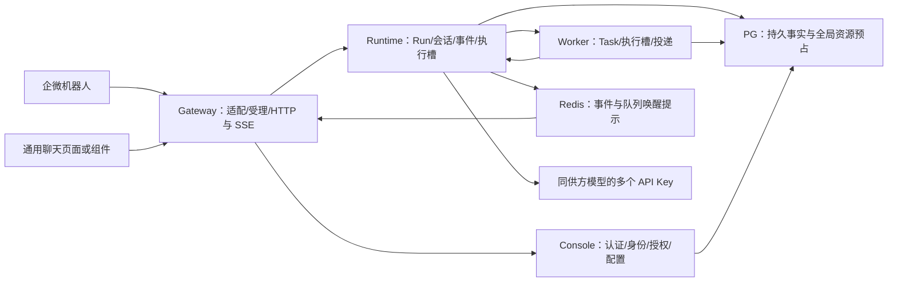
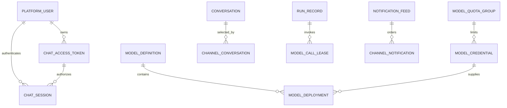

# Agent 并发容量与通用 Webchat 后端设计

> 文档编号：MOD-AGENT-CAPACITY-WEBCHAT
> 版本：v0.6
> 创建日期：2026-10-16
> 状态：v0.6 评审稿；补齐业务/资源/启动/验收配置清单及默认值、生效边界；本轮重新核验 Design Gate，产品实现与容量验收尚未执行
> 来源：本会话已经完成的架构讨论，无独立 PRD；旧 OpenClaw Webchat 文档仅提供产品参考。
> 前端契约：同目录 `agent-capacity-webchat.frontend.design.md`。

## 1. 文档控制

### 1.1 已确认的设计输入

- D-01：保留 Console / Gateway / Runtime / Worker 四个部署单元；生产基线 Console 一个 Pod、Gateway 一个 Pod，Runtime/Worker 使用共享执行池。
- D-02：本轮以每个 Agent 使用一个企微机器人验证容量；不新增多机器人分配、入口迁移或连接分片功能，也不删除仓库已有的一对多绑定能力。
- D-03：优化模型资源使用、执行并发、持久事件分发、数据库连接与共享制品存储；Pod 数量由固定资源规格下的压测得出，不采用此前讨论中的假设数字作为承诺。
- D-04：增加通用 WEBCHAT，HTTP 提交、SSE 订阅；认证与聊天能力分离，后续接入业务平台时复用聊天组件和执行接口。
- D-05：企微和网页入口拥有独立 Conversation/Run，可以同时处理不同内容；身份与 Agent 授权复用。长期记忆沿用已有 tenant/user 作用域，不在本需求中变更成按入口或 Agent 隔离。
- D-06：本轮不实现 MSSW/MSSP JWT 验证器，不信任浏览器提交的 user-id，不增加第五个微服务，不复刻 OpenClaw 的固定 Pod、exec 派发、SQLite 镜像和会话路由。
- D-07：同一 Agent 使用同一家供应商，模型扩容重点是多个有效 API Key；同一模型配置内按调用分配 Key，不把会话绑定到 Key。多个 Key 的容量按真实独立/共享额度核算。
- D-08：允许模型/工具资源不足时有界排队；两入口及时反馈已受理、排队原因、执行和失败状态，支持取消与等待超时，不显示未经测量的预计时间或准确名次。
- D-09：首期由 Console 为已有 platform_user 签发随机 Webchat Token，用户在聊天页面输入一次后建立独立 CHAT Cookie 会话；无需注册、密码或 Console 管理账号。Token 默认 30 天、CHAT 会话默认 12 小时，均可配置，后者不得超过 Token 到期时间；撤销/重置 Token 同时撤销关联登录会话，历史对话保留。业务平台 JWT 验签/解密后续接入相同身份端口。
- D-10：Webchat 采用左侧历史会话/新建入口、右侧消息与输入的布局；同一用户同一网页入口可以保留多个 Conversation，查看历史并在原会话继续聊天。消息与上下文复用既有 PG 数据，不新增 Webchat 消息镜像。
- D-11：用户要求可调参数明确抽为配置项；业务默认、模型资源额度、每进程资源预算和压测输入各有唯一归属，列明类型/单位/默认值/范围/生效边界；正确性规则不做绕过开关。

### 1.2 本轮确认与待实测参数

| 编号 | 议题 | 已确认结论 | 设计落点 |
|---|---|---|---|
| Q-01 已闭合 | 模型资源池 | 同供方的多 API Key 是重点；会话保持确定模型语义，同一模型内按请求分配 Key | §3.1 ADR-03/04、§3.3、§3.4 API-01/02 |
| Q-02 已闭合 | 1000 并发口径与反馈 | 1000 用户的 Run 可以处于已受理等待/执行状态；资源不足允许有界等待，并明确反馈状态 | §2.5 S-01/S-09/E-09、§3.2、§3.4 API-06/07 |
| Q-03 已闭合 | 通用 Webchat 认证 | 用户确认采用 Console 签发的随机用户 Token；认证后复用 platform_user 与已有授权，首期不建设通用 JWT 认证方/身份映射 | §3.3 Token/会话、§3.4 API-03/04/13 |
| OPEN-01 已闭合 | 首期用户如何进入聊天 | 管理员在用户详情签发 Token 并交付用户；用户打开 /chat 输入 Token，换取独立聊天 Cookie；不信任自报 user-id | FEAT-04/05 首次访问闭环，前端 TokenAccess/bootstrap |
| Q-04 已闭合 | Token 与聊天登录会话有效期 | 用户确认 Token 默认 30 天、CHAT Cookie 会话默认 12 小时，均可配置；Cookie 到期重新输入仍有效 Token，Token 到期由管理员重签；不删除历史对话 | §3.4 有效期与撤销，S-16、E-20、B-08 |
| Q-05 已闭合 | 可调参数的归属 | 按用户要求形成配置契约，复用系统设置与资源实体；进程/部署预算在启动配置，负载与SLO在验收配置 | §3.7、S-17、E-21、B-09、S-F15 |

队列/等待等运行参数已有§3.7的类型与起始默认值；生产额度、Pod资源和SLO属于显式部署/验收输入，真实吞吐及副本数属于测量结果。配置默认值不代表生产已达标，不能把“1000个已受理Run”当作“1000路模型同时推理”的证据。

### 1.3 当前实现证据

| 位置 | 当前事实 | 设计承接 |
|---|---|---|
| `application/channel_admin_service.py`；`tests/console_platform/test_agent_channels_api.py:63` | 已支持同 Agent 多 bot | 保留现状，本轮不扩展多 bot 产品能力 |
| `infrastructure/models/control.py::AgentDefinition` | 显式单 `model_id` | model_id 确定模型语义，下挂多个 API Key 成员；密钥分配不改变模型身份 |
| Runtime `async_tools/supervisor.py` | 无执行总槽位上限 | 容量准入与 PG claim 一起监督 |
| Worker `worker/service.py` | 一个循环等待一次执行完成再领取下一条 | 有界执行池，回收独立运行 |
| Runtime `run_service.py::_tail_events` | 每条流每 0.5 秒分别读取持久事件和 Run | 提交后通知、共享追尾、低频补偿 |
| Gateway `application/inbound.py` | 持流期间占处理槽；按 bot/user 串行，未显式传 conversation_id | 受理/订阅分离，按入口选择会话 |
| `ConsoleAccount` / `PlatformUser`；`ConsoleSession` / `api/security.py` | 管理登录主体与 Agent 用户分离，管理会话已有 PG 摘要/HttpOnly Cookie/CSRF 机制；尚无用户 Webchat Token | 复用处理机制，新增面向 platform_user 的 Token 与独立 CHAT 会话；不复用管理账号身份或会话行 |
| `infrastructure/models/runtime.py::Conversation/RunRecord/CanonicalEvent` | 已有会话/title/last_seq/last_run_id、逐轮 Run、USER_MESSAGE/ASSISTANT_MESSAGE/CONTEXT_SUMMARY 等持久数据 | 复用存储，补入口归属、列表索引和安全消息投影 |
| `run_service.py::create_conversation/_resolve_conversation`；`context_builder.py::load_history` | 已支持幂等新会话、显式 conversation_id 和 DB 摘要/事件重建 | 历史续聊传原 conversation_id 新建一轮 Run，不从浏览器拼接模型历史 |

## 2. 需求分析

### 2.1 需求概述

在保留四单元和 PG 权威状态的基础上，面向 1000 用户并发目标建立可测量、可约束、可扩容的执行与推送链路；交付通用 Webchat 页面/客户端，普通用户输入 Console 签发的 Token 即可使用已有 Agent 授权。首期无注册/密码体系，未来业务平台认证接入统一主体端口。

### 2.2 痛点与用户场景

- US-01：用户希望高峰期请求被可靠受理，看到等待/执行/失败的真实状态。
- US-02：同一用户希望在企微和网页同时处理不同内容，停止或确认其中一项不影响另一项。
- US-03：管理员希望用同供方多个 API Key 提供同一 Agent 能力，并了解各 Key 的负载、限流和调用结果。
- US-04：普通聊天用户希望输入管理员提供的 Token 使用已授权 Agent，并在重连或重新认证后恢复原会话、回复与附件。
- US-05：运维希望通过真实容量报告决定 Runtime/Worker 副本数，并单独评估机器人瓶颈。
- US-06：后续业务平台希望接入已有聊天组件，只扩展认证、身份关联和登录生命周期。
- US-07：用户希望在网页查看历史会话、新建独立会话，并重新打开任一可用历史会话继续聊天；切换页面不取消后台运行。

### 2.3 功能方案

| 功能 | 描述 | 优先级 | 来源 |
|---|---|---|---|
| FEAT-01 | 同供方模型的多 API Key 池、逐请求分配、共享额度及逐次调用审计 | P0 | US-03、需求讨论 |
| FEAT-02 | Runtime 执行槽、Worker 有界执行池、独立回收和公平领取 | P0 | US-01、US-05 |
| FEAT-03 | PG 持久事件、提交后唤醒、共享追尾、有界订阅和游标恢复 | P0 | US-01、US-04 |
| FEAT-04 | 用户 Token 签发/交换、30 天/12 小时可配置有效期、关联登录会话撤销及现有 Agent 授权；保留统一主体端口 | P0 | US-04、US-06、D-09、Q-04 |
| FEAT-05 | WEBCHAT 通道账号、适配器注册、HTTP 受理与 SSE | P0 | US-04、US-06 |
| FEAT-06 | 按入口隔离当前会话、精确 Run 取消/确认、来源路由投递 | P0 | US-02 |
| FEAT-07 | 上传、下载、历史和离线通知，复用 Artifact Store 与 canonical | P0 | US-04 |
| FEAT-08 | typed启动/部署/验收配置、连接预算、资源、指标、分层压测和容量报告 | P0 | US-05、D-11 |
| FEAT-09 | 管理界面的多Key/额度组、用户Token、容量/等待/网页设置，含类型/范围/版本与生效说明 | P0 | US-03、US-04、D-11 |
| FEAT-10 | 网页会话列表、标题、选择/新建、分页历史与原会话续聊 | P0 | US-07、D-10、用户截图 |

### 2.4 范围与边界

范围包括以上功能的控制面、Gateway、Runtime/Worker、前端与真实验收，含网页历史会话列表和续聊。业务平台的具体 JWT/OIDC 接入、跨域嵌入的最终部署配置、不同型号模型自动替换、多机器人自动分用户不在本次已确认范围。

普通用户共享身份与授权，首期采用随机用户 Token 换取 CHAT 会话；不建聊天密码表、密码找回或用户注册，不建设 JWT 认证方、公钥管理、subject 映射或签发 CLI。未来业务 JWT 验证后仍归一到已有 platform_user，不提前实现未知协议。供方相同不能证明不同型号可无条件互换，跨型号自动替换不在本轮范围；按 Key 分配保持本次调用的 model/参数不变。内部认证服务调用不等于回调外部业务平台。

### 2.5 验收条件

**设计约束**

| 规则 | 约束 | 场景 |
|---|---|---|
| RULE-01 | Runtime/Worker 的执行身份只来自 PG claim；HTTP 断开不取消执行 | S-03、E-02 |
| RULE-02 | 受理持久化后才返回 202；同 key 同输入回放，异输入冲突 | S-01、E-01 |
| RULE-03 | 两入口共享真实用户与授权，独立对话和 Run 控制；后台结果回原入口 | S-02、E-03 |
| RULE-04 | 只能在冻结的逻辑模型及兼容成员范围中分配实例 | S-04、E-04 |
| RULE-05 | 用户/租户从受验证主体确定；Gateway 不持库 | S-05、E-05 |
| RULE-06 | 压缩失败保留原文；记忆提炼失败不改主 Run 终态；退化必须可观测 | E-06 |
| RULE-07 | 产品内提示、工具调用、系统事件和原始推理不能通过聊天历史接口泄露 | S-06、E-05 |
| RULE-08 | 队列容量有界，持久受理后可查询/取消；超时有终态，状态反馈不作为模型正文 | S-09、E-09 |
| RULE-09 | Console 随机 Token 绑定已有用户，验证后建立 PG CHAT 会话；30 天/12 小时可配置且会话期限不越过来源 Token；撤销/重置关联失效，不授予管理权限或删除聊天历史 | S-05、S-16、E-10、E-20、B-08 |
| RULE-10 | Webchat 消息显式绑定所选 conversation_id；切换/新建不取消其他会话的 Run，续聊复用 DB 上下文；同会话最多一个活跃 Run | S-10、S-11、E-11 |
| RULE-11 | 配置每项只有一个权威源，typed校验与跨字段约束在后端执行；新操作策略冻结，实时容量只应用递增版本，启动预算需重启；前端只消费非敏感白名单投影 | S-17、E-21、B-09、S-F15 |

**正常与异常场景，均由本需求闭合**

| 场景 | 功能 | 层级 | 不得 mock 的真实边界 | 输入与最终可观测结果 |
|---|---|---|---|---|
| S-01 | 02、03、05、08 | E2E | 真实 HTTP Gateway→Runtime→PG；模型可为真实 HTTP 受控探针 | 配置接纳 1000 不同用户各一个 Run；确认持久受理、可见等待/执行、最终进展、无跨用户事件；执行不超模型/工具容量，排队不冒充同时推理 |
| S-02 | 04、05、06、07 | E2E | 真实企微协议探针、浏览器、Gateway、Runtime、Worker、PG/Redis | 同用户机器人查告警、网页分析文档；两个 Conversation 独立执行，停止一个不影响另一个，附件/Task 结果回原入口 |
| S-03 | 02、03、06 | E2E | 两个 Runtime 实例、PG、真实 SSE、故障进程 | 断开重连并替换订阅实例，游标无缺口/重复渲染，不重建 Run/工具 |
| S-04 | 01、08 | E2E | 多 Runtime、同模型多 Key HTTP 探针、实际额度存储和审计 | 等权等容量且无失败的空闲池分配请求时，累计预占次数的最大差≤1；异容量/长短请求验证容量和额度上限，同会话可用不同 Key 且 model/上下文一致 |
| S-05 | 04、09 | E2E | 管理员/普通用户真实浏览器、Console Token 签发/交换、PG、Gateway | ADMIN 在已有用户详情生成 Token，用户打开 /chat 输入后仅见获授权 Agent；刷新 Cookie 恢复；无需注册/密码/管理账号，聊天会话不能进入管理 API，注销仅撤销本登录会话 |
| S-06 | 03、07、10 | E2E | canonical、共享卷、Gateway、真实浏览器 | 初次加载最近50条可见消息，可分页查看超过200条的保留历史；附件下载核属；确认 prompt 仅回所属用户；刷新恢复且不暴露工具/系统内容 |
| S-07 | 02、07 | E2E | Worker 多实例、实际 Skill 子进程组、PG、投递链路 | 并发任务分别续租；取消杀整组；崩溃任务按租约接管；离线结果持久入箱后可重开读取 |
| S-08 | 01、09 | E2E | Console 管理界面、PG、Runtime 实际模型请求 | 修改成员和权重只影响后续配置快照；旧 Run 沿用冻结语义；调用明细能追溯实际实例，无密钥 |
| S-09 | 02、03、05 | E2E | 企微协议探针、真实浏览器/SSE、PG、受控模型与 Worker | 故意耗尽 Runtime/模型/工具容量，两入口及时显示所处阶段；资源恢复后原 Run 继续，状态不混进助手正文；刷新后恢复排队原因和开始时间 |
| S-10 | 06、07、10 | E2E | 真实浏览器、Gateway、Runtime、PG 与捕获模型 HTTP 输入的探针 | 在冻结记忆注入关闭的测试配置下，A 含局部标记而新建 B 不带 A 历史；打开 A 追问，模型请求含 A 的 DB 历史/摘要；conversation_id 不变且产生新 Run，B 无该轮消息；用户级长期记忆共享另按既有契约验收 |
| S-11 | 02、03、10 | E2E | 两浏览器页面、两个 Runtime、PG、真实 SSE 和等待中的模型探针 | A 运行时切换 B 不取消 A；切回恢复 A 已落库增量与状态，不从历史页水位跳过当前 Run 的正文；同一会话两端同时发送仅一个新 Run 受理，另一端显示忙碌/原 Run |
| S-12 | 01、09 | E2E | 两个 Runtime、主模型/摘要/记忆任务、Console 探针和真实 HTTP Key 计数服务 | 多个模型成员引用同一 credential_id，所有调用合并占用；一个 Key 不因多成员/多进程增加容量；供方额度、工作负载份额与尝试审计均可核对 |
| S-13 | 03、07、10 | E2E | 浏览器、PG、真实 Run/Worker 投递与提交后故障注入 | 用户查看 B 时 A 完成或待确认，活动持久入箱；提交后进程崩溃不丢通知；回前台/重开能定位 A，重复投递不重复未读，未查看的其他通知不被误清 |
| S-14 | 02、03、08 | E2E | 容量栈真实 PG/HTTP/SSE、可配置增量模型探针 | 按配置窗口合并小增量，断流恢复正文一致；事件写入率/PG连接/内存不超报告预算，取消/确认/续租在满载时仍可服务，终态前全部正文已持久化 |
| S-15 | 02、03、04、08 | E2E | 正式四单元栈、真实浏览器/入口代理、单 Console/Gateway 重启与 Runtime/Worker 替换 | 单 Pod 短暂不可用按事实记录；恢复后重连带抖动，已受理 Run 不重建、无双执行，租约资源无误释放，FD/HTTP/PG 总预算可核对 |
| S-16 | 04、09、10 | E2E | Console 策略/签发、浏览器 Cookie、真实 PG 时间与历史续聊接口 | 默认 Token 到期=签发+30天，CHAT 到期=min(交换+12小时,Token到期)；配置变更仅影响后续签发/交换，已签发期限不漂移；Cookie 到期输入有效 Token 恢复原历史，Token 到期重签后同用户仍可续聊 |
| S-17 | 01、02、03、04、08、09 | E2E | Console系统设置/资源配置、两个Runtime、真实PG准入、Gateway启动配置与浏览器 | 修改配额/等待/网页参数后各消费者按声明边界生效；旧Run期限不变，已受理重放不被新输入上限破坏；降全局上限不杀旧Run且旧配置实例不能继续超收，重启应用新连接/槽位预算；浏览器限额与后端一致 |
| E-01 | 03、05 | E2E | 两并发请求、PG、模型探针计数 | 同消息重投仅一个 Run；同 key 异正文/附件回 IDEMPOTENCY_MISMATCH |
| E-02 | 02、03 | E2E | PG/Redis 故障代理、真实执行/连接 | 通知丢失可补拉；全局模型额度不可确认时不超发；旧租约不能写事件/终态；失败有指标 |
| E-03 | 06 | E2E | 两入口、真实 Run/待确认状态 | 伪造另一入口的 Run、确认或 conversation 不得串操作；同入口非等待输入态的新消息保持既有串行语义 |
| E-04 | 01 | integration | 真实故障模型 HTTP 服务和调度存储 | 429/5xx/断流在 deadline/重试预算内处理；已输出正文不混拼另一轮回复；不跨型号暗换 |
| E-05 | 04、05、07 | E2E | 两租户、真实认证/归属查询/下载与 SSE | 篡改 user/tenant/entry/run/artifact 拒绝，令牌不进入 URL、日志或快照，撤销授权后新受理被拒 |
| E-06 | 01、03 | integration | 真实压缩/记忆提炼接线、持久快照和 model HTTP | 摘要失败保留原历史；提炼失败整批回滚且主 Run 不变；槽位泄漏和旧记忆缓存不残留 |
| E-07 | 03、05、07 | E2E | 慢浏览器、SSE 代理、PG、重连 | 消费缓冲达到上限后明确重连；按 seq 补齐；页面内消息只显示一次 |
| E-08 | 01、04、06 | E2E | 双入口、真实确认请求、记忆 PG 状态与模型 HTTP 输入 | 一端删除记忆后，另一端旧确认/提炼不能复活；同 source_event 的选择与取消只能消费一次；后续模型调用刷新记忆，冻结设置及 UTF-8 预算保持有效 |
| E-09 | 02、03、05 | E2E | 队列实际存储、并发受理/取消、SSE、模型探针计数 | 队列满时拒绝新受理且不生成假 Run；等待中取消/超时后无越权领取、无超时后模型调用；同消息重投仍是原结果，两入口均显示原因 |
| E-10 | 04、09 | E2E | 真实随机 Token、Console、两租户用户、PG CHAT 会话 | 随机伪造/过期/已撤销 Token、已停用用户、自填 user-id/tenant 均不能冒认身份；BUILDER/CHAT 无权签发重置，原文仅签发响应一次可见，GET/审计/日志/快照/幂等回执无 Token 明文 |
| E-11 | 06、07、10 | E2E | 两租户/用户/入口的真实列表、详情、发送和确认 API | 篡改 conversation_id、从其他入口借用会话或授权已撤销均拒绝；A 的迟到响应不写入 B；WAITING_INPUT 只允许原 Run 的明确确认，不按最新会话自动消费 |
| E-12 | 04、05、07 | E2E | 同一浏览器 A/B 用户 Token、共享 Cookie、API/SSE/下载 | 退出 A 后输入 B Token，先停旧流并清状态再交换身份；旧页面 X-Chat-Context 与 Cookie 不匹配时拒绝，不返回 B 数据给 A 页面；退出/撤销后重放也不能绕过权限 |
| E-13 | 03、05、07 | E2E | Runtime 实际持久事件、Gateway 公开投影和浏览器 | 插入含内部 canary 的工具/推理/未知事件，公开 SSE/历史不泄露；合法 seq 跳号不触发循环重连，过期游标明确恢复安全快照，不重发消息 POST |
| E-14 | 05、07 | E2E | 浏览器上传、真实共享文件系统、PG、清理与幂等受理 | 202 已受理后暂存过期，再用原幂等身份重试仍得到原 Run；清理暂存或另一 Run 的过期制品不破坏当前附件；未受理新消息不能使用过期上传 |
| E-15 | 02、06、07 | E2E | 真实 Worker 子进程、PG claim/reclaim、受控外部写 HTTP 服务 | 外部成功而应答丢失后，幂等写复用业务键且效果一次；非幂等写不自动重做，显示结果待核实；旧租约不能重复提交或自动解释成成功 |
| E-16 | 01、02 | E2E | 模型服务端处理中断、真实 Key/账户计数和租约存储 | 本地超时但远端是否停止未知时记 UNKNOWN、保留占用；未有证据不靠冷却到时自动超发；已证明结束才释放；其他健康 Key 仍遵守共同额度 |
| E-17 | 04、05、06 | E2E | 单租户 Gateway、其他租户有效 CHAT 会话、稳定入口/Run 来源 | 跨部署租户身份明确拒绝；有历史的入口不能原地换 Agent 后误投旧结果；停用入口/撤销授权不通过通知或下载泄露数据，原执行按冻结与控制契约处理 |
| E-18 | 03、04、05、07 | E2E | 实际代理/应用解析、浏览器、PG 与模型计数服务 | 超大文本/认证Token/事件/上传在配置边界明确拒绝且不调用模型；HTML/SVG 不获同源执行，私有附件/消息不缓存；失败回执不含敏感输入原文 |
| E-19 | 03、06、07 | E2E | 单 Gateway 重启、真实 Run 终态/PG投递意图、企微协议探针 | Gateway 下线期间 Run 完成或回复窗口失效，恢复后持久意图触发原入口主动交付；发送失败/ACK丢失保持可追溯重试，不把占位标送达，不依赖内存订阅复活 |
| E-20 | 04、09、10 | E2E | ADMIN 重置/撤销、两个浏览器 CHAT 会话、真实 PG 事务与长流复核 | 重置/撤销与交换竞态后旧 Token 不能创建有效会话，原所有关联会话拒绝下一请求且长流在复核上限内停止；新 Token 仍须已有 Agent 授权；过期/撤销不删除历史、不自动重发消息、不隐式取消已受理 Run |
| E-21 | 02、03、08、09 | E2E | 设置保存API、真实PG版本行、进程启动与正式部署清单/容量harness | bool冒充整数、非法范围/枚举、未知键及跨字段冲突明确拒绝且无新版本；非法env拒绝启动；设置损坏不静默回落默认值；容量验收缺SLO/资源声明时明确拒绝给出通过结论，未泄露服务地址/凭据 |
| B-01 | 01、02 | integration | 并发预占/释放、实际租约存储 | 容量边界、重复释放、异常退出、取消和租约失效均不超发；失约执行停手 |
| B-02 | 04、07 | integration | 真实凭据/会话/附件归属存储 | 未授权、过期、空正文、纯附件、大小/数量边界与现有附件门控一致 |
| B-03 | 03、07 | integration | 跨页读取和提交顺序、PG | 事件追尾与历史分页无跳过；读游标不能跨会话；通知 seq 按用户提交顺序推进 |
| B-04 | 07、10 | integration | 实际 Conversation/CanonicalEvent 查询与索引 | 多页会话和超过200条消息按确定顺序读取；消息水位固定时无跳过/重复；列表 list/count 同条件、同快照，无逐会话 N+1；后台续租不改变会话最近活动排序 |
| B-05 | 02、06 | integration | 实际准入计数、Run 事务、取消/领取竞态和 PG 行锁 | 幂等/回滚/双终态/接管后计数正确且不为负；每用户跨入口受同一上限；初始排队过期与领取只有一个结果，已开始执行不被旧排队期限误杀 |
| B-06 | 03 | integration | 实际公开事件 DTO/水位和恢复服务 | 过滤跳号、重复 seq、checkpoint、超前游标与已过期游标分别处理；重建快照不混 Run；心跳不推进游标，终态不能先于最后持久正文 |
| B-07 | 03、07、10 | integration | 真实保留/清理查询、活跃 Run/job 与共享文件系统 | 清理不删模型唯一摘要、尚被 Run/job 引用的事件/上传或已受理制品；无安全快照的活动流不能先淘汰重放数据；保留边界在 API 中明确可观测 |
| B-08 | 04、09 | integration | 真实 PG Token/会话约束、有效期裁决与用户锁 | 有效期必须正整数且有界；到期瞬间拒绝，Token最后1小时交换只能获≤1小时会话，读请求不滑动续期；同用户并发重置仅一个expected_revision成功，响应丢失重试不再次轮换或回放明文；旧版本撤销重放不影响后续新Token；摘要唯一且每用户至多一个未撤销Token |
| B-09 | 01、02、03、08、09 | integration | contracts配置解析、真实PG配置/快照、全局准入版本和启动settings | 默认值/单位/边界/派生值唯一；旧policy不补新默认，低版本不覆盖全局容量；请求限额/HTTP池/租约/重连/保留联动成立；配置网络读取在行锁短事务外，fixture不把样例参数当生产实测 |

非功能目标：1000用户各一个活跃Run，允许有界排队；P95/P99受理延迟、框架首字额外延迟及故障恢复阈值是§3.7验收配置的显式必填项，队列与稳态时长有起始默认值。验收报告保存本次锁定配置、硬件/Pod数/规格、探针耗时/token分布、附件构成及错误计数；没有测量证据不得宣称生产达标。

## 3. 技术设计

### 3.1 方案选型与决策

- ADR-01：复用 PG 任务/Run 状态及 claim，增加有界监督槽；相比请求内执行，断流与执行解耦，故障可接管；相比无界 gather，内存/子进程/连接数有明确预算。
- ADR-02：持久事件先提交，之后发布轻量唤醒；同进程按会话共享追尾，Redis Pub/Sub 仅通知。超时补查负责恢复通知丢失。相比每订阅 0.5 秒独立查库，减少随观察者数量线性重复的查询；不引入 Kafka。
- ADR-03：`Agent.model_id` 指向确定的模型配置；其下资源成员代表同供方可调用该模型的多个 API Key，成员不是另一种模型。一个成员也使用正式池配置，不加旧字段回退、双写或隐式默认。上下文由 Runtime 重建并随请求发送，不对 Key 做会话粘滞；完整调用的流式结果归同一个 attempt，不能中途换 Key 拼接正文。
- ADR-04：对未禁用/未冷却且容量与共享额度均足够的成员，优先选择本调度窗口内 `dispatch_count/weight` 最小者，平局按归一化在飞量、稳定轮转顺序选择；预占成功同时递增计数，重试也计一次尝试。选择/计数/容量预占跨 Runtime 事务协调；等权空闲成员按请求轮转，不依赖随机才能趋于均衡。有容量差异或失败时服从配额和回压，不为等分计数超发。窗口切换使用共享状态，固定锁序；压测记录候选扫描/热点锁等待。独立 Key 可增加经证实的可用额度，共享同一账号/项目额度的 Key 归同一 quota_group。
- ADR-05：认证归 Console，聊天请求归 Gateway；首期 ADMIN 为已有用户生成随机 Token，用户在 /chat 输入一次换取可撤销 PG CHAT 会话。Token 默认 30 天、会话默认 12 小时且不越过来源有效期；不做滑动续期、自动记住 Token、普通用户密码登录或通用 JWT 配置。相比先建设认证方/公钥/subject 映射，原生 Token 直接关联 platform_user，首访无需另建可信宿主。未来 JWT 适配器验证并映射到同一主体后复用会话与聊天接口；浏览器自报 user-id 不能认证。
- ADR-06：按入口维护当前 Conversation，按 Run 控制停止/确认/投递；不改变用户级记忆作用域。长期记忆不是入口隐私隔离承诺。
- ADR-07：会话和上下文已有 PG 权威数据。Webchat 通过显式 conversation_id 选择历史对话，当前会话指针仅用于未携显式会话的通道；历史列表读 Conversation，用户可见消息投影读 CanonicalEvent，模型上下文继续由 DbBackedContextBuilder 重建。浏览器分页与模型历史预算分开，新增标题/入口归属/活动索引，不复制消息全文到新表。
- ADR-08：模型池只保存凭据成员关系；计量层按实际 Key 的稳定 key_resource_id 合并占用，该 ID 由 Owner 依据 tenant/provider/Key指纹内部派生，不是模型成员ID。一个 Key 在多模型/Agent、摘要和提炼中共享占用与账户额度，删除重录不能重置窗口。凭据轮换后新 Key 使用新计量身份，旧在飞/UNKNOWN 仍留在旧身份；逻辑模型和成员策略随 Run 冻结，物理占用实时协调。

技术栈沿用 Python 3.12+、FastAPI、SQLAlchemy/PG、Redis、RWX Artifact Store；前端 React 18、TypeScript、Semi。具体依赖采用仓库锁文件，不引入新的模型代理微服务。

### 3.2 架构与执行边界

应用内遵守 api→application→infrastructure；packages 不反向 import apps，跨服务走 HTTP 契约。Gateway 不读写数据库。每个工作进程先获得本地槽，再在短事务中 claim；没有槽不领取。WAITING_TOOL/WAITING_INPUT 结束当前执行片段并释放槽，SSE 订阅独立存在。

Worker 执行与 heartbeat 共同监督，reclaim/调度/投递独立循环；外部等待继续使用 WAITING。任务 claim 不改变既有 operation→root→Parent→Child 锁序，不因增大并发自动把具有副作用的同一 Run 工具改成并行。

通知追尾采用“注册唤醒→读取 through_seq→按页追到该水位→等待或超时补查”；序号由会话行锁分配，不使用可能先分配后乱序提交的全局 sequence 作为跨用户可靠游标。出事务后再序列化与写网络，避免慢 SSE 占用数据库连接。

排队是持久状态投影，区分 WAITING_RUNTIME、WAITING_MODEL 与工具执行/等待，不以新增 Run 终态替代既有生命周期。状态变化与事件同事务提交，使用持久 seq 去重；SSE 心跳不伪装业务进度。首次回复显示“已收到，正在排队”，模型受限时显示“正在等待模型资源”，工具运行显示“正在执行任务”，开始回复后转入正文。Gateway 只适配显示形式：网页状态区域持续更新，企微在现有回复能力内更新并合并重复通知，不逐秒发送新消息；状态文字不写成助手模型正文或进入下一轮模型历史。

总队列与租户/用户份额、等待 deadline 均为显式容量配置；准入在 PG 中原子检查/登记，队列满在新 Run 持久受理前返回明确过载错误。初始排队 deadline 自首次受理确定，只约束开始执行前的等待，HTTP 重试/Pod 接管不延期；超时与领取竞争由同一状态 CAS 裁决，超时后不得再调用模型。开始执行后按原 Run 绝对 deadline 收尾，不能因初始排队期限过去而错误地拒绝合法完成。后续模型资源等待另受本次等待预算与 Run 绝对 deadline 约束，重试不刷新该等待预算。恢复资源执行原 Run，不靠重发用户消息。Runtime 执行片段有界；片段内没有持久检查点的模型等待仍占片段槽，WAITING_TOOL/WAITING_INPUT 按现有持久边界释放。

准入以“所有非终态Run”限定总接纳量，覆盖执行、排队和等待态；租户与用户计数跨入口/会话共享，每用户配置必须容纳至少机器人+网页两个Run。run_admission_counter与Run创建/终态释放同事务，幂等重放不重复占位，admission_released_at CAS防重复释放。新受理先取run_admission_policy版本锁，再遵守Conversation→Run→USER计数→TENANT计数；终态释放不需要policy锁。不得从计数行倒锁会话，版本单调与降额语义见§3.7；重建计数只在受控维护/低频审计路径执行，不每次claim全表COUNT。

按用户公平领取并限制工具扇出；取消、确认、心跳、回收和投递有独立调度/连接预算，不能排在长流队尾。交互模型调用、摘要、记忆提炼共用物理资源上限，同时设工作负载份额和老化机制，后台任务不能无限挤占交互容量，交互高峰也不能永久饿死后台队列。

### 3.3 数据设计

新增产品实体继承 StandardColumnsMixin，带 tenant_id、显式 update_time、带时区时间；普通实体 partial unique 与软删除复活配套。归属同 Owner 物理 FK，跨 Owner 逻辑 UUID。迁移不读取环境变量，与 ORM 约束、索引 parity；迁移序号在编码前按实际 head 分配。

| 表/Owner | 字段、类型与约束 | 索引与用途 |
|---|---|---|
| `control.model_definition` 调整既有表 | 保留 key/name/protocol/model_id（供方模型名字符串）/params/revision/enabled；新增 provider_key varchar(128)；连接和 api_key 移至 model_credential | Agent.model_id UUID 仍指向本表 id；供方标识由 Owner 规范化，成员 credential.provider_key 必须匹配；模型名与关系UUID不混用 |
| `control.model_credential` | key/provider_key varchar(128)；base_url text；api_key text（repr/响应隐藏）；api_key_digest varchar(64)（仅去重）；quota_group_id UUID FK；max_inflight int>0；enabled bool；revision bigint | active unique(tenant_id,key)、(tenant_id,provider_key,api_key_digest)；一个物理 Key 只计一个资源；轮换更新同一身份，不把摘要/不同模型用量拆开 |
| `control.model_deployment` | model_id/credential_id UUID 同 Owner FK；key varchar(128)；weight int>0；enabled bool；revision bigint；协议/型号/参数继承逻辑模型 | active unique(tenant_id,model_id,credential_id) 与 (tenant_id,model_id,key)；成员是关系，不复制 api_key 或另建一份物理容量 |
| `control.model_quota_group` | key varchar(128)；rpm/tpm bigint>0 或 null；max_inflight int>0；revision bigint | active unique(tenant_id,key)；多个部署共享供应商额度，不按 key 数虚增额度 |
| `runtime.model_capacity` | resource_type 枚举 KEY/QUOTA_GROUP；resource_id 逻辑 UUID（KEY 用内部稳定 key_resource_id）；capacity_revision bigint；inflight int≥0；window_start timestamptz；reserved_tokens/requests bigint≥0 | 完整唯一(tenant_id,resource_type,resource_id)；同一实际Key在所有池中合并，轮换/重录不清旧计量，调度计数另表 |
| `runtime.model_dispatch_state` | model_id/deployment_id 逻辑 UUID；policy_hash varchar(128)；dispatch_epoch/dispatch_count bigint≥0；last_picked_at timestamptz | 完整唯一(tenant_id,model_id,deployment_id,policy_hash)；池锁内更新；旧策略不再被活跃 Run 引用后才可回收，不承载物理额度 |
| `runtime.model_call_lease` | call_attempt_id UUID；run_id/memory_job_id 同 Owner FK 或 probe_id UUID（三者恰一非空）；deployment_id/credential_id/key_resource_id/quota_group_id 逻辑 UUID；credential_revision bigint；workload 枚举/owner varchar/epoch bigint/lease_until timestamptz；reserved_tokens bigint；state 含 UNKNOWN | call_attempt 完整唯一；活跃租约 partial index；冻结本次实际Key身份，轮换不迁移或提前释放旧尝试的占用 |
| `control.chat_access_token` | platform_user_id UUID 同 Owner FK；token_hash varchar(64)；revision bigint>0；issued_at/expires_at/revoked_at timestamptz；expires_at>issued_at | active unique(token_hash)；active unique(tenant_id,platform_user_id,revision)；partial unique(tenant_id,platform_user_id) WHERE is_deleted=false AND revoked_at IS NULL；用户行锁内签发，旧记录撤销后新增更高 revision，过期记录也显式撤销再重签；只存摘要不存原文 |
| `control.chat_session` | access_token_id/platform_user_id UUID 同 Owner FK；token_hash varchar(64)；issued_at/expires_at/revoked_at timestamptz；expires_at>issued_at | active unique(token_hash)；(tenant_id,platform_user_id,expires_at)、活跃(access_token_id)；本会话期限≤来源 Token 期限，由服务端原子校验；新登录随机生成独立会话 Token，不把用户 Token 本身写 Cookie |
| `control.platform_setting` 扩展既有配置 | 整份settings_json新增capacity/model_pool/webchat typed分组，完整字段/默认/范围见§3.7；Token期限30天、CHAT期限12小时分别限制1～365天、1～24小时 | 沿用现有(tenant_id,revision)唯一、append-only与整份保存，不新增控制面策略表或更新历史行；ADMIN维护；签发/交换冻结期限，会话校验不依赖设置读取 |
| `runtime.run_record` 新增队列投影列 | queue_stage varchar 枚举或 null；queued_at/queue_deadline_at/admission_released_at timestamptz；queue_reason varchar 稳定错误/状态码 | 对有等待阶段的活跃行建立 deadline partial index；终态与准入计数原子释放；幂等重放不新占位 |
| `runtime.run_admission_counter` | scope_type 枚举 USER/TENANT；scope_key varchar；open_run_count bigint≥0；revision bigint | 完整唯一(tenant_id,scope_type,scope_key)；Run 为权威，此表只承载事务内准入计数，不形成另一套执行状态 |
| `runtime.run_admission_policy` | source_settings_revision bigint≥0；max_open_runs_per_tenant/max_open_runs_per_user int>0；is_deleted CHECK false | 完整唯一(tenant_id)；Runtime持有的全局准入阈值投影，来源为Console设置；只允许应用更高版本，旧实例不能用旧阈值覆盖；版本行锁先于Conversation→Run→计数行 |
| `runtime.conversation` 扩展现有表 | 已有 title/status/last_seq/last_run_id 不重复建；新增 channel_account_id 逻辑 UUID、external_thread_id varchar(256)、last_message_at timestamptz；user/agent/tenant 沿用原列 | 活跃索引(tenant_id,user_id,channel_account_id,agent_id,last_message_at DESC,id DESC)；last_message_at 在可见消息/首次创建时更新，不随 heartbeat 刷新 |
| `runtime.channel_upload` | user_id/entry_id 逻辑 UUID；storage_key text；kind/media_type/checksum/filename 元信息；size bigint>0；expires_at timestamptz；运行前的暂存上传不是 artifact 行 | (tenant_id,user_id,entry_id,expires_at)；上传引用不可变、可在同消息重投时重复验证 |
| `runtime.channel_conversation` | user_id/agent_id/channel_account_id 逻辑 UUID；external_thread_id varchar(256) NOT NULL default ''；conversation_id UUID FK | active unique(tenant_id,user_id,agent_id,channel_account_id,external_thread_id)；仅无显式会话的入口按此键锁内切换当前指针，Webchat 写目标不依赖该指针 |
| `runtime.channel_notification_feed` | user_id 逻辑 UUID；last_seq bigint≥0；稳定注册行，is_deleted CHECK false | 完整唯一(tenant_id,user_id)；锁内分配提交序号，通知清理/重新登录不能重置 feed 或 last_seq |
| `runtime.channel_notification` | feed_id/conversation_id/run_id UUID 同 Owner FK；user_id/entry_id/task_id 逻辑 UUID；kind 枚举；seq bigint/delivery_key varchar(128)/read_at timestamptz；event/artifact 引用；delivery_state/attempt/next_attempt_at/lease_owner/lease_epoch/lease_until；首次投递结果JSON | 完整唯一(tenant_id,user_id,seq) 与 (tenant_id,delivery_key)；未读/投递partial索引；隐藏通知不丢投递回执，送达/已读独立，网页持久入箱可 NOT_REQUIRED |

图中关系仅表示各自 Owner 内的物理 FK；跨 control/runtime 的模型成员、用户、Agent 和入口均用逻辑 UUID 并在受信业务边界核属。channel_upload 由 Gateway 写共享字节后经 Runtime HTTP 登记权威元信息，返回 upload_id；新 Run 受理时验证并创建自己的 artifact。暂存上传与 Run 制品使用不同不可变 storage_key，可用校验后的原子硬链接发布；暂存清理不能删除已受理制品，某一 Run 制品过期不能删除其他 Run 的字节。活跃登记、已接受引用与孤儿宽限共同保护清理；不通过客户端 storage_key 取件。

BotSnapshotItem 增 channel，Console 按实际通道输出，装配根按类型分发；WEBCHAT 是稳定入口账号，配置 allowed origins/显示名/Agent，不要求企微 secret。新网页入口创建后不原地改绑 Agent，停用保留历史归属，改绑使用新入口ID；后台结果保存原入口/Agent/Run 来源并再次核验接收者。会话、Run、事件沿用 Runtime 原表，不建 Webchat 全文镜像。

会话标题复用 Conversation.title，首条真实用户文本归一化后截取前80个字符；纯附件使用本地化占位，不为标题额外调用模型。空会话暂显示“新会话”。last_message_at 在真实可见消息事务内更新；后台续租/订阅不刷新。既有会话的入口归属仅按 Run.channel_json 等可靠记录回填，无法证实归属的旧记录保留审计、不得冒认成网页历史；不把企微历史自动混入网页入口。

历史记录与执行上下文是两个读取视图：网页只展示允许的 USER/ASSISTANT/附件信息；模型继续读取既有摘要、消息和成对工具历史，遵守冻结预算。压缩后的续聊可能使用权威摘要，不保证每轮向模型发送全部原文；网页历史不读取/导出 TRANSCRIPT 产物，也不把 SYSTEM/工具参数/原始推理发送到浏览器。保留记录可继续分页，已清理或失效附件明确提示。

模型快照冻结逻辑模型版本、非密钥成员/credential 引用、路由策略及预算；健康/在飞为实时运行事实。调用凭据实时经受信内部接口按 deployment_id/credential_id 核对冻结归属，返回当前 secret/revision/实际 key_resource_id；密钥指纹和由其派生的计量身份不进入 snapshot/hash。配置 credential_id 可以稳定轮换，但每个调用租约记录的实际Key身份不迁移。旧 Run/提炼 job 保持原冻结主模型和设置；池关系/权重变更影响后续 Run，旧快照不能带出另一份物理额度。不同策略版本的分布分别解释。

credential_revision 仅记录本次调用的解析/审计版本，不作为模型快照 hash 的输入；纯密钥值轮换不改变模型语义，非密钥连接/成员策略变更按既有快照规则生效。

模型容量以 PG 预占为权威，Redis 只缓存候选负载/唤醒；成员选择由**一条原子语句**完成（按 `dispatch_count/weight`、归一在飞、最久未选与成员 ID 排序后取行，并在同一语句里按共享 epoch 归一计数）：多成员用 `FOR UPDATE SKIP LOCKED` 让并发调用各取各的行、拿不到行短退避重试，单成员直接阻塞取唯一行；同 `call_attempt_id` 的并发选择由一把独立身份锁串行（不同 attempt 互不相干），保证重试只计一次尝试。预占不跨语句持共享行锁：先写 lease，再对 quota_group/key_resource 各发一条条件 UPDATE（窗口归一 + 在飞/RPM/TPM 判定 + 计数一并完成），失败整事务回滚；释放/结算先推进租约状态，最后对组行/Key 行各一条条件 UPDATE。准入的响应路径不做本地领取：受理事务提交后由后台任务 claim/消费，claim 与执行槽排队不再计入 HTTP 响应；每进程同时进行的准入数有上限（`ADMISSION_CONCURRENCY_LIMIT`）——800 用户实测：200 个并发准入各持连接约 4s，会把单 Pod 200 的连接池占满并在 `claim_in` 排队 26s（30s 超时的直接原因），闸门 + 后台领取后 800/800 受理成功（P99 20s）。取消探测每 250ms 只查 Redis 提示，PG 每 5s 兜底（提示命中立即由 PG 确认）——旧实现每 250ms 为每个执行中的 Run 开一个 DB 会话（800 Run ≈ 3,200 次/秒），会话 churn 耗尽连接池并让 SQLAlchemy 的阻塞式取连接冻住事件循环（实测 14s 的 idle-in-transaction 停顿）。选择与预占都经进程内闸门（`PoolLockGate`）限制同时在数据库上排队的会话数，超出者在 asyncio 排队、不占连接。**没有池级 advisory 锁**：2026-10-21 实测旧锁占全部 DB 等待时间的 94.7%（单次 P50 4.6s、吞吐 ~7 次/秒），把 800 用户的模型调用串成一条全局队列并饿死准入（16s、30s 客户端超时 293 次）。计数与额度窗口分开：额度遵循供方窗口，调度计数按共享 epoch 归一，不在每次请求上全量清零。调用前预留输入估算与允许输出上限，成功按实际用量结算，失败不假定供应商未计费。失约立即停止本地流；无法确认远端结束的 attempt 标记 UNKNOWN、保留资源占用，只有供方确认结束或有证据的服务端硬超时才能释放；不存在该证据时隔离受影响 Key 并提示核实，不用任意冷却秒数冒充远端已停止。未知 tokenizer 时显式保守估算，不宣称精确 TPM。

非密钥候选元信息在短事务外取得；事务选择/预占并提交后，再按所选 credential_id+expected_revision 解析密钥，校验返回的 key_resource_id 与预占一致，随后发上游请求。轮换竞争导致不一致时按“确定未发送”释放该预占并有界重新选择，不能拿新 Key 消费旧 Key 的槽位。改变 endpoint/provider/账号归属先排空旧连接配置；相同调用目标的值轮换可实时生效，旧 attempt 的计量不迁移。配置、凭据、文件校验及上游 HTTP 均不得落在会话/额度行锁的事务内。

本期RPM/TPM采用§3.7定义的保守滚动60秒窗口与有界分桶，额度值按真实供方填写，不逐次扫描审计；在飞预占不因旧桶过期清空，结算失败/无usage按保守预算保留。估算和最大输出预算已有配置契约，不再留作泛化前置问题；真实供方额度仍需资源配置声明。降额/变更归属先排空，删除重录不重置旧计量。该控制只覆盖Harness发出的流量，外部共享额度或未建模供方约束仍可能产生429。

此处“全局”指同租户部署栈内的调用；跨租户、多栈或平台外共享同一供方账号时，需要预分配不重叠预算，否则不能承诺供方账号整体不会限流。新 Run/resume/continuation、摘要、提炼的生产调用均接入 `AuditedModelProvider → OpenAIProvider` 前的统一分配端口，Console 探针走 API-17 占额后自行探测。既有内部凭据解析接口（本需求 API-12）扩展冻结的 model/member/credential 引用，实时只返回所选 Key；MCP 凭据仍按现有 server 引用处理。

### 3.4 接口设计

JSON 沿用 `{code,msg,data,trace_id,request_id,timestamp}`，错误来自 api-messages.yaml；资源列表沿用 items/page/page_size/total，page_size≤100。身份与租户从受验证主体导出；所有内部端点要求 InternalServiceDep。资源归属缺失返回 COMMON_NOT_FOUND，未登录 UNAUTHORIZED，越权 FORBIDDEN；新码在编码时登记目录与契约。

| API | 功能 | 方法与路径 | 请求与响应 data |
|---|---|---|---|
| API-01 | 01、09 | `GET/POST /api/v1/models/{id}/deployments`；`PUT/DELETE .../{deployment_id}` | ADMIN 绑定已配置物理 Key `{key,credential_id,weight}`；更新带 expected_revision；不接受/回显 api_key；同供方/模型可用性核对，集合禁止整体 PUT |
| API-02 | 01、09 | `GET/POST /api/v1/model-quota-groups`；`PUT/DELETE .../{id}` | `{key,rpm,tpm,max_inflight,expected_revision?}`；删除被引用项明确冲突；创建携 Idempotency-Key |
| API-03 | 04、09 | `GET/PUT/DELETE /api/v1/users/{id}/webchat-token` | ADMIN GET仅返回 `{configured,status,token_id,revision,issued_at,expires_at}`；PUT `{expected_revision}` 首签/重置（从0开始），生成新随机Token，仅本次响应返回 `{...metadata,token}`；旧Token及关联会话同事务撤销。DELETE `?expected_revision=N`幂等撤销指定版本及关联会话，不误伤后续新签发版本；不授予Agent/Console权限 |
| API-04 | 04 | `POST /api/v1/webchat/auth/exchange`、`POST .../logout`；`GET .../me` | exchange `{token}`：Console 以摘要定位并验证 Token/用户，设独立 HttpOnly CHAT Cookie+CSRF，返回 `{tenant_id,user_id,display_name,session_id,expires_at,auth_context_id,auth_method:USER_TOKEN}`；不接受可信 user_id/tenant 参数。资源携 X-Chat-Context；logout 仅撤销本 CHAT 会话、不撤销用户 Token |
| API-05 | 04、05 | `GET /api/v1/webchat/entries` | 仅列出已启用且当前用户获 Agent 授权的入口，不能从可见性推断授权已永久通过 |
| API-06 | 02、03、05、06、10 | `POST /api/v1/webchat/entries/{entry}/messages` | `{conversation_id,message_id,text,upload_ids[]}`+Idempotency-Key；conversation_id 必填，核对 tenant/user/agent/entry 后建新一轮 Run；202 返回原会话ID、新 run_id/status/execution_status；队列满明确拒绝 |
| API-07 | 03、05、06 | `GET /api/v1/webchat/runs/{run}/events?after_seq=N` | 公开白名单 SSE `id:seq/event:type`，data 为安全 DTO；阶段含 stage/reason/queued_at/deadline；过滤后序号允许跳号；过期游标返回 CURSOR_EXPIRED，超前/异 Run 游标明确拒绝；心跳不推进游标 |
| API-08 | 06、10 | `POST /api/v1/webchat/entries/{entry}/conversations`；`POST /api/v1/webchat/runs/{run}/cancel`；`POST .../{run}/resume` | new 携幂等键，201 `{conversation_id,entry_id,title,status,last_seq:0,active_run:null}`；不取消旧会话；cancel 可重放；resume 显式绑定 WAITING_INPUT 的原 Run/submission/source |
| API-09 | 07、10 | `GET /api/v1/webchat/conversations/{id}/messages` | page/page_size（默认50，≤100）、through_seq；首屏冻结水位，后页沿用，页内正序，向前加载旧页；返回标准列表封套加 through_seq；白名单投影含 event_id/seq/run_id/role/text/附件，无200条总量上限 |
| API-10 | 07 | `POST /api/v1/webchat/entries/{entry}/attachments`；`GET /api/v1/webchat/artifacts/{id}/content` | 流式 multipart，复用数量/MIME/大小门控；返回 upload_id 与权威元信息，不伪造提前存在的 artifact_id；使用前再次核对 tenant/user/entry；下载检查授权 |
| API-11 | 03、07、10 | `GET /api/v1/webchat/notifications`；`POST .../{id}/read` | 按用户 feed seq 增量分页；含 Run 完成、待确认、Task 结果和 conversation_id；只含安全摘要/引用；仅标记明确读过的通知，切换会话不清空其他未读 |
| API-12 | 01、04、06、07 | Console/Runtime 内部身份解析、成员凭据、入口会话、历史、通知端点 | 服务身份必需；Gateway 经 HTTP 调用；内部身份只接受已验证会话/服务上下文，不把浏览器自填 user_id 当证明 |
| API-13 | 02、04、08、09 | 复用 `GET/PUT /api/v1/platform-settings` | ADMIN按整份设置协议维护capacity/model_pool/webchat分组：PUT `{revision,settings:{...全部有效组}}`，携Idempotency-Key；GET沿用groups字段元信息，新增字段/默认/范围见§3.7；保存插新版本、冲突不覆盖历史，不另建webchat-auth-policy接口 |
| API-14 | 10 | `GET /api/v1/webchat/entries/{entry}/conversations` | page/page_size≤100；标准列表 `{items,page,page_size,total}`，items 含 conversation_id/title/create_time/last_message_at/last_run_id/status/active_run_status；仅本主体/入口/Agent，按 last_message_at/id 倒序，活跃状态批量关联 |
| API-15 | 03、06、10 | `GET /api/v1/webchat/conversations/{id}` | `{conversation_id,entry_id,agent_id,title,status,last_seq,last_run_id,active_run}`；active_run 含 id/status/execution_status/待确认引用，用于打开历史后的恢复；核属后查询，不暴露内部快照 |
| API-16 | 01、09 | `GET/POST /api/v1/model-credentials`；`PUT/DELETE .../{id}` | ADMIN 维护 `{key,provider_key,base_url,api_key,max_inflight,quota_group_id}`；读取仅 configured；同物理Key去重，删除被引用项冲突；成员通过 API-01 引用，不双写密钥 |
| API-17 | 01、09 | `POST /internal/model-capacity/reservations`；`POST .../{id}/renew`、`POST .../{id}/settle` | 受信 Console 探针申请 `{probe_id,model_id,credential_id,attempt_id,deadline_at,reserved_tokens}`，返回 `{reservation_id,epoch,lease_until}`；续租/结算核 epoch，结算含 outcome/usage/远端完成证据。探针 HTTP 仍由 Console 执行，不复用 Runtime provider，不写模型计费审计 |
| API-18 | 03、06、07 | Runtime `POST /internal/channel-notifications/{id}/reserve`、`.../renew`、`.../ack` | 受信发送方携 delivery_key/attempt_id 预占，返回 lease_epoch/lease_until；续租/确认核对 lease，ack 含真实 outcome；已送达重放首次结果，不把“有占位”当成功。Runtime 投递泵走同一 PG 状态转换 |
| API-19 | 04、05、08、09 | `GET /api/v1/webchat/client-config` | CHAT认证后由Gateway返回 `{settings_revision,transport_revision,webchat:{history_page_size,text_max_bytes,upload_max_bytes,upload_max_per_message,notification_poll_sec},transport:{sse_event_max_bytes,sse_heartbeat_sec,reconnect_base_ms,reconnect_cap_ms,reconnect_max_attempts}}`；后端schema/启动设置派生的白名单投影，不回内部地址、连接池、模型额度或密钥；会话过期仍按401处理 |

创建/开通/上传/消息提交的指纹使用 strict canonical JSON，含 tenant/endpoint/actor/entry/conversation/关键输入，同键 advisory 事务锁+唯一约束。附件同消息重试可复用同内容，不能一次性消费导致重投无法恢复。普通消息和 `/new` 等命令的结果用判别型 response，命令没有 Run 时不伪造 run_id。

幂等重放先核实当前身份与会话/入口权限，再比对原指纹返回既有结果；已受理提交的重放不重新依赖已过期的 channel_upload 或已完成资源的可写状态。只有未受理的新提交才校验暂存上传 TTL/内容与准入。未登录、授权撤销或身份切换不能借缓存/幂等键读回其他主体结果；响应丢失不会让用户获得一个新 Run。

历史续聊：GET API-15 读取所选会话与活跃 Run，API-09 分页恢复可见消息；无活跃 Run 时通过 API-06 在同一 Conversation 新建 Run，沿既有 context_builder 读取 DB 上下文。CREATED/RUNNING/WAITING_TOOL 不接受第二个 Run，显示当前运行并订阅；WAITING_INPUT 展示原确认，走 API-08 resume。已完成/失败/取消的旧 Run 不被重新打开。当前 Agent/用户授权及可用配置在新一轮受理时重新校验，新 Run 冻结其执行配置；若与会话确定的模型语义不兼容，明确提示新建会话，不静默换模型。

打开历史只是读取与切换前端视图，不重写旧会话、不移动企微指针、不取消未显示的 Run。没有本地已应用游标时，活跃 Run 的 SSE 从其起点或服务端安全快照恢复，不能直接使用消息页 through_seq 跳过已持久化的正文增量；消息历史、增量与完成事件按 run/event 身份合并。会话列表动态排序发生变化时客户端合并去重并刷新首屏，当前 URL 选定的 conversation_id 不随列表位置变化。

认证端口产出统一 principal `{tenant_id,platform_user_id,session_id,auth_method}`，首期 auth_method=USER_TOKEN。ADMIN 在已有用户详情通过 API-03 首签/重置 Token，以密码学安全随机源生成至少256位熵的不透明值，只有本次签发响应可见；PG 只存 SHA-256 摘要，读取接口不恢复明文。用户打开 /chat，输入 Token 经 HTTPS POST API-04 交换，服务端从 Token 记录导出用户与租户，再检查用户启用状态；不自动创建用户或 Agent 授权，不用浏览器自报 user-id 代替认证。

当前 Gateway 仍按一个部署租户运行：公共聊天解析得到的 tenant 必须匹配本 Gateway 的服务租户，不将 Token 认证误实现成跨租户 Gateway。`auth_context_id` 是服务端返回的当前 CHAT 会话标识，X-Chat-Context 仅防止 Cookie 切用户后页面误用身份，不能代替认证/授权；所有聊天资源读取、写入、SSE 和附件请求均检查此匹配。私有数据响应与下载使用 no-store；图片预览也经带上下文检查的 service 获取。

交换后 PG chat_session 是聊天登录会话唯一权威，随机会话令牌与用户 Token 分开、都只存摘要；Cookie 与 CSRF 沿用安全底座但使用 CHAT 独立名称，与 console_session/管理Cookie隔离。有效期由 PG 时间计算：`access_token.expires_at=issued_at+access_ttl_days×24小时`，`chat_session.expires_at=min(exchange_time+session_ttl_hours×1小时,access_token.expires_at)`，默认30天/12小时。Cookie Max-Age 与数据库剩余期限同源，普通请求不滑动续期。配置编辑只影响后续签发/交换，已认证请求只查权威会话/来源Token/用户状态，不依赖配置读取。

配置复用`muad_contracts.platform_settings`类型/解析/校验和Console现有分组元信息、系统设置页面；TTL名称使用非凭据字段access_ttl_days，不让含token的配置键被通用审计脱敏丢弃。默认值从同一schema派生，不在前端、API和签发服务分别硬编码；设置源损坏/不可读时签发与交换明确失败，仅合法的缺省配置按schema默认处理，不静默绕过错误。已存在的合法CHAT会话校验不受设置读取故障影响。

首访无有效 Cookie 时显示单个 Token 输入框和“进入聊天”，无用户名/密码/注册。刷新可经 /me 恢复有效 Cookie；Cookie 到期清理私有状态并提示重新输入仍有效 Token，不后台保存Token或自动交换。Token 到期/撤销时提示联系管理员获取新Token，错误响应不回显凭据或暴露其他用户身份。重新认证到同一 platform_user 后，获授权的历史对话继续可读/续聊；Token/CHAT过期、撤销和登出都不删除 Conversation/Run/消息，不自动取消已受理执行或重发原消息。

管理员重置时，在同一事务撤销旧 access_token 及其全部 chat_session，再新增更高 revision 的随机Token；到期旧行也先显式撤销，保证每用户至多一个未撤销Token，最新签发行保留为版本基准，撤销不删行。交换与重置/停用按用户→Token的固定锁序串行，写会话前重新检查来源有效期/撤销和用户状态；后续认证同时验证会话与来源Token。PUT以expected_revision防并发/不明响应重复轮换：响应丢失后GET只能查看新版本与状态，需要明文则再次显式重置；不将Token明文写幂等回执。DELETE按指定版本幂等撤销，旧请求迟到不撤销后续新Token；登出只撤销本浏览器会话，其他设备会话不因此退出。

更换用户先递增前端 generation、停旧流并清历史/草稿/Blob URL，经 logout 撤销本会话后再输入新Token；首期同浏览器同源只有一个当前CHAT主体。旧页 AUTH_CONTEXT_CHANGED 停自动重试，不能互相刷新Cookie。新受理、历史/附件读取和事件续订由 Owner 核当前权限，长流按配置的有界周期复核会话与Token，最迟在会话到期时停止且不能只在收到模型增量时检查。撤销影响后续访问，已受理Run仍遵守冻结能力；管理员保留停止执行途径。

exchange 属于认证动作，不缓存含凭据响应以回放资源创建；响应丢失可重新验证Token，客户端singleflight合并提交，输入提交完成/退出后清空。首期同源POST验证Origin，建立会话后的写接口验证独立CHAT CSRF；签发/交换响应均no-store且代理不记录body。用户Token不放query/localStorage/日志/审计/快照，只短暂存在输入与认证内存；令牌字段使用已被敏感键清单覆盖的token，并验证api-kit/logging-kit/Runtime审计脱敏。为签发/交换设置有界请求体与认证限流，不回传明文错误详情。

后续业务平台按实际JWT验签/JWE解密协议实现认证适配器，验证后映射已有platform_user，再进入统一CHAT会话与授权链路；宿主明确提供当前身份时必须先验证该身份，不能被旧/me成功短路。首期不创建chat_auth_provider/chat_identity表、通用公钥管理或签发CLI，业务集成阶段再设计来源凭据与会话撤销/退出联动，不将未知JWT协议提前固化。

模型连接测试只证明实际被选中的成员可用，不把一次成功展示为整个 Key 池均健康。物理 Key 检测采用 ADMIN `POST /api/v1/model-credentials/test`，请求为至多50组 `{model_id,credential_id}`，Console 按总并发≤4和单次5s预算探测并返回逐项结果；不自动遍历所有模型×Key。占额走 API-17，未能申请容量时明确未执行，探测不递增配置 revision 或写模型计费审计。

### 3.5 质量实现方案

- 性能：控制请求与上游 SSE 使用独立 HTTP 池；数据库会话只覆盖读取/写入短事务。模型、工具、Run、附件、订阅分别有容量与 deadline；公平扫描使用有界前进游标，不在每次 claim 中做全局 COUNT。
- 历史读取：会话列表按租户/用户/入口/Agent 索引查询，list/count 同条件同快照，页内关联信息批量读取；消息按 conversation/seq 索引分页并固定 through_seq，不把整个会话事件流或所有会话正文一次返回给浏览器。当前消息视窗和历史列表均有界，继续向前加载不等于模型上下文无限增长。
- 可靠性：通知丢失低频补查；持久提交与提示分离。消息正文/终态不可静默丢，慢订阅明确恢复；Worker 确认 WEBCHAT 投递仅在 Runtime 持久收件箱提交后成立，用户已读另记，不把 socket 写入当已读。
- 凭据：模型/身份 Owner 保持 Console，模型明文仅受信解析进入调用内存；用户Token/CHAT会话仅存digest，签发原文只在本次受控响应可见；不进快照、审计、事件、URL或Prompt。token字段沿用既有敏感键清单并补齐签发/交换响应脱敏验收，若引入新凭据键须同步api-kit、logging-kit和Runtime审计三处清单；校验错误不得回带原文，健康探测不替代额度准入。
- 日志：logging-kit 与 context_scope，真实 tenant/trace/run/call/entry 关联；指标 label 仅固定 workload/outcome/reason 等低基数枚举，资源 UUID 只进受控日志或管理查询。逐部署均衡从调用审计聚合，不能把 endpoint UUID 加入 Prometheus label。
- 时间：租约、排队/执行 deadline 与额度窗口以 PG 服务端时间裁决，跨实例不依赖机器本地墙钟；本地 monotonic 仅用于计时/退避与展示，不修改业务期限。
- 记忆：网页确认使用真实当前 submission/source event；双入口并发写仍走既有 scope 锁、配额、history/receipt/revision 原子提交，forget tombstone 不因入口变化失效。每次模型发送刷新 MemoryComponent；提炼作业独立容量，模型调用不拖垮交互流，失败不改主 Run。
- 记忆确认与刷新继续使用完整既有协议：候选每 Run 至多一个，完整展示后由真实用户确认，resume 检查绝对 deadline；选择/取消共用 source_event 的消费身份。写入维持 Conversation→Run→memory_scope 锁序、稳定 key/version 和同事务 receipt/history/revision。缓存仅存候选行，按真实 revision/语句时间逐请求重新过滤 TTL 与选择，读取失败移除旧组件；完整 SYSTEM 块与 recall JSON 各守最终 UTF-8 预算。删除递增 forget_epoch，自动写不越过 tombstone；提炼仅接受 COMPLETED Run，冻结输入边界与来源 revision，租约/epoch fence 持久效果，不能用 job 开始时间替代新入站依据。

### 3.6 综合复核补充契约

**公开流与持久写入**：API-07 使用独立的公开事件投影，只允许正文 delta/snapshot、业务阶段、安全错误、附件引用和真实用户确认；工具参数/结果、模型请求、SYSTEM 与原始推理不透传，未知事件默认不公开。过滤后 canonical seq 可以不连续，前端不能用 `seq != last+1` 判丢包。游标只代表已应用的公开状态；需要推进过滤水位时可返回基于真实持久水位的安全 checkpoint，不另分配 canonical seq，心跳仍不推进。过期游标通过详情/历史与安全快照恢复；保留期内的普通跳号不是游标过期。

模型小增量先按有界时间/字节窗口合并，再批量写 canonical，提交后才转发网页/机器人，终态前先 flush。窗口和最大事件字节数是容量配置，不能把每个 token 都变成一次数据库事务；进程崩溃只允许丢失尚未对用户确认的内存缓冲。共享追尾必须在退出数据库事务后才向慢网络 yield。压测同时记录事件写入量、WAL/磁盘增长、锁等待、PG 连接占用与框架首字额外延迟。

已有部分正文后的调用失败，按策略终止或显式开启新的 reply generation，以持久 snapshot 替换后再继续 delta；不能把另一 Key/attempt 的回答直接拼到旧正文。Run/seq/reply generation 共同保护重放，旧尝试迟到输出被 fence；模型重试不能顺带为已提交工具操作生成新的业务幂等键。

**后台会话活动**：普通 Run 完成和进入待确认也写用户通知，不只为 Worker Task 建通知。Run 的状态/确认事件与通知在 Runtime 同一事务提交，feed 锁在既有 Conversation/Run 锁之后；Worker 结果沿任务完成后的持久投递意图重试，通过 Runtime 接口提交收件箱后才确认送达。页面只订阅当前 Run，另对 API-11 做有界、带抖动的增量轮询；隐藏页暂停常规轮询，回到前台立即同步。后台会话显示未读/待确认标记，点击时重读权威状态；不因切换会话或 socket 写入就标已读。

feed 是稳定身份，last_seq 不因清理通知而从零开始；通知隐藏与投递回执保留分开，仍可能重投/UNKNOWN 的结果不得清除唯一回执。超过明确重放保留期的旧 delivery_key 返回过期语义，不能当成新投递重新发送；用户活动游标亦有明确最早可用水位。

**机器人终态交付**：不能把最终结果的送达依赖于 Gateway 内存中的 SSE 订阅/ReplySession。Runtime 终态与 notification 的 PENDING 出站意图同事务提交，Runtime 内独立投递泵按租约重试，经既有 Gateway 适配器主动交付，仍是四部署单元。活跃回复会话的收尾与兜底主动交付使用同一稳定 delivery_key，并经 API-18/既有网关去重协调；实际发送成功才 ack。Gateway 重启、排队超过机器人回复窗口或旧回调失效时走主动投递；失败保留重试/核实状态，不标“已送达”。PG 业务事实保证持久、投递按至少一次设计；渠道确认丢失/外部无幂等能力时，不宣称跨系统绝对只发一次。接收者、原入口与 Agent 权限在交付时复核。

**附件与重试生命周期**：输入大小、上传字节/数量、认证Token大小和 SSE 单事件大小都有应用与入口代理一致的上限，拒绝发生在昂贵解析/模型调用之前。暂存上传过期只阻止新受理，不影响已受理消息的幂等回放或其独立制品。清理先查活跃引用并保留宽限；下载核权限后释放 DB 连接再流式输出。HTML/SVG 等可执行内容默认附件下载，禁止同源脚本执行；预览仅允许验证后的安全媒体，返回 no-store/nosniff，文件名只作元信息。

**重试与外部副作用**：PG epoch/CAS 保护数据库提交权，不代表远端业务只执行一次。Skill/MCP/外部写操作的执行重试须依据冻结的可信 effect/retry_safety 元数据；幂等操作复用原 operation/business key，并在崩溃后核查外部结果。未声明安全性或没有幂等/结果查询能力的写操作，响应丢失后标记“结果待核实”，不能自动重做；只读操作仍可有界重试。用户看到明确状态，管理员/业务确认后再决定后续动作。此条不改变压缩/提炼失败的可观测退化契约。

retry_safety 在新 Task/工具操作的 execution policy 中明确冻结为 READ_ONLY/IDEMPOTENT/NON_RETRYABLE，未知按 NON_RETRYABLE；MCP 的 readOnlyHint 单独不能证明重试安全，仍需可信登记或可验证的幂等契约。MCP 保持 Streamable HTTP、统一 ToolRegistry 与冻结 catalog；资源恢复不重新 tools/list，协议错误/isError 明确失败并丢弃坏会话。MCP/业务接口也要配置出站并发和超时预算，按单 Pod 上限×最大副本数约束下游总并发，容量报告记录该约束，不能只限模型而放任下游无界调用。

**会话语义与数据保留**：首轮 Run 快照确定空会话的模型语义，后续轮次以首轮模型身份/型号为基准核验；模型、Agent 或入口变化不能把旧上下文暗送给另一个模型/Agent。新 Run 冻结当前获授权的同语义配置，旧 Run 恢复仍使用原快照。逻辑模型停用/移除时明确说明不可续聊，保留允许读取的历史；物理 Key 轮换保持身份，切换账号/额度组或降低上限按排空规则处理。短期流增量保留策略与可见消息/模型摘要的保留策略分开，不能删掉唯一上下文来源或尚被 Run/job 引用的证据。活动 Run 的重放数据须保留到有安全快照/终态可接管；更早记录不可用时明确反馈，不伪造完整历史。

**集成边界**：首期保持同源页面与 Cookie；未来业务平台同域反向代理可复用该方案，跨站 iframe 还受第三方 Cookie、CORS 与 CSP 约束，不能承诺只换 JWT 算法就完成所有部署集成。独立认证service与传输层保留认证承接边界，实际平台协议/嵌入方式在对接时验证，不在本期先造不明协议。

协议依据：[SSE UTF-8 与事件 ID 语义](https://html.spec.whatwg.org/multipage/server-sent-events.html)、[浏览器第三方 Cookie 约束](https://developer.mozilla.org/en-US/docs/Web/Privacy/Guides/Third-party_cookies)。

### 3.7 配置契约与生效边界

本节定义计划实现的配置，不表示当前代码已有这些字段。除已确认的Token 30天/CHAT 12小时及注明沿用的值外，以下默认值是开发和受控探针的起始配置，不是生产容量结论。生产按资源与实测修改配置，无需修改业务代码；模型真实额度和正式验收SLO不编造默认值。

**配置归属与唯一来源**

| 配置类别 | 权威位置/维护方式 | 生效与消费者 |
|---|---|---|
| 业务默认 | Console既有platform_setting整份文档，ADMIN系统设置；contracts typed schema唯一声明默认/范围/单位 | 新业务操作取一次快照；执行策略冻进Run.policy_json或Task.execution snapshot，登录/上传直接保存到期时间 |
| 全局接纳上限 | Console capacity设置为来源，Runtime run_admission_policy为PG准入阈值投影 | 首次新受理应用更高设置版本后全实例按同一阈值计数；不以每Pod本地缓存独立判定 |
| 模型/Key/额度组 | 既有模型管理及本需求credential/deployment/quota_group实体 | 模型语义/关系/权重随Run冻结；实际Key与供方额度实时协调，降额/迁移额度归属需排空 |
| 进程资源 | SharedSettings typed字段，ConfigMap/部署参数；secret仍用既有Secret/Owner凭据 | 每进程启动固定；变更滚动重启，不放系统设置、不自动按Pod数放大全局额度 |
| 网页可见参数 | API-19从后端schema/有效设置和Gateway启动参数生成白名单投影 | 页面初始化获取，保存settings_revision/transport_revision；输入上限、分页/轮询/重连由service/hook消费，组件不复制默认值 |
| 压测与生产部署 | 计划新增容量harness的typed YAML profile及现有部署values/清单 | 每次测量前锁定一份配置并保存hash；Runtime/Worker生产副本建议是报告输出 |

不做同字段的PG/env双重覆盖，不接受任意JSON透传成调度参数。有效值来源只有上述一个位置；Agent已有覆盖继续沿用既有白名单，新字段默认不增加Agent或用户级覆盖。资源硬预算约束业务上限，但不静默取较小值掩盖错误：保存或启动时报明确配置冲突。

**系统设置字段（租户级）**

以下均扩展现有GET/PUT platform-settings、contracts解析和字段元信息。整数必须拒绝bool/小数，数值必须有限；没有配置版本时使用schema默认，坏版本/读取失败不得回落默认。

| 配置键 | 类型/单位与起始默认 | 范围/约束 | 生效边界 |
|---|---|---|---|
| capacity.max_open_runs_per_tenant | int，2000个非终态Run | 2～100000；含排队/执行/等待，两入口共享 | 新受理应用全局阈值；减少后暂停新增至计数低于上限，不杀已有Run |
| capacity.max_open_runs_per_user | int，2个非终态Run | 2～100，且≤租户上限 | 同上；不按入口、会话或Pod重复计算 |
| capacity.queue_wait_timeout_sec | int，60秒 | 1～3600 | 首次受理冻结，queue_deadline=min(受理+配置,原Run绝对deadline)；重试/接管不延长 |
| capacity.model_wait_timeout_sec | int，30秒 | 1～600 | Run创建时冻结；每段模型等待取本段预算与原Run剩余时间较小者，重试不刷新 |
| model_pool.dispatch_epoch_sec | int，60秒 | 10～3600 | 新Run冻结策略版本；共享调度计数按冻结policy_hash/epoch推进 |
| model_pool.input_estimate_multiplier | number，1.25 | 1～4，有限数 | 新Run/提炼job冻结；估算不是精确计费，usage缺失按预占保守保留 |
| model_pool.interactive_weight / background_weight | int，各8 / 1 | 各1～100 | 新Run/提炼job冻结；调度按候选冻结权重及实际等待时长公平选择，不突破物理额度 |
| model_pool.aging_interval_sec | int，30秒 | 1～300 | 新Run/提炼job冻结，等待优先级按真实等待时长提升，不能永久饿死后台工作 |
| webchat.access_ttl_days | int，30天 | 1～365 | 每次Token首签/重置保存expires_at，不修改既有签发行 |
| webchat.session_ttl_hours | int，12小时 | 1～24 | 每次交换冻结，且≤来源Token剩余有效期，无滑动续期 |
| webchat.text_max_bytes | int，65536字节 | 1～1048576，UTF-8字节；≤启动请求硬上限 | 新消息受理；已受理幂等回放不因新限制被拒 |
| webchat.upload_max_bytes | int，52428800字节（50MiB） | 1～上传硬上限 | 新上传；已接受制品不因新限制失效 |
| webchat.upload_max_per_message | int，5个 | 1～20 | 新上传/新消息受理复核；前端预检同值 |
| webchat.upload_staging_ttl_sec | int，86400秒 | 60～604800 | 新上传登记保存expires_at；清理仍受已接受引用保护 |
| webchat.history_page_size | int，50条 | 1～100；100为既有API分页硬上限 | 新列表/消息请求缺省值；用户显式page_size仍受100限制 |
| webchat.notification_poll_sec | number，5秒 | 1～60，有限数 | 新页面初始化；隐藏页暂停，回前台立即同步，实际轮询加固定比例抖动 |
| webchat.reconnect_base_ms / reconnect_cap_ms | int，各500 / 30000毫秒 | 100～5000 / 1000～120000，base≤cap | 新连接恢复周期；指数退避+full jitter，401/主体冲突不进入重连循环 |
| webchat.reconnect_max_attempts | int，10次 | 1～100 | 同上；用尽显示显式重试，不重发消息POST |
| webchat.stream_replay_retention_hours | int，24小时 | 1～168 | 下一次清理；仅可回收有安全快照/终态且无活跃引用的流增量 |
| webchat.notification_retention_days | int，30天 | 1～365 | 下一次清理；不删除仍可重投/待核实投递的唯一回执，feed水位不重置 |
| webchat.history_retention_days | int，0天 | 0或1～3650；0表示不按时间自动删除可见聊天历史 | 下一次清理；非0也不能删活跃引用、唯一摘要或重建仍必需的事件；与登录有效期无关 |
| agent.deadline_ms / max_model_retries | 沿用现有120000毫秒 / 3次 | 沿用既有schema/Agent覆盖；不新增一套同义配置 | 原有Run绝对期限/重试预算继续冻结，排队不重置执行deadline |
| task.max_attempts / delivery_max_attempts / delivery_backoff_base_sec | 沿用3次 / 5次 / 5秒 | 复用既有校验，非幂等副作用仍不自动重做 | 既有Task/投递操作边界，不复建重试配置 |
| artifact.retention_days / cleanup_batch_size；im.progress_interval_sec | 沿用30天 / 500条 / 5秒 | 复用既有schema与环境资源约束 | 清理执行边界/机器人回复生命周期；不建立Webchat专用制品保留副本 |

**模型资源配置**

| 实体字段 | 默认/约束 | 生效与语义 |
|---|---|---|
| model_credential.max_inflight | 正整数必填，无生产默认 | 同一实际Key跨模型/Agent/摘要/提炼/探针共享；改小或换额度组先排空 |
| model_quota_group.max_inflight | 正整数必填 | 账号/项目级总在飞；不能按Key数复制 |
| model_quota_group.rpm / tpm | 正整数或null，按真实供方额度填写 | 固定60秒的应用内保守滚动窗口，边界桶向保守侧取整；null只关闭该维度应用限流，不代表供方无限额度；429仍遵守Retry-After及绝对期限 |
| model_deployment.weight | int，默认1，1～100 | 新Run冻结，按权重均衡请求，不改变型号/Key容量 |
| model_definition.params中的最大输出预算 | 当前OPENAI调用真实生效的max_tokens须为正整数，启用池时显式填写 | 新Run冻结；预占=保守输入估算+最大输出预算；调用显式覆盖时以该次实际发送上限预占，不能只读未发送的同义字段；探针输出1 |

额度窗口算法固定为保守滚动60秒，分桶实现保留与窗口相交的边界桶，不能提早清掉在飞预占。已验证tokenizer按模型元信息选择；未知型号使用UTF-8字节量与协议开销的保守估算再乘input_estimate_multiplier，实际偏差写入容量报告，不宣称所有供方计费精确相等。不提供任意算法切换、任意UNKNOWN释放超时或跨型号替换开关；供方另有日额度/独立工具额度等约束时在接入时显式建模，不能把RPM配置当作覆盖一切的证据。Key权重和RPM/TPM能填，不意味着已经验证供方独立额度。

**启动/部署配置（每进程）**

新增字段放SharedSettings并由应用装配根注入，原有字段沿用原名。下列大写为环境键；实例只创建实际需要的池，Gateway仍不创建PG连接。

| 环境键/部署项 | 起始默认与单位 | 校验/生效要求 |
|---|---|---|
| RUNTIME_EXECUTION_CONCURRENCY / WORKER_EXECUTION_CONCURRENCY | 8 / 4个执行槽 | int，各1～256 / 1～64；启动固定，只限制本进程，回收/续租/控制独立 |
| GATEWAY_MAX_CONCURRENT_HANDLERS / GATEWAY_MAX_PENDING_HANDLERS | 8 / 256个（沿用现有值） | 正整数；handler仅覆盖规范化/受理，不覆盖长SSE生命周期 |
| GATEWAY_MAX_PENDING_PER_ROUTE / GATEWAY_MAX_PENDING_COMMANDS | 8 / 32个（沿用现有值） | 正整数；路由有界缓冲、控制命令独立队列，不能替代PG全局Run准入 |
| GATEWAY_MAX_SSE_SUBSCRIBERS / RUNTIME_MAX_SSE_SUBSCRIBERS | 各1100条 | int，1～100000；受FD/HTTP/内存总预算约束，生产显式配置 |
| DB_POOL_SIZE / DB_MAX_OVERFLOW / DB_POOL_TIMEOUT_SEC | 10个 / 0个 / 5秒 | size>0、overflow≥0、timeout>0；按所有进程与最大副本数求和后≤PG连接预算减保留连接 |
| REDIS_MAX_CONNECTIONS | 50条 | int>0，按进程×副本数计；提示故障沿PG补查退化 |
| CONTROL_HTTP_MAX_CONNECTIONS / CONTROL_HTTP_MAX_KEEPALIVE | 32 / 16条 | 0≤keepalive≤connections，给短控制/续租/认证端口独立预算 |
| STREAM_HTTP_MAX_CONNECTIONS / STREAM_HTTP_MAX_KEEPALIVE | 1100 / 64条 | 同上；SSE独立池，不能挤占控制请求 |
| MODEL_HTTP_MAX_CONNECTIONS / MODEL_HTTP_MAX_KEEPALIVE | 64 / 32条 | 同上；本地连接上限与PG全局Key预占同时满足 |
| MCP_HTTP_MAX_CONNECTIONS / MCP_HTTP_MAX_KEEPALIVE / MCP_MAX_INFLIGHT | 16 / 8条 / 8次 | keepalive≤connections、inflight>0；MCP独立池和调用信号量，按最大副本数核下游预算，不占短控制池 |
| EGRESS_HTTP_MAX_CONNECTIONS / EGRESS_HTTP_MAX_KEEPALIVE / EGRESS_MAX_INFLIGHT | 16 / 8条 / 8次 | 同上；业务平台出站单独限流，不能用HTTP连接数冒充HTTP/2请求并发限制 |
| UPLOAD_HTTP_MAX_CONNECTIONS / UPLOAD_HTTP_MAX_KEEPALIVE | 8 / 4条 | 同上；大文件流独立池，不把整文件读进内存 |
| HTTP_CONNECT_TIMEOUT_SEC / HTTP_POOL_TIMEOUT_SEC | 5 / 2秒 | 有限正数，适用于各池；业务调用还受原对象deadline约束 |
| CONTROL_HTTP_READ_TIMEOUT_SEC / STREAM_HTTP_READ_TIMEOUT_SEC / MODEL_HTTP_READ_TIMEOUT_SEC / UPLOAD_HTTP_READ_TIMEOUT_SEC | 10 / 45 / 60 / 60秒 | 有限正数；流空闲超时≥3倍心跳；不等于远端模型已结束证据 |
| MCP_HTTP_READ_TIMEOUT_SEC / EGRESS_HTTP_READ_TIMEOUT_SEC | 各30秒 | 有限正数，并受原Run/Task剩余deadline约束；超时按冻结retry_safety处理 |
| RUN_LEASE_SEC / RUN_HEARTBEAT_SEC / RUN_REAPER_INTERVAL_SEC | 沿用60 / 20 / 30秒 | lease≥3×heartbeat>0，回收独立；TASK_LEASE_SEC/TASK_HEARTBEAT_SEC沿用60/20同约束 |
| MODEL_CALL_LEASE_SEC / MODEL_CALL_HEARTBEAT_SEC | 60 / 20秒 | 同上；过期停止本地调用但远端未知仍保持UNKNOWN占额 |
| RUN_EVENT_HEARTBEAT_SEC / RUN_EVENT_FALLBACK_POLL_SEC | 15 / 5秒 | 均>0；后者为共享追尾补查，不按每个浏览器独立查库 |
| STREAM_DELTA_FLUSH_INTERVAL_MS / STREAM_DELTA_FLUSH_BYTES | 50毫秒 / 4096字节 | int，10～500 / 1024～65536；达到任一条件落库，终态前强制flush |
| SSE_EVENT_MAX_BYTES / SSE_SUBSCRIBER_BUFFER_BYTES / SSE_TOTAL_BUFFER_BYTES | 262144 / 1048576 / 67108864字节 | event>0，per-subscriber≥2×event，total≥per-subscriber；进程总缓冲也有限，超额关闭慢订阅并依持久游标恢复，不丢正文 |
| CHAT_AUTH_RECHECK_SEC | 15秒 | (0,60]；独立定时复核、不得晚于会话expires_at，空闲长流也必须执行 |
| CHAT_EXCHANGE_MAX_BODY_BYTES / CHAT_EXCHANGE_PER_IP_PER_MINUTE | 4096字节 / 6000次 | 正整数；考虑共享出口IP的1000用户，不以低单IP额度挡住合法集中登录；真实IP只信任已配置代理，认证限流不占执行槽 |
| CHAT_MESSAGE_HARD_MAX_BYTES / CHAT_UPLOAD_HARD_MAX_BYTES | 1048576 / 52428800字节 | 正整数；代理/Console/Gateway/Runtime采用部署中统一硬上限，系统设置只能≤对应硬上限 |
| CHANNEL_DELIVERY_CONCURRENCY / CHANNEL_DELIVERY_TIMEOUT_SEC / CHANNEL_DELIVERY_LEASE_SEC | 4个 / 5秒 / 30秒 | 并发>0、timeout<lease，租约泵独立于执行与SSE |
| CHANNEL_DELIVERY_POLL_SEC / CHANNEL_DELIVERY_BATCH_SIZE | 1秒 / 32条 | 有限正数/int>0，领取数量≤空闲投递槽，无槽不领取 |
| CHANNEL_DELIVERY_RETRY_BASE_SEC / CHANNEL_DELIVERY_RETRY_CAP_SEC / CHANNEL_DELIVERY_MAX_ATTEMPTS | 1秒 / 30秒 / 20次 | 0<base≤cap、attempts>0；这里只重试交付已持久结果，不重跑外部写任务 |
| 既有WORKER_POLL_INTERVAL_SEC / TASK_CANCEL_CHECK_SEC / TASK_DEADLINE_SWEEP_INTERVAL_SEC / ASYNC_TOOL_DISPATCH_* | 沿用现有5 / 2 / 30秒及既有dispatcher默认 | 一处typed来源，保留独立循环/租约约束；不新增同义键 |
| Kubernetes resources / 进程数 / HPA min-max / terminationGracePeriodSeconds / 实际nofile | 本地单进程/单副本；生产资源及maxReplicas必填，终止宽限起始60秒、nofile预算起始4096 | Console/Gateway保持各1Pod，Runtime/Worker按实测；验证实际FD上限及连接/总缓冲预算，不能仅把变量写大就宣称容量足够 |

现有模型探针的单次5秒、并发≤4和本期单批≤50，以及分页硬上限100保留为契约常量；这些上限无需另建运营旋钮。共享库不读取部署全局单例，装配根注入typed值；无env密钥回落。所有池timeout/槽位/字节预算均可通过配置修改，生产清单需列出有效值。

**验收profile字段**

计划由独立容量harness读取typed YAML（不是平台系统设置），用于S-01/14/15和最终报告；每个测试运行冻结profile hash和服务配置revision，不在测试中临时改阈值追求通过。

| profile键 | 类型/默认 | 校验与用途 |
|---|---|---|
| workload.users / active_runs_per_user | int，1000 / 1 | users≥1000才可验收本目标，active_runs_per_user≥1且不超过本次用户上限；双入口并发另有S-02场景 |
| workload.ramp_sec / steady_sec | int，60 / 600秒 | ramp≥0、steady>0；允许专门用ramp=0验证同时受理，稳态与突发结果分开记录 |
| workload.turns_per_user / input_distribution / attachment_distribution | 正整数/typed分布，必填 | 明确消息频率/大小/轮数和纯文本/附件比例，不能仅建1000个空闲连接充当执行负载 |
| model.mode / probe_latency_ms / output_distribution / credentials_and_quotas | CONTROLLED_PROBE或REAL及对应typed参数，必填 | 探针配置是真实HTTP服务，实际模型记录供方/模型/独立Key额度证据；探针吞吐不冒充真实模型吞吐 |
| slo.admission_p95_ms / admission_p99_ms / framework_first_delta_p95_ms / recovery_max_sec | 有限正数，正式验收必填无默认 | 运行前确定阈值并记录；缺任一项可生成诊断结果但不能给出容量验收pass |
| slo.max_system_error_ratio | number，[0,1]，正式验收必填 | 系统错误、明确过载/429、排队超时分别计数并报告，不能靠排除失败制造成功率 |
| resources / process_counts / replica_counts / max_replica_counts / pg_connection_budget / fd_budget / storage_budget | typed资源声明，正式验收必填 | 记录requests/limits、连接预算与存储/事件率；与正式部署一致，所有最大副本的连接总和要有剩余量 |

**版本、生效与跨字段约束**

- 唯一默认与范围在contracts schema，SharedSettings只负责启动资源；设置页元信息、默认回显和API-19由同一schema派生。新字段登记来源、单位、范围、生效标记和消费者；生效标记沿用既有new_run/new_task/next_operation/restart_required/code，具体操作边界用字段说明补充；严格拒未知键，不用自由字典或未声明的0/null无限语义兜底。
- 平台设置保存仍是append-only revision、旧版本回滚也插新版本；设置端无单字段静默写入。新Run只冻结执行相关的capacity等待/model_pool估算等非密钥策略，不把连接池/Token/全租户动态准入上限塞进模型快照；旧Run/resume缺字段不补新默认。
- 全局准入以Runtime的policy行锁先行，随后Conversation→Run→USER计数→TENANT计数；配置元信息在短事务外获取，锁内只将较高source_settings_revision应用到policy并校验计数。读到较低版本的请求退出事务后重新获取一次有效配置或明确重试，不能覆盖更高版本或按旧阈值放行；终态释放仍按原Run的占位事实执行，不依赖新限额。降额不回收已有Run，新请求待计数低于阈值才可受理。
- 单进程启动校验并发份额、租约心跳、HTTP keepalive、base/cap、请求软/硬上限等联动；跨服务总预算由部署清单校验和容量harness验证，不要求应用查询Kubernetes。PG总连接=各服务进程数×最大副本数×(pool+overflow)之和，另留维护/迁移保留量；FD计入服务端/出站连接，总SSE缓冲受进程内存预算约束。部署预算不足明确失败，不自动扩张供方额度。
- 单帧限制不允许截断正文：公开snapshot拆成同run/reply_generation/canonical seq的有界分片，携part_index/part_count，不分配新canonical序号；完整接收才原子替换并推进游标，期间checkpoint不能跨过未齐组。断流丢弃未齐组，从安全游标恢复；状态/终态在提交正文flush后输出，内部事件仍不公开。
- API-19校验CHAT与部署租户，只投影浏览器需要的值。前端reconnect/轮询/输入预检只消费该投影；保存配置不改变已建立流的传输上限，新连接重新读取并绑定transport_revision。不把服务地址、DSN、secret或资源内部计量ID送到浏览器。
- 本期不增加匿名开关、跳过授权、关闭租约/CAS、允许未持久化推送或按冷却到时释放UNKNOWN的配置。会话隔离、同会话一个活跃Run、持久后202、用户级记忆作用域等保持固定契约。

## 4. 部署与运维

### 4.1 部署与容量

Console/Gateway 基线各一个 Pod；Runtime/Worker 按压测配置副本与执行槽。明确 requests/limits、终止宽限、HTTP/PG/Redis 总连接预算、RWX 挂载和每进程独立 Skill cache root。HPA 观察在飞槽、队列时长、最老任务年龄及 CPU/内存，不能只看 CPU。

Webchat 前端在 `apps/console-platform/frontend/src/modules/webchat/` 内实现，与 Console 共用前端工程、构建产物和镜像，由 Console 现有静态资源服务提供 `/chat/*` 页面；无需单独启动或部署前端服务，不增加 Pod/Service/端口。入口代理将聊天认证 API 转 Console、聊天消息/事件 API 转 Gateway，SSE 实时链路由 Gateway 承担。代码结构、SPA 回退和路径分流细节见前端设计 §3.2；正式构建与部署验证见 S-F09。

连接预算覆盖浏览器→Gateway、Gateway→Runtime与模型/MCP/业务出站，字段/默认见§3.7；共享某Run上游订阅再扇出，短控制/SSE/模型/上传/MCP/业务分池。执行槽与连接池均按每进程计，PG总量按全部进程×最大副本数求和，给心跳/回收/维护留预算并约束HPA上界；不得长流持库连接。HTTPX参数按[官方资源限制配置](https://www.python-httpx.org/advanced/resource-limits/)及压力报告调整，正式部署/容量profile必须显式声明资源总预算。

Console/Gateway 各一个 Pod 是部署约束，不提供该两单元的高可用承诺；其中任一更新/故障会短暂影响页面/认证或通道连接。readiness 排空先停新受理/领取，再有界等待并关闭订阅，已受理状态留在 PG；Runtime/Worker 由租约接管。Gateway 更新避免机器人连接重叠，浏览器重连/重新认证采用有界退避与抖动，回放 GET 不重建 Run，压测包含1000用户重连。磁盘容量按事件率×平均行大小×保留期估算，并计入索引/WAL/备份、制品字节和孤儿宽限，不能只报 CPU/内存。

就绪条件与故障退化保持一致：PG 不可写不能受理并返回202；Redis仅承担通知/缓存/提示的路径故障时进入可观测降级，继续PG补查，不能因把可选hint误列为硬依赖而让全部Pod退出就绪。各服务按实际必需依赖装配 api-kit 探针，普通业务探测失败不形成跨服务readyz循环；保留已有进行中连接的排空语义。

计算采用 `N = ceil(目标执行并发 / 单 Pod 实测容量 / 目标利用率) + 冗余副本`，参数全部来自报告和业务确认。Run 等工具时不占 Runtime 执行槽，但仍占事件订阅预算。原始流量按模型调用数、token、工具扇出与占用秒数分别计量。

### 4.2 发布与迁移

先记录生产版本/head与备份，维护窗口停新受理并排空 Run/Task/提炼 job，执行 Alembic 单次迁移、结构 parity 和受控探针，再发布四单元。已有模型的密钥迁成物理 credential 并建立模型成员，重复物理 Key 合并；迁移后删除冗余旧执行字段，不双写、不做旧快照运行兼容层，历史快照只读审计。实现后同步 model/secret/snapshot 等 Spec 的具体字段约定，并保留当前 required 约束的验收，不在设计阶段伪写成已实现事实。

Gateway 单机器人发布采用确保连接不重叠的更新策略；readiness 接 /readyz、liveness 接 /healthz。数据库变更回退需确认新写入数据保留策略，不能假设回滚旧镜像即可降级 schema。

### 4.3 分层验收与报告

1. 隔离 PG 验收库与 Redis 编号，真实通道/模型 HTTP 探针验证平台链路；运行前按根 AGENTS 清理测试残留与 dev Worker 干扰。
2. 独立容量栈固定 Pod 规格，运行 1000 用户负载、慢订阅与故障接管，记录每种排队/执行/通知延迟；单独报告等待中的 Run 与实际推理并发。
3. 真实模型池核对额度与推理吞吐。真实企微单机器人测试作为外部容量边界，记录 ACK/积压/限流；本轮不以增加机器人掩盖出口瓶颈。
4. 输出各组件瓶颈和 Runtime/Worker 副本建议、资源及总连接预算；无真实外部额度的部分注明未验证，不编造 SLA。

## 5. 风险与依赖

| 风险 | 应对 | 验证 |
|---|---|---|
| RISK-01 同供方多个 Key 可能共享账号/项目额度 | 按真实额度归属配置 quota_group，原子预算；增加 Key 不直接乘算供应商容量 | S-04、B-01 |
| RISK-02 会话隔离后控制命令串入口 | entry/conversation/run 一致性检查，结果固定来源 | S-02、E-03 |
| RISK-03 用户Token泄露、跨用户冒认或意外获得管理权限 | 安全随机值/摘要存储/一次显示、ADMIN签发与重置、独立CHAT会话和既有Agent授权，关联撤销 | S-05/16、E-05/10/20、B-08 |
| RISK-04 PG 事件/容量热点或共享盘吞吐不足 | 共享追尾、短事务、真实 SQL/IO 指标和压力栈，不预设硬件数字 | S-01、S-04、S-07 |
| RISK-05 推送成功与持久效果不一致 | inbox 提交后确认投递、序号和幂等；读写权限实时核对 | S-07、E-02、B-03 |
| RISK-06 模型池变更破坏历史快照/记忆语义 | 排空迁移、冻结主模型/设置、实时凭据；不跨型号替换 | S-08、E-04、E-06 |
| RISK-07 机器人或真实模型外部额度未知 | 外部容量与框架容量分别报告；生产额度前不能承诺整体1000路推理 | S-01、S-04、外部阶段报告 |
| RISK-08 排队不可见、无限等待或取消后仍执行 | 持久阶段事件、显式容量/deadline、领取前和收尾再次核验 | S-09、E-09 |
| RISK-09 多历史会话因隐式最新指针串写或重连缺正文 | API-06 显式 conversation_id、严格核属、Run 恢复从正确边界回放，切换不取消执行 | S-10、S-11、E-11 |
| RISK-10 历史列表/消息全量读取拖垮容量或泄露内部上下文 | 索引分页、批量关联、安全投影，展示历史与模型上下文读取分开 | S-06、E-11、B-04 |
| RISK-11 切用户或 Cookie 共享导致主体错配 | 显式退出/交换、X-Chat-Context比对、主体变化清缓存并撤销被替换会话；后续宿主认证不能被旧Cookie短路 | E-12、S-F12 |
| RISK-12 Runtime 事件直出、合法跳号误判或每token写PG | 公开 DTO、显式游标错误、增量合并持久化、出事务再发网络 | S-14、E-13、B-06 |
| RISK-13 故障重试重复产生外部副作用 | 冻结 retry_safety、稳定业务幂等键、未知结果停止自动重做 | E-15、E-F09 |
| RISK-14 单 Pod/连接池不足或重连风暴 | 明确可用性边界、独立连接预算、排空/回放与抖动，固定最大副本约束下游 | S-15、S-14 |
| RISK-15 上传清理/保留策略破坏已受理结果或上下文 | 独立制品键、重放先鉴权后查回执、活跃引用保护和保留边界 | E-14、B-07 |
| RISK-16 配置分散/版本倒退导致超收、旧Run被改期限或前后端阈值漂移 | §3.7唯一来源/typed校验、PG准入版本锁、执行策略冻结、部署预算校验/API-19投影 | S-17、E-21、B-09、S-F15、E-F11 |

## 6. 需求追溯矩阵

| 来源 | 功能 | 接口/组件 | 场景 |
|---|---|---|---|
| US-01 | FEAT-02、03 | 执行监督器、PG准入policy/计数、公开事件；API-06/07 | S-01/03/09/14/15/17、E-01/02/07/09/13/21、B-01/05/06/09 |
| US-02 | FEAT-06 | API-08、入口会话路由 | S-02、E-03、E-08 |
| US-03 | FEAT-01、09 | API-01/02/13/16/17、Key池/凭据解析与资源配置 | S-04/08/12/17、E-04/16/21、B-01/09 |
| US-04 | FEAT-04、05、07 | API-03～11、API-13/19、TokenAccess/clientConfig | S-05/06/07/13/16/17、E-05/10/12/14/17/18/20/21、B-02/03/07/08/09 |
| US-05 | FEAT-08 | §3.7 typed容量profile/启动/部署配置、指标与连接/磁盘预算 | S-01/04/07/14/15/17、E-21、B-09 |
| US-06 | FEAT-04、05 | API-04/12、统一principal/CHAT会话与客户端认证边界 | S-05/16、E-05/10/12/17/20；具体业务JWT/跨站嵌入后续另验 |
| US-07 | FEAT-10，复用 FEAT-03/06/07 | API-06/07/08/09/11/14/15、Conversation、DbBackedContextBuilder | S-06/10/11/13、E-11/13、B-04/06/07 |

## 7. 综合复核记录

以下是综合复核与v0.6配置契约的设计落点，不代表相应生产代码已经修复。P0必须随本需求实现验收；P1也纳入本期交付或容量报告的明确边界。

| 编号/优先级 | 问题与证据 | 收敛方案/落点 | 验证 |
|---|---|---|---|
| REV-01 P0 | 原候选表按 model_deployment 复制 Key 和容量，同 Key 跨模型会重复计容 | §3.3 物理 credential、成员关系、共享 capacity 与独立调度计数；API-16/17 | S-12、E-16 |
| REV-02 P0 | 原准入只描述队列上限，初始排队期限与执行期限存在混淆；多会话可能绕过用户限额 | §3.2 事务计数/固定锁序、至少两入口份额、独立控制通道及期限语义 | S-14、B-05 |
| REV-03 P0 | `run_service._tail_events` 将持久 payload 按 stream_type 输出，且在 session 内 yield；公开接口不能直接复用裸 payload | §3.6 公开投影、合法 seq 跳号、安全快照、批量持久化与出事务发送 | E-13、S-14、B-06 |
| REV-04 P0 | Cookie共享及未来宿主切用户可能造成主体错配 | §3.4 显式Token认证、X-Chat-Context、关联撤销与状态清理，未来宿主先验证当前身份 | E-12、S-F12 |
| REV-05 P1 | 只看当前 Run 的 SSE 时，后台会话完成或待确认可能没有可发现通知 | §3.6 同事务活动通知、增量轮询与独立已读语义 | S-13、S-F13 |
| REV-06 P0 | 暂存过期后重新验证上传会破坏已受理重放；共享存储键可能互相清理 | §3.3 独立不可变制品键；§3.4 先鉴权/查回执，只有新受理验证暂存TTL | E-14、B-07 |
| REV-07 P0 | Worker 现有 reclaim 会重排过期任务，数据库 fence 不能证明外部业务只做一次 | §3.6 冻结重试安全性、幂等键和结果核实，保留统一 MCP catalog/registry | E-15、E-F09 |
| REV-08 P0 | 本地超时不等于供方停止；旧配置不能建立第二份资源额度 | §3.3 UNKNOWN 持有、证实结束后释放；逻辑快照与物理资源身份分开 | E-16、S-12 |
| REV-09 P0 | Gateway 现有 delivery 按部署租户校验；网页身份/入口不能任意跨租户或原地换 Agent | §3.3/3.4 单租户边界、稳定入口来源、所有读取/重放再核权限 | E-17、E-12 |
| REV-10 P1 | 多数当前 HTTP client 未显式配池，单 Pod 更新与1000连接恢复也未形成容量承诺 | §4.1 分池、FD/PG预算、readiness排空、抖动重连和单Pod可用性边界 | S-14/15 |
| REV-11 P1 | 原方案缺输入/事件字节边界与历史保留对重放的约束 | §3.6 有界解析/安全下载、活跃引用保护、明确游标过期恢复 | E-18、B-06/07 |
| REV-12 P1 | 跨站嵌入受浏览器 Cookie/CSP/CORS 影响，不能只以 JWT 算法定义全部集成工作 | §3.6 首期同源、认证桥接与传输边界；业务平台实际协议后续验收 | S-F09、E-F05；外部平台未接入，不宣称已验证 |
| REV-13 P0 | Gateway 重启或回复窗口到期后，单靠内存订阅/回调无法保证机器人收到最终结果 | §3.3/3.6 PG 持久投递意图、独立租约投递泵与统一 delivery_key，恢复后主动交付 | S-15、E-19 |
| REV-14 P1 | Redis只作hint却被当硬就绪依赖，会让宣称的PG降级链路实际无法接流量 | §4.1 按真实必要依赖配置探针、Redis降级可观测、PG不可写不假受理 | E-02、S-15 |
| REV-15 P0/已设计闭合 | 没有业务平台时仍需普通用户可操作的首次入口 | 用户已确认Console用户Token→/chat输入→独立CHAT会话；默认30天/12小时、关联撤销和保留历史；首期移除通用JWT配置 | S-05/16、E-10/20、B-08、S-F01/14、E-F10；实现验收待执行 |
| REV-16 P0/已设计闭合 | 可调参数仅散落在文字中，动态全局上限还有实例间旧版本覆盖风险 | §3.7配置来源/默认/范围/生效表，PG准入policy单调版本、API-19公开投影、typed验收profile与部署预算校验 | S-17、E-21、B-09、S-F15、E-F11、B-F05 |

配置与验收参数契约已集中到§3.7：运行参数有起始默认及边界，真实额度/生产资源/正式SLO以必填输入约束容量harness，不再以“参数待定”阻塞任务拆分。任务需覆盖schema、配置消费/冻结、全局版本、前端元信息、部署/验收profile和配置验收；生产性能与Runtime/Worker副本数依实测报告得出，用户级长期记忆共享范围不变。

## Spec Compliance Matrix

本需求共绑定20份Spec、27条required Rule；原Context绑定不重选。下表给出设计落点；verifier指对应Spec frontmatter命令，编码验收同时执行本需求新增场景。用户确认见§1.2，配置契约见§3.7；v0.6引用经bind登记，以本轮真实Gate结果为准。产品代码/容量验收尚未执行，不把设计引用门禁当作生产达标。

| Spec / Rule | enforcement | 设计影响与具体落点 | 验证场景 / verifier | 状态 |
|---|---|---|---|---|
| harness-api / RULE-api-002 | required | §3.4 API-01～19：规范化指纹/持久回放；重放鉴权且不受后续新输入阈值破坏，设置保存沿用既有幂等协议 | E-01/08/10/14/19/21、S-10/17；harness-api#RULE-api-002 | 已设计 |
| harness-api / RULE-api-001 | required | §3.4/3.7：统一封套/分页/配置错误路径，API-19白名单，公开分片与显式游标错误 | S-05/06/17、E-05/13/18/21、B-04/06/09；harness-api#RULE-api-001 | 已设计 |
| harness-arch / RULE-arch-001 | required | §3.2/3.7/4.1：四单元、PG准入版本/计数/投递，typed启动/部署预算，Gateway不持库 | S-03/07/14/15/17、S-F09、E-02/19/21、B-09；harness-arch#RULE-arch-001 | 已设计 |
| harness-skill / RULE-skill-001 | required | §3.3/3.6 不可变暂存/独立制品键与清理保护；§4.1 RWX和本地校验缓存 | S-07、E-14/18、B-02/07；harness-skill#RULE-skill-001 | 已设计 |
| harness-auth / RULE-auth-001 | required | §3.4 用户Token/PG主体、部署租户、X-Chat-Context、关联撤销与ADMIN凭据维护；三层能力授权保持 | S-05/16、E-05/10/12/17/20、B-08；harness-auth#RULE-auth-001 | 已设计 |
| harness-frontend / RULE-front-001 | required | 前端§3.1/3.2/3.5：模块service/共享传输、CHAT认证、API-19配置元信息/版本与分片恢复，同工程部署 | S-F01～03、S-F09～15、E-F11、B-F01～05；harness-frontend#RULE-front-001 | 前端已设计 |
| harness-i18n / RULE-i18n-001 | required | §3.4 错误目录；前端 §3.5/3.7：统一语言头与双语词条 | E-05、S-F07；harness-i18n#RULE-i18n-001 | 前端已设计 |
| harness-im / RULE-im-001 | required | §1.1 D-02、§3.2/3.3：保留 Agent 0..N 账号能力，单机器人基线不绑定 Pod | S-02、S-03；harness-im#RULE-im-001 | 已设计 |
| harness-im / RULE-im-002 | required | §3.2/3.4/3.6：通道专有能力留Gateway，Runtime记录中立交付意图；回调失效/重启走原入口适配器，公开投影不泄内部事件 | S-02/06、E-11/13/17/19；harness-im#RULE-im-002 | 已设计 |
| harness-log / RULE-log-001 | required | §3.5：logging-kit、context_scope，Token签发/交换覆盖三处脱敏且不记录body，保持低基数指标 | E-02/05/10/18；harness-log#RULE-log-001 | 已设计 |
| harness-mcp / RULE-mcp-001 | required | §3.6：MCP 保持 Streamable HTTP、统一 ToolRegistry/冻结 catalog，故障丢弃坏会话；外部写重试不由 readOnlyHint 单独授权 | E-15、S-02；harness-mcp#RULE-mcp-001 | 已设计；本轮增量绑定 |
| harness-memory / RULE-memory-001 | required | §3.4 API-08、§3.5：真实用户确认、候选/Run/submission/source 绑定与一次消费 | S-02、E-03、E-08；harness-memory#RULE-memory-001 | 已设计 |
| harness-memory / RULE-memory-002 | required | §3.5：固定锁序、稳定 key/version、配额及事实/history/receipt/revision 原子写 | E-08、B-01；harness-memory#RULE-memory-002 | 已设计 |
| harness-memory / RULE-memory-003 | required | §3.5：逐次模型请求刷新、revision/TTL、失败清缓存及最终 UTF-8 预算 | E-06、E-08；harness-memory#RULE-memory-003 | 已设计 |
| harness-memory / RULE-memory-004 | required | §3.5：forget tombstone/epoch、旧提议失效与自动写来源 revision | E-08；harness-memory#RULE-memory-004 | 已设计 |
| harness-memory / RULE-memory-005 | required | §3.3/3.5：COMPLETED 后持久提炼、冻结输入、实时凭据与 epoch fence；整批失败不改 Run | E-06、E-08；harness-memory#RULE-memory-005 | 已设计 |
| harness-memory / RULE-memory-006 | required | §3.3/4.2：冻结设置、降额维护排空、历史快照只读，无兼容写层 | S-08、E-06、E-08；harness-memory#RULE-memory-006 | 已设计 |
| harness-model / RULE-model-001 | required | §3.1/3.3/3.7：显式model_id、稳定Key/额度组配置与统一分配，估算/真实输出上限冻结，探针保持5秒/≤4 | S-04/08/12/17、E-04/16、B-09；harness-model#RULE-model-001 | 已设计 |
| harness-data / RULE-data-001 | required | §3.3/3.7：标准列/Owner引用，PG准入版本/计数，平台设置append-only，结构parity与引用保护 | S-10/13/17、E-21、B-02～09；harness-data#RULE-data-001 | 已设计 |
| harness-rel / RULE-rel-001 | required | §3.4 API-01：独立成员关系POST/DELETE，禁止全量覆盖；用户Token为单项凭据轮换、不承担授权关系维护 | S-08、S-F06；harness-rel#RULE-rel-001 | 已设计 |
| harness-secret / RULE-secret-001 | required | §3.3/3.4/3.5：Console凭据Owner、物理Key实时解析；用户Token与会话只存摘要/原文一次显示，凭据不进snapshot/日志/幂等回执 | S-08/12/16、E-05/10/12/18/20；harness-secret#RULE-secret-001 | 已设计；实现后同步Owner列约定 |
| harness-snapshot / RULE-snapshot-001 | required | §3.3/3.6/3.7：执行相关策略按边界冻结，不把实时阈值/进程预算塞入快照；旧Run不补新默认/延期，终态CAS | S-08/12/17、E-02/06/15/16、B-09；harness-snapshot#RULE-snapshot-001 | 已设计 |
| harness-test / RULE-test-001 | required | §2.5/3.7/4.3/7及前端§2.4：16项复核有场景，配置schema/版本/联动/预算和真实浏览器均纳入验收，profile运行前锁定 | S-01～17、E-01～21、B-01～09、S-F01～15、E-F01～11、B-F05；harness-test#RULE-test-001 | 已设计；产品实现与容量验收待执行 |
| harness-time / RULE-time-001 | required | §3.3：timestamptz；前端 §3.7：DateTimeText，执行时长独立本地计时 | S-06、S-F07；harness-time#RULE-time-001 | 已设计 |
| harness-ui-detail / RULE-ui-detail-001 | required | 前端 §3.2/3.7：原列表对象操作与共享详情 SideSheet，关系保存影响后续新 Run | S-F06、B-F02；harness-ui-detail#RULE-ui-detail-001 | 前端已设计 |
| harness-ui / RULE-ui-001 | required | 前端 §1/3.2/3.7：沿用 Semi、十一菜单及列表范式，独立聊天入口 | S-F06、S-F07；harness-ui#RULE-ui-001 | 前端已设计 |
| harness-worker / RULE-worker-001 | required | §3.2/3.6：有界执行/独立回收、PG租约fence与WAITING释放，执行deadline双侧检查，外部写重试核安全性 | S-07/09/14/15、E-02/09/15/19、B-01/05；harness-worker#RULE-worker-001 | 已设计 |
