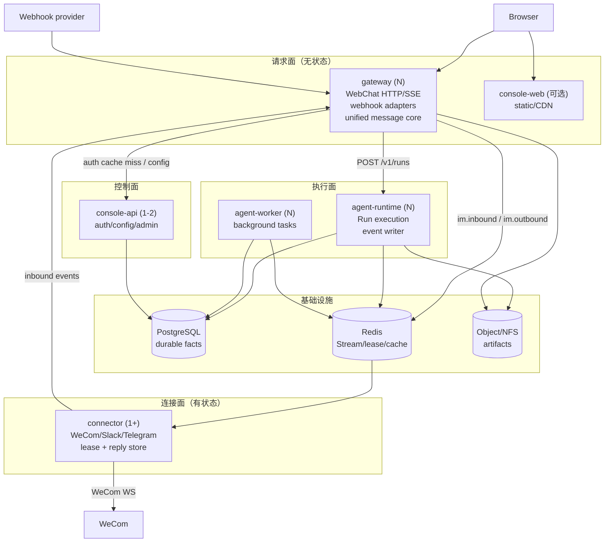
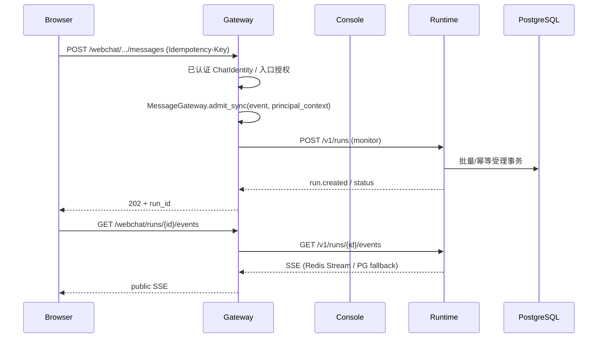
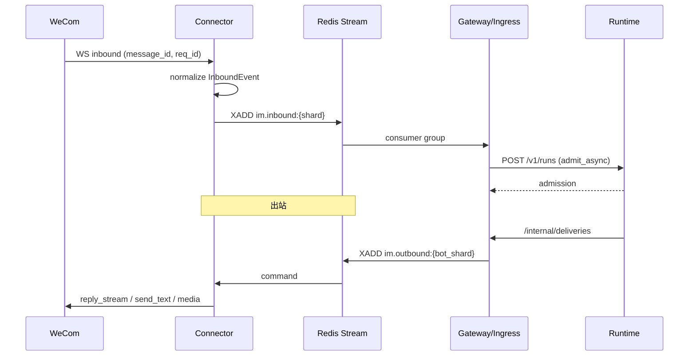
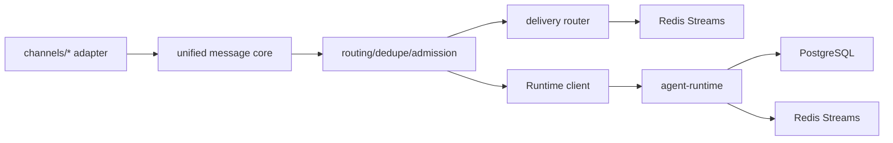
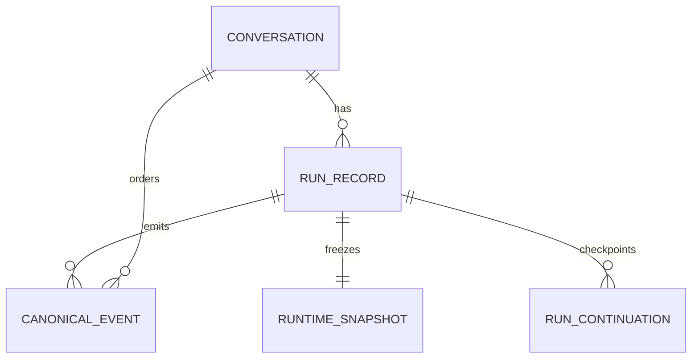

# 高 QPS 架构整改后端设计

> 文档编号：MOD-HIGH-QPS-REMEDIATION
> 文档版本：v0.2
> 创建日期：2026-10-24
> 文档状态：设计评审中
> 来源：`docs/operations/high-qps-remediation-plan.md` + 2026-10-24 四路代码审计
> 前端契约：同目录 `high-qps-remediation.frontend.design.md`
> 场景源：同目录 `high-qps-remediation.scenarios.md`

## 1. 文档控制

### 1.1 责任人与设计输入

| 角色 | 姓名 | 职责范围 |
|---|---|---|
| 产品/架构 | Agent（设计草案） | 需求边界、架构取舍、验收口径 |
| 开发负责人 | 待指定 | 后端/Connector/部署实现 |
| 测试负责人 | 待指定 | 场景/容量/混沌验收 |
| 设计评审 | 待指定 | 本设计的批准与 spec 变更确认 |

| 编号 | 输入 | 结论 |
|---|---|---|
| D-01 | 目标负载 | 1000 个并发对话用户；8 轮/600s；20 chunks/s × 10s；通知轮询 15s（可配置） |
| D-02 | 部署约束 | 开源默认 4 个部署单元；启用企微时 +1 个 Connector；中间件仅 PG + Redis |
| D-03 | Connector 边界 | 有状态传输独立镜像/独立 Deployment；不把 WebChat/webhook 塞进 Connector |
| D-04 | Gateway 边界 | 请求面无状态、不持 DB、不持 socket；WebChat 走 SYNC 核心，IM 走 ASYNC 队列 |
| D-05 | 写入模型 | PG 只做持久事实；实时正文走 Redis Stream + 周期快照；批量写替代每增量事务 |
| D-06 | 控制面 | 先做 settings 单例、auth SQL 合并、通知 page_size；身份缓存延后 |
| D-07 | 前端 | 先 code splitting；`console-web` 静态层为可选 overlay/CDN，不是默认四单元硬依赖 |
| D-08 | 中间件 | 默认不引入 Kafka/NATS/Citus/Service Mesh；PgBouncer 可选 |
| D-09 | 验证 | SLO、真实流式、浏览器同形轮询、PG state/rate 必须进入验收 |
| D-10 | 规则边界 | `harness-arch#RULE-arch-001` 已按“四个逻辑业务单元 + Connector 运行时角色”修订；`harness-arch`/`harness-im` 的相关 Conventions 已同步。代码侧 architecture tests/preflight 的更新列入 §4.1.1，作为 WP-05e 的交付项 |

### 1.2 修订历史

| 版本 | 日期 | 作者 | 变更描述 |
|---|---|---|---|
| v0.1 | 2026-10-24 | Agent | 初始设计：基于整改方案与代码审计，形成可拆解的 WP/接口/数据/验收设计 |
| v0.2 | 2026-10-25 | Agent | 按 review 修正：E2E/integration 分层、spec amendment、NFR registry、API/追溯 ID、场景闭合 |

### 1.3 上游输入与冲突取舍

| 上游输入 | 原始主张 | 本设计取舍 | 理由 |
|---|---|---|---|
| `high-qps-target-architecture.md` | 前端独立 `console-web` 必须拆分 | 先 code splitting；静态层为可选 overlay | 4.2MB bundle 先减体积；开源默认 4 单元 |
| 同上 | Stage B 引入身份缓存/签名断言 | Phase 1 不做；先 settings/auth/page_size | 实测固定 CPU 是主因；缓存引入撤销协议 |
| 同上 | PG 集群/分片 | 单主 + 批量/分区；PgBouncer/副本/Citus 条件触发 | 先消除写放大；集群不自动提升写吞吐 |
| 同上 | Mattermost 历史 | 独立读模型/只读归档；不在本设计实现 | 不伪造 Run；`run_id` 缺失投影会丢弃 |
| `harness-arch.md` | 固定四单元、Gateway 单 Pod、SDK 只在 Gateway | 四个逻辑单元；Connector 运行时角色；Gateway N 副本；SDK 允许在 Connector adapter surface | 有状态/无状态扩缩模型不同；spec 已同步 |


---

## 2. 需求分析

### 2.1 需求概述

| 项目 | 内容 |
|---|---|
| 模块名称 | 高 QPS 架构整改（Gateway/Connector/Console/Runtime/PG） |
| 模块ID | MOD-HIGH-QPS-REMEDIATION |
| 所属系统/产品线 | Agent Harness |
| 需求类型 | 性能优化 + 架构演进 |
| 业务背景 | 1000 并发对话下，SSE 连接占用 PG、每增量事务放大到 2 万 commits/s、Console 每请求固定 CPU、企微连接与回复状态困在单 Gateway；现有验收无法暴露这些问题 |
| 核心目标 | 在开源部署可接受的前提下，把瓶颈从 Gateway/Console 的同步路径和单 PG 连接/写入上移走，使 1000 并发对话达到 SLO |

### 2.2 痛点与价值

| 维度 | 内容 |
|---|---|
| 目标用户 | 聊天用户（1000 并发）、运维/SRE、开源部署者、后续 IM 接入开发者 |
| 当前问题 | SSE 每流占一条 PG 连接；20k commits/s + 14–16 万 statements/s；Console 每次通知轮询 2 次 `SharedSettings()`；通知 200 rps；企微多副本重复连接/丢 reply_ref；1000 用户验收不断言 SLO |
| 业务影响 | 800 用户实测 admission P50 13–18s、first-delta P50 44s；PoolTimeout/连接耗尽；多副本无法安全上线；容量结论不可信 |
| 预期价值 | 1000 用户 admission P95 ≤500ms、first-delta P95 ≤1200ms；PG total <200、稳态 idle-in-tx≈0；Console/Gateway CPU <60%；开源默认部署仍简单 |

**用户故事**

| 编号 | 用户故事 | 优先级 |
|---|---|---|
| US-01 | 作为聊天用户，我希望 1000 人同时对话时消息及时受理、回复持续到达 | P0 |
| US-02 | 作为运维，我希望看到真实瓶颈（连接/写入/队列）并用真实负载验收，而不是“假绿” | P0 |
| US-03 | 作为聊天用户，我希望断线/多 Gateway/Connector 故障后仍能恢复对话，不丢不重 | P0 |
| US-04 | 作为接入开发者，我希望新增 webhook/IM 只写 adapter，不新增微服务 | P1 |
| US-05 | 作为开源部署者，我希望默认 4 个单元 + PG/Redis 就能跑，规模上来再启用 Connector/多副本 | P0 |
| US-06 | 作为管理员，我希望企微历史/旧 Mattermost 历史可保留，但不污染 Run 模型 | P2 |

### 2.3 功能方案

| 功能ID | 功能名称 | 功能描述 | 优先级 | 来源 |
|---|---|---|---|---|
| FEAT-01 | 验证与可观测性 | 真实流式/浏览器轮询驱动、SLO 断言、PG state/rate/保留指标、CI 冒烟 | P0 | US-02 |
| FEAT-02 | Console 热路径 | settings 单例/注入、auth SQL 合并、通知 page_size/轮询/fast path、materials 去重 | P0 | US-01/02 |
| FEAT-03 | SSE 短 Session 与池 | 流式端点返回前释放请求级 Session、显式池、准入闸门/预检匹配 | P0 | US-01/03 |
| FEAT-04 | 事件写批量/序列/保留 | per-Run 批量 writer、seq 块、lease fence、批量 INSERT、retention/索引 | P0 | US-01/02 |
| FEAT-05 | Runtime 容量/后台隔离 | 队列指标/HPA、执行槽/模型额度、history 移出受理、memory job 背压 | P0 | US-01/02 |
| FEAT-06 | 统一消息网关契约/核心 | InboundEvent/DeliveryCommand/Capabilities/Lease、SYNC/ASYNC 入口、路由/去重/幂等 | P0 | US-04 |
| FEAT-07 | Connector 运行时 | 独立镜像、bot lease/fencing、reply store、inbound/outbound Stream | P0 | US-03/05 |
| FEAT-08 | Gateway 无状态/投递 | 移除 WeCom、多副本、投递 facade、bot snapshot 过滤、ChannelName 开放 | P0 | US-03/04/05 |
| FEAT-09 | WebChat 统一核心/读路径 | SYNC admit、resolved principal、lean scope、去掉 202 后 get_run | P0 | US-01/04 |
| FEAT-10 | PG 规模档 | PgBouncer/读副本/分集群/Citus 条件触发；Mattermost 历史独立读模型（不在本设计实现） | P2 | US-02/06 |

### 2.4 范围与边界

| 类别 | 内容 |
|---|---|
| 范围（In Scope） | 上述 FEAT-01..FEAT-10 的后端/部署/验收设计；WebChat、企微 Connector、Webhook 统一核心；PG/Redis 数据与索引；容量验证 |
| 非范围（Out of Scope） | 新 IM 协议的具体实现（只留 adapter SPI）；Mattermost 历史 ETL 的具体执行（只定边界）；Citus/Kafka 默认引入；Console/Gateway HA 承诺；模型供应商额度采购 |
| 前置假设 | 企微智能机器人同一 bot 只允许一个 active WS（或至少本设计按 active-passive 安全）；Redis Streams 可接受 at-least-once；PG 单主可承载批量写；模型额度可扩 |
| 有意妥协 / 技术债 | 实时正文崩溃最多丢约 1s（Phase 3）；Connector 的 `req_id` 跨重连可能失效，降级主动发送；Phase 1 不做身份缓存；Phase 2 前不做 PG 分片 |

---

### 2.5 验收条件

#### 2.5.1 业务规则与约束

| ID | 类型 | 描述 | 验证场景 |
|---|---|---|---|
| RULE-01 | 系统约束 | SSE 流式端点不得在流生命周期内持有请求级 PG Session；连接数不随流数线性增长 | S-03、E-02 |
| RULE-02 | 业务规则 | 事件批量写必须保持 per-conversation seq 单调、无丢/重、terminal 最后；崩溃后已提交前缀可重放 | S-04、E-05、B-02 |
| RULE-03 | 系统约束 | Console 热路径不得逐请求构造 `SharedSettings`；auth/授权语义与错误优先级不变；通知轮询带 page_size 后不再回源设置 | S-02、S-08、S-09、E-01 |
| RULE-04 | 系统约束 | 每个 bot 同时只有一个 Connector owner；lease + fencing epoch；旧 owner 不得发送；切换不得重复入站或串消息 | S-05、E-03、E-04、E-06 |
| RULE-05 | 系统约束 | Gateway 请求面无状态：不持 DB、不持 socket、无 sticky；任意副本可服务/重连 | S-06、B-03 |
| RULE-06 | 业务规则 | WebChat 与 IM 共用统一消息核心；WebChat 走 SYNC，IM 走 ASYNC；同 message_id 只建一个 Run | S-07、S-08、S-06 |
| RULE-07 | 安全约束 | Bot secret/模型 Key 只在其 Owner；Gateway 不接收 WeCom secret；密钥不进日志/快照/响应 | S-05、E-04、E-06 |
| RULE-08 | 系统约束 | 准入/队列/S​​SE/投递均有界；过载显式 429/CHANNEL_BUSY/稳定错误码，不无限排队/OOM | S-01、B-01、E-02、E-07、E-08 |
| RULE-09 | 系统约束 | event retention 删除速率 ≥ 写入速率；表/索引不无界增长 | B-02、S-04 |
| RULE-10 | 架构约束 | 开源默认 4 个逻辑单元；Connector 是 im-gateway 的运行时角色，不是第五业务微服务；Webhook/新 IM 不新增默认服务 | S-07、B-04 |
| RULE-11 | 系统约束 | 真实浏览器关键旅程（S-06/B-04）必须 E2E；1000 容量/Connector lease/故障用 integration + manual release gate；指标在无流量时可见 | S-06、B-04、E-09 |

#### 2.5.2 功能验收场景

> 完整场景（优先级/层级/边界/steps/expected/why_e2e/trigger_paths/checks）见
> `high-qps-remediation.scenarios.md`；本节只列设计影响。

| 场景ID | 设计影响 / 备注 |
|---|---|
| S-01 | 1000 用户 capacity_load；integration；覆盖 FEAT-01/02/03/04/05/08 |
| S-02 | 1000 用户空闲通知轮询；integration；覆盖 FEAT-02 |
| S-03 | SSE 短 Session/池；integration；pool=2 × 100 流 |
| S-04 | 批量事件写/seq/终态；integration；100 Run × 20 delta/s |
| S-05 | Connector lease/fencing/接管（假 WS）；integration；覆盖 FEAT-07 |
| S-06 | 多 Gateway/SSE 重连；E2E；覆盖 FEAT-08/09 |
| S-07 | Webhook adapter 统一接入；integration；覆盖 FEAT-06 |
| S-08 | WebChat SYNC 核心/幂等；integration；覆盖 FEAT-06/09 |
| S-09 | 前端 page_size/轮询；component；覆盖 FEAT-02 |
| S-10 | admin 路由 lazy/深链/首屏 chunk；component；覆盖 FEAT-F03 |
| S-11 | InboundEvent/DeliveryCommand/Capabilities/Lease 契约；contract；覆盖 FEAT-06 |
| S-12 | Connector/Gateway 边界与 5 单元预检；integration；覆盖 FEAT-07/08 |
| S-13 | Runtime 队列/HPA、history 后台化、memory 背压；integration；覆盖 FEAT-05 |
| S-14 | Console materials 去重/通知 fast path；integration；覆盖 FEAT-02 |
| S-15 | lean scope/202 不 get_run/dead queue；integration；覆盖 FEAT-09 |
| S-16 | 100 用户 capacity smoke；integration；FEAT-01/05 |
| S-17 | 200 用户 bounded verification；integration；FEAT-01/05 |
| S-18 | 400 用户 soak；integration；FEAT-01/04/05 |
| E-01 | 设置源故障时通知轮询不依赖 settings；integration；FEAT-02 |
| E-02 | 池耗尽快速失败；integration；FEAT-03/08 |
| E-03 | Connector 崩溃+平台重投；integration；FEAT-07 |
| E-04 | reply_ref 过期/epoch 降级；integration；FEAT-07/08 |
| E-05 | Redis 故障 PG 回退/恢复；integration；FEAT-04/08 |
| E-06 | 真机企微双 WS/req_id 跨重连；manual/staging；FEAT-07 |
| E-07 | Connector 崩溃+平台不重投；integration；FEAT-07 |
| E-08 | PG failover/Redis 抖动/Pod kill；integration；FEAT-02/04/05/08 |
| E-09 | 1000×8 manual release gate；manual/staging；FEAT-01/05 |
| B-01 | 1000 瞬时受理有界排队/拒绝；integration；FEAT-05/08 |
| B-02 | retention 追写入；integration；FEAT-04 |
| B-03 | 多 worker 指标/artifact token；integration；FEAT-08 |
| B-04 | 静态 overlay 同源 Cookie/CSRF；E2E；FEAT-F04 |

#### 2.5.3 非功能指标

**性能指标**

| 指标ID | 指标名称 | 目标值 | 测量方法 |
|---|---|---|---|
| NFR-PERF-01 | 受理延迟 P95 / P99 | ≤500ms / ≤1500ms | 1000 用户 acceptance / capacity_load 样本 |
| NFR-PERF-02 | 框架首字 P95 | ≤1200ms | SSE first-delta 样本 |
| NFR-PERF-03 | Console CPU | <60% limit | kubectl top / metrics，稳态 |
| NFR-PERF-04 | Gateway CPU | <60% limit | kubectl top / metrics，稳态 |
| NFR-PERF-05 | PG total connections | <200 | pg_stat_activity total |
| NFR-PERF-06 | PG commits/s | ≤4k（Phase 2）/ ≤2k（Phase 3） | xact_commit 速率 |
| NFR-PERF-07 | WAL 增长 | 在磁盘/保留预算内 | pg_wal_lsn_diff/时间 |
| NFR-PERF-08 | 事件写入/保留 | 删除速率 ≥ 写入速率 | 表大小 + retention 指标 |
| NFR-PERF-09 | Scope/读 SQL | ≤2 SQL；202 后无 get_run | SQL 计数/集成测试 |

**可靠性指标**

| 指标ID | 目标值 |
|---|---|
| NFR-REL-01 | Connector 故障接管 ≤ lease TTL；无重复发送 |
| NFR-REL-02 | Gateway Pod 重启后 SSE 可从游标恢复，无缺/重 |
| NFR-REL-03 | Redis 故障退化为 PG 有界补查，不丢已持久事件 |
| NFR-REL-04 | SIGKILL 后已提交前缀可 replay，终态 CAS 权威 |

**安全性要求**

| 指标ID | 验收标准 |
|---|---|
| NFR-SEC-01 | Gateway 响应/日志/快照无 WeCom bot secret；Connector 只持有本人 bot secret |
| NFR-SEC-02 | 既有 CHAT 会话/授权语义不变；不做跨用户缓存/降级 |
| NFR-SEC-03 | Webhook 签名/token 校验失败不落库、不触发 Run |

#### 2.5.4 验证环境假设

| 维度 | 假设 | 验证方式 / 参数 | 不满足时 |
|---|---|---|---|
| 容量 | 1000 users / 8 turns / 600s；20 chunks/s × 10s；通知 15s | acceptance profile；`capacity_smoke` 100 用户 | 标记 incomplete/REJECTED，不写达标 |
| 硬件 | 目标拓扑 CPU/内存/磁盘；PG 单主 + 可选副本；Redis 单实例/集群 | `check_agent_capacity_deployment.py` + `kubectl top` | env_blocked 并列出缺失 |
| 依赖 | PG/Redis/Ingress/浏览器/假 WS/webhook 提供方/模型额度 | preflight health/lease/探针 | env_blocked 并列出 owner |
| profile | smoke / changed / full；1000 用户不在 PR 全跑 | `.github/workflows/check.yml` + Makefile | 显式 incomplete，不降级冒充 |

---

## 3. 技术设计

### 3.1 方案选型

#### 备选方案对比

| 对比维度 | 权重 | 方案A：现状+调参 | 得分 | 方案B：模块化拆分+批量+Redis Stream | 得分 | 方案C：全微服务+Kafka+Citus | 得分 |
|---|---:|---|---:|---|---:|---|---:|
| 功能完备性 | 30% | 不能解决 2 万 commits/s/连接占用 | 1 | 覆盖连接、写入、控制面、Connector | 5 | 覆盖但过度 | 5 |
| 性能预期 | 25% | 低 | 1 | 高：批量+短 Session+分区 | 5 | 高但复杂 | 4 |
| 实现复杂度 | 20% | 低 | 5 | 中：4+1 单元、PG+Redis | 3 | 高 | 1 |
| 维护成本 | 15% | 低但故障多 | 3 | 中 | 4 | 高 | 1 |
| 风险评估 | 10% | 高（生产不可用） | 1 | 中（可灰度/回滚） | 4 | 高（开源门槛） | 1 |
| **最终得分** | **100%** | | **2.10** | | **4.35** | | **2.95** |

#### 关键决策记录

| 决策点 | 选择 | 被否决项 | 理由 | 可逆性 |
|---|---|---|---|---|
| SSE 连接 | 流式路由短 Session，返回前关闭 | 扩大 DB 池 | 池再大也线性吃连接，PgBouncer 也救不了 idle-in-tx | 易 |
| 事件写 | 每 Run 批量 writer + seq 块 | 每增量一次事务 | 2 万 commits/s 不可持续 | 中 |
| 实时正文 | Redis Stream + PG 快照/终态 | PG 当广播总线 | 写入/读取放大都不可控 | 中 |
| Connector | 独立镜像/Deployment，im-gateway 的运行时角色 | 所有协议塞一个进程 | 有状态/无状态扩缩模型不同 | 中 |
| WebChat | SYNC 统一核心，不进队列 | 全部走 ASYNC 队列 | 202 延迟敏感；已有 auth/idempotency | 易 |
| Console | settings 单例 + auth SQL + page_size | 先加身份缓存 | 实测固定 CPU 是主因；缓存后加 | 易 |
| 前端 | code splitting 先，静态 overlay 后 | 直接拆静态 Pod | 4.2MB bundle 先减体积；默认部署简单 | 易 |
| PG 规模 | 单主+分区/批量，按需 PgBouncer/副本/Citus | 一开始 Citus | 开源复杂度和收益不匹配 | 难（分片） |

#### 技术栈

| 类别 | 选型 | 版本 | 选型理由 |
|---|---|---|---|
| 语言 | Python | 3.12 | 现有栈 |
| 框架 | FastAPI + uvicorn | 现有 | WebChat/内部 API；多 worker 需先在 Pod 内多进程 |
| 数据库 | PostgreSQL | 16.x | 权威状态/事件/审计；批量+分区 |
| 中间件 | Redis | 7.x | 去重/lease/hint/Stream；不新增 Kafka |
| ORM | SQLAlchemy async + asyncpg | 现有 | 现有栈；注意 pool/PgBouncer |
| 前端 | React + TS + Semi | 现有 | 不改 UI 框架 |
| 可观测 | Prometheus + 现有 metrics registry | 现有 | 需多进程/新指标 |

### 3.2 架构设计



#### WebChat SYNC 路径



#### IM ASYNC 路径



#### 技术分层



#### 外部依赖清单

| 外部系统 | 依赖类型 | 协议 | 超时 | 降级策略 |
|---|---|---|---|---|
| Console | 内部 HTTP | JSON | 5s/10s | auth 失败显式 401/403/409；settings 缓存不阻塞已认证通知 |
| Runtime | 内部 HTTP/SSE | JSON/SSE | 10s/45s | 受理失败显式错误；SSE 断开可重连 |
| Redis | 流/lease/缓存 | RESP | 1–5s | hint 失败退 PG 补查；lease 失败停止接单 |
| PostgreSQL | 权威状态 | SQL | pool 1s、statement 5s | 过载显式 503/429；不吞错 |
| WeCom | WS/HTTP | 官方 SDK | SDK/超时 | 退避重连；主动发送降级 |
| Object/NFS | 文件 | FS | 现有 | 交付显式失败/DEGRADED |

### 3.3 数据设计

#### 3.3.1 Redis 键与 Stream

| 键/Stream | 类型 | 字段/值 | TTL/上限 | 用途 |
|---|---|---|---|---|
| `im:inbound:{shard}` | Stream | `event_id, channel, bot_id, user_id, conversation_id, message_id, text, attachments, reply_target, received_at, transport_meta` | `MAXLEN ~ 100000`；消费组 `im-ingress` | Connector/Webhook 入站 |
| `im:inbound:dead` | Stream | 原事件 + error/attempts | 保留 7d | 重试耗尽 |
| `im:outbound:{bot_shard}` | Stream | `command_id, route, reply_target, kind, payload, idempotency_key, connection_epoch` | `MAXLEN ~ 100000`；消费组 `im-connector` | 出站命令 |
| `im:outbound:result:{command_id}` | String | accepted/delivered/failed + code | 10min | 投递结果等待 |
| `connector:bot:{tenant}:{bot_id}` | String | owner + epoch | lease TTL 15–30s，续租 | bot ownership |
| `connector:cmd:{command_id}` | String | `1` | 10min | 命令幂等 |
| `im:reply:message:{tenant}:{bot}:{message_id}` | Hash | reply_ref, epoch, expires_at | 300s | 消息回复目标 |
| `im:reply:run:{tenant}:{run_id}` | Hash | reply_target, epoch, expires_at | 3600s | Run 产物/终态目标 |
| `im:reply:stream:{tenant}:{run_id}` | Hash | stream_id, last_text, epoch | 300s | 短重连恢复（可选） |

> Redis Stream 是 at-least-once；消费端按 `message_id`/`command_id` 幂等。Redis 故障时 SSE/事件退化为 PG 有界补查；入站是否需要 PG inbox 见 §5 风险。

#### 3.3.2 PostgreSQL 变更

**新增列：`runtime.canonical_event.execution_epoch`**

| 字段名 | 类型 | 可空 | 默认值 | 索引 | 说明 |
|---|---|---|---|---|---|
| execution_epoch | BIGINT | N | 0 | 无 | 写者 fence；僵尸 writer 不追加到新 epoch |

> PG 16 `ADD COLUMN ... DEFAULT 0` 为 metadata-only；迁移窗口执行，旧行自动 0。

**索引设计**

| 索引名 | 类型 | 字段/谓词 | 使用场景 |
|---|---|---|---|
| `ix_run_record_tenant_open` | btree partial | `(tenant_id) WHERE admission_released_at IS NULL AND is_deleted=false` | 租户在飞计数 |
| `ix_run_record_claim_update` | btree partial | `(update_time, id) WHERE status IN ('CREATED','WAITING_TOOL') AND is_deleted=false` | continuation claim |
| `ix_run_record_active_deadline` | btree partial | `(deadline_at) WHERE status IN ('CREATED','RUNNING','WAITING_TOOL','WAITING_INPUT') AND is_deleted=false` | deadline sweep |
| `ix_canonical_history` | btree partial | `(tenant_id, conversation_id, seq DESC) WHERE event_type IN ('USER_MESSAGE','ASSISTANT_MESSAGE','TOOL_CALL','ASSISTANT_TURN','TOOL_TASK_ACCEPTED','BACKGROUND_RESULT','TOOL_SUBMISSION_FAILED','MEMORY_CONFIRMATION_RESOLVED') AND is_deleted=false` | 历史装配 |
| `ix_canonical_summary` | btree partial | `(tenant_id, conversation_id, seq DESC) WHERE event_type='CONTEXT_SUMMARY' AND is_deleted=false` | latest summary |
| `ix_canonical_retention` | btree partial/BRIN | `(create_time) WHERE stream_type IS NOT NULL AND is_deleted=false` | retention |
| `ix_conversation_last_message` | 现有 | 保留 | 会话列表 |

**表调整**

- `conversation`：`fillfactor=90`；`last_seq` 仅作已分配高水位；不因 seq 分配更新带索引的 `update_time`。
- `canonical_event`：事件 id 应用层生成 UUIDv7（时间有序）；评估去掉 `submission_id` FK（保留逻辑 id）。
- 分区（Phase 3，条件）：`canonical_event` 按 `HASH(conversation_id)` 16–32 分区；分区表的 PK/唯一约束必须包含 `conversation_id`，迁移时重建为 `(conversation_id, id)` / `(conversation_id, seq)`；用 `CREATE INDEX CONCURRENTLY`，先 dry-run。
- 不新增业务表；Mattermost 历史若导入，走独立 `legacy_message` 读模型（不在本设计实现）。

**ER 图（现有核心）**



**容量预估**

| 维度 | Phase 2（批量合并） | Phase 3（Redis 实时+快照） |
|---|---:|---:|
| 1000 Run × 20 delta/s 原始 | 20k rows/s | 20k msg/s（Redis） |
| PG 事件行 | 2–4k rows/s | ~1k rows/s（1s 快照） |
| PG 提交 | 2–4k/s | 1–2k/s |
| 日行数（24h） | ~170–345M | ~86M |
| 保留策略 | 分区/批删 ≥ 写入 | 分区 drop/批删 |

> 没有实测前这些是设计预算，不是验收结论；容量报告必须用真实采样校准。

### 3.4 接口设计

#### 3.4.1 对外 HTTP API（保持不变）

| 接口ID | 名称 | 方法 | 路径 | 变更 |
|---|---|---|---|---|
| API-01 | WebChat 提交消息 | POST | `/api/v1/webchat/entries/{entry_id}/messages` | 内部改走 SYNC 核心；请求/响应/202 语义不变 |
| API-02 | WebChat SSE | GET | `/api/v1/webchat/runs/{run_id}/events` | 保持公开投影/游标；内部从 Stream/PG 读 |
| API-03 | 通知列表 | GET | `/api/v1/webchat/notifications` | 前端带 `page_size`；服务端可 skip 设置读取 |
| API-04 | 内部投递 | POST | `/internal/deliveries` | 请求/响应契约不变；内部改为入队 + 有界等待 |
| API-05 | InboundEvent Stream | XADD | `im:inbound:{shard}` | 内部契约，不是 HTTP |
| API-06 | DeliveryCommand Stream | XADD | `im:outbound:{bot_shard}` | 内部契约，不是 HTTP |
| API-07 | Connector lease | SET NX PX | `connector:bot:{tenant}:{bot_id}` | 传输 owner/fencing |
| API-08 | MessageGateway.admit_sync | 函数 | `muad_im_core.gateway` | WebChat SYNC 入口 |
| API-19 | client-config（既有） | GET | `/api/v1/webchat/client-config` | 不改；page_size/轮询参数来源 |

**API-03 请求补充**

| 参数 | 类型 | 必填 | 说明 |
|---|---|---|---|
| page_size | int | 否 | 前端从 client-config 投影取；给了就不再回源 settings |
| after_seq | int | 否 | 现有增量游标 |

**API-04 语义**

- 保留租户/产物校验、`delivery_key` 去重、审计；
- 通过 `im.outbound` 发送；返回 `accepted`/`delivered`/`deduplicated` 与稳定错误；
- 等待有界（如 2s），超时返回可重试错误，不把占位当成功。

#### 3.4.2 内部契约（Redis Stream，不是 HTTP）

**API-05: InboundEvent**

```json
{
  "event_id": "uuid",
  "channel": "WECOM",
  "bot_id": "bot-1",
  "external_user_id": "user-1",
  "external_conversation_id": "chat-1",
  "message_id": "msg-1",
  "text": "hello",
  "attachments": [],
  "reply_target": {"ref": "req-1", "epoch": 7},
  "received_at": "2026-10-24T12:00:00Z",
  "transport_meta": {"kind": "wecom_ws"}
}
```

**API-06: DeliveryCommand**

```json
{
  "command_id": "uuid",
  "tenant_id": "default",
  "route": {"channel": "WECOM", "bot_id": "bot-1", "external_user_id": "user-1", "external_conversation_id": "chat-1"},
  "reply_target": {"ref": "req-1", "epoch": 7},
  "kind": "stream",
  "payload": {"text": "partial", "finish": false},
  "idempotency_key": "run:run-1:terminal",
  "connection_epoch": 7
}
```

**ChannelCapabilities**

| 字段 | 类型 | 说明 |
|---|---|---|
| stream | bool | 是否支持增量 |
| edit | bool | 是否支持编辑 |
| thread | bool | 是否支持线程 |
| media | bool | 是否支持媒体 |
| read_receipt | bool | 是否支持已读 |
| typing | bool | 是否支持 typing |
| max_bytes | int | 单条上限 |
| rate_limit | object | 通道速率 |

**API-07: ConnectorLease**

| 字段 | 类型 | 说明 |
|---|---|---|
| tenant_id | str | 租户 |
| bot_id | str | bot |
| owner | str | connector 实例 |
| epoch | int | fencing |
| lease_until | timestamp | 过期 |

#### 3.4.3 函数/库接口

| 函数签名 | 入参 | 返回 | 错误处理 |
|---|---|---|---|
| `MessageGateway.admit_sync(event, principal_context)`（API-08） | InboundEvent + 已解析主体 | RunAdmission | AppError（既有码） |
| `MessageGateway.admit_async(event)` | InboundEvent | AdmissionReceipt | 入队/消费错误显式 |
| `ConnectorHost.start()/stop()` | — | — | LeaseLost/Unavailable |
| `OutboundSender.send(command)` | DeliveryCommand | CommandResult | 稳定错误/结果 |
| `ReplyStore.get_message(...)` | tenant/bot/message | ReplyTarget | 过期/不匹配显式 |

#### 3.4.4 幂等与错误

| 场景 | 幂等键 | 行为 |
|---|---|---|
| WebChat 提交 | `Idempotency-Key` / message_id | 同键同指纹重放；异指纹 409 |
| IM 入站 | `message_id` | 重复不建第二个 Run |
| Connector 命令 | `command_id` | `SET NX` 去重；旧 epoch 拒绝 |
| 出站交付 | `delivery_key` | 已送达不重发 |
| 事件 | `(conversation_id, seq)` | 重放去重；不重排 |

> 新错误码只在确有外部语义时加，并更新 `config/api-messages.yaml`；内部 Stream 状态用 `CommandResult`，不冒充 HTTP 错误。

### 3.5 质量实现方案

#### 3.5.1 性能设计

| 指标ID | 热点路径 | 目标值 | 实现方案（含被放弃的较慢方案） |
|---|---|---|---|
| NFR-PERF-01 | 受理 | P95≤500ms | 材料阶段与写事务分离；gate≤pool；settings/auth 去固定 CPU。放弃“只加池” |
| NFR-PERF-02 | 首字 | P95≤1200ms | 首段 delta 立即 flush；批量后续；Redis Stream 实时。放弃“每 50ms 一次 PG 事务” |
| NFR-PERF-03 | Console | CPU<60% | settings 单例、auth 2 SQL、page_size、fast path。放弃“先加身份缓存” |
| NFR-PERF-04 | Gateway | CPU<60% | 多 worker；SSE 指标按秒批；delta 快速路径。放弃单进程大而全 |
| NFR-PERF-05 | PG 连接 | total<200 | SSE 短 Session + 显式池 + 可选 PgBouncer。放弃“扩 pool” |
| NFR-PERF-06 | PG 写入 | ≤4k commits/s | per-Run batch + seq 块 + 批量 INSERT；Phase 3 快照。放弃每增量 commit |
| NFR-PERF-07 | WAL | 在磁盘预算内 | 批量提交/分区/快照；观测 WAL/s。放弃“无界增量行” |
| NFR-PERF-08 | 保留 | 删除≥写入 | 批量 retention + create_time 索引/分区。放弃“单批 200 行/30s” |
| NFR-PERF-09 | Scope/读 | ≤2 SQL | run+conversation 单查询；snapshot 摘要列选择；202 不 get_run。放弃完整 JSONB |

#### 3.5.2 可靠性设计

| 风险ID | 失效模式 | 影响 | 应对措施 | 验证场景 |
|---|---|---|---|---|
| RISK-01 | SSE 流占用 PG 连接 | 池耗尽/流打不开 | 短 Session；pool=2 压测；idle-in-tx 告警 | S-03、E-02 |
| RISK-02 | 事件写批量失败/崩溃 | 丢正文/乱序 | 已提交前缀可 replay；首段立即 flush；terminal CAS | S-04、E-05 |
| RISK-03 | Connector 崩溃/双 owner | 重复/丢回复 | Redis lease + epoch；单 owner；主动发送降级 | S-05、E-03、E-04 |
| RISK-04 | Redis 故障 | 实时流断/降级 | hint/Stream 失败退 PG 有界补查；指标可见 | E-05 |
| RISK-05 | 多 worker 进程内状态 | token/metrics 丢失 | 共享 store/多进程指标；先修再扩 | B-03 |
| RISK-06 | 1000 瞬时受理 | OOM/雪崩 | 有界队列+429+准入；分阶段材料/写闸门 | B-01 |
| RISK-07 | retention 追不上 | 表膨胀/IO | 批量/分区/索引；删除≥写入断言 | B-02 |
| RISK-08 | reply_ref 跨重连失效 | 回复串消息 | epoch 不匹配→主动发送+DEGRADED，不回落最新回调 | E-04 |

#### 3.5.3 安全性设计

| 指标ID | 验收标准 | 实现方案 |
|---|---|---|
| NFR-SEC-01 | Gateway 无 bot secret | `bot_snapshot` 按 channel 过滤；Connector 只拿 WECOM；Gateway 响应/日志/快照不含 secret |
| NFR-SEC-02 | 授权语义不变 | auth SQL 合并只合并查询，不改 grants/Effective Capability；不做跨用户缓存 |
| NFR-SEC-03 | Webhook 验签 | adapter 验签/token/时间戳/replay；失败不落库 |
| NFR-SEC-04 | 幂等边界 | 现有 Idempotency-Key/delivery_key/message_id 保持；内部 command_id CAS |

#### 3.5.4 可观测性设计

| 场景 | 实现方案 |
|---|---|
| 受理/首字 | Gateway auth/upstream/projection；Runtime precheck/materials/write/history；SLO 样本 |
| PG | state 分解（idle/idle-in-tx/active/waiting）、commits/s、WAL/s、锁等待、pg_stat_statements |
| Connector | connected bots、lease owner/epoch、reconnect、inbound/outbound lag、send failures |
| Runtime | execution slots in-use/configured、waiting runs、oldest queue age、event flush lag |
| Gateway | active SSE、pending bytes、closed reasons、rejected、pool waits |
| 背压 | 429/CHANNEL_BUSY、queue depth、drop reasons；标签低基数 |

#### 3.5.5 背压与降级

- Gateway：每租户/用户/路由有界队列；超限 429 + Retry-After；不无限 `create_task`。
- Runtime：执行槽/模型池/队列年龄；队列满拒绝新 Run；不无限入队。
- Connector：每 bot 发送速率/并发；lease 失败停止接单；命令重试有上限 + DLQ。
- PG：pool_timeout=1s；statement/lock/idle-in-tx timeout；过载显式 503。
- Redis：Stream/hint 失败退 PG；降级指标/日志可见；不静默吞。

---

## 4. 部署与运维

### 4.1 部署架构

| 环境 | 配置 | 实例数 | 用途 |
|---|---|---|---|
| 开源默认（WebChat-only） | 4 单元 | Console 1、Gateway N、Runtime N、Worker N | 单机/小规模 |
| 启用企微 | 5 单元 | 上述 + Connector 1+ | 有状态通道 |
| 规模档 | 5+ 单元 | Connector 按 bot 分片；Runtime/Worker HPA；可选 console-web | 1000+ |

| 工作负载 | 形态 | 说明 |
|---|---|---|
| `console` | Deployment 1（容量口径） | API + 默认静态；多 worker 需先修进程内状态；HA 不在本设计 |
| `gateway` | Deployment N | 无状态；WebChat/webhook/delivery facade；多 worker |
| `connector` | Deployment/StatefulSet 1+ | 独立镜像；bot lease；不暴露公开 HTTP |
| `console-web`（可选） | Deployment/CDN | 静态 overlay；同源路径 |
| `agent-runtime` | Deployment N | 执行面；队列 HPA |
| `agent-worker` | Deployment N | 后台任务；独立池 |

**发布预检调整**

- 从“固定四单元”改为“profile 声明的单元集合”，允许 connector/console-web 可选；
- `process_counts` 乘 FD/SSE 缓冲预算；
- 允许每单元 DB 池键，并校验 `pool+overflow ≥ gate`、总 PG 连接 ≤ 预算；
- 移除 Gateway 单 Pod 限制；Console 仍 1（容量口径；HA 不在本设计）；
- 保留旧四单元 profile 作为兼容基线。

#### 4.1.1 必须同步的 spec / architecture tests / preflight

| 对象 | 需要的变更 | 归属 |
|---|---|---|
| `harness-arch#RULE-arch-001` | 已改为“四个逻辑业务单元 + Connector 运行时角色”；不绑定 agent→Pod | 本设计（已改） |
| `harness-arch` Conventions | 容量基线改为 profile 声明；SDK 允许 Connector adapter surface；Connector 也要 metrics/probe 预算 | 本设计（已改） |
| `harness-im#RULE-im-002` | 渠道差异允许在 im-connector 的 adapter surface；Gateway web 角色仍零渠道字样 | 本设计（已改） |
| `tests/architecture/test_im_gateway_boundaries.py` | 允许 `apps/im-connector/channels/**` 的 SDK；禁止 connector 公开 HTTP 路由；Gateway 不依赖 aibot | WP-05e |
| `tests/architecture/test_channel_neutrality.py` | `ALLOWED_SURFACES` 增加 im-connector adapter surface | WP-05e |
| `tests/architecture/test_capacity_webchat_deployment_preflight.py` | 5 单元/可选 connector/console-web；process_counts 乘 FD/SSE；每单元 DB 池 | WP-05e |
| `scripts/check_agent_capacity_deployment.py` | 单元集合由 profile 声明；Gateway 多副本；Connector PDB/lease；`pool+overflow ≥ gate` | WP-05e |
| `tests/architecture/test_capacity_webchat_console_gateway_deploy.py` | 移除 Gateway 单 Pod 断言；Console 保持 1–2 | WP-05e |
| `tests/architecture/test_capacity_webchat_hpa_budget.py` | Runtime 队列指标/Connector HPA 预算 | WP-04/05e |
| `tests/test_attachment_contract.py` | 打开 `ChannelName`/registry，新增 fake channel 不改字面量 | WP-05a |
| `tests/gateway/test_gateway_metrics.py` | Connector metrics catalog/无流量可见 | WP-05e |
| `tests/architecture/test_k8s_deploy_manifests.py` | Connector Deployment/Service/探针/资源/Secret 挂载 | WP-05e |
| `tests/architecture/test_capacity_webchat_runtime_gateway_metrics.py` | Connector 指标目录/SSE 账本聚合 | WP-05e |

### 4.2 发布与回滚

| 阶段 | 范围 | 进入条件 | 回滚条件 |
|---|---|---|---|
| Phase 0 | 指标/测试 | 不影响生产 | 回退测试改动 |
| Phase 1 | settings/auth/通知/SSE/池/读路径 | 200–400 用户 smoke 通过 | 开关/旧路径 |
| Phase 2 | 事件批量/索引/Connector/HPA | 1000 用户 SLO 通过 | 保留旧写路径开关（短窗口）；DB 迁移按备份回退 |
| Phase 3 | Redis 实时/静态/PG 规模 | Phase 2 实测触发 | 回退到批量 PG 写/默认四单元 |

**Connector 切换**：先部署 connector，确认 bot lease/只连一次；再把 Gateway 的 WeCom 移除；切换窗口不接受新企微消息或允许短时重连。回滚时恢复 Gateway WeCom 角色/旧镜像。

### 4.3 监控告警

| 指标 | 阈值 | 级别 | 处理 SLA |
|---|---|---|---|
| 受理 P95 | >500ms 持续 5min | P1 | 5min |
| idle-in-tx | >50 或年龄>30s | P1 | 5min |
| PG commits/s | >4k 持续 5min | P1 | 5min |
| pool timeout | >0 | P1 | 5min |
| Connector lease loss | >0/5min | P1 | 5min |
| SSE rejected | >0（正常负载） | P2 | 15min |
| retention lag | 删除<写入 | P2 | 15min |

### 4.4 数据迁移

| 阶段 | 操作 | 验证方法 |
|---|---|---|
| 1 | 加 `execution_epoch` 列（metadata-only） | schema/回归 |
| 2 | 建新索引（CONCURRENTLY） | EXPLAIN/无锁等待 |
| 3 | 事件 writer 切批量/seq 块 | 双跑对比 seq/终态 |
| 4 | retention 批量/索引切换 | 表大小/WAL |
| 5 | 分区（条件） | dry-run/备份/校验 |
| 6 | 去掉 submission_id FK（条件） | 外键/回归 |

> 任何 schema 迁移先备份、dry-run；大表 `CREATE INDEX CONCURRENTLY`；分区迁移在低峰维护窗口。

---

## 5. 风险与依赖

### 5.1 项目依赖

| 依赖模块/团队 | 依赖内容 | 状态 | 风险等级 |
|---|---|---|---|
| 企微平台 | 单 bot 连接语义、重投、req_id 生命周期 | 未验证 | 高 |
| Redis | Stream/lease/AOF/容量 | 现有 | 中 |
| PostgreSQL | 批量写/分区/索引/PgBouncer | 现有 | 中 |
| 模型供应商 | 1000 并发额度 | 外部 | 高 |
| 前端 | page_size/code splitting | 同需求 | 低 |
| 运维 | 多 worker/Connector/预检/监控 | 需配合 | 中 |

### 5.2 风险识别

| 风险ID | 类型 | 描述 | 概率 | 影响 | 应对措施 | 验证场景 |
|---|---|---|---|---|---|---|
| RISK-01 | 外部协议 | 同一 bot 多 WS 行为未知 | 高 | 连接抖动/重复 | 真机/探针；lease active-passive | S-05 |
| RISK-02 | 数据 | 入站未 XADD 就崩 | 中 | 丢消息 | 平台重投/PG inbox 兜底；明确语义 | E-03 |
| RISK-03 | 数据 | req_id 跨重连失效 | 高 | 回复换线程/重复 | 主动发送+DEGRADED，不回落最新回调 | E-04 |
| RISK-04 | 数据 | Redis 快照丢 ≤1s | 中 | 少字 | 产品确认；保留批量 PG 写选项 | E-05 |
| RISK-05 | 容量 | 模型额度不足 | 高 | 排队/超时 | 扩额度/多凭据；容量报告标注 | S-01 |
| RISK-06 | 架构 | `RULE-arch-001`/Conventions 与 Connector 角色冲突 | 中 | 评审 block | spec 已按逻辑四单元 + Connector 角色修订；architecture tests/preflight 更新列入 §4.1.1 | 设计评审/S-12 |
| RISK-07 | 并发 | 多 worker 进程内状态 | 中 | token/metrics 坏 | 先修再扩；B-03 | B-03 |
| RISK-08 | 迁移 | 分区/大表索引锁 | 中 | 发布阻塞 | 备份/CONCURRENTLY/维护窗口 | 运维演练 |

---

## 6. 需求追溯矩阵

| 用户故事 | 功能ID | 接口ID | 测试用例ID | 测试层级 | 执行方式 | 追溯 check | 状态 |
|---|---|---|---|---|---|---|---|
| US-01 | FEAT-01/02/03/04/05/08 | API-01/02/03 | S-01 | integration | deferred | 待 plan 绑定 | 待实现 |
| US-01/02 | FEAT-02 | API-03 | S-02 | integration | deferred | 待 plan 绑定 | 待实现 |
| US-01 | FEAT-03 | API-02 | S-03 | integration | auto | 待 plan 绑定 | 待实现 |
| US-01 | FEAT-04 | API-05/06 | S-04 | integration | auto | 待 plan 绑定 | 待实现 |
| US-03 | FEAT-07 | API-07 | S-05 | integration | deferred | 待 plan 绑定 | 待实现 |
| US-03 | FEAT-08/09 | API-01/02 | S-06 | E2E | deferred | 待 plan 绑定 | 待实现 |
| US-04 | FEAT-06 | API-05 | S-07 | integration | auto | 待 plan 绑定 | 待实现 |
| US-01/04 | FEAT-06/09 | API-01/08 | S-08 | integration | auto | 待 plan 绑定 | 待实现 |
| US-01/02 | FEAT-02 | API-03 | S-09 | component | auto | 待 plan 绑定 | 待实现 |
| US-05 | FEAT-F03 | API-19 | S-10 | component | auto | 待 plan 绑定 | 待实现 |
| US-04 | FEAT-06 | API-05/06/07/08 | S-11 | contract | auto | 待 plan 绑定 | 待实现 |
| US-03/04 | FEAT-07/08 | API-07 | S-12 | integration | auto | 待 plan 绑定 | 待实现 |
| US-01/02 | FEAT-05 | API-01 | S-13 | integration | auto | 待 plan 绑定 | 待实现 |
| US-01/02 | FEAT-02 | API-01/03 | S-14 | integration | auto | 待 plan 绑定 | 待实现 |
| US-01/04 | FEAT-09 | API-01/02 | S-15 | integration | auto | 待 plan 绑定 | 待实现 |
| US-01/02 | FEAT-01/05 | API-01 | S-16 | integration | deferred | 待 plan 绑定 | 待实现 |
| US-01/02 | FEAT-01/05 | API-01 | S-17 | integration | deferred | 待 plan 绑定 | 待实现 |
| US-01/02 | FEAT-01/04/05 | API-01 | S-18 | integration | deferred | 待 plan 绑定 | 待实现 |
| US-02 | FEAT-02 | API-03 | E-01 | integration | auto | 待 plan 绑定 | 待实现 |
| US-01/03 | FEAT-03/08 | API-02 | E-02 | integration | auto | 待 plan 绑定 | 待实现 |
| US-03 | FEAT-07 | API-07 | E-03 | integration | deferred | 待 plan 绑定 | 待实现 |
| US-03 | FEAT-07/08 | API-06 | E-04 | integration | auto | 待 plan 绑定 | 待实现 |
| US-01/03 | FEAT-04/08 | API-05/06 | E-05 | integration | auto | 待 plan 绑定 | 待实现 |
| US-03 | FEAT-07 | API-07 | E-06 | manual | manual | 待 plan 绑定 | 待实现 |
| US-03 | FEAT-07 | API-07 | E-07 | integration | deferred | 待 plan 绑定 | 待实现 |
| US-01/02/03 | FEAT-02/04/05/08 | API-01/02 | E-08 | integration | deferred | 待 plan 绑定 | 待实现 |
| US-02 | FEAT-10 | API-01/02 | E-08 | integration | deferred | 待 plan 绑定 | 待实现 |
| US-01/02 | FEAT-01/05 | API-01 | E-09 | manual | manual | 待 plan 绑定 | 待实现 |
| US-01/02 | FEAT-05/08 | API-01 | B-01 | integration | deferred | 待 plan 绑定 | 待实现 |
| US-02 | FEAT-04 | API-05 | B-02 | integration | auto | 待 plan 绑定 | 待实现 |
| US-03/04 | FEAT-08 | API-01/02 | B-03 | integration | auto | 待 plan 绑定 | 待实现 |
| US-05 | FEAT-F04 | API-19 | B-04 | E2E | deferred | 待 plan 绑定 | 待实现 |

> `checks` 由 plan 阶段绑定到 acceptance manifest；本表不手工造 check ID。测试层级/执行方式以 `high-qps-remediation.scenarios.md` 为唯一权威，本表仅作 plan 投影。FEAT-Fxx 为前端设计功能，定义见 `high-qps-remediation.frontend.design.md` §2.2。

---

## Spec Compliance Matrix

> 从 `spec-context.yml` 继承；required Rule 必须有设计落点与验收场景。N/A 逐项用户确认后才有效。

| Spec/Rule | enforcement | 设计影响 | 设计落点 | 验证场景 | 状态/N/A 理由 |
|---|---|---|---|---|---|
| `harness-api#RULE-api-002` | required | WebChat/内部投递保持 Idempotency-Key/指纹/重放；Connector 命令用 command_id 幂等 | §3.4.4、§3.4.1 API-04 | S-06、S-08、S-05 | applied |
| `harness-api#RULE-api-001` | required | 对外 API 封套/分页不变；内部 Stream 不是 HTTP API，不另造封套 | §3.4.1、§3.4.2 | S-06、S-02 | applied |
| `harness-arch#RULE-arch-001` | required | 四个逻辑业务单元；Connector 是 im-gateway 的运行时角色；不绑定 agent→Pod；spec/Conventions 已同步 | §1.1 D-10、§3.2、§4.1.1 | S-05、S-06、S-12 | applied |
| `harness-auth#RULE-auth-001` | required | auth SQL 合并不改变三层授权/Effective Capability；不做跨用户身份缓存 | §3.5.3 NFR-SEC-02 | S-02、E-01 | applied |
| `harness-data#RULE-data-001` | required | 新列/索引/分区遵守标准列/timestamptz/partial unique；不新增业务表 | §3.3.2 | S-04、B-02 | applied |
| `harness-frontend#RULE-front-001` | required | 通知请求经 service/hook，不裸 fetch/axios；见前端设计 | `high-qps-remediation.frontend.design.md` §3.5 | S-09、S-02 | applied（前端设计） |
| `harness-im#RULE-im-001` | required | 一个 Agent 可绑 0..N 通道；bot 只路由一个 Agent；Connector lease 只是传输 owner，不建立 agent→Pod | §3.2、§3.3.1 | S-05、S-06 | applied |
| `harness-im#RULE-im-002` | required | 渠道差异只活 adapter/Connector；Gateway web 核心无渠道专有字样；附件/密钥不出适配器；spec 已允许 connector surface | §3.2、§3.4.2 | S-07、S-05、S-12 | applied |
| `harness-memory#RULE-memory-001` | required | 不改记忆保存/确认语义；WP-09 只对 consolidation 入队限速 | §4.1、§3.5.5 | S-01（后台隔离） | applied（无语义变更） |
| `harness-memory#RULE-memory-002` | required | 不改 Runtime 记忆写入/锁序/事务；后台隔离不触碰写路径 | §4.1 | S-01 | applied（无语义变更） |
| `harness-memory#RULE-memory-003` | required | 不改候选查询/注入/缓存语义 | §4.1 | S-01 | applied（无语义变更） |
| `harness-memory#RULE-memory-004` | required | 不改 tombstone/forget_epoch/退休语义 | §4.1 | S-01 | applied（无语义变更） |
| `harness-memory#RULE-memory-005` | required | consolidation 仍只对 COMPLETED 入队；job/lease/终态 fence 不变；仅加入队背压 | §3.5.5、§4.1 | S-13、B-01 | applied |
| `harness-memory#RULE-memory-006` | required | 不改变 memory 设置冻结/额度/迁移语义 | §4.1 | S-01 | applied（无语义变更） |
| `harness-secret#RULE-secret-001` | required | Bot secret 只在 Connector；Gateway 不接收；不进日志/快照/响应 | §3.5.3 NFR-SEC-01 | S-05、E-04 | applied |
| `harness-snapshot#RULE-snapshot-001` | required | Run/Task 快照冻结/终态 CAS 不变；事件批量写不改变 policy/budget | §3.5.2 RISK-02、§3.4.3 | S-04、S-01 | applied |
| `harness-test#RULE-test-001` | required | 真实浏览器关键旅程（S-06/B-04）用 E2E；1000 容量/Connector lease/故障用 integration + manual release gate；单元覆盖纯逻辑 | §2.5、§4.1.1、§6 | S-06、B-04、E-09 | applied |
| `harness-ui#RULE-ui-001` | required | 不改列表/菜单/详情结构；仅 code splitting/静态 overlay；见前端设计 | `high-qps-remediation.frontend.design.md` §3.2/§3.3 | B-04、S-06 | applied（前端设计） |
| `harness-worker#RULE-worker-001` | required | 后台任务隔离不改变 PG 权威/lease/deadline；仅并发/池/背压 | §4.1、§3.5.5 | S-13、E-08 | applied |

---

## 附录：术语表

| 术语 | 定义 |
|---|---|
| Connector | 持有 IM 有状态连接/回复上下文的运行时角色 |
| InboundEvent | 协议接入层规范化后的统一入站事件 |
| DeliveryCommand | 统一出站命令（text/stream/finish/artifact） |
| Lease/Fencing | bot 单 owner 租约与旧 owner 拒绝机制 |
| SYNC/ASYNC | WebChat 请求内受理 / IM 队列异步受理 |
| CQRS | 写模型（PG 权威）+ 读模型（流/快照/历史） |
| idle-in-tx | `idle in transaction`，SSE 占用 PG 连接的典型状态 |

---

*文档结束*
