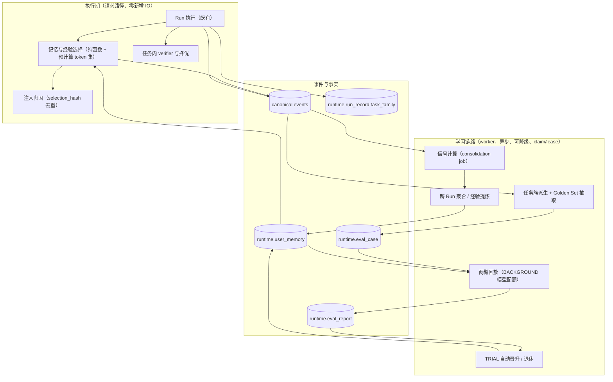

# Agent 自进化设计

> 文档编号：MOD-AGENT-SELF-EVOLUTION
> 文档版本：v0.2
> 创建日期：2026-10-31
> 文档状态：设计评审中
> 场景源：同目录 `agent-self-evolution.scenarios.md`

## 1. 文档控制

### 1.1 责任人与设计输入

| 角色 | 姓名 | 职责范围 |
|---|---|---|
| 产品/架构 | 待指定 | 任务族定义、成功判据、控制策略 |
| 开发负责人 | 待指定 | runtime / agent-core / 迁移与评测工具 |
| 测试负责人 | 待指定 | 回放评测、注入精度、门禁验收 |
| 设计评审 | 待指定 | 被否方案与 spec 变更确认 |

| 编号 | 输入 | 结论 |
|---|---|---|
| D-01 | 现状 | 记忆在 PG（`runtime.user_memory` JSONB），纯词法打分，覆盖率 >0 即入选；无反馈信号、无评测、无程序性经验 |
| D-02 | 效果定义 | 以任务族为单位度量：首次成功率、纠错轮次、注入精度；指标不动即停止投入 |
| D-03 | 控制模型 | 生成自由、激活受控、全程可审计、随时可回滚；控制点是激活而不是每一步确认 |
| D-04 | 检索选型 | 记忆上限按租户可配置（默认 200 条 / 64KB；当前上界 1000 条 / 1MiB），设计以可配置上界为准；Phase 1 用「阈值门控 + IDF 词法 + 使用归因 + 预计算 token 集」，语义检索由容量或召回指标触发 |
| D-05 | 经验承载 | 复用 `runtime.user_memory` 对象模型（单一写入方、锁序、幂等回执），不新建并行经验表；经验与事实共享每用户配额 |
| D-06 | 任务族 | 任务族由 Run 实际执行的 skill 派生，无 skill 时回退 `agent_id`；不需要新增人工字段或意图分类模型 |
| D-07 | 自动化边界 | 逐条经验不引入人工确认：回放达标自动进入 TRIAL，TRIAL 期生产信号不劣化自动晋升，劣化自动退休；只有回放不完整或高风险类别保留人工 |
| D-08 | Golden Set | 从真实 Run 自动抽取（成功、无负向信号、未取消），按任务族去重、脱敏、限量并保留时间切分，不建人工用例集 |
| D-09 | 回放口径 | 生产门禁用 live 两臂重跑（基线臂 vs 候选臂）；CI 用脚本化 provider 保证可复现。放弃“录制响应回放”，它无法测出新经验的效果 |
| D-10 | 范围 | 仅后端能力；Console 学习页与显式点赞 UI 列入后续 |
| D-11 | 批量输入 | 一个 Run 处理多个目标（如同一消息给出 10 个客户）时，学习链路按 case 的逐项结果判定，不以 Run 终态代替；运行时的自动扇出/批量执行能力不在本需求，单独记录并排期（`docs/issues/2026-10-31-batch-skill-fanout-backlog.md`） |

### 1.2 修订历史

| 版本 | 日期 | 作者 | 变更描述 |
|---|---|---|---|
| v0.1 | 2026-10-31 | Agent | 初始设计：效果先行的自进化闭环、检索打分改造、经验资产与激活控制 |
| v0.2 | 2026-10-31 | Agent | 按评审口径重写：任务族由 skill 派生、Golden Set 自动抽取、两臂回放、TRIAL 自动晋升、经验两通道注入、在线路径零新增 IO |

---

## 2. 需求分析

### 2.1 需求概述

| 项目 | 内容 |
|---|---|
| **模块名称** | Agent 学习与记忆（memory / consolidation / 评测 / 执行自检） |
| **模块ID** | MOD-AGENT-SELF-EVOLUTION |
| **所属系统/产品线** | agent-runtime / agent-core / agent-worker |
| **需求类型** | 功能开发 + 架构演进 |
| **业务背景** | 用户目前只会感觉「它记得我」：记忆靠用户显式告知或确认，召回是词法匹配且门槛极低；系统没有记录「对不对」的信号，没有评测能证明变好，也不会把成功经验沉淀成可复用的程序性知识。固定 skill 的旅程每次都要重新摸索，非标问题也复用不到旧经验。 |
| **核心目标** | 建立一条效果可度量、几乎不需要人介入的学习闭环：信号 → Golden Set → 两臂评测 → 经验候选 → 自动激活/回滚；同时把记忆召回从「有字面重叠就注入」改为「过阈值才注入」。 |

### 2.2 痛点与价值

| 维度 | 内容 |
|---|---|
| **目标用户** | 使用 Agent 完成重复性任务的业务用户；维护 Agent 的平台研发与租户管理员 |
| **当前问题** | ① 注入门槛：`lexical_coverage > 0` 即入选，单 token 重叠就会带入无关记忆（`memory/rank.py`）；② 空查询时事实类按更新时间塞入；③ 偏好类无条件注入且与事实类共享预算；④ 没有信号与评测，无法判断某条记忆是否真的有用；⑤ 成功轨迹不沉淀，同类任务每次都要重新摸索；⑥ 非标问题没有可复用的经验通道。 |
| **业务影响** | 用户觉得「上下文里有噪音」而不是「它懂我」；重复任务的纠错成本不变；无法用数据证明改进，也无法在改坏时快速回滚。 |
| **预期价值** | 同一任务族的纠错轮次下降、首次成功率上升；注入精度可度量；经验资产可审计、可灰度、可回滚；固定 skill 与非标探索都能命中经验。 |

**用户故事**

| 编号 | 用户故事 | 优先级 |
|---|---|---|
| US-01 | 作为业务用户，我希望它记住我的偏好和口径，但不要把无关内容塞进上下文 | P0 |
| US-02 | 作为业务用户，我希望同类任务越做越顺，但它不要擅自改变行为 | P0 |
| US-03 | 作为研发，我希望「变聪明」能用指标证明，改坏时能归因 | P0 |
| US-04 | 作为租户管理员，我希望一次开启后由系统自动控制经验生效，并能随时停用 | P0 |
| US-05 | 作为运维，我希望学习链路的任何失败都不影响主流程 | P1 |
| US-06 | 作为业务用户，我希望非标问题也能复用过去的经验与相关 skill | P0 |
| US-07 | 作为业务用户，我希望一次给出多个目标（如 10 个客户）时，系统按项处理并逐项判定成败，不因整体完成就掩盖某一项失败 | P0 |

### 2.3 功能方案

#### 2.3.1 功能清单

| 功能ID | 功能名称 | 功能描述 | 优先级 | 来源 |
|---|---|---|---|---|
| FEAT-01 | 学习信号与注入归因 | 隐式纠正信号（重问/否定/改写）由 consolidation job 在事件边界计算并落 canonical event；每次模型请求的注入条目与丢弃原因落事件，按选择 hash 去重，供评测与信用分配使用 | P0 | US-03 |
| FEAT-02 | 评测与回放 | 两臂回放（基线臂 vs 候选臂）+ 指标报告 + 门禁判定；批量 case 按逐项结果判定，缺项即失败；评测在 worker 内离线执行、走后台模型配额；学习链路失败降级为无学习 | P0 | US-03、US-05、US-07 |
| FEAT-03 | 任务内自检与择优 | 通过 verifier 注册表接入工具校验 / Skill 断言，在成本上限内生成候选并只输出通过验证的答案；全不通过则显式失败 | P0 | US-01 |
| FEAT-04 | 经验资产与提案 | 从成功且无纠正的轨迹生成 PROCEDURE / FAILURE_PATTERN / VERIFICATION 候选，带任务签名、触发文本与证据；批量轨迹的候选带批量触发语义；候选只处于 PROPOSED，不参与注入 | P0 | US-02、US-07 |
| FEAT-05 | 记忆与经验检索质量 | 事实记忆改为阈值门控 + IDF 词法 + 重要度 + 时效 + 使用归因打分；经验走「任务族」与「目标文本」两通道，ACTIVE 经验注入不受 inject_inferred 影响；偏好独立限额；同键只取最新；预算贪心装箱 | P0 | US-01、US-06 |
| FEAT-06 | 激活控制与自动晋升 | 经验状态机 PROPOSED → TRIAL → ACTIVE → RETIRED；回放达标自动进 TRIAL，TRIAL 期信号不劣化自动晋升、劣化自动退休；高风险类别人工确认；审计与停用回滚；新 Run 冻结激活集 | P0 | US-02、US-04 |
| FEAT-07 | 任务族与 Golden Set 自动抽取 | Run 完成时按执行的 skill 派生任务族（无 skill 回退 agent）；从真实成功轨迹自动抽取、脱敏、去重并落 eval_case，按族限量与时间切分；批量 case 记录 item_count 与逐项判据，超限标记 incomplete | P0 | US-03、US-06、US-07 |

### 2.4 范围与边界

| 类别 | 内容 |
|---|---|
| **范围（In Scope）** | 任务族派生；Golden Set 自动抽取；隐式学习信号；注入归因事件；两臂回放评测；任务内 verifier 与有界择优；经验资产的生成、状态机与自动激活；记忆与经验检索门控；平台设置新分组；迁移与契约测试 |
| **非范围（Out of Scope）** | Console 学习日志页面与显式点赞 UI（后续需求）；跨用户/跨租户知识共享；模型微调；在线修改系统提示词；引入向量数据库或 pgvector（由评测触发后再评估）；对既有 Run 的追溯性改写；运行时的自动扇出与批量 skill 执行能力（单独需求，见 `docs/issues/2026-10-31-batch-skill-fanout-backlog.md`） |
| **前置假设** | 任务族的成功判据可以被表达（工具返回 / Skill 断言 / Run 终态）；Golden Set 可从真实 Run 抽取并脱敏；租户已启用记忆 |
| **有意妥协 / 技术债** | Phase 1 语义检索缺位，同义表述仍可能召不回；隐式信号精度有限，只作候选生成证据与 TRIAL 期监控，不单独决定激活；学习日志先以事件与审计形式提供，暂无专用页面；跨 skill 的部分逻辑复用仍由现有 search_skills 承担 |

### 2.5 验收条件

#### 2.5.1 业务规则与约束

| ID | 类型 | 描述 | 验证场景 |
|---|---|---|---|
| RULE-01 | 系统约束 | 只有回放达标（候选臂相对基线臂达到 eval_min_improvement）的经验才允许进入 TRIAL/ACTIVE；ACTIVE 经验必须能回滚到 RETIRED 且行为回到基线 | S-06、S-08、S-10 |
| RULE-02 | 系统约束 | 记忆注入必须过阈值门控；空查询不得注入事实类；偏好类单独限额 | S-07、B-01 |
| RULE-03 | 系统约束 | 所有学习物可溯源（来源 Run / 事件），并遵守 forget_epoch；删除后不得再注入或被候选复活 | S-05、E-02 |
| RULE-04 | 系统约束 | 自动激活仅限 experience_auto_activate 白名单中的低风险类别；白名单之外的类别必须人工确认 | S-12 |
| RULE-05 | 系统约束 | 新 Run 冻结激活集与学习设置；激活只影响后续 Run | S-06、S-13 |
| RULE-06 | 系统约束 | 学习链路任何失败降级为无学习，不得影响主 Run 终态 | E-01 |
| RULE-07 | 系统约束 | 经验注入走「任务族」与「目标文本阈值」两通道；ACTIVE 经验注入不受 inject_inferred 影响；两路命中同一经验只注入一次 | S-06、S-13 |
| RULE-08 | 系统约束 | 自动晋升必须经过 TRIAL 观察窗口：TRIAL 期信号不劣化才晋升 ACTIVE，劣化自动 RETIRED，状态变化全程写审计 | S-12 |
| RULE-09 | 系统约束 | 学习链路不得增加 Run 请求路径的外部 IO：选择与装箱为进程内纯计算，候选 token 集在缓存装载时预计算，注入归因按 selection_hash 去重，评测与回放不进入请求路径 | S-02、B-03、B-06 |
| RULE-10 | 系统约束 | 批量 case 必须按条目判定：eval_case 记录 item_count 与逐项判据，回放缺项或单项失败即判失败；超过 eval_max_items_per_case 的 case 标记 incomplete；批量成功轨迹生成的经验必须带批量触发语义 | S-14、S-15、S-16 |

#### 2.5.2 功能验收场景

> 场景定义见 `agent-self-evolution.scenarios.md`；下表只写覆盖关系与设计影响。

> **测试分层**：纯逻辑（打分/门控/状态机/校准集）用 unit；真实 PostgreSQL 上的注入归因、任务族抽取、评测门禁、经验生命周期用 integration；迁移同构与架构隔离用 contract；本需求不新增浏览器旅程，故不新增 E2E。

| 场景ID | 覆盖功能 | 设计影响 / 备注 |
|---|---|---|
| S-01 | FEAT-01 | 信号由 consolidation job 离线计算并落库，不进入模型历史、不增加请求路径开销 |
| S-02 | FEAT-01 | 注入归因与模型请求逐条一致；按 selection_hash 去重，避免每请求多写一行 |
| S-03 | FEAT-02 | 回放在脚本化 provider 下可复现；报告以不可变行落 eval_report，不依赖 artifact 的 run/task 归属 |
| S-04 | FEAT-03 | verifier 经平台注册表接入；拒绝的候选不得输出；尝试次数有上限 |
| S-05 | FEAT-04 | 经验候选由跨 Run 聚合生成，只到 PROPOSED，不参与注入 |
| S-06 | FEAT-06 | 激活门禁由两臂回放决定；只影响后续 Run；inject_inferred=false 不影响 ACTIVE 经验 |
| S-07 | FEAT-05 | 阈值、空查询、偏好限额三条硬规则 |
| S-08 | FEAT-06 | 激活/停用写审计；停用即回滚且保留历史行 |
| S-09 | FEAT-07 | Golden Set 从真实轨迹自动抽取；任务族按执行的 skill 派生，无 skill 回退 agent |
| S-10 | FEAT-02 | 两臂对比与基线臂复用；判定写入报告 |
| S-11 | FEAT-05 | 阈值在标注集上校准，注入精度不劣于现状且噪音下降 |
| S-12 | FEAT-06 | 回放达标自动进 TRIAL；按生产信号自动晋升或退休 |
| S-13 | FEAT-05 | 非标问题按目标文本命中旧经验；执行 skill 后切换任务族并在下一个请求注入 |
| E-01 | FEAT-02 | 学习链路失败降级，主 Run 不受影响 |
| E-02 | FEAT-04 | forget_epoch 之后不得复活 |
| B-01 | FEAT-05 | 条数与字节双上限，丢弃有计数 |
| B-02 | FEAT-05 | 同键只注入最新有效版本 |
| B-03 | FEAT-05 | 可配置上界下选择正确、无外部 IO、token 集预计算 |
| B-04 | FEAT-04、FEAT-07 | 新列/新表与 ORM、契约模型同构，默认值保持既有行为 |
| B-05 | FEAT-02 | 覆盖表、manifest、context 与测试路径一致 |
| B-06 | FEAT-02 | 评测/回放不在 Run 请求路径，模型调用走 BACKGROUND 配额 |
| S-14 | FEAT-07 | 批量 case 的条目语义与超限 incomplete；运行时不保证逐项调用，测试用脚本化 provider 构造 |
| S-15 | FEAT-02 | 回放按逐项结果判定，缺项/单项失败即失败 |
| S-16 | FEAT-04 | 批量轨迹的经验带批量触发语义 |

#### 2.5.3 非功能指标

**性能指标**

| 指标ID | 指标名称 | 目标值 | 测量方法 |
|---|---|---|---|
| NFR-PERF-01 | 学习链路对 Run 请求路径的开销 | ① 每个模型请求新增数据库查询为 0；② 选择与装箱在 200 / 1000 条规模下 p95 不超过 3ms / 15ms（进程内，单机基准）；③ 候选内容 token 化只发生在缓存装载；④ 注入归因按 selection_hash 去重 | 单测基准（纯函数，覆盖默认 200 与上界 1000 两种规模）+ 查询计数断言；基准数字随验收证据记录 |
| NFR-COST-01 | 批量 case 的评测成本 | 单 case 条目数不超过 eval_max_items_per_case（默认 10），超出标记 incomplete；报告记录 item_count 与实际调用次数 | 回放报告字段与用例上限断言 |

**可靠性指标**

| 指标ID | 指标名称 | 目标值 |
|---|---|---|
| NFR-REL-01 | 学习链路失败对主流程的影响 | 0（降级为无学习，warning + 失败计数可见） |

**安全性要求**

| 指标ID | 安全域 | 验收标准 |
|---|---|---|
| NFR-SEC-01 | 内容安全 | 经验、记忆与 Golden Set 内容过 canary 校验；不得含凭据、密钥或跨租户数据 |

#### 2.5.4 验证环境假设

| 维度 | 假设 | 验证方式 / 参数 | 不满足时 |
|---|---|---|---|
| 容量 | 单任务族 Golden Set 初期 10–50 个 case | 回放 CLI 指定 task_family 与并发度 | 标记 incomplete 并跳过门禁 |
| 硬件 | 开发机 / CI runner | 无需额外硬件 | 返回 env_blocked |
| 依赖 | PostgreSQL、Redis、可用的脚本化 provider；无浏览器 | `make acceptance` 的隔离库 | 返回 env_blocked 并列出缺失项 |
| profile 参数 | 目标套件 → 回放 CLI → `make acceptance` → 全量 pytest | 串行，禁止共用 dev 库 | 显式报 incomplete |

---

## 3. 技术设计

### 3.1 方案选型

#### 备选方案对比

| 对比维度 | 权重 | 方案A：阈值门控 + 自动学习闭环 | 得分 | 方案B：向量检索 + 自动强化 | 得分 |
|---|---|---|---|---|---|
| 功能完备性 | 30% | 覆盖注入精度、经验沉淀与自动激活，语义召回复用词法兜底 | 24 | 语义召回更好，但缺信号时无法验证收益 | 21 |
| 性能预期 | 25% | 纯进程内计算，预计算后请求期开销低于现状 | 25 | 每次请求新增 embedding 调用与索引维护 | 16 |
| 实现复杂度 | 20% | 复用记忆体系与事件链 | 18 | 新增模型依赖、回填、索引与灰度 | 10 |
| 维护成本 | 15% | 无新中间件 | 15 | 向量列、模型版本、重嵌入与容量治理 | 9 |
| 风险评估 | 10% | 可回滚、证据链完整、逐条无需人工 | 10 | 少样本负迁移 + 噪声放大 | 5 |
| **最终得分** | **100%** | | **92** | | **61** |

#### 关键决策记录

| 决策点 | 选择 | 被否决项 | 理由 | 可逆性 |
|---|---|---|---|---|
| 任务族 | 执行的 skill key，无 skill 回退 agent_id；Run 完成时派生并落 `run_record.task_family` | 调用方显式声明 / LLM 意图分类 / 纯 agent_id | 零人工、零额外模型调用；固定 skill 旅程精确，非标问题由目标文本通道兜底 | 易（派生函数与列可替换） |
| 检索方式 | 阈值门控 + IDF 词法 + 使用归因；经验两通道（任务族 / 目标文本） | 只按任务族注入（B1） | 非标问题没有 skill，只按族注入会全部漏掉 | 易（打分函数可替换） |
| 向量存储 | 触发后先补 PG 向量列 + 预筛后的进程内余弦，仍不足再上 pgvector | 外部向量库 / 一步到位 pgvector（B2） | 上限可配置且可能继续上调，扩容要分阶段 | 易（列可保留，索引可后补） |
| 经验承载 | 复用 `runtime.user_memory` + 新类别 + 激活状态 + 触发文本列 | 新建 experience 表（B3） | 单一写入方、锁序、幂等回执与历史机制已就绪；经验与记忆共享一次 snapshot 读取 | 难（数据迁移） |
| Golden Set | 从真实成功轨迹自动抽取 | 人工维护用例集（B4） | 人工集会持续腐化，且没人维护 | 易（抽取器可停用） |
| 激活时机 | 回放达标 → TRIAL → 生产信号不劣化 → ACTIVE | 生成即生效（B5） | 少样本经验直接生效等于把偶然当规律；TRIAL 用真实信号复核 | 易 |
| 回放方式 | live 两臂重跑（基线臂结果可缓存） | 录制响应回放（B6） | 录制回放确定但测不出新经验效果，提升恒为 0 | 易 |
| 归因写入 | 每请求一条事件，选择未变化时以 selection_hash 引用 | 每请求完整落一条（B7） | 工具循环会让请求数放大，完整落行是纯写放大 | 易 |
| 任务内择优 | verifier 注册表 + 有界多候选 | LLM 自评择优（B8） | 自评无判据、不可复现；verifier 可测试 | 易 |

#### 技术栈

| 类别 | 选型 | 版本 | 选型理由 |
|---|---|---|---|
| 语言 | Python | 3.12+ | 既有 |
| 框架 | 无新增 | — | 纯函数 + 既有服务 |
| 数据库 | PostgreSQL | 既有 | 记忆、用例与评测报告 |
| 中间件 | 无新增 | — | 不引入向量库 |

### 3.2 架构设计

三条闭环与职责：

1. **任务内**：`RUN` 调 verifier 生成候选并择优；失败显式返回，不输出未验证答案。
2. **跨任务**：`EV` → 信号 + 任务族派生 → Golden Set 落 `EC` → 聚合生成 `UM` PROPOSED → 两臂 `REPLAY` 落 `ER` → `ACT` 自动 TRIAL/ACTIVE/RETIRED。
3. **控制面**：每次状态变化写审计；新 Run 的 `RuntimeSnapshot` 冻结 learning 设置与 ACTIVE 经验 id 集合；停用即回滚。

**任务族派生**：Run 完成时扫描该 Run 的 `TOOL_CALL` 事件，取首个成功执行的 skill key 作为任务族；没有任何 skill 时任务族为 `agent:<agent_id>`。派生结果落到 `runtime.run_record.task_family`，供 Golden Set 分组、经验归属与指标归因共用；离线 job 复用同一个纯函数 `derive_task_family`。

**执行期与学习链路的隔离**：信号、Golden Set 抽取、聚合与回放全部在 worker 内执行，使用 `memory_consolidation_job` 同构的 claim/lease 与同事务最多一次语义；回放模型调用走 `PooledModelProvider` 的 BACKGROUND 工作负载，不占用前台 Run 的模型预算。

### 3.3 数据设计

**扩展表：`runtime.user_memory`**

| 字段名 | 类型 | 可空 | 默认值 | 索引 | 说明 |
|---|---|---|---|---|---|
| activation_state | text | N | `'ACTIVE'` | 见下 | `PROPOSED` / `TRIAL` / `ACTIVE` / `RETIRED`；既有行为 ACTIVE |
| task_signature | text | Y | NULL | | 经验类别的任务族键（`skill:<key>` 或 `agent:<id>`） |
| trigger_text | text | Y | NULL | | 经验的触发条件文本，供目标文本通道打分 |
| evidence_json | jsonb | Y | NULL | | 来源 run_id、成功次数、回放报告引用与触发证据 |

- 类别约束扩展为 `PREFERENCE / WORK_STYLE / EXPLICIT / TASK_STATE / PROCEDURE / FAILURE_PATTERN / VERIFICATION`；契约层 `MemoryCategory`、`memory_service.ALLOWED_CATEGORIES`、Admin/Console DTO 的类别 Literal 与提案文案表同步扩展。
- 新增 partial index：`(tenant_id, user_id, category, update_time DESC) WHERE is_deleted=false AND enabled=true AND activation_state='ACTIVE'`。
- `user_memory` 的迁移与 ORM 保持同构（既有 schema parity 套件覆盖）；经验与事实共享 `max_entries_per_user` 配额。

**新增表：`runtime.eval_case`**

| 字段名 | 类型 | 可空 | 默认值 | 索引 | 说明 |
|---|---|---|---|---|---|
| tenant_id | varchar(64) | N | | 复合 UK | 租户 |
| task_family | varchar(64) | N | | 复合 UK + 查询索引 | 任务族 |
| source_run_id | uuid | N | | 复合 UK + FK `runtime.run_record.id` | 来源 Run |
| input_ref_json | jsonb | N | | | Snapshot 与输入引用 |
| criteria_json | jsonb | N | | | verifier 与逐项判据（批量 case 记录每一项的期望结果） |
| item_count | integer | N | 1 | | 批量 case 的条目数；超过 eval_max_items_per_case 时 case 标记 incomplete |
| content_hash | varchar(128) | N | | 复合 UK | 输入指纹，用于去重 |
| version | bigint | N | 1 | 复合 UK | 用例版本 |

- 唯一键 `(tenant_id, task_family, source_run_id, version)`；查询索引 `(tenant_id, task_family, create_time DESC)`。

**新增表：`runtime.eval_report`**

| 字段名 | 类型 | 可空 | 默认值 | 索引 | 说明 |
|---|---|---|---|---|---|
| tenant_id | varchar(64) | N | | 查询索引 | 租户 |
| task_family | varchar(64) | N | | 查询索引 | 任务族 |
| experience_key | varchar(64) | Y | NULL | | 被评经验；NULL 表示纯基线报告 |
| base_config_hash | varchar(128) | N | | | 冻结 Snapshot 与策略的指纹，基线臂缓存键 |
| metrics_json | jsonb | N | | | 成功率、纠错轮次、注入精度等指标 |
| decision_json | jsonb | N | | | 门禁判定与原因 |
| report_json | jsonb | N | | | 每个 case 的通过/失败原因 |
| content_hash | varchar(128) | N | | | 报告内容指纹 |
| version | bigint | N | 1 | 复合 UK | 追加版本 |

- append-only：重复回放产生新版本，不覆盖历史；不写入 `runtime.artifact`（artifact 的 run/task 互斥约束不适用于评测报告）。

**扩展：`runtime.run_record.task_family`**

- 新增可空 `varchar(64)` 列与索引 `(tenant_id, task_family, end_time DESC)`；只在 Run 完成时写入，既有行为保持不变。

**事件类型**（canonical events，不新建表）：`LEARNING_SIGNAL`、`MEMORY_INJECTED`、`EXPERIENCE_STATE_CHANGED`。三者均不在 `HISTORY_EVENT_TYPES` 中，不进入模型历史；`MEMORY_INJECTED` 载荷只写 memory_key/version/score/decision、丢弃计数与 selection_hash。

**迁移**：单条 revision（编号按实施时链尾顺延，与 execution-core-deframework 的 0029 不冲突），upgrade 建列/约束/索引/新表，downgrade 对称回收。

### 3.4 接口设计

#### 形态 C：函数 / 库接口（执行期）

| 函数签名 | 入参 | 返回 | 错误处理 |
|---|---|---|---|
| `select_for_injection(records, *, query, now, policy, task_family)` | 候选集、查询、策略、当前任务族 | 入选条目、每条 score/decision 与按 reason 汇总的丢弃计数 | 纯函数，不抛业务错误 |
| `score(record, query, now, stats)` | 单条候选 | 分数与分量 | 纯函数 |
| `derive_task_family(events, skills)` | Run 事件与 skill 目录 | `skill:<key>` 或 `agent:<id>` | 纯函数 |
| `register_verifier(task_family, verifier)` | 任务族、校验器 | — | 重复注册抛 `ValueError` |
| `run_verification(candidates, verifier, max_attempts)` | 候选、校验器、上限 | 通过的候选或显式失败 | 超限返回 `VERIFICATION_EXHAUSTED` |

**运行期任务族**：请求期的 `task_family` 由本次 Run 已成功执行的 skill 实时派生（与离线 `derive_task_family` 同一函数），不读取 `run_record.task_family` 的完成值；后者只服务离线评测与指标归因。

**两通道注入规则**（由 `select_for_injection` 统一实现，不引入额外查询）：

1. 偏好类：沿用既有独立限额，空查询只注入偏好。
2. 任务族通道：`activation_state='ACTIVE'` 且 `task_signature` 等于当前任务族的经验；skill 执行后下一次模型请求生效。
3. 目标文本通道：ACTIVE 经验按查询与 `trigger_text` 的阈值打分入选，覆盖无 skill 的非标问题。
4. 去重与预算：两路命中同一 memory_key 只保留一条；统一按分数贪心装箱并记录丢弃原因。

**冻结语义**：新 Run 创建时，`RuntimeSnapshot` 的 `policy_json` 冻结 learning 设置与当时 ACTIVE 经验的 id/version 集合；执行期不重读，激活只影响后续 Run。

#### 形态 B：CLI 命令（控制面）

| 命令 | 参数 / Flag | 说明 | 退出码 |
|---|---|---|---|
| `learning_admin list` | `--tenant-id` `--state` `--task-family` | 列出经验与状态 | 0 / 1 |
| `learning_admin replay` | `--tenant-id` `--task-family` `--experience-id` | 触发两臂回放并产出报告 | 0=达标 / 1=不达标 / 2=执行错误 |
| `learning_admin activate` | `--experience-id` `--operator` | 人工覆盖自动晋升（白名单外类别必需） | 0 / 1=门禁拒绝 |
| `learning_admin retire` | `--experience-id` `--reason` `--operator` | 停用并写审计 | 0 |
| `learning_admin explain` | `--experience-id` | 输出状态机历史与最近报告 | 0 |

- stdout 输出机器可读 JSON；stderr 输出失败原因；所有动作写审计，操作者取自 `--operator`。

#### 平台设置新增分组 `learning`

| 配置项 | 默认值 | 说明 |
|---|---|---|
| `learning_enabled` | `false` | 总开关，按租户灰度；开启一次后逐条经验无需人工 |
| `signal_detection_enabled` | `true` | 隐式信号采集（受总开关约束） |
| `retrieval_min_score` | `0.35` | 低于阈值不注入（由标注集校准） |
| `retrieval_preference_items` | `3` | 偏好类独立条数限额 |
| `retrieval_preference_bytes` | `512` | 偏好类独立字节限额 |
| `experience_min_success_runs` | `3` | 生成候选所需的最小成功轨迹数 |
| `experience_auto_activate` | `["PROCEDURE", "FAILURE_PATTERN"]` | 允许自动进入 TRIAL 的类别白名单 |
| `experience_trial_runs` | `20` | TRIAL 观察窗口内需要信号统计的 Run 数 |
| `experience_trial_max_regression` | `0.05` | TRIAL 期信号劣化上限 |
| `verification_max_attempts` | `2` | 任务内择优的候选上限 |
| `eval_min_improvement` | `0.05` | 两臂回放达标所需的最小提升 |
| `eval_min_cases` | `10` | 可判定门禁的最少用例数，不足标记 incomplete |
| `eval_max_cases` | `50` | 单族回放用例上限 |
| `eval_max_items_per_case` | `10` | 批量 case 的条目上限，超出标记 incomplete 并记录 item_count |

所有 `learning` 设置随 Run 冻结进 Snapshot 的 `policy_json`，执行期不重读。

### 3.5 质量实现方案

#### 性能设计

| 指标ID | 热点路径 | 目标值 | 实现方案（含被放弃的较慢方案） |
|---|---|---|---|
| NFR-PERF-01 | 每个模型请求的记忆与经验选择 | 200 条 p95 ≤ 3ms；1000 条 p95 ≤ 15ms；新增 DB 查询 0 | 候选 token 集在缓存装载时预计算（仓库实测：现状 1000 条每次请求 12.2ms，预计算后 0.11ms；200 条 2.45ms → 0.02ms）；选择为进程内集合运算；放弃每请求向量检索（Phase 1） |
| NFR-PERF-01 | 注入归因写入 | 每请求至多 1 行，选择未变化不新增 | 事件带 selection_hash；未变化时引用上一条，不重复写载荷 |
| NFR-PERF-01 | 评测与回放 | 不进入 Run 请求路径 | 全部在 worker 内执行；基线臂按 `base_config_hash` 缓存复用；回放走 BACKGROUND 模型配额 |

#### 可靠性设计

| 风险ID | 失效模式 | 影响 | 应对措施 | 验证场景 |
|---|---|---|---|---|
| RISK-01 | 隐式信号误判 | 生成错误经验候选 | 信号只作候选证据与 TRIAL 监控；需最小成功轨迹数 | S-05、E-01 |
| RISK-02 | 回放与线上分布不一致 | 激活后效果不及预期 | Golden Set 按时间切分；TRIAL 期生产信号复核并自动退休 | S-03、S-10、S-12 |
| RISK-03 | 经验负迁移 | 同类任务质量下降 | 任务族 + 阈值 + 两臂回放 + 可回滚；停用即 RETIRED | S-06、S-08 |
| RISK-04 | 学习链路拖垮主流程 | Run 失败或延迟 | 异步执行、有界超时、失败降级为无学习并计数 | E-01 |
| RISK-05 | 删除后复活 | 用户隐私与信任受损 | forget_epoch 校验；候选生成跳过已删除键；tombstone 优先于激活集 | E-02 |
| RISK-06 | 经验与事实争抢配额 | 用户事实被挤占 | 经验计入同一配额并在观测指标中区分类别；必要时按类别限额 | S-05、B-01 |
| RISK-07 | 回放成本失控 | 模型费用上升 | 用例上限、按需触发、基线臂缓存、BACKGROUND 配额 | S-10、B-06 |
| RISK-12 | 批量 case 以整体成功掩盖单项失败 | 指标虚高、经验错误 | eval_case 记录 item_count 与逐项判据；缺项/单项失败即失败；超限标记 incomplete | S-14、S-15 |
| RISK-13 | 批量回放成本按条目放大 | 评测预算超支 | eval_max_items_per_case 上限、成本随 item_count 记录、按族按需触发 | S-14、S-15 |

#### 安全性设计

| 指标ID | 验收标准 | 实现方案 |
|---|---|---|
| NFR-SEC-01 | 经验与记忆不含凭据 | 复用 canary 校验与脱敏；Golden Set 抽取先脱敏再落库；跨租户数据不参与任何学习链路 |

#### 可观测性设计

| 场景 | 实现方案 |
|---|---|
| 信号 | `learning_signal_total{type,outcome}` |
| 注入 | `memory_inject_total{outcome}`、`memory_inject_dropped_total{reason}`、`memory_inject_score` 直方图、`memory_inject_category_total{category}` |
| 经验 | `experience_state_total{state,transition}`、`experience_replay_total{result}`、`experience_trial_total{outcome}` |
| 失败 | `learning_pipeline_failures_total{stage}` + warning 日志 |

---

## 4. 部署与运维

### 4.1 部署架构

| 环境 | 配置 | 实例数 | 用途 |
|---|---|---|---|
| 内网 K8s | 既有 5 单元，无新增服务 | 按既有 chart | 交付部署 |
| CI | 全量 pytest + `make acceptance` + images matrix | 既有 | 构建验证 |

### 4.2 发布与回滚

| 阶段 | 范围 | 进入条件 | 回滚条件 |
|---|---|---|---|
| 灰度 | 单租户、单任务族，`learning_enabled=true` | 回放达标、指标监控就绪 | 纠错轮次或成功率劣化 |
| 扩大 | 试点租户全量 | 灰度期指标不劣于基线 | 同上 |

回滚：关闭 `learning_enabled`、`retire` 相关经验或把类别移出 `experience_auto_activate` 即可回到基线行为；数据回滚用迁移 downgrade。

### 4.3 监控告警

| 指标 | 阈值 | 处置 |
|---|---|---|
| `learning_pipeline_failures_total{stage}` | 5 分钟 > 0 | 检查 consolidation / 回放 worker |
| `experience_trial_total{outcome="RETIRED"}` | 连续 3 条 | 检查 Golden Set 与阈值，暂停自动晋升 |
| `memory_inject_dropped_total{reason}` | 相对基线翻倍 | 复核 `retrieval_min_score` 校准 |

### 4.4 数据迁移

| 阶段 | 操作 | 验证方法 |
|---|---|---|
| 1 | 扩展类别约束与新列，默认 `ACTIVE` 保持既有行为 | schema parity 套件 |
| 2 | 新建 `eval_case`、`eval_report` 表与 `run_record.task_family` 列 | 迁移到 head 后表结构比对 |
| 3 | 回滚演练 | downgrade 后列与表回收，既有记忆行不受影响 |

---

## 5. 风险与依赖

### 5.1 项目依赖

| 依赖模块/团队 | 依赖内容 | 状态 | 风险等级 |
|---|---|---|---|
| 模型提供方 | 回放需要可用模型；后续语义检索需要 embedding 接口 | Phase 1 不依赖 embedding | 低 |

### 5.2 风险识别

| 风险ID | 类型 | 描述 | 概率 | 影响 | 应对措施 | 验证场景 |
|---|---|---|---|---|---|---|
| RISK-08 | 产品 | 任务族选错，指标无法移动 | 中 | 高 | skill 派生 + agent 兜底；试点前先建基线，指标不动即停止并归因 | S-09、S-03 |
| RISK-09 | 成本 | 择优与回放带来额外模型调用 | 中 | 中 | 严格次数与用例上限；回放离线执行并走后台配额 | S-04、S-10、B-06 |
| RISK-10 | 门禁 | 记忆 spec 的规则与实现冲突 | 中 | 中 | 按 Spec Compliance Matrix 逐条落点；阈值门控同步改写 RULE-memory-003 文本 | S-05、E-02、S-07 |
| RISK-11 | 容量 | 租户把记忆上限上调后，候选载入与打分变慢 | 中 | 中 | token 集预计算 + revision 缓存 + 两阶段预筛；达到触发条件再补向量索引；基准覆盖默认与上界两种规模 | B-03 |

---

## 6. 需求追溯矩阵

| 用户故事 | 功能ID | 接口ID | 测试用例ID | 测试层级 | 执行方式 | 追溯 check | 状态 |
|---|---|---|---|---|---|---|---|
| US-01 | FEAT-05 | — | S-07 | unit | auto | 待 plan 绑定 | 待实现 |
| US-01 | FEAT-05 | — | S-11 | unit | auto | 待 plan 绑定 | 待实现 |
| US-01 | FEAT-03 | — | S-04 | integration | auto | 待 plan 绑定 | 待实现 |
| US-02 | FEAT-04 | — | S-05 | integration | auto | 待 plan 绑定 | 待实现 |
| US-02 | FEAT-06 | — | S-06 | integration | auto | 待 plan 绑定 | 待实现 |
| US-02 | FEAT-04 | — | E-02 | integration | auto | 待 plan 绑定 | 待实现 |
| US-03 | FEAT-01 | — | S-01 | integration | auto | 待 plan 绑定 | 待实现 |
| US-03 | FEAT-01 | — | S-02 | integration | auto | 待 plan 绑定 | 待实现 |
| US-03 | FEAT-02 | — | S-03 | integration | auto | 待 plan 绑定 | 待实现 |
| US-03 | FEAT-02 | — | S-10 | integration | auto | 待 plan 绑定 | 待实现 |
| US-03 | FEAT-07 | — | S-09 | integration | auto | 待 plan 绑定 | 待实现 |
| US-04 | FEAT-06 | — | S-08 | integration | auto | 待 plan 绑定 | 待实现 |
| US-04 | FEAT-06 | — | S-12 | integration | auto | 待 plan 绑定 | 待实现 |
| US-05 | FEAT-02 | — | E-01 | integration | auto | 待 plan 绑定 | 待实现 |
| US-06 | FEAT-05 | — | S-13 | integration | auto | 待 plan 绑定 | 待实现 |
| US-06 | FEAT-07 | — | B-04 | contract | auto | 待 plan 绑定 | 待实现 |
| US-02 | FEAT-05 | — | B-01 | unit | auto | 待 plan 绑定 | 待实现 |
| US-02 | FEAT-05 | — | B-02 | unit | auto | 待 plan 绑定 | 待实现 |
| US-01 | FEAT-05 | — | B-03 | unit | auto | 待 plan 绑定 | 待实现 |
| US-03 | FEAT-02 | — | B-05 | contract | auto | 待 plan 绑定 | 待实现 |
| US-03 | FEAT-02 | — | B-06 | contract | auto | 待 plan 绑定 | 待实现 |
| US-07 | FEAT-07 | — | S-14 | integration | auto | 待 plan 绑定 | 待实现 |
| US-07 | FEAT-02 | — | S-15 | integration | auto | 待 plan 绑定 | 待实现 |
| US-07 | FEAT-04 | — | S-16 | integration | auto | 待 plan 绑定 | 待实现 |

---

## Spec Compliance Matrix

| Spec/Rule | enforcement | 设计影响 | 设计落点 | 验证场景 | 状态/N/A 理由 |
|---|---|---|---|---|---|
| `harness-memory#RULE-memory-001` | required | 自然语言记忆仍需真实用户确认；白名单外经验的人工激活经 `learning_admin` 且记录操作者；模型不得自称授权 | §3.4 接口设计 `learning_admin` | S-08、S-12 | applied |
| `harness-memory#RULE-memory-002` | required | Runtime 仍是唯一记忆写入方；经验复用 `user_memory` 的锁序与幂等回执；学习链路不新建写入路径 | §3.3 数据设计 `user_memory` | S-05、S-08 | applied |
| `harness-memory#RULE-memory-003` | required | 候选读取仍取用户完整有界集合，不截断；revision 缓存失效语义不变；打分与装箱为纯函数，token 集在缓存装载时预计算 | §3.4 接口设计 `select_for_injection` | S-07、B-01、B-02、B-03 | applied |
| `harness-memory#RULE-memory-004` | required | forget_epoch 与 tombstone 优先于激活集；停用为 RETIRED 不删历史；候选生成跳过已删除键 | §3.5 质量实现方案 `forget_epoch` | E-02、S-08 | applied |
| `harness-memory#RULE-memory-005` | required | 聚合与回放复用 consolidation job 的 claim/lease 与同事务最多一次语义；失败整批回滚 | §3.2 架构设计 `claim/lease` | S-05、E-01 | applied |
| `harness-memory#RULE-memory-006` | required | 激活集与 learning 设置随 `policy_json` 冻结；执行期不重读；额度变更只影响新 Run | §3.4 接口设计 `policy_json` | S-06 | applied |
| `harness-data#RULE-data-001` | required | 新列与新表遵循标准列、JSONB 与 partial index 口径；评测报告 append-only；迁移与 ORM 同构 | §3.3 数据设计 `eval_report` | B-04 | applied |
| `harness-snapshot#RULE-snapshot-001` | required | 学习设置与激活集在 Run 创建时冻结进 RuntimeSnapshot；激活只影响后续 Run，终态写入保持 CAS | §3.2 架构设计 `RuntimeSnapshot` | S-06 | applied |
| `harness-test#RULE-test-001` | required | 纯逻辑（打分/门控/状态机/校准）用 unit；真实 PG 的注入归因、任务族抽取、回放与生命周期用 integration；迁移与隔离用 contract；无新增浏览器旅程 | §2.5 验收条件 测试分层 | S-01、S-02、S-03、S-05、S-06、S-07、S-08、S-09、S-10、S-11、S-12、S-13、S-14、S-15、S-16、B-04、B-05、B-06 | applied |

---

*文档结束*
