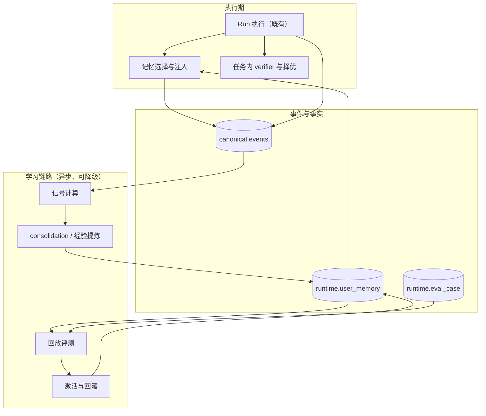
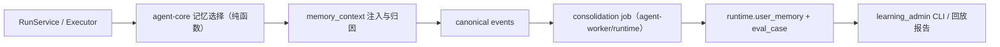

# Agent 自进化设计

> 文档编号：MOD-AGENT-SELF-EVOLUTION
> 文档版本：v0.1
> 创建日期：2026-10-31
> 文档状态：设计评审中
> 场景源：同目录 `agent-self-evolution.scenarios.md`

## 1. 文档控制

### 1.1 责任人与设计输入

| 角色 | 姓名 | 职责范围 |
|---|---|---|
| 产品/架构 | 待指定 | 任务族选择、成功判据、控制策略 |
| 开发负责人 | 待指定 | runtime / agent-core / 迁移与评测工具 |
| 测试负责人 | 待指定 | 回放评测、注入精度、门禁验收 |
| 设计评审 | 待指定 | 被否方案与 spec 变更确认 |

| 编号 | 输入 | 结论 |
|---|---|---|
| D-01 | 现状 | 记忆在 PG（`runtime.user_memory` JSONB），纯词法打分，覆盖率 >0 即入选；无反馈信号、无评测、无程序性经验 |
| D-02 | 效果定义 | 以任务族为单位度量：首次成功率、纠错轮次、注入精度、人工干预率；指标不动即停止投入 |
| D-03 | 控制模型 | 生成自由、激活受控、全程可审计、随时可回滚；控制点是激活而不是每一步确认 |
| D-04 | 检索选型 | 记忆上限按租户可配置（默认 200 条 / 64KB；当前上界 1000 条 / 1MiB，常量可继续上调），设计以**可配置上界**为准；Phase 1 用「阈值门控 + IDF 词法 + 使用归因 + 预计算 token 集」，语义检索与向量索引由容量或召回指标触发 |
| D-05 | 经验承载 | 复用 `runtime.user_memory` 对象模型（单一写入方、锁序、幂等回执），不新建并行经验表 |
| D-06 | 范围 | 仅后端能力；Console 学习页、显式点赞 UI、跨用户知识列入后续 |

### 1.2 修订历史

| 版本 | 日期 | 作者 | 变更描述 |
|---|---|---|---|
| v0.1 | 2026-10-31 | Agent | 初始设计：效果先行的自进化闭环、检索打分改造、经验资产与激活控制 |

---

## 2. 需求分析

### 2.1 需求概述

| 项目 | 内容 |
|---|---|
| **模块名称** | Agent 学习与记忆（memory / consolidation / 评测 / 执行自检） |
| **模块ID** | MOD-AGENT-SELF-EVOLUTION |
| **所属系统/产品线** | agent-runtime / agent-core / agent-worker |
| **需求类型** | 功能开发 + 架构演进 |
| **业务背景** | 用户目前只会感觉「它记得我」：记忆靠用户显式告知或确认，召回是词法匹配且门槛极低；系统没有记录「对不对」的信号，没有评测能证明变好，也不会把成功经验沉淀成可复用的程序性知识。继续加记忆条目不会带来「越用越聪明」的感受。 |
| **核心目标** | 建立一条效果可度量的学习闭环：信号 → 评测 → 经验候选 → 回放验证 → 激活/回滚；同时把记忆召回从「有字面重叠就注入」改为「过阈值才注入」。 |

### 2.2 痛点与价值

| 维度 | 内容 |
|---|---|
| **目标用户** | 使用 Agent 完成重复性任务的业务用户；维护 Agent 的平台研发与租户管理员 |
| **当前问题** | ① 注入门槛：`lexical_coverage > 0` 即入选，单 token 重叠就会带入无关记忆（`memory/rank.py`）；② 空查询时事实类按更新时间塞入；③ 偏好类无条件注入且与事实类共享预算；④ 没有信号与评测，无法判断某条记忆是否真的有用；⑤ 成功轨迹不沉淀，同类任务每次都要重新摸索。 |
| **业务影响** | 用户觉得「上下文里有噪音」而不是「它懂我」；重复任务的纠错成本不变；无法用数据证明改进，也无法在改坏时快速回滚。 |
| **预期价值** | 同一任务族的纠错轮次下降、首次成功率上升；注入精度可度量；经验资产可审计、可灰度、可回滚。 |

**用户故事**

| 编号 | 用户故事 | 优先级 |
|---|---|---|
| US-01 | 作为业务用户，我希望它记住我的偏好和口径，但不要把无关内容塞进上下文 | P0 |
| US-02 | 作为业务用户，我希望同类任务越做越顺，但它不要擅自改变行为 | P0 |
| US-03 | 作为研发，我希望「变聪明」能用指标证明，改坏时能归因 | P0 |
| US-04 | 作为租户管理员，我希望控制哪些经验可以自动生效、哪些必须人工确认，并能随时停用 | P0 |
| US-05 | 作为运维，我希望学习链路的任何失败都不影响主流程 | P1 |

### 2.3 功能方案

#### 2.3.1 功能清单

| 功能ID | 功能名称 | 功能描述 | 优先级 | 来源 |
|---|---|---|---|---|
| FEAT-01 | 学习信号与注入归因 | 隐式纠正信号（重问/否定/改写）落 canonical event；每次模型请求注入的记忆条目与丢弃原因落事件，供评测与信用分配使用 | P0 | US-03 |
| FEAT-02 | 评测与回放 | 任务族 + Golden Set + 基于 Snapshot 的确定性回放 + 指标报告；学习链路失败降级为无学习 | P0 | US-03、US-05 |
| FEAT-03 | 任务内自检与择优 | 可注册 verifier（工具校验 / Skill 断言），在成本上限内生成候选并只输出通过验证的答案；全不通过则显式失败 | P0 | US-01 |
| FEAT-04 | 经验资产与提案 | 从成功且无纠正的轨迹生成 PROCEDURE / FAILURE_PATTERN / VERIFICATION 候选，带任务签名与证据；候选只处于 PROPOSED，不参与注入 | P0 | US-02 |
| FEAT-05 | 记忆检索质量 | 打分改为阈值门控 + IDF 词法 + 重要度 + 时效 + 使用归因；偏好独立限额；同键只取最新；预算贪心装箱 | P0 | US-01 |
| FEAT-06 | 激活控制与回滚 | 经验状态机 PROPOSED → TRIAL → ACTIVE → RETIRED；激活需回放达标；高风险类别人工确认；审计与停用回滚；新 Run 冻结激活集 | P0 | US-02、US-04 |

### 2.4 范围与边界

| 类别 | 内容 |
|---|---|
| **范围（In Scope）** | 隐式学习信号；注入归因事件；Golden Set 与回放评测；任务内 verifier 与有界择优；经验资产的生成、状态机与激活门禁；记忆打分与门控改造；平台设置新分组；迁移与契约测试 |
| **非范围（Out of Scope）** | Console 学习日志页面与显式点赞 UI（后续需求）；跨用户/跨租户知识共享；模型微调；在线修改系统提示词；引入向量数据库或 pgvector（由评测触发后再评估）；对既有 Run 的追溯性改写 |
| **前置假设** | 任务族的成功判据可以被表达（工具返回 / Skill 断言 / 用户验收）；Golden Set 可从真实 Run 抽取并脱敏；租户已启用记忆 |
| **有意妥协 / 技术债** | Phase 1 语义检索缺位，同义表述仍可能召不回；隐式信号精度有限，只作候选生成证据，不直接驱动自动激活；学习日志先以事件与审计形式提供，暂无专用页面。 |

### 2.5 验收条件

#### 2.5.1 业务规则与约束

| ID | 类型 | 描述 | 验证场景 |
|---|---|---|---|
| RULE-01 | 系统约束 | 只有回放指标达到阈值的经验才允许进入 ACTIVE；ACTIVE 经验必须能回滚到 RETIRED 且行为回到基线 | S-06、S-08 |
| RULE-02 | 系统约束 | 记忆注入必须过阈值门控；空查询不得注入事实类；偏好类单独限额 | S-07、B-01 |
| RULE-03 | 系统约束 | 所有学习物可溯源（来源 Run / 事件），并遵守 forget_epoch；删除后不得再注入或被候选复活 | E-02、S-05 |
| RULE-04 | 系统约束 | 高风险类别激活必须人工确认；自动激活仅限平台设置白名单中的低风险类别 | S-06、S-08 |
| RULE-05 | 系统约束 | 新 Run 冻结激活集与学习设置；激活只影响后续 Run | S-06 |
| RULE-06 | 系统约束 | 学习链路任何失败降级为无学习，不得影响主 Run 终态 | E-01 |

#### 2.5.2 功能验收场景

> 场景定义见 `agent-self-evolution.scenarios.md`；下表只写覆盖关系与设计影响。

> **测试分层**：纯逻辑（打分/门控/状态机）用 unit；真实 PostgreSQL 上的注入归因、经验生命周期与回放用 integration；本需求不新增浏览器旅程，故不新增 E2E。

| 场景ID | 覆盖功能 | 设计影响 / 备注 |
|---|---|---|
| S-01 | FEAT-01 | 信号由 Runtime 在事件边界计算并落库，不进入模型历史 |
| S-02 | FEAT-01 | 注入归因与模型请求逐条一致，是后续信用分配的唯一输入 |
| S-03 | FEAT-02 | 回放必须确定性；报告落产物存储 |
| S-04 | FEAT-03 | verifier 拒绝的候选不得输出；尝试次数有上限 |
| S-05 | FEAT-04 | 经验候选只到 PROPOSED，不参与注入 |
| S-06 | FEAT-06 | 激活门禁由回放结果决定；只影响后续 Run |
| S-07 | FEAT-05 | 阈值、空查询、偏好限额三条硬规则 |
| S-08 | FEAT-06 | 激活/停用写审计；停用即回滚且保留历史行 |
| E-01 | FEAT-02 | 学习链路失败降级，主 Run 不受影响 |
| E-02 | FEAT-04 | forget_epoch 之后不得复活 |
| B-01 | FEAT-05 | 条数与字节双上限，丢弃有计数 |
| B-02 | FEAT-05 | 同键只注入最新有效版本 |
| B-03 | FEAT-05 | 在 `max_entries_per_user` 的可配置上界下，选择仍正确且无新增外部 IO |

#### 2.5.3 非功能指标

**性能指标**

| 指标ID | 指标名称 | 目标值 | 测量方法 |
|---|---|---|---|
| NFR-PERF-01 | 记忆选择与装箱的额外开销 | 无新增外部 IO；按 `max_entries_per_user` 的可配置上界（当前 1000 条）建立基准并回填 P95 目标 | 单测基准（纯函数，覆盖默认 200 与上界 1000 两种规模）与 run 段 profile |

**可靠性指标**

| 指标ID | 指标名称 | 目标值 |
|---|---|---|
| NFR-REL-01 | 学习链路失败对主流程的影响 | 0（降级为无学习，warning + 失败计数可见） |

**安全性要求**

| 指标ID | 安全域 | 验收标准 |
|---|---|---|
| NFR-SEC-01 | 内容安全 | 经验与记忆内容过 canary 校验；不得含凭据、密钥或跨租户数据 |

#### 2.5.4 验证环境假设

| 维度 | 假设 | 验证方式 / 参数 | 不满足时 |
|---|---|---|---|
| 容量 | 单租户 Golden Set 初期 ≤50 个 case | 回放 CLI 指定 task_family 与并发度 | 标记 `incomplete` 并分批 |
| 硬件 | 开发机 / CI runner | 无需额外硬件 | 返回 `env_blocked` |
| 依赖 | PostgreSQL、Redis、可用的脚本化 provider；无浏览器 | `make acceptance` 的隔离库 | 返回 `env_blocked` 并列出缺失项 |
| profile 参数 | 目标套件 → 回放 CLI → `make acceptance` → 全量 pytest | 串行，禁止共用 dev 库 | 显式报 `incomplete` |

---

## 3. 技术设计

### 3.1 方案选型

#### 备选方案对比

| 对比维度 | 权重 | 方案A：阈值门控 + 学习闭环 | 得分 | 方案B：向量检索 + 自动强化 | 得分 |
|---|---|---|---|---|---|
| 功能完备性 | 30% | 覆盖注入精度与经验沉淀，语义召回复用词法兜底 | 24 | 语义召回更好，但缺信号时无法验证收益 | 21 |
| 性能预期 | 25% | 纯进程内计算，无新增网络调用 | 25 | 每次请求新增 embedding 调用与索引维护 | 16 |
| 实现复杂度 | 20% | 复用记忆体系与事件链 | 18 | 新增模型依赖、回填、索引与灰度 | 10 |
| 维护成本 | 15% | 无新中间件 | 15 | 向量列、模型版本、重嵌入与容量治理 | 9 |
| 风险评估 | 10% | 可回滚、证据链完整 | 10 | 少样本负迁移 + 噪声放大 | 5 |
| **最终得分** | **100%** | | **92** | | **61** |

#### 关键决策记录

| 决策点 | 选择 | 被否决项 | 理由 | 可逆性 |
|---|---|---|---|---|
| 检索方式 | Phase 1 阈值门控 + IDF 词法 + 使用归因 | 直接引入向量检索（B1） | 在默认与可配置上界内，词法+门控先解决噪音；语义检索由召回指标触发 | 易（打分函数可替换） |
| 向量存储 | 触发后先补 PG 向量列 + 预筛后的进程内余弦，仍不足再上 pgvector | 外部向量库 / 一步到位 pgvector（B2） | 上限可配置且可能继续上调，扩容要分阶段；外部向量库引入额外运维面 | 易（列可保留，索引可后补） |
| 经验承载 | 复用 `runtime.user_memory` + 新类别 + 激活状态 | 新建 experience 表（B3） | 单一写入方、锁序、幂等回执与历史机制已就绪 | 难（数据迁移） |
| 激活时机 | 回放达标后才激活 | 生成即生效（B4） | 少样本经验直接生效等于把偶然当规律 | 易 |
| 任务内择优 | verifier + 有界多候选 | LLM 自评择优（B5） | 自评无判据、不可复现；verifier 可测试 | 易 |

#### 技术栈

| 类别 | 选型 | 版本 | 选型理由 |
|---|---|---|---|
| 语言 | Python | 3.12+ | 既有 |
| 框架 | 无新增 | — | 纯函数 + 既有服务 |
| 数据库 | PostgreSQL | 既有 | 记忆与评测用例 |
| 中间件 | 无新增 | — | 不引入向量库 |

### 3.2 架构设计

三条闭环与职责：

1. **任务内**：`RUN` 调 verifier 生成候选并择优；失败显式返回，不输出未验证答案。
2. **跨任务**：`EV` 信号 → consolidation 生成经验候选 → `UM` PROPOSED → `REPLAY` 用 `EC` 回放 → `ACT` 激活或拒绝。
3. **控制面**：激活/停用写审计；新 Run 冻结当前 ACTIVE 集与学习设置。

**容量口径**：记忆上限按租户配置（默认 200 条 / 64KB；当前上界 1000 条 / 1MiB，`MEMORY_MAX_RECORDS` / `MEMORY_MAX_BYTES` 可继续上调）。候选集整体载入按 revision 失效的缓存；token 集在缓存装载时预计算，查询期只做集合运算。上界上调后，先加 PG 向量列与预筛后的进程内余弦；预筛仍不足时再引入 pgvector 索引。设计不得以默认值 200 作为架构前提。

#### 技术分层

### 3.3 数据设计

**扩展表：`runtime.user_memory`**

| 字段名 | 类型 | 可空 | 默认值 | 索引 | 说明 |
|---|---|---|---|---|---|
| activation_state | text | N | `'ACTIVE'` | 见下 | `PROPOSED` / `TRIAL` / `ACTIVE` / `RETIRED`；既有行为 ACTIVE |
| task_signature | text | Y | NULL | | 经验类别的任务签名，用于识别同类任务 |
| evidence_json | jsonb | Y | NULL | | 来源 run_id、成功次数、回放报告引用 |

- 类别约束扩展为 `PREFERENCE / WORK_STYLE / EXPLICIT / TASK_STATE / PROCEDURE / FAILURE_PATTERN / VERIFICATION`。
- 新增 partial index：`(tenant_id, user_id, category, update_time DESC) WHERE is_deleted=false AND enabled=true AND activation_state='ACTIVE'`。
- 迁移与 ORM 保持同构（既有 schema parity 套件覆盖）。

**新增表：`runtime.eval_case`**

| 字段名 | 类型 | 可空 | 默认值 | 索引 | 说明 |
|---|---|---|---|---|---|
| tenant_id | varchar(64) | N | | 复合 UK | 租户 |
| task_family | varchar(64) | N | | 复合 UK | 任务族 |
| source_run_id | uuid | N | | 复合 UK + FK `runtime.run_record.id` | 来源 Run |
| input_ref_json | jsonb | N | | | Snapshot 与输入引用 |
| criteria_json | jsonb | N | | | verifier 与判据 |
| version | bigint | N | 1 | 复合 UK | 用例版本 |

- 标准列走 `StandardColumnsMixin`；唯一键 `(tenant_id, task_family, source_run_id, version)`。
- 回放报告作为产物落 Artifact Store，库内只留相对 `storage_key`（沿用产物不可变与保留期口径）。

**事件类型**（canonical events，不新建表）：`LEARNING_SIGNAL`、`MEMORY_INJECTED`、`EXPERIENCE_STATE_CHANGED`。三者均不在 `HISTORY_EVENT_TYPES` 中，不进入模型历史。

**迁移**：单条 revision（编号按实施时链尾顺延，与 `execution-core-deframework` 的 0029 不冲突），upgrade 建列/约束/索引/新表，downgrade 对称回收。

### 3.4 接口设计

#### 形态 C：函数 / 库接口（执行期）

| 函数签名 | 入参 | 返回 | 错误处理 |
|---|---|---|---|
| `select_for_injection(records, *, query, now, policy)` | 候选集、查询、策略 | 排序后的候选与丢弃原因 | 纯函数，不抛业务错误 |
| `score(record, query, now, stats)` | 单条候选 | 分数与分量 | 纯函数 |
| `register_verifier(task_family, verifier)` | 任务族、校验器 | — | 重复注册抛 `ValueError` |
| `run_verification(candidates, verifier, max_attempts)` | 候选、校验器、上限 | 通过的候选或显式失败 | 超限返回 `VERIFICATION_EXHAUSTED` |

#### 形态 B：CLI 命令（控制面）

| 命令 | 参数 / Flag | 说明 | 退出码 |
|---|---|---|---|
| `learning_admin list` | `--tenant-id` `--state` `--task-family` | 列出经验与状态 | 0 / 1 |
| `learning_admin replay` | `--tenant-id` `--task-family` `--golden-set` | 回放并产出报告 | 0=达标 / 1=不达标 / 2=执行错误 |
| `learning_admin activate` | `--experience-id` `--evidence` | 仅当最近回放达标时允许 | 0 / 1=门禁拒绝 |
| `learning_admin retire` | `--experience-id` `--reason` | 停用并写审计 | 0 |

- stdout 输出机器可读 JSON；stderr 输出失败原因；所有动作写审计，操作者取自 CLI 参数 `--operator`（必填）。

#### 平台设置新增分组 `learning`

| 配置项 | 默认值 | 说明 |
|---|---|---|
| `learning_enabled` | `false` | 总开关，按租户灰度 |
| `signal_detection_enabled` | `true` | 隐式信号采集（受总开关约束） |
| `retrieval_min_score` | `0.35` | 低于阈值不注入（实现期用基准测试校准） |
| `retrieval_preference_items` | `3` | 偏好类独立条数限额 |
| `retrieval_preference_bytes` | `512` | 偏好类独立字节限额 |
| `experience_min_success_runs` | `3` | 生成候选所需的最小成功轨迹数 |
| `experience_auto_activate` | `[]` | 允许自动激活的类别白名单，默认空 |
| `verification_max_attempts` | `2` | 任务内择优的候选上限 |
| `eval_min_improvement` | `0.05` | 回放达标所需的最小指标提升 |

所有 `learning` 设置随 Run 冻结进 Snapshot 的 `policy_json`，执行期不重读。

### 3.5 质量实现方案

#### 性能设计

| 指标ID | 热点路径 | 目标值 | 实现方案（含被放弃的较慢方案） |
|---|---|---|---|
| NFR-PERF-01 | 记忆选择与注入 | 无新增外部 IO；先建立基准再回填 | 候选集有界（≤200 条），打分与装箱在进程内一次完成；放弃每请求向量检索（Phase 1） |

#### 可靠性设计

| 风险ID | 失效模式 | 影响 | 应对措施 | 验证场景 |
|---|---|---|---|---|
| RISK-01 | 隐式信号误判 | 生成错误经验候选 | 信号只作候选证据，不直接触发激活；需最小成功轨迹数 | S-05、E-01 |
| RISK-02 | 回放与线上分布不一致 | 激活后效果不及预期 | Golden Set 按时间切分；激活后按租户灰度并保留对照组 | S-03、S-06 |
| RISK-03 | 经验负迁移 | 同类任务质量下降 | 任务签名 + 阈值 + 回放 + 可回滚；停用即 RETIRED | S-06、S-08 |
| RISK-04 | 学习链路拖垮主流程 | Run 失败或延迟 | 异步执行、有界超时、失败降级为无学习并计数 | E-01 |
| RISK-05 | 删除后复活 | 用户隐私与信任受损 | forget_epoch 校验；候选生成跳过已删除键 | E-02 |

#### 安全性设计

| 指标ID | 验收标准 | 实现方案 |
|---|---|---|
| NFR-SEC-01 | 经验与记忆不含凭据 | 复用 canary 校验与脱敏；跨租户数据不参与任何学习链路 |

#### 可观测性设计

| 场景 | 实现方案 |
|---|---|
| 信号 | `learning_signal_total{type,outcome}` |
| 注入 | `memory_inject_total{outcome}`、`memory_inject_dropped_total{reason}`、`memory_inject_score` 直方图 |
| 经验 | `experience_state_total{state,transition}`、`experience_replay_total{result}` |
| 失败 | `learning_pipeline_failures_total{stage}` + warning 日志 |

---

## 4. 部署与运维

### 4.1 部署架构

| 环境 | 配置 | 实例数 | 用途 |
|---|---|---|---|
| 内网 K8s | 既有 5 单元，无新增服务 | 按既有 chart | 交付部署 |
| CI | 全量 pytest + `make acceptance` + images matrix | 既有 | 构建验证 |

### 4.2 发布与回滚

| 阶段 | 范围 | 进入条件 | 回滚条件 |
|---|---|---|---|
| 灰度 | 单租户、单任务族，`learning_enabled=true` | 回放达标、指标监控就绪 | 纠错轮次或成功率劣化 |
| 扩大 | 试点租户全量 | 灰度期指标不劣于基线 | 同上 |

回滚：关闭 `learning_enabled` 或 `retire` 相关经验即可回到基线行为；数据回滚用迁移 downgrade。

### 4.4 数据迁移

| 阶段 | 操作 | 验证方法 |
|---|---|---|
| 1 | 扩展类别约束与新列，默认 `ACTIVE` 保持既有行为 | schema parity 套件 |
| 2 | 新建 `eval_case` 表 | 迁移到 head 后表结构比对 |
| 3 | 回滚演练 | downgrade 后列与表回收，既有记忆行不受影响 |

---

## 5. 风险与依赖

### 5.1 项目依赖

| 依赖模块/团队 | 依赖内容 | 状态 | 风险等级 |
|---|---|---|---|
| 模型提供方 | 若后续启用语义检索，需要 embedding 接口 | Phase 1 不依赖 | 低 |

### 5.2 风险识别

| 风险ID | 类型 | 描述 | 概率 | 影响 | 应对措施 | 验证场景 |
|---|---|---|---|---|---|---|
| RISK-06 | 产品 | 任务族选错，指标无法移动 | 中 | 高 | 试点前先建基线，指标不动即停止并归因 | S-03 |
| RISK-07 | 成本 | 择优与回放带来额外模型调用 | 中 | 中 | 严格次数上限；回放离线执行 | S-04、S-03 |
| RISK-08 | 门禁 | 记忆 spec 的 6 条规则与实现冲突 | 中 | 中 | 按 Spec Compliance Matrix 逐条落点；变更走 cf-spec 流程 | S-05、E-02 |
| RISK-09 | 容量 | 租户把记忆上限上调后，候选载入与打分变慢，或触发内存压力 | 延迟与成本上升 | token 集预计算 + revision 缓存 + 两阶段预筛；达到触发条件再补向量索引；基准覆盖默认与上界两种规模 | B-03 |

---

## 6. 需求追溯矩阵

| 用户故事 | 功能ID | 接口ID | 测试用例ID | 测试层级 | 执行方式 | 追溯 check | 状态 |
|---|---|---|---|---|---|---|---|
| US-01 | FEAT-05 | — | S-07 | unit | auto | 待 plan 绑定 | 待实现 |
| US-01 | FEAT-03 | — | S-04 | integration | auto | 待 plan 绑定 | 待实现 |
| US-02 | FEAT-04 | — | S-05 | integration | auto | 待 plan 绑定 | 待实现 |
| US-02 | FEAT-06 | — | S-06 | integration | auto | 待 plan 绑定 | 待实现 |
| US-03 | FEAT-01 | — | S-02 | integration | auto | 待 plan 绑定 | 待实现 |
| US-03 | FEAT-02 | — | S-03 | integration | auto | 待 plan 绑定 | 待实现 |
| US-04 | FEAT-06 | — | S-08 | integration | auto | 待 plan 绑定 | 待实现 |
| US-05 | FEAT-02 | — | E-01 | unit | auto | 待 plan 绑定 | 待实现 |
| US-02 | FEAT-05 | — | B-01 | unit | auto | 待 plan 绑定 | 待实现 |
| US-02 | FEAT-05 | — | B-03 | unit | auto | 待 plan 绑定 | 待实现 |
| US-01 | FEAT-05 | — | B-02 | unit | auto | 待 plan 绑定 | 待实现 |
| US-04 | FEAT-04 | — | E-02 | integration | auto | 待 plan 绑定 | 待实现 |
| US-03 | FEAT-01 | — | S-01 | integration | auto | 待 plan 绑定 | 待实现 |

---

## Spec Compliance Matrix

| Spec/Rule | enforcement | 设计影响 | 设计落点 | 验证场景 | 状态/N/A 理由 |
|---|---|---|---|---|---|
| `harness-memory#RULE-memory-001` | required | 经验与记忆的写入口径不变：自然语言记忆仍需真实用户确认；高风险经验激活需人工；模型不得自称授权 | §3.4 CLI 激活门禁、§3.5 可靠性设计 | S-06、S-08 | applied |
| `harness-memory#RULE-memory-002` | required | Runtime 仍是唯一记忆写入方；经验复用同一锁序与幂等回执；学习链路不新建写入路径 | §3.3 数据设计、§3.2 架构设计 | S-05、S-08 | applied |
| `harness-memory#RULE-memory-003` | required | 候选读取仍取用户完整有界集合，不截断；revision 缓存失效语义不变；打分与装箱为纯函数 | §3.2 架构设计、§3.4 函数接口 | S-07、B-01、B-02 | applied |
| `harness-memory#RULE-memory-004` | required | forget_epoch 与 tombstone 优先于激活集；停用为 RETIRED 不删历史；候选生成跳过已删除键 | §3.3 数据设计、§3.5 可靠性设计 | E-02、S-08 | applied |
| `harness-memory#RULE-memory-005` | required | 经验提炼复用 consolidation job 的 claim/lease 与同事务最多一次语义；失败整批回滚 | §3.2 架构设计、§3.5 可靠性设计 | S-05、E-01 | applied |
| `harness-memory#RULE-memory-006` | required | 激活集与 learning 设置随 Snapshot 冻结；执行期不重读；额度变更只影响新 Run | §3.4 平台设置、§3.2 架构设计 | S-06 | applied |
| `harness-data#RULE-data-001` | required | 新列与新表遵循标准列、JSONB 与 partial index 口径；迁移与 ORM 同构 | §3.3 数据设计 | S-05、S-06 | applied |
| `harness-snapshot#RULE-snapshot-001` | required | 学习设置与激活集在 Run 创建时冻结；激活只影响后续 Run，终态写入保持 CAS | §3.2 架构设计、§3.4 平台设置 | S-06 | applied |
| `harness-test#RULE-test-001` | required | 纯逻辑（打分/门控/状态机）用 unit；真实 PG 的注入归因、经验生命周期、回放用 integration；无新增浏览器旅程，故不新增 E2E | §2.5 验收条件、§3.5 质量实现 | S-01、S-02、S-03、S-05、S-06、S-07、S-08 | applied |

---

*文档结束*
