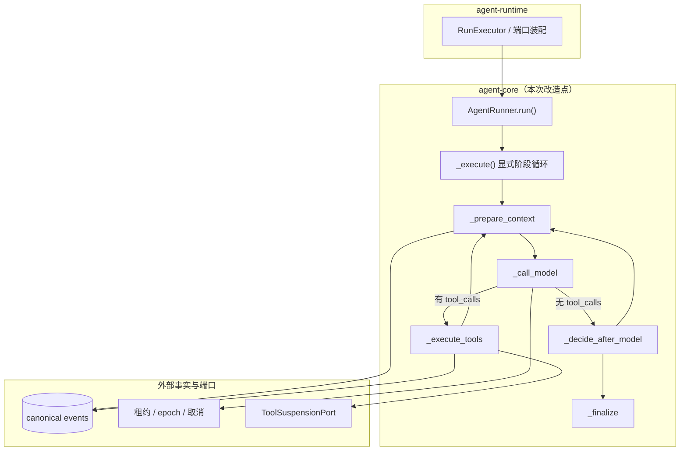
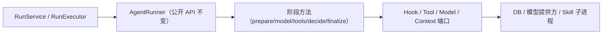

# 执行核心去框架化设计

> 文档编号：MOD-RUNTIME-EXEC-CORE-DEFRAMEWORK
> 文档版本：v0.1
> 创建日期：2026-10-31
> 文档状态：设计评审中
> 场景源：同目录 `execution-core-deframework.scenarios.md`

## 1. 文档控制

### 1.1 责任人与设计输入

| 角色 | 姓名 | 职责范围 |
|---|---|---|
| 产品/架构 | 待指定 | 需求边界、架构取舍、交付文档口径 |
| 开发负责人 | 待指定 | agent-core / 迁移 / 依赖与文档实现 |
| 测试负责人 | 待指定 | 行为等价回归、迁移契约、机检恢复 |
| 设计评审 | 待指定 | 被否方案确认与 spec 变更确认 |

| 编号 | 输入 | 结论 |
|---|---|---|
| D-01 | 执行真相模型 | Run 的真相是 canonical events + 租约/epoch；框架 checkpoint 只在「不替代业务事实」时才有位置 |
| D-02 | LangGraph 实际使用面 | 全仓仅 `runner.py:12-13` import `StateGraph/START/END`；无 checkpointer、无 `interrupt()`、无 `astream`、无 `Send` |
| D-03 | 选型原始理由 | 08 设计 §3.1「LangGraph + PG Checkpointer，保留 interrupt/checkpoint 能力」；两者均未通过框架落地 |
| D-04 | 实施范围 | 只去框架化；不拆分 runner（见 §3.1 被否方案 B3） |
| D-05 | 交付文档口径 | 基线与详细设计一并改写（用户确认） |
| D-06 | 空 schema 处理 | 新增迁移删除（用户确认） |

### 1.2 修订历史

| 版本 | 日期 | 作者 | 变更描述 |
|---|---|---|---|
| v0.1 | 2026-10-31 | Agent | 初始设计：影响面排查、被否方案、迁移与验收场景 |

---

## 2. 需求分析

### 2.1 需求概述

| 项目 | 内容 |
|---|---|
| **模块名称** | Agent 执行核心（`muad-agent-core` AgentRunner） |
| **模块ID** | MOD-RUNTIME-EXEC-CORE |
| **所属系统/产品线** | agent-runtime / agent-core |
| **需求类型** | 技术重构（架构去框架化） |
| **业务背景** | 产品基线 V7 指定 agent-runtime 使用 Python + LangGraph，08 设计以「保留 interrupt/checkpoint 能力」为唯一理由选择 LangGraph + PG Checkpointer；实际实现中 checkpoint 从未接线（归档文档自记为遗留缺口），interrupt 由 `run_interrupt` 业务表自研实现，图只承担 5 节点的 reasoning/tool loop。执行真相始终在 canonical events + 租约，与 LangGraph 的持久执行模型互斥。 |
| **核心目标** | 在执行语义零变化的前提下，把执行核心从 LangGraph 解耦为显式阶段循环，移除依赖与空 schema，并让 spec/文档与代码事实一致。 |

### 2.2 痛点与价值

| 维度 | 内容 |
|---|---|
| **目标用户** | 平台研发（维护执行核心）、运维（镜像与供应链）、安全审计（SCA/许可证）、评审者（文档可信度） |
| **当前问题** | ① 约 10 个 langgraph/langchain 包进入全部 5 个服务镜像（`build/dist/logs/console-platform.log:104-115` 实证）；② 每 Run 一次 `StateGraph.compile` 固定开销，capacity profile 实测占 1.8%（`scripts/capacity/ANALYSIS.md:303`）；③ `docs/02 §9` 定义了从未存在的 checkpoint 三张表，`docs/04 §15` 的「LangGraph interrupt」时序与实现不符；④ 归档文档「checkpointer 未接线，列入遗留缺口」会引导后来者接入一个会制造双真相的改造。 |
| **业务影响** | 架构叙述与代码事实长期不一致；供应链与镜像体积存在无收益负担；错误改造的入口被文档合法化。 |
| **预期价值** | 依赖面减少约 10 个包；每 Run 固定开销归零；文档与 spec 可被当作事实引用；后续执行核心改造不再被框架语义误导。 |

**用户故事**

| 编号 | 用户故事 | 优先级 |
|---|---|---|
| US-01 | 作为平台研发，我希望执行核心不依赖与自身真相模型冲突的框架，以便后续改造不被框架语义误导 | P0 |
| US-02 | 作为运维/安全，我希望镜像不携带从未使用的第三方栈，以便缩小供应链与扫描面 | P0 |
| US-03 | 作为评审者，我希望 specs 与设计文档描述的事实与代码一致，以便评审与交接可信 | P1 |

### 2.3 功能方案

#### 2.3.1 功能清单

| 功能ID | 功能名称 | 功能描述 | 优先级 | 来源 |
|---|---|---|---|---|
| FEAT-01 | 执行循环去框架化 | `_build_graph()` 与 `ainvoke` 替换为显式阶段循环，保留 5 个阶段方法与全部路由判断、预算、取消、挂起、事件注入、流式回调语义 | P0 | 需求描述 |
| FEAT-02 | 依赖移除 | 根 `pyproject.toml` 的 `agent` extra 与 `packages/agent-core/pyproject.toml` 去掉 `langgraph`；重生成 `uv.lock` 与 `requirements.txt` | P0 | 需求描述 |
| FEAT-03 | 空 schema 移除 | 新增迁移删除从未使用的 `langgraph` schema（down 可重建） | P0 | 需求描述 |
| FEAT-04 | spec 与文档对齐 | 修改 `persistence/harness-data.md` 的 schema 名单规则；改写 docs/00、01、02 §9、04 §15、08 与基线 V2.0/V7；清理 tests 中两处提及 LangGraph 的注释/文档字符串；新增 ADR 记录被否方案，并注明 docs/17 与 capacity 分析属历史记录 | P1 | 需求描述 |
| FEAT-05 | 机检与防回归 | 按 AST 口径重生成 `docs/configuration-inventory.csv`；复核既有 `max_turns` 有界用例在循环化后仍覆盖有界性，必要时补强 | P1 | 需求描述 |

### 2.4 范围与边界

| 类别 | 内容 |
|---|---|
| **范围（In Scope）** | `runner.py` 图壳替换；依赖清单与锁；一条迁移；配置盘点 CSV；spec 规则文本；docs 与基线口径；ADR；行为等价回归 |
| **非范围（Out of Scope）** | runner 结构拆分（见 §3.1 被否方案 B3）；任何执行语义、预算、超时、重试、挂起、流式、审计行为变更；LangGraph 其他能力的替代实现（多 Agent、子图、时间旅行）；console/gateway/worker 代码改动；已应用的 `0001` 迁移与历史记录（docs/17、capacity 分析、archived 任务文档）改写 |
| **前置假设** | 没有任何环境由 LangGraph adapter 建过 checkpoint 表（全仓 0 引用、DDL 无、迁移无）；交付基线口径允许修改（D-05） |
| **有意妥协 / 技术债** | 不保留兼容开关或过渡适配层；`langgraph` schema 直接删除且不做数据迁移（无数据）。回滚 = revert 提交 + 迁移 downgrade。 |

### 2.5 验收条件

#### 2.5.1 业务规则与约束

| ID | 类型 | 描述 | 验证场景 |
|---|---|---|---|
| RULE-01 | 系统约束 | 公开接口 `AgentRunner.run` 及全部回调/端口签名不变；现有测试的断言逻辑零修改（仅允许更新两处提及 LangGraph 的注释/文档字符串） | S-01、S-04、E-01 |
| RULE-02 | 系统约束 | 依赖图中不再出现 langgraph/langchain 栈；干净安装后 `import langgraph` 失败 | S-02 |
| RULE-03 | 系统约束 | 迁移保持单链单头；新建库 schema 恰为 control/runtime/task；down 可重建空 schema | S-03、E-02 |
| RULE-04 | 系统约束 | 当前非归档文档与 specs 不再声称 LangGraph 在执行链中存在；ADR 记录被否方案 | S-05 |
| RULE-05 | 系统约束 | `docs/configuration-inventory.csv` 与源码 AST 逐项一致 | S-06 |

#### 2.5.2 功能验收场景

> 场景定义见 `execution-core-deframework.scenarios.md`；下表只写设计影响与覆盖关系。

| 场景ID | 覆盖功能 | 设计影响 / 备注 |
|---|---|---|
| S-01 | FEAT-01 | 真实 PG 上执行链行为不变；落库的 assistant/tool 成对关系与计数不能漂移 |
| S-02 | FEAT-02 | 依赖移除后镜像与干净安装环境必须真的没有该栈 |
| S-03 | FEAT-03 | 迁移新增 `0029`；schema 名单从 4 收缩到 3 |
| E-02 | FEAT-03 | downgrade 重建空 schema，且不触碰业务表 |
| S-04 | FEAT-01 | 循环路由与既有图语义逐条对应（纯文本、工具轮、预算耗尽） |
| E-01 | FEAT-01 | 异常/取消/期限三类路径的异常类型与 STOP hook 次数不变 |
| B-01 | FEAT-01 | 复核既有 `max_turns` 有界用例在循环化后仍覆盖有界性；必要时补强 |
| S-05 | FEAT-04 | 当前文档与 spec 文本检索（历史记录显式排除）、ADR 与 schema 名单 |
| S-06 | FEAT-05 | 配置盘点机检恢复绿色 |

#### 2.5.3 非功能指标

**性能指标**

| 指标ID | 指标名称 | 目标值 | 测量方法 |
|---|---|---|---|
| NFR-PERF-01 | 每 Run 的图编译固定开销 | 0（当前实测占 run 窗口 1.8%） | 重跑 `scripts/capacity` 的 run 段 profile，对比 `StateGraph.compile` 热点消失 |

**可靠性指标**

| 指标ID | 指标名称 | 目标值 |
|---|---|---|
| NFR-REL-01 | 执行语义与终态分布 | 与改动前基线一致（同一套测试、同一断言） |

**安全性要求**

| 指标ID | 安全域 | 验收标准 |
|---|---|---|
| NFR-SEC-01 | 供应链 | 镜像中不再安装 langgraph/langchain 栈；SCA 扫描范围相应缩小 |

#### 2.5.4 验证环境假设

| 维度 | 假设 | 验证方式 / 参数 | 不满足时 |
|---|---|---|---|
| 容量 | 现有套件规模（全量 pytest 约 1646 条、`make acceptance` 约 265 条） | 先跑目标套件，再跑全量 | 标记 `incomplete` 并拆分 |
| 硬件 | 开发机 / CI runner，无特殊规格 | 无需额外硬件 | 返回 `env_blocked` |
| 依赖 | PostgreSQL（localhost:5432）、Redis（6379）、uv、可创建临时库 | `make acceptance` 自带隔离建库 | 返回 `env_blocked` 并列出缺失项 |
| profile 参数 | 目标套件 → `make acceptance` → 全量 pytest → images CI | 串行执行，禁止共用 dev 库 | 显式报 `incomplete` |

---

## 3. 技术设计

### 3.1 方案选型

#### 备选方案对比

| 对比维度 | 权重 | 方案A：显式阶段循环 | 得分 | 方案B：接 PG Checkpointer | 得分 |
|---|---|---|---|---|---|
| 功能完备性 | 30% | 保持现有全部执行语义 | 30 | 获得 superstep 级恢复，但引入第二真相 | 18 |
| 性能预期 | 25% | 省掉每 Run 编译，无新增 IO | 25 | 每 superstep 额外 checkpoint 写 | 15 |
| 实现复杂度 | 20% | 单文件约 60 行替换 | 20 | 状态 ID 化重构 + 全部工具幂等 + 租约 fence 自研 | 6 |
| 维护成本 | 15% | 依赖 −10 个包 | 15 | 框架升级、checkpoint 保留期与租户作用域 | 7 |
| 风险评估 | 10% | 行为等价可被现有测试证明 | 10 | 工具副作用重放、双执行、脱敏绕过 | 2 |
| **最终得分** | **100%** | | **100** | | **48** |

#### 关键决策记录

| 决策点 | 选择 | 被否决项 | 理由 | 可逆性 |
|---|---|---|---|---|
| 执行核心与 LangGraph | 移除图壳，显式阶段循环 | 保留 `StateGraph` 造型 | 图未提供任何被使用的语义；仅剩的排版价值不抵依赖与错误改造入口 | 易（revert） |
| 持久化语义 | 继续由 canonical events + 租约承载 | 接入 LangGraph Checkpointer（B1） | 双真相；checkpointer 无租约/epoch fence；tools 节点恢复会重放副作用；state 含回调不可序列化 | 难（一旦接入） |
| 空 schema | 新迁移删除 | 保留空 schema（B2） | 死表面应去掉；spec 的「4 个 schema」随之改写 | 易（downgrade 重建） |
| runner 结构 | 保持单文件内聚 | 拆成运行循环/工具回合/预算守卫三对象（B3） | 42 个方法中位数 12 行、最长 45 行，已满足 ≤50 行规范；拆分需在对象间传共享 state 与回调，增加间接层 | 易（未做） |

#### 技术栈

| 类别 | 选型 | 版本 | 选型理由 |
|---|---|---|---|
| 语言 | Python | 3.12+ | 既有 |
| 框架 | 无（stdlib asyncio） | — | 执行核心不再依赖编排框架 |
| 数据库 | PostgreSQL | 既有 | 迁移仅删空 schema |
| 中间件 | 无 | — | 无新增 |

### 3.2 架构设计



循环的等价形状（替换 `runner.py:375-408` 的图构建与 `:315-320` 的 `ainvoke`）：

```text
while True:
    prepare_context
    if 预算耗尽: break
    call_model
    有 tool_calls 且未到 max_turns: execute_tools → 继续
    有 tool_calls 且已到 max_turns: break
    无 tool_calls:
        runtime_events 存在时 decide（checkpoint / drain / try_wait）→ 继续或 break
        否则 break
finalize
```

#### 技术分层



### 3.3 数据设计

不新增业务表，不改动任何业务列与索引。

**新增迁移：`migrations/versions/0029_drop_langgraph_schema.py`**

| 项 | 内容 |
|---|---|
| upgrade | `DROP SCHEMA IF EXISTS langgraph` |
| downgrade | `CREATE SCHEMA IF NOT EXISTS langgraph` |
| 依赖链 | `down_revision = "0028"` |
| 约束 | 不使用环境变量（连接串来自 `migrations/alembic.ini`）；不创建/修改业务表 |

**迁移历史保留**：`0001_create_schemas.py` 中的 `CREATE SCHEMA IF NOT EXISTS langgraph` 保留为历史；新建库按 0001→0029 执行后，净状态中不存在该 schema。不改写已应用迁移。

**执行前安全检查**（发布步骤，不写进迁移）：删除前查询 `information_schema.tables WHERE table_schema='langgraph'`，必须为 0 行；非 0 则中止发布并排查。

### 3.4 接口设计

#### 形态 C：函数 / 库接口

| 函数签名 | 入参 | 返回 | 错误处理 |
|---|---|---|---|
| `AgentRunner.run(request, *, is_cancelled, on_delta, ..., checkpoint, context_cursor) -> AgentRunResult` | 全部保持不变 | `AgentRunResult` 不变 | 既有 `RunnerError` 家族不变 |

变更项（均为内部实现，不构成对外契约）：

| 项 | 变更 |
|---|---|
| `_build_graph()` | 删除 |
| `self._graph` | 删除 |
| `AgentGraphState` | 改名 `AgentRunState`（字段集合不变，`next_node` 保留供 decide 阶段传递路由） |
| `langgraph` import | 删除 |
| HTTP API / CLI | 无变化 |

### 3.5 质量实现方案

#### 性能设计

| 指标ID | 热点路径 | 目标值 | 实现方案（含被放弃的较慢方案） |
|---|---|---|---|
| NFR-PERF-01 | 每 Run 的 `StateGraph.compile` | 归零 | 循环直接调用实例方法，无编译期与图状态开销；放弃「保留图 + 预热编译缓存」方案（仍需保留依赖且不解决根本问题） |

#### 可靠性设计

| 风险ID | 失效模式 | 影响 | 应对措施 | 验证场景 |
|---|---|---|---|---|
| RISK-01 | 循环化引入路由差异（遗漏 decide 分支或预算出口） | 执行提前/延后终态 | 路由函数原样搬运；新增 B-01 有界性回归；现有 20 条用例零修改 | S-04、B-01、E-01 |
| RISK-02 | 异常路径 STOP hook 丢失或重复 | 观测与 Hook 语义变化 | `run()` 的 except 分支原样保留，`_stop_emitted` 标志不动 | E-01 |
| RISK-03 | 删除 schema 时环境中意外存在 checkpoint 表 | 数据丢失 | 发布前 `information_schema` 空表检查，非空中止 | S-03、E-02 |
| RISK-04 | 依赖重生成遗漏或手改 requirements | 镜像仍携带旧栈 | 只用 `export-requirements.sh` 重生成并 diff；干净环境 import 断言 | S-02 |
| RISK-05 | spec 规则文本变更触发 drift 阻塞门禁 | 设计/计划门禁红 | 经 cf-spec 编辑流程修改规则文本并在同轮 refresh | S-05 |
| RISK-06 | 配置盘点 CSV 过期 | 机检红 | 按 AST 口径重生成派生行 | S-06 |

#### 安全性设计

| 指标ID | 验收标准 | 实现方案 |
|---|---|---|
| NFR-SEC-01 | 镜像不再安装 langgraph/langchain 栈 | 从 pyproject 移除并重生成单一共享 requirements.txt |

#### 可观测性设计

| 场景 | 实现方案 |
|---|---|
| 指标 | 不变；`RUN_CHECKPOINT_SECONDS` 等既有指标口径不动 |
| 日志 | 不变；不新增/删除日志字段 |
| 链路 | 不变；图包装层消失后 traceback 更短，属预期 |

---

## 4. 部署与运维

### 4.1 部署架构

| 环境 | 配置 | 实例数 | 用途 |
|---|---|---|---|
| 内网 K8s | 5 个服务镜像共用单一 `requirements.txt` | 按既有 chart | 交付部署 |
| CI | images matrix 4 个镜像任务 | 4 | 构建验证 |

说明：`build/docker-build/export-requirements.sh` 明确「一个 requirements.txt 由全部服务镜像共用」，因此依赖移除影响全部镜像；本次必须重建并验证 images matrix。

### 4.2 发布与回滚

| 阶段 | 范围 | 进入条件 | 回滚条件 |
|---|---|---|---|
| 单次发布 | 全部服务镜像 | 全量测试与验收通过 | 执行语义出现任何差异 |

回滚步骤：revert 代码提交 → `alembic downgrade 0028`（重建空 schema）→ 重建镜像。

### 4.4 数据迁移

| 阶段 | 操作 | 验证方法 |
|---|---|---|
| 1 | 查询 `information_schema.tables WHERE table_schema='langgraph'` | 必须 0 行，否则中止 |
| 2 | 执行迁移 `0029` | schema 列表为 3 个 |
| 3 | 回滚演练 | downgrade 后 schema 重新存在且为空 |

---

## 5. 风险与依赖

### 5.1 项目依赖

| 依赖模块/团队 | 依赖内容 | 状态 | 风险等级 |
|---|---|---|---|
| 无外部团队依赖 | — | — | 低 |

### 5.2 风险识别

| 风险ID | 类型 | 描述 | 概率 | 影响 | 应对措施 | 验证场景 |
|---|---|---|---|---|---|---|
| RISK-07 | 文档口径 | 基线文档属对外交付描述，改写需产品确认 | 中 | 高 | 已在 D-05 取得用户确认；ADR 记录口径变更 | S-05 |
| RISK-08 | 门禁 | CLI 运行时契约与仓库 runtime-commands.json 不一致，门禁需用仓库内脚本执行 | 高 | 低 | 使用仓库内 0.8.0 脚本；不改动 code-flow 安装 | S-05 |

---

## 6. 需求追溯矩阵

> 本表在 plan 阶段由 `cf_traceability.py` 依据 manifest 重新生成；以下为设计阶段的人工初稿。

| 用户故事 | 功能ID | 接口ID | 测试用例ID | 测试层级 | 执行方式 | 追溯 check | 状态 |
|---|---|---|---|---|---|---|---|
| US-01 | FEAT-01 | — | S-04 | unit | auto | 待 plan 绑定 | 待实现 |
| US-01 | FEAT-01 | — | S-01 | integration | auto | 待 plan 绑定 | 待实现 |
| US-01 | FEAT-01 | — | E-01 | unit | auto | 待 plan 绑定 | 待实现 |
| US-01 | FEAT-01 | — | B-01 | unit | auto | 待 plan 绑定 | 待实现 |
| US-02 | FEAT-02 | — | S-02 | contract | auto | 待 plan 绑定 | 待实现 |
| US-02 | FEAT-03 | — | S-03 | contract | auto | 待 plan 绑定 | 待实现 |
| US-02 | FEAT-03 | — | E-02 | contract | auto | 待 plan 绑定 | 待实现 |
| US-03 | FEAT-04 | — | S-05 | contract | auto | 待 plan 绑定 | 待实现 |
| US-03 | FEAT-05 | — | S-06 | contract | auto | 待 plan 绑定 | 待实现 |

---

## Spec Compliance Matrix

| Spec/Rule | enforcement | 设计影响 | 设计落点 | 验证场景 | 状态/N/A 理由 |
|---|---|---|---|---|---|
| `harness-data#RULE-data-001` | required | 新增迁移只删空 schema、不建业务表；迁移保持单链、不使用环境变量、不引入新的时间/JSON 口径 | §3.3 新增迁移与安全检查、§4.4 数据迁移 | S-03、E-02 | applied |
| `harness-test#RULE-test-001` | required | 行为等价由 unit（状态机/路由）与 integration（真实 PG 执行链）覆盖；迁移一致性由 contract 覆盖；本需求不新增跨 API/DB/Browser 的用户旅程，故不新增 E2E，E2E 空集需在 plan 中显式声明 | §2.5 验收条件、§3.5 可靠性设计 | S-01、S-04、E-01、B-01、S-03 | applied |

---

*文档结束*
