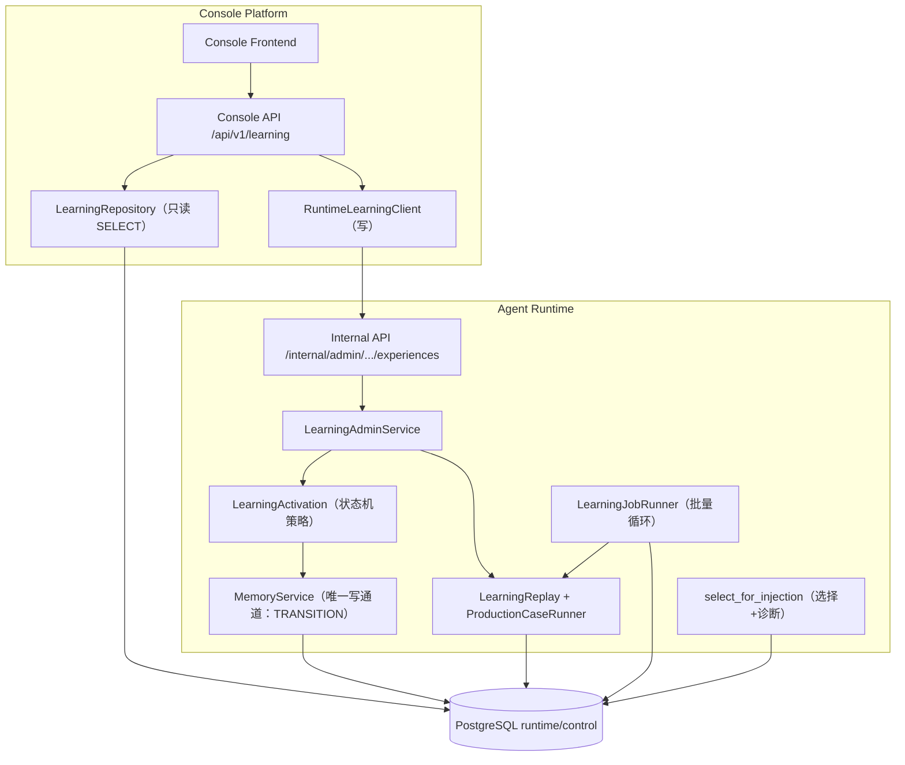
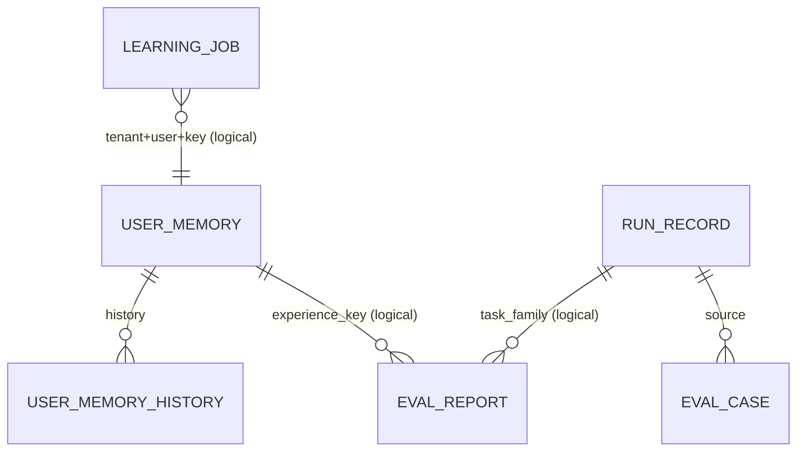

# 经验管理模块 后端设计

> **文档编号**: MOD-EXP-MGMT-BE-v0.1
> **文档版本**: v0.1
> **创建日期**: 2026-11-01
> **文档状态**: 草稿
> **上游 PRD**: `experience-management.prd.md`

**评审边界说明**:
- 需求基线以 PRD 为准；本文只写实现方案。
- 场景源：`experience-management.scenarios.md`；本文只引用场景 ID。

---

## 1. 文档控制

| 角色 | 姓名 | 职责范围 |
|------|------|---------|
| 产品经理 | jahan | 需求定义、业务验收 |
| 开发负责人 | jahan | 技术方案、代码实现 |
| 测试负责人 | jahan | 测试策略、质量保证 |

| 版本 | 日期 | 作者 | 变更描述 |
|------|------|------|---------|
| v0.1 | 2026-11-01 | jahan | 初始设计 |

---

## 2. 需求分析

### 2.1 需求概述

| 项目 | 内容 |
|------|------|
| **模块名称** | 经验管理（Learning Experience Management） |
| **模块ID** | MOD-EXP-MGMT |
| **所属系统** | console-platform（读模型与操作入口）+ agent-runtime（写入与回放权威） |
| **需求类型** | 新功能 + 既有学习链路事实修正 |
| **业务背景** | 学习闭环已上线但无管理面；三个事实缺陷（报告无用户归属、状态变更绕过记忆写通道、注入归因不真实）使解释不可信 |
| **核心目标** | 双视图（用户/任务族）共用一份事实，经验全生命周期可解释、可操作、可追责 |

### 2.2 痛点与价值

| 维度 | 内容 |
|------|------|
| **目标用户** | 租户管理员与运维 |
| **当前问题** | 管理只能靠 CLI + SQL；用户视图看不到学习状态；无族视图；回放报告可跨用户借用；注入归因分数是重算值 |
| **业务影响** | 学习结果无法被业务方信任，出错时无法定位「没学会/学错了/没注入」 |
| **预期价值** | 管理操作全部可审计；解释链路可从 Run 追到回放证据；错误经验可人工止损 |

**用户故事**：见 PRD §3.2（US-01…US-06）。

### 2.3 功能方案

#### 2.3.1 功能清单

| 功能ID | 功能名称 | 优先级 | 来源 |
|--------|---------|--------|------|
| FEAT-01 | 用户经验视图 | P0 | US-01 |
| FEAT-02 | 任务族视图 | P0 | US-02 |
| FEAT-03 | 经验详情与解释 | P0 | US-03, US-06 |
| FEAT-04 | 生命周期操作 | P0 | US-04 |
| FEAT-05 | Run ↔ 学习对象追溯 | P1 | US-05 |
| FEAT-06 | 双视图一致性与聚合口径 | P0 | US-06 |
| FEAT-07 | 经验治理边界 | P1 | US-03, US-04 |
| FEAT-08 | 学习事实修正（前置） | P0 | US-03, US-04, US-06 |
| FEAT-09 | 审计可见性与深链 | P0 | US-07 |
| FEAT-10 | 止损与族级暂停 | P0 | US-08 |
| FEAT-11 | 经验内容修订 | P1 | US-09 |
| FEAT-12 | 差回答反馈闭环 | P1 | US-10 |

#### 2.3.2 字段约束

**ExperienceItem（读投影）**

| 字段 | 类型 | 必填 | 约束 | 说明 |
|------|------|------|------|------|
| user_id | UUID | 是 | 与 tenant 共同定位 | 经验所属用户 |
| memory_key | str | 是 | `exp.*` | 经验唯一键（族哈希或人工 key） |
| version | int ≥1 | 是 | 来自 user_memory | 内容版本 |
| category | enum | 是 | PROCEDURE/FAILURE_PATTERN/VERIFICATION | 只允许经验类别 |
| activation_state | enum | 是 | PROPOSED/TRIAL/ACTIVE/RETIRED | 学习状态机状态 |
| authority | enum | 是 | USER_EXPLICIT/ADMIN_EDIT/AGENT_INFERRED | 内容权威；决定激活路径 |
| task_signature | str | 否 | `skill:<key>` / `agent:<id>` | 任务族 |
| trigger_text | str | 否 | ≤512 | 目标文本（族不命中时的词法匹配源） |
| content.value | str | 是 | 来自 content_json | 经验正文 |
| latest_report | object | 否 | 按 user_id 过滤 | 最新候选臂回放结论 |
| report_owner | enum | 是 | OWNED/UNKNOWN/ABSENT | 历史报告归属标记 |

**LearningJob（异步回放）**

| 字段 | 类型 | 必填 | 约束 | 说明 |
|------|------|------|------|------|
| job_type | enum | 是 | REPLAY/REGENERATE | 操作类型 |
| status | enum | 是 | PENDING/RUNNING/SUCCEEDED/FAILED | 终态不可回退 |
| command_id | str | 是 | 幂等键 | 唯一 (tenant, command_id) |
| request_json | jsonb | 是 | 冻结参数 | 含 user/key/base_config_hash/limits |
| result_json | jsonb | 否 | 完成时写 | 回放结论或新版本号 |
| attempts / lease_until | int / timestamptz | 是 | ≥0 | 崩溃可回收 |

### 2.4 范围与边界

| 类别 | 内容 |
|------|------|
| **范围（In Scope）** | PRD FEAT-01…FEAT-08；经验读投影、族聚合、诊断、生命周期写入、回放异步任务、审计修正、注入归因扩展 |
| **非范围（Out of Scope）** | 经验内容编辑、阈值调参、抽取/候选/回放算法、跨租户、历史 Run 重分类、历史报告归属回填 |
| **前置假设** | Console 可直接只读 runtime schema（既有先例）；Runtime 承担唯一写权威；迁移可停机或以 nullable 列安全上线 |
| **有意妥协 / 技术债** | 历史候选报告 `user_id` 为 NULL：只展示「归属未知」，不参与晋升校验；不编造归属。历史 Run 无诊断字段：页面显示「未记录诊断」。 |

### 2.5 验收条件

#### 2.5.1 业务规则与约束

| ID | 类型 | 描述 | 验证场景 |
|----|------|------|---------|
| RULE-01 | 单一事实 | 经验 = `user_memory` 的经验类别行；族 = `run_record.task_family`；用户视图与族视图共用同一 `LearningRepository` 与同一个 `ExperienceItem` 投影，禁止第二套查询口径 | S-02, S-07 |
| RULE-02 | 状态机 | 仅允许：PROPOSED→TRIAL、PROPOSED→ACTIVE、TRIAL→ACTIVE、TRIAL→RETIRED、PROPOSED→RETIRED、ACTIVE→RETIRED、RETIRED→PROPOSED（仅 REGENERATE）；其他转换返回 `LEARNING_INVALID_TRANSITION` | S-04, E-02 |
| RULE-03 | 用户归属 | 候选臂回放报告必须写 `experience_user_id`；回放、晋升、详情展示一律按 `(tenant, user, key)` 过滤；`user_id` 为 NULL 的历史候选报告标 UNKNOWN 且不参与晋升 | S-04, E-01 |
| RULE-04 | 记忆主通道 | `activation_state` 变更作为记忆命令动作 `TRANSITION` 经 `MemoryService` 提交：锁序 Conversation→Run→scope，同事务递增 version、写 `user_memory_history` 完整 after、幂等 receipt、scope revision 并写审计；保留 tombstone/forget_epoch 语义（自动写不得解除删除、不得把 USER/ADMIN 降级）；禁止直接 UPDATE | S-04, E-03 |
| RULE-05 | 归因真实 | 注入选择返回真实 score 与命中通道（FAMILY/TEXT）；`MEMORY_INJECTED` 增加 diagnostics：learning_enabled、min_score、冻结集合大小、skipped（key/state/reason/score，≤20）、dropped_by_budget（key/version）；items 只含渲染后真实进入上下文的条目 | S-03, S-09 |
| RULE-06 | 族判定一致 | 注入侧任务族切换与 `run_record.task_family` 同为「首个成功 skill」；失败的 skill 调用不切换族 | B-01 |
| RULE-07 | 读写分离 | Console 读取 runtime schema 只发 SELECT；所有写（replay/activate/retire/regenerate）经受保护 Runtime internal API；CLI 复用同一服务层，不允许另写状态或查询逻辑 | S-04, E-03 |
| RULE-08 | 异步回放 | 回放以持久 job 执行：`(tenant, command_id)` 唯一幂等，claim 用 `FOR UPDATE SKIP LOCKED` + lease，崩溃按 attempts 重试；单次执行使用租户当前 learning 门槛并在报告中记录 `limits` | S-04, E-04 |
| RULE-09 | 审计归属 | 审计 `actor_user_id` 为真实账号 UUID；`resource_id = uuid5("experience:{tenant}:{user}:{key}")`；after 含 experience_key/user_id/reason/from/to；retire/regenerate 必须带 reason | S-04 |
| RULE-10 | 资源边界 | 通用记忆列表/计数排除经验类别；经验只经 `/learning/*` 资源读写；通用记忆 API 对经验类别拒绝写操作 | S-05, E-02 |
| RULE-11 | 族口径 | 族来源由前缀判定（skill:/agent:）；`task_family` 为空的历史 Run 归「未归类」且不计入族统计；族聚合按用户分组，不合并状态；族的 Run 计数只读 `family_run_stat` 增量汇总（按族按天，默认 7 天窗口、计数封顶），禁止页面请求扫描 Run 历史 | S-02, B-02, S-11 |
| RULE-12 | 降级 | 学习关闭时管理面只读并显式提示；Runtime 不可达时 Console 返回错误而非缓存旧值；job 失败保留错误码与现场，可重放 | E-01, E-04 |
| RULE-13 | 时间口径 | 新增列一律 `timestamptz`；Console 出参带 offset，页面按 `YYYY-MM-DD HH:mm:ss` 展示；审计/报告时间不得用本地时间 | 契约测试 |
| RULE-18 | 回放容量 | 回放任务按租户/实例并发硬限（默认 1）；模型调用必须经 `ModelCapacityService` 预占（BACKGROUND 用途），拿不到额度排队重试，不得直连模型绕过限流；单 job 超时与样本上限固定 | S-04, S-11, E-04 |
| RULE-33 | 扩展性护栏 | 经验暴露 `authority` 并按权威分流激活；`memory_key` 不透明、同族允许多 key；状态/原因/job 类型/报告字段用开放字符串码 + extras；学习类别与状态转换收敛到共享常量；族暂停与反馈信号是后续 core 必须消费的控制面契约 | S-02, S-04, E-02 |
| RULE-30 | 止损与族级暂停 | Run 一键停用按注入归因精确到 `(user_id, memory_key)`；`family_control(tenant, family, paused)` 只影响暂停后的新 Run（已冻结集合不变），暂停期间不生成候选、不注入该族经验；恢复不复活已退休经验；所有操作写审计 | S-12, E-05 |
| RULE-31 | 内容修订 | 修订必须带 `expected_version` 与 reason；经记忆主通道生成新版本、history、回执与审计，状态回 PROPOSED；晋升仍要求该用户的 PASSED 报告；通用记忆接口不可绕过 | S-13, E-05 |
| RULE-32 | 反馈闭环 | 同一 Run 的差回答标记幂等，写 `LEARNING_SIGNAL(source_run_id, actor, reason)`；该 Run 从未来 Golden Set 排除；为注入过的 ACTIVE 经验排一次复核回放（复用 RULE-18 容量边界），回归才退休 | S-14, E-05 |
| RULE-19 | 审计可见性 | 审计投影对 `MEMORY_EXPERIENCE` 输出可读 target（experience_key + user_id）；资源类型/动作/操作者词条齐备；审计详情携带 user_id/key 供前端深链；真实 actor 为账号 UUID，历史合成 actor 标「归属未知」 | S-10, S-08 |

#### 2.5.2 功能验收场景

| 场景ID | 设计影响 / 备注 |
|--------|----------------|
| S-01 | 用户经验列表：Console 读投影 + 真实 PG；状态/族过滤、分页、字段完整性 |
| S-02 | 族列表与族详情聚合；与用户视图逐字段一致性 |
| S-03 | 经验详情：来源证据、回放报告（含用户归属与门槛）、历史版本、审计时间线、注入记录 |
| S-04 | 生命周期操作：异步回放、晋升（用户归属 + 门槛）、退休、重新沉淀、幂等、审计 |
| S-05 | 资源边界：通用记忆列表排除经验；通用写 API 拒绝经验类别 |
| S-06 | 用户详情经验页签（component） |
| S-07 | 族页面与共用详情组件（component） |
| S-08 | 浏览器关键旅程：用户经验 → 详情 → 退休 → 族页同步；Run 注入事件 ↔ 经验深链 |
| S-09 | 「为什么没注入」诊断：新事件字段展示；历史事件显示未记录 |
| E-01 | 学习关闭/报告归属未知/学习服务不可达的降级 |
| E-02 | 非法状态转换、跨用户借用报告、通用 API 写经验被拒 |
| E-03 | 审计/历史/回执一致性：状态变更失败整体回滚，无无审计变更 |
| E-04 | 回放 job 崩溃回收、重复幂等键、INCOMPLETE 不改变状态 |
| B-01 | 族判定纯函数边界：多 skill、失败 skill、无 skill、批量 |
| B-02 | 聚合口径边界：null family、跨用户同名 key、恶意前缀 |

#### 2.5.3 非功能指标

| 指标ID | 指标名称 | 目标值 | 测量方法 |
|--------|---------|-------|---------|
| NFR-PERF-01 | 列表/族聚合 p95 | ≤500ms（1 万经验/1 千族，page_size≤100） | 集成基准（本地验收数据规模） |
| NFR-PERF-02 | 管理面与 1000 用户负载隔离 | 用户侧 admission/first-delta 不回归；管理查询 p95≤500ms；回放不超模型额度 | 容量混合场景 S-11 |
| NFR-SEC-01 | 越权 | 跨租户/非管理员 100% 拒绝 | 集成测试与契约测试 |
| NFR-AUDIT-01 | 审计完整性 | 生命周期操作 100% 审计且同事务 | 集成测试 |
| NFR-REL-01 | 降级 | 学习服务不可用时只读/报错，不伪造 | 集成测试（上游 5xx） |

#### 2.5.4 验证环境假设

| 维度 | 假设 | 验证方式 / 参数 | 不满足时 |
|------|------|----------------|---------|
| 容量 | 单租户 1 万经验、1 千族、5 万 Run；回放样本 ≤50 | 集成基准 fixture；`tests/console_platform/test_learning_*` | 标记 incomplete |
| 硬件 | 本地/CI 标准 runner（PG 16 + Redis） | `make acceptance` / pytest 分片 | env_blocked |
| 依赖 | 真实 PostgreSQL；模型提供方以本地 OpenAI 兼容探针代替 | runtime 验收真实栈；探针 URL 注入 | env_blocked 并列出缺失 |
| profile | changed 只跑命中路径；full 在需求终验 | `code-flow task verify --profile changed` | 显式 incomplete |

---

## 3. 技术设计

### 3.1 方案选型

**备选方案对比**

| 对比维度 | 权重 | 方案A：Console 读模型 + Runtime 写权威（选定） | 方案B：Runtime 提供全部读写 internal API，Console 纯转发 | 方案C：Console 直读直写 runtime 表 |
|---------|------|---------------------------------------------|--------------------------------------------------------|-----------------------------------|
| 功能完备性 | 30% | 高：读可一次 SQL 聚合，写经状态机 | 高 | 低：绕过状态机与审计 |
| 性能预期 | 25% | 高：无额外进程跳转 | 中：每页 5-6 次内部调用 | 高 |
| 实现复杂度 | 20% | 中 | 高 | 低 |
| 维护成本 | 15% | 低：写只有一处 | 中：DTO 双份投影 | 高：两套写语义 |
| 风险评估 | 10% | 低 | 低 | 极高（违反 RULE-04） |
| **最终得分** | **100%** | **9.0** | **8.0** | **3.0** |

**关键决策记录**

| 决策点 | 选择 | 被否决项 | 理由 | 可逆性 |
|--------|------|---------|------|--------|
| 读路径 | Console 只读 runtime schema，单一 `LearningRepository` | 新增 Runtime 读 internal API | 与既有 memory/runs 读投影一致；聚合一次 SQL；无跨进程 DTO 漂移 | 易 |
| 写路径 | Runtime internal API（状态机 + 记忆主通道） | Console 直写 / CLI 直写 | RULE-memory-002 唯一写者；审计与历史同事务 | 难（必须回滚） |
| 回放执行 | 持久 `runtime.learning_job` + Runtime 批量循环 claim | 同步请求内执行 | 真实模型回放耗时不可控；崩溃可恢复；可观测 | 中 |
| 报告归属 | `eval_report` 增 `experience_user_id`，候选报告必填 | 用 key 推断用户 / 报告共享 | 同族跨用户同 key，推断必错 | 难（数据事实） |
| 状态写入 | 新增记忆动作 `TRANSITION` 经 `MemoryService` | 直 UPDATE + 补写 history | 避免两条写路径；锁序/幂等/版本统一 | 难 |
| 注入归因 | `select_for_injection` 返回选择结果对象（selected + skipped + score + channel） | 事件里再算一次 | 解释必须与选择同源；禁止重算漂移 | 易 |
| 族视图 | Console SQL 聚合（run_record/eval_*/user_memory） | 物化族表 | 事实已在 PG；物化引入双写 | 易 |
| 兼容策略 | 无兼容层：DTO/事件/表结构直接调整 | 新增并行字段/旧接口保留 | 用户明确不接受兼容设计；旧口径即错误口径 | — |

**技术栈**：Python 3.12 + FastAPI + SQLAlchemy async + PostgreSQL 16；React 18 + TypeScript 5.7（前端另文）。

### 3.2 架构设计

**技术分层**：FE → Console API → Repository（读）/ RuntimeLearningClient（写）→ Runtime Service → PG。读取不经过 Runtime，避免额外 RTT；写入不与 Console 事务混用。

**外部依赖**

| 外部系统 | 依赖类型 | 协议 | 超时 | 降级策略 |
|---------|---------|------|------|---------|
| Runtime internal API | HTTP | JSON 封套 | 5s（操作）/ 10s（查询 job） | 返回 `COMMON_INTERNAL_ERROR`/上游业务码，前端只读展示 |
| 模型提供方（回放） | OpenAI 兼容 | HTTP | 逐请求 ≤60s | 单个 case 失败按 verifier 判失败；job 失败可重试 |

### 3.3 数据设计

**新增表：`runtime.learning_job`**

| 字段 | 类型 | 可空 | 默认 | 索引 | 说明 |
|------|------|------|------|------|------|
| id | UUID | N | gen | PK | |
| tenant_id | varchar(64) | N | | uq1, ix2 | |
| user_id | UUID | N | | ix3 | 经验所属用户 |
| experience_key | varchar(64) | N | | ix3 | |
| job_type | varchar(16) | N | | | REPLAY/REGENERATE |
| status | varchar(16) | N | PENDING | ix2 | PENDING/RUNNING/SUCCEEDED/FAILED |
| command_id | varchar(256) | N | | uq1 | 幂等键 |
| request_json | jsonb | N | | | 冻结参数（base_config_hash、limits、actor） |
| result_json | jsonb | Y | | | 结论/新版本 |
| error_code / error_message | varchar | Y | | | 失败现场 |
| attempts | int | N | 0 | | 重试计数 |
| lease_until | timestamptz | Y | | ix2 | 崩溃回收 |
| is_deleted/create_time/update_time | 标准列 | N | | | RULE-data-001 |

索引：`uq_learning_job_command (tenant_id, command_id) WHERE is_deleted=false`；`ix_learning_job_claim (status, lease_until, create_time) WHERE status IN ('PENDING','RUNNING')`；`ix_learning_job_experience (tenant_id, user_id, experience_key, create_time DESC)`。

**新增表：`runtime.family_run_stat`（族 Run 增量汇总）**

| 字段 | 类型 | 可空 | 默认 | 索引 | 说明 |
|------|------|------|------|------|------|
| id | UUID | N | gen | PK | |
| tenant_id | varchar(64) | N | | uq, ix | |
| family | varchar(64) | N | | uq, ix | `skill:<key>` / `agent:<id>` |
| day | date | N | | uq, ix | 按租户时区归日 |
| run_count | bigint | N | 0 | | 当日完成 Run 数 |
| last_run_at | timestamptz | Y | | | 最近一次 Run 完成时间 |
| is_deleted/create_time/update_time | 标准列 | N | | | |

唯一键 `uq_family_run_stat_day (tenant_id, family, day) WHERE is_deleted=false`；查询索引 `ix_family_run_stat_window (tenant_id, day DESC, family)`。
由 `LearningScheduler` 的同一循环按 `run_record.end_time` 水位增量 upsert（每分钟一批、可重入）；重算窗口重叠当天的行是幂等覆盖，不做全量重扫。页面只读该表（默认 7 天，可切 30 天），Run 计数按窗口求和，超过 `100000` 显示 `100000+`。

**新增表：`runtime.learning_family_control`（族级暂停）**

| 字段 | 类型 | 可空 | 说明 |
|------|------|------|------|
| id | UUID | N | 主键 |
| tenant_id | varchar(64) | N | |
| family | varchar(64) | N | `skill:<key>` / `agent:<id>` |
| paused | boolean | N | true=暂停学习与注入 |
| reason | varchar(256) | N | 暂停原因 |
| actor_user_id | UUID | N | 操作者账号 |
| is_deleted/create_time/update_time | 标准列 | N | |

唯一键 `uq_learning_family_control (tenant_id, family) WHERE is_deleted=false`。暂停判定在候选生成与首次注入冻结时各查一次（按 Run 冻结：暂停只影响新 Run）；恢复写同一行并保留审计。

**修改表：`runtime.eval_report`**

- 新增 `experience_user_id UUID NULL`；候选臂报告写入经验所属用户；基线报告为 NULL。
- 候选报告唯一键改为 `(tenant_id, task_family, experience_key, experience_user_id, base_config_hash, version) WHERE experience_key IS NOT NULL`（drop 旧索引后新建）。
- `decision_json` 增加：`limits {min_cases,max_cases,min_improvement}`、`experience_user_id`。
- `report_json` 增加：逐 case `{case_id,item_count,items_passed,passed}`；不新增敏感字段。

**修改：`runtime.user_memory` 列（权限/权威）**

- 新增 `authority varchar(16) NOT NULL DEFAULT 'AGENT_INFERRED'`，check 限定三值；迁移按 `author` 回填（USER→USER_EXPLICIT、ADMIN→ADMIN_EDIT、AGENT→AGENT_INFERRED）。
- `authority` 与 `author` 的映射由单一函数维护；后续教学/修复写入必须显式给出 authority。

**修改：`runtime.user_memory` 索引**

| 索引 | 字段 | 用途 |
|------|------|------|
| ix_user_memory_state_time | (tenant_id, activation_state, update_time DESC) WHERE is_deleted=false AND category IN (经验类别) | 用户视图状态过滤/族聚合 |
| ix_user_memory_family_state | (tenant_id, task_signature, activation_state, update_time DESC) WHERE is_deleted=false AND category IN (经验类别) | 族视图 |
| ix_user_memory_user_time | (tenant_id, user_id, update_time DESC, id DESC) WHERE is_deleted=false | 通用记忆列表排序（现状缺索引） |
| ix_eval_report_experience_time | (tenant_id, experience_key, experience_user_id, create_time DESC) | 详情报告（跨族兜底） |

**`control.config_audit_log`**：无结构变更；`resource_id` 改为 `uuid5("experience:{tenant}:{user}:{key}")`，`after_json` 增加 user_id/from/to；历史行按 `after_json->>'experience_key'` 兼容查询（只读事实，不写兼容层）。

**ER**

**容量**：经验行与用户数同阶（每用户每族 ≤1）；job 表按操作量增长，保留 180 天（与运行审计同口径，后续配置化）；`family_run_stat` 行数 = 族数 × 天数（单租户量级 ~10³），可长期保留。

**新增配置**（`SharedSettings`，随 `.env`/部署注入）：`learning_job_poll_interval_sec`（默认 5）、`learning_replay_max_parallel`（默认 1）、`learning_replay_job_timeout_sec`（默认 900）。三者进入配置清单与部署预检。

### 3.4 接口设计

#### 3.4.1 Console 公开 API（ADMIN 组）

统一封套与分页遵循 `RULE-api-001`；写操作要求 `Idempotency-Key`。

| 接口ID | 名称 | 方法 | 路径 |
|--------|------|------|------|
| API-01 | 经验列表 | GET | `/api/v1/learning/experiences` |
| API-02 | 经验详情 | GET | `/api/v1/learning/experiences/{user_id}/{memory_key}` |
| API-03 | 族列表 | GET | `/api/v1/learning/families` |
| API-04 | 族详情 | GET | `/api/v1/learning/families/{family}` |
| API-05 | 提交回放 | POST | `/api/v1/learning/experiences/{user_id}/{memory_key}/replay` |
| API-06 | 晋升 | POST | `/api/v1/learning/experiences/{user_id}/{memory_key}/activate` |
| API-07 | 退休 | POST | `/api/v1/learning/experiences/{user_id}/{memory_key}/retire` |
| API-08 | 重新沉淀 | POST | `/api/v1/learning/experiences/{user_id}/{memory_key}/regenerate` |
| API-09 | 查询任务 | GET | `/api/v1/learning/jobs/{job_id}` |
| API-10 | Run 学习诊断 | GET | `/api/v1/runs/{run_id}/learning-diagnostics` |
| API-15 | Run 一键止损 | POST | `/api/v1/runs/{run_id}/learning-stop` |
| API-16 | 族级暂停/恢复 | POST | `/api/v1/learning/families/{family}/control` |
| API-17 | 修订经验内容 | PATCH | `/api/v1/learning/experiences/{user_id}/{memory_key}/content` |
| API-18 | 差回答反馈 | POST | `/api/v1/runs/{run_id}/learning-feedback` |

**API-01 经验列表**

请求参数：`user_id`（必填）、`state`、`family`、`category`、`q`、`page`、`page_size`。
响应 `data`：`{items: ExperienceItem[], counts: {PROPOSED,TRIAL,ACTIVE,RETIRED,total}, page,page_size,total}`。`counts` 只按 `user_id` 统计，不受 state/family 过滤影响。

**API-02 经验详情**：`ExperienceDetail` = 身份 + 内容 + `evidence` + `history[]` + `reports[]`（按用户过滤，含 `limits` 与逐 case）+ `injections[]`（最近 50 次 Run，含 score/channel/selection_hash）+ `audits[]` + `thresholds {current, at_activation}` + `report_owner`。

**API-03 族列表**：参数 `source`、`q`、`window`（默认 7d，可 30d）、`page`、`page_size`；返回 `FamilyItem[]` + `unclassified_runs`（仅计数，用于提示）+ `window`。
`FamilyItem = {family, source, run_count(window), run_count_capped, last_run_at, experience_count, states{}, latest_report_at, pass_rate{passed,total}, last_decision}`；Run 计数读 `family_run_stat`，经验/回放读小表索引，单查询聚合，禁止 N+1。

**API-04 族详情**：`{family, source, run_count, recent_runs[≤20], cases[≤20], experiences[{user_id, items: ExperienceItem[]}], reports[≤20]}`。

**API-05/06/07/08**：请求体 `{reason?: str}`，actor 由会话派生；响应 202（replay，返回 `job_id`）或 200（activate/retire/regenerate，返回 `activation_state` 与新版本）。错误：`LEARNING_EXPERIENCE_NOT_FOUND`(404)、`LEARNING_INVALID_TRANSITION`(409)、`LEARNING_REPLAY_GATE_FAILED`(409)、`LEARNING_LEARNING_DISABLED`(409)、`IDEMPOTENCY_MISMATCH`(409)。

**API-09**：`{id,status,job_type,experience{user_id,key},result,error_code,error_message,create_time,update_time}`。

**API-10**：读取该 Run 的 `MEMORY_INJECTED` 事件 + `run_record.task_family` + Snapshot 的 learning 冻结值；返回 `{task_family, learning_enabled, min_score, injected[], skipped[], dropped_by_budget[], recorded: bool}`；`recorded=false` 表示历史事件无诊断字段。

#### 3.4.2 Runtime internal API

| 接口ID | 方法 | 路径 | 说明 |
|--------|------|------|------|
| API-11 | POST | `/internal/admin/users/{user_id}/experiences/{memory_key}/replay` | 创建 REPLAY job（幂等） |
| API-12 | POST | `/internal/admin/users/{user_id}/experiences/{memory_key}/activate` | 状态机 + 记忆主通道 |
| API-13 | POST | `/internal/admin/users/{user_id}/experiences/{memory_key}/retire` | 必须 reason |
| API-14 | POST | `/internal/admin/users/{user_id}/experiences/{memory_key}/regenerate` | RETIRED→PROPOSED 新版本 |
| API-19 | POST | `/internal/admin/runs/{run_id}/learning-stop` | 按注入归因停用经验（可指定 key 集合） |
| API-20 | POST | `/internal/admin/learning/families/{family}/control` | 族级暂停/恢复 |
| API-21 | PATCH | `/internal/admin/users/{user_id}/experiences/{memory_key}/content` | 修订内容（expected_version + reason） |
| API-22 | POST | `/internal/admin/runs/{run_id}/learning-feedback` | 差回答信号 + 复核 job |

鉴权：`X-Internal-Service` + `X-Tenant-Id` + `X-Actor-Id` + `Idempotency-Key`。actor 必须是 UUID；Runtime 不信任 body 中的 actor。

#### 3.4.3 写入编排（关键流程）

**晋升**：`LearningAdminService.activate` → 读行（tenant/user/key）→ 状态机校验（RULE-02）→ **按 authority 分流**：`AGENT_INFERRED` 需 `_replay_passed(tenant,user,key,family,base_hash)`（RULE-03），`USER_EXPLICIT`/`ADMIN_EDIT` 允许直接激活但必须带 reason；→ 构造 `MemoryCommand(action="TRANSITION", …)` → `MemoryService.execute_in_session`（锁序、版本、历史、回执、审计同事务）。返回 `ActivationOutcome`。

**回放**：`replay` → 校验经验存在且学习开启 → 写 `learning_job(PENDING, command_id)`（唯一冲突时读首条结果）→ 返回 202。`LearningJobRunner` 循环：`SELECT ... FOR UPDATE SKIP LOCKED` 领取 → RUNNING + lease → `LearningReplay.run(..., limits=租户设置, experience_user_id=user)` → 写 report → job SUCCEEDED/FAILED；lease 过期由同一循环回收（attempts+1，超过上限 FAILED）。

**回放容量边界（RULE-18）**：runner 以 `learning_replay_max_parallel` 为硬并发（默认 1），领取前先取 `ModelCapacityService` 的 BACKGROUND 用途预占；预占失败不执行、保持 PENDING 并按退避重试（不绕过限流直连模型）。单 job 受 `learning_replay_job_timeout_sec` 约束，超时置 FAILED 并释放 lease；`max_cases` 继续取租户 `eval_max_cases`。这样管理员在 1000 用户高峰触发回放时，只会在后台额度内竞争，不会挤占用户流量。

**审计投影（RULE-19）**：Console `_PROJECTION_SQL` 的 CONFIG 分支对 `resource_type='MEMORY_EXPERIENCE'` 把 `target` 投影为 `after_json->>'experience_key' || ' / ' || after_json->>'user_id'`（历史行缺字段时回落原 `resource_type/id`，并标 `owner_unknown`）；详情 extras 返回 before/after，前端据此生成 `/learning?experience=<user_id>:<key>` 深链。列表筛选复用现有 `resource_type`/`action` 参数，不需要新端点。

**Run 止损**：API-15 读取该 Run 的 `MEMORY_INJECTED.items`（精确到 user/key/version）→ 对所选条目逐条调用 API-13（retire，reason 固定为「run 止损」+ run_id）→ 返回逐条结果。当前 Run 不修改；在飞 Run 的冻结集合不变。部分失败按条返回，不吞错。

**族级暂停**：API-16 先查 `learning_family_control`，写/更新 `paused` 与 reason（唯一键 + 行锁），写审计；候选生成与首次注入冻结检查该行。暂停期间：不生成新候选、不把该族经验放进新 Run 的冻结集合；恢复只解除暂停，不改变任何经验状态。

**内容修订**：API-17 校验 `expected_version`（乐观并发）→ 生成新的 `FactContent` → `MemoryService` 的 `UPSERT`（ADMIN，expected_version，reason）→ 版本 +1、history、回执、scope revision、审计同事务；`activation_state=PROPOSED`，`evidence_json` 追加修订信息。随后可手动回放，仍按 RULE-03/08 门槛晋升。

**差回答反馈**：API-18 校验 Run 归属 → 幂等 receipt（`learning.feedback` + command_id）→ 写 `LEARNING_SIGNAL` 事件（source_run_id、actor、reason、explicit=true）→ 该 Run 从未来 Golden Set 排除（现有信号排除规则复用）→ 为事件中的注入经验创建复核 job（去重：同 Run 同 key 只一次）。回放结果按现有 TRIAL/激活规则处理，不直接改状态。

**重新沉淀**：仅 RETIRED 且 body 带 reason → 生成新内容（同一候选生成函数，输入族与证据）→ `MemoryCommand(action="UPSERT", expected_version=当前版本)` 走记忆主通道 → 状态 PROPOSED，`evidence_json` 记录 generation+actor；审计 `REGENERATE`。

**族判定对齐**：`executor.on_assistant_turn` 只在收到对应 `TOOL_CALL(status=OK)` 后切换族；失败的 skill 调用保留当前族。`derive_task_family` 与切换共用 `first_successful_skill` 纯函数（`task_family.py`）。

### 3.5 质量实现方案

**扩展性护栏（RULE-33）**

- `memory_key` 不透明：所有管理查询按 `(tenant, user_id, task_signature)` 分组；不解析 key，不假设一族一 key；同族多 key 必须正常展示与计数。
- 状态、注入原因、job_type、报告状态一律用字符串码；未知值原样透出（extras/未知码兜底），禁止 DB enum 与前端封闭枚举。
- `EXPERIENCE_CATEGORIES`、状态转换表、authority 映射收敛到共享常量模块（runtime/contracts 各一处、由契约生成前端类型），禁止各文件重复字面量。
- 族暂停（`learning_family_control`）与 `LEARNING_SIGNAL` 是控制面契约，后续 core 的候选/教学/修复必须消费。

**一致性（FEAT-06）**

- Console `LearningRepository` 提供 `list_experiences / get_experience / list_families / get_family`；两个视图与详情共用 `ExperienceItem` 构造器。
- 契约包 `muad_contracts.learning_admin` 定义 `ExperienceItem / ExperienceDetail / FamilyItem / FamilyDetail / LearningJobItem`。
- 集成测试：同一 fixture 调 API-01 与 API-04 中的经验条目，逐字段比对；CI 作为一致性门禁。

**可解释性映射**

| 问题 | 字段/证据 | 来源 |
|------|-----------|------|
| 从哪来 | evidence.source_run_ids/success_runs/item_total、history、审计 | user_memory / history / config_audit_log |
| 为什么是当前状态 | audits from→to、operator、reason；reports 的 decision/metrics/limits | config_audit_log / eval_report |
| 为什么注入/没注入 | injections{score,channel}；diagnostics.skipped reasons；thresholds | canonical_event / Snapshot |
| 影响了哪些 Run | injections + Run 链接 | canonical_event / run_record |
| 族怎么判定 | task_family 来源说明 + 来源 Run 的 tool_calls | run_record / canonical_event |

**性能**

- 经验列表 1 条 SQL（小表索引）；族列表 1 条 SQL 读 `family_run_stat` 窗口 + 经验状态聚合，复杂度 O(族数×窗口天数) 而非 O(Run 总数)；族详情固定 4 条有界查询（recent runs/cases/experiences/reports）。
- 索引见 §3.3；injection 查询限定该用户最近 100 个 Run 的 `MEMORY_INJECTED`（走 `ix_canonical_event_run_seq`）。
- 管理接口设 2s `statement_timeout`，Console 侧每实例并发上限 2；回放走独立 job，不占用请求连接与用户模型额度（RULE-18）。
- 容量验证：在 1000×8 容量 profile 跑动中执行管理查询与一次回放，断言 NFR-PERF-02（不回归用户侧、管理 p95、PG 连接/WAL 增量、回放不超额度）。

**安全**：Console 路由在 ADMIN 组；租户取自账号；Runtime internal 只认服务令牌；actor 来自会话/头；不使用 body 自报。错误码新增于 `muad_api.error_codes` + `config/api-messages.yaml`（中英）。

**幂等**：API-05 以 `learning_job(tenant,command_id)` 唯一兜底并先取 `pg_advisory_xact_lock`；API-06/07/08 复用 `memory_command_receipt(tenant,command_id)`，同 key 不同指纹返回 `IDEMPOTENCY_MISMATCH`。

**降级/可观测**：job 指标 `learning_job_total{job_type,status}`、耗时直方图；失败 warning 日志含 job_id/tenant/key；Runtime 不可达时 Console 直接报错（不缓存）；学习关闭时写操作 409 并说明。

**测试策略**

| 层级 | 覆盖 |
|------|------|
| unit | 状态机转换表、族判定纯函数、聚合口径函数、诊断原因枚举 |
| integration（真实 PG、进程内 ASGI、真实 internal 头） | 用户列表/族聚合一致性、详情证据、生命周期写入（版本/历史/回执/审计同事务）、跨用户报告拒绝、job claim/回收/幂等、通用 API 拒绝经验写 |
| contract | DTO 字段/枚举/错误码/分页封套、前端类型生成 |
| component | 两个前端视图与共用详情（见前端设计） |
| E2E | 浏览器关键旅程（S-08）；真实构建产物 |

### 3.6 规则落点索引

本节把每条设计与 Spec Rule 的落点钉在可引用条目上（供 `cf-task:align` 绑定与 Gate 校验）。

| 设计规则 | 落点说明 | 对应 Spec |
|---------|---------|-----------|
| RULE-01 | 单一事实：`ExperienceItem` 由唯一 `LearningRepository` 构造；族来自 `run_record.task_family`；表结构遵循标准列/时间类型（§3.3） | harness-data#RULE-data-001、harness-time#RULE-time-001 |
| RULE-02 | 状态机转换表（§2.5.1）由 `LearningActivation` 唯一实现；非法转换 `LEARNING_INVALID_TRANSITION` | — |
| RULE-03 | `eval_report.experience_user_id`；回放/晋升按用户过滤；UNKNOWN 历史报告不参与晋升 | — |
| RULE-04 | `TRANSITION` 记忆动作走 `MemoryService`：锁序、版本、history、receipt、scope revision、审计同事务；tombstone/forget_epoch 语义保留 | harness-memory#RULE-memory-001、#RULE-memory-002、#RULE-memory-004 |
| RULE-05 | `select_for_injection` 返回真实 score/通道；`MEMORY_INJECTED.diagnostics` 记录 skipped/dropped；items 只含渲染后条目 | harness-memory#RULE-memory-003 |
| RULE-06 | 注入侧族切换与 `derive_task_family` 共用 `first_successful_skill`，失败调用不切换 | — |
| RULE-07 | Console 读 runtime schema 只 SELECT；写全部经 Runtime internal API；CLI 复用同一服务层 | harness-api#RULE-api-001、harness-api#RULE-api-002、harness-log#RULE-log-001 |
| RULE-08 | 持久 `learning_job` + `SKIP LOCKED` claim + lease/attempts + `(tenant,command_id)` 幂等；报告记录当次 `limits`；Runtime 无状态、多副本安全 | harness-memory#RULE-memory-005、#RULE-memory-006、harness-arch#RULE-arch-001、harness-api#RULE-api-002 |
| RULE-09 | 真实账号 UUID 作为审计 actor；resource_id 含 tenant/user/key；retire/regenerate 必填 reason；跨租户 404 | harness-auth#RULE-auth-001、harness-i18n#RULE-i18n-001 |
| RULE-10 | 通用记忆列表/计数排除经验；经验资源独立端点；通用写 API 拒绝经验类别 | — |
| RULE-11 | 族前缀解析与未归类口径；族聚合按用户分组 | — |
| RULE-12 | 学习关闭/上游不可达降级；job 失败现场保留；指标与脱敏日志 | harness-log#RULE-log-001、harness-test#RULE-test-001 |
| RULE-13 | `timestamptz` 与 Console 时间格式（`format_console_time` 复用） | harness-time#RULE-time-001 |
| RULE-18 | 回放并发硬限 + 模型容量预占 + job 超时；管理员回放不抢占用户额度 | harness-arch#RULE-arch-001、harness-model#RULE-model-001 |
| RULE-19 | 审计投影 target/资源类型/动作/操作者可读；详情携带深链身份；历史行不伪造归属 | harness-auth#RULE-auth-001、harness-i18n#RULE-i18n-001、harness-log#RULE-log-001 |
| RULE-33 | authority 分流激活；key 不透明/同族多 key；开放码与 extras；共享常量；控制面契约 | harness-data#RULE-data-001、harness-api#RULE-api-001 |
| RULE-30 | Run 止损按注入归因精确到 user/key；族级暂停只影响新 Run、可恢复、有审计；暂停不动数据 | harness-memory#RULE-memory-003、harness-auth#RULE-auth-001 |
| RULE-31 | 内容修订走记忆主通道（版本/history/回执/审计），回 PROPOSED，晋升仍需 PASSED | harness-memory#RULE-memory-002、harness-api#RULE-api-002 |
| RULE-32 | 差回答标记幂等写 LEARNING_SIGNAL，Run 退出未来 Golden Set；复核回放复用容量边界，不直接改状态 | harness-memory#RULE-memory-005、harness-arch#RULE-arch-001 |

---

## 4. 部署与运维

### 4.1 部署架构

迁移 0031（新表 + `eval_report.experience_user_id` + 索引）先于 runtime/console 发布；Runtime 增加 `LearningJobRunner` 循环（与现有 learning 调度同进程，可多副本，claim 用 `SKIP LOCKED`）。

### 4.2 发布与回滚

- 顺序：迁移 → runtime → console backend → frontend。
- 回滚：应用可回滚；`experience_user_id` 为 nullable，旧版本忽略；`learning_job` 表保留不删除。事件新增字段对旧消费者透明（仅多字段）。
- 不做双写/兼容层；回滚窗口内新管理面不可用（Console 旧版本无入口）。

### 4.3 监控告警

- `learning_job_total{status="FAILED"}` 连续增长告警；job 队列积压（PENDING > 100 或最老 > 10min）。
- 注入诊断字段缺失率（按 schema 版本）用于观察历史兼容面。

### 4.4 数据迁移

- 0031 只做加法：新表、nullable 列、索引与部分唯一索引替换；不回填历史候选报告的 user_id。
- 迁移与 ORM 一致性由 parity 测试覆盖（新增 eval_report/learning_job 到 parity 表清单）。

---

## 5. 风险与依赖

| 风险ID | 描述 | 影响 | 缓解 |
|--------|------|------|------|
| RISK-01 | 状态写入改造触及记忆锁序 | 写路径回归 | 复用既有锁序与 MemoryService；负向测试覆盖并发/冲突 |
| RISK-02 | 注入诊断扩展改变事件负载 | 旧消费方（导出/审计）解析失败 | 只加字段；契约测试校验现有字段不变 |
| RISK-03 | 索引替换期间锁表 | 发布窗口抖动 | 使用 `CREATE INDEX CONCURRENTLY`（迁移内 `op.execute`）；小表可接受 |
| RISK-04 | 族聚合 SQL 复杂导致慢查询 | 页面超时 | CTE + 现有索引 + 基准测试；必要时分两步查询 |
| RISK-05 | job 循环多副本重复执行 | 重复回放/报告重复 | 唯一键 + SKIP LOCKED + lease；回放 append-only 允许重复报告但 job 只一次成功 |

---

## 6. 需求追溯矩阵

**US → FEAT → API**

| US | FEAT | API |
|----|------|-----|
| US-01 | FEAT-01 | API-01, API-02 |
| US-02 | FEAT-02 | API-03, API-04 |
| US-03 | FEAT-03, FEAT-08 | API-02, API-10 |
| US-04 | FEAT-04, FEAT-07, FEAT-08 | API-05…API-09, API-11…API-14 |
| US-05 | FEAT-05 | API-10 |
| US-06 | FEAT-06 | API-01, API-04 |
| US-07 | FEAT-09 | 现有审计列表/详情（resource_type/action 过滤 + 深链） |
| US-08 | FEAT-10 | API-15, API-16, API-19, API-20 |
| US-09 | FEAT-11 | API-17, API-21 |
| US-10 | FEAT-12 | API-18, API-22 |

**场景 → 功能（验收闭合）**

| 场景 | 功能 |
|------|------|
| S-01 | FEAT-01 |
| S-02 | FEAT-02, FEAT-06 |
| S-03 | FEAT-03, FEAT-08 |
| S-04 | FEAT-04, FEAT-07, FEAT-08 |
| S-05 | FEAT-07 |
| S-06 | FEAT-01, FEAT-03 |
| S-07 | FEAT-02, FEAT-03, FEAT-06 |
| S-08 | FEAT-01, FEAT-02, FEAT-05 |
| S-09 | FEAT-05, FEAT-08 |
| E-01 | FEAT-04, FEAT-08 |
| E-02 | FEAT-07, FEAT-08 |
| E-03 | FEAT-04, FEAT-08 |
| E-04 | FEAT-04 |
| B-01 | FEAT-08 |
| B-02 | FEAT-02, FEAT-06 |
| S-10 | FEAT-09 |
| S-11 | FEAT-02, FEAT-04 |
| S-12 | FEAT-10 |
| S-13 | FEAT-11 |
| S-14 | FEAT-12 |
| S-15 | FEAT-10, FEAT-11, FEAT-12 |
| E-05 | FEAT-10, FEAT-11, FEAT-12 |

## 7. Spec Compliance Matrix

| Spec / Rule | 设计落点（文件 / section / item） | 验证 |
|-------------|----------------------------------|------|
| harness-memory#RULE-memory-001 | backend §3.6 / RULE-04 | S-04 |
| harness-memory#RULE-memory-002 | backend §3.6 / RULE-04 | S-04, E-03 |
| harness-memory#RULE-memory-003 | backend §3.6 / RULE-05 | S-03, S-09 |
| harness-memory#RULE-memory-004 | backend §3.6 / RULE-04 | E-02 |
| harness-memory#RULE-memory-005 | backend §3.6 / RULE-08 | E-04 |
| harness-memory#RULE-memory-006 | backend §3.6 / RULE-08 | S-04 |
| harness-data#RULE-data-001 | backend §3.6 / RULE-01 | 迁移 parity |
| harness-api#RULE-api-001 | backend §3.6 / RULE-07 | S-01, S-05 |
| harness-api#RULE-api-002 | backend §3.6 / RULE-08 | E-04 |
| harness-arch#RULE-arch-001 | backend §3.6 / RULE-08 | 架构守卫 |
| harness-auth#RULE-auth-001 | backend §3.6 / RULE-09 | S-04, E-02 |
| harness-log#RULE-log-001 | backend §3.6 / RULE-12 | 集成测试 |
| harness-test#RULE-test-001 | backend §3.6 / RULE-12 | S-08 |
| harness-time#RULE-time-001 | backend §3.6 / RULE-13 | 契约测试 |
| harness-frontend#RULE-front-001 | frontend §2.4.1 / RULE-20 | S-06, S-07 |
| harness-ui#RULE-ui-001 | frontend §2.4.1 / RULE-21 | S-07 |
| harness-ui-detail#RULE-ui-detail-001 | frontend §2.4.1 / RULE-22 | S-06, S-07 |
| harness-i18n#RULE-i18n-001 | frontend §2.4.1 / RULE-23 | 契约测试 |
| harness-e2e#RULE-e2e-001 | frontend §2.4.1 / RULE-24 | S-08 |
