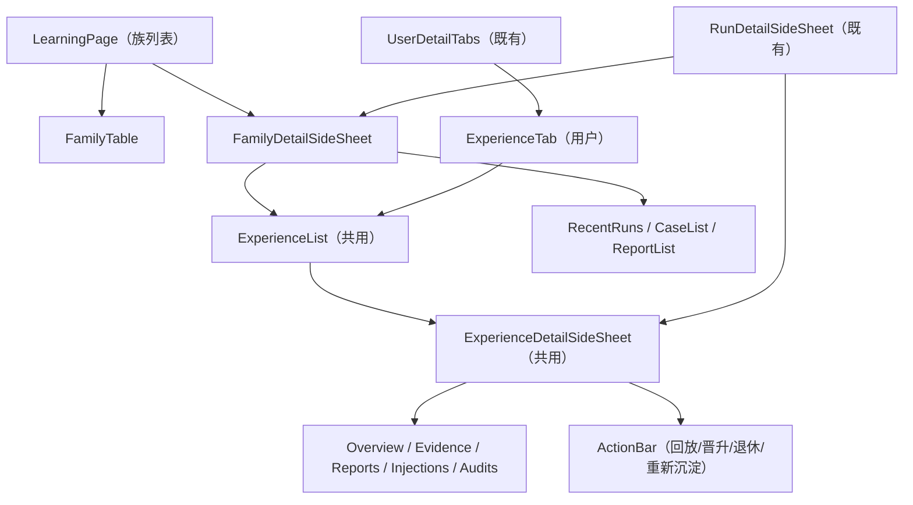

# 经验管理模块 前端设计

> **文档编号**: MOD-EXP-MGMT-FE-v0.1
> **文档版本**: v0.1
> **创建日期**: 2026-11-01
> **文档状态**: 草稿
> **上游 PRD**: `experience-management.prd.md`
> **后端设计**: `experience-management.backend.design.md`

---

## 1. 文档控制

| 角色 | 姓名 | 职责范围 |
|------|------|---------|
| 产品经理 | jahan | 需求定义、业务验收 |
| 开发负责人 | jahan | 组件实现、交互验收 |

| 版本 | 日期 | 作者 | 变更描述 |
|------|------|------|---------|
| v0.1 | 2026-11-01 | jahan | 初始设计 |

---

## 2. 需求分析

### 2.1 需求概述

| 项目 | 内容 |
|------|------|
| **模块名称** | 经验管理（Console） |
| **模块ID** | MOD-EXP-MGMT-FE |
| **需求类型** | 新功能 |
| **业务背景** | 学习闭环缺少可视化、可解释、可操作的管理面 |
| **核心目标** | 用户维度与任务族维度两个入口共用同一份经验事实与同一个详情组件 |

### 2.2 功能方案

| 功能ID | 功能名称 | 优先级 | 来源 |
|--------|---------|--------|------|
| FEAT-01 | 用户经验视图（用户详情「经验」页签） | P0 | US-01 |
| FEAT-02 | 任务族视图（「学习与经验」页） | P0 | US-02 |
| FEAT-03 | 经验详情与解释（共用组件） | P0 | US-03, US-06 |
| FEAT-04 | 生命周期操作入口（回放/晋升/退休/重新沉淀） | P0 | US-04 |
| FEAT-05 | Run ↔ 学习对象深链与诊断 | P1 | US-05 |
| FEAT-06 | 双视图一致展示 | P0 | US-06 |
| FEAT-09 | 审计页经验可见性与深链 | P0 | US-07 |
| FEAT-10 | 止损与族级暂停入口 | P0 | US-08 |
| FEAT-11 | 经验内容修订入口 | P1 | US-09 |
| FEAT-12 | 差回答反馈入口 | P1 | US-10 |

### 2.3 范围与边界

| 类别 | 内容 |
|------|------|
| **范围** | 用户详情经验页签、任务族页面与族详情、共用经验详情 SideSheet、操作确认与任务进度、深链与回跳、i18n |
| **非范围** | 经验内容编辑、阈值设置（系统设置已有）、图表化统计、导出 |
| **前置假设** | Console 已登录管理员；后端 API 按后端设计交付；Semi Design 组件库与现有 DetailSideSheet/RemoteTable 范式可复用 |

### 2.4 验收条件

#### 2.4.1 业务规则与约束

| ID | 类型 | 描述 | 验证场景 |
|----|------|------|---------|
| RULE-20 | 前端约束 | 所有 HTTP 调用只经 `modules/learning/services/*`（共享 `api/client` 实例）；组件/hooks 禁止裸用 axios/fetch；类型与后端契约逐字段对齐 | S-06, S-07 |
| RULE-21 | 交互约束 | 族页面采用「左上主操作 + 右上筛选 + 列表 + 右下分页」；菜单新增「学习与经验」（十一项 → 十二项，需同步改写 `harness-ui` RULE-ui-001）；不重复页签标题 | S-07 |
| RULE-22 | 详情约束 | 经验详情用 SideSheet：标题/副标题居左、关闭 X 居右、Tabs 在下；对象级操作集中在列表最后一列，详情不重复渲染同一操作；操作成功后列表与详情即时刷新 | S-06, S-07 |
| RULE-23 | 国际化 | 所有新增文案走 `learning.*` 词条，中英齐平；枚举/错误码不在组件里写死中文 | 契约测试 |
| RULE-24 | 浏览器验收 | 成功的 E2E 使用真实构建产物 + 真实浏览器，不改写路由、不 mock 业务 API；失败路径只允许制造超时/HTTP 错误 | S-08 |
| RULE-29 | 扩展性兜底 | 经验列表/详情展示 authority；未知状态/原因码/extras 字段原样展示并本地化兜底；不解析 memory_key，不做“一族一 key”假设 | S-02, S-06, S-15 |
| RULE-26 | 止损交互 | Run 详情的注入归因提供「停用本次经验」逐条/全选，确认框展示影响范围并注明「只影响后续新 Run」；族详情提供暂停/恢复，状态可见；操作后列表/详情即时刷新 | S-12, S-15 |
| RULE-27 | 修订交互 | 经验详情提供「修订正文」：展示当前版本、必填原因、提交后显示新版本与 PROPOSED 状态；409 冲突提示刷新，不覆盖 | S-13, S-15 |
| RULE-28 | 反馈交互 | Run 详情提供「差回答」按钮与可选说明；提交后显示已记录、禁止重复提交；提示将触发复核而非立即改状态 | S-14, S-15 |
| RULE-25 | 审计可见性 | 审计页资源类型筛选包含 `MEMORY_EXPERIENCE`，动作/资源/操作者词条齐备；目标展示 `experience_key / user_id`，详情可跳转 `/learning?experience=<user_id>:<key>`；历史合成 actor 显示「系统/自动」并可回看 operator，不伪造账号 | S-10, S-08 |

#### 2.4.2 验收场景

见 `experience-management.scenarios.md`（S-06、S-07、S-08 及 E-01/E-02 的界面分支）。

---

## 3. 前端技术设计

### 3.1 技术选型

| 类别 | 选型 | 版本 | 说明 |
|------|------|------|------|
| 框架 | React + TypeScript | 18 / 5.7 | 与 Console 一致 |
| 组件库 | Semi Design | 现有 | 表格/表单/SideSheet/Tabs/Tag |
| 路由 | react-router | 现有 | `/learning` 新增 |
| 数据请求 | 共享 axios 实例 | `src/api/client.ts` | 仅 service 层使用 |
| 状态 | 页面内 hooks + 轮询 | — | 无全局状态库新增 |

### 3.2 页面与路由结构

| 路由 | 页面 | 说明 |
|------|------|------|
| `/learning` | LearningPage | 任务族列表；`?family=<enc>` 直接打开族详情；`?experience=<user_id>:<key>` 直接打开经验详情 |
| `/users?user=<id>&tab=experience&experience=<key>` | UserPage | 打开用户详情 → 经验页签；可选直接打开经验详情 |
| 运行审计详情 | RunsPage | 既有页面内增加族链接、注入事件链接、诊断入口 |

菜单：新增第 12 项「学习与经验」（`config/menu.ts`，`adminOnly: true`）。该项与 `harness-ui` RULE-ui-001「菜单固定十一项」冲突，实施时同步改写该 Rule（spec 跟随代码事实）。

### 3.2.1 审计页改造（FEAT-09）

- `AuditFilterBar.RESOURCE_TYPES` 增加 `MEMORY_EXPERIENCE`；新增动作选项（`TRIAL_START/TRIAL_PROMOTE/TRIAL_RETIRE/ACTIVATE/RETIRE/REGENERATE`），走 `audit.action.*` 词条。
- 列表「目标」列：`MEMORY_EXPERIENCE` 行展示 `experience_key / user_id`（后端投影已给出）；「操作者」为空且 after_json 有 operator 时显示「系统/自动」，详情显示 operator 原文。
- 详情 `AuditDetailSideSheet`：CONFIG 的 before/after 已有；对经验行提供「查看经验」按钮，跳 `/learning?experience=<user_id>:<key>`；关闭详情返回时保留筛选（沿用现有 search/state）。
- 不新增审计 API；筛选沿用 `resource_type`/`action`。

### 3.2.2 新增操作入口（FEAT-10/11/12）

- **Run 详情**：注入归因区域增加「停用本次经验」（逐条 + 全选），确认框列出将停用的 `memory_key` 与所属用户，并注明「当前回答不变，只影响后续新 Run」；旁路提供「标记差回答」（可选说明，幂等）。
- **族详情**：头部展示暂停状态与操作者；「暂停学习/注入」/「恢复」按钮，确认框说明只影响新 Run、不删除数据。
- **经验详情**：身份区展示 authority（用户确认/管理员修订/Agent 推断）；未知状态与诊断原因码走兜底文案；报告 extras 原样展示；新增「修订正文」入口；表单带当前版本与必填原因，提交后展示新版本与 PROPOSED；若返回 409 提示版本冲突并刷新，不覆盖。
- 所有入口仅在管理员可用的 learning 路由下渲染；提交中禁用、失败保留输入并可重试。

### 3.3 组件设计

| 组件 | 职责 | 复用 |
|------|------|------|
| `LearningPage` | 族列表 + 过滤 + 分页 + 详情开关 | 参照 AuditPage |
| `FamilyDetailSideSheet` | 族聚合、Run/用例/经验/回放页签 | 参照 SkillDetailSideSheet |
| `ExperienceTab` | 用户维度的经验列表与过滤 | 复用 MemoryTab 的列表/分页模式 |
| `ExperienceList` | 经验表格（两处共用） | 单一组件，禁止复制 |
| `ExperienceDetailSideSheet` | 解释与操作 | 两处共用同一组件与同一 DTO |
| `ExperienceStateTag` | 状态机四态与颜色 | — |
| `LearningJobToast` | 回放任务进度/失败重试 | 轮询 API-09 |
| `AuditFilterBar`（既有） | 资源类型/动作新增经验域选项 | 复用现有筛选栏 |
| `AuditDetailSideSheet`（既有） | 经验审计详情与「查看经验」深链 | 复用现有详情壳 |
| `LearningActions`（新增） | Run 止损、族暂停、内容修订、差回答反馈的确认框与结果提示 | 复用 ConfirmAction/Modal |

### 3.4 组件接口契约

| 组件 | Props | Events |
|------|-------|--------|
| `ExperienceList` | `items: ExperienceItem[]`, `loading`, `error`, `counts`, `onOpen(item)`, `onReplay(item)`, `onRetire(item)` | `onFilterChange(filter)` |
| `ExperienceAuthorityTag` | `authority`（未知值原样显示） | — |
| `ExperienceDetailSideSheet` | `experienceId {user_id,memory_key}`, `open`, `onClose`, `onMutated()` | — |
| `FamilyDetailSideSheet` | `family`, `open`, `onClose`, `onOpenExperience(ref)` | — |
| `LearningPage` | — | — |

组件之间只传契约类型（`learningTypes.ts`），不传后端原始响应。

### 3.5 状态与数据流

- `services/learning.ts`：`listExperiences / getExperience / listFamilies / getFamily / replayExperience / activateExperience / retireExperience / regenerateExperience / getJob / getRunDiagnostics`；统一 `unwrap` 与分页类型；写接口强制调用方传 `idempotencyKey`。
- hooks：`useFamilyList`、`useExperienceList`、`useExperienceDetail`、`useLearningJob`（轮询 2s，终态停止，页面隐藏时暂停）。
- 一致性：列表与详情都消费同一 `ExperienceItem` 构造（后端保证），前端不二次拼装状态字段。
- 操作后：`onMutated` 触发列表与详情重新拉取；job 完成事件触发详情刷新。
- 深链：读取 `useSearchParams`，打开对应 SideSheet；关闭时移除参数。

### 3.6 UI 状态

| 状态 | 表现 |
|------|------|
| loading | 表格骨架 / SideSheet 占位 |
| empty | 用户无经验：说明「学习开关 + 成功任务次数」；族为空：说明判定规则 |
| error | 错误码文案 + 重试按钮；上游不可达时只读提示 |
| readonly | 学习关闭：操作按钮禁用并说明原因 |
| pending job | 回放按钮转为「回放中」+ 进度；可离开页面，回来按 job 状态恢复 |
| conflict | 409（非法转换/门槛未过/幂等冲突）显示具体原因，不弹通用失败 |

### 3.7 样式方案

沿用 Console token 与 Semi 组件；状态 Tag：PROPOSED 灰、TRIAL 蓝、ACTIVE 绿、RETIRED 橙；族来源 `skill`/`agent` 用文本标签而非颜色区分。列表主字段即详情入口（family / memory_key 可点击）。

### 3.8 可访问性与兼容性

SideSheet 复用 `DetailSideSheet` 的 Esc/焦点管理；表格操作按钮有 `aria-label`；新增页面支持 zh-CN/en-US；窄屏下表格横向滚动，不隐藏关键列（状态、族、回放结论）。

---

## 4. 风险与依赖

| 风险 | 影响 | 缓解 |
|------|------|------|
| 菜单新增与既有 11 项 Rule 冲突 | 规范审计红 | 实施时同步改写 harness-ui RULE-ui-001，并在任务中作为独立 checklist |
| 回放耗时长 | 用户误以为卡死 | 异步 job + 进度/离开可恢复 |
| 双入口状态不一致 | 用户不信任 | 同一 DTO/组件；E2E 断言两处一致 |
| 历史报告归属未知 | 误读 | 详情显式标注 UNKNOWN，不显示为 PASSED 依据 |

---

## 5. Spec Compliance Matrix

| Spec / Rule | 设计落点（文件 / section / item） | 验证 |
|-------------|----------------------------------|------|
| harness-frontend#RULE-front-001 | frontend §2.4.1 / RULE-20 | S-06, S-07 |
| harness-ui#RULE-ui-001 | frontend §2.4.1 / RULE-21 | S-07 |
| harness-ui-detail#RULE-ui-detail-001 | frontend §2.4.1 / RULE-22 | S-06, S-07 |
| harness-i18n#RULE-i18n-001 | frontend §2.4.1 / RULE-23 | 契约测试 |
| harness-e2e#RULE-e2e-001 | frontend §2.4.1 / RULE-24 | S-08 |
