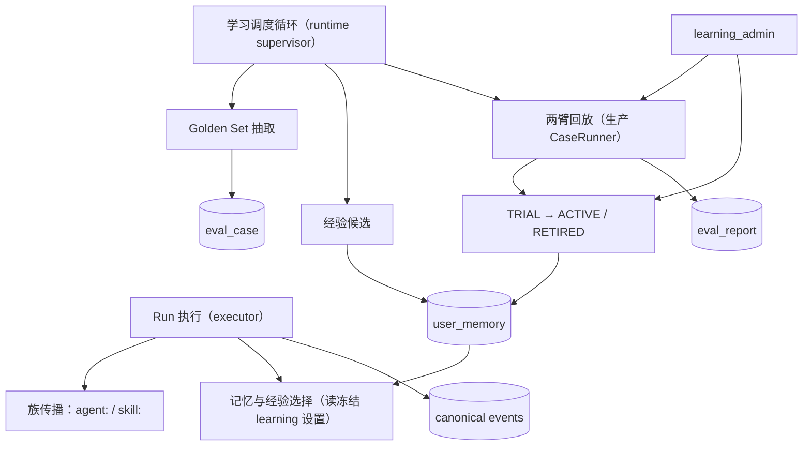

# 学习链路运行时接线设计

> 文档编号：MOD-LEARNING-PIPELINE-WIRING
> 文档版本：v0.1
> 创建日期：2026-11-01
> 文档状态：设计评审中
> 场景源：同目录 `learning-pipeline-wiring.scenarios.md`

## 1. 文档控制

### 1.1 责任人与设计输入

| 角色 | 姓名 | 职责范围 |
|---|---|---|
| 产品/架构 | 待指定 | 闭环触发时机、默认开关 |
| 开发负责人 | 待指定 | runtime / executor / worker / CLI |
| 测试负责人 | 待指定 | 真实执行链 E2E 与接线盘点 |
| 设计评审 | 待指定 | 被否方案与 spec 变更确认 |

| 编号 | 输入 | 结论 |
|---|---|---|
| D-01 | 现状 | 学习链路的服务实现已存在，但抽取/候选/回放/激活/族传播/设置读取没有生产调用方（agent-self-evolution 归档时明确记录） |
| D-02 | 目标 | 让学习闭环在生产运行路径上真实生效：Run 完成 → 自动抽取/候选 → 真实两臂回放 → TRIAL → 下一次 Run 注入 |
| D-03 | 控制模型 | 不引入逐条人工：调度自动，激活按回放与 TRIAL 信号自动；`learning_admin` 只作覆盖与排查 |
| D-04 | 真实边界 | 回放必须走真实 Snapshot 与真实模型（生产 CaseRunner），禁止用注入端口冒充；验收至少一条走真实 supervisor/executor 的 E2E |
| D-05 | 设置口径 | `learning` 分组随 Run 冻结进 `policy_json`，执行期不重读；关闭 `learning_enabled` 后新 Run 不学习也不注入 |
| D-06 | 范围 | 仅后端与脚本；Console 页面不变 |

### 1.2 修订历史

| 版本 | 日期 | 作者 | 变更描述 |
|---|---|---|---|
| v0.1 | 2026-11-01 | Agent | 初始设计：族传播、设置冻结、自动调度、生产回放、CLI 与接线盘点 |

---

## 2. 需求分析

### 2.1 需求概述

| 项目 | 内容 |
|---|---|
| **模块名称** | 学习链路运行时接线 |
| **模块ID** | MOD-LEARNING-PIPELINE-WIRING |
| **所属系统/产品线** | agent-runtime / agent-worker / scripts |
| **需求类型** | 架构演进 / 功能接线 |
| **业务背景** | 上一需求交付了学习链路的组件与存储，但生产运行时没有调用它们，导致"越用越智能"不生效 |
| **核心目标** | 把已有组件接到真实执行链：族传播、冻结设置、自动调度、真实回放、自动 TRIAL、CLI 覆盖，并用一条真实执行的 E2E 证明效果 |

### 2.2 痛点与价值

| 维度 | 内容 |
|---|---|
| **目标用户** | 使用 Agent 完成重复任务的业务用户；运维与研发 |
| **当前问题** | 经验停在 PROPOSED；抽取消极；回放无生产执行端；激活无调用方；学习设置惰性 |
| **业务影响** | 无法观察"同类任务越做越顺"，也无法证明或回滚学习效果 |
| **预期价值** | 同类任务第 2 次起即使用族经验；稳定后自动晋升；关闭总开关即回到基线 |

**用户故事**

| 编号 | 用户故事 | 优先级 |
|---|---|---|
| US-01 | 作为业务用户，我希望同类任务越做越顺，且不用我做任何配置 | P0 |
| US-02 | 作为运维，我希望学习自动发生、可审计、可关闭、可回滚 | P0 |
| US-03 | 作为研发，我希望每个学习能力都有生产调用方，不能再出现"组件在、链路空" | P0 |

### 2.3 功能方案

#### 2.3.1 功能清单

| 功能ID | 功能名称 | 功能描述 | 优先级 | 来源 |
|---|---|---|---|---|
| FEAT-01 | 执行层任务族传播 | executor 在 Run 启动时设置 agent 族；skill 工具调用后切换为该 skill 族并作用于后续请求 | P0 | US-01 |
| FEAT-02 | learning 设置冻结与读取 | 新 Run 把 learning 分组写入 `policy_json`，executor 读取并传给选择器 | P0 | US-02 |
| FEAT-03 | 学习调度 | 后台循环对开启学习的租户执行 Golden Set 抽取与经验候选生成，幂等 | P0 | US-01、US-02 |
| FEAT-04 | 生产 CaseRunner | 从 eval_case 的来源 Run 与 RuntimeSnapshot 重建请求，真实模型两臂回放并逐项判定 | P0 | US-01 |
| FEAT-05 | TRIAL 自动接线 | 回放 PASSED 自动进入 TRIAL；观察期信号不劣化自动晋升，劣化退休 | P0 | US-02 |
| FEAT-06 | learning_admin CLI | list/extract/candidates/replay/activate/retire/explain，机器可读输出与审计 | P1 | US-02 |
| FEAT-07 | 端到端闭环 | 3 次同族任务 → 抽取/候选/回放/TRIAL → 第 4 次注入 | P0 | US-01 |
| FEAT-08 | 失败降级 | 调度/回放异常降级为无学习，warning 与失败计数可见 | P1 | US-02 |
| FEAT-09 | learning_enabled 总开关 | 关闭后新 Run 不学习、不注入、调度跳过 | P0 | US-02 |
| FEAT-10 | 接线盘点 | 每个学习能力必须有生产调用方，仅测试调用或端口注入判失败 | P0 | US-03 |

### 2.4 范围与边界

| 类别 | 内容 |
|---|---|
| **范围（In Scope）** | 族传播、设置冻结、调度循环、生产回放、自动 TRIAL、CLI、接线盘点与 E2E |
| **非范围（Out of Scope）** | Console 新页面、跨租户学习、向量检索、模型微调、多 Pod 下的分布式调度（单实例调度即可，幂等） |
| **前置假设** | 生产模型可用；RuntimeSnapshot 已有 agent/model 定义；eval_case 可重建输入 |
| **有意妥协 / 技术债** | 回放判据用"参考答案的词法覆盖 + JSON 结构"启发式；调度为单实例周期轮询；CLI 为运维工具，不做 RBAC 页面 |

### 2.5 验收条件

#### 2.5.1 业务规则与约束

| ID | 类型 | 描述 | 验证场景 |
|---|---|---|---|
| RULE-01 | 系统约束 | 真实执行链必须能观察到族传播、冻结设置与调度；禁止用注入端口代替生产组合 | S-01、S-02、S-03、B-01 |
| RULE-02 | 系统约束 | 回放必须使用来源 Run 与冻结 Snapshot 重建请求；候选臂携带经验、基线臂不携带 | S-04 |
| RULE-03 | 系统约束 | 回放 PASSED 才允许 TRIAL；观察期不劣化才 ACTIVE，劣化必须 RETIRED | S-05、S-07 |
| RULE-04 | 系统约束 | 学习调度与回放失败降级为无学习，不得影响主 Run | E-01 |
| RULE-05 | 系统约束 | `learning_enabled=false` 时新 Run 不学习、不注入；设置随 Run 冻结 | S-02、E-02 |
| RULE-06 | 系统约束 | 每个学习能力至少一个生产调用方，测试调用不算 | B-01 |
| RULE-07 | 系统约束 | 激活/停用写审计并带 operator；CLI 输出机器可读 JSON | S-06 |

#### 2.5.2 功能验收场景

> **测试分层**：真实调度/执行链、回放与状态机用 integration；CLI 与接线盘点用 contract；纯函数用 unit。

| 场景ID | 覆盖功能 | 设计影响 / 备注 |
|---|---|---|
| S-01 | FEAT-01 | skill 成功后下一个请求切换族；无 skill 用 agent 族 |
| S-02 | FEAT-02 | 设置写入 policy_json 并只影响后续 Run |
| S-03 | FEAT-03 | 调度幂等，关闭学习的租户跳过 |
| S-04 | FEAT-04 | 生产 CaseRunner 重建请求；两臂请求差异可断言 |
| S-05 | FEAT-05 | 回放结果驱动 TRIAL 与晋升/退休 |
| S-06 | FEAT-06 | CLI 退出码、JSON 与审计 |
| S-07 | FEAT-07 | 真实 supervisor/executor 的端到端闭环 |
| E-01 | FEAT-08 | 调度失败不影响主 Run |
| E-02 | FEAT-09 | 总开关关闭后的行为 |
| B-01 | FEAT-10 | AST/导入扫描生产调用方 |

#### 2.5.3 非功能指标

| 指标ID | 指标名称 | 目标值 | 测量方法 |
|---|---|---|---|
| NFR-REL-01 | 调度对主流程影响 | 0（独立后台循环，失败降级） | 故障注入用例 |
| NFR-COST-01 | 回放模型调用 | 每 case 两臂、单 case 一次；基线臂可缓存 | 回放报告记录调用数 |

#### 2.5.4 验证环境假设

| 维度 | 假设 | 验证方式 | 不满足时 |
|---|---|---|---|
| 数据库 | 真实 PostgreSQL（acceptance 隔离库） | `make acceptance` | env_blocked |
| 模型 | acceptance 用本地脚本化上游；生产用真实模型池 | 双模式 | 报 incomplete |
| 调度 | 单实例轮询 | 手动触发一轮 | 跳过 |

---

## 3. 技术设计

### 3.1 方案选型

| 决策点 | 选择 | 被否决项 | 理由 | 可逆性 |
|---|---|---|---|---|
| 族传播 | executor 在 assistant turn 的工具调用里识别 skill，设置 loader 族；Run 启动先取会话上一 Run 的族做兜底 | 每请求查 DB 推导 | 零额外查询，语义与离线派生一致 | 易 |
| 设置冻结 | `build_snapshot` 写入 `policy_json.learning`；executor 读取后传给选择器 | 执行期重读平台设置 | 符合 RULE-memory-006，激活/阈值只影响新 Run | 易 |
| 调度 | runtime supervisor 内的周期循环（幂等服务） | 新 job 表/队列 | 组件已幂等，单实例轮询足够；后续扩多实例再加 claim | 易 |
| 回放执行端 | 生产 CaseRunner：来源 Run 输入 + Snapshot agent 定义 + 模型池凭据 | 复用完整 executor（过重） | 最小真实链路，保留两臂差异可断言 | 易 |
| 回放判据 | 参考答案词法覆盖 + JSON 结构；可注册 verifier 覆盖 | LLM 自评 | 自评不可复现 | 易 |
| 观察期信号 | 调度周期内按族统计 LEARNING_SIGNAL 数量与基线对比 | 在线 A/B | 无实验基础设施，先用纠错信号近似 | 易 |

### 3.2 架构设计

调度循环每轮：只处理 `learning_enabled=true` 的租户；抽取 → 候选 → 对 PROPOSED 经验执行回放 → PASSED 进 TRIAL → 观察期判定。所有步骤幂等，失败独立降级。

调度循环复用 runtime supervisor 的单实例循环，不新增服务；聚合与候选写入复用 `MemoryService` 的锁序与幂等回执（claim/lease 仅属 consolidation job，本调度以幂等服务替代）。

### 3.3 数据设计

- 不新增表；`RuntimeSnapshot.policy_json` 新增 `learning` 段（`learning_enabled`、`retrieval_min_score`、`retrieval_preference_items/bytes`、`experience_min_success_runs`、`experience_auto_activate`、`experience_trial_runs`、`experience_trial_max_regression`、`eval_*`）。
- `user_memory` 现有 `activation_state` / `task_signature` / `trigger_text` / `evidence_json` 复用。
- `eval_case` / `eval_report` 复用。
- 复用 `runtime.user_memory` 与既有表；时间字段沿用 timestamptz；不新增索引。

### 3.4 接口设计

| 接口 | 说明 |
|---|---|
| `LearningSupervisor.run_once(now)` | 调度一轮：抽取、候选、回放、TRIAL；返回计数报告 |
| `ProductionCaseRunner(case, experience_key)` | 从来源 Run 输入与 Snapshot agent 定义重建请求，调用模型，按参考答案判定 |
| `learning_admin list/extract/candidates/replay/activate/retire/explain` | 运维 CLI；stdout JSON，stderr 原因，operator 必填 |
| `build_snapshot(..., learning=...)` | 把 learning 设置冻结进 `policy_json` |
| `MemoryContextLoader.set_task_family(...)` | 执行层在 skill 调用后切换族 |

回放选择沿用 `select_for_injection` 的既有打分与 revision 缓存；候选写入遵守 forget_epoch 与 tombstone；模型调用走模型池，凭据只读 Owner 表且不落日志/报告；不新增 POST 幂等端点。

回放判据：
1. 若参考答案是 JSON，要求候选答案可解析且键集合覆盖参考键集合；
2. 否则要求候选答案覆盖参考答案 >= 80% 的内容 token；
3. 逐项：批量 case 的 item_count 与实际覆盖条目一致，缺项判失败。

### 3.5 质量实现方案

| 风险ID | 失效模式 | 应对 | 验证 |
|---|---|---|---|
| RISK-01 | 调度重复执行 | 服务幂等 + 单实例 | S-03 |
| RISK-02 | 回放判据过松/过严 | 参考答案结构优先；阈值可配 | S-04、S-07 |
| RISK-03 | 学习失败拖垮主流程 | 独立循环 + try/except + 失败计数 | E-01 |
| RISK-04 | 设置漂移 | policy_json 冻结、只影响新 Run | S-02、E-02 |
| RISK-05 | 组件再次空转 | B-01 接线盘点进 CI | B-01 |

可观测性：`learning_pipeline_failures_total{stage}`、`experience_replay_total{result}`、`experience_state_total{state,transition}`、`learning_scheduler_total{outcome}`。

---

## 4. 部署与运维

- 调度循环随 runtime supervisor 启动；可用 `LEARNING_SCHEDULER_INTERVAL_SEC`（默认 60）控制；关闭 learning 的租户自动跳过。
- CLI 作为运维工具通过 `scripts/learning_admin.py` 执行。
- 回滚：关闭 `learning_enabled` 或 retire 经验；无需迁移回滚。

## 5. 风险与依赖

| 依赖 | 内容 | 风险 |
|---|---|---|
| 模型池 | 回放调用走 BACKGROUND 配额 | 中（容量） |
| Snapshot | agent/model 定义可重建请求 | 低 |
| 上一需求 | eval_case/候选/回放/激活服务 | 无 |

## 6. 需求追溯矩阵

| 用户故事 | 功能ID | 用例 | 层级 |
|---|---|---|---|
| US-01 | FEAT-01 | S-01 | integration |
| US-01 | FEAT-03 | S-03 | integration |
| US-01 | FEAT-04 | S-04 | integration |
| US-01 | FEAT-07 | S-07 | integration |
| US-02 | FEAT-02 | S-02 | integration |
| US-02 | FEAT-05 | S-05 | integration |
| US-02 | FEAT-06 | S-06 | contract |
| US-02 | FEAT-08 | E-01 | integration |
| US-02 | FEAT-09 | E-02 | integration |
| US-03 | FEAT-10 | B-01 | contract |

---

## Spec Compliance Matrix

| Spec/Rule | enforcement | 设计影响 | 设计落点 | 验证场景 | 状态 |
|---|---|---|---|---|---|
| `harness-memory#RULE-memory-001` | required | 人工激活经 learning_admin，operator 必填；白名单外不自动 | §3.4 learning_admin | S-06 | applied |
| `harness-memory#RULE-memory-002` | required | 候选写入复用 MemoryService 锁序与幂等回执 | §3.2 MemoryService | S-03 | applied |
| `harness-memory#RULE-memory-003` | required | 选择沿用 select_for_injection 与 revision 缓存，设置只影响渲染参数 | §3.4 select_for_injection | S-01、S-07 | applied |
| `harness-memory#RULE-memory-004` | required | 候选不复活 tombstone；删除后不注入 | §3.4 forget_epoch | S-03、E-02 | applied |
| `harness-memory#RULE-memory-005` | required | 调度不新建 job 表，以幂等服务替代 claim/lease | §3.2 claim/lease | S-03 | applied |
| `harness-memory#RULE-memory-006` | required | learning 设置随 Run 冻结进 policy_json，执行期不重读 | §3.4 policy_json | S-02、E-02 | applied |
| `harness-snapshot#RULE-snapshot-001` | required | 回放使用冻结 RuntimeSnapshot；设置只影响后续 Run | §3.3 RuntimeSnapshot | S-02、S-04 | applied |
| `harness-data#RULE-data-001` | required | 复用现有表与 jsonb；时间沿用 timestamptz | §3.3 user_memory | S-03 | applied |
| `harness-api#RULE-api-001` | required | CLI 输出机器可读 JSON，错误走退出码/stderr | §3.4 learning_admin | S-06 | applied |
| `harness-api#RULE-api-002` | required | 不新增 POST 幂等端点 | §3.4 POST | S-06 | applied |
| `harness-secret#RULE-secret-001` | required | 回放凭据只读 Owner 表，不落日志/报告 | §3.4 凭据 | S-04 | applied |
| `harness-arch#RULE-arch-001` | required | 调度在 runtime supervisor 内，不新增服务 | §3.2 supervisor | S-03 | applied |
| `harness-model#RULE-model-001` | required | 回放模型调用走模型池与实时凭据 | §3.4 模型池 | S-04 | applied |
| `harness-time#RULE-time-001` | required | 调度与报告时间统一 timestamptz | §3.3 timestamptz | S-03 | applied |
| `harness-test#RULE-test-001` | required | 真实执行链 E2E + 接线盘点；禁止端口注入冒充 | §2.5 验收条件 测试分层 | S-07、B-01 | applied |

---
