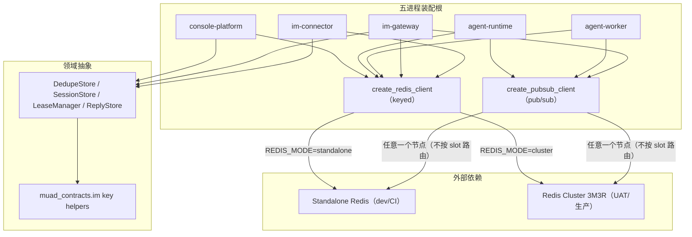
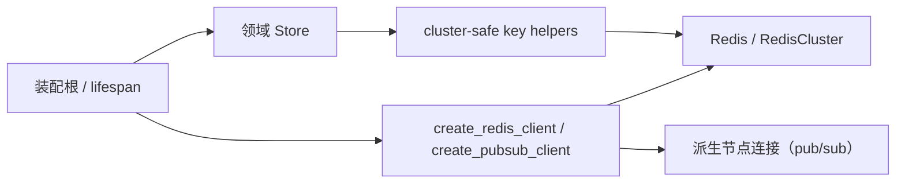

# Redis 单机/Cluster 双模式接入 模块需求与设计一体化文档

> **文档编号**: MOD-REDIS-001
> **文档版本**: v0.2
> **创建日期**: 2026-11-03
> **文档状态**: 设计评审中（v0.2 已按实现可行性与内网真实拓扑对齐）

**评审边界说明**:
- **需求评审**: 第 2 章（需求分析）→ 通过后锁定为需求基线 v1.0
- **设计评审**: 第 3-4 章（技术设计 + 部署运维）→ 通过后锁定设计基线 v1.x
- **交接契约**: 2.5 验收条件 — 需求定义 What，设计实现 How

**ID 体系**: US（用户故事）、FEAT（功能）、API（接口）、RULE（业务规则/系统约束）、TC（测试用例）、RISK（风险）、NFR（非功能指标）
场景编号：S-（正常）、E-（异常）、B-（边界，按需）

---

## 目录

- [1. 文档控制](#1-文档控制)
- [2. 需求分析](#2-需求分析)
  - [2.1 需求概述](#21-需求概述)
  - [2.2 痛点与价值](#22-痛点与价值)
  - [2.3 功能方案](#23-功能方案)
  - [2.4 范围与边界](#24-范围与边界)
  - [2.5 验收条件](#25-验收条件)
- [3. 技术设计](#3-技术设计)
  - [3.1 方案选型](#31-方案选型)
  - [3.2 架构设计](#32-架构设计)
  - [3.3 数据设计](#33-数据设计)
  - [3.4 接口设计](#34-接口设计)
  - [3.5 质量实现方案](#35-质量实现方案)
- [4. 部署与运维](#4-部署与运维)
- [5. 风险与依赖](#5-风险与依赖)
- [6. 需求追溯矩阵](#6-需求追溯矩阵)
- [Spec Compliance Matrix](#spec-compliance-matrix)

---

## 1. 文档控制

### 1.1 责任人

| 角色 | 姓名 | 职责范围 |
|------|------|---------|
| 需求提出人 | jahan | 需求定义、业务验收 |
| 开发负责人 | jahan | 技术方案、代码实现 |
| 测试负责人 | 待定 | 测试策略、质量保证 |
| 架构师（如有） | 待定 | 架构审核、技术决策 |

### 1.2 修订历史

| 版本 | 日期 | 作者 | 变更描述 |
|------|------|------|---------|
| v0.1 | 2026-11-03 | jahan | 初始设计草稿，基于 Redis Cluster 需求对齐结论 |
| v0.2 | 2026-11-03 | jahan | 按实测与内网真实拓扑对齐：补 pub/sub 独立连接方案（RedisCluster 无 pub/sub 能力）、集群异常归一、三族 key 字面值与单一来源、启动拓扑自校验、六地址可达前置、单 slot 集中风险；修正 redis-py 6.x 已废弃参数与 proxy 方案评估；开发阶段无新旧并存，取消兼容层与排空窗口 |

---

## 2. 需求分析

### 2.1 需求概述

| 项目 | 内容 |
|------|------|
| **模块名称** | Redis 单机/Cluster 双模式接入 |
| **模块ID** | MOD-REDIS-001 |
| **所属系统/产品线** | 五进程共享基础设施（console-platform / agent-runtime / agent-worker / im-gateway / im-connector） |
| **需求类型** | 技术重构 / 架构演进 |
| **业务背景** | 内网生产 Redis 为 3 主 3 从原生集群；当前 13 个客户端构造点全部使用单机 `Redis.from_url`。连到集群时：单 key 命令返回 `MOVED`（Gateway 入站建组持续报 `inbound_stream_group_unavailable error=MovedError`）；多 key 的 `XREADGROUP`（32 个入站 shard）、Connector 租约的双 key `EVAL`（lease + epoch）被服务端以 `CROSSSLOT` 拒绝。另外 **项目锁定的 redis-py 6.4.0 异步 `RedisCluster` 没有订阅能力**（无 `pubsub()`；`PUBLISH` 只能经 `execute_command(..., target_nodes=...)` 发布，2026-11-03 实测），三处实时通知/唤醒不能直接迁到集群客户端。redis-py 8.1.0 已实现异步集群 pub/sub，但当前依赖约束是 `>=5,<7`（见 §3.1 决策记录）。 |
| **核心目标** | 增加一套公共 Redis 客户端入口（keyed 客户端 + pub/sub 客户端）与 cluster-safe key 契约，使 dev/CI 继续 standalone、生产使用原生 Redis Cluster，且不改变现有业务语义。 |

---

### 2.2 痛点与价值

| 维度 | 内容 |
|------|------|
| **目标用户** | 平台运维、部署交付人员、五进程开发者 |
| **当前问题** | 生产集群每秒输出 `inbound_stream_group_unavailable error=MovedError`；IM 入站消费不可用；Connector 租约（双 key Lua）与入站多 key 读取在集群下必然失败；pub/sub 类客户端没有集群形态的替代入口；部署文档明确写着“原生 Redis Cluster 当前版本不支持”。 |
| **业务影响** | 内网生产无法使用已部署的 3M3R Redis；IM/WECOM 入站不可用；切换集群若只改 key 或只换客户端都会得到“换了报错但依旧不可用”的半成品。 |
| **预期价值** | 生产直接使用现有 Redis Cluster；dev/CI 继续 standalone；同一套代码、同一套 key 布局；保留现有降级、at-least-once、租约 fencing 和 session 可重建语义。 |

**用户故事**

| 编号 | 用户故事 | 优先级 |
|------|---------|--------|
| US-01 | 作为平台运维，我希望生产通过一个配置开关连接原生 Redis Cluster，以便复用现有 3M3R 集群而不改代码。 | P0 |
| US-02 | 作为五进程开发者，我希望 Redis 客户端创建、pub/sub 连接和 cluster-safe key 规则收敛到公共库，以便新增调用点时不再引入 MOVED/CROSSSLOT。 | P0 |
| US-03 | 作为测试/发布人员，我希望 standalone 与 cluster 都有一套可执行的验收路径，以便切换前能证明没有回归。 | P0 |

---

### 2.3 功能方案

#### 2.3.1 功能清单

| 功能ID | 功能名称 | 功能描述 | 优先级 | 来源 |
|--------|---------|---------|--------|------|
| FEAT-01 | 双模式客户端入口 | 在 `muad_common.redis_client` 提供 `RedisMode`、`RedisClient`、`create_redis_client`（keyed 命令，返回 `Redis`/`RedisCluster`）与 `create_pubsub_client`（pub/sub，**永远返回普通 `Redis`**；cluster 下从集群拓扑派生节点连接）。`REDIS_MODE=standalone` 默认；cluster 校验 db=0、`REDIS_CLUSTER_SEEDS` 解析、`require_full_coverage`；缺失 URL/非法 seed/非法模式启动失败。 | P0 | US-01、US-02 |
| FEAT-02 | Cluster-safe key 与命令契约 | 入站 Stream 加 `{inbound}` tag；Connector 租约 lease/epoch 同 slot 且 key 收敛；出站加 `{tenant_id}` tag；三族 key 只在 `muad_contracts.im` 定义一次，删除 Gateway/Connector 内的本地副本；禁止新增跨 slot 多 key 命令。 | P0 | US-02 |
| FEAT-03 | 生命周期、异常归一与可观测性 | 五进程装配根统一创建/关闭两种客户端；把 `RedisClusterException` 归一进 `RedisError` 体系（或显式捕获），保证既有降级路径不被穿透；启动时校验实际拓扑与 `REDIS_MODE` 一致；启动日志与 `/readyz` 暴露模式；集群错误限频/退避；保留既有降级指标。 | P0 | US-01、US-03 |
| FEAT-04 | 测试矩阵与部署切换 | 单测 key slot/工厂/异常归一；standalone 回归；本地 3 节点 cluster 集成；3M3R staging 故障/reshard 验收；更新 ConfigMap、K8s 清单、`docs/configuration-inventory.*` 与 `build/INTRANET-K8S-DEPLOY.md`；上线前完成“六通告地址可达 + 模式一致性”前置检查。 | P0 | US-03 |
| FEAT-05 | Stream 保留策略与内存边界 | 入站按时间窗口周期 `XTRIM MINID`（每 30s，与 reclaim 同节拍；下界不越过最早 pending）；出站生产端 `XADD ... MINID`；`MAXLEN` 降为 5k 兜底；内存上限按“速率 × 窗口”可推算，不随历史总量增长。 | P0 | US-01、US-03 |

#### 2.3.2 字段约束

**配置字段约束**

| 字段名 | 字段类型 | 必填 | 约束 | 说明 |
|--------|---------|------|------|------|
| `REDIS_MODE` | enum | 否 | `standalone` / `cluster`，默认 `standalone` | 非敏感配置，放 `muad-common` ConfigMap；**环境级唯一来源**，五进程共用，不存在按服务分叉 |
| `REDIS_URL` | DSN | 是 | standalone 可为 `redis://`/`rediss://`；cluster 必须 db=0，作为主 seed 与凭据/TLS 来源 | 继续放 Secret，日志不得输出完整 DSN |
| `REDIS_CLUSTER_SEEDS` | string | 否 | cluster 专用；逗号分隔 `host:port`，支持 `[IPv6]:port`；为空时退化为 `REDIS_URL` 的 host:port | 多 seed 启动发现，避免单 seed 不可达；所有节点必须同一套认证/TLS |
| `REDIS_MAX_CONNECTIONS` | int | 否 | ≥1，默认 50；cluster 模式下按**每节点**连接数解释 | 需在容量/FD 预算中按 master 数放大 |
| `INBOUND_STREAM_MAXLEN` | int | 否 | ≥100，默认 **5000**（原 100000） | 入站每流硬上限兜底；内存主要由保留窗口决定，此值只防失控 |
| `OUTBOUND_STREAM_MAXLEN` | int | 否 | ≥100，默认 **5000**（原复用入站配置） | 出站每流硬上限兜底；与入站解耦，避免“调一个影响两个” |
| `INBOUND_STREAM_RETENTION_SEC` | int | 否 | ≥60，默认 **600** | 入站流时间保留窗口；周期 `XTRIM MINID` 裁剪，下界不越过最早 pending |
| `OUTBOUND_STREAM_RETENTION_SEC` | int | 否 | ≥300，默认 **3600**；启动校验必须 ≥ `CONNECTOR_COMMAND_MAX_AGE_SEC` | 出站流保留窗口（生产端 `XADD ... MINID`）；小于命令过期时间会把“尚未判超时”的命令提前裁掉 |

> `redis://` 与 `rediss://` 只表示**明文 / TLS**，不表示 cluster。cluster 模式由 `REDIS_MODE=cluster` 选择客户端类型；只有集群启用了 TLS 才使用 `rediss://`。
>
> `REDIS_URL` 仍是必填的主 seed 与凭据/TLS 来源；`REDIS_CLUSTER_SEEDS` 可追加 2..N 个 `host:port` seed。`RedisCluster` 只需一个可达 seed 就能完成拓扑发现，发现后会连接**通告地址**（不是 seed），因此防火墙必须放行全部通告 `ip:port`（见 §4.1）。
>
> **内网实际配置**（UAT/生产）：`REDIS_CLUSTER_SEEDS=10.74.145.45:6393,10.74.145.46:6393,10.74.145.47:6393`。集群实际主节点为 `10.74.145.46:6393`、`10.74.145.46:6394`、`10.74.145.47:6393`，客户端发现后会连 `6394` 端口——只放行 `6393` 会导致 1/3 的 key 无法路由。

---

### 2.4 范围与边界

| 类别 | 内容 |
|------|------|
| **范围（In Scope）** | 公共 Redis 客户端入口（keyed + pub/sub）与 `REDIS_MODE` 配置；13 个客户端构造位置迁移（其中 2 处需要同时持有两种客户端）；入站 Stream、Connector 租约、出站 tenant tag 的 cluster-safe 改造；集群异常归一；五进程启动拓扑自校验、就绪与日志；standalone 与 cluster 测试；ConfigMap/K8s 清单/配置清单/部署文档。 |
| **非范围（Out of Scope）** | 不把验收隔离从 Redis DB 10–15 改成 key 前缀（但 **cluster 测试**必须另用专用集群 + key 前缀，见 §3.5.5）；不实现 per-shard 并发 `XREADGROUP`（方案 C）；不引入 Redis Sentinel、代理或自研 cluster 路由；不迁移历史数据（当前为开发阶段，无生产数据）；不做 dual-read/dual-write 兼容层；不覆盖多租户 Connector 出站分组（当前单租户部署）；不做 cluster 性能基准结论。 |
| **前置假设** | 生产/UAT 为 3 主 3 从原生集群，**服务端 Redis 6.2.18（内网生产实测，满足 ≥6.2 下限）**，16384 槽位完整；应用 Pod 可达全部节点通告地址（6393 与 6394）；Redis 密码由 Secret 注入；当前 `DEFAULT_TENANT_ID` 单租户部署；本地/CI 保留 standalone 验收。 |
| **有意妥协 / 技术债** | 32 个入站 shard 通过 hash tag 集中到一个 slot，牺牲集群分片并行度以换取多 key `XREADGROUP` 合法；保留 32 个 key（而不是 `shards=1`）是为了保住积压容量；代价是 IM 全部写入落在同一 master（内网当前为 `10.74.145.46:6393`），该节点故障期间 IM 进出全停（见 RISK-07）。Stream 保留改为**时间窗口**驱动（RET-01），稳态内存按“事件速率 × 保留窗口”推算，不再随历史总量增长。cluster 连接池按每节点计数，`REDIS_MAX_CONNECTIONS` 的容量口径需要同步更新。 |

---

### 2.5 验收条件

#### 2.5.1 业务规则与约束

| ID | 类型 | 描述 | 验证场景 |
|----|------|------|---------|
| RULE-01 | 系统约束 | `REDIS_MODE` 默认 `standalone`；只有显式 `cluster` 才使用 `RedisCluster`，standalone 行为不得改变。模式是环境级唯一来源，五进程共用。 | S-01、S-07 |
| RULE-02 | 系统约束 | standalone 与 cluster 共用同一套 key 布局；hash tag 在两种模式都保留，业务层不得按模式分支 key。 | S-01、S-02、S-03、S-04、S-05、S-06、S-08 |
| RULE-03 | 业务规则 | Redis 仍只承担现有职责（Stream、hint、cache、session、bot lease、pub/sub）；不新增第二权威源，PostgreSQL 继续是 Run/Task/业务事实的权威源。 | S-01、S-06、E-02 |
| RULE-04 | 系统约束 | cluster 模式要求 `db=0`、槽位完整覆盖、seed 可达，且**实际拓扑与 `REDIS_MODE` 一致**（cluster 下 `INFO server.redis_mode=cluster`）；不满足时启动失败关闭，不进入半可用状态。 | S-02、S-07、E-01 |
| RULE-05 | 系统约束 | 业务代码不得直接构造 `Redis.from_url`/`RedisCluster`，只能经 `muad_common.redis_client` 的工厂（keyed 与 pub/sub 两个入口）。 | S-08 |
| RULE-06 | 系统约束 | 多 key 命令必须同 slot（hash tag），或改成逐 key 调用；不得引入跨 slot 的 `XREADGROUP`、`EVAL`、`XREAD`。跨 slot 时集群客户端会抛 `RedisClusterException`（客户端侧拒绝），单机客户端连集群则被服务端以 `CROSSSLOT`/`MOVED` 拒绝，两种都必须消除。 | S-02、S-03、S-04、S-05、S-08、E-01 |
| RULE-07 | 业务规则 | Redis 故障/集群重定向/降级必须显式可见；不得静默吞错或伪造成功。 | S-03、S-06、E-01、E-02 |
| RULE-08 | 业务规则 | PlatformSession 仍是可重建缓存；失效必须清空目标 tenant/platform 的所有 session 与 index，且不影响其他 tenant/platform。 | S-05 |
| RULE-09 | 系统约束 | **pub/sub 不得经 `RedisCluster`**（该客户端没有 pub/sub 能力）。cluster 模式下使用从集群拓扑派生的普通 `Redis` 连接（地址来自 `get_primaries()`，不是第二套 Redis 部署）；被 pin 的节点故障后必须重新派生并恢复订阅。 | S-06、E-02 |
| RULE-10 | 系统约束 | `RedisClusterException` 不是 `RedisError` 子类，必须归一（或显式捕获）；任何 Redis 故障不得让进程崩溃或让消费/订阅循环退出，必须走既有降级路径并可见（日志 + 指标）。 | S-06、E-02 |
| RULE-11 | 系统约束 | Stream 保留必须由**时间窗口**驱动（入站周期 `XTRIM MINID`、出站生产端 `XADD MINID`），`MAXLEN` 只作兜底；**任何裁剪都不得越过最早 pending 条目**；内存上限必须能按“速率 × 窗口”推算，不随历史总量增长。 | S-02、S-04 |

#### 2.5.2 功能验收场景

> 验收场景定义在 `redis-cluster-support.scenarios.md`，本节只引用场景 ID 与设计影响。

| 场景ID | 设计影响 / 备注 | 覆盖功能 |
|--------|----------------|---------|
| S-01 | standalone 默认路径与现有 key 布局一致（tag 恒在）；工厂 standalone 分支与 pub/sub 同源。 | FEAT-01、FEAT-04 |
| S-02 | 入站 32 shard 同 slot；Gateway 消费组、XAUTOCLAIM、重启接管；保留窗口裁剪不越过 pending。 | FEAT-02、FEAT-03、FEAT-05 |
| S-03 | Connector lease/epoch 同 slot 且 key 统一；Lua 原子性、epoch fencing、TTL 接管。 | FEAT-02 |
| S-04 | 同 tenant 出站 bot stream 同 slot；Gateway 入队、Connector XREAD、result 回读。 | FEAT-02 |
| S-05 | PlatformSession 逐 key 删除；滑动续期与登录发布的 4-key `EVAL` 同 slot；可重建缓存与 tenant/platform 隔离。 | FEAT-02 |
| S-06 | 通知/唤醒/取消/session/token/MCP cache/dedupe 的 cluster 使用面；**pub/sub 必须经派生连接**，发布端与订阅端可分布在不同节点；节点故障后恢复；故障时显式降级。 | FEAT-01、FEAT-03 |
| S-07 | 工厂配置校验与启动失败关闭；cluster db 0、缺失 URL、非法 mode、多 seed 解析。 | FEAT-01 |
| S-08 | key slot 不变量与“无直连客户端”机检；standalone/cluster 共用 key 布局。 | FEAT-01、FEAT-02 |
| E-01 | 3M3R 节点故障/reshard；客户端重连、MOVED/ASK、at-least-once 与租约单 owner。 | FEAT-03、FEAT-04 |
| E-02 | 集群不可用时 Gateway/Worker/Runtime 的既有降级语义与恢复（异常归一后不得崩溃）。 | FEAT-03、FEAT-04 |

#### 2.5.3 非功能指标

**性能指标**

| 指标ID | 指标名称 | 目标值 | 测量方法 |
|--------|---------|-------|---------|
| NFR-PERF-01 | 入站/出站 Redis 往返不增加 | 入站仍为 1 次 `XREADGROUP`；出站仍为同 tenant 1 次 `XREAD`；不因 cluster 模式增加逐 key 轮询 | S-02、S-04 的命令计数/抓包断言 |
| NFR-PERF-02 | standalone 回归 | 现有 Redis 相关测试全部通过，无额外延迟阈值回归 | S-01 的测试结果 |
| NFR-PERF-03 | cluster 生产基线 | staging 压测对比切换前后：入站吞吐、入站 P99、入站 slot 所在 master 的 CPU/内存、各节点连接数，无显著回退 | staging 压测报告（不承诺“完全一致”） |

**可靠性指标**

| 指标ID | 指标名称 | 目标值 |
|--------|---------|-------|
| NFR-REL-01 | 节点故障/reshard 恢复 | 客户端在既有 cluster 重试窗口内恢复，无需重启进程；入站 at-least-once、无重复业务副作用 |
| NFR-REL-02 | 降级可见 | 集群不可用时 stream-reliant Gateway `/readyz` 503；hint/pub-sub 降级有日志/指标，进程不崩溃 |
| NFR-REL-03 | pub/sub 可用性 | 订阅端节点故障后经重新派生恢复，窗口等于一次重连；通知按持久 seq 回填 |

**运维与安全指标**

| 指标ID | 安全/运维域 | 验收标准 |
|--------|------------|---------|
| NFR-OPS-01 | 启动校验 | 非法 cluster 配置启动失败；实际拓扑与 `REDIS_MODE` 不一致启动失败；`/readyz` 反映 Redis 模式与依赖状态 |
| NFR-SEC-01 | 凭据保护 | `REDIS_URL` 仍只来自 Secret；日志、错误消息、`/readyz` detail 不输出密码或完整 DSN；`REDIS_MODE` 走非敏感 ConfigMap |

#### 2.5.4 验证环境假设

| 维度 | 假设 | 验证方式 / 参数 | 不满足时 |
|------|------|----------------|---------|
| 容量 | 入站 32 shard；2 个 Connector；同 tenant 2 个 bot；PlatformSession ≥3 个 actor | S-02/S-03/S-04/S-05 fixture | 标记 `incomplete` 或拆分批次 |
| 硬件 | dev/CI 单机即可跑 standalone 与**3 节点**本地 cluster；3M3R 在 staging | 本地 3 节点集群（1 节点测不出跨节点广播）+ staging 3M3R | 3M3R 缺失时 E-01 `env_blocked`，owner=发布负责人 |
| 网络 | 应用 Pod 可达全部 **6 个通告地址**（`10.74.145.45/46/47` × `6393/6394`） | 从 Pod 内对六地址做 TCP 连通 + `RedisCluster` 发现冒烟 | 返回 `env_blocked` 并列出不可达地址；不得降级为单机模式 |
| 依赖 | 真实 Redis（standalone / 本地 3 节点 cluster / 3M3R）、真实 PostgreSQL、真实 Console/Runtime/Worker/Gateway/Connector | preflight：`PING`、`CLUSTER INFO`、`CLUSTER SLOTS`、`/readyz` | 返回 `env_blocked` 并列出缺失项 |
| 服务端版本 | 内网生产 Redis **6.2.18**（满足 ≥6.2 下限） | `INFO server` 的 `redis_version`；本地 6.2.24 冒烟对照 | 低于 6.2 时标记 `env_blocked`（`XAUTOCLAIM` 不可用） |
| 隔离 | cluster 只有 db 0，不能用 DB 10–15 隔离 | 本地 cluster 测试使用 `muad_probe:{uuid}` key 前缀 + 收尾清理；standalone 验收维持既有 DB 号位 | 显式报 `incomplete`，不自动降级为 standalone |

---

## 3. 技术设计

### 3.1 方案选型

#### 备选方案对比

| 对比维度 | 权重 | 方案A：单机 Redis/代理 | 得分 | 方案B+：Cluster 客户端 + hash tag + 派生 pub/sub 连接 | 得分 | 方案C：per-shard 并发消费 | 得分 |
|---------|------|------------------------|------|-------------------------------|------|---------------------------|------|
| 功能完备性 | 30% | 依赖运维提供单 keyspace，代码零改动；但 blocking 命令不被 proxy 支持 | 2 | 直连原生 3M3R，保留现有语义与命令形态 | 5 | 直连原生 3M3R，保留分片并行 | 5 |
| 性能预期 | 25% | 单节点/代理可能成瓶颈 | 3 | 入站 32 shard 集中一个 slot，无额外往返 | 4 | 分片并行最好，但 32 个阻塞连接 | 4 |
| 实现复杂度 | 20% | 最低（但代理不可用） | 1 | 13 个构造位置 + 4 类 key/命令修复 + 两种客户端 | 3 | 在 B+ 上重写阻塞读/生命周期 | 1 |
| 维护成本 | 15% | 依赖外部代理行为 | 2 | 一套 key 契约 + 两个工厂入口，长期可维护 | 4 | 多任务/连接/回收复杂度高 | 2 |
| 风险评估 | 10% | 代理不支持 blocking/reshard 重定向，且长期无维护 | 1 | 风险中等且可测试 | 4 | 风险最高 | 2 |
| **最终得分** | **100%** | | **1.95** | | **4.10** | | **3.20** |

> 代理方案（redis-cluster-proxy）的否决依据（2026-11-03 核实）：官方 README 自述 alpha，**明确不支持 blocking commands**（我们四个读循环全部使用 `block`）、**reshard 后不做自动重定向**；仓库 2023-08 之后无提交。
>
> `INBOUND_STREAM_SHARDS=1` 同样被否决：多 key 问题虽消失，但积压容量从 32×`maxlen` 塌缩为 1×，Gateway 故障期间会丢入站事件。

#### 关键决策记录

| 决策点 | 选择 | 被否决项 | 理由 | 可逆性 |
|--------|------|---------|------|--------|
| 客户端模式 | `create_redis_client`（keyed）+ `create_pubsub_client`（pub/sub）+ 公共工厂 | 继续单机客户端 | 单机客户端无法跟随 MOVED；13 个构造位置必须统一 | 易回退（`REDIS_MODE=standalone`，仅 dev/CI） |
| pub/sub 连接 | cluster 下从 `get_primaries()` 派生普通 `Redis` 连接 | 用当前 6.4.0 的 `RedisCluster` 订阅；升级 redis-py 8.x；sharded pub/sub；Stream 扇出 | 6.4.0 的异步 `RedisCluster` 无 `pubsub()`（实测）；**8.1.0 已实现 `RedisCluster.pubsub()` → `ClusterPubSub`**，但 `redis>=5,<7` 的约束下不可用，且升级属 major 变更需独立评估，不并入本需求首批；sharded pub/sub 要求 Redis 7 且改变广播语义；Stream 扇出是广播改竞争消费，成本最高 | 易（仅改工厂分支；将来升级 8.x 后可直接删除派生连接） |
| 多 key 读取 | hash tag 让 32 个入站 key 同 slot | `shards=1`；per-shard 并发 `XREADGROUP`（方案 C） | 保留一次 `XREADGROUP` 的阻塞语义与 32× 积压容量 | 中（后续可升级 C） |
| 租约 Lua | lease/epoch 加同一 hash tag 并统一 key 名 | 拆成两个 Lua/单 key 改造 | 改动最小，保持原 Lua 原子语义 | 易 |
| 异常处理 | `RedisClusterException` 归一进 `RedisError` 体系 | 每个调用点零散 `try/except` | 现有降级路径只捕 `RedisError`；零散捕获易漏 | 易 |
| key 布局 | standalone/cluster 共用同一套带 tag key | 仅 cluster 模式加 tag | 避免 dev/prod 两套 key 与测试分叉 | 中（开发阶段无历史数据） |
| 本地测试 | 保留 standalone，另起 3 节点本地集群 | 直接把本地唯一 Redis 换 cluster | 验收隔离依赖 DB 10–15，cluster 只有 DB 0 | 易 |

#### 技术栈

| 类别 | 选型 | 版本 | 选型理由 |
|------|------|------|---------|
| 语言 | Python | 3.12+ | 现有服务栈 |
| 框架 | FastAPI / uvicorn | 现有版本 | 不新增服务 |
| Redis 客户端 | `redis.asyncio.Redis` / `RedisCluster` | redis-py **`>=6.4,<7`（当前 6.4.0）** | 工作区 `platform-sdk` 已声明 `redis>=6.4.0`，根约束建议同步收紧（原 `>=5,<7` 可解析到 5.x，而设计里的 `retry=Retry(...)` 需 6.x） |
| Redis 服务端 | 原生 Cluster | **内网生产 6.2.18**（实测确认）；下限 6.2（`XAUTOCLAIM`）；本地用 6.2.24 与 7.4.11 验证 | 本方案不使用 Redis 7 专属特性（sharded pub/sub），6.2 即可；`XAUTOCLAIM` 在 6.2 与 7.x 的返回形状差异已由 redis-py 6.4 抹平（6.2.24 实测通过） |
| 重试/负载均衡 | `retry=Retry(...)`、`load_balancing_strategy` | redis-py 6.x | `cluster_error_retry_attempts` 与 `read_from_replicas` 在 6.x 已 deprecated，不得再作为配置口径 |
| 配置 | pydantic-settings `SharedSettings` | 现有版本 | 统一 `REDIS_MODE`/`REDIS_URL` |
| 部署 | K8s ConfigMap/Secret + kustomize（仓库无 Helm） | 现有版本 | `REDIS_MODE` 非敏感，URL 继续在 Secret |

---

### 3.2 架构设计

#### 技术分层

#### ARCH-01 部署单元与依赖边界

- 四单元边界不变：console-platform / agent-runtime / agent-worker / im-gateway；Connector 仍是 im-gateway 的运行时角色，不是第五个业务微服务。
- Redis 仍是外部依赖，不新增服务、不改变 Pod 拓扑；单机与 cluster 只是同一依赖的两种连接模式。
- 13 个客户端构造位置统一走工厂；装配根负责创建/关闭，领域 Store 不持有全局单例。

#### 客户端构造点清单

| 序号 | 文件 | 当前职责 | 客户端类型 | 迁移后 |
|------|------|---------|-----------|--------|
| 1 | `apps/im-gateway/src/muad_im_gateway/main.py` | Gateway 主客户端（inbound/outbound/notification/session） | keyed + pub/sub | 拆两个：keyed 给 Stream/session/dedupe 与通知水位读取，pub/sub 给 `NotificationStreamHub` 的订阅 |
| 2 | `apps/im-gateway/src/muad_im_gateway/infrastructure/dedupe.py` | Gateway dedupe | keyed | 使用工厂，保留独立生命周期 |
| 3 | `apps/im-connector/src/muad_im_connector/main.py` | Connector 主客户端（lease/reply/outbound/publisher） | keyed | 工厂创建后注入；删除 `connection_pool.connection_kwargs` 日志假设 |
| 4 | `apps/agent-runtime/src/muad_agent_runtime/application/event_tail_hub.py` | event-tail wakeup hint | pub/sub | `create_pubsub_client`，保留降级与重连 |
| 5 | `apps/agent-runtime/src/muad_agent_runtime/infrastructure/cancel_hint.py` | cancel hint | keyed | 工厂创建 |
| 6 | `apps/agent-runtime/src/muad_agent_runtime/infrastructure/notification_publisher.py` | 通知 watermark 写 + pub/sub 发布 | keyed + pub/sub | 拆两个：watermark 走 keyed，`PUBLISH` 走 pub/sub |
| 7 | `apps/agent-worker/src/muad_agent_worker/infrastructure/wakeup_hint.py` | wakeup notifier | pub/sub | `create_pubsub_client`，保留降级 |
| 8 | `apps/agent-worker/src/muad_agent_worker/infrastructure/wakeup_hint.py` | wakeup listener | pub/sub | `create_pubsub_client`，保留订阅重连与重新派生 |
| 9 | `apps/agent-worker/src/muad_agent_worker/infrastructure/cancel_hint.py` | cancel hint | keyed | 工厂创建 |
| 10 | `apps/console-platform/backend/src/muad_console_platform/main.py` | Console session store | keyed | 工厂创建 |
| 11 | `apps/console-platform/backend/src/muad_console_platform/api/deps.py` | platform session invalidator | keyed | 工厂创建 |
| 12 | `apps/console-platform/backend/src/muad_console_platform/api/deps.py` | MCP catalog cache | keyed | 工厂创建 |
| 13 | `apps/console-platform/backend/src/muad_console_platform/api/deps.py` | artifact fetch tokens | keyed | 工厂创建 |
| 14 | `packages/platform-sdk/src/muad_platform_sdk/skill_access.py` | Skill 平台访问（PlatformSession 读写） | keyed | 由 Runtime/Worker 装配根注入工厂客户端；包内不再自建 |

> 14 个构造位置 → 16 个客户端实例：#1 与 #6 各拆成两个；#14 是 2026-11-03 合入 main 后新增的构造点（`Redis.from_url(context.redis_url)`），必须改为由调用方注入，否则既违反 RULE-05，也无法在 cluster 模式下工作。第 11–13 项目前在 `deps.py` 内按需创建并缓存在 `app.state`；改造后仍按需创建，但统一走工厂，不改变请求路径的懒加载语义。
>
> **为什么只有这两处要拆**：同一个组件可能同时触达两种语义。Gateway 的 `NotificationStreamHub` 一边 `pubsub()` 订阅（`notification_streams.py:79`）、一边 `GET` 通知水位（同文件 `:101`，有 key，必须按 slot 路由）；Runtime 的 `NotificationPublisher` 在同一个方法里 `SET` 水位（`notification_publisher.py:64-69`）再 `PUBLISH`（同文件 `:76-90`）。集群客户端做不了前者，普通客户端做不对后者，因此两处都要同时持有两个客户端，并在构造时分别注入。其余 11 个位置都是单一用途（只 keyed 或只 pub/sub），各一个即可。
>
> **pub/sub 客户端不是 standalone 模式**：它连的是同一套集群的某个节点（地址来自拓扑发现）。`PUBLISH`/`SUBSCRIBE` 无 key，不参与槽路由；集群会把消息广播到所有节点，因此发布端与订阅端可以 pin 在不同节点。

#### 外部依赖清单

| 外部系统 | 依赖类型 | 协议 | 超时/重试 | 降级策略 |
|---------|---------|------|----------|---------|
| Standalone Redis | 必需（dev/CI） | RESP | 现有客户端超时 | 现有服务降级路径 |
| Redis Cluster 3M3R | 必需（UAT/生产） | RESP cluster | `retry=Retry(...)`（6.x 口径）；启动校验超时 5s | MOVED/ASK 自动重试；不可用时按服务降级 |
| PostgreSQL | 必需 | asyncpg | 现有 | PG 主链路不受 Redis 影响 |

---

### 3.3 数据设计

> 本需求**不新增/修改 PostgreSQL 表、字段或索引**。本节描述 Redis key space 的“数据设计”，因为 key 布局就是本次的核心契约。

#### KEY-01 入站 Stream

| key | 类型 | slot 策略 | TTL/长度 | 生产者 | 消费者 |
|-----|------|----------|---------|--------|--------|
| `im.inbound:{inbound}:0..31` | Stream | 32 个 shard 共用字面 tag `{inbound}`，同 slot | `INBOUND_STREAM_MAXLEN`（默认 100000） | Connector / Webhook `InboundPublisher` | Gateway `InboundStreamConsumer` |
| `im:inbound:dead` | Stream | 单 key | `DEAD_STREAM_MAXLEN` 10000 | 消费失败/dead letter | 运维排查 |
| `im:inbound:attempts:{entry_id}` | String | 单 key | 86400s | 消费重试计数 | 消费重试计数 |

- 生产与消费必须共用 `inbound_stream_key_for_shard()`；Gateway 的 `INBOUND_KEY_PREFIX` 本地拼装删除。
- 旧 `im.inbound:0..31` 不再被新代码读取；开发阶段直接清理（§4.4）。
- **落点（内网当前拓扑）**：全部 32 个 key 落在 slot **8433 → `10.74.145.46:6393`**。

#### IM-01/IM-02 出站 Stream 与渠道边界

| key | 类型 | slot 策略 | 说明 |
|-----|------|----------|------|
| `im.outbound:{tenant_id}:{bot_id}` | Stream | `{tenant_id}` 是**字面 tag**，同 tenant 的 bot 同 slot；单租户下一次 `XREAD` 合法 | Gateway 入队、Connector 消费 |
| `im:outbound:result:{command_id}` | String | 单 key，TTL 600s | Connector 写结果、Gateway 轮询 |
| `im.outbound:dead` | Stream | 单 key | 投递失败 |
| `im:reply:*` | Hash/String | 单 key 或非事务 pipeline | reply target；cluster pipeline 跨节点不保证原子，语义与现状一致 |

- 渠道差异仍只在适配器层；本设计不改 `channels/`、WeCom SDK、附件取件逻辑。
- 单租户部署下 Connector `_bots` 只来自 `DEFAULT_TENANT_ID`；多租户不在本次范围，未来按 tenant 分组 `XREAD`（tag 已按 tenant 划分，天然支持）。
- Connector 的 `_stream_key` / `_bot_of_stream` 本地副本删除，改用契约函数。
- **落点（内网当前拓扑）**：`default` 租户全部 bot stream 落在 slot **5718 → `10.74.145.46:6393`**。

#### PLAT-01 PlatformSession

| key | 类型 | slot 策略 | 说明 |
|-----|------|----------|------|
| `platform_session:{tenant_id:platform_id}:{actor_scope}:{credential_version}:{adapter_key}:{adapter_version}` | String | 与 index/generation/lock 共用字面 tag `{tenant_id:platform_id}`，同 slot | 可重建缓存（滑动会话，2h 空闲续期） |
| `platform_sessions:{tenant_id:platform_id}` | Set | 同上 | session 索引 |
| `platform_sessions:{tenant_id:platform_id}:generation` | String | 同上 | 会话代次（登录发布时校验） |
| `{session_key}:lock` | String | 同上 | 登录互斥锁（`SET NX EX 120`） |

- **必须加 tag 的原因**：合并后的 `RedisPlatformSessionManager`（`packages/platform-sdk/.../session/redis_manager.py`）有一个 **4 个 key 的 `EVAL`（`_PUBLISH`：session、index、lock、generation）**。不加 tag 在集群下会被客户端直接拒绝（`all keys must map to the same key slot`），单机客户端连集群则收到 CROSSSLOT。`_TOUCH` / `_RELEASE` 是单 key，不受影响。
- `RedisPlatformSessionInvalidator.clear_platform` 保持"SMEMBERS 后删除"的语义。**`delete(*keys)` 不需要改写**：redis-py 6.x 的集群客户端会把 DEL/UNLINK/EXISTS 按 slot 拆分执行（2026-11-03 实测跨 slot 删除返回总数），语义与现状一致（本来就是非原子）；`SREM index *keys` 是单 key 多成员，也合法。
- 但 **prefix 匹配与索引键必须按新格式（含 tag）更新**：`redis_manager.invalidate` 里的 `platform_session:{tenant}:{platform}:{actor}:` 前缀、console 侧 `platform_sessions_index_key` 的消费方都要同步。
- `RULE-platform-001` 的 spec 文本目前写的是无 tag 的 key 格式；按"spec 跟代码事实"的原则，实现时同步修改 spec 并重跑 `spec refresh`/绑定。

#### 租约与提示 key

| key | 类型 | slot 策略 | 说明 |
|-----|------|----------|------|
| `connector:bot:{tenant_id:bot_id}:lease` | String(JSON) | lease/epoch 共用字面 tag `{tenant_id:bot_id}`，同 slot | bot 所有权 |
| `connector:bot:{tenant_id:bot_id}:epoch` | String(int) | 同上 | fencing epoch，单调递增 |
| `connector:inbound:{tenant_id}:{bot_id}:{message_id}` | String | 单 key | 入站去重标记 |
| `connector:outbound-cursor:{tenant_id}:{bot_id}` | String | 单 key | 出站游标 |
| `run:cancel:{run_id}` / `task:cancel:*` | String | 单 key | cancel hint |
| `task:wakeup` / `runtime:events` / `webchat.notifications` | Pub/Sub | 无 slot 概念，不参与路由 | 唤醒/事件/通知频道 |
| `webchat:notification:watermark:*` | String | 单 key | 通知水位（回填依据） |
| `mcp:tools:{server_id}:{revision}` | String | 单 key | MCP 目录缓存 |
| `artifact_fetch:*` | String | 单 key | 取件 token |
| gateway dedupe keys | String | 单 key | 入站/路由去重 |

- 租约 key 由契约 `lease_key`/`lease_epoch_key` 唯一提供；`RedisLeaseManager` 的静态方法删除，避免两份拼装漂移。
- **落点（内网当前拓扑）**：`{default:bot-a}` 的 lease/epoch 落在 slot **250 → `10.74.145.46:6394`**。

#### 容量与连接预算

| 维度 | 估算 |
|------|------|
| 入站 key 数 | 32 个 stream + 1 dead + 每 entry attempts；**全部集中在一个 master** |
| 出站 key 数 | 每 tenant×bot 1 stream + 每 command 1 result |
| Cluster 连接 | `REDIS_MAX_CONNECTIONS` 按每节点解释；3 个 master 时总连接约为 3×配置值（pub/sub 另加 1 条） |
| 迁移 | 无 PG 数据迁移；开发阶段旧 Redis key 直接清理 |

> **单 slot 集中的影响**：内网当前入站、出站、dead stream 全部落在 `10.74.145.46:6393`，而该主机同时承载 2 个 master（槽位 0–10922，占 2/3 keyspace）。必须监控该节点的 `maxmemory`/`maxmemory-policy` 与内存占用：`noeviction` 下打满会让 `XADD` 直接失败（入站丢失）。详见 RISK-07。

#### RET-01 Stream 保留与内存边界

**事实基线**

- `XACK` 只把条目从消费组 PEL 移除，**不删除条目**。条目只有三个去向：被 `XTRIM` 裁剪、被 `XADD ... MINID` 裁剪、被 `XDEL` 删除。当前代码只有 `XADD ... MAXLEN`（近似裁剪）这一条路，所以“已消费”的条目会一直留到被上限挤掉。
- 实测（Redis 6.2.18，200 字文本的入站事件）：单条约 **767 B**；`MAXLEN=100000` × 32 流 ≈ **2.3 GB**，且 hash tag 让它们全部落在同一台 master 上。

**保留策略（三档并用）**

| 档 | 位置 | 做法 | 默认 |
|----|------|------|------|
| 入站时间窗口 | Gateway 消费循环（与 `XAUTOCLAIM` 同 30s 节拍） | 对 32 个流执行 `XTRIM <key> MINID <cutoff>`；`cutoff = min(now − window, 最早 pending 的 ID / last-delivered-id)`，且**绝不越过 `last-delivered-id`**（未投递积压只能由 `MAXLEN` 兜底，否则重启后会先删掉本可处理的消息） | `INBOUND_STREAM_RETENTION_SEC=600` |
| 出站时间窗口 | Gateway `XADD`（生产端） | `XADD <key> MINID <now − window> ...`；窗口外命令本来就已过期（`EXPIRED`），裁剪不改变语义 | `OUTBOUND_STREAM_RETENTION_SEC=3600`，且必须 ≥ Connector 的 `connector_command_max_age_sec` |
| 条数兜底 | 两侧 | 每流硬上限，只防失控，不再是主要边界 | `INBOUND/OUTBOUND_STREAM_MAXLEN=5000` |

- 实测 `redis-py 6.4` 的 `xadd(minid=...)` 与 Redis 6.2 的 `XADD ... MINID` 均可用；`approximate=True`（默认）在小流量下不会立即裁剪（等 macro node 攒满，残留约一个 macro node 的量），需要立即生效用 `approximate=False`，两种都可接受。
- **稳态内存** = `min(事件速率 × 保留窗口, MAXLEN × 流数 × 单条大小)`，与历史总量无关。例：20 条/秒、10 分钟窗口 ≈ 1.2 万条 ≈ 9 MB。

**硬约束（6.2 实测依据）**

- **裁剪不得越过 pending**：在 6.2 上把已投递未 ACK 的条目裁掉后，`XAUTOCLAIM` 返回一串 `(None, None)`，**PEL 里的 pending 数量不变**；现有消费循环会把它当空载荷写 dead letter，`XACK ""` 又失败 → pending 永远清不掉，每个回收节拍重复一次。因此入站裁剪下界必须先读 `XPENDING` 的最小未确认 ID。
- **裁剪不得越过 `last-delivered-id`**：时间窗口只允许清理“已经投递过”的历史；未投递的积压必须保留到消费者追上为止（否则 Gateway 重启后会先删掉本可处理的消息，把一次可恢复的停摆变成数据丢失）。未投递积压的上界由 `MAXLEN` 兜底。
- **触顶（未投递积压 ≥ `MAXLEN`）是真正的数据丢失点**：MAXLEN 裁剪发生在生产者 `XADD` 时，条目已经消失——既无法定位受影响会话，也无法定位对应去重标记。实现为裁剪后检测“最老条目 ID > `last-delivered-id`”，记 ERROR + 指标 `inbound_stream_backlog_overflow_total`，由运维告警介入；用户侧恢复依赖平台重投（去重标记 TTL 24h 内）与人工补发，不得静默。
- **不采用“ACK 后立即 XDEL”**：`tests/acceptance/im_gateway/test_webhook_channel.py` 会在 Gateway 消费后回读流内事件做断言，立即删除会让它变 flaky，也会失去“最近事件可回看/排查”的能力；时间窗口能覆盖同样的内存目标。
- **`XLEN` 语义改变**：表示“最近窗口内的条目数”，不再是历史总量；容量脚本与看板的判读需同步更新。

---

### 3.4 接口设计

> 本需求是函数/库接口与配置接口，不新增 HTTP API、CLI 命令。以下为内部公共接口。

#### API-01 `create_redis_client`（keyed）

| 函数签名 | 入参 | 返回 | 错误处理 |
|---------|------|------|---------|
| `create_redis_client(url: str, *, mode: RedisMode = "standalone", seeds: Sequence[str] \| None = None, decode_responses: bool = True, max_connections: int \| None = None) -> RedisClient` | `url`：standalone DSN 或 cluster 主 seed/凭据/TLS 来源；`seeds`：cluster 额外启动节点 `host:port`；`mode`：`standalone`/`cluster`；`max_connections`：standalone 总数 / cluster 每节点数 | `Redis` 或 `RedisCluster` | `RedisConfigError`：URL 缺失、非法 mode、cluster db≠0、非法 seed、cluster 槽位不完整/全部 seed 不可达 |

**行为约束**
- `mode=standalone` 时调用 `Redis.from_url`，保持现有参数默认值；`seeds` 非空时记录一次 `redis_cluster_seeds_ignored` warning，不改变单机行为。
- `mode=cluster` 且 `seeds` 为空时调用 `RedisCluster.from_url(url, ..., require_full_coverage=True, retry=Retry(...))`。
- `mode=cluster` 且 `seeds` 非空时：解析 `url` 的 username/password/TLS 参数，把 `url` 的 host:port 与 `seeds` 去重合并，构造 `ClusterNode` 列表并调用 `RedisCluster(startup_nodes=[...], require_full_coverage=True, retry=Retry(...))`。
- seed 解析规则：`host:port`；IPv6 用 `[addr]:port`；空项、缺端口、非法端口、重复项去重后为空都抛 `RedisConfigError`。
- 不在工厂里做全局单例；调用方负责 `aclose()`。
- 错误消息不得包含完整 DSN 或密码，只允许 host/port 与模式。

#### API-02 入站 key 构造

| 函数签名 | 入参 | 返回 | 错误处理 |
|---------|------|------|---------|
| `inbound_stream_key_for_shard(shard: int) -> str` | `shard >= 0` | `im.inbound:{inbound}:{shard}` | 负数 `ValueError` |
| `inbound_stream_key(event: InboundEvent, *, shards: int = 32) -> str` | 入站事件、分片数 | 上述 key 的对应 shard | `shards < 1` 时 `ValueError` |

**行为约束**
- Producer 与 Consumer 只调用这两个函数；Gateway 的 `_stream_keys()` 改为循环调用 `inbound_stream_key_for_shard`，删除本地前缀常量。
- 两种模式 key 完全一致；standalone 也保留 `{inbound}` 文本。

#### API-03 租约 key 构造（唯一来源）

| 函数签名 | 入参 | 返回 | 错误处理 |
|---------|------|------|---------|
| `lease_key(tenant_id: str, bot_id: str) -> str` | tenant/bot | `connector:bot:{tenant_id:bot_id}:lease` | 空值 `ValueError` |
| `epoch_key(tenant_id: str, bot_id: str) -> str` | tenant/bot | `connector:bot:{tenant_id:bot_id}:epoch` | 空值 `ValueError` |

**行为约束**
- 两个 key 必须使用同一个字面 hash tag `{tenant_id:bot_id}`，保证 Lua `EVAL` 同 slot。
- `RedisLeaseManager` 的 `acquire/renew/release` 继续使用原 Lua 脚本，只替换 key 构造；`RedisLeaseManager` 自带的 `lease_key`/`epoch_key` 静态方法删除。

#### API-04 `create_pubsub_client`（pub/sub）

| 函数签名 | 入参 | 返回 | 错误处理 |
|---------|------|------|---------|
| `create_pubsub_client(url: str, *, mode: RedisMode = "standalone", seeds: Sequence[str] \| None = None, decode_responses: bool = True, max_connections: int = 10) -> Redis` | 同上（凭据/TLS/seeds 与 API-01 同源） | **普通 `Redis`**（永不返回 `RedisCluster`） | `RedisConfigError`；全部 seed 不可达时抛 `ConnectionError`（`RedisError` 子类，现有降级路径可捕获） |
| `create_pubsub_client_from_cluster(cluster: RedisCluster, *, decode_responses: bool = True) -> Redis` | 已构造的集群客户端（复用其凭据/TLS） | 从 `cluster.get_primaries()` 派生节点连接 | 无可用 primary 时抛 `ConnectionError` |

**行为约束**
- standalone：与今天 `Redis.from_url(url, decode_responses=True)` 完全等价。
- cluster：优先用 `create_pubsub_client_from_cluster(cluster)` 从拓扑派生；只有拿不到集群客户端时才用 seeds 首发可达节点。派生连接与集群客户端使用同一份凭据/TLS。
- 被 pin 的节点故障时，调用方捕获 `ConnectionError` 后重新派生（订阅循环里重建 `pubsub()`），不阻塞进程。
- 不使用 sharded pub/sub（`SPUBLISH`/`SSUBSCRIBE`）：要求 Redis 7 且改变广播语义。

#### API-05 拓扑自校验

| 函数签名 | 入参 | 返回 | 错误处理 |
|---------|------|------|---------|
| `verify_redis_topology(client: RedisClient, *, mode: RedisMode) -> None` | 已构造客户端、模式 | 无 | `RedisTopologyMismatch`：cluster 模式下 `INFO server.redis_mode != "cluster"`、槽位不全、db≠0；standalone 模式连到 cluster |

**行为约束**
- 在五进程启动装配处调用（构造客户端之后、开始服务之前），失败即启动失败关闭。
- 错误日志只输出模式与 host/port，不输出 DSN。

---

### 3.5 质量实现方案

#### 3.5.1 性能设计

| 指标ID | 热点路径 | 目标值 | 实现方案（含被放弃的较慢方案） |
|--------|---------|-------|------------------------------|
| NFR-PERF-01 | Gateway 入站 `XREADGROUP` | 1 次/轮询，不随 32 shard 增加额外往返 | 32 个 key 同 slot，仍一次 `XREADGROUP`；放弃方案 C 的 32 个并发阻塞调用 |
| NFR-PERF-01 | Connector 出站 `XREAD` | 同 tenant 1 次/轮询 | `im.outbound:{tenant}:{bot}` 同 tenant 同 slot；单租户下无需按 bot 拆读 |
| NFR-PERF-02 | standalone 回归 | 不增加额外 Redis 命令 | 工厂 standalone 分支保持原 `Redis.from_url` 行为；key tag 不增加命令数 |
| NFR-PERF-03 | cluster 生产基线 | staging 压测无显著回退 | 合并前后用同一脚本对比；新增“入站 slot 所在 master 的 CPU/内存”观测 |
| NFR-PERF-04 | 保留裁剪开销 | 30s 节拍内 32 次 `XPENDING` + 32 次 `XTRIM`；不进入消息热路径 | 裁剪在消费循环空闲节拍执行；稳态每次裁掉的条目数是常数，单次为 O(log N + 裁剪量) |

**说明**：
- 单 key 命令由集群客户端按缓存槽表**直连**目标节点，不经过代理跳转；新增开销仅为本地 CRC16 + 路由表查找（微秒级），网络往返数与单机一致。
- 本需求不引入缓存层、不改变 Stream 批量大小、不改变 `XREADGROUP BLOCK` 语义；因此不做无依据的延迟数字承诺。
- **已知代价**：入站全部集中到一个 master（见 §3.3 容量与 RISK-07），这是 hash tag 方案的固有取舍，需在上线前用 staging 压测确认该节点余量。

#### 3.5.2 可靠性设计

**WORKER-01 Worker 提示与权威源**

- PostgreSQL 仍是 Task/Schedule/lease 的唯一权威源；Redis wakeup/cancel 仍是 hint。
- cluster 模式只改变 hint 的传输方式；Redis 不可用时 Worker 继续按 PG 扫描推进。
- 现有降级指标（`task_hint_degraded_total`、`event_stream_hint_total`）保留。

**EXC-01 异常归一**

- `RedisClusterException` 不是 `RedisError` 子类（实测：不可达集群 `ping()` 抛 `RedisClusterException`）。工厂/适配层必须把它归一为 `RedisUnavailableError(RedisError)`；无法归一时，所有降级/重试入口捕获 `(RedisError, RedisClusterException, OSError)`。
- **platform-sdk 也要覆盖**：`skill_bridge.py` 只捕获 `RedisError`（平台会话存储不可用时返回 `PLATFORM_SESSION_STORE_UNAVAILABLE`），切换集群客户端后必须同时接住 `RedisClusterException`，否则 skill 执行路径会直接抛异常而不是返回可重试错误。
- 验收要求：任何 Redis 故障都不得让消费/订阅循环退出或让进程崩溃（RULE-10）。

**PUBSUB-01 pub/sub 连接**

- pub/sub 使用派生连接（API-04），与 keyed 客户端同源凭据；订阅循环在 `ConnectionError` 后重新派生节点并重订阅。
- 丢失窗口内的消息由既有兜底覆盖：`webchat.notifications` 按持久 seq 回填；`task:wakeup`/`runtime:events` 是 hint，退化为 PG 轮询/事件回扫。

**RETENTION-01 裁剪安全**

- 裁剪下界 = `min(now − 窗口, 最早 pending ID / last-delivered-id)`，且不得超过组的 `last-delivered-id`；实现必须每周期先读 `XPENDING` 的最小未确认 ID 与 `XINFO GROUPS` 的 `last-delivered-id`（无 pending 时用后者与时间下界取小）。
- 回归用例必须覆盖两条：`pending` 条目不被裁剪；以及“裸裁 pending 的坏形态”被显式断言（`XAUTOCLAIM` 返回空条目、PEL 不清），防止后续实现退回错误的 `XTRIM` 写法。
- 出站裁剪窗口必须 ≥ Connector 的命令过期时间（默认 600s，建议窗口 3600s），并在启动时校验；否则会把“尚未判超时”的命令提前裁掉，结果从 `EXPIRED` 变成“超时无结果”。

| 风险ID | 失效模式 | 影响 | 应对措施 | 验证场景 |
|--------|---------|------|---------|---------|
| RISK-01 | 集群节点故障/reshard | MOVED/ASK、短暂不可用 | `RedisCluster` 自动重定向；应用不重启；保留 at-least-once | E-01 |
| RISK-02 | key 构造漂移导致跨 slot | `CROSSSLOT`/客户端拒绝，入站/租约失败 | key helper 单一来源（契约）；单测 slot 断言；架构扫描禁止直连 | S-08、S-02、S-03 |
| RISK-03 | 旧 key 不被新代码读取 | 开发阶段旧数据不可读 | 直接清理旧 key（无生产数据）；不做 dual-write | S-01、E-01 |
| RISK-04 | 每节点连接预算放大 | Redis maxclients/FD 压力 | `REDIS_MAX_CONNECTIONS` 按每节点解释；pub/sub 另计 1 条；容量/FD 预算乘 master 数 | S-06、NFR-OPS-01 |
| RISK-05 | 集群整体不可用 | 入站/通知/租约不可用 | stream-reliant Gateway `/readyz` 503；Worker/Runtime 走 PG；恢复后自动重连 | E-02 |

#### 3.5.3 安全性设计

**SEC-01 凭据与配置保护**

| 指标ID | 验收标准 | 实现方案 |
|--------|---------|---------|
| NFR-SEC-01 | 不泄露 Redis 密码/完整 DSN | `REDIS_URL` 继续来自 Secret；`SharedSettings.redis_url` 保持 `repr=False`；工厂/校验错误只输出 host/port/mode；日志脱敏依赖 logging-kit |
| NFR-SEC-02 | `REDIS_MODE` 非敏感 | 放 `muad-common` ConfigMap，默认 `standalone`；不写 Secret |
| NFR-SEC-03 | 密钥仍只在 Owner 表/Connector | 本需求不改变 Bot secret、模型 Key、平台凭据的归属与流向 |

#### 3.5.4 可观测性设计

| 场景 | 实现方案 |
|------|---------|
| 启动日志 | `redis_client_configured mode=cluster db=0 seed_host=...`，不输出密码/完整 URL；pub/sub 派生节点单独一条 `redis_pubsub_connected node=host:port` |
| 就绪探针 | `/readyz` detail 增加 `redis_mode` 与 `redis_ok`；stream-reliant Gateway 在 Redis 不可用时返回 503 |
| 集群错误 | `inbound_stream_group_unavailable` 等日志保留异常类型；`MovedError`/`CROSSSLOT`/`RedisClusterException`/连接错误按 1s→2s→4s→…→60s 指数退避，同一错误类型每 60s 最多一条 warning；恢复时输出一条 recovered |
| 指标 | 复用现有 `im_inbound_stream_failures_total`、`task_hint_degraded_total`、`event_stream_hint_total`；新增 pub/sub 断连/恢复计数与“Redis 异常类型”维度；不新增无消费点的指标 |
| LOG-01 | 所有新增日志走 logging-kit，单行文本，自动脱敏 Authorization/Cookie/token/password 等字段 |

#### 3.5.5 测试策略

**TEST-01 分层与真实边界**

| 层级 | 覆盖内容 | 真实边界 |
|------|---------|---------|
| unit | key slot 不变量、工厂模式选择、seed 解析、异常归一 | 纯 Python + `redis.crc.key_slot` |
| contract | `REDIS_MODE`/`REDIS_URL`/db 0 校验、拓扑自校验、无直连构造点 | `SharedSettings` + 源码扫描 |
| integration | standalone 回归；**本地 3 节点 cluster** 的入站/租约/出站/session/pubsub | 真实进程 + 真实 Redis + 真实 PG |
| integration（staging） | 3M3R failover/reshard、MOVED/ASK、恢复 | 真实 3M3R |
| E2E | 本需求无浏览器用户界面，不新增 E2E | — |

**测试清单**
- 新增 `tests/common/test_redis_client.py`：standalone/cluster 分支、单 seed/多 seed 解析与去重、IPv6 seed、非法 seed、db 0 校验、`max_connections` 透传、`RedisClusterException` 归一。
- 新增 `tests/common/test_redis_pubsub_client.py`：standalone 等价性、cluster 派生节点、全 seed 不可达抛 `ConnectionError`、节点失效后重新派生。
- 扩充 `tests/contracts/test_im_contracts.py`：32 个 inbound key 同 slot、lease/epoch 同 slot、同 tenant outbound 同 slot、key 字面值。
- 新增 `tests/architecture/test_redis_client_construction.py`：业务代码除工厂外不得出现 `Redis.from_url`/`RedisCluster`；不得出现本地 key 前缀常量。
- `tests/sdk/test_platform_sliding_session.py` 增加 cluster 覆盖：4-key `EVAL` 同 slot、滑动续期、`invalidate` 清理；`tests/sdk/platform_server.py` 保持真实进程边界。
- 新增 cluster 集成测试：**本地 3 节点集群**跑 S-02/S-03/S-04/S-05/S-06（1 节点测不出跨节点广播）；3M3R staging 跑 E-01。
- 本地集群镜像分别用 **Redis 6.2（内网实际版本/下限）与 7.x（升级预留）** 各跑一轮核心命令冒烟：同 slot `XREADGROUP`、`XAUTOCLAIM`、双 key `EVAL`、`SCAN`、跨节点 `PUBLISH`。
- 新增 `tests/gateway/test_inbound_stream_retention.py`：窗口外的已确认条目被裁剪；**最早 pending 之前的条目保留**；裸裁 pending 时 `XAUTOCLAIM` 返回空条目、PEL 不清的回归断言。
- 出站保留：`XADD MINID` 窗口外的命令被裁、窗口内保留；`OUTBOUND_STREAM_RETENTION_SEC < CONNECTOR_COMMAND_MAX_AGE_SEC` 时启动校验失败。
- 新增多 seed 启动测试：停掉 `REDIS_URL` 主 seed，仅保留 `REDIS_CLUSTER_SEEDS` 中的另一个 seed，应用仍能发现集群并完成一次 `XREADGROUP`/租约调用。
- **测试隔离**：cluster 只有 db 0，不能沿用 `tests/acceptance/conftest.py` 的 DB 10–15；cluster 用例使用 `muad_probe:{uuid}` 前缀并在收尾清理（`scan_iter` 在集群客户端上会遍历所有 primary，已实测）。
- **配置清单**：新增 `redis_mode`/`redis_cluster_seeds` 及任何新增模块常量必须同步 `docs/configuration-inventory.csv`（`tests/test_configuration_inventory.py` 会逐条核对）。
- **清单测试**：`muad-common` ConfigMap 必须有 `REDIS_MODE`；`deploy/k8s` 下五个工作负载的清单与 settings 字段一致性测试同步更新。
- 现有 acceptance/E2E 保持 standalone，不修改 DB 10–15 隔离；既有测试里精确 key 断言（`im.inbound:0`、`connector:bot:{t}:{b}` 等）随 key 布局一并更新。

---

## 4. 部署与运维

### 4.1 部署架构

| 环境 | Redis 配置 | 实例/拓扑 | 用途 |
|------|-----------|----------|------|
| dev | `REDIS_MODE=standalone`，`REDIS_URL=redis://localhost:6379/0` | 单机 Redis | 日常开发、现有 acceptance/E2E |
| CI | `REDIS_MODE=standalone`（现有 job）；新增 cluster 测试用**本地 3 节点**集群 | 单机 + 3 节点集群 | standalone 回归 + CROSSSLOT/pub/sub 回归 |
| staging | `REDIS_MODE=cluster`，`REDIS_URL=redis://:<pwd>@<seed1>:6393/0`，`REDIS_CLUSTER_SEEDS=<seed1>:6393,<seed2>:6393,<seed3>:6393` | 3M3R | failover/reshard 验收 |
| prod（内网） | `REDIS_MODE=cluster`，`REDIS_CLUSTER_SEEDS=10.74.145.45:6393,10.74.145.46:6393,10.74.145.47:6393` | 3 主 3 从（6 节点 / 3 主机） | 生产 |

**内网真实拓扑**（2026-11-03 `CLUSTER NODES` 实测）：

| 角色 | 节点 | 槽位 |
|------|------|------|
| master | `10.74.145.46:6393` | 5461–10922 |
| master | `10.74.145.46:6394` | 0–5460 |
| master | `10.74.145.47:6393` | 10923–16383 |
| slave | `10.74.145.45:6393` | 跟随 `.46:6394` |
| slave | `10.74.145.45:6394` | 跟随 `.47:6393` |
| slave | `10.74.145.47:6394` | 跟随 `.46:6393` |

**配置归属**
- `REDIS_MODE`：`deploy/k8s/base/configmap.yaml`（`muad-common`），默认 `standalone`；生产必须显式 `cluster`。
- `REDIS_CLUSTER_SEEDS`：ConfigMap（非敏感）；为空时使用 `REDIS_URL` 单 seed。
- `REDIS_URL`：`muad-external` / `muad-connector-external` Secret，继续由部署平台注入；作为主 seed 与凭据/TLS 来源。
- `REDIS_MAX_CONNECTIONS`：ConfigMap 或 chart values；cluster 下按每节点解释。

**上线前置检查（硬门槛）**
1. 从应用 Pod 内对 **6 个通告地址**（`10.74.145.45/46/47` × `6393/6394`）逐一 TCP 连通；种子只覆盖 6393，但客户端会连接宣告的 6394。
2. 跑一次发现冒烟：`RedisCluster` 能枚举出 3 个 primary，且与上表一致。
3. 核对 `INFO server.redis_mode=cluster`、`CLUSTER INFO` 槽位 16384 全覆盖。
4. 核对 master 节点的 `maxmemory`/`maxmemory-policy` 与当前内存占用（见 RISK-07）。
5. 核对 `maxclients` 与每节点连接预算。
6. 确认 `INFO server`：`redis_version=6.2.18`（内网生产实测，满足 ≥6.2 下限）、`redis_mode=cluster`。
7. 确认 master 的 `maxmemory` 已设置且**小于容器内存限制**、`maxmemory-policy=noeviction`；按“事件速率 × 保留窗口”核算入站/出站流的稳态内存余量（§3.3 RET-01）。

### 4.2 发布与回滚

**发布策略**

| 阶段 | 范围 | 进入条件 | 回滚条件 |
|------|------|---------|---------|
| 1. 代码先行（standalone） | 全部服务 | `REDIS_MODE=standalone`，现有 acceptance/E2E 全绿 | 任一回归 → 回滚代码 |
| 2. 本地 3 节点集群 | 本地/CI | S-02/S-03/S-04/S-05/S-06 通过 | 任一 CROSSSLOT/MOVED/客户端拒绝未处理 → 修复后重跑 |
| 3. staging 3M3R | staging | E-01 通过 + NFR-PERF-03 压测基线 | failover 不可恢复 / 性能显著回退 → 不发布 |
| 4. 生产集群 | prod | 维护窗口；上线前置检查 5 项全过；staging 全绿 | 前向修复或灰度回退到**已支持集群**的上一个版本 |

**回滚说明（按当前实际约束重写）**
- **开发阶段**：无新旧版本并存、无生产数据；直接一次性部署，回滚 = 重新部署当前分支的上一提交。
- **生产**：只有集群 Redis，没有单机实例可切；**旧版本（本需求前）不支持集群，回滚到旧版本等于继续故障**。因此生产回滚只能回到“支持集群的相邻版本”，实际策略是灰度发布 + 前向修复。
- 由于没有新旧并存窗口，本需求不引入 dual-write/dual-read 兼容层。

### 4.3 监控告警

| 指标/日志 | 阈值 | 级别 | 处理 |
|-----------|------|------|------|
| `inbound_stream_group_unavailable` | 连续 5 分钟 >0 | P1 | 检查 `CLUSTER INFO`、seed 可达、`REDIS_MODE` |
| `MovedError` / `CROSSSLOT` / `RedisClusterException` | 任意出现 | P1 | 检查 key helper、客户端是否绕过工厂 |
| `inbound_stream_read_failed` | 连续 5 分钟 >0 | P2 | 检查 Redis 延迟/连接数 |
| `/readyz` Redis detail | 非 200 | P1 | 检查集群健康与连接预算 |
| 入站 slot 所在 master 的内存使用率 | >70% `maxmemory` | P1 | 扩容/调整 `maxmemory-policy`，防 `noeviction` 下写失败 |
| 入站 slot 所在 master 的 CPU | 持续 >70% | P2 | 评估 IM 写入是否成为热点 |
| 每节点连接数 | 接近 maxclients 80% | P2 | 调整 `REDIS_MAX_CONNECTIONS` 或扩容 |
| pub/sub 断连/恢复计数 | 任意断连 | P2 | 检查被 pin 节点与重新派生是否生效 |
| 流长度 `XLEN`（入站 32 流 / 出站各 bot 流） | 持续高于“速率 × 窗口”推算值 | P2 | 检查裁剪节拍与保留窗口；注意 `XLEN` 现在表示最近窗口内条目，不是历史总量 |
| 入站消费者滞后（最新 entry ID − 组 `last-delivered-id`） | ≥ `MAXLEN` 的 60% | P1 | 消费者落后；触顶后会裁掉未投递事件（`inbound_stream_backlog_overflow_total`）。恢复消费者或临时扩容 |
| `inbound_stream_backlog_overflow_total` | 任意出现 | P1 | 已发生未投递事件丢失；检查消费者停摆时长，核对受影响会话的用户反馈与去重标记清理 |

### 4.4 数据迁移

> 本需求无 PostgreSQL schema 迁移。当前为开发阶段，**没有生产数据需要迁移**。

| 阶段 | 操作 | 验证方法 |
|------|------|---------|
| 1 | 部署新代码（key 布局与客户端同时上线） | 启动日志 `redis_client_configured mode=cluster`；`/readyz` 200 |
| 2 | 清理旧 key：`im.inbound:0..31`、旧 `connector:bot:{tenant}:{bot}`（含 `:epoch`） | 旧 key 数量为 0；新 key 可读写 |
| 3 | 冒烟：一条入站事件走完 Connector → Stream → Gateway | 新 key 上 `XLEN` 增加、事件被消费、`external_message_id` 无重复 |

- 不采用双写/双读：Redis 数据为 Stream/hint/cache/session/lease，PostgreSQL 是业务事实权威源。
- 开发阶段旧 key 直接删除即可；如环境里存在历史数据且希望保留，可临时保留旧 key 但新代码不读。

---

## 5. 风险与依赖

### 5.1 项目依赖

| 依赖模块/团队 | 依赖内容 | 状态 | 风险等级 |
|-------------|---------|------|---------|
| 运维/基础设施 | 3M3R Redis Cluster、seed 列表、密码、maxclients、**六个通告地址对应用侧放行** | 待确认 | 高 |
| 发布负责人 | 部署顺序、灰度与前置检查 | 待确认 | 中 |
| 测试环境 | 本地 3 节点 cluster、3M3R staging | 待建设 | 高 |
| redis-py | `RedisCluster`/`ClusterPipeline` 版本行为（6.4.0 无 pub/sub、异常不继承 `RedisError`） | 已核实 | 中 |
| 现有 acceptance | standalone DB 10–15 隔离保持不变 | 已具备 | 低 |

### 5.2 风险识别

| 风险ID | 类型 | 描述 | 概率 | 影响 | 应对措施 | 验证场景 |
|--------|------|------|------|------|---------|---------|
| RISK-01 | 技术 | 集群节点故障/reshard 导致短暂 MOVED/ASK | 中 | 高 | `RedisCluster` 自动重定向；应用重试；E-01 验证 | E-01 |
| RISK-02 | 技术 | key 构造漂移导致 CROSSSLOT | 中 | 高 | 契约单一来源 + 单测 + 架构扫描 | S-08、S-02、S-03 |
| RISK-03 | 运维 | 旧 key 与新 key 并存 | 低 | 低 | 开发阶段直接清理；新代码不读旧 key | S-01 |
| RISK-04 | 容量 | cluster 每节点连接数放大 | 中 | 中 | 预算乘 master 数；pub/sub 另计；监控 maxclients | S-06、NFR-OPS-01 |
| RISK-05 | 运维 | 通告地址不可达（防火墙只放行 6393；节点通告为 6393/6394） | 中 | 高 | 上线前置检查；必要时 `address_remap` | S-07、E-01 |
| RISK-06 | 范围 | 多租户 Connector 出站未覆盖 | 低 | 中 | 当前单租户；tag 已按 tenant 划分，未来直接支持 | 非范围，记录 |
| RISK-07 | 容量/可用性 | 入站/出站全部集中到单一 master（当前 `.46:6393`），且该主机同时承载 2 个 master（2/3 槽位） | 高 | 高 | 监控该节点内存/CPU；确认 `maxmemory-policy`；failover 窗口内 IM 会短暂全停；评估是否把入站与出站分到不同 tag | S-02、E-01 |
| RISK-08 | 可用性 | pub/sub 连接的 pin 节点故障导致订阅中断 | 中 | 中 | 订阅循环重新派生节点；通知按 seq 回填，hint 退化为轮询 | S-06、E-02 |
| RISK-09 | 实现 | 集群异常类型未被捕获，故障时表现为进程崩溃 | 中 | 高 | 工厂归一 + 全量捕获检查；E-02 断言降级而非崩溃 | E-02 |
| RISK-10 | 环境 | 目标环境 Redis < 6.2 时 `XAUTOCLAIM` 不可用，pending 消息无法回收（内网生产已确认 6.2.18，满足下限） | 低 | 高 | 新环境接入时前置检查记录 `redis_version` 并卡 ≥6.2；本地/CI 集群用 6.2+ 镜像各跑一轮 | S-02、E-01 |
| RISK-11 | 实现 | 保留裁剪越过 pending：6.2 上会留下悬空 PEL（`XAUTOCLAIM` 返回 `(None, None)` 且 pending 不清），消费循环反复写死信 | 中 | 高 | 裁剪下界取 `min(now − 窗口, 最早 pending ID)`；回归用例显式断言“pending 不被裁”；出站窗口 ≥ 命令过期时间并在启动校验 | S-02、S-04 |

---

## 6. 需求追溯矩阵

> 本表为设计阶段的手工闭合矩阵；plan 阶段由 acceptance manifest 生成最终矩阵并替换。

| 用户故事 | 功能ID | 接口ID | 测试用例ID | 测试层级 | 执行方式 | 追溯 check | 状态 |
|---------|--------|--------|-----------|---------|---------|-----------|------|
| US-01 | FEAT-01 | API-01、API-04、API-05 | S-01、S-06、S-07、S-08 | integration / contract / unit | auto | 待 plan 绑定 | 设计完成 |
| US-02 | FEAT-02 | API-02、API-03 | S-02、S-03、S-04、S-05、S-08 | integration / unit | auto | 待 plan 绑定 | 设计完成 |
| US-03 | FEAT-03 | API-01、API-04 | S-06、E-01、E-02 | integration | auto / deferred | 待 plan 绑定 | 设计完成 |
| US-01、US-03 | FEAT-04 | API-01、API-02、API-05 | S-01、E-01、E-02 | integration | auto / deferred | 待 plan 绑定 | 设计完成 |
| US-01、US-03 | FEAT-05 | —（内部策略，无对外接口） | S-02、S-04 | integration | auto | 待 plan 绑定 | 设计完成 |

---

## Spec Compliance Matrix

> 从需求目录 `spec-context.yml` 继承并逐 Rule 回填。required Rule 必须有具体设计落点和 verifier/验收场景。

| Spec/Rule | enforcement | 设计影响 | 设计落点 | 验证场景 | 状态/N/A 理由 |
|-----------|-------------|---------|---------|---------|----------------|
| `harness-arch#RULE-arch-001` | required | 不新增部署单元；Redis 只是外部依赖，Connector 仍是 im-gateway 运行时角色 | §3.2 ARCH-01 | S-01、S-06 | applied |
| `harness-im#RULE-im-001` | required | bot→Agent 路由不变；hash tag 只改 key，不建立 agent→Pod 映射 | §3.3 IM-01 | S-02、S-03、S-04 | applied |
| `harness-im#RULE-im-002` | required | 渠道差异仍在适配器层；入站/出站只改 Stream key 与客户端，不把渠道形状带回核心域 | §3.3 IM-02 | S-02、S-04 | applied |
| `harness-log#RULE-log-001` | required | 新增启动/集群错误日志走 logging-kit；不输出完整 DSN/密码；错误限频 | §3.5.4 LOG-01 | S-01、S-06 | applied |
| `harness-project-platform#RULE-platform-001` | required | PlatformSession 仍是可重建缓存；失效保持 SMEMBERS 后删除语义，不改变 tenant/platform 隔离 | §3.3 PLAT-01 | S-05 | applied |
| `harness-secret#RULE-secret-001` | required | REDIS_URL 继续来自 Secret；REDIS_MODE 走 ConfigMap；日志/错误不泄露密码 | §3.5.3 SEC-01 | S-06、S-07 | applied |
| `harness-test#RULE-test-001` | required | cluster 集成使用真实 3 节点集群；standalone 回归使用真实 PG/Redis；不 mock 业务边界 | §3.5.5 TEST-01 | S-02、S-03、S-06、E-01、E-02 | applied |
| `harness-worker#RULE-worker-001` | required | PostgreSQL 仍是 Task/lease 权威源；Redis wakeup/cancel 仅 hint；cluster 不改变调度语义 | §3.5.2 WORKER-01 | S-06、E-02 | applied |
| `harness-snapshot#RULE-snapshot-001` | required | 本任务只调整 SkillPlatformContext 的 Redis 连接字段，不改变 Run/Task 快照冻结、预算冻结与 CAS 终态；快照套件作为回归 | Spec Compliance Matrix | S-05、S-06 | applied |
| `harness-api#RULE-api-001` | required | 仅 `/readyz` detail 增加 `redis_mode`；探针响应不走业务封套，未改错误码/列表口径 | Spec Compliance Matrix；§3.5.4 可观测性设计 | S-02、S-06 | applied |
| `harness-api#RULE-api-002` | required | 本需求未新增创建/上传 POST，幂等契约与指纹口径不变 | Spec Compliance Matrix；§3.5.4 可观测性设计 | S-02、S-06 | applied |

---

## 附录：术语表

| 术语 | 定义 |
|------|------|
| Standalone | 单机/主从 Redis，客户端只看到一个 keyspace |
| Redis Cluster | 原生分片集群，16384 槽位，MOVED/ASK 重定向 |
| hash tag | Redis Cluster 中用 `{...}` 让多个 key 落到同一 slot 的写法 |
| MOVED / ASK | Redis Cluster 的槽位重定向错误 |
| CROSSSLOT | Redis Cluster 对跨 slot 多 key 命令返回的服务端错误 |
| RedisClusterException | redis-py 集群客户端的异常类型；**不继承 `RedisError`**，必须显式归一/捕获 |
| 派生连接 | cluster 模式下为 pub/sub 从集群拓扑（`get_primaries()`）取节点地址建立的普通 `Redis` 连接 |
| fencing epoch | Connector 租约的单调递增版本，用于拒绝旧 owner |
| MVCC | 本需求不涉及 |

---

*文档结束*
