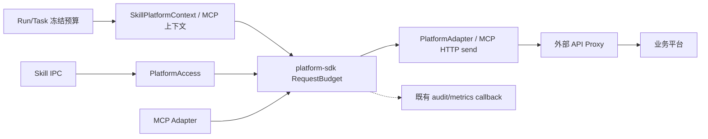

# 出站请求限流 SDK 设计简报

> v0.2；2026-11-08 细化配置、作用域和错误契约；本需求只交付 SDK 与 Runtime/Worker 接线，不建设独立服务、控制面或全平台接口保护。
> 场景唯一源：`egress-rate-sdk.scenarios.md`。

## 1. 文档控制

| 角色 | 责任 |
|---|---|
| 需求决策 | Max |
| 设计整理 | Codex |
| 实施负责人 | Plan 阶段分配 |

代码基线：本地 `main` / `9bfeae1b8c8b4a1320fc46db7537cf9e04bb4857`。当前只修改 Code Flow 文档。

## 2. 需求分析

### 2.1 需求概述

外部 API Proxy 负责整个业务平台的接口保护和全局限流。Fluxion 只在自身发出平台/MCP 请求前，用一个进程内 SDK 执行级预算，避免单次 Skill、Run 或 Task 在自身范围内无限循环请求。

目标：复用 `packages/platform-sdk`，不增加部署单元、数据库、Redis 计数服务、Console 页面或 HTTP 管理 API。预算由 Agent `runtime_config` 中的执行/Skill 子项 在 Run/Task 创建边界注入，并随既有 execution snapshot 冻结；SDK 不负责配置管理。

### 2.2 功能方案

| 功能ID | 功能名称 | 功能描述 | 优先级 | 来源 |
|---|---|---|---|---|
| FEAT-01 | 本地请求预算 | 每次真实发送前检查 invocation、Run/Task 本地执行段及目标的次数和在途并发 | P0 | 用户范围调整 |
| FEAT-02 | 真实发送计次 | 登录、CSRF/Session 校验、业务请求、MCP initialize/notification/tools.call 和重试均计次 | P0 | 已确认按实际请求计数 |
| FEAT-03 | 快照注入 | Run/Task 创建时从 Agent `runtime_config` 中的执行/Skill 子项 读取并冻结预算，执行期只读 | P0 | Snapshot 既有规则 |
| FEAT-04 | 超限停止 | 超限返回结构化 SDK 错误；invocation 耗尽由父执行器结束脚本 | P0 | 已确认脚本停止范围 |
| FEAT-05 | Proxy 结果透传 | 外部 Proxy 的 429、Retry-After 和业务错误不被 SDK 改写 | P0 | 用户范围调整 |
| FEAT-06 | 轻量观测钩子 | 可选 outcome/计数 callback，复用既有 audit/metrics，不保存 SDK 明细 | P1 | 最小实现边界 |

### 2.3 范围与边界

| 类别 | 内容 |
|---|---|
| **范围（In Scope）** | `platform-sdk` 的本地 limiter/budget；Skill Platform IPC、PlatformAdapter 实际发送边界、MCP Runtime Adapter 接线；Run/Task 快照字段；结构化超限错误；unit/contract/integration 测试 |
| **非范围（Out of Scope）** | 全平台/跨租户/跨 Pod 接口保护；独立 rate-limit service；Redis/PG 计数桶；Console 策略 CRUD、接口发现、明细查询、统计页面；模型/入站 API 限流；替代 API Proxy 的 429 策略 |
| **有意妥协 / 技术债** | 本地预算只保证单个执行进程内的自我约束，多副本共享保护由 API Proxy 负责。进程崩溃、WAIT/resume 或新 Task attempt 不恢复本地计数，只继承冻结阈值。受信 Skill 仍可能绕过 SDK 自行联网，当前不提供操作系统级沙箱。 |

规则：无预算或全 `None` 时完全旁路，不创建 limiter、限流检查不访问 Redis/PG、不增加默认限制；`max_requests` 按实际发送尝试计数，失败/401/429/重试均占用；`max_inflight` 在响应流关闭、取消或异常时释放；本地 window 只防单执行循环，平台级窗口由 Proxy 负责；invocation 身份由父进程生成，脚本参数不能修改。

### 2.4 验收条件

场景详见 `egress-rate-sdk.scenarios.md`。

| 规则 | 约束 | 场景 |
|---|---|---|
| RULE-SDK-01 | 每次真实发送含认证/重试独立计次 | S-01、S-02、S-03 |
| RULE-SDK-02 | 全部父子规则原子检查，拒绝不扣减，释放幂等 | B-01、B-03、E-01 |
| RULE-SDK-03 | gate 位于实际发送前，认证职责保持 | S-02 |
| RULE-SDK-04 | 本地和上游错误区分、安全保留上游字段 | S-03、E-03 |
| RULE-SDK-05 | 策略冻结，内存计数按执行段生命周期 | S-04、B-04 |
| RULE-SDK-06 | invocation 可信，父事件终止耗尽脚本 | S-04、E-02 |
| RULE-SDK-07 | 无规则旁路，无全局计数承诺 | B-02、E-03 |
| RULE-SDK-08 | 接口匹配与单调时间窗口有确定口径 | B-05 |
| RULE-SDK-09 | observer 失败可见且不改变业务结果 | E-04 |


| 场景ID | 设计影响 |
|---|---|
| S-01 | 本地预算放行、计次和脱敏 |
| S-02 | PlatformAdapter 认证、校验、业务重试共用 gate |
| S-03 | MCP 请求共用 gate，Proxy 429 原样透传 |
| S-04 | 完整执行段、invocation 与恢复链（TASK-005 集成验收） |
| S-05 | 预算解析后的 Run/Task 快照构建与读回契约（TASK-001） |
| E-01 | 次数/并发超限在发送前拒绝 |
| E-02 | invocation 耗尽终止脚本，Run 可继续 |
| B-01 | 多条本地规则原子判定 |
| B-02 | 无预算完全旁路 |
| B-03 | 流式/取消/异常释放并发 |
| E-03 | 进程重启不冒充全局计数恢复，Proxy 仍负责全局保护 |
| B-04 | 配置合并及非法值校验 |
| B-05 | 接口匹配与连续窗口边缘 |
| E-04 | observer 失败不改变业务及收尾 |

| 指标ID | 约束 | 验证 |
|---|---|---|
| NFR-PERF-01 | 无预算无额外外部 IO；有预算只做进程内判定 | unit + benchmark |
| NFR-REL-01 | 本地超限不发送；Proxy 429 不被吞掉 | contract + integration |
| NFR-SEC-01 | 身份来自父执行器；错误/callback 不含凭据、头、正文 | contract + integration |

验证环境：SDK 核心不依赖 Redis/PG；平台/MCP 使用真实本地 HTTP 探针；脚本终止使用真实子进程组；依赖缺失标 `env_blocked`，不能用 mock 成功响应代替真实传输。

## 3. 技术设计

### 3.1 技术选型

| 类别 | 选型 | 理由 |
|---|---|---|
| SDK 位置 | `packages/platform-sdk` | 已承载 PlatformAccess、Adapter、Session、Egress 边界 |
| 算法 | 进程内 `RequestBudget` + `asyncio.Lock` | 执行级限制无需跨 Pod，无网络 IO，易测试 |
| 时间 | `time.monotonic()` | 避免系统时间回拨；平台级窗口交给 Proxy |
| 配置 | Agent `runtime_config` 中的执行/Skill 子项 → Runtime/Worker 冻结快照 → `SkillPlatformContext` | SDK 不负责管理面，执行期不重新读取 |

不采用 Redis/PG/独立服务：那是全平台共享保护的职责，已经属于外部 API Proxy；在 Fluxion 再实现会产生双重策略和故障恢复复杂度。

### 3.2 架构设计



职责：Agent `runtime_config` 中的执行/Skill 子项 只在 Run/Task 创建边界提供预算，之后进入冻结快照；`RequestBudget` 只做本地窗口、累计、inflight 预占/释放；`PlatformAccess` 确保认证、校验、业务和重试共用 gate；`McpRuntimeAdapter` 确保 initialize、notification、tools.call 各自按实际 HTTP 发送 gate；Runtime/Worker 创建冻结预算和 invocation 子预算；Proxy 负责全局、跨实例、跨租户保护。

### 3.3 接口设计

SDK 单一入口为 BudgetController，持有同一 executor 的父子预算状态；RequestBudgetPolicy 是不可变规则，不是独立持锁计数器。

```python
@dataclass(frozen=True, slots=True)
class RequestBudgetPolicy:
    max_requests: int | None = None
    window_requests: int | None = None
    window_seconds: float | None = None
    max_inflight: int | None = None

class BudgetController:
    def invocation(self, skill_key: str, invocation_id: str) -> InvocationBudget: ...
    def attempt(self, context: AttemptContext) -> AsyncContextManager[BudgetLease]: ...

class BudgetLease:
    def release(self) -> None: ...
```

| 接口 | 输入/输出 | 错误与生命周期 |
|---|---|---|
| resolve_budget(config) | 原始 Agent 配置 → typed EffectiveBudget | 启动边界校验并冻结，非法值明确拒绝 |
| BudgetController(effective, segment_id, clock) | 有效规则、可信执行段 ID、单调时钟 | 所属 executor 单事件循环对象，不跨进程共享 |
| controller.invocation(skill_key, invocation_id) | 由父执行器指定技能及新调用 ID → 子 scope | 共享 controller 父预算，不能由脚本构造 |
| controller.attempt(context) | 受信身份、平台/方法/路径或 MCP 信息 → async context manager | 原子检查全部规则；超限抛 LocalRateLimitError，未发请求 |
| lease.release() | 无 → None | 同步、幂等，仅释放当前 lease 的 inflight，次数不返还 |
| on_outcome(event) | 脱敏结构化事件 → None | 锁外可选 observer，不拥有计数状态，失败语义见 §3.9 |

传输代码用 `async with controller.attempt(context)` 自动收尾；没有预算则不创建 controller，直接沿原发送路径。校验、scope 和 matching 的完整契约见 §3.5—§3.9。不新增 HTTP API、CLI、表、迁移或服务端配置接口。

### 3.4 性能与容量考量

无生产峰值数据，不设置 QPS/SLO。无预算路径不创建 limiter；有预算路径只在单进程锁和 deque 中操作，过期项从头部清理；不读 Console/PG/Redis。基准只测 SDK 额外开销，不代表 API Proxy 或业务平台容量。

### 3.5 配置契约与优先级（本轮技术建议）

当前 `ResolvedAgent.runtime_config` 已存在，`ResolvedSkill` 只有 `frontmatter`，没有独立 runtime_config 字段。本期配置统一落在现有 Agent runtime_config 的 `egress_budget`，沿用 JSON 保存入口；按 Skill key 分项，不新增 Skill 配置表或管理页。以下值仅为说明行为的样例，实际默认配置是空对象：

```json
{
  "egress_budget": {
    "execution": {
      "max_requests": 200,
      "max_inflight": 8
    },
    "skill_defaults": {
      "total": {"max_requests": 100}
    },
    "skills": {
      "asset-query": {
        "total": {"max_requests": 50},
        "targets": [
          {
            "id": "asset-list",
            "match": {"platform_key": "mssp", "method": "GET", "path_template": "/assets/{id}"},
            "limits": {"window_requests": 10, "window_seconds": 60, "max_inflight": 2}
          }
        ]
      }
    },
    "targets": [
      {
        "id": "knowledge-server",
        "match": {"mcp_server_key": "knowledge"},
        "limits": {"max_inflight": 2}
      }
    ]
  }
}
```

| 字段 | 含义/校验 |
|---|---|
| execution | 本次本地执行段共享限制，覆盖本段同步 Skill 和直接 MCP 的实际发送 |
| skill_defaults.total | 每次脚本调用的默认累计/窗口/并发限制 |
| skills.<skill_key>.total | 字段级覆盖该 Skill 的默认；省略继承，显式 null 清除该项，0 不表示关闭 |
| skill_defaults.targets / skills.<skill_key>.targets | 本次脚本中接口级附加规则；相同 id 的 Skill 项整体替换默认项，不做复杂深层合并 |
| targets | 本次执行段中按平台/接口或 MCP Server/Tool 聚合的附加规则 |
| limits.max_requests/max_inflight | strict 正整数，bool、0、负数、小数拒绝 |
| limits.window_requests/window_seconds | 成对存在或同时为空；请求数为 strict 正整数，秒数为有限正数；拒绝 NaN/Infinity |
| match | 平台 HTTP 或 MCP 判别联合；必须恰好选择一种；资源 key 来自已冻结生效资源 |

默认、覆盖解析均在执行边界一次完成，冻结的是有效规则而非稍后再解析原始配置。Run 的载体是已有 snapshot policy_json 中的 egress_budget；Task 使用 execution_snapshot.budget.egress_budget，不把预算另挂到 Task 快照顶层。对象恢复只读冻结策略，不重读 Agent 配置。最终 limits 全为空的规则剔除；无匹配规则直接旁路。配置非法在新执行启动前失败，不能静默退为无限制。设置后只影响后续新执行。

Agent 的 execution 限制与 Skill 子预算同时约束；Skill 覆盖不会放宽 execution 限制。targets 命中多项全部生效；规则 id 只用于诊断和进程内寻址，不注册数据库实体。

### 3.6 作用域、匹配与恢复

| scope | 创建/共享范围 | 清理/恢复 |
|---|---|---|
| execution segment | Runtime 一次 executor 激活或 Worker 一次 Task attempt；其中所有同步脚本与 MCP 共用 | executor 退出即释放；WAIT/resume、Task retry、跨 Pod 恢复是新段，不保留累计值 |
| invocation | 一次 execute_skill/run_skill_script 实际启动；含启动前 Session acquire、认证、脚本和内部重试 | 每次启动前生成可信 invocation_id；结束后释放，新脚本新计数 |
| target | 在所属 execution/invocation 内由静态规则 id 标识 | scope 销毁一并清理；不按任意 URL query 动态建桶 |

**冻结策略不等于持久计数**：恢复/重试沿用冻结阈值，计数重新从本地段开始；记录 segment_id、attempt 和新段原因。首期不承诺跨恢复累计上限；不新增 checkpoint 或计量恢复表。明确已知脚本累计耗尽属于确定性失败，不触发系统自动 Task retry；其他原本可重试错误仍遵循现有 Worker 策略。

HTTP 匹配使用平台 key + method + path_template，query/fragment 不参与；路径模板仅支持完整字面段和单段 `{name}`，不用正则。实际发送 URL 经既有地址校验与编码规则处理后匹配，非法/歧义路径不能通过改变表示绕开规则。多个模板命中全部执行，不引入优先级覆盖。MCP 匹配 Server key + 可选 rpc_method/tool_name；初始化无 tool，仍消耗 execution/Server 总预算。握手请求不能冒充指定 Tool。

例：一个脚本最多 50 次，第一次查资产遇到 401，登录一次后重试。总预算实际消耗资产请求两次+登录一次（启用 CSRF/health 时各再计）；资产接口规则只消耗资产两次。Session 复用不会虚构一次登录；本 SDK 不计内部 Console 解析和 Redis Session 存取为业务平台请求。

### 3.7 原子计数与发送租约

SDK 提供一个所属 executor 的 BudgetController，持有所有 scope 的状态和一把 asyncio.Lock。一次请求解析出 execution、invocation、target 的所有命中规则，在同一临界区完成检查及提交；不能先扣父预算再发现子预算不足。锁内不做网络 IO、审计或 callback。不要在不同子 limiter 各持锁后逐个预占。

1. 校验执行仍有权运行、目标与参数合法，组装好真实请求。
2. 用单调时间清理滑动窗口中 `timestamp <= now-window_seconds` 的条目，统计范围 `(now-window_seconds, now]`。
3. 检查全部累计、窗口、并发上限；拒绝不增加任何计数或占用。
4. 成功后一次增加命中计数、窗口记录及 inflight，创建 attempt_id/lease，立即进入真实发送函数。
5. 响应/异常/取消时先完成传输资源收尾，再幂等释放 inflight；调用 observer 在锁外执行。

计次定义为“已获准并进入底层发送的尝试”，无法精确证明远端收到了字节。成功提交后不返还次数，即便连接失败、超时或取消；纯参数拒绝、授权拒绝和本地限流拒绝不计发送。每次重试重新 acquire；不能将 lease 包住整个含多次发送的逻辑操作。

使用同步、无 await 的 lease.release() 做本事件循环计数释放，避免 CancelledError 打断释放；传输关闭本身仍按异步客户端契约有界执行。lease 绑定 controller token/attempt，不接受外部伪造；重复 release 不会减成负数。多个线程/事件循环不共享 controller，跨进程正确性由 Proxy 负责。

建议公共接口统一为 `async with controller.attempt(context) as lease: ...`；上下文管理器自动收尾，显式 release 仅供内部传输适配器使用。controller 根据 context 自动找规则，调用方不能通过少传父预算绕过 execution 限制。

### 3.8 接线点与停止信号

| 所有者 | 具体接线与约束 |
|---|---|
| contracts | 新增 typed EgressBudgetConfig/EffectiveBudget，解析并冻结；SDK 不反向依赖应用层 |
| Runtime executor | 创建 execution controller 并传入 SkillToolSet、MCP Adapter，同段共享，退出时清理 |
| SkillToolSet/ScriptSkillExecutor | `_execute` 透传可信 call_id，实际启动分配 invocation_id；禁止脚本从 input/IPC 指定预算和身份 |
| SkillPlatformAccess/skill_bridge | start/acquire、request、retry 共享 invocation；通过上下文中的 Event 把累计耗尽通知父执行器，不只返回 IPC 字符串 |
| Adapter/SessionManager | 给 authenticate/validate 实际发送注入 attempt 上下文；不能注册一个带可变“当前用户”字段的共享 Adapter；并发调用显式传递上下文 |
| MCP _McpSession._post | initialize、initialized notification、tools/call 的真实 POST 各包一层 attempt；保持现有 singleflight 初始化和请求 ID 校验 |
| Worker executor | 从冻结 Task snapshot 构建本次 attempt 的 controller；预算耗尽显式 retryable=false，保留原终态 CAS/lease/outbox |

STOP 的触发点是下一次尝试将超过累计上限时；恰好达到上限的最后一次请求允许完整结束，不能在它成功返回前杀脚本。父执行器监督“脚本结果”和“budget_exhausted Event”，后者触发即回收整个进程组、取消本 invocation 未完成的请求并返回确定性错误；脚本 try/except 不能屏蔽父进程事件。已有副作用不撤销。

窗口/并发上限只拒绝当前请求，不自动睡眠或创建排队任务。invocation 累计耗尽只结束该次脚本；execution 段累计耗尽则该段后续所有匹配外发被拒，Run 可继续用已有结果汇报。不把现有 timeout、cancel 或资源授权失败当本地限流。

### 3.9 本地与上游错误契约

本地异常字段：`origin=LOCAL_BUDGET`、code、scope_kind、scope_id、rule_id、limit_kind、limit_value、used、segment_id、invocation_id（可空）。累计无自动恢复时间；窗口可提供基于单调剩余时长的 retry_after_seconds；并发何时释放不确定，字段为空。SDK 不新增 HTTP 端点，不伪造一个 HTTP 429 响应对象；应用展示若需业务码，沿既有 ErrorCode/catalog 中英文机制登记。

上游字段：`origin=UPSTREAM`、status_code、retry_after_raw（仅选取该头）、业务码（原有解析支持时）、safe_detail。原始 headers、Cookie、Authorization、任意原始业务响应体不打包到日志/模型提示。底层响应交由现有 Adapter 解析；适配器包装错误时仍保留上述结构化信息。“透传”指保留可用信息，不等于将外部正文全部塞给模型。

**当前代码缺口**：MCP `_post` 将全部 >=400 归为 protocol 文本，MSS check 将非成功响应归为 PLATFORM_HTTP_ERROR；两者都尚未保证 Retry-After 结构化保留。本期仅补充可选上游状态/重试头字段与分类，不实现 Proxy 自动重试/退避。观察到 429 也只能称上游限流，不能证明一定由 Proxy 产生。

observer 为可选注入回调，提供 allowed/blocked/completed 与耗时；沿既有 logging-kit/metrics/audit 接口接入。拒绝也必须落既有 DENY 审计；observer 出错用 warning/失败指标可见，不使业务重复发送，不新增明细表、7/90 天保存期或 spool。高基数 invocation/URL/用户只作诊断字段，不用作 Prometheus label。

### 3.10 实施边界与代码基线

配置示例及以上接口都是拟新增契约，不是当前运行能力。当前本地 HEAD 仍为上述版本，origin/main 已显示领先 105 个提交；实施前应在明确目标 revision 上重验 contracts/Adapter/Worker 接口并做设计差异对照，不在本轮自动拉取、重放或覆盖其他工作。

不增加 service、表、迁移、前端、全局配置控制台、共享计数存储。首次启用 SDK 配置前排空旧在途执行；旧终态快照只供审计，避免为旧执行临时补新预算。已有 Redis Session 依赖继续属于认证功能，SDK 的限流检查本身没有 Redis 依赖。

## 4. 风险与依赖

| 风险 | 应对 | 验证 |
|---|---|---|
| 认证/校验/MCP initialize 绕过 gate | gate 放在 Adapter/MCP 实际发送前 | S-02、S-03 |
| 误把 SDK 当全局保护 | 明确 Proxy 是全局保护者，不用共享计数存储 | E-03 |
| 超限后脚本继续循环 | 父执行器终止 invocation 进程组，不自动重试该错误 | E-02 |
| 流式/取消泄漏 inflight | `try/finally`、stream close、重复 close 幂等 | B-03 |
| Skill 绕过 SDK 自行联网 | 保持受信 Skill 约束，不声称 OS 级隔离 | E-03 |

## Spec Compliance Matrix

| Spec/Rule | enforcement | 设计落点 | 验证场景 | 状态 |
|---|---|---|---|---|
| harness-arch#RULE-arch-001 | required | §3.2；不增加部署单元 | E-03；architecture verifier | applied |
| harness-skill#RULE-skill-001 | required | §3.2/§4；沿用进程组回收和 READY 缓存 | E-02；skill verifier | applied |
| harness-mcp#RULE-mcp-001 | required | §3.2；只在 Streamable HTTP/ToolRegistry 发送边界接线 | S-03；mcp verifier | applied |
| harness-project-platform#RULE-platform-001 | required | §3.2；Adapter 继续负责认证/Session | S-02；platform verifier | applied |
| harness-secret#RULE-secret-001 | required | §3.2；错误/callback 不含秘密 | S-01；secret verifier | applied |
| harness-snapshot#RULE-snapshot-001 | required | §3.5、§3.6；策略随 Run/Task 冻结，内存计数按段 | S-04；snapshot verifier | applied |
| harness-test#RULE-test-001 | required | §2.4；unit/contract/真实 integration 分层 | S-01–S-04；test verifier | applied |
| harness-worker#RULE-worker-001 | required | §3.6、§3.8；每次 Task attempt 使用冻结预算，已知耗尽不自动重试 | S-04、E-02；worker verifier | applied |
| harness-log#RULE-log-001 | required | §3.9；observer 复用 logging-kit、拒绝落既有 DENY 审计 | S-01；logging verifier | applied |

## 附录：术语表

| 术语 | 定义 |
|---|---|
| SDK | `platform-sdk` 中的本地请求预算能力 |
| invocation | 一次 Skill 脚本执行的可信 ID |
| Request attempt | 一次真实 HTTP 发送尝试；失败、重试、429 也计数 |
| API Proxy | 外部统一业务代理，负责全局接口保护 |
| 本地预算 | 单个 Runtime/Worker 进程内的 Run/Task/invocation 限制 |


## 5. 当前基线适配（2026-11-08 Plan 核对）

当前 HEAD 为 ad60beab177f99c13c80e92b3a3f954d8188ea18，main 已同步 origin/main。前文旧 HEAD 是设计来源，不是实施基线。当前 skill_bridge 是只返回 Session state 文件的 broker，不能执行任意业务请求；SessionBrokerBudget 只限制连接/取 state/文件数，不计业务 HTTP。

本期保留现有登录态 broker，只在其触发的 Adapter authenticate/validate 真实发送处接 SDK。旧 Skill 自己 requests/httpx 的业务发送须显式改接 SDK 才会计量；不恢复业务 HTTP IPC，也不使用全局 monkeypatch 劫持任意网络库。Runtime/Worker 向受控客户端显式传 budget context；对自行发送业务请求的旧 Skill，配置和运行诊断需说明该路径未受 SDK 计量，不能显示“全部业务请求已限流”。脚本跨 IPC 的预算耗尽通知只用于父进程已经观察到的受控发送。

TASK-001 核对并固定新基线配置/快照契约；TASK-003 验证认证发送与显式 SDK 客户端路径，另提供直连旧脚本负向边界测试。此边界承接 §2.3 的受信脚本限制，不新增服务或共享计量存储。

计划修正：S-04 的真实进程及计数生命周期依赖 SDK 控制器和接线，保持其全部预期与 integration 层级并移交 TASK-005。新增 S-05 验证 TASK-001 独立可交付的快照构建契约；不以 S-05 替代 S-04。
