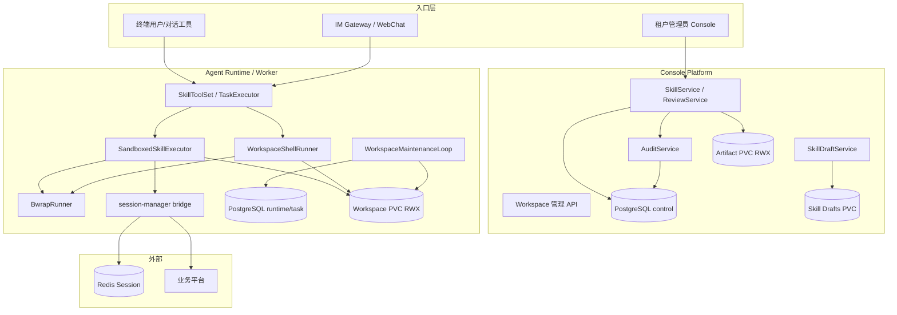
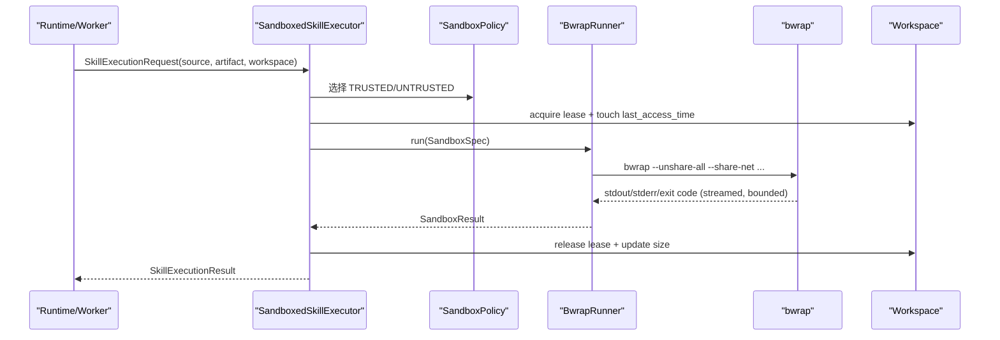
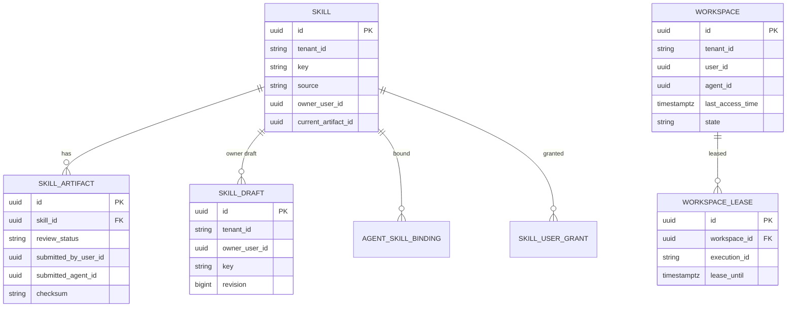

# 用户自建 Skill 与统一沙箱执行 后端模块需求与设计

> **文档编号**: MOD-SKILL-SANDBOX-001
> **文档版本**: v0.1
> **创建日期**: 2026-11-06
> **文档状态**: 草稿（设计评审中）

**评审边界说明**:
- **需求评审**: 第 2 章（需求分析）→ 通过后锁定为需求基线
- **设计评审**: 第 3-4 章（技术设计 + 部署运维）→ 通过后锁定设计基线
- **交接契约**: 2.5 验收条件 — 需求定义 What，设计实现 How

**ID 体系**: US（来自 PRD）、FEAT（功能）、API（接口）、FN（内部函数入口）、RULE（业务规则/系统约束）、TC（测试用例）、RISK（风险）、NFR（非功能指标）

场景源：`user-skill-sandbox.scenarios.md`。本文只引用场景 ID，不复制完整场景字段。

---

## 目录

- [1. 文档控制](#1-文档控制)
  - [1.1 责任人](#11-责任人)
  - [1.2 修订历史](#12-修订历史)
- [2. 需求分析](#2-需求分析)
  - [2.1 需求概述](#21-需求概述-必填)
  - [2.2 痛点与价值](#22-痛点与价值-必填)
  - [2.3 功能方案](#23-功能方案-必填)
  - [2.4 范围与边界](#24-范围与边界-必填)
  - [2.5 验收条件](#25-验收条件-必填)
- [3. 技术设计](#3-技术设计)
  - [3.1 方案选型](#31-方案选型-必填)
  - [3.2 架构设计](#32-架构设计-必填)
  - [3.3 数据设计](#33-数据设计-必填)
  - [3.4 接口设计](#34-接口设计-必填)
  - [3.5 质量实现方案](#35-质量实现方案-必填)
- [4. 部署与运维](#4-部署与运维)
- [5. 风险与依赖](#5-风险与依赖)
- [6. 需求追溯矩阵](#6-需求追溯矩阵)
- [Spec Compliance Matrix](#spec-compliance-matrix)
- [附录：术语表](#附录术语表)

---

## 1. 文档控制

### 1.1 责任人

| 角色 | 姓名 | 职责范围 |
|------|------|---------|
| 产品经理 | 待定 | 需求定义、业务验收 |
| 开发负责人 | 待定 | 技术方案、代码实现 |
| 测试负责人 | 待定 | 测试策略、质量保证 |
| 安全负责人 | 待定 | 沙箱边界、服务身份、凭据处理 |

### 1.2 修订历史

| 版本 | 日期 | 作者 | 变更描述 |
|------|------|------|---------|
| v0.1 | 2026-11-06 | OpenCode Agent | 基于 PRD 与沙箱探索记录形成后端设计初稿 |

---

## 2. 需求分析

### 2.1 需求概述 [必填]

| 项目 | 内容 |
|------|------|
| **模块名称** | 用户自建 Skill 与统一沙箱执行 |
| **模块ID** | MOD-SKILL-SANDBOX |
| **所属系统/产品线** | fluxion-harness：Console Platform、Agent Runtime、Agent Worker、IM Gateway |
| **需求类型** | 新功能 + 架构演进 |
| **业务背景** | 现有 Skill 只支持管理员/系统导入，脚本在 Runtime/Worker 进程内执行；用户无法自助创建、测试、提交和审批 Skill；旧 Skill 写包根目录、依赖 Windows 路径和硬编码平台地址；通用 Shell 与 Skill 执行缺少统一沙箱、配额和审计。 |
| **核心目标** | 在现有 Runtime/Worker 镜像内落地 bwrap 沙箱，统一所有 Skill 与 `workspace_shell` 的执行、隔离、凭据、配额和审计，让用户可安全地自建、测试、提交和运行 Skill。 |

### 2.2 痛点与价值 [必填]

| 维度 | 内容 |
|------|------|
| **目标用户** | 租户终端用户（Skill 作者、workspace_shell 使用者）、租户管理员（审批/下载/解绑）、系统管理员（系统 Skill）、平台运维（部署/容量/故障）。 |
| **当前问题** | 用户脚本没有沙箱边界；`python -I` 破坏相邻模块 import；`communicate()` 收全量输出；已批准包缓存可能被写；`session-manager` state 可能走 memfd；Runtime `/v1` 未鉴权；旧 Skill 写包根目录/硬编码地址。 |
| **业务影响** | 无法开放用户自建 Skill；管理员代开发成本高；用户脚本一旦开放就继承服务进程权限；旧 Skill 迁移成本高；执行失败难以审计和定位。 |
| **预期价值** | 用户自助沉淀业务流程；所有脚本统一沙箱和审计；审批/归属/下载可追溯；老 Skill 少量改造继续可用；通用 Shell 与 Skill 执行环境一致，降低维护成本。 |

**用户故事**

| 编号 | 用户故事 | 优先级 |
|------|---------|--------|
| US-01 | 创建 Skill 草稿并读写文件 | P0 |
| US-02 | 用一次性沙箱 Shell 测试草稿并获取平台登录态 | P0 |
| US-03 | 提交后看到 PENDING/APPROVED/REJECTED 和驳回原因 | P0 |
| US-04 | 只能覆盖自己的 PENDING，不能覆盖他人同名 Skill | P0 |
| US-05 | 已审批版本不可修改，管理员解绑+软删后才能重提 | P0 |
| US-06 | 审批通过后自动授权给我并绑定上传时 Agent | P0 |
| US-07 | 用 `execute_skill` / `run_skill_script` 运行 Skill，行为与现有 Skill 一致 | P0 |
| US-08 | 所有 Skill 在统一沙箱执行，包只读、独立工作目录、流式有界输出 | P0 |
| US-09 | 平台登录态按 `platforms` 注入，旧 `session-manager` stdout 兼容 | P0 |
| US-10 | 按 user + Agent 持久 `SKILL_DATA_DIR` 和独立 `SKILL_OUTPUT_DIR` | P0 |
| US-11 | 通过 `workspace_shell` 执行命令、处理文件、安装 pip/npm 依赖 | P0 |
| US-12 | 老 Skill 只需少量路径/配置改造即可运行 | P0 |
| US-13 | 管理员查看待审包并批准/驳回 | P0 |
| US-14 | 管理员下载待审/已审批包并留审计 | P0 |
| US-15 | 管理员一键解绑并软删已审批 Skill | P0 |
| US-16 | 管理员管理用户范围和 Agent 绑定 | P0 |
| US-17 | 系统管理员上传 `source=SYSTEM` Skill，自动通过并全局生效 | P0 |
| US-18 | `/v1` 受信接口只接受服务身份，沙箱脚本不能直接调用 | P0 |
| US-19 | 审计/指标覆盖执行、审批、下载、清理 | P1 |
| US-20 | macOS Dev/本地 K8s/内网 K8s 执行语义一致 | P1 |
| US-21 | Sandbox 失败返回明确错误码和 retryable | P0 |
| US-22 | workspace 30 天未访问自动清理，失败可见 | P0 |
| US-23 | 管理员把批准的 Python/Node 依赖预装到系统镜像/Pod 基线 | P1 |

### 2.3 功能方案 [必填]

#### 2.3.1 功能清单

| 功能ID | 功能名称 | 功能描述 | 优先级 | 来源 |
|--------|---------|---------|--------|------|
| FEAT-01 | 草稿工作区与文件操作 | tenant + user + draft_key 隔离的草稿目录、revision、配额 | P0 | US-01, US-04 |
| FEAT-02 | 草稿校验与打包 | 校验 manifest/entrypoint/文件安全，生成 PENDING artifact | P0 | US-01, US-03 |
| FEAT-03 | 草稿沙箱测试 Shell | 一次性命令、草稿副本、session-manager、回写 | P0 | US-02, US-08, US-09 |
| FEAT-04 | 提交与管理员审批事务 | 状态机、owner 覆盖、单 PENDING、审批事务、自动授权/绑定 | P0 | US-03, US-04, US-05, US-06, US-13 |
| FEAT-05 | 已审批包冻结与下载审计 | artifact 只读、checksum、受控下载、审计 | P0 | US-05, US-14 |
| FEAT-06 | 统一沙箱执行器 | 所有 source 走 `SandboxedSkillExecutor`、只读包、独立 workspace、流式输出、进程回收 | P0 | US-07, US-08, US-12 |
| FEAT-07 | `session-manager` 登录态注入 | 按 platforms 注入 socket/state 文件，兼容旧 stdout | P0 | US-09, US-12 |
| FEAT-08 | user + Agent workspace 与目录契约 | `data/` + `outputs/{run_id}`，`SKILL_DATA_DIR`/`SKILL_OUTPUT_DIR`，输出产物登记 | P0 | US-10, US-11 |
| FEAT-09 | `workspace_shell` 通用命令 | 全 Agent、无 session-manager、Pod 网络；默认系统依赖，允许临时 pip/npm 验证 | P0 | US-11 |
| FEAT-10 | 老 Skill 兼容改造 | 数据/输出目录、Cookie、base_url、Linux 路径、调度、webhook | P0 | US-12 |
| FEAT-11 | `/v1` 服务身份门控 | Runtime 受信 router 门控，Gateway/Console/Worker 带身份 | P0 | US-18 |
| FEAT-12 | 管理员 Skill 管理界面与接口 | source/审批筛选、审批抽屉、下载、范围/绑定、解绑软删 | P0 | US-13, US-14, US-15, US-16 |
| FEAT-13 | 系统 Skill 与 `source=SYSTEM` | 自动通过、当前租户全局生效、无需绑定 | P0 | US-17 |
| FEAT-14 | 审计、指标与错误码 | 全生命周期审计、执行/清理指标、统一错误码 | P0 | US-19, US-21 |
| FEAT-15 | workspace 配额、TTL 与自动清理 | 配额、30 天 TTL、Worker 内置清理、多副本认领 | P0 | US-22 |
| FEAT-16 | 多环境部署与运行模式 | bwrap 内置镜像、macOS dev-unsafe、K8s 一致、fail closed | P1 | US-20 |
| FEAT-17 | 数据模型、迁移与存量兼容 | Skill/Artifact/Draft/Workspace 字段、索引、回填 | P0 | US-01, US-05, US-07 |
| FEAT-18 | 系统依赖预装 | 管理员通过现有镜像构建流程预装批准的 Python/Node 依赖；不运行时改 Pod；workspace 安装仅临时验证 | P1 | US-23 |

#### 2.3.2 字段约束

**Skill（`control.skill`）**

| 字段 | 类型 | 必填 | 约束 | 说明 |
|------|------|------|------|------|
| `source` | varchar(16) | 是 | `SYSTEM` / `ADMIN` / `USER` | 执行 policy 和 effective 查询依据；存量回填 `ADMIN` |
| `author` | varchar(128) | 否 | 自由文本，仅展示 | 来自 `muad.skill.json`，不是鉴权外键 |
| `owner_user_id` | uuid | USER 必填 | `platform_user.id` 逻辑引用 | 只用于 USER Skill 覆盖/鉴权，不展示 |
| `current_artifact_id` | uuid | 否 | 指向已批准 artifact | 用户 Skill 审批后切换 |
| `user_scope` | varchar(16) | 是 | `ALL` / `SELECTED` | USER Skill 默认 `SELECTED`；SYSTEM 固定 `ALL` |

**SkillArtifact（`control.skill_artifact`）**

| 字段 | 类型 | 必填 | 约束 | 说明 |
|------|------|------|------|------|
| `review_status` | varchar(16) | 是 | `PENDING` / `APPROVED` / `REJECTED` / `SUPERSEDED` | 存量回填 `APPROVED` |
| `review_note` | text | 否 | 驳回必填 | 用户可见 |
| `reviewed_by` | uuid | 否 | 管理员 `platform_user.id` | 审批/驳回人 |
| `reviewed_at` | timestamptz | 否 | 审批/驳回时间 | |
| `submitted_by_user_id` | uuid | USER 必填 | 提交者平台用户 | 默认授权对象 |
| `submitted_agent_id` | uuid | USER 必填 | 上传时 Agent | 自动绑定对象 |
| `submitted_channel` | varchar(16) | 否 | `WECOM` / `WEBCHAT` | 来源渠道；不进入核心域分支 |
| `source` | varchar(16) | 是 | 冗余自 Skill | 快照/执行时避免回查漂移 |

**SkillDraft（`control.skill_draft`）**

| 字段 | 类型 | 必填 | 约束 | 说明 |
|------|------|------|------|------|
| `tenant_id` | varchar(64) | 是 | 与 unique key 组合 | |
| `owner_user_id` | uuid | 是 | `platform_user.id` | 草稿归属 |
| `key` | varchar(128) | 是 | 规范化 Skill key | |
| `revision` | bigint | 是 | 单调递增 | CAS 回写 |
| `last_submitted_artifact_id` | uuid | 否 | 最近提交 artifact | |
| `last_submitted_revision` | bigint | 否 | 最近提交 revision | 防止旧 revision 重复提交 |
| `file_count` / `total_size` | int / bigint | 是 | 配额检查缓存 | |

唯一：`(tenant_id, owner_user_id, key) WHERE is_deleted=false`。

**Workspace（`task.workspace` / `task.workspace_lease`）**

| 字段 | 类型 | 必填 | 约束 | 说明 |
|------|------|------|------|------|
| `tenant_id` | varchar(64) | 是 | 唯一键 | |
| `user_id` | uuid | 是 | 唯一键 | PlatformUser |
| `agent_id` | uuid | 是 | 唯一键 | Agent |
| `last_access_time` | timestamptz | 是 | 索引 | TTL 依据 |
| `size_bytes` | bigint | 是 | 默认 0 | 最近统计值 |
| `file_count` | int | 是 | 默认 0 | |
| `state` | varchar(16) | 是 | `ACTIVE` / `DELETING` / `DELETED` | 清理状态 |
| `cleanup_error` | text | 否 | 最近失败原因 | 可见、可重试 |

唯一：`(tenant_id, user_id, agent_id) WHERE is_deleted=false`；索引 `last_access_time`、`state`。

`workspace_lease`：`workspace_id`、`run_id`、`lease_until`、`create_time`；`lease_until` 索引；活跃租约存在时禁止清理。

**SandboxSpec / Policy（内存对象）**

| 字段 | 说明 |
|------|------|
| `source` | `SYSTEM` / `ADMIN` / `USER`，选择 `TRUSTED` / `UNTRUSTED` policy |
| `package_dir` | 已批准包只读根；草稿 Shell 用草稿副本 |
| `workspace_dir` | 当前 user + Agent 的 workspace 根；只 bind 该目录 |
| `data_dir` / `output_dir` | `/workspace/data`、`/workspace/outputs/{run_id}` |
| `platform_keys` | 服务端计算后的允许平台集合 |
| `network` | 固定 `share_net`（与 Pod 一致） |
| `timeout_sec` / `output_limit` | 执行级限制 |
| `env` | `PATH`/`HOME`/`LANG` + `SKILL_*` + Task 上下文；不含服务 Token |
| `rlimits` | `RLIMIT_AS/CPU/NPROC/FSIZE` 等 |
| `cancel_event` | 取消信号 |

**SkillExecutionRequest 扩展**

在现有 `ready_dir/input/timeout_sec/env/cancel_event/script/platform_context` 基础上增加：

| 字段 | 说明 |
|------|------|
| `source` | 服务端记录的 Skill 来源 |
| `skill_name` | 用于 session-manager 校验的名称 |
| `workspace_root` | 当前 user + Agent workspace |
| `data_dir` / `output_dir` | 注入环境变量和挂载 |
| `policy` | 沙箱 policy（TRUSTED/UNTRUSTED） |
| `execution_id` | Run/Task/命令 ID，用于审计和输出目录 |

### 2.4 范围与边界 [必填]

| 类别 | 内容 |
|------|------|
| **范围（In Scope）** | PRD 全部 P0/P1：草稿、校验、沙箱测试、提交、审批、下载、解绑软删、统一执行器、session-manager、workspace、workspace_shell、老 Skill 改造、`/v1` 门控、管理员界面接口、系统 Skill、审计指标、配额/TTL、清理、多环境、迁移。 |
| **非范围（Out of Scope）** | 独立沙箱微服务/Controller/CRD/Sandbox Pod；gVisor/Kata；Skill 表平台关联字段；Legacy 可写副本；按 Agent 开关 workspace_shell；内网 mirror allowlist/egress proxy；macOS Seatbelt；Skill 市场/评分/跨租户共享/计费；多版本并存 UI/一键回滚；包内任意系统依赖安装。 |
| **前置假设** | 现有 Console 登录/租户/PlatformUser/Agent/AgentAccessGrant/审计可复用；runtime/worker 可重建镜像；session-manager 和平台 adapter 可用；Worker 有进程内维护循环；Console `/skills` 页面存在；内网 Pod 允许 bwrap 所需 namespace/mount。 |
| **有意妥协 / 技术债** | 1）bwrap 与 Runtime 共享内核，接受该边界；2）workspace 配额在 NFS/PVC 无硬配额时只能执行前检查 + 执行后统计，不能保证绝对不超；3）`workspace_shell` 跟 Pod 网络一致，接受公网访问和供应链风险；4）审批 UI 先复用现有 `/skills` 页面，不新建独立“我的 Skill”页；5）macOS 原生 Dev 使用 `dev-unsafe`，不阻塞主线。 |

### 2.5 验收条件 [必填]

#### 2.5.1 业务规则与约束

| ID | 类型 | 描述 | 验证场景 |
|----|------|------|---------|
| RULE-01 | 业务规则 | USER Skill 的覆盖/授权只认服务端 `owner_user_id`，不认 `author`、Console 账号或上传 Agent。 | E-08, B-03 |
| RULE-02 | 业务规则 | 同一 Skill 同时最多一个 PENDING；同一 owner 可覆盖自己的 PENDING，旧 PENDING 置 SUPERSEDED。 | B-03 |
| RULE-03 | 业务规则 | 已审批 Skill 锁定；用户不能提交新版，需管理员解绑+软删后重提。 | E-09 |
| RULE-04 | 业务规则 | 审批通过自动 grant 提交者、绑定上传 Agent；审批时复核 AgentAccessGrant，已撤销返回 `AGENT_ACCESS_REVOKED`，不自动恢复。 | S-05, E-10 |
| RULE-05 | 系统约束 | 所有 Skill 脚本必须经 `SandboxedSkillExecutor`/bwrap；bwrap 不可用或 policy 非法 fail closed。 | S-10, E-07 |
| RULE-06 | 系统约束 | 已批准包只读；每次执行独立可写 workspace；不允许可写 bind 共享 READY 缓存。 | S-15 |
| RULE-07 | 系统约束 | stdout/stderr 流式有界读取，不能先 `communicate()` 收全量；超限终止/有界丢弃。 | E-01 |
| RULE-08 | 系统约束 | 超时/取消/父进程退出必须回收完整后代，覆盖 setsid、双重 fork、后台进程。 | E-02 |
| RULE-09 | 安全 | 沙箱内不得有 `INTERNAL_SERVICE_TOKEN`、DB/Redis 连接串、SA Token、`/mnt`、`/proc`、`/var/run`、Docker socket。 | E-03 |
| RULE-10 | 安全 | `session-manager` 只注入 Skill 执行/草稿 Shell；`workspace_shell` 默认无；state 文件用执行专属只读文件，不用 memfd。 | S-03, E-05, S-13 |
| RULE-11 | 业务规则 | workspace 按 tenant + user + Agent 隔离；`data` 跨 Run 持久，`outputs` 每次执行独立。 | B-01 |
| RULE-12 | 系统约束 | workspace 配额/TTL 清理由 Worker 内置循环执行，多副本认领，活跃执行跳过，失败可见。 | E-06, S-24, B-02, E-16 |
| RULE-13 | 安全 | Runtime `/v1` 受信接口必须校验服务身份；浏览器不能透传；Token 不进入沙箱。 | E-04, S-20 |
| RULE-14 | 系统约束 | 审批/执行/下载/解绑/清理写审计和指标；不记录 Cookie/Token/密钥。 | S-41, E-14 |
| RULE-15 | 兼容性 | `python scripts/run.py` 不变；执行器用 `-E -s -B`；保留 `SKILL_OUTPUT_DIR`，新增 `SKILL_DATA_DIR`；旧 `session-manager get-state` stdout 的 `platforms` list 可用。 | S-02, S-13, S-14 |

#### 2.5.2 功能验收场景

> 完整场景定义见 `user-skill-sandbox.scenarios.md`；本节只说明设计影响。

| 场景ID | 设计影响 / 备注 |
|--------|----------------|
| S-01 | 草稿存储、revision CAS、跨用户隔离 |
| S-02 | 草稿副本、bwrap、变更校验、回写 |
| S-03 | session broker、平台授权、state 文件 |
| S-04 | 校验、打包、PENDING artifact、幂等 |
| S-05 | 审批事务、grant/binding、审计 |
| S-06 | 驳回状态机、重提 |
| S-07 | 下载路由、checksum、审计 |
| S-08 | 解绑+软删事务、审计 |
| S-09 | source=SYSTEM、effective 查询 |
| S-10 | 统一执行器、只读包、workspace |
| S-11 | workspace_shell、Pod 网络、pip/npm |
| B-01 | workspace user + Agent 隔离与持久化 |
| S-47 | 输出目录产物登记、边界校验、交付 |
| S-48 | 系统依赖预装后直接 import/require |
| E-17 | workspace 临时安装不作为生产依赖 |
| S-13 | 旧 login-mssp-platform 不改代码 |
| S-14 | 旧 mss-report-skill 改造 |
| S-15 | 只读包、独立工作目录 |
| E-01 | 流式输出上限、内存有界 |
| E-02 | 进程树回收、超时/取消 |
| E-03 | 环境/mount 最小化 |
| E-04 | `/v1` 门控正负向 |
| S-20 | SSE 建连/重连身份 |
| E-05 | workspace_shell 无 session-manager |
| S-22 | 真实 Cookie 正负向 |
| E-06 | workspace 配额 |
| S-24 | TTL 清理、活跃跳过 |
| B-02 | 多副本清理认领 |
| S-26 | macOS dev-unsafe |
| E-07 | bwrap 不可用 fail closed |
| E-08 | 跨用户同名冲突 |
| B-03 | 同 owner PENDING 覆盖 |
| E-09 | 已审批锁定 |
| E-10 | AgentAccessGrant 撤销 |
| E-11 | 并发审批/提交 |
| B-04 | 系统 Skill effective 查询 |
| E-12 | 非管理员拒绝 |
| S-35 | 审批抽屉 |
| S-36 | 解绑软删确认 |
| S-37 | 列表筛选 |
| E-13 | 空态/错误/无权限 |
| S-39 | 管理员审批 E2E |
| S-40 | 管理员解绑软删 E2E |
| S-41 | 审计/指标 |
| E-14 | 错误码契约 |
| E-15 | checksum 不匹配 |
| E-16 | 清理失败可见 |
| S-45 | MCP/Memory/Model 非干扰 |
| S-46 | 渠道中立性 |

#### 2.5.3 非功能指标

**性能指标**

| 指标ID | 指标名称 | 目标值 | 测量方法 |
|--------|---------|-------|---------|
| NFR-PERF-01 | bwrap 启动额外开销 | 与实测基线同量级（毫秒级），不成为执行主瓶颈 | 基准脚本/执行耗时分布 |
| NFR-PERF-02 | 输出读取内存 | 不随 stdout 总量增长；只保留上限内数据 | 洪泛脚本 + RSS/内存断言 |
| NFR-PERF-03 | `/v1` 门控额外开销 | 本地比较，不引入 DB/Redis/远程调用；SSE 只建连/重连校验 | ASGI 基准/SSE 测试 |

**可靠性指标**

| 指标ID | 指标名称 | 目标值 |
|--------|---------|-------|
| NFR-REL-01 | 进程树回收 | 超时/取消/父退出后无孤儿进程 |
| NFR-REL-02 | 审批事务 | 并发提交/审批只有一方成功，无中间态 |
| NFR-REL-03 | 清理幂等 | 多副本重复执行不重复删除/计数 |
| NFR-REL-04 | 失败可见 | 沙箱/清理/审批失败有日志 + 指标 + 错误码，不静默降级 |

**安全性要求**

| 指标ID | 安全域 | 验收标准 |
|--------|--------|---------|
| NFR-SEC-01 | 执行隔离 | 所有脚本经 bwrap，fail closed |
| NFR-SEC-02 | 凭据边界 | 沙箱无服务 Token/DB/Redis/SA Token/敏感挂载 |
| NFR-SEC-03 | 服务身份 | `/v1` 无/错身份拒绝，浏览器不能透传 |
| NFR-SEC-04 | 授权 | owner/审批/grant/binding 以服务端记录为准 |
| NFR-SEC-05 | 凭据处理 | Cookie/Token 不写日志/审计；state 文件执行结束删除 |

#### 2.5.4 验证环境假设 [必填]

| 维度 | 假设 | 验证方式 / 参数 | 不满足时 |
|------|------|----------------|---------|
| 容量 | 审批/草稿/执行集成测试使用独立空库 + 独立 Redis DB；真实平台场景使用内网测试账号 | `make acceptance`/域测试 fixture | 标记 `env_blocked` |
| 硬件 | 本地 Docker/OrbStack 支持 `unshare`；内网 K8s 节点允许 bwrap | `bwrap --version` + probe job | `env_blocked`，记录节点/运行时 |
| 依赖 | 真实 PostgreSQL、Redis、Artifact PVC、session-manager、测试平台凭据 | preflight health/凭据检查 | 返回 `env_blocked` 并列出 owner |
| profile 参数 | 执行上限、输出上限、TTL/配额使用配置项，不在测试中写死生产值 | 环境变量/ConfigMap | 显式报 `incomplete`，不自动降级 |

---

## 3. 技术设计

### 3.1 方案选型 [必填]

#### 备选方案对比

| 对比维度 | 权重 | 方案A：现有 Pod 内 bwrap | 得分 | 方案B：独立沙箱服务/K8s Sandbox | 得分 |
|---------|------|--------------------------|------|--------------------------------|------|
| 功能完备性 | 30% | 复用 runtime/worker、PVC、调度；满足当前隔离需求 | 8 | 隔离更强，但需要新控制面/CRD/镜像流水线 | 7 |
| 性能预期 | 25% | 进程内启动，毫秒级开销；无额外网络跳转 | 9 | 每任务 Pod/服务调度，延迟和资源开销更高 | 5 |
| 实现复杂度 | 20% | 中；执行器/policy/镜像改造 | 7 | 高；新服务、Controller、网络、存储 | 4 |
| 维护成本 | 15% | 复用现有部署单元和维护循环 | 8 | 多一套控制面和运维 | 4 |
| 风险评估 | 10% | 共享内核，接受 bwrap 边界 | 6 | 内核隔离更强，但复杂度和故障面更大 | 7 |
| **最终得分** | **100%** | | **7.75** | | **5.55** |

#### 关键决策记录

| 决策点 | 选择 | 被否决项 | 理由 | 可逆性 |
|--------|------|---------|------|--------|
| 沙箱实现 | 现有 runtime/worker 镜像内置 bwrap | 独立沙箱服务、K8s Agent Sandbox、gVisor/Kata | 复用部署单元、PVC、调度；P0 已验证 bwrap/session-manager/真实平台链路；不新增服务/CRD | 较难（需重新架构），但执行器抽象可替换 runner |
| 用户脚本执行路径 | 所有 source 统一 `SandboxedSkillExecutor` | 保留进程内 `ScriptSkillExecutor` 仅给用户 | 统一边界、审计、配额；避免“用户代码一套、系统 Skill 另一套” | 易（policy 可调） |
| Python 参数 | `-E -s -B` | 继续 `-I`、裸 `python` | `-I` 阻止相邻模块 import；`-E -s` 保留环境隔离；`-B` 不写只读包 | 易 |
| workspace 粒度 | tenant + user + Agent | 按用户、按会话 | 不同 Agent 不共享可执行文件/数据；同 user+Agent 跨会话共享 | 中（路径/权限调整） |
| 网络 | 与 Pod 一致 `--share-net` | 默认断网、egress proxy、mirror allowlist | 产品要求 Pod 网络一致；`/v1` 门控是硬前置；接受公网供应链风险 | 中（后续可加代理） |
| 清理归属 | Worker 内置 `workspace.maintenance` 循环 | 管理员 Schedule、K8s CronJob、常驻清理服务 | 复用现有进程/维护模式；无需管理员操作；多副本用 DB 认领 | 易 |
| session state | 执行专属普通只读文件 | memfd/`/proc/<pid>/fd` | 沙箱隐藏 `/proc`；文件模式可被 CLI 读取；执行结束删除 | 易 |
| 旧 Skill 兼容 | 最小代码/路径改造 + bridge legacy stdout 摘要 | Legacy 可写副本模式 | 保持包只读；避免绕过审批/审计；旧 Skill 不改 `session-manager` 解析 | 易 |
| 审批 | 单事务 + 行锁 + partial unique | 异步最终一致 | 防止批准旧包/跨用户覆盖；授权/绑定与状态同事务 | 难回退（数据一致性要求） |

#### 技术栈

| 类别 | 选型 | 版本 | 选型理由 |
|------|------|------|---------|
| 语言 | Python | 3.12 | 现有 Runtime/Worker |
| Web 框架 | FastAPI | 现有 | 现有 Console/Runtime/Worker |
| ORM/DB | SQLAlchemy + PostgreSQL | 现有 | 事务/行锁/partial unique |
| 缓存/队列 | Redis | 现有 | session broker/wake-up hint，不作为 Task 权威 |
| 沙箱 | bubblewrap | 0.13.1 | 内置镜像，已验证 |
| 前端 | React + TypeScript + Semi Design | 现有 | 见前端设计 |

### 3.2 架构设计 [必填]



#### 执行流



#### 技术分层

| 层 | 组件 | 职责 |
|----|------|------|
| 入口 | `SkillToolSet`、`TaskExecutor`、Console API | 参数校验、权限、工具注册 |
| 应用 | `SkillService`、`SkillDraftService`、`SkillReviewService`、`WorkspaceService` | 状态机、事务、授权、审计 |
| 执行 | `SandboxedSkillExecutor`、`WorkspaceShellRunner`、`SandboxPolicy` | 选择 policy、构造 spec、流式输出、结果解析 |
| 沙箱 | `SandboxRunner` / `BwrapRunner` | argv 构造、进程树回收、资源限制 |
| 集成 | `SkillArtifactStore`、`SkillArtifactCache`、`session-manager bridge`、`WorkspaceStore` | 包缓存、session、workspace 元数据 |
| 维护 | `WorkspaceMaintenanceLoop` | TTL 扫描、认领、删除、指标 |

#### 外部依赖清单

| 外部系统 | 依赖类型 | 协议 | 超时 | 降级策略 |
|---------|---------|------|------|---------|
| Console Platform | 内部 HTTP | JSON | 请求级配置 | 失败显式报错，不回落模型自报身份 |
| Redis | session/缓存 | Redis protocol | 请求级配置 | session 不可用 → `PLATFORM_SESSION_REQUIRED`/store unavailable |
| Artifact PVC | 文件 | RWX | N/A | 校验失败 → `SKILL_ARTIFACT_INTEGRITY_ERROR` |
| Workspace PVC | 文件 | RWX | N/A | 不可用 → `WORKSPACE_UNAVAILABLE`，fail closed |
| 业务平台 | HTTP | 平台协议 | Skill 自定 | Skill 自行处理鉴权/重试 |

#### 非干涉边界

本需求不修改 MCP、Memory、Model 模块；新增的 Skill/Workspace 代码不得：

- 改变 MCP catalog/tool registry 的发现、授权、执行路径；
- 改变 Memory 的写入/召回/软删/版本协议；
- 引入平台默认模型回退；
- 在核心域写渠道专有分支。

对应回归场景：S-45（MCP/Memory/Model）、S-46（渠道中立性）。

### 3.3 数据设计 [必填]

#### 3.3.1 `control.skill` 变更

| 字段 | 类型 | 可空 | 默认值 | 索引 | 说明 |
|------|------|------|--------|------|------|
| `source` | varchar(16) | N | `'ADMIN'` | `ix_skill_tenant_source` | SYSTEM/ADMIN/USER |
| `author` | varchar(128) | Y | NULL | | 展示用自由文本 |
| `owner_user_id` | uuid | Y | NULL | `ix_skill_owner` | USER Skill 鉴权归属 |

存量回填：`source='ADMIN'`。

#### 3.3.2 `control.skill_artifact` 变更

| 字段 | 类型 | 可空 | 默认值 | 索引 | 说明 |
|------|------|------|--------|------|------|
| `review_status` | varchar(16) | N | `'APPROVED'` | `ix_skill_artifact_review` | PENDING/APPROVED/REJECTED/SUPERSEDED |
| `review_note` | text | Y | NULL | | 驳回原因 |
| `reviewed_by` | uuid | Y | NULL | | 审批人 |
| `reviewed_at` | timestamptz | Y | NULL | | 审批时间 |
| `submitted_by_user_id` | uuid | Y | NULL | `ix_skill_artifact_submitter` | 提交者 |
| `submitted_agent_id` | uuid | Y | NULL | | 上传时 Agent |
| `submitted_channel` | varchar(16) | Y | NULL | | WECOM/WEBCHAT |
| `source` | varchar(16) | N | `'ADMIN'` | | 冗余来源 |

存量回填：`review_status='APPROVED'`、`source='ADMIN'`。

**Partial unique index（单 Skill 最多一个 PENDING）**

```sql
CREATE UNIQUE INDEX uq_skill_artifact_one_pending
ON control.skill_artifact (skill_id)
WHERE review_status = 'PENDING' AND is_deleted = false;
```

#### 3.3.3 `control.skill_draft` 新增

| 字段 | 类型 | 可空 | 默认值 | 索引 | 说明 |
|------|------|------|--------|------|------|
| `id` | uuid | N | gen | PK | |
| `tenant_id` | varchar(64) | N | | unique | |
| `owner_user_id` | uuid | N | | unique | |
| `key` | varchar(128) | N | | unique | |
| `revision` | bigint | N | 1 | | CAS |
| `last_submitted_artifact_id` | uuid | Y | NULL | | |
| `last_submitted_revision` | bigint | Y | NULL | | |
| `file_count` | int | N | 0 | | 配额缓存 |
| `total_size` | bigint | N | 0 | | 配额缓存 |
| `is_deleted` / `create_time` / `update_time` | 标准列 | N | | | |

唯一：`(tenant_id, owner_user_id, key) WHERE is_deleted=false`。

#### 3.3.4 `task.workspace` / `task.workspace_lease` 新增

**task.workspace**

| 字段 | 类型 | 可空 | 默认值 | 索引 | 说明 |
|------|------|------|--------|------|------|
| `id` | uuid | N | gen | PK | |
| `tenant_id` | varchar(64) | N | | unique | |
| `user_id` | uuid | N | | unique | |
| `agent_id` | uuid | N | | unique | |
| `last_access_time` | timestamptz | N | now() | `ix_workspace_last_access` | TTL |
| `size_bytes` | bigint | N | 0 | | 统计值 |
| `file_count` | int | N | 0 | | |
| `state` | varchar(16) | N | `'ACTIVE'` | `ix_workspace_state` | ACTIVE/DELETING/DELETED |
| `cleanup_error` | text | Y | NULL | | 最近失败 |
| `is_deleted` / `create_time` / `update_time` | 标准列 | N | | | |

唯一：`(tenant_id, user_id, agent_id) WHERE is_deleted=false`。

沙箱内路径：`<workspace-root>/{tenant_id}/{user_id}/{agent_id}/data` 与 `.../outputs/{execution_id}`；`<workspace-root>` 默认 `/mnt/muad-workspaces`；只把当前 user + Agent 目录 bind 到 `/workspace`，不暴露 workspace 根。

系统运行时（Python/Node 解释器、系统 site-packages）只读继承 Pod 基础镜像，**不复制到 workspace**；workspace 只保存 `pip`/`npm` 安装包、venv、node_modules 和数据/输出。禁止每个 workspace 复制完整运行时。

**task.workspace_lease**

| 字段 | 类型 | 可空 | 默认值 | 索引 | 说明 |
|------|------|------|--------|------|------|
| `id` | uuid | N | gen | PK | |
| `workspace_id` | uuid | N | | `ix_workspace_lease_workspace` | |
| `run_id` / `task_id` / `execution_id` | varchar(64) | N | | | 执行归属 |
| `lease_until` | timestamptz | N | | `ix_workspace_lease_until` | 活跃判断 |
| `is_deleted` / `create_time` / `update_time` | 标准列 | N | | | |

唯一：`(workspace_id, execution_id) WHERE is_deleted=false`。

#### 3.3.5 ER 图



#### 3.3.6 容量预估

| 维度 | 预估值 |
|------|--------|
| Skill/Artifact 元数据 | 每租户万级，行大小 KB 级 |
| 草稿文件 | 每用户百 MB 级；PVC 20 GiB 起，按租户增长 |
| Workspace | 每 user+Agent 默认 500 MiB，每用户聚合 500 MiB，文件数 5,000；1000 用户约 500 GiB |
| Workspace 租约 | 每次执行一行，按执行量增长；按 `lease_until` 清理过期行 |
| 审计 | 复用 `config_audit_log`，按现有保留策略 |

### 3.4 接口设计 [必填]

#### 形态 A：HTTP API

##### 接口清单

| 接口ID | 名称 | 方法 | 路径 | 权限 | 详细 |
|--------|------|------|------|------|------|
| API-01 | Skill 列表（扩展） | GET | `/api/v1/skills` | 管理员/租户 | [↓](#api-01) |
| API-02 | 导入 Skill（扩展 source） | POST | `/api/v1/skills/import` | 管理员 | [↓](#api-02) |
| API-03 | 创建/读取/写入/删除草稿 | POST/GET/PUT/DELETE | `/internal/skills/drafts...` | 内部服务 | [↓](#api-03) |
| API-04 | 提交草稿 | POST | `/api/v1/skills/drafts/{draft_id}/submit` | 草稿 owner | [↓](#api-04) |
| API-05 | 审批/驳回 | POST | `/api/v1/skills/{skill_id}/review` | 管理员 | [↓](#api-05) |
| API-06 | 下载 artifact | GET | `/api/v1/skills/{skill_id}/artifacts/{artifact_id}/download` | 管理员 | [↓](#api-06) |
| API-07 | 解绑+软删 | DELETE | `/api/v1/skills/{skill_id}?unbind=true` | 管理员 | [↓](#api-07) |
| API-08 | 用户范围/grant | PUT/POST/DELETE | `/api/v1/skills/{skill_id}/user-scope`、`/users/{user_id}` | 管理员 | [↓](#api-08) |
| API-09 | Agent 绑定 | GET/POST/DELETE | `/api/v1/skills/{skill_id}/agents`、`/agents/{agent_id}` | 管理员 | [↓](#api-09) |
| API-10 | 草稿 Shell 内部执行 | POST | `/internal/skills/drafts/{draft_id}/shell` | 内部服务 | [↓](#api-10) |
| API-11 | workspace touch/quota | POST | `/internal/workspaces/touch`、`/quota` | 内部服务 | [↓](#api-11) |
| API-12 | 草稿 review/status | POST/GET | `/internal/skills/drafts/{draft_id}/review`、`/status` | 内部服务/草稿 owner | [↓](#api-12) |

##### API-01: Skill 列表（扩展）

**请求**

| 参数 | 类型 | 必填 | 说明 |
|------|------|------|------|
| `page` / `page_size` | int | 否 | `page>=1`，`1<=page_size<=100` |
| `keyword` | string | 否 | key/name/description |
| `source` | enum | 否 | SYSTEM/ADMIN/USER |
| `review_status` | enum | 否 | PENDING/APPROVED/REJECTED/SUPERSEDED |
| `user_scope` | enum | 否 | ALL/SELECTED |
| `enabled` | bool | 否 | |
| `execution_mode` | enum | 否 | SYNC/ASYNC/AUTO |

**响应**

```json
{
  "code": 0,
  "msg": "success",
  "data": {
    "items": [
      {
        "id": "uuid",
        "key": "my-skill",
        "name": "My Skill",
        "source": "USER",
        "author": "张三",
        "review_status": "PENDING",
        "user_scope": "SELECTED",
        "enabled": true,
        "current_version": "1.0.0",
        "agent_count": 1,
        "user_count": 1,
        "update_time": "2026-11-06T12:00:00+08:00"
      }
    ],
    "page": 1,
    "page_size": 20,
    "total": 1
  },
  "trace_id": "...",
  "request_id": "...",
  "timestamp": "..."
}
```

**错误码**：`COMMON_VALIDATION_ERROR`、`COMMON_FORBIDDEN`。

**处理逻辑**：`SkillService.list_skills` 增加 `source`/`review_status` 过滤；`skill_list_item` 增加字段；SYSTEM Skill 对所有租户用户可见的 effective 查询在 `SkillRepository` 统一处理，覆盖 `list`/`count`/`catalog`/`snapshot`/`execution` 所有入口。

##### API-02: 导入 Skill（扩展 source）

**请求**：multipart zip + `version`、`key`、`default_script`、`source`（仅管理员可传 SYSTEM/ADMIN）、`user_scope`；支持 `Idempotency-Key`。

**响应**：`SkillDetail`。

**错误码**：`SKILL_KEY_EXISTS`、`SKILL_PACKAGE_INVALID`、`IDEMPOTENCY_MISMATCH`、`COMMON_FORBIDDEN`。

**处理逻辑**：`source=SYSTEM` → 自动 `APPROVED`、`user_scope=ALL`、`enabled=true`；`source=ADMIN` → 自动 `APPROVED`；`source=USER` 不允许走管理员导入，必须走草稿提交。

##### API-03: 草稿内部 API

| 方法 | 路径 | 说明 |
|------|------|------|
| POST | `/internal/skills/drafts` | 创建草稿，body: `{tenant_id, owner_user_id, key}` |
| GET | `/internal/skills/drafts/{draft_id}` | 元数据 + revision |
| GET | `/internal/skills/drafts/{draft_id}/files?path=` | 读文件/列目录 |
| PUT | `/internal/skills/drafts/{draft_id}/files` | 写文件，body: `{path, content, expected_revision}` |
| DELETE | `/internal/skills/drafts/{draft_id}/files?path=` | 删文件 |
| DELETE | `/internal/skills/drafts/{draft_id}` | 删整个草稿 |

**错误码**：`DRAFT_NOT_FOUND`、`DRAFT_REVISION_CONFLICT`、`DRAFT_QUOTA_EXCEEDED`、`DRAFT_PATH_INVALID`、`COMMON_FORBIDDEN`。

**处理逻辑**：路径规范化 + 根目录校验；写文件先写临时文件再 `os.replace`；revision CAS；文件数/大小配额；只允许内部服务身份（Runtime 工具调用）。Runtime 工具 `skill_draft_write` / `skill_draft_read` / `skill_draft_delete` 分别调用上述内部端点；工具名唯一，不保留旧别名。

##### API-04: 提交草稿

**请求**：`POST /api/v1/skills/drafts/{draft_id}/submit`，body: `{expected_revision, version?, default_script?}`；支持 `Idempotency-Key`。

**响应**：`{skill_id, artifact_id, review_status: "PENDING", version, checksum}`。

**错误码**：`DRAFT_REVISION_CONFLICT`、`SKILL_PACKAGE_INVALID`、`SKILL_KEY_EXISTS`、`SKILL_PENDING_EXISTS`、`SKILL_APPROVED_LOCKED`、`IDEMPOTENCY_MISMATCH`。

**处理逻辑**：

1. 校验 draft owner = 当前 actor。
2. 校验 `expected_revision` = draft.revision。
3. `SkillValidator` 校验并打包，计算 checksum。
4. 同一 owner 的旧 PENDING → `SUPERSEDED`；插入新 PENDING；partial unique 兜底。
5. 更新 draft `last_submitted_artifact_id`/`last_submitted_revision`。
6. 写审计。

##### API-05: 审批/驳回

**请求**：`POST /api/v1/skills/{skill_id}/review`，body: `{artifact_id, action: "APPROVE"|"REJECT", review_note?}`。

**响应**：`SkillDetail`。

**错误码**：`SKILL_ARTIFACT_NOT_PENDING`、`AGENT_ACCESS_REVOKED`、`SKILL_REVIEW_CONFLICT`、`COMMON_FORBIDDEN`、`COMMON_VALIDATION_ERROR`。

**处理逻辑**：

1. 管理员权限校验。
2. 开启事务，`SELECT ... FOR UPDATE` 锁 artifact 行。
3. 校验 `review_status=PENDING`。
4. `REJECT`：要求 `review_note`，置 `REJECTED`。
5. `APPROVE`：校验提交者对 `submitted_agent_id` 的 `AgentAccessGrant` 仍 active；否则 `AGENT_ACCESS_REVOKED`。置 `APPROVED`，切换 `skill.current_artifact_id`，插入/恢复 `SkillUserGrant` 和 `AgentSkillBinding`（幂等）。
6. 写审计，提交事务。

##### API-06: 下载 artifact

**请求**：`GET /api/v1/skills/{skill_id}/artifacts/{artifact_id}/download`。

**响应**：zip 流；`Content-Disposition`；`X-Checksum`。

**错误码**：`COMMON_NOT_FOUND`、`SKILL_ARTIFACT_INTEGRITY_ERROR`、`COMMON_FORBIDDEN`。

**处理逻辑**：管理员权限；校验 artifact 属于该 skill/tenant；PENDING 和 APPROVED 均可下载；校验 checksum；写 `SKILL_ARTIFACT_DOWNLOAD` 审计；不暴露 `storage_key`。

##### API-07: 解绑+软删

**请求**：`DELETE /api/v1/skills/{skill_id}?unbind=true&confirm=true`。

**响应**：`{skill_id, unbound_agents: [...], deleted: true}`。

**错误码**：`SKILL_IN_USE`（未传 `unbind=true`）、`COMMON_NOT_FOUND`、`COMMON_FORBIDDEN`。

**处理逻辑**：

1. 管理员权限 + 二次确认参数。
2. 单事务：查询所有 active `AgentSkillBinding`；逐个解除（单关系 DELETE 语义）；解除 `SkillUserGrant`；`skill.is_deleted=true`。
3. artifact、审批、审计保留。
4. 写 `SKILL_UNBIND`/`SKILL_DELETE` 审计，记录解绑 Agent 列表。
5. 幂等：已删除返回成功/已删除。

> 现有 `delete_skill` 在绑定时返回 `SKILL_IN_USE`；新接口通过 `unbind=true` 显式选择一键解绑，保留旧行为作为默认。

##### API-08: 用户范围/grant

沿用现有 `PUT /user-scope`、`POST/DELETE /users/{user_id}`；增加：
- 管理员可把测试用户加入 SELECTED grant；
- 加入前校验目标用户对 `submitted_agent_id` 有 `AgentAccessGrant`（或由管理员显式确认）；
- 单关系 POST/DELETE，不用全量 PUT 覆盖。

##### API-09: Agent 绑定

沿用现有 `GET/POST/DELETE /skills/{skill_id}/agents...`；增加：
- 绑定时校验 Agent 属于当前租户；
- 审批自动绑定走同一 service，幂等；
- 解绑+软删时批量解除。

##### API-10: 草稿 Shell 内部执行

**请求**：`POST /internal/skills/drafts/{draft_id}/shell`，body: `{tenant_id, owner_user_id, command, cwd?, timeout_sec?}`。

**响应**：`{stdout, stderr, exit_code, duration_ms, changed_files, revision}`。

**错误码**：`DRAFT_REVISION_CONFLICT`、`DRAFT_PATH_INVALID`、`SANDBOX_UNAVAILABLE`、`SANDBOX_TIMEOUT`、`SANDBOX_OUTPUT_LIMIT`、`PLATFORM_SESSION_REQUIRED`。

**处理逻辑**：Runtime `skill_draft_shell` 调用；Console 返回草稿 zip 和 revision；Runtime 在沙箱执行；变更校验后按 revision CAS 回写；Console 更新 revision。

**session-manager stdout 契约**：

```json
{
  "version": 1,
  "status": "ready",
  "skillName": "login-mssp-platform",
  "sessionStateFile": "/tmp/fx-session-xxx/state.json",
  "platforms": [
    {"platform": "mssp", "source": "session", "expiresAt": "2026-11-06T12:00:00+08:00"}
  ]
}
```

- `sessionStateFile` 内部仍是 `platforms.<key>.cookies` / `requestProfile` dict，新 Skill 读取方式不变；
- `platforms` list 只为旧 Skill stdout 解析兼容；`source` 当前固定 `"session"`，`expiresAt` 必须存在；
- 旧 `login-mssp-platform` 不改代码即可运行；新 Skill 不受影响。

##### API-11: workspace touch/quota 内部 API

**请求**：`POST /internal/workspaces/touch`，body: `{tenant_id, user_id, agent_id, execution_id, lease_sec}`；`POST /internal/workspaces/quota`，body: `{tenant_id, user_id, agent_id, delta_bytes?, file_count?}`。

**响应**：`{workspace_id, last_access_time, size_bytes, file_count, state}` 或 `{allowed, reason}`。

**错误码**：`WORKSPACE_QUOTA_EXCEEDED`、`WORKSPACE_UNAVAILABLE`、`WORKSPACE_DELETING`。

**处理逻辑**：Runtime/Worker 执行前 acquire lease、touch last_access；执行后 release + 更新大小；清理中的 workspace 拒绝新执行。

##### API-12: 草稿 review/status

**请求**：

- `POST /internal/skills/drafts/{draft_id}/review`：只读确定性校验，body `{tenant_id, owner_user_id}`；返回 pass/warn/error 明细，无副作用。
- `GET /internal/skills/drafts/{draft_id}/status`：返回最近提交的 artifact、`review_status`、`review_note`、`reviewed_at`、`version`。

**错误码**：`DRAFT_NOT_FOUND`、`COMMON_FORBIDDEN`。

**处理逻辑**：Runtime 工具 `skill_draft_review` / `skill_draft_status` 调用；只允许草稿 owner 或内部服务；不返回其他用户草稿内容。

#### 老 Skill 兼容契约

| 老 Skill 现状 | 新契约 | 说明 |
|--------------|--------|------|
| `cache` / `logs` / `companies` 写在 Skill 包根目录 | `SKILL_DATA_DIR` | 包只读；持久数据迁到 user + Agent data 目录 |
| 报告/导出写 Skill 包根目录或 `/tmp` | `SKILL_OUTPUT_DIR` | 每次执行独立；脚本先判空，空时不写 |
| `cookies.txt` / 硬编码 Cookie | `session-manager get-state` | 从 `sessionStateFile` 读取 cookies |
| `common_config.json` 写死 base_url | `requestProfile.baseUrl` | 平台地址以当前配置为准 |
| Windows 路径 / `Get-Content` / 盘符 | POSIX 路径 / Linux 命令 | 沙箱为 Linux |
| `schtasks` / 常驻 daemon | 平台 Schedule | 不在 Skill 内维护 Windows 计划任务或后台循环 |
| `webhook_config.json` 硬编码 key | 平台交付 / Secret 配置 | 密钥不进 Skill 包、日志或快照 |
| `sys.path.insert(0, dirname(__file__))` | 可保留，也可删除 | `-E -s -B` 保留入口脚本目录在 `sys.path[0]` |
| `SKILL.md` 写 `python scripts/run.py` | 保持不变 | 框架注入 `-E -s -B`，不要求作者写参数 |

**执行契约扩展**：

- `ResolvedSkill` 增加 `source`；execution snapshot 的 `skills[]` 冻结 `source`、artifact、checksum、workspace、platform keys；缺失/非法 `source` 拒绝执行。
- `SkillExecutor` 统一到实际使用的 `execute(request)` 签名；`SandboxedSkillExecutor` 实现该协议，装配时不再保留未使用的旧 Protocol 形状。
- `execute_skill` / `run_skill_script` 都挂载当前 user + Agent workspace，注入 `SKILL_DATA_DIR` / `SKILL_OUTPUT_DIR`；`SkillExecutor` 协议签名必须与 `ScriptSkillExecutor.execute(request)` 的实际形状一致。
- `workspace_shell` 由 `SkillToolSet` 对所有 Agent 无条件注册；不接受 `skill_key`，Skill 脚本必须走 `execute_skill` / `run_skill_script`。
- `skill_draft_shell` 工具名唯一，不保留旧名或兼容别名。

#### 形态 C：函数 / 库接口

| 函数签名 | 入参 | 返回 | 错误处理 |
|---------|------|------|---------|
| `SandboxRunner.run(spec: SandboxSpec) -> SandboxResult` | policy、argv、env、mounts、limits、timeout、cancel | stdout/stderr/exit_code/duration | `SandboxUnavailable`、`SandboxTimeout`、`SandboxOutputLimit` |
| `BwrapRunner.run(spec)` | 同上 | 同上 | 同上 |
| `SandboxedSkillExecutor.execute(request: SkillExecutionRequest)` | ready_dir、source、input、workspace、platform_context、timeout、cancel | `SkillExecutionResult` | `SkillExecutionError` |
| `WorkspaceShellRunner.run(request: WorkspaceShellRequest)` | tenant/user/agent、command、cwd、timeout、env | stdout/stderr/exit_code/changed_files | 同上 |
| `SandboxedSkillExecutor.collect_outputs(output_dir)` | 输出目录、文件数/大小上限 | `list[OutputFile]`（相对路径、大小、checksum） | `OutputLimitError`；不跟随 symlink/越界路径 |
| `WorkspaceStore.acquire(...)` | tenant/user/agent、execution_id、lease_sec | `WorkspaceLease` | `WORKSPACE_QUOTA_EXCEEDED`、`WORKSPACE_DELETING` |
| `WorkspaceStore.release(...)` | lease | None | 失败记日志/指标，不阻塞结果 |
| `WorkspaceMaintenanceLoop.run_forever()` | 无 | None | 单次失败记日志/指标，不杀死循环 |
| `session_bridge.skill_platform_environment(context, skill_name)` | 平台上下文、Skill 名 | env dict | `PlatformAuthError` |
| `require_internal_service(request)` | FastAPI Request | None | 403 |

#### 统一错误码（新增/扩展）

| 错误码 | HTTP | retryable | 场景 |
|--------|------|-----------|------|
| `SKILL_KEY_EXISTS` | 409 | false | 不同用户/租户同 key |
| `SKILL_PENDING_EXISTS` | 409 | false | 同 Skill 已有 PENDING |
| `SKILL_APPROVED_LOCKED` | 409 | false | 已审批用户提交新版 |
| `SKILL_ARTIFACT_NOT_PENDING` | 409 | false | 审批非 PENDING |
| `SKILL_REVIEW_CONFLICT` | 409 | true | 并发审批/提交冲突 |
| `SKILL_ARTIFACT_INTEGRITY_ERROR` | 422 | false | checksum 不匹配 |
| `AGENT_ACCESS_REVOKED` | 409 | false | 审批时 AgentAccessGrant 已撤销 |
| `DRAFT_REVISION_CONFLICT` | 409 | true | 草稿 CAS 冲突 |
| `DRAFT_QUOTA_EXCEEDED` | 413 | false | 草稿大小/文件数超限 |
| `DRAFT_PATH_INVALID` | 400 | false | 路径穿越/symlink |
| `SANDBOX_UNAVAILABLE` | 503 | true | bwrap 不可用/配置非法 |
| `SANDBOX_TIMEOUT` | 504 | true | 执行超时 |
| `SANDBOX_OUTPUT_LIMIT` | 422 | false | 输出超限 |
| `WORKSPACE_QUOTA_EXCEEDED` | 413 | false | workspace 超限 |
| `WORKSPACE_UNAVAILABLE` | 503 | true | PVC/目录不可用 |
| `WORKSPACE_DELETING` | 409 | true | 清理中拒绝新执行 |
| `PLATFORM_SESSION_REQUIRED` | 401 | false | 缺少平台登录态 |
| `PLATFORM_SESSION_STORE_UNAVAILABLE` | 503 | true | Redis/session store 不可用 |

### 3.5 质量实现方案 [必填]

#### 性能设计

| 指标ID | 热点路径 | 目标值 | 实现方案（含被放弃的较慢方案） |
|--------|---------|-------|------------------------------|
| NFR-PERF-01 | Skill 启动 | 毫秒级额外开销 | 复用现有 Pod 内 bwrap；不引入独立服务/网络跳转；放弃每任务 Pod（调度/冷启动更慢） |
| NFR-PERF-02 | stdout/stderr | 内存有界 | `asyncio` 按块读取 + 上限计数；超限终止/有界丢弃；放弃 `communicate()` 全量缓冲 |
| NFR-PERF-03 | `/v1` 门控 | 本地比较，无远程调用 | 启动时缓存 `process_settings()` + 异步依赖 + `hmac.compare_digest`；SSE 建连/重连校验一次；放弃每请求 `SharedSettings()`/DB/Redis |
| NFR-PERF-04 | workspace 访问 | bind 零拷贝 | 只 bind 当前 user+Agent 目录；配额/大小统计异步/执行后更新；放弃每次 `du` 全盘扫描 |

#### 可靠性设计

| 风险ID | 失效模式 | 影响 | 应对措施 | 验证场景 |
|--------|---------|------|---------|---------|
| RISK-01 | 子进程 fork 后台/脱离进程组 | 孤儿进程、端口/文件占用 | `start_new_session` + `killpg` + `--die-with-parent` + 有界等待 | E-02 |
| RISK-02 | stdout 洪泛 | Runtime 内存耗尽 | 流式有界读取，超限终止/丢弃 | E-01 |
| RISK-03 | 审批并发 | 批准旧包/覆盖新提交 | artifact 行锁 + 状态复核 + partial unique | E-11 |
| RISK-04 | 清理并发/失败 | 重复删除、目录残留 | DB 认领 + `DELETING` 状态 + 失败可见 + 下轮重试 | B-02, E-16 |
| RISK-05 | bwrap 不可用 | 用户脚本宿主执行 | fail closed，不回退；显式 `dev-unsafe` 仅本地 | E-07, S-26 |
| RISK-06 | 沙箱泄露服务凭据 | 内网/DB 被访问 | `--clearenv` + allowlist + 最小 mount + 不传 Token | E-03 |
| RISK-07 | checksum 不匹配 | 执行损坏/被篡改包 | 执行/下载前校验，失败拒绝 | E-15 |
| RISK-08 | AI 生成代码/配置错误 | 审批/授权错乱 | 服务端强制字段 + 测试 + 审计 | S-05, E-08 |

#### 安全性设计

| 指标ID | 验收标准 | 实现方案 |
|--------|---------|---------|
| NFR-SEC-01 | 所有脚本经 bwrap | `SandboxedSkillExecutor` 统一入口；`SandboxRunner` 工厂在非 Linux/无 bwrap 时 fail closed |
| NFR-SEC-02 | 沙箱无服务凭据 | `--clearenv` + `ENV_ALLOWLIST` + 只传 `SKILL_*`/Task 环境；不 bind `/mnt`、`/proc`、`/var/run`、SA Token |
| NFR-SEC-03 | `/v1` 服务身份 | Runtime 受信 router 依赖 `require_internal_service`；Gateway 客户端统一 header；浏览器不透传 |
| NFR-SEC-04 | owner/审批授权 | `owner_user_id`/`submitted_by_user_id`/`submitted_agent_id` 服务端写入；审批事务复核；effective 查询含 `is_deleted=false`/`enabled` |
| NFR-SEC-05 | 凭据不落日志 | logging-kit 脱敏；审计只记摘要；state 文件执行结束删除；`workspace_shell` 不注入 session |

补充约束：

- 服务 Token 按目标请求注入，不放在可能访问多个目标的共享 HTTP 池默认 headers；Gateway 剥离浏览器传入的同名头。
- `session-manager` broker 的连接、并发、请求次数、state 文件数/总大小有执行级预算；仅校验 Skill 名不能承担身份授权。
- 脚本仍可把 Cookie 复制到 workspace/output；删除 state 文件不撤销副本。要求脚本不能获取 Cookie 原文时，需要父进程代发业务请求（当前不支持）。
- 执行器总是注入非空 `SKILL_OUTPUT_DIR`；脚本在非 Skill 上下文（本地调试/直接调用）必须判空，不写 cwd 或根目录。
- workspace 配额在 NFS/PVC 无硬配额时为执行前检查 + 执行后统计，不能保证绝对不超；需要 PVC/NFS 后端提供硬配额。
- 系统 Python/Node 解释器与系统 site-packages 只读共享；workspace 配额只统计 venv/target/node_modules/安装包/数据/输出，不计基础运行时。
- 执行结束后扫描 `SKILL_OUTPUT_DIR`：文件数、单文件大小、总大小有界；不跟随 symlink/越界路径；登记为本次执行 artifact，交付走现有 `deliver_artifact`/附件机制，不在本需求新增独立下载页。

#### 系统依赖基线

- **生产依赖走镜像构建**：管理员把批准的 Python 包加入 `requirements.txt`/基础镜像依赖清单，Node 依赖加入镜像基线；重建 runtime/worker 镜像并滚动发布。
- **不在运行中的 Pod 上安装**：运行时 `pip install` 到系统 site-packages 会在重启/换副本后丢失，且副本间不一致，不纳入生产路径。
- **版本化/回滚**：依赖随 image digest 版本化；升级失败回滚旧镜像；变更记录包含包名、版本、申请人、审批人、镜像版本。
- **workspace 临时安装**：只用于验证；跨 Pod/重建/清理后不保证存在；计入 workspace 配额；不作为 Skill 的生产依赖。
- **本期不新增依赖管理 UI**：沿用现有镜像构建流程；如后续需要管理员页面，另开需求。

#### 可观测性设计

| 场景 | 实现方案 |
|------|---------|
| 审计 | 复用 `AuditService`/`config_audit_log`；新增 `SKILL_*`、`WORKSPACE_CLEANUP` 事件 |
| 指标 | `skill_execution_total{source,status}`、`skill_execution_duration_seconds`、`sandbox_output_limit_total`、`sandbox_timeout_total`、`workspace_cleanup_total{status}`、`workspace_quota_rejected_total`、`skill_review_total{action}` |
| 日志 | logging-kit 单行文本 + `trace_id/request_id/tenant_id/user_id/agent_id/run_id/skill_key`；不记录 Cookie/Token |
| 关联 | `execution_id` 贯穿 Run/Task/Shell/审计/指标 |

---

## 4. 部署与运维

### 4.1 部署架构

| 环境 | 配置 | 实例数 | 用途 |
|------|------|--------|------|
| macOS 原生 Dev | 显式 `dev-unsafe` | 1 | 快速开发；不保证隔离 |
| 本地 K8s（OrbStack） | bwrap | 按本地 | 与生产同路径 |
| 内网 K8s | bwrap | runtime/worker 现有副本 | 生产 |

- 基础镜像 `python-node:3.12.13-node24` 内置 bwrap 0.13.1；
- 不新增独立沙箱服务/Controller/CRD；
- 系统 Python/Node 依赖随基础/服务镜像构建，runtime/worker 重建后所有副本一致；不在运行中的 Pod 安装；
- runtime/worker 使用现有共享 Artifact PVC；workspace 使用独立 RWX PVC `muad-workspaces-rwx`，挂载 `/mnt/muad-workspaces`；console/gateway/connector 不挂 workspace；
- workspace 根路径 `/mnt/muad-workspaces`；每个 user + Agent 目录 bind 到沙箱 `/workspace`，不把 PVC 根暴露给脚本；
- 草稿 PVC 只挂 Console；
- Helm 的 runtime/worker chart 增加 `global.workspaces.existingClaim` / `mountPath`；console/gateway/connector 不加；
- 容量：每用户 500 MiB，初始 PVC 100Gi，按用户数扩容；artifacts 与 workspace 分开监控。

### 4.2 发布与回滚 [按需]

**发布策略**

| 阶段 | 范围 | 持续 | 进入条件 | 回滚条件 |
|------|------|------|---------|---------|
| P1 canary | 1 个 runtime/worker 副本 | 1–2 天 | `/v1` 门控、执行器、流式输出、只读包、workspace 挂载通过 | 执行失败率/内存/孤儿进程异常 |
| P1 全量 | 全部副本 | - | canary 稳定 | 同上 |
| P2 用户自建 | 全量 Console/前端 | - | 审批/owner/下载/清理验收 | 越权/数据不一致 |

**回滚步骤**：回滚镜像/配置 → 关闭用户 Skill 提交入口 → 保留已审批 Skill 执行（如 executor 兼容）→ 清理新表/保留数据。

### 4.3 监控告警 [按需]

| 指标 | 阈值 | 级别 | 处理SLA |
|------|------|------|---------|
| `SANDBOX_UNAVAILABLE` 比例 | 持续 > 0 | P1 | 5min |
| 执行失败率 | 按基线设阈值 | P1 | 10min |
| 输出超限/超时 | 突增 | P2 | 30min |
| workspace 清理失败 | 连续 > 0 | P2 | 1h |
| workspace 使用率 | > 80% PVC | P1 | 容量扩容 |
| `/v1` 403 突增 | 按基线设阈值 | P1 | 10min |

### 4.4 数据迁移 [按需]

| 阶段 | 操作 | 验证方法 |
|------|------|---------|
| 1 | 新增 `skill.source/author/owner_user_id`、`skill_artifact` 审批字段、`skill_draft`、`task.workspace*` | 查 schema/迁移测试 |
| 2 | 回填存量 `source=ADMIN`、`review_status=APPROVED` | 存量 Skill 列表/执行回归 |
| 3 | 建 partial unique/index | 并发插入测试 |
| 4 | 部署 Console/Runtime/Worker/前端 | canary + E2E |

迁移必须可重复执行；存量管理员导入行为不变；软删保留 artifact/审计。

---

## 5. 风险与依赖

### 5.1 项目依赖

| 依赖模块/团队 | 依赖内容 | 状态 | 风险等级 |
|-------------|---------|------|---------|
| 基础镜像 | bwrap 0.13.1 内置；runtime/worker 重建 | P0 已完成 | 高 |
| Console 后端 | schema/审批/草稿/下载/解绑 API | 待实现 | 高 |
| Runtime | `SandboxedSkillExecutor`、`skill_draft_*`、`workspace_shell`、`/v1` 门控 | 待实现 | 高 |
| Worker | 统一执行器、workspace 清理循环、async 验收 | 待实现 | 高 |
| Gateway | `/v1` 调用带 `X-Internal-Service` | 待实现 | 高 |
| Platform SDK | state 文件、legacy stdout 摘要 | 待实现 | 中 |
| 前端 | `/skills` 审批/下载/解绑/系统 Skill | 待实现 | 中 |
| 存储 | workspace 独立 RWX PVC、配额、容量；Runtime/Worker 挂载 | 待规划 | 中 |
| 部署/Helm | runtime/worker workspace volumeMount/values；PVC 创建 | 待实现 | 中 |
| 测试 | 真实 PG/Redis/HTTP/浏览器；内网 canary | 待执行 | 中 |

### 5.2 风险识别

| 风险ID | 类型 | 描述 | 概率 | 影响 | 应对措施 | 验证场景 |
|--------|------|------|------|------|---------|---------|
| RISK-01 | 安全 | bwrap 共享内核 | 中 | 高 | 接受边界；最小挂载/凭据；后续 gVisor/Kata | E-03, S-45 |
| RISK-02 | 安全 | Pod 公网出口，pip/npm 供应链 | 高 | 中 | 接受 Pod 网络；安装到 workspace；不提供 session；审计 | S-11, E-03 |
| RISK-03 | 容量 | NFS 无硬配额 | 中 | 中 | 配额 + TTL + 容量规划；验证后端能力 | E-06, S-24 |
| RISK-04 | 兼容 | `/v1` 门控漏调用点 | 中 | 高 | 全调用面清单 + E2E + 安全测试 | E-04, S-20 |
| RISK-05 | 一致性 | 审批并发/覆盖错误 | 中 | 高 | owner + partial unique + 行锁 + 审计 | E-08, B-03, E-09, E-10, E-11 |
| RISK-06 | 兼容 | 老 Skill 改造遗漏 | 高 | 中 | 清单 + 逐包验收 + 检查表 | S-13, S-14 |
| RISK-07 | 资源 | 输出洪泛/孤儿进程 | 中 | 高 | 流式有界 + 进程树回收 + 对抗测试 | E-01, E-02 |
| RISK-08 | 运维 | 清理与执行竞争 | 中 | 中 | 租约 + DB 认领 + `DELETING` | S-24, B-02, E-16 |
| RISK-09 | 部署 | 镜像/底座漂移 | 中 | 中 | 记录 digest/imageID/kernel/seccomp | S-26, E-07 |

---

## 6. 需求追溯矩阵

> 场景源：`user-skill-sandbox.scenarios.md`；API/FN 见 §3.4。完整执行元数据以场景源为准。

| 用户故事 | 功能ID | 接口ID | 测试用例ID | 测试层级 | 执行方式 | 追溯 check | 状态 |
|---------|--------|--------|-----------|---------|---------|-----------|------|
| US-01, US-04 | FEAT-01 | API-03 | S-01, E-08 | integration | auto | 待 plan | 待实现 |
| US-01, US-03 | FEAT-02 | API-04, API-12 | S-04 | integration | auto | 待 plan | 待实现 |
| US-02, US-08, US-09 | FEAT-03 | API-10, FN-01 | S-02, S-03 | integration | auto/deferred | 待 plan | 待实现 |
| US-03, US-04, US-05, US-06, US-13 | FEAT-04 | API-05 | S-05, S-06, B-03, E-09, E-10, E-11 | integration | auto | 待 plan | 待实现 |
| US-05, US-14 | FEAT-05 | API-06 | S-07, E-15 | integration | auto | 待 plan | 待实现 |
| US-07, US-08, US-12 | FEAT-06 | FN-01, FN-02 | S-10, S-15, E-01, E-02, E-07 | integration | auto | 待 plan | 待实现 |
| US-09, US-12 | FEAT-07 | FN-06 | S-03, S-13, S-22 | integration | auto/manual | 待 plan | 待实现 |
| US-10, US-11 | FEAT-08 | FN-04, FN-01 | B-01, S-47 | integration | auto | 待 plan | 待实现 |
| US-11 | FEAT-09 | FN-03 | S-11, E-05 | integration | auto | 待 plan | 待实现 |
| US-12 | FEAT-10 | FN-01 | S-13, S-14 | integration | manual | 待 plan | 待实现 |
| US-18 | FEAT-11 | FN-07 | E-04, S-20 | integration | auto | 待 plan | 待实现 |
| US-13, US-14, US-15, US-16 | FEAT-12 | API-01, API-05, API-06, API-07, API-08, API-09 | S-35, S-36, S-37, E-12, S-39, S-40 | component/integration/E2E | auto | 待 plan | 待实现 |
| US-17 | FEAT-13 | API-02, API-01 | S-09, B-04 | integration | auto | 待 plan | 待实现 |
| US-19, US-21 | FEAT-14 | FN-01, FN-05 | S-41, E-14 | integration/contract | auto | 待 plan | 待实现 |
| US-22 | FEAT-15 | FN-04, FN-05 | E-06, S-24, B-02, E-16 | integration | auto | 待 plan | 待实现 |
| US-20 | FEAT-16 | FN-02 | S-26, E-07 | unit/integration | auto | 待 plan | 待实现 |
| US-01, US-05, US-07 | FEAT-17 | API-01, API-02, API-04 | S-01, S-04, S-10, B-04 | integration | auto | 待 plan | 待实现 |
| US-23 | FEAT-18 | OPS-01 | S-48, E-17 | integration | auto | 待 plan | 待实现 |

---

## Spec Compliance Matrix

> 从 `spec-context.yml` 继承；所有 required Rule 均落在具体设计章节，验证场景引用 `user-skill-sandbox.scenarios.md`。

| Spec/Rule | enforcement | 设计影响 | 设计落点 | 验证场景 | 状态/N/A 理由 |
|-----------|-------------|---------|---------|---------|----------------|
| `harness-arch#RULE-arch-001` | required | 不新增第五个部署单元；沙箱在 runtime/worker 内；workspace/清理不绑定 Pod 或用户 | §3.2 架构、§4.1 部署 | S-11, E-02, E-07, S-26 | applied |
| `harness-frontend#RULE-front-001` | required | `/skills` 新增调用只经 `modules/skill-management/services`，复用 `api/client` | 前端设计 §3.5 | S-35, S-37 | applied |
| `harness-project-platform#RULE-platform-001` | required | 平台实例/凭据/Session 语义不变；session-manager 只按受信上下文解析 | §3.2、§3.4、FN-06 | S-03, S-13, S-22 | applied |
| `harness-secret#RULE-secret-001` | required | 沙箱不传/不挂服务密钥；日志、审计、错误不输出 Cookie/Token | §3.5 安全性、§3.4 错误码 | E-03, S-22, S-41 | applied |
| `harness-snapshot#RULE-snapshot-001` | required | `source`/artifact/workspace/platform keys 进入 execution snapshot 并冻结 | §3.2、§3.3、FN-01 | S-05, S-10, B-04 | applied |
| `harness-ui#RULE-ui-001` | required | `/skills` 沿用 Semi Design 列表布局、source/审批筛选、操作列 | 前端设计 §3.2、§3.3 | S-35, S-37, E-13 | applied |
| `harness-worker#RULE-worker-001` | required | Async Skill 继续走 PG 权威/租约；workspace 清理循环不替代 Task 权威 | §3.5、FN-05 | E-02, S-24, B-02, E-16 | applied |
| `harness-api#RULE-api-001` | required | 新增/扩展接口使用统一封套、分页上限、错误码配置 | §3.4 | S-04, E-04, E-14 | applied |
| `harness-api#RULE-api-002` | required | 导入/提交支持 `Idempotency-Key`，指纹含 endpoint/tenant/actor | §3.4 API-02/04 | S-04 | applied |
| `harness-skill#RULE-skill-001` | required | Artifact Store RWX、只读包、checksum、READY 缓存、不可变写入保持 | §3.2、§3.3、FN-01 | S-15, E-15 | applied |
| `harness-auth#RULE-auth-001` | required | owner/审批/grant/binding/effective 查询严格遵守三层授权 | §3.3、§3.4 API-05/07/08/09 | S-05, E-08, B-03, E-09, E-10, E-12, B-04 | applied |
| `harness-e2e#RULE-e2e-001` | required | 审批/解绑使用真实浏览器 + 真实后端 + 真实 PG | §2.5.2、S-39/S-40 | S-39, S-40 | applied |
| `harness-i18n#RULE-i18n-001` | required | 新增错误码/状态/按钮词条 zh-CN/en-US | §3.4 错误码、前端设计 §3.6 | E-13, E-14 | applied |
| `harness-im#RULE-im-001` | required | 不引入 agent→Pod 映射；Skill 执行仍按 Run/Task 任意 Pod | §3.2 非干涉边界 | S-46 | applied |
| `harness-im#RULE-im-002` | required | 核心域不出现渠道专有分支；submitted_channel 只作审计字段 | §3.2 非干涉边界、§3.3 | S-46 | applied |
| `harness-log#RULE-log-001` | required | 统一 logging-kit；执行/清理日志带关联字段并脱敏 | §3.5 可观测性 | S-41, E-01, E-16 | applied |
| `harness-mcp#RULE-mcp-001` | required | 不修改 MCP catalog/tool registry；Skill 执行不绕过 MCP 授权 | §3.2 非干涉边界 | S-45 | applied |
| `harness-memory#RULE-memory-001` | required | 不修改 Memory 确认/写入路径 | §3.2 非干涉边界 | S-45 | applied |
| `harness-memory#RULE-memory-002` | required | 不修改 Memory 锁序/唯一身份/事务 | §3.2 非干涉边界 | S-45 | applied |
| `harness-memory#RULE-memory-003` | required | 不修改 Memory 查询/注入/缓存 | §3.2 非干涉边界 | S-45 | applied |
| `harness-memory#RULE-memory-004` | required | 不修改 Memory 删除/tombstone/退休 | §3.2 非干涉边界 | S-45 | applied |
| `harness-memory#RULE-memory-005` | required | 不修改 Memory consolidation job | §3.2 非干涉边界 | S-45 | applied |
| `harness-memory#RULE-memory-006` | required | 不修改 Memory 冻结/迁移 | §3.2 非干涉边界 | S-45 | applied |
| `harness-model#RULE-model-001` | required | 不引入平台默认模型回退；Skill 执行不改变 model_id | §3.2 非干涉边界 | S-45 | applied |
| `harness-data#RULE-data-001` | required | 新表标准列/软删 partial unique/timestamptz/jsonb | §3.3 | S-01, B-01, B-02, E-11 | applied |
| `harness-rel#RULE-rel-001` | required | grant/binding 用单关系 POST/DELETE；解绑批量走显式事务 | §3.4 API-07/08/09 | S-05, S-08, S-36 | applied |
| `harness-test#RULE-test-001` | required | 审批/owner/并发/进程回收/门控分层测试；关键旅程 E2E | §2.5.2、S-39/S-40/S-45 | S-39, S-40, S-45 | applied |
| `harness-time#RULE-time-001` | required | 审批/租约/TTL 用 timestamptz；调度时区 IANA | §3.3 | S-24 | applied |
| `harness-ui-detail#RULE-ui-detail-001` | required | 审批/详情用 SideSheet，对象操作集中列表最后一列 | 前端设计 §3.3 | S-35, S-36, S-39, S-40 | applied |

---

## 附录：术语表

| 术语 | 定义 |
|------|------|
| US / FEAT / API / FN | 用户故事 / 功能 / HTTP 接口 / 内部函数入口 |
| RULE / TC / RISK / NFR | 业务规则 / 测试用例 / 风险 / 非功能指标 |
| bwrap | bubblewrap，Linux 用户态沙箱 |
| `source` | SYSTEM/ADMIN/USER |
| `owner_user_id` | USER Skill 内部鉴权归属 |
| `SKILL_DATA_DIR` | 按 user + Agent 持久的数据目录 |
| `SKILL_OUTPUT_DIR` | 每次执行独立的输出目录 |
| `TRUSTED` / `UNTRUSTED` | 按 source 选择的沙箱 policy |
| `dev-unsafe` | macOS 原生开发模式；生产禁止 |

---

*文档结束*
