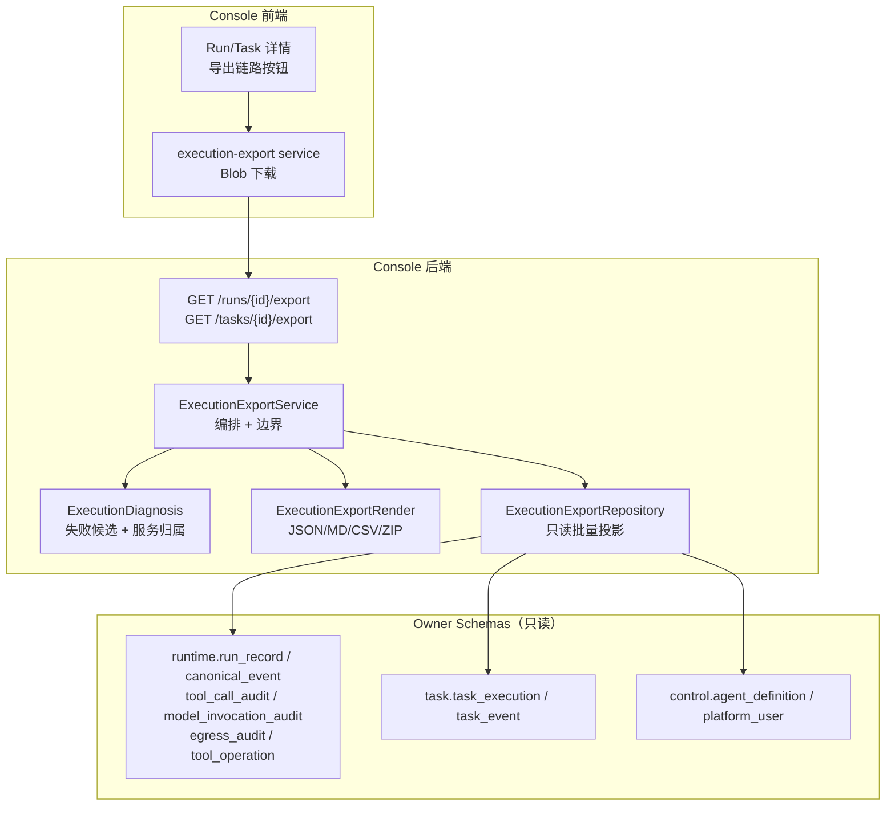
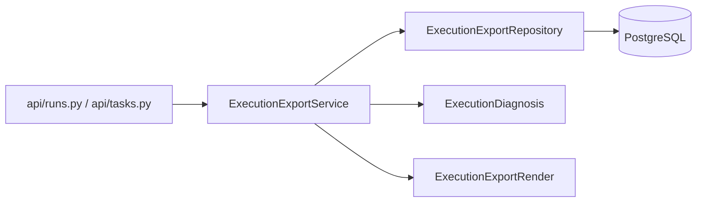
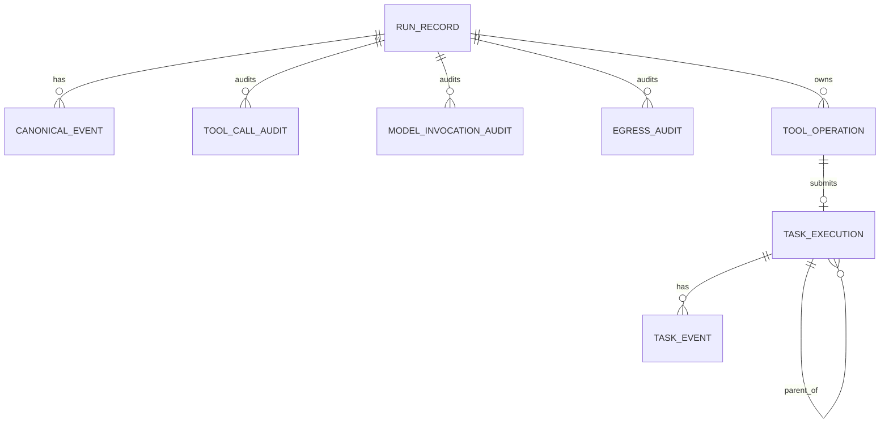
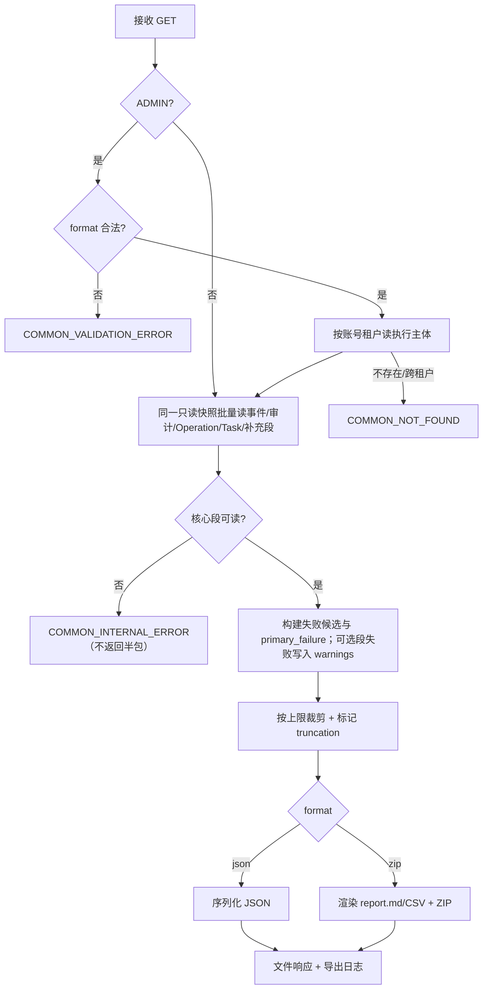

# 单次执行链路分析包（Execution Chain Export）模块需求与设计一体化文档

> **文档编号**: MOD-EXPORT-001
> **文档版本**: v1.0
> **创建日期**: 2026-11-09
> **文档状态**: 设计评审中

**评审边界说明**:
- **需求评审**: 第 2 章（需求分析）→ 通过后锁定为需求基线 v1.0
- **设计评审**: 第 3-4 章（技术设计 + 部署运维）→ 通过后锁定设计基线 v1.x
- **交接契约**: 2.5 验收条件 — 需求定义 What，设计实现 How

**ID 体系**: US（用户故事）、FEAT（功能）、API（接口）、RULE（业务规则/系统约束）、TC（测试用例）、RISK（风险）、NFR（非功能指标）
场景编号：S-（正常）、E-（异常）、B-（边界）

---

## 1. 文档控制

### 1.1 责任人

| 角色 | 姓名 | 职责范围 |
|------|------|---------|
| 产品经理 | 待定 | 需求定义、业务验收 |
| 开发负责人 | 待定 | 技术方案、代码实现 |
| 测试负责人 | 待定 | 测试策略、质量保证 |

### 1.2 修订历史

| 版本 | 日期 | 作者 | 变更描述 |
|------|------|------|---------|
| v0.1 | 2026-11-09 | Agent | 初始设计草稿：Run/Task 单执行链路导出 |

---

## 2. 需求分析

### 2.1 需求概述 [必填]

| 项目 | 内容 |
|------|------|
| **模块名称** | 单次执行链路分析包导出 |
| **模块ID** | MOD-EXPORT-001 |
| **所属系统/产品线** | Console Platform / 运行审计与排障 |
| **需求类型** | 新功能 |
| **业务背景** | 现有审计导出是四张审计表的列表投影，无法带走一条 Run/Task 的完整链路、失败节点、服务归属和日志检索键；管理员无法把单点故障拿到线下分析 |
| **核心目标** | 在 Run/Task 详情一键导出该次执行的结构化分析包，成功/失败都可导出，失败场景优先回答“哪里先失败、错误码、哪个服务、用什么 key 查日志” |

### 2.2 痛点与价值 [必填]

| 维度 | 内容 |
|------|------|
| **目标用户** | Console 管理员/运维排障人员 |
| **当前问题** | 运行审计只能看到列表与 UI 事件轮廓；UI 轮廓按 200 条截断，失败信息要逐节点展开；审计导出的 16 列里没有 `error_code/error_message/service`，也不包含 `run_record` 与 `task_execution` 的失败事实；管理员无法把一条失败执行完整带到线下 |
| **业务影响** | 失败定位依赖人工翻页面、翻日志、猜服务；跨 Run/Task 的异步失败尤其难判断主责服务 |
| **预期价值** | 单条失败执行可在一次下载内完成“失败节点 + 调用明细 + 服务 + 日志键”的取证与离线分析；成功执行也可导出用于对比复盘 |

**用户故事**

| 编号 | 用户故事 | 优先级 |
|------|---------|--------|
| US-01 | 作为管理员，我希望从一条失败的 Run 详情导出完整链路，以便离线定位失败原因 | P0 |
| US-02 | 作为管理员，我希望从一条失败的 Task 详情导出任务链路与来源 Run 上下文，以便判断是 Worker 还是 Runtime 的问题 | P0 |
| US-03 | 作为管理员，我希望报告直接给出首个失败节点、错误码、主责服务和日志检索键，而不是只给我一堆原始数据 | P0 |
| US-04 | 作为管理员，我希望成功的执行也能导出同一结构，以便把成功样本和失败样本放在一起对比 | P0 |

### 2.3 功能方案 [必填]

#### 2.3.1 功能清单

| 功能ID | 功能名称 | 功能描述 | 优先级 | 来源 |
|--------|---------|---------|--------|------|
| FEAT-01 | 失败 Run 链路导出 | 从 Run 详情导出该 Run 的执行摘要、全部非 delta 事件、模型/工具/Egress 审计、Operation、关联 Task 与失败诊断 | P0 | US-01 |
| FEAT-02 | 失败 Task 链路导出 | 从 Task 详情导出 Task 摘要、全部 task_event、attempt、skill/artifact 版本、子 Task 树、来源 Run 上下文与失败诊断 | P0 | US-02 |
| FEAT-03 | 失败诊断摘要 | 生成 `primary_failure`、`contributing_failures`、服务归属、日志检索键与可读 insights；失败时解释原因，成功时不伪造失败 | P0 | US-03 |
| FEAT-04 | ZIP/JSON 分析包 | 生成固定结构的 ZIP（report.json/report.md/events.csv/failures.csv/calls.csv/tasks.csv/README.md）或单 JSON | P0 | US-01/02 |
| FEAT-05 | 诊断字段与凭据边界 | 租户隔离、ADMIN 专属、诊断字段原样、仅凭据字段掩码、事件/字节上限、显式 truncation；不导出 Secret 原文、日志正文 | P0 | US-01/02/03 |

#### 2.3.2 字段约束

**report.json 顶层结构**

| 字段 | 类型 | 必填 | 约束 | 说明 |
|------|------|------|------|------|
| `schema_version` | integer | 是 | 固定 1 | 报告结构版本 |
| `generated_at` | string | 是 | Console 时间格式，带 offset | 生成时刻 |
| `locale` | string | 是 | `zh-CN`/`en-US` | 报告语言 |
| `execution` | object | 是 | 见下 | 执行身份与结论 |
| `summary` | object | 是 | 见下 | 计数、耗时、慢步骤 |
| `diagnosis` | object | 是 | 见下 | 失败诊断/成功洞察 |
| `timeline` | array | 是 | 非 `ASSISTANT_DELTA` | 事件时间线 |
| `model_calls` | array | 是 | 可为空 | 模型调用审计 |
| `tool_calls` | array | 是 | 可为空 | 工具调用审计 |
| `egress_calls` | array | 是 | 可为空 | Egress 审计 |
| `operations` | array | 是 | 可为空 | 异步操作 |
| `tasks` | array | 是 | 可为空 | 关联/任务树 |
| `links` | array | 是 | 可为空 | 节点关系 |
| `supplemental` | object | 是 | 可为空 | 补充段：续接/结果收件箱/提交/中断/控制命令/产物/会话 |
| `truncation` | object | 是 | 见下 | 截断事实 |
| `data_quality` | object | 是 | 见下 | 分段完整性与 warnings |
| `database_snapshot` | object | 是 | 见下 | 一致快照元信息 |
| `data_policy` | object | 是 | 见下 | 诊断字段/凭据边界声明 |

**`execution`**

| 字段 | 类型 | 必填 | 约束 | 说明 |
|------|------|------|------|------|
| `kind` | string | 是 | `RUN`/`TASK` | 执行类型 |
| `id` | string | 是 | UUID | Run/Task ID |
| `status` | string | 是 | 现有状态枚举 | 原始状态 |
| `outcome` | string | 是 | `SUCCEEDED`/`FAILED`/`CANCELLED`/`IN_PROGRESS`/`UNKNOWN` | 归一结论 |
| `error_code` | string | 否 | 领域错误码 | 权威错误码 |
| `error_message` | string | 否 | 诊断字段原样；仅凭据模式掩码 | 权威错误信息 |
| `trace_id` | string | 否 | 最大 64 | 关联 trace |
| `run_id` | string | 否 | UUID | Run 身份 |
| `task_id` | string | 否 | UUID | Task 身份 |
| `start_time` | string | 否 | 带 offset | 开始 |
| `end_time` | string | 否 | 带 offset | 结束 |
| `duration_ms` | integer | 否 | ≥0 | 总耗时 |
| `deadline_at` | string | 否 | 带 offset | 截止时间 |
| `agent` | object | 是 | `{id,name}` | Agent |
| `actor` | object | 是 | `{id,name}` | 执行用户 |
| `attempt` | integer | 否 | ≥0 | Task 尝试次数 |
| `max_attempts` | integer | 否 | ≥1 | Task 最大尝试 |
| `skill_id` | string | 否 | UUID | Task Skill |
| `intent_key` | string | 否 | ≤128 | Task 意图 |
| `source_run_id` | string | 否 | UUID | Task 来源 Run |
| `delivery_status` | string | 否 | 现有枚举 | Task 投递状态 |
| `input_text` | string | 否 | 完整诊断字段 | Run 输入正文（不截断） |
| `input` | object | 否 | 完整诊断字段 | Task 输入 JSON |
| `result` | object/string | 否 | 完整诊断字段 | Task 结果/终态结果 |
| `snapshot` | object | 否 | 见下 | Run/Task 冻结身份；读取已冻结快照，不重读当前配置 |

**`execution.snapshot`**

| 字段 | 类型 | 必填 | 约束 | 说明 |
|------|------|------|------|------|
| `schema_version` | integer | 否 | ≥1 | Run snapshot / Task execution snapshot 版本 |
| `hash` | string | 否 | ≤128 | Task `snapshot_hash`；Run 可取快照内容 hash |
| `agent_revision` | integer | 否 | ≥1 | 冻结的 Agent 版本 |
| `model_id` | string | 否 | UUID | 冻结的模型 ID |
| `model_revision` | integer | 否 | ≥1 | 冻结的模型版本 |
| `skills` | array | 否 | `{key,artifact_id,revision}` | 冻结的 Skill 版本 |
| `prompt_template_version` | string | 否 | ≤64 | Prompt 模板版本 |
| `mcp_catalog_revision` | string | 否 | ≤64 | MCP 目录版本 |
| `mcp_catalog_hash` | string | 否 | ≤128 | MCP 目录 hash |

**`summary`**

| 字段 | 类型 | 必填 | 约束 | 说明 |
|------|------|------|------|------|
| `event_count` | integer | 是 | ≥0 | 导出事件数 |
| `model_call_count` | integer | 是 | ≥0 | 模型调用数 |
| `tool_call_count` | integer | 是 | ≥0 | 工具调用数 |
| `egress_call_count` | integer | 是 | ≥0 | Egress 调用数 |
| `operation_count` | integer | 是 | ≥0 | 异步操作数 |
| `task_count` | integer | 是 | ≥0 | Task 数 |
| `failure_count` | integer | 是 | ≥0 | 失败候选数 |
| `retry_count` | integer | 是 | ≥0 | 模型重试数 |
| `total_model_latency_ms` | integer | 否 | ≥0 | 模型总耗时 |
| `total_tool_latency_ms` | integer | 否 | ≥0 | 工具总耗时 |
| `timing` | object | 是 | 见下 | 时间与 deadline 关系 |
| `slowest_steps` | array | 是 | 最多 5 项 | 最慢步骤 |

**`summary.timing`**

| 字段 | 类型 | 必填 | 约束 | 说明 |
|------|------|------|------|------|
| `elapsed_seconds` | number | 否 | ≥0 | start→end |
| `queue_wait_ms` | integer | 否 | ≥0 | 排队等待 |
| `waiting_tool_ms` | integer | 否 | ≥0 | 等待后台任务 |
| `seconds_before_absolute_deadline` | number | 否 | — | deadline - end；正数表示提前结束 |
| `ended_before_absolute_deadline` | boolean | 否 | — | 是否在绝对 deadline 前结束 |

**`data_quality`**

| 字段 | 类型 | 必填 | 约束 | 说明 |
|------|------|------|------|------|
| `complete` | boolean | 是 | — | 所有声明段是否都成功读取 |
| `warnings` | array | 是 | 可为空 | `{section,status,error_code}` |
| `section_status` | object | 是 | — | 段名 → `ok`/`unavailable`/`error` |

**`database_snapshot`**

| 字段 | 类型 | 必填 | 约束 | 说明 |
|------|------|------|------|------|
| `snapshot_time` | string | 是 | 带 offset | 快照时间 |
| `transaction_read_only` | string | 是 | `on` | 只读事务事实 |
| `transaction_isolation` | string | 是 | `repeatable read` | 隔离级别事实 |

**`data_policy`**

| 字段 | 类型 | 必填 | 约束 | 说明 |
|------|------|------|------|------|
| `diagnostic_fields` | string | 是 | `raw` | 诊断字段原样导出 |
| `credentials` | string | 是 | `masked` | 凭据字段掩码 |
| `conversation_text` | string | 是 | `included` | 对话正文包含 |
| `admin_only` | boolean | 是 | `true` | 仅 ADMIN 可下载 |

**`supplemental`**

| 字段 | 类型 | 必填 | 约束 | 说明 |
|------|------|------|------|------|
| `continuations[]` | array | 是 | 完整存储字段（凭据掩码） | wait_generation/ready/consumed_event_seq/turns/tool_calls |
| `tool_result_inbox[]` | array | 是 | 完整存储字段（凭据掩码） | task_id/task_event_seq/receipt_seq/late/materialized/payload_hash/payload_json |
| `submissions[]` | array | 是 | 完整存储字段（凭据掩码） | endpoint/status/response_status/first_seq/last_seq/request_fingerprint/terminal_result_json |
| `interrupts[]` | array | 是 | 完整存储字段（凭据掩码） | interrupt_type/status/prompt_text/options_json/expires_at/resolved_at |
| `control_outbox[]` | array | 是 | 完整存储字段（凭据掩码） | command/status/attempts/not_before/last_error_code |
| `artifacts[]` | array | 是 | 完整存储字段（凭据掩码） | artifact_type/media_type/size/checksum/storage_key/preview_text/metadata（不取文件体） |
| `conversation` | object/null | 是 | 完整存储字段（凭据掩码） | id/title/status/last_seq/last_run_id/last_message_at；会话表本身不存消息正文 |

**`diagnosis`**

| 字段 | 类型 | 必填 | 约束 | 说明 |
|------|------|------|------|------|
| `outcome` | string | 是 | 同 `execution.outcome` | 诊断结论 |
| `primary_failure` | object/null | 是 | 失败时非空 | 最早可解释失败节点 |
| `contributing_failures` | array | 是 | 可为空 | 其他失败候选 |
| `services` | array | 是 | 可为空 | 主责/关联服务 |
| `log_lookup` | object | 是 | 见下 | 日志检索键 |
| `insights` | array | 是 | 结构化 code/params/message | 可读分析提示 |

**`log_lookup`**

| 字段 | 类型 | 必填 | 约束 | 说明 |
|------|------|------|------|------|
| `services` | array | 是 | 服务名 + role | 主责/关联服务 |
| `keys` | object | 是 | 仅非空键 | run_id/trace_id/task_id/tool_call_id/operation_id/audit_id |
| `paths` | array | 是 | 路径提示 | `LOG_DIR/<service>/<date>.log`；同时给目录级 grep 提示 |
| `commands` | array | 是 | 命令字符串 | 本地 grep / kubectl logs 提示 |

**`truncation`**

| 字段 | 类型 | 必填 | 约束 | 说明 |
|------|------|------|------|------|
| `truncated` | boolean | 是 | — | 是否发生截断 |
| `omitted_events` | integer | 是 | ≥0 | 被省略事件数 |
| `omitted_task_events` | integer | 是 | ≥0 | 被省略 task_event 数 |
| `omitted_task_children` | integer | 是 | ≥0 | 被省略子 Task 数 |
| `max_events` | integer | 是 | 配置值 | 本次生效上限 |
| `max_bytes` | integer | 是 | 配置值 | 本次生效上限 |

**`FailureCandidate`（`primary_failure` / `contributing_failures[]`）**

| 字段 | 类型 | 必填 | 约束 | 说明 |
|------|------|------|------|------|
| `node_type` | string | 是 | `RUN`/`EVENT`/`MODEL_CALL`/`TOOL_CALL`/`EGRESS_CALL`/`OPERATION`/`TASK`/`TASK_EVENT` | 失败节点类型 |
| `node_id` | string | 是 | 稳定 ID | 审计 ID/任务 ID/事件 seq 的可读 ID |
| `seq` | integer | 否 | ≥1 | 能对应到 canonical_event 时的序号 |
| `occurred_at` | string | 否 | 带 offset | 失败发生时间 |
| `status` | string | 否 | 原始状态 | ERROR/FAILED/DENY 等 |
| `error_code` | string | 否 | 领域错误码 | 失败码 |
| `error_message` | string | 否 | 诊断字段原样；仅凭据模式掩码 | 失败信息 |
| `service` | string | 是 | 服务名或 `external:*` | 主责服务 |
| `basis` | string | 是 | `RUN_ERROR_CODE`/`TASK_ERROR_CODE`/`EARLIEST_TERMINAL_FAILURE` | 判定依据 |
| `is_retry` | boolean | 是 | — | 是否仅重试记录 |
| `related_ids` | object | 是 | 仅非空键 | tool_call_id/task_id/operation_id/audit_id |

**`model_calls[]` / `tool_calls[]` / `egress_calls[]`**

均包含完整存储诊断字段（provider/model/attempt/status/error_code/error_message/tokens/latency/tool_name/tool_kind/args_preview_json/egress target/policy/status_code 等），只对凭据键名/模式做掩码；不逐字段截断，受整体大小上限约束。

**`timeline[]` / `events.csv`**

| 字段 | 类型 | 必填 | 约束 | 说明 |
|------|------|------|------|------|
| `seq` | integer | 是 | ≥1 | 会话事件序号 |
| `event_type` | string | 是 | 现有枚举 | 落库业务名 |
| `create_time` | string | 是 | 带 offset | 事件时间 |
| `elapsed_ms` | integer | 否 | ≥0 | 相对执行开始 |
| `interval_ms` | integer | 否 | ≥0 | 相对上一事件 |
| `status` | string | 否 | 完整存储字段 | 节点结果 |
| `error_code` | string | 否 | 领域错误码 | 失败码 |
| `service` | string | 是 | 服务名 | 归属服务 |
| `tool_call_id` | string | 否 | ≤256 | 工具调用关联 |
| `task_id` | string | 否 | UUID | 后台任务关联 |
| `operation_id` | string | 否 | UUID | 异步操作关联 |
| `has_artifact` | boolean | 是 | — | 是否有产物 |
| `text` | string | 否 | 完整诊断字段（凭据掩码） | 消息/结果正文，不逐字段截断 |
| `payload` | object | 否 | 完整诊断字段（凭据掩码） | 事件负载，不逐字段截断 |

**`links[]`**

| 字段 | 类型 | 必填 | 约束 | 说明 |
|------|------|------|------|------|
| `from` | string | 是 | `type:id` | 起点节点 |
| `to` | string | 是 | `type:id` | 终点节点 |
| `type` | string | 是 | `HAS_EVENT`/`MODEL_CALL`/`TOOL_CALL`/`OPERATION`/`SUBMITTED_TASK`/`SPAWNED_TASK`/`CHILD_TASK`/`EGRESS_OF` | 关系类型 |

**`tasks[]`**

| 字段 | 类型 | 必填 | 约束 | 说明 |
|------|------|------|------|------|
| `task_id` | string | 是 | UUID | Task |
| `parent_id`/`root_id` | string | 否 | UUID | 父子/根 |
| `status` | string | 是 | 现有枚举 | 状态 |
| `error_code`/`error_message` | string | 否 | 诊断字段原样；仅凭据模式掩码 | 失败事实 |
| `attempt`/`max_attempts` | integer | 是 | ≥0/≥1 | 尝试 |
| `intent_key`/`skill_id` | string | 否 | — | 意图/Skill |
| `events` | array | 是 | 失败子任务详列 | task_event 全量负载（凭据掩码，不逐字段截断） |
| `summary` | object | 否 | 成功子任务 | 状态/耗时/attempt 汇总 |

### 2.4 范围与边界 [必填]

| 类别 | 内容 |
|------|------|
| **范围（In Scope）** | Run 详情/Task 详情单条执行导出；Run 全量非 delta 事件；Task 全量 task_event；模型/工具/Egress 审计；Operation；关联/子 Task；补充段（续接/结果收件箱/提交/中断/控制命令/产物/会话元信息）；对话正文/事件负载/工具参数/Task 输入结果等诊断字段原样；失败诊断；服务归属；日志检索键；一致快照；ZIP/JSON；凭据掩码与整体边界；可选段失败降级 |
| **非范围（Out of Scope）** | 批量/按时间范围导出（仍由现有审计导出承载）；日志正文抓取；跨执行聚合报告；真正的 span 树（当前 `canonical_event` 无 `parent_span_id`）；新增导出任务表/异步轮询；修改 Run/Task 状态机；Secret/凭据明文导出；原始全行/软删除行导出（仍由 `scripts/export_run_diagnostics.py` 在内网兜底） |
| **前置假设** | Console 已有登录账号租户上下文；Run/Task/审计事实仍按现有表结构落库；现有审计导出保持不变 |
| **有意妥协 / 技术债** | 同步下载而非异步任务：单执行数据量可控，换取“一键即得”；超过上限时只保留失败窗口与首尾摘要，不追求完整全量；`primary_failure` 是最早可解释失败节点，不宣称绝对根因；可选段失败时允许 `data_quality.complete=false` 的部分报告 |

### 2.5 验收条件 [必填]

#### 2.5.1 业务规则与约束

| ID | 类型 | 描述 | 验证场景 |
|----|------|------|---------|
| RULE-01 | 业务规则 | 一次请求只导出一条 Run 或一条 Task；不提供批量/时间范围模式 | S-01, S-02, B-02 |
| RULE-02 | 业务规则 | `run_record.status/error_code` 与 `task_execution.status/error_code` 是权威结论；`primary_failure` 取最早可解释的终态失败节点并标注 `basis`，不宣称绝对根因 | S-01, S-02, S-03 |
| RULE-03 | 业务规则 | 导出完整非 `ASSISTANT_DELTA` 事件链，不受 UI 200 条轮廓限制；Task 导出包含 task_event 与来源 Run 上下文 | S-01, S-02, S-03, E-02, B-01, B-02 |
| RULE-04 | 业务规则 | 成功与失败使用同一 schema；成功时 `primary_failure=null`，不得编造失败；仍输出慢步骤/重试等性能洞察 | S-03 |
| RULE-05 | 系统约束 | 租户取自登录账号；跨租户、软删除、不存在统一 404，不泄漏存在性 | E-01 |
| RULE-06 | 安全约束 | 诊断字段（对话正文、事件负载、工具参数、Task 输入/结果、错误信息）原样导出；仅凭据类字段（Authorization/Cookie/api_key/access_token/password/secret/私钥/DSN）掩码；Secret 原文与日志正文不进入报告 | S-01, S-02, S-03, E-03 |
| RULE-07 | 系统约束 | 事件/字节/子任务上限显式；截断必须保留 `primary_failure` 与失败窗口，并写入 `truncation` | E-02, B-02 |
| RULE-08 | 业务规则 | ZIP 固定包含 `report.json/report.md/events.csv/failures.csv/calls.csv/tasks.csv/README.md`；JSON 为单文件；文件名由响应头给出 | S-01, S-02, S-03, S-04 |
| RULE-09 | 业务规则 | 日志定位只给服务、检索键、路径提示与命令，不读取/返回日志内容 | S-01, S-02, E-03 |
| RULE-10 | 系统约束 | 同步只读 GET 下载；不创建任务、不写 artifact store、不新增导出表；失败响应走统一封套 | S-01, S-02 |
| RULE-11 | 交互规则 | Run/Task 详情头部常驻“导出链路”按钮；成功/失败都可导出；提交中禁用，失败可重试 | S-04 |
| RULE-12 | 系统约束 | 所有段在同一 `REPEATABLE READ, READ ONLY` 快照内读取；报告带 `database_snapshot`；非终态执行只代表生成时刻 | B-03 |
| RULE-13 | 系统约束 | 导出仅 ADMIN 可用；服务端强制角色校验，前端对非 ADMIN 隐藏入口；非管理员返回 403 且不返回任何数据 | E-05 |
| RULE-14 | 系统约束 | 诊断字段不做逐字段字符截断；只受整体事件/字节/子任务上限约束，截断必须显式 | E-02 |

#### 2.5.2 功能验收场景

> 验收场景唯一源：`execution-chain-export.scenarios.md`。下表只引用场景 ID 与设计影响，不复制执行元数据。

| 场景ID | 设计影响 / 备注 |
|--------|----------------|
| S-01 | 失败 Run 导出；涉及 FEAT-01, FEAT-03, FEAT-04, FEAT-05；验证全量事件、失败诊断、ZIP 固定内容与诊断字段/凭据边界 |
| S-02 | 失败 Task 导出；涉及 FEAT-02, FEAT-03, FEAT-04, FEAT-05；验证 task_event、attempt、子任务与来源 Run 上下文 |
| S-03 | 成功 Run 导出；涉及 FEAT-01, FEAT-03, FEAT-04；验证 `primary_failure=null`、性能洞察、同构 schema |
| S-04 | 前端按钮；涉及 FEAT-05, FEAT-06, FEAT-07；验证按钮常驻、加载、成功下载、失败重试 |
| E-01 | 跨租户/不存在 404；涉及 FEAT-01, FEAT-02；验证不泄漏存在性 |
| E-02 | 截断；涉及 FEAT-04, FEAT-05；验证 `primary_failure` 不丢、truncation 显式 |
| E-03 | 诊断字段与凭据边界；涉及 FEAT-05；验证诊断内容原样、凭据掩码、Secret 原文不出现 |
| B-01 | >200 事件；涉及 FEAT-01, FEAT-04；验证不受 UI 轮廓上限影响 |
| B-02 | 批量 Task；涉及 FEAT-02, FEAT-04；验证失败子任务优先详列 |
| S-05 | 浏览器端到端；涉及 FEAT-01, FEAT-06, FEAT-07；验证点击→真实 HTTP→Blob→下载→解包 |
| E-04 | 可选段失败降级；涉及 FEAT-01, FEAT-04, FEAT-05；验证 200 + warnings + `data_quality.complete=false` |
| E-05 | ADMIN 专属；涉及 FEAT-05；验证非 ADMIN 403、不返回数据 |
| B-03 | 一致快照；涉及 FEAT-01；验证 `database_snapshot` 的隔离级别/只读事实 |

#### 2.5.3 非功能指标 [按需]

**性能指标**

| 指标ID | 指标名称 | 目标值 | 测量方法 |
|--------|---------|-------|---------|
| NFR-PERF-01 | 单次执行导出查询数 | 常数上界，不随事件数增长 | 集成测试记录 SQL 条数；禁止逐事件回查 |
| NFR-PERF-02 | 单次执行导出生成耗时 | 待定（按目标环境实测） | 集成测试计时；不得以未实测值冒充 SLA |

**可靠性指标**

| 指标ID | 指标名称 | 目标值 |
|--------|---------|-------|
| NFR-REL-01 | 超限导出成功率 | 100% 返回可分析包 + 显式 truncation，不因超限 500 |

**安全性要求**

| 指标ID | 安全域 | 验收标准 |
|--------|-------|---------|
| NFR-SEC-01 | 诊断数据边界 | 诊断字段原样保留；凭据字段掩码；Secret 原文不出现；整体大小有界 |
| NFR-SEC-02 | 租户隔离 | 跨租户与不存在同码 404 |

#### 2.5.4 验证环境假设 [必填]

| 维度 | 假设 | 验证方式 / 参数 | 不满足时 |
|------|------|----------------|---------|
| 容量 | 单次执行事件数覆盖 UI 200 条上限与导出上限边界；批量 Task 覆盖子任务上限 | 集成测试 seed 250 条事件、20 个子 Task；上限用测试配置调小 | 标记 `incomplete` 或拆分批次 |
| 硬件 | 本地/CI 可运行 Console API + PostgreSQL | `make acceptance` / 目标测试命令 | 返回 `env_blocked` 并列出缺失项 |
| 依赖 | PostgreSQL、Console 应用、登录账号租户上下文；无需 Redis/Runtime/Worker 进程 | `pytest` 集成夹具 + 真实 PG | 返回 `env_blocked` |
| profile 参数 | 组件测试 + 集成测试；不引入 E2E | `pytest tests/frontend tests/console_platform` | 显式报 `incomplete`，不自动降级 |

---

## 3. 技术设计

### 3.1 方案选型 [必填]

#### 备选方案对比

| 对比维度 | 权重 | 方案A：同步 GET 内存渲染 | 得分 | 方案B：异步导出任务 + artifact | 得分 |
|---------|------|--------------------------|------|--------------------------------|------|
| 功能完备性 | 30% | 单执行一键下载；无需轮询 | 9 | 可承载超大导出；需轮询 | 8 |
| 性能预期 | 25% | 单执行有界；无额外任务表/文件写 | 9 | 首次响应快；后台生成 | 7 |
| 实现复杂度 | 20% | 复用现有仓储；无新表 | 9 | 复用审计导出任务模式；多状态机 | 6 |
| 维护成本 | 15% | 同步路径集中；边界简单 | 9 | 任务清理/重试/权限面更大 | 6 |
| 风险评估 | 10% | 超大执行需截断 | 7 | 任务堆积/artifact 生命周期 | 7 |
| **最终得分** | **100%** | | **8.8** | | **6.9** |

#### 关键决策记录

| 决策点 | 选择 | 被否决项 | 理由 | 可逆性 |
|--------|------|---------|------|--------|
| 生成方式 | 同步 GET、内存渲染、直接下载 | 新建导出任务表 + 异步轮询 | 单条执行有界；用户要“一键即得”；现有审计导出继续服务批量场景 | 易回退（改为 POST 任务即可） |
| 产物 | ZIP（JSON+MD+CSV+README）/ 单 JSON | 只给 CSV | CSV 无法表达链路关系；JSON 是机器分析主格式，Markdown 是人读摘要 | 易扩展 |
| 事件范围 | 全部非 `ASSISTANT_DELTA` + 失败窗口 | 复用 UI 200 条轮廓 | UI 轮廓会截掉尾部失败；token 增量对失败定位价值低 | 易调整 |
| 诊断结论 | `primary_failure` + `contributing_failures` + `basis` | 宣称“根因” | 当前没有 span 树，最早失败不等于绝对根因；必须保留权威 error_code | 易扩展 |
| 数据写入 | 只读，不写库/不写 artifact | 落库快照 | 导出是一次读取；不引入新生命周期和清理负担 | 易回退 |
| 任务查询 | 直读 `task.task_execution` 只读投影 + 新索引 | 逐页调用 Worker Admin API | 单执行导出需要批量读；避免 N 次 HTTP 与分页拼装 | 易回退 |

#### 技术栈

| 类别 | 选型 | 版本 | 选型理由 |
|------|------|------|---------|
| 语言 | Python | 3.12+ | 与 Console 后端一致 |
| 框架 | FastAPI + SQLAlchemy async | 现有版本 | 现有路由/仓储模式 |
| 数据库 | PostgreSQL | 现有版本 | 只读聚合；新增一个索引 |
| 渲染 | 标准库 `json`/`csv`/`zipfile` | Python 3.12 | 无新依赖；内存有界 |
| 前端 | React + TypeScript + Semi Design | 现有版本 | 复用详情 SideSheet 操作区 |

#### 参考实现：`scripts/export_run_diagnostics.py`

内网临时脚本（GPT 生成）已验证“单 Run 全量采集”的边界，产品化时**复用其采集语义，不复用其原始导出策略**：

| 脚本能力 | 产品化采用 | 产品化不采用 |
|---------|-----------|-------------|
| `REPEATABLE READ, READ ONLY` + `TimeZone=UTC` 一致快照 | ✅ 整个导出在同一只读事务内取数，报告带 `database_snapshot` | — |
| 按 source 分段采集，单段失败记 `warnings`，不中止其他段 | ✅ 核心段失败才失败；可选段降级为 `section_status + warnings + database_sections_complete=false` | — |
| 递归 CTE 取 `source_run_id` + operation task 的全部子 Task | ✅ 复用同一递归范围 | — |
| 覆盖 `run_continuation`/`tool_result_inbox`/`run_submission`/`run_interrupt`/`tool_control_outbox`/`artifact`/`conversation` | ✅ 作为补充段（完整存储字段，凭据掩码） | — |
| `timing_summary`（elapsed / deadline gap） | ✅ 进入 `summary.timing` | — |
| `to_jsonb(r)` 全行、无脱敏、无行数/大小上限、直连 DSN | — | ❌ 产品 API 输出完整诊断字段但凭据掩码、整体有界，走 Console DB 配置，不内置 DSN |
| 包含软删除行 | — | ❌ 默认排除软删除；原始全量仍由该脚本在内网兜底 |

> 结论：脚本证明“要采哪些表、怎么保证一致快照”；产品版在其骨架上加**诊断摘要、凭据掩码、ZIP/JSON 渲染、ADMIN 门控与整体上限**。

### 3.2 架构设计 [必填]



#### 技术分层



#### 外部依赖清单

| 外部系统 | 依赖类型 | 协议 | 超时 | 降级策略 |
|---------|---------|------|------|---------|
| PostgreSQL | 只读查询 | SQLAlchemy async | 现有请求超时 | 查询失败 → 500，不返回半包 |
| Artifact Store | 不使用 | — | — | — |
| Worker Admin API | 不使用 | — | — | Task 事实直读只读投影 |
| 日志平台 | 不使用 | — | — | 只给检索键/命令 |

### 3.3 数据设计 [必填]

**不新增业务表。** 导出是只读投影，不落库、不写 artifact。

**一致性快照**

整个导出在同一个数据库事务内完成：

```sql
SET TRANSACTION ISOLATION LEVEL REPEATABLE READ, READ ONLY;
SELECT set_config('TimeZone', 'UTC', true);
```

- 所有段读取同一快照，避免 Run 状态、事件、审计、Task 在多次查询之间漂移；
- 报告写入 `database_snapshot`（`snapshot_time`、`transaction_read_only`、`transaction_isolation`），便于线下复现；
- 非终态执行（RUNNING/WAITING）导出的是**生成时刻的点视图**，不声称终态。

**新增索引: `task.task_execution`**

| 字段名 | 类型 | 说明 |
|--------|------|------|
| `tenant_id` | varchar(64) | 现有列；租户前缀 |
| `source_run_id` | uuid | 现有列；按 Run 查关联 Task |
| `is_deleted` | boolean | 现有列；partial index 条件 |

| 索引名 | 类型 | 字段 | 使用场景 |
|--------|------|------|---------|
| `ix_task_execution_source_run` | btree partial | `(tenant_id, source_run_id) WHERE is_deleted = false` | Run 导出按 `source_run_id` 批量取关联 Task；避免任务表顺序扫描 |

**迁移**: `migrations/versions/0043_task_execution_source_run_index.py`
- upgrade: `CREATE INDEX ix_task_execution_source_run ON task.task_execution (tenant_id, source_run_id) WHERE is_deleted = false`
- downgrade: `DROP INDEX task.ix_task_execution_source_run`
- 生产大表按现有迁移约定在低峰执行；迁移只保证 schema 一致，不负责在线建索引窗口。

**只读来源表**

| 来源表 | 用途 | 过滤 |
|--------|------|------|
| `runtime.run_record` | Run 身份、状态、错误、时间、trace、Agent/用户 | `tenant_id` + `id` + `is_deleted=false` |
| `runtime.runtime_snapshot` | Run 冻结身份（Agent/模型/Skill/MCP/Prompt 版本） | `tenant_id` + `run_id` + `is_deleted=false` |
| `runtime.canonical_event` | 时间线、失败节点、关联 ID | `tenant_id` + `run_id` + `is_deleted=false` + `event_type <> ASSISTANT_DELTA` |
| `runtime.tool_call_audit` | 工具调用明细 | `tenant_id` + `run_id`/`task_id` + `is_deleted=false` |
| `runtime.model_invocation_audit` | 模型调用明细 | 同上 |
| `runtime.egress_audit` | Egress 明细 | 同上 |
| `runtime.tool_operation` | 异步操作 | 同上 |
| `runtime.run_continuation` | 接续轮次、ready、消费进度（补充段） | `tenant_id` + `run_id` + `is_deleted=false` |
| `runtime.tool_result_inbox` | 异步结果收件箱、迟到/物化状态（补充段） | `tenant_id` + `run_id` + `is_deleted=false` |
| `runtime.run_submission` | 提交幂等状态、首末事件序号（补充段） | `tenant_id` + `run_id` + `is_deleted=false` |
| `runtime.run_interrupt` | WAITING_INPUT 类型/状态/过期（补充段） | `tenant_id` + `run_id` + `is_deleted=false` |
| `runtime.tool_control_outbox` | SUBMIT/CANCEL 控制命令状态与最后错误（补充段） | `tenant_id` + `operation_id` + `is_deleted=false` |
| `runtime.artifact` | 产物元信息（不取文件体/存储键）（补充段） | `tenant_id` + `run_id`/`task_id` + `is_deleted=false` |
| `runtime.conversation` | 会话元信息（不取消息内容）（补充段） | `tenant_id` + `id` + `is_deleted=false` |
| `task.task_execution` | Task 摘要、attempt、错误、子任务、冻结 `execution_snapshot_json` | `tenant_id` + `source_run_id`/`id`/`parent_id` + `is_deleted=false` |
| `task.task_event` | Task 事件 | `tenant_id` + `task_id` + `is_deleted=false` |
| `control.agent_definition` / `control.platform_user` | 名称补齐 | 同租户、同 ID |

**关系图**



**容量预估**

| 维度 | 预估值 |
|------|--------|
| 单次 Run 事件 | 由 `ExecutionExportSettings.max_events` 约束；超限截断 |
| 单次 Task 事件 | 由 `max_task_events` 约束；失败子任务优先 |
| 单次导出响应 | 由 `max_bytes` 约束；内存渲染，不落盘 |

**查询预算**

| 查询 | 次数 | 说明 |
|------|------|------|
| 执行主体 | 1 | Run 或 Task + 名称 |
| 快照 | 1 | Run `runtime_snapshot` 或 Task `execution_snapshot_json` 冻结身份 |
| 事件/task_event | 1-2 | 批量取，不逐事件回查 |
| 审计三表 | 3 | 工具/模型/Egress |
| Operation | 1 | 按 run_id 或 task_id |
| Task 树 | 1-2 | 递归 CTE + task_event 批量 |
| 补充段 | 1-7 | continuation/inbox/submission/interrupt/control_outbox/artifact/conversation，逐段可选 |
| 合计 | 常数上界 | 不随事件数增长；导出是单对象低频路径；可选段失败只降级不增加重试 |

### 3.4 接口设计 [必填]

#### 接口清单

| 接口ID | 名称 | 方法 | 路径 | 详细 |
|--------|------|------|------|------|
| API-01 | 导出 Run 执行链路 | GET | `/api/v1/runs/{run_id}/export` | [↓](#api-01) |
| API-02 | 导出 Task 执行链路 | GET | `/api/v1/tasks/{task_id}/export` | [↓](#api-02) |

#### API-01: 导出 Run 执行链路

**请求**

| 参数 | 类型 | 必填 | 说明 |
|------|------|------|------|
| `run_id` | path UUID | 是 | Run ID |
| `format` | query string | 否 | `zip`（默认）/`json` |
| 权限 | — | 是 | ADMIN；非 ADMIN 返回 `FORBIDDEN` |

**请求示例**

```http
GET /api/v1/runs/2f1c.../export?format=zip
Accept-Language: zh-CN
```

**响应**

| 参数 | 类型 | 说明 |
|------|------|------|
| 200 body | binary | ZIP 或 JSON 字节流 |
| `Content-Type` | header | `application/zip` 或 `application/json` |
| `Content-Disposition` | header | `attachment; filename="run-{id}-{outcome}.zip"` |
| `Cache-Control` | header | `no-store`；诊断数据不落浏览器/代理缓存 |
| `X-Export-Truncated` | header | `true`/`false` |
| `X-Export-Complete` | header | `true`/`false`；可选段失败时为 `false`，但响应仍是 200 |
| `X-Export-Event-Count` | header | 实际导出事件数 |
| 4xx/5xx body | envelope | `{code,msg,data,trace_id,request_id,timestamp}` |

**响应示例（JSON 摘要）**

```json
{
  "schema_version": 1,
  "generated_at": "2026-11-09 12:00:00+08:00",
  "locale": "zh-CN",
  "execution": {
    "kind": "RUN",
    "id": "2f1c...",
    "status": "FAILED",
    "outcome": "FAILED",
    "error_code": "RUN_NO_PROGRESS",
    "error_message": "…",
    "trace_id": "…",
    "run_id": "2f1c...",
    "task_id": null,
    "agent": {"id": "…", "name": "…"},
    "actor": {"id": "…", "name": "…"},
    "snapshot": {
      "schema_version": 1,
      "agent_revision": 3,
      "model_id": "…",
      "model_revision": 7,
      "skills": [{"key": "…", "artifact_id": "…", "revision": 2}],
      "prompt_template_version": "…"
    }
  },
  "diagnosis": {
    "outcome": "FAILED",
    "primary_failure": {
      "node_type": "TOOL_CALL",
      "node_id": "…",
      "seq": 42,
      "error_code": "SKILL_EXECUTION_FAILED",
      "service": "muad-agent-worker",
      "basis": "EARLIEST_TERMINAL_FAILURE"
    },
    "contributing_failures": [],
    "services": [{"service": "muad-agent-worker", "role": "PRIMARY"}],
    "log_lookup": {
      "keys": {"run_id": "…", "trace_id": "…", "task_id": "…"},
      "paths": ["LOG_DIR/muad-agent-worker/<date>.log"],
      "commands": ["grep -R -F '<run_id>' \"$LOG_DIR/muad-agent-worker\""]
    },
    "insights": []
  },
  "timeline": [],
  "supplemental": {},
  "truncation": {"truncated": false, "omitted_events": 0},
  "data_quality": {"complete": true, "warnings": [], "section_status": {}},
  "database_snapshot": {
    "snapshot_time": "2026-11-09 12:00:00+00:00",
    "transaction_read_only": "on",
    "transaction_isolation": "repeatable read"
  },
  "data_policy": {
    "diagnostic_fields": "raw",
    "credentials": "masked",
    "conversation_text": "included",
    "admin_only": true
  }
}
```

**错误码**

| 错误码 | 信息 | 场景 | HTTP状态码 |
|--------|------|------|----------|
| `COMMON_NOT_FOUND` | 执行不存在或不可读 | 跨租户/软删/不存在 | 404 |
| `COMMON_VALIDATION_ERROR` | 参数错误 | `format` 非法 | 400 |
| `COMMON_INTERNAL_ERROR` | 内部错误 | 核心段查询/渲染失败 | 500 |
| `FORBIDDEN` | 仅管理员可导出 | 非 ADMIN 账号 | 403 |

**处理逻辑**



#### API-02: 导出 Task 执行链路

请求/响应结构与 API-01 同构，差异：

| 项 | 说明 |
|----|------|
| 路径 | `/api/v1/tasks/{task_id}/export` |
| `execution.kind` | `TASK` |
| 主体 | Task 摘要 + attempt/max_attempts + skill/artifact + 来源 Run |
| 事件 | `task.task_event` 全量；来源 Run 只取提交/结果相关事件 + 邻接窗口 |
| Task 树 | 父/子 Task；失败子 Task 优先详列，其余汇总 |
| 快照 | `execution.snapshot` 取 `task_execution.execution_snapshot_json` 的冻结值；不重新解析当前 Agent/模型/Skill 配置 |
| 权限 | ADMIN；非 ADMIN 返回 `FORBIDDEN` |
| 日志服务 | 默认 `muad-agent-worker`；来源 Run 失败时并列 `muad-agent-runtime` |

**错误码**：同 API-01。

### 3.5 质量实现方案 [必填]

#### 性能设计

| 指标ID | 热点路径 | 目标值 | 实现方案（含被放弃的较慢方案） |
|--------|---------|-------|------------------------------|
| NFR-PERF-01 | Run 导出按 `source_run_id` 取 Task | 常数查询数 | 新增 `ix_task_execution_source_run`；放弃“逐页调用 Worker Admin API”（N 次 HTTP + 分页拼装） |
| NFR-PERF-02 | 事件/审计批量读 | 不随事件数增加查询数 | 每个来源一次批量查询；放弃“逐事件调用 RunEventQueryService”（N+1） |
| NFR-PERF-02 | 大事件流 | 受 `max_events`/`max_bytes` 约束 | 内存渲染 + 失败窗口保留；放弃“全量无上限导出” |

#### 可靠性设计

| 风险ID | 失效模式 | 影响 | 应对措施 | 验证场景 |
|--------|---------|------|---------|---------|
| RISK-01 | 执行仍在运行，导出时数据继续变化 | 报告是点时间视图 | `execution.outcome=IN_PROGRESS` + `generated_at`；不声称终态 | S-03 |
| RISK-02 | 事件/子任务超限 | 报告不完整 | 保留失败窗口与首尾摘要，`truncation` 显式 | E-02, B-02 |
| RISK-03 | 某个可选段读取失败 | 报告缺段 | 核心段（Run/Task 主体、事件/task_event）失败才返回 500；可选段降级为 `section_status=error` + `warnings` + `data_quality.complete=false`，仍返回 200 | E-04 |
| RISK-04 | 诊断字段含凭据片段 | 数据泄漏 | 仅对凭据键名/模式掩码；诊断上下文保留；ADMIN 专属 | E-03, E-05 |

#### 安全性设计

| 指标ID | 验收标准 | 实现方案 |
|--------|---------|---------|
| NFR-SEC-01 | 诊断字段原样；Secret 原文不出现；日志正文不导出 | 诊断字段（对话正文/事件负载/工具参数/Task 输入结果/错误信息）原样保留；仅用凭据键名/模式掩码器替换 Secret、Authorization、Cookie、api_key、access_token、password、私钥、DSN；整体大小有界 |
| NFR-SEC-02 | 跨租户 404 | `AccountTenantId` + 所有查询带 `tenant_id` + `is_deleted=false` |
| NFR-SEC-03 | ADMIN 专属且可追溯 | API 使用 `AdminAccount`；前端用 `useAuth().account.role === "ADMIN"` 隐藏入口；`logger.info("execution_export", extra={tenant_id, account_id, role, kind, execution_id, format, event_count, size_bytes, truncated, duration_ms})`；不记录内容 |

#### 可观测性设计

| 场景 | 实现方案 |
|------|---------|
| 日志 | logging-kit 单行文本；自动带 trace_id/request_id/tenant_id；导出日志不含内容 |
| 指标 | `execution_export_total{kind,format,status}`、`execution_export_duration_ms{kind,format}`、`execution_export_truncated_total{kind}` |
| 错误 | 查询/渲染失败 `logger.exception` + 500；不吞异常 |

---

## 4. 部署与运维

### 4.1 部署架构

| 环境 | 配置 | 实例数 | 用途 |
|------|------|--------|------|
| dev | 现有 Console | 1 | 本地/CI 集成测试 |
| prod | 现有 Console | 现有副本 | 无新增单元；同步导出受请求超时约束 |

### 4.2 发布与回滚 [按需]

| 阶段 | 操作 | 验证方法 |
|------|------|---------|
| 1 | 应用迁移 0043（新索引） | `alembic upgrade head`；检查索引存在 |
| 2 | 发布 Console 新版本 | 现有发布流程 |
| 3 | 回滚 | 代码回滚；索引可保留（只增查询能力）或按 downgrade 删除 |

### 4.3 监控告警 [按需]

| 指标 | 阈值 | 级别 | 处理SLA |
|------|------|------|---------|
| `execution_export_total{status="ERROR"}` 比例 | 待定（按实测） | P2 | 15min 响应 |
| `execution_export_duration_ms` P95 | 待定（按实测） | P2 | 15min 响应 |

### 4.4 数据迁移 [按需]

| 阶段 | 操作 | 验证方法 |
|------|------|---------|
| 1 | 新增 `ix_task_execution_source_run` | 查询 `pg_indexes` |
| 2 | 回滚删除索引 | `DROP INDEX` |

---

## 5. 风险与依赖

### 5.1 项目依赖

| 依赖模块/团队 | 依赖内容 | 状态 | 风险等级 |
|-------------|---------|------|---------|
| Console Platform | 登录账号租户、现有路由/仓储 | 现有 | 低 |
| Agent Runtime | `runtime.*` 只读事实结构稳定 | 现有 | 中 |
| Agent Worker | `task.*` 只读事实结构稳定 | 现有 | 中 |
| 部署 | 迁移执行窗口 | 现有 | 中 |

### 5.2 风险识别

| 风险ID | 类型 | 描述 | 概率 | 影响 | 应对措施 | 验证场景 |
|--------|------|------|------|------|---------|---------|
| RISK-05 | 数据 | `canonical_event` 无 parent_span_id，无法还原真正调用树 | 高 | 报告只能给时间线+关系链接 | 用 `links` 表达已知关系；不宣称 span 树；`primary_failure` 标注 basis | S-01, S-02 |
| RISK-06 | 性能 | 任务表无 `source_run_id` 索引导致慢查询 | 中 | 导出变慢 | 新增 partial index；查询预算常量 | S-01 |
| RISK-07 | 安全 | 诊断字段含凭据片段 | 中 | 泄漏 | 凭据掩码 + ADMIN 专属 + 导出审计 | E-03, E-05 |
| RISK-08 | 兼容 | 报告 schema 后续演进 | 中 | 离线脚本失效 | `schema_version` + 固定 ZIP 内容 | S-01 |

---

## 6. 需求追溯矩阵

| 用户故事 | 功能ID | 接口ID | 测试用例ID | 测试层级 | 执行方式 | 追溯 check | 状态 |
|---------|--------|--------|-----------|---------|---------|-----------|------|
| US-01 | FEAT-01 | API-01 | S-01 | integration | auto | 待 plan 生成 | 待实现 |
| US-02 | FEAT-02 | API-02 | S-02 | integration | auto | 待 plan 生成 | 待实现 |
| US-03 | FEAT-03 | API-01/API-02 | S-01, S-02 | integration | auto | 待 plan 生成 | 待实现 |
| US-04 | FEAT-01 | API-01 | S-03 | integration | auto | 待 plan 生成 | 待实现 |
| US-01/02 | FEAT-04 | API-01/API-02 | S-01, S-02, B-01 | integration | auto | 待 plan 生成 | 待实现 |
| US-01/02/03 | FEAT-05 | API-01/API-02 | E-02, E-03 | integration | auto | 待 plan 生成 | 待实现 |
| US-01 | FEAT-01, FEAT-06, FEAT-07 | API-01 | S-05 | E2E | auto | 待 plan 生成 | 待实现 |
| US-03 | FEAT-01, FEAT-04, FEAT-05 | API-01 | E-04 | integration | auto | 待 plan 生成 | 待实现 |
| US-01 | FEAT-01 | API-01 | B-03 | integration | auto | 待 plan 生成 | 待实现 |
| US-01/02 | FEAT-05 | API-01/API-02 | E-05 | integration | auto | 待 plan 生成 | 待实现 |

---

## Spec Compliance Matrix

| Spec/Rule | enforcement | 设计影响 | 设计落点 | 验证场景 | 状态/N/A 理由 |
|-----------|-------------|---------|---------|---------|----------------|
| `harness-api#RULE-api-001` | required | 文件下载成功路径返回二进制；错误路径（含 403）仍走统一封套 | §3.4 API-01/API-02 错误码与响应头 | S-01, S-02, E-01, E-05 | applied |
| `harness-api#RULE-api-002` | required | 本功能是只读 GET 下载，不创建导出任务，不消费 `Idempotency-Key` | §3.1 关键决策 / §3.4 API-01 | S-01, S-02 | confirmed N/A：GET 只读，无创建类幂等 |
| `harness-arch#RULE-arch-001` | required | 不新增部署单元；Console 只读聚合 runtime/task 事实 | §3.2 架构设计 | S-01, S-02 | applied |
| `harness-data#RULE-data-001` | required | 新增租户前缀 partial index；不新增业务表 | §3.3 数据设计 / 迁移 0043 | S-01 | applied |
| `harness-log#RULE-log-001` | required | 导出日志用 logging-kit，自动带 trace/request/tenant；不新增日志格式 | §3.5 可观测性设计 | S-01, E-03 | applied |
| `harness-secret#RULE-secret-001` | required | 诊断字段原样；仅凭据类字段掩码；Secret 原文与日志正文不进入报告 | §3.5 安全性设计 / `data_policy` | E-03, E-05 | applied |
| `harness-snapshot#RULE-snapshot-001` | required | Run/Task 导出读取已冻结快照身份；不重新解析当前 Agent/模型/Skill 配置 | §3.3 只读来源表 / §3.4 API-01/API-02 / `execution.snapshot` | S-01, S-02 | applied |
| `harness-test#RULE-test-001` | required | 组件+集成分层；真实 PG/HTTP 边界；不 mock 导出服务 | §2.5.4 验证环境假设 / S-01..S-04 | S-01, S-02, S-04 | applied |
| `harness-time#RULE-time-001` | required | 所有时间出参带 offset；失败发生时间用于诊断排序 | §3.4 API-01 响应 | S-01, E-02 | applied |
| `harness-worker#RULE-worker-001` | required | Task 事实以 PostgreSQL 为权威；导出不改变 claim/lease/deadline 语义 | §3.3 只读来源表 / API-02 | S-02 | applied |
| `harness-e2e#RULE-e2e-001` | required | 浏览器下载旅程使用真实构建产物、真实浏览器、真实 Console 与真实 PostgreSQL；不 mock 业务响应 | §2.5.4 验证环境假设 / S-05 | S-05 | applied |

---

## 附录：术语表

| 术语 | 定义 |
|------|------|
| 执行 | 本文指一条 Run 或一条 Task |
| 链路 | 该执行的 canonical_event/task_event 时间线，以及通过 ID 关联的模型/工具/Egress/Operation/Task 事实 |
| primary_failure | 最早的可解释终态失败节点；不是绝对根因 |
| contributing_failures | 同一执行下的其他失败候选，按时间排序 |
| truncation | 因事件/字节/子任务上限而未完整导出的显式事实 |
