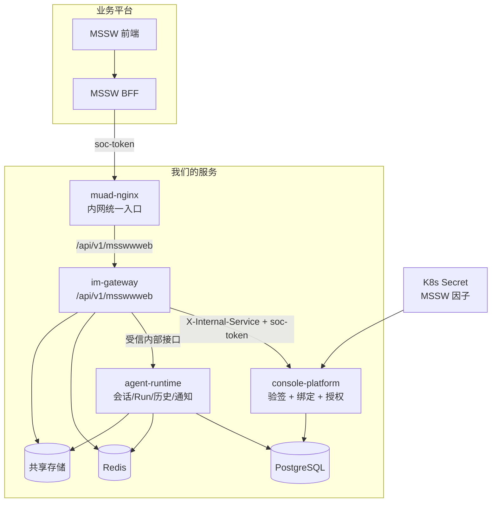
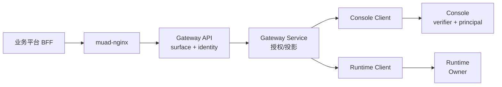
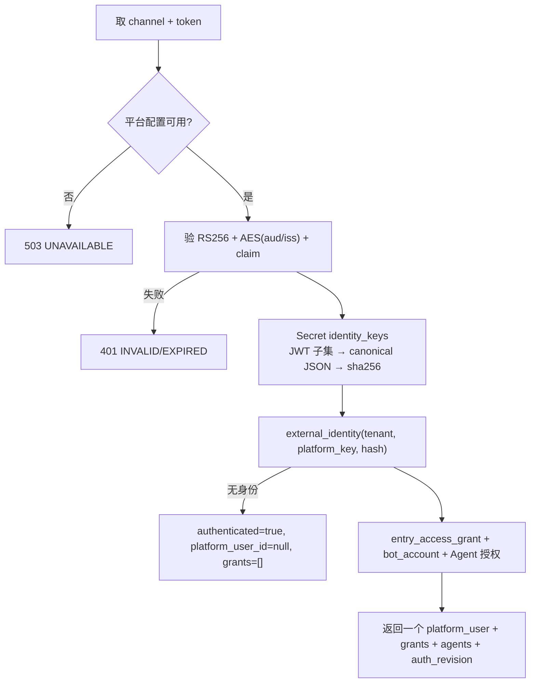

# MSSW 外部 IM 入口 后端设计

> **文档编号**: MOD-MSSW-IM-1.0
> **文档版本**: v1.2
> **创建日期**: 2026-11-13
> **文档状态**: 设计评审中

**评审边界说明**:
- **需求评审**: 第 2 章 → 通过后锁定需求基线
- **设计评审**: 第 3-4 章 → 通过后锁定设计基线
- **交接契约**: 2.5 验收条件 — 需求定义 What，设计实现 How

**ID 体系**: US（来自 PRD）、FEAT、API、RULE、TC、RISK、NFR；场景引用 `mssw-external-im-channel.scenarios.md` 的 S-/E-/B-。

---

## 1. 文档控制

### 1.1 责任人

| 角色 | 姓名 | 职责范围 |
|------|------|---------|
| 产品经理 | fluxion-harness | 需求定义、业务验收 |
| 开发负责人 | fluxion-harness | 技术方案、代码实现 |
| 测试负责人 | fluxion-harness | 测试策略、质量保证 |

### 1.2 修订历史

| 版本 | 日期 | 作者 | 变更描述 |
|------|------|------|---------|
| v0.1 | 2026-11-13 | fluxion-harness | 初始设计：MSSWWEB 通道、外部断言、直绑、通知未读 |
| v1.1 | 2026-11-13 | fluxion-harness | 对齐修正：用户级外部身份 + 入口授权；user+Agent 跨入口共享；`/identity` PG + Redis 认证缓存；resume 保留确认动作 |
| v1.2 | 2026-11-13 | fluxion-harness | 复审修订：同步失效与回填隔离、凭证/权限分层、平台配置版本、现有 WebChat 前后端适配、Run 来源、可获取的通知水位、SSE 分片协议及匹配索引 |

---

## 2. 需求分析

### 2.1 需求概述

| 项目 | 内容 |
|------|------|
| **模块名称** | MSSW 外部 IM 入口（MSSWWEB） |
| **模块ID** | MOD-MSSW-IM |
| **所属系统/产品线** | IM Gateway + Console Platform + Agent Runtime |
| **需求类型** | 新功能（外部平台接入） |
| **业务背景** | MSSW 业务平台在自己的页面内提供“MSS 智能机器人”，前端由业务平台负责，后端经 BFF 转发到我们。现有 WebChat 只支持 Cookie 会话与独立 Console 页面。 |
| **核心目标** | 纯后端提供 MSSWWEB 入口：`soc-token` 验签、用户级身份 + 入口授权、对话/SSE/上传/产物；同用户同 Agent 跨入口共享，entry/channel 只做来源标识；并沉淀未来同类平台的接入规范。 |

### 2.2 痛点与价值

| 维度 | 内容 |
|------|------|
| **目标用户** | MSSW 业务用户；MSSW BFF；Console 管理员；后续接新平台的研发/运维。 |
| **当前问题** | 业务平台无法复用 WebChat：Cookie 不能跨平台携带，业务用户没有 CHAT Token；入口/认证在代码中与 `WEBCHAT` 耦合。 |
| **业务影响** | 业务平台需要自建会话/SSE/附件/身份映射，成本高且与我们的历史割裂。 |
| **预期价值** | 业务用户不离开工作台即可用 Agent；未来 MSSP 只加配置与入口，不复制 handler。 |

### 2.3 功能方案

| 功能ID | 功能名称 | 说明 | 优先级 | 来源 |
|--------|---------|------|--------|------|
| FEAT-01 | MSSWWEB 通道与 surface | `ChatSurface` 抽象；同一套 router/service 按 channel 挂载；执行面复用 | P0 | US-01/02/03 |
| FEAT-02 | 外部断言认证 | Console 验 `soc-token`；因子放 K8s Secret；Gateway 只转发 | P0 | US-01/07 |
| FEAT-03 | 用户级身份与入口授权 | `external_identity` + `entry_access_grant`；平台级 `identity_keys`；解绑只删 grant；编辑/重绑保留历史 | P0 | US-06/10/11 |
| FEAT-04 | 权限/入口可用接口 | `GET /identity` 返回 `allowed/reason` + `grants`；PG + Redis | P0 | US-06 |
| FEAT-05 | 对话闭环 | 入口/会话/消息/历史/SSE/取消/恢复 | P0 | US-01/02/03 |
| FEAT-06 | 最近会话与红点未读 | 复用通知未读；列表 `has_unread`；会话级 mark-read | P0 | US-03/04 |
| FEAT-07 | 上传与产物 | 复用上传/产物发布/下载；`MSSWWEB` 进站内流能力组 | P0 | US-05 |
| FEAT-08 | 来源标识与共享数据 | entry/channel 只做来源；同用户同 Agent 跨入口共享；不同用户隔离 | P0 | US-07 |
| FEAT-09 | 协议与规范文档 | 内部 `docs/operations/im-channel-playbook.md` + 外部 `docs/operations/bff-agent-integration.md` | P0 | US-08/09 |
| FEAT-10 | 运维配置降级 | Secret 缺失/损坏只影响 MSSWWEB 鉴权 | P0 | US-07 |
| FEAT-11 | Console 管理面 | MSSWWEB 入口创建、平台状态、用户级身份/入口授权 | P1 | US-06 |
| FEAT-12 | 确认与 resume | `confirmation.required` 展示后调用 resume；同一 Run 继续；Agent 授权边界 | P0 | US-12 |

### 2.4 范围与边界

| 类别 | 内容 |
|------|------|
| **范围（In Scope）** | MSSWWEB 通道；外部断言认证；身份/入口授权；同步缓存失效；对话/SSE/上传/产物；现有 WebChat 前后端的共享列表与跨入口续聊；后台来源追踪；通知水位已读；Secret 降级及配置版本；管理 API/UI；两份接入文档。 |
| **非范围（Out of Scope）** | MSSP 实现；业务平台前端/BFF；通知中心/通知 SSE/消息级未读；Agent prompt 效果；文件预览扩展；密钥热更新；多租户单部署。 |
| **前置假设** | MSSW 提供真实因子与测试 token；AES-ECB 派生可复现；`login-source=mssw`；单租户部署；BFF 支持 SSE 透传。 |
| **有意妥协 / 技术债** | 未读沿用通知口径；配置通过维护窗口激活，不热更新；第一版授权变更以租户级短暂屏障串行化，正常读请求不串行。屏障期间返回可重试的不可用，不能放行旧授权。 |

### 2.5 验收条件

#### 2.5.1 业务规则与约束

| ID | 类型 | 描述 | 验证场景 |
|----|------|------|---------|
| RULE-01 | 认证 | 只接受 `soc-token` 请求头；Cookie/Authorization 不参与 | E-01 |
| RULE-02 | 认证 | 验签只在 Console；Gateway 不持因子 | S-03 / E-03 |
| RULE-03 | 绑定 | 绑定 JSON 多字段 AND；按 (`tenant`,`platform_key`,`identity_hash`) 查用户级身份；未绑定不可用 | S-02 / E-02 |
| RULE-04 | 数据边界 | 同用户同 Agent 跨入口共享；不同用户隔离；entry/channel 只做来源 | E-04 |
| RULE-05 | 未读 | 红点 = 该会话未读 `channel_notification`；用户级共享；mark-read 带水位 | S-05 |
| RULE-06 | 降级 | 因子缺失/损坏只影响 MSSWWEB，返回 503；不影响启动与其他通道 | E-03 |
| RULE-07 | 安全 | `soc-token`/salt/公钥不进日志、审计、响应 | E-01 / E-03 |
| RULE-08 | 复用 | 复用 `muad_contracts.webchat`；WebChat Cookie 认证保留，授权刷新、共享列表和跨入口续聊同步修正 | S-03 / S-11 / E-05 |

#### 2.5.2 功能验收场景

> 场景唯一源：`mssw-external-im-channel.scenarios.md`。下表只列设计影响。

| 场景ID | 设计影响 / 备注 |
|--------|----------------|
| S-01 | 管理员创建 MSSWWEB 入口；无 secret、平台状态、`LOCAL_STREAM_CHANNELS` |
| S-02 | 管理员创建用户级外部身份并授权/解绑入口；Console API + UI |
| S-03 | 完整对话；Console 验签、Gateway surface、Runtime 会话/SSE |
| S-04 | 停止生成；复用 Run cancel |
| S-05 | 用户+Agent 最近会话 + 红点；通知未读聚合 + 水位 mark-read |
| S-06 | 上传/产物；本地流发布 + 下载 |
| S-07 | 删除会话；用户级软删、含 tombstone、幂等；不按 entry 断言 |
| S-08 | 解绑后重绑；历史会话/产物恢复、可新建对话 |
| S-09 | 编辑外部身份 JSON；值更新、历史保留、key 集合不可改 |
| S-10 | 确认动作 + resume；同一 Run 继续，Agent 撤权拒绝 |
| S-11 | 同用户同 Agent 跨入口共享；WebChat/MSSWWEB 互相可见；不同用户 404 |
| E-01 | 无效/缺失 token；401，不泄露细节 |
| E-02 | 无外部身份；`/identity` 200 allowed=false，资源 403/404；不伪造主体 |
| E-03 | Secret 缺失/损坏；503，其他通道正常 |
| E-04 | 同用户同 Agent 跨入口共享；不同用户 404 |
| E-05 | Agent 授权撤销；入口隐藏、按 ID 403 |
| E-06 | 重复发送；幂等 |
| E-07 | 长流期间 Agent 撤权/用户停用；复核边界内结束；仅 entry 解绑不中断 |
| E-08 | SSE 断线重连；Last-Event-ID |
| E-09 | 公钥轮换；单公钥替换 + 维护窗口 |
| E-10 | Redis 缓存 revision 失效/不可用；降级 Console |
| E-11 | Agent 撤权后 resume 拒绝；取消仍可用 |
| B-01 | 空会话列表；首次发送创建 |
| B-02 | `exp=-1` + 最大会话年龄 |
| B-03 | 文本 65536 边界 |
| B-04 | 上传大小/类型边界 |

#### 2.5.3 非功能指标

| 指标ID | 类型 | 目标 | 测量 |
|--------|------|------|------|
| NFR-PERF-01 | 性能 | 分别测量首次验签、缓存命中、失效回源与混合负载的 p50/p95/p99；未测量前不承诺时延数值 | 容量 profile + 认证分阶段指标 |
| NFR-PERF-02 | 性能 | SSE 不按增量查控制面；上传不按分片 | 代码审查 + 指标 |
| NFR-SEC-01 | 安全 | 因子只在 Console Secret；token 不落日志/审计/响应 | 脱敏测试 |
| NFR-REL-01 | 可用性 | 缺配置不影响启动与其他通道 | 降级用例 |
| NFR-COMPAT-01 | 适配 | WebChat 登录与现有能力回归；共享列表/续聊采用本次新契约；MSSP 复用平台配置与入口机制 | 回归 + 设计评审 |

#### 2.5.4 验证环境假设

| 维度 | 假设 | 验证方式 | 不满足时 |
|------|------|---------|---------|
| 容量 | 单入口、单 Agent、少量并发（聊天场景） | 手工 + 集成测试 | 记录缺失项与 owner |
| 硬件 | 本地/CI 单机；生产为现有 K8s 单元 | 人工检查 | 记录 |
| 依赖 | MSSW 测试 token + 四因子；Redis/Postgres/共享存储 | 人工检查 | 阻塞联调 |
| 测试预算 | Task 只跑相关 unit/integration；全量/E2E 在 CI | 任务文档声明 | 记录未覆盖风险 |

---

## 3. 技术设计

### 3.1 方案选型

| 决策点 | 选择 | 被否决项 | 理由 | 可逆性 |
|--------|------|---------|------|--------|
| 验签位置 | Console | Gateway 本地验签 | Gateway 不持库/不持因子；Console 是身份权威；轮换集中 | 易 |
| 因子存储 | K8s Secret → Console env | DB 表/页面配置 | 因子不变；避免页面回显与 DB 明文；符合现有 Secret 注入 | 易 |
| 身份模型 | 用户级外部身份 + 入口授权 | 按入口建身份/按入口 schema | 一个外部身份 → 一个 platform_user；entry 只是授权/展示；解绑不丢主体 | 中 |
| 数据共享 | user + agent 跨入口共享 | 按 entry/channel 做数据隔离 | 同一用户同 Agent 的会话/产物/通知共享；entry/channel 只做来源标识 | 中 |
| 平台维度 | `channel=MSSWWEB`，Secret 内 `platform_key=mssw`；平台元数据放 Secret/ConfigMap | 把 channel 当身份边界 | MSSP 未来加平台+入口；身份不随入口变化 | 中 |
| 未读 | 复用 `channel_notification.read_at` | 新增消息级未读 | 通知用户级共享；红点=终态通知；mark-read 带水位 | 易 |
| 入口抽象 | `ChatSurface` + 参数化 service + 单 router 多挂载 | 复制 15 个 handler | 未来加平台不改 handler | 易 |
| 通知路由 | MSSW 不暴露通知中心；WebChat 展示同用户全部通知 | 按 channel 过滤成两个收件箱 | 数据共享；通知不是安全边界 | 易 |
| 认证缓存 | 凭证与权限分层；`/identity` 永远 PG/Console；资源 Redis-first；权限版本 + 同步失效屏障 | 仅 DEL；依赖 TTL；把授权冻结在登录缓存 | 热路径不查 PG；撤权后旧响应不能回填；Agent 撤权不销毁有效登录 | 中 |
| JWT 库 | PyJWT（RS256/aud/iss/leeway）+ cryptography（AES-ECB） | 手写 JWT 解析 | 标准库处理 claim 校验，减少安全错误 | 易 |
| 数据变更 | 身份/入口授权表、授权同步状态、用户权限版本、会话来源列、查询匹配索引 | 复用按入口身份表；仅追加字段而不修授权链路 | 每个事实有明确所有者；配置因子仍不落库 | 中 |

#### 技术栈

| 类别 | 选型 | 版本 | 理由 |
|------|------|------|------|
| 语言 | Python | 3.12 | 现有 |
| 框架 | FastAPI | 现有 | 现有 |
| 数据库 | PostgreSQL | 现有 | 现有 |
| 中间件 | Redis | 现有 | 会话/流/通知 |
| JWT | PyJWT | 2.x | 外部断言验签；不用于我们自己的会话 |
| 加密 | cryptography | 现有 | AES-ECB `aud/iss` |

#### 3.1.1 2026-11-13 对齐结论（本设计最终口径）

1. **身份是用户级的**：一个外部 JWT 身份 → 一个 `platform_user`；入口只是授权/展示，不参与身份唯一性。一个用户可以有多个入口。
2. **数据按 user + Agent 共享**：同一用户、同一 Agent 的会话/产物/通知跨 WebChat/MSSWWEB 可见；entry/channel 只做来源标识，不做数据隔离。**数据共享不等于实时广播**：Run 的 SSE 按 `run_id` 订阅；非发起方需刷新/重开会话，若 Run 仍 active 才能订阅同一 `run_id` 补流；已完成则读历史。本期不推送 `run.started`。
3. **入口权限与用户身份分离**：`external_identity`（用户级）+ `entry_access_grant`（入口授权）；解绑只删 grant，身份保留，清理能力闭合。
4. **平台级身份 schema**：`identity_keys` 属于平台，放平台 Secret/ConfigMap，不建元数据表；不是每个入口一套；绑定 JSON 多字段 AND。
5. **认证缓存**：`/identity` 永远查 Console/PG；凭证与当前权限分层缓存；解绑/撤权成功前删除对应权限缓存，并阻止旧回源结果再次写入；TTL 不提供撤权保证。WebChat 与 MSSWWEB 共用权限层。
6. **resume 不是清理**：要求用户 ACTIVE + 当前 Agent 授权；entry 不是边界；Agent 撤权默认拒绝。
7. **不做 IM 通道数据隔离**：不再按 entry/channel 对按 ID 资源做 404 断言；不同用户才隔离。
8. **来源保留在后台**：会话来源是创建时入口；每个 Run 来源是本次实际入口；通知/交付跟随来源 Run。页面不强制增加来源标签，来源不参与共享资源授权。
9. **立即失效的边界**：管理端成功响应前完成失效；其后新认证决策不能使用旧授权。既有长流收到通知后重查，且有截止时间兜底；缓存删除不等于撤销已受理 Run 的执行快照或回滚已经发生的副作用。

**评审项 A-03 / A-06 / D-04 定稿**

| 项 | 最终口径 |
|---|---|
| A-03 通知 | 同用户通知共享；WebChat 可看 MSSW 通知；MSSW BFF 可不展示通知中心；不做后端五路径过滤；如需分渠道展示，呈现层过滤 |
| A-06 删除/停用清理 | 删除走用户级 `ConversationDeletionService`，含 tombstone、幂等；不预解析、不按 entry/channel 断言；入口停用不影响清理 |
| D-04 跨通道产物 | 同用户同 Agent 的产物跨入口复用允许；不做数据域隔离；未来要严格隔离另立需求 |

### 3.2 架构设计



#### 技术分层



#### 外部依赖清单

| 外部系统 | 依赖类型 | 协议 | 超时 | 降级策略 |
|---------|---------|------|------|---------|
| MSSW 平台 | JWT 签发方 | RS256 JWT | — | 验签失败 401；配置缺失 503 |
| Console | 内部身份解析 | HTTP JSON | 现有 5s | 不可达 → 503（MSSWWEB） |
| Runtime | 会话/历史/通知 | HTTP JSON/SSE | 现有 | 沿用现有错误映射 |

### 3.3 数据设计

**Console 拥有身份与授权事实，Runtime 拥有会话与通知；缓存不形成第二份权限权威。以下为待实现的数据变更，不表示已迁移。**

| 表 | 用途 | 本次变更 |
|---|---|---|
| `control.external_identity` | 用户级外部身份：platform_key、identity_json、identity_hash、platform_user_id | 新表；唯一 `(tenant, platform_key, identity_hash)` |
| `control.entry_access_grant` | 外部身份 → 入口授权 | 新表；唯一 `(tenant, external_identity_id, bot_account_id)` |
| `control.auth_cache_sync_state` | 授权变更与平台配置激活的持久恢复状态 | 新表；租户级协调行记录 operation_id、阶段、影响范围；平台状态记录非密 policy_epoch/可用性，不存因子 |
| `control.bot_account` | MSSWWEB 入口（无 secret） | 仅新增数据行；`bot_id` 是入口标识，不参与身份 |
| `control.channel_identity` | WECOM/WebChat 旧模型 | 不改；MSSWWEB 不使用 |
| `runtime.conversation` | 会话 | 新增 `channel` 来源列；归属仍是 user+agent |
| `runtime.channel_notification` | 通知未读 | 复用；新增未读索引；mark-read 带水位 |
| `control.platform_user` | 用户权限版本 | 新增单调 `auth_revision`；权限/状态变更与版本递增在同一 PG 事务 |
| `control.agent_access_grant` | Agent 授权 | 结构不变；grant/revoke 接入统一失效流程；Agent 反查复用现有索引 |
| `runtime.channel_upload` | 上传暂存 | 无变更 |

**身份模型**

- `external_identity` 是**用户级**的：一个外部 JWT 身份 → 一个 `platform_user`；不按入口复制。
- `entry_access_grant` 只表达“这个外部身份能用哪些入口”；解绑只删 grant，不删外部身份，所以清理/取消仍有主体。
- 平台级 `identity_keys` 定义绑定 JSON 的字段集合（如 `["expert_id","tenant_id"]`）；放平台 Secret/ConfigMap，不建元数据表；绑定/编辑必须同 key 集合，多字段 **AND**。
- 认证：用平台 `identity_keys` 从 JWT 取值 → 规范 JSON → `sha256` → 查 `(tenant, platform_key, identity_hash)`；**一次 hash、一次索引查询**，不扫用户表。
- 索引：
  - `external_identity`：唯一 `(tenant_id, platform_key, identity_hash) WHERE is_deleted=false`。
  - `external_identity`：`(tenant_id, platform_user_id) WHERE is_deleted=false`，支撑用户详情与权限集合查询。
  - `entry_access_grant`：唯一 `(tenant_id, external_identity_id, bot_account_id) WHERE is_deleted=false`；按 `external_identity_id` 查 grants。
  - `entry_access_grant`：`(tenant_id, bot_account_id, external_identity_id) WHERE is_deleted=false`，支撑入口停用/删除时反查受影响用户。
  - 协调状态以 `(tenant_id, scope_type, scope_id)` 唯一；scope 为租户协调或平台配置状态，不以原始 token/身份明文作键。
- `bot_id` 只作入口标识/展示；不参与身份唯一性；可修改不影响身份。
- **解绑/重绑**：解绑只删 grant；外部身份保留。重绑同一入口后，历史会话/产物仍归同一 `platform_user`，可查看/下载/新建会话。
- **编辑身份**：编辑 `external_identity.identity_json`；影响其名下所有入口授权；历史不变；冲突按平台唯一键。
- 未绑定：验签成功但没有 `external_identity`；`/identity` 返回 `allowed=false`、不返回 `platform_user_id`；资源接口拒绝，不伪造 `ChatIdentity`。

**Secret 配置（非 DB）**

```json
{
  "mssw": {
    "channel": "MSSWWEB",
    "public_key": "-----BEGIN PUBLIC KEY-----\n...\n-----END PUBLIC KEY-----",
    "issuer": "<plaintext>",
    "audience": "<plaintext>",
    "salt": "<AES key material>",
    "identity_keys": ["expert_id", "tenant_id"],
    "login_source": "mssw"
  }
}
```

精简原则：

- **对象 key = `platform_key`**（`mssw`）；不再单独写 `platform_key` 字段，也不再包一层数组。
- **算法固定 `RS256`**，不配置；`none`/HS* 一律拒绝。
- **单公钥 `public_key`**：轮换必须先关闭该平台认证并失效缓存，再替换、重启、核对版本、重新激活；不做多公钥数组。
- **`login_source` 可选**：写了就校验签名 claim 必须相等；不写就不校验。
- **`identity_keys` 直接放 Secret**：与验签因子同一份平台配置；它不是密钥，但当前开发阶段无存量数据，放一起最简单，不建元数据表。
- **`configured=false`**：用一个非密平台 key 列表（ConfigMap `EXTERNAL_PLATFORM_KEYS=mssw` 或静态已知列表）判断 Secret 是否缺失；不落库。
- **`max_session_age_sec` 不进 Secret**：非敏感，放全局 `EXTERNAL_ASSERTION_MAX_SESSION_AGE_SEC`（ConfigMap/设置），所有外部平台共用；MSSP 如需独立值再加。
- **`enabled` 不配**：可用性来自有效配置与已激活的配置版本；Secret 删除/损坏并被服务加载后，该平台保持不可用。未热更新的进程不会自动感知 Secret 环境变量变化。
- 不配 `app_id` 白名单；需要时以后加 `app_id` 单字段，不预埋空数组。
- 加载时构建两个索引：`by_platform_key` 与 `by_channel`；API-16 用 `channel` 找配置，API-17 用 `platform_key` 展示。

**会话列表及未读查询**

```sql
-- 会话列表页：只判 has_unread（有界 EXISTS）
WITH page AS (
  SELECT c.* FROM runtime.conversation c
  WHERE c.tenant_id = :tenant AND c.user_id = :user AND c.agent_id = :agent
    AND c.is_deleted = false
  ORDER BY c.last_message_at DESC NULLS LAST, c.id DESC
  LIMIT :page_size OFFSET :offset
)
SELECT c.id,
       EXISTS (
         SELECT 1 FROM runtime.channel_notification n
         WHERE n.tenant_id = :tenant
           AND n.user_id = :user
           AND n.conversation_id = c.id
           AND n.read_at IS NULL
           AND n.is_deleted = false
       ) AS has_unread
FROM page c
ORDER BY c.last_message_at DESC NULLS LAST, c.id DESC;
```

确定纳入迁移的查询索引（名称与模型、migration 保持一致）：

```sql
CREATE INDEX ix_channel_notification_user_conversation_unread
ON runtime.channel_notification (tenant_id, user_id, conversation_id, seq)
WHERE read_at IS NULL AND is_deleted = false;

CREATE INDEX ix_conversation_tenant_user_agent_last_message
ON runtime.conversation
  (tenant_id, user_id, agent_id, last_message_at DESC NULLS LAST, id DESC)
WHERE is_deleted = false;

CREATE INDEX ix_external_identity_tenant_user
ON control.external_identity (tenant_id, platform_user_id)
WHERE is_deleted = false;

CREATE INDEX ix_entry_access_grant_tenant_entry_identity
ON control.entry_access_grant (tenant_id, bot_account_id, external_identity_id)
WHERE is_deleted = false;
```

- 现有 `(tenant_id,user_id,seq) WHERE read_at IS NULL` 对“按会话 EXISTS”不够匹配；用上面的索引，避免按用户未读积压扫描。
- `has_unread` 只判存在，不 `COUNT(*)`；mark-read 也按同一索引更新。
- 现有 conversation 的 `update_time` 索引排序不同；另一条索引把 `channel_account_id` 放在 Agent 前，不能完整服务本次跨入口排序。新增会话索引匹配筛选、NULL 顺序与同时间的稳定排序。
- Agent 反查已有 `ix_agent_access_grant_agent_user`，不重复添加；经用户表 join 限定租户。身份/授权唯一索引仍按上文创建，不能被普通查询索引替代。
- 在隔离库执行 EXPLAIN (ANALYZE, BUFFERS)：多入口、大量历史、相同/NULL 活动时间、深分页、小未读/大积压/软删残留；检查排序、扫描行数和缓冲读取。小表走顺序扫描不直接判失败。
- 新表的索引随建表创建；存量 Runtime 大表使用受控迁移或事务外并发建索引，检查有效性；不在应用启动时执行 DDL。迁移测试比较模型与实际索引列顺序、方向及谓词。

**容量预估**

| 维度 | 预估值 |
|---|---|
| 入口数 | 单 Agent 1 个 MSSWWEB 入口 |
| 未读行数 | 每用户少量（终态/等待/任务结果） |
| 绑定数 | 每用户少量入口 |

### 3.4 接口设计

> **URL 口径**：WebChat 与 MSSWWEB **不共用公开 URL**。共用的是 handler/service/contracts；URL 与认证面分开（`/api/v1/webchat` 用 Cookie + `X-Chat-Context`，`/api/v1/msswwweb` 用 `soc-token`），避免两种认证面混用，也避免 BFF 触达 WebChat 资源。视图层不共用：业务平台前端由业务平台负责，我们的 Console WebChat 页面仍是 WebChat-only。
>
> **公开面完整协议**：`/api/v1/msswwweb` 的逐接口请求参数、响应参数、示例与错误码见 `docs/operations/bff-agent-integration.md`；本文只保留新增/差异接口与内部面，避免两份文档重复漂移。内部新增通道步骤见 `docs/operations/im-channel-playbook.md`。

#### 接口清单

**Gateway 公开面（`/api/v1/msswwweb`）**

| 接口ID | 名称 | 方法 | 路径 | 说明 |
|--------|------|------|------|------|
| API-01 | 权限/入口可用 | GET | `/identity` | 永远查 PG；返回用户级主体 + grants + allowed/reason；成功后写 Redis |
| API-02 | 客户端配置 | GET | `/client-config` | 复用 |
| API-03 | 入口列表 | GET | `/entries` | 当前用户可用的入口授权 + Agent |
| API-04 | 创建会话 | POST | `/entries/{entry_id}/conversations` | 入口作为本次会话的来源/展示 |
| API-05 | 用户+Agent 会话列表 | GET | `/conversations?agent_id=` | 跨入口聚合；item 带来源 `entry_id`/`channel`/`has_unread` |
| API-06 | 提交消息 | POST | `/entries/{entry_id}/messages` | 入口作为本次 Run 的来源 |
| API-07 | 会话详情 | GET | `/conversations/{id}` | user+agent 核属；不做 entry/channel 断言 |
| API-08 | 删除会话 | DELETE | `/conversations/{id}` | user 级；沿用现有幂等 delete |
| API-09 | 历史消息 | GET | `/conversations/{id}/messages` | user+agent；不做 entry/channel 断言 |
| API-10 | 会话已读 | POST | `/conversations/{id}/read` | 带通知水位；只标已看到 |
| API-11 | 上传附件 | POST | `/entries/{entry_id}/attachments` | 入口作为来源 |
| API-12 | 取消 Run | POST | `/runs/{run_id}/cancel` | user 级 |
| API-13 | 恢复 Run | POST | `/runs/{run_id}/resume` | user+agent；入口不是边界 |
| API-14 | Run SSE | GET | `/runs/{run_id}/events` | user+agent；复核到期/授权 |
| API-15 | 产物下载 | GET | `/artifacts/{id}/content` | user+agent；不做 channel 断言 |

**Console 内部/管理面**

| 接口ID | 名称 | 方法 | 路径 | 说明 |
|--------|------|------|------|------|
| API-16 | 外部身份解析 | POST | `/internal/channel/external-principal` | 用户级身份 + grants；未绑定返回 `platform_user_id=null` |
| API-17 | 平台状态 | GET | `/api/v1/external-platforms` | 平台元数据 + configured；不返回因子 |
| API-18 | 创建/更新外部身份 | PUT | `/api/v1/users/{user_id}/external-identities` | ADMIN；`{platform_key, identity}` |
| API-19 | 可绑定入口 | GET | `/api/v1/external-platforms/{platform_key}/entries` | ADMIN；供入口授权选择 |
| API-21 | 编辑外部身份 | PUT | `/api/v1/users/{user_id}/external-identities/{identity_id}` | ADMIN |
| API-22 | 授权入口 | POST | `/api/v1/users/{user_id}/external-identities/{identity_id}/grants` | ADMIN；`{channel_account_id}` |
| API-23 | 解绑入口 | DELETE | `/api/v1/users/{user_id}/external-identities/{identity_id}/grants/{entry_id}` | ADMIN；只删 grant |
| API-24 | 外部身份列表 | GET | `/api/v1/users/{user_id}/external-identities` | ADMIN；身份 + grants |

**Runtime 内部**

| 接口ID | 名称 | 方法 | 路径 | 说明 |
|--------|------|------|------|------|
| API-20 | 会话已读 | POST | `/internal/webchat/conversations/{id}/read` | 服务身份；带水位 |
| API-25 | 用户+Agent 会话列表 | GET | `/internal/webchat/conversations?agent_id=` | 用户级聚合；来源字段 |
| API-26 | 授权同步状态（ADMIN） | GET | `/api/v1/auth-cache-sync` | 当前租户同步状态与可安全展示的操作摘要 |
| 既有 | 会话详情 | GET | `/internal/webchat/conversations/{id}` | 同快照返回 `last_seq`、active_run 与 `notification_through_seq` |

---

#### API-01: `GET /api/v1/msswwweb/identity`

**请求**

| 参数 | 类型 | 必填 | 说明 |
|------|------|------|------|
| `soc-token` | header | 是 | MSSW JWT |
| `entry_id` | query UUID | 否 | 指定入口则返回该入口的 allowed/reason |

**响应示例**

```json
{
  "authenticated": true,
  "platform_user_id": "uuid",
  "external_identity_id": "uuid",
  "platform_key": "mssw",
  "allowed": true,
  "reason": null,
  "grants": [
    {
      "entry_id": "uuid",
      "agent_id": "uuid",
      "entry_name": "MSS 智能机器人",
      "channel": "MSSWWEB",
      "allowed": true,
      "reason": null
    }
  ],
  "auth_revision": 7
}
```

- 未绑定：`platform_user_id=null`、`external_identity_id=null`、`grants=[]`、`allowed=false`、`reason=UNBOUND`。
- `entry_id` 指定时只影响顶层 `allowed/reason`，不改变用户级主体。

**错误码**

| code | HTTP | 场景 |
|------|------|------|
| `EXTERNAL_ASSERTION_INVALID` | 401 | 缺失/签名错/格式错/claim 不匹配 |
| `EXTERNAL_ASSERTION_EXPIRED` | 401 | 正数 exp 过期或超过最大年龄 |
| `EXTERNAL_ASSERTION_UNAVAILABLE` | 503 | 平台未配置/配置坏 |
| token 有效但用户停用 | 200 | `allowed=false, reason=USER_DISABLED` |
| token 有效但无外部身份 | 200 | `allowed=false, reason=UNBOUND`；不伪造主体 |

**处理逻辑**：Gateway 取 `soc-token` → Console 按当前平台配置验签并查 PG → 返回主体、权限版本、配置版本及权限集合 → 按下文屏障协议写凭证/权限两层缓存。回填失败若源于版本或屏障变化，必须丢弃整份旧响应后重查，不能用未成功回填的旧主体直接放行。未绑定结果第一版不缓存。

---

#### API-10: `POST /api/v1/msswwweb/conversations/{id}/read`

**请求**：`soc-token` header；body `{ "through_seq": 123 }`。这里是会话详情返回的 `notification_through_seq`，属于用户通知 feed 序号，不能使用 `last_seq`、历史 `through_seq` 或 SSE id 替代。

**响应**

```json
{ "conversation_id": "uuid", "read_count": 3, "read_at": "2026-11-13T10:00:00Z" }
```

**处理逻辑**：按 `(tenant,user,conversation)` 核属 → Runtime 按同一范围 UPDATE `seq <= through_seq AND read_at IS NULL AND is_deleted=false`；幂等，零更新成功；晚到通知保留未读。先校验非负整数及不超过当前用户已提交 feed 水位，超前返回 `CURSOR_AHEAD`；不保存一个会自动吃掉未来通知的已读上限。

**水位获取协议（现有会话详情扩展，不新增通知中心）**：

1. `GET /conversations/{id}` 在一个短的只读一致性快照中返回 `last_seq=C`、`active_run`/确认信息，以及 `notification_through_seq=N`。N 是该用户该会话快照内最大未读通知 seq，无未读为 0；走会话未读索引反向取首条，不扫全用户 feed。
2. BFF/WebChat 取历史时从第一页就传 `through_seq=C`，后续页沿用 C；显示该快照对应的消息、确认和结果提示后，才提交 `{through_seq:N}`。会话级已读表示用户打开并查看该次会话状态，不是逐条消息滚动曝光统计。
3. C 与 N 分属两套序号；它们只作为同一次详情视图的配对水位使用，不能互相比较。刷新出的新 N 必须配合其对应的新视图，不能配旧正文直接标读。
4. 终态/待确认/Task 结果通知必须与其 canonical 回执在同一事务提交；覆盖三种通知的快照一致性测试。并发完成在快照之后产生的通知，即使请求标读时已经存在，也因 seq>N 保持未读。
5. SSE 完成或进入待确认后，如需清红点，重新取一轮详情与对应历史再提交已读；不能把刚收到的 SSE seq 填给本接口。

**错误码**：`COMMON_NOT_FOUND`（非本主体/不同用户/资源不存在）、`EXTERNAL_ASSERTION_*`。

---

#### API-16: `POST /internal/channel/external-principal`

**请求**

| 参数 | 类型 | 必填 | 说明 |
|------|------|------|------|
| `X-Internal-Service` | header | 是 | 服务身份 |
| `X-Tenant-Id` | header | 是 | 部署租户 |
| `channel` | body | 是 | `MSSWWEB` |
| `soc_token` | body SecretStr | 是 | 原始 JWT，不落日志 |
| `entry_id` | body UUID | 否 | 可选；预筛选 |

**响应**

```json
{
  "authenticated": true,
  "platform_user_id": "uuid-or-null",
  "external_identity_id": "uuid-or-null",
  "expires_at": "2026-11-14T10:00:00Z",
  "platform_key": "mssw",
  "identity": {"expert_id": "E123", "tenant_id": "1001"},
  "grants": [
    {"entry_id": "uuid", "agent_id": "uuid", "entry_name": "...", "channel": "MSSWWEB", "allowed": true, "reason": null}
  ],
  "agents": [{"agent_id": "uuid", "key": "agent-x", "name": "Agent X"}],
  "auth_revision": 7,
  "policy_epoch": "opaque-policy-version"
}
```

- 未绑定：`platform_user_id=null`、`external_identity_id=null`、`grants=[]`；**不构造 `ChatIdentity`**，`/identity` 返回 `allowed=false` + `UNBOUND`，资源接口 403/404。
- 已绑定：一个 `platform_user_id`；grants 是该用户名下入口授权。
- `auth_revision` 来自 `control.platform_user.auth_revision`；`policy_epoch` 来自该平台激活状态。两者和内部 `cache_fence` 一并参与缓存校验；`cache_fence` 只供服务端使用，不返回 BFF。

**错误码**：401 `EXTERNAL_ASSERTION_INVALID/EXPIRED`；403 租户不符/用户停用；503 `EXTERNAL_ASSERTION_UNAVAILABLE`。

**处理逻辑**



---

#### API-17: `GET /api/v1/external-platforms`

**响应**

```json
{
  "items": [
    {
      "platform_key": "mssw",
      "channel": "MSSWWEB",
      "configured": true,
      "identity_keys": ["expert_id", "tenant_id"],
      "login_source": "mssw"
    }
  ]
}
```

平台元数据来自 Secret（`platform_key`/`channel`/`identity_keys`）；`configured` 表示 Secret 中是否有该平台。不返回公钥、salt、issuer/audience。非密平台 key 列表（ConfigMap/静态列表）用于 Secret 缺失时仍能显示 `configured=false`；不落库。

---

#### API-18: `PUT /api/v1/users/{user_id}/external-identities`

**请求**

```json
{
  "platform_key": "mssw",
  "identity": {"expert_id": "E123", "tenant_id": "1001"}
}
```

**响应**

```json
{
  "id": "uuid",
  "platform_key": "mssw",
  "channel": "MSSWWEB",
  "platform_user_id": "uuid",
  "identity": {"expert_id": "E123", "tenant_id": "1001"},
  "identity_keys": ["expert_id", "tenant_id"],
  "auth_revision": 7,
  "grants": []
}
```

**校验**：ADMIN；租户取登录账号；`identity` 必须是 JSON 对象，至少 1 个键；值为非空字符串；key 集合必须与平台 `identity_keys` 完全一致，否则 `IDENTITY_KEYS_MISMATCH`；拒绝 `exp`/`aud`/`iss`/`iat`/`nbf`。按规范 JSON 算 `identity_hash`；`(tenant, platform, identity_hash)` 已存在且 `platform_user_id` 相同 → 幂等；不同 → `IDENTITY_ALREADY_BOUND`。写 `config_audit_log`。

#### API-21: `PUT /api/v1/users/{user_id}/external-identities/{identity_id}`

**请求**：`{ "identity": {"expert_id": "E456", "tenant_id": "1001"} }`

**响应**：同 API-18（含 grants/auth_revision）。

**校验**：ADMIN；只改身份值，不改 `platform_user`；key 集合必须与平台 `identity_keys` 一致；重算 hash；冲突规则同上；历史会话/产物仍归原 `platform_user`；审计 action=`UPDATE`。

#### API-22: `POST /api/v1/users/{user_id}/external-identities/{identity_id}/grants`

**请求**：`{ "channel_account_id": "uuid" }`

**响应**：`{ "grant_id": "uuid", "entry_id": "uuid", "agent_id": "uuid", "channel": "MSSWWEB", "auth_revision": 8 }`

**校验**：ADMIN；入口同租户、未删除、channel 匹配；同一 `(identity, entry)` 幂等；入口可禁用但返回 allowed=false；写审计。

**并发语义**：bind/edit/grant 按 `(tenant, platform, identity_hash)` 或 `(tenant, identity, entry)` 使用行锁/唯一冲突回读；同用户幂等、异用户 409；无变更不重复审计；审计与业务变更同事务。

#### API-23: `DELETE /api/v1/users/{user_id}/external-identities/{identity_id}/grants/{entry_id}`

只删 grant；外部身份保留；幂等；业务变更、审计与用户版本递增同事务。管理请求成功前必须完成对应权限缓存删除及重新开放屏障，不能异步发个事件就返回成功。

#### API-24: `GET /api/v1/users/{user_id}/external-identities`

**响应**：身份列表 + 每个身份的 grants（entry/agent/channel/allowed/reason），供 Console 用户详情页展示与编辑预填。

---

#### API-19: `GET /api/v1/external-platforms/{platform_key}/entries`

**用途**：入口授权选择；跨 Agent 列出该平台入口。

**Query**：`query`（可选，入口名/Agent 名搜索；SQL 参数化并转义 LIKE 通配符）、`page`、`page_size`（按契约限制）。查询与 total 均限定部署租户、平台及未删除入口；禁用项保留。

**响应**

```json
{
  "items": [
    {
      "entry_id": "uuid",
      "entry_name": "MSS 智能机器人",
      "agent_id": "uuid",
      "agent_name": "Agent X",
      "channel": "MSSWWEB",
      "enabled": true
    }
  ],
  "page": 1,
  "page_size": 20,
  "total": 1
}
```

**校验**：ADMIN；`platform_key` 必须是已注册平台；只返回该平台入口；不返回 secret/config/因子。入口禁用也返回（`enabled=false`）。

---

#### API-20: `POST /internal/webchat/conversations/{id}/read`

**请求**：`user_id` query；body `{ "through_seq": 123 }`；服务身份门控。

**响应**

```json
{ "conversation_id": "uuid", "read_count": 3, "read_at": "2026-11-13T10:00:00Z" }
```

**处理逻辑**：与 API-10 同一通知水位语义；校验水位不超前后按 `(tenant,user,conversation)` 更新，追加 `seq <= through_seq AND read_at IS NULL AND is_deleted=false`；PG `now()`；不碰消息、交付状态或 feed 水位。

---

#### API-25: `GET /internal/webchat/conversations?agent_id=...`

**用途**：用户+Agent 跨入口会话列表；Gateway 的 `GET /conversations?agent_id=` 用它。

**请求**：`tenant`（头）、`user_id`、`agent_id`、`page/page_size`。

**响应**：`WebchatConversationPage`，item 增加 `entry_id`/`channel`/`has_unread`；按 `last_message_at DESC NULLS LAST, id DESC`。

**处理逻辑**：`WHERE tenant,user,agent,is_deleted=false`，不再按 entry 过滤；未读用 EXISTS + 新索引；来源字段来自 `conversation.channel_account_id`/`channel`。

---

#### 3.4.1 代码落点

| 模块 | 文件 | 变更 |
|------|------|------|
| Gateway | `api/webchat.py` | 去掉固定 `prefix`；保留共享资源 handler；把通知三件套移出 |
| Gateway | `api/webchat_notifications.py`（新） | 通知列表/已读/SSE；只在 `/api/v1/webchat` 挂载 |
| Gateway | `api/deps.py` | `ChatSurface`、`get_chat_surface`、身份分支、流复核分支 |
| Gateway | `application/chat_principal.py` | 凭证/当前权限分层；移除缓存 `agents` 直接授权；WebChat 凭证 miss 经 Console 恢复；长流统一 `recheck()` |
| Gateway | `application/external_assertion.py`（新） | `ExternalPrincipalGate`：`/identity` 查 Console/PG 并写 Redis；资源接口 Redis-first + revision；未绑定不构造 `ChatIdentity` |
| Gateway | `application/console_client.py` | 新增 `EXTERNAL_PRINCIPAL_PATH` 与 `external_principal()` |
| Gateway | `application/webchat_service.py` | 参数化 `channel`（仅创建/发送/上传的来源）；`list_entries` 按 grants；用户+Agent 会话列表；删除/已读不预解析；无 channel 断言 |
| Gateway | `application/webchat_uploads.py` / `webchat_artifacts.py` / `webchat_streams.py` | 入口只作来源；按 ID 只校验 user+agent；SSE 复核 user/agent/到期 |
| Gateway | `application/webchat_core.py` | `build_webchat_message_gateway(owner, channel)` |
| Gateway | `channels/webchat.py` / `channels/registry.py` | `WebchatChannelAdapter(name=...)`；注册 `MSSWWEB` |
| Gateway | `main.py` | 同一 router 双挂载；通知 router 只挂 WebChat（MSSW 不暴露通知中心） |
| Console | `application/external_assertion/{config,aes_ecb,verifier,principal}.py`（新） | 配置加载、AES 因子、验签、按平台 `identity_keys` 提取 + hash、用户级身份/授权解析 |
| Console | `api/internal_channel.py` | `POST /internal/channel/external-principal`；未绑定返回 nullable 主体 |
| Console | `api/external_platforms.py`（新） | 平台状态（从 Secret + 非密 key 列表）；入口列表（ADMIN）；不落库 |
| Console | `api/users.py` + `external_identity_service.py`（新） | 外部身份创建/编辑/列表；入口 grant 授权/解绑 |
| Console | `application/external_identity_service.py`（新） | 用户级 identity、hash、grant、auth_revision；解绑只删 grant |
| Console | `application/channel_admin_service.py` / `application/dto.py` | `SECRETLESS_CHANNELS` 加 `MSSWWEB`；`bot_id` 仍必填；平台 `identity_keys` 校验 |
| Console | `infrastructure/models/channel.py` + `migrations/` | 新表 `external_identity`/`entry_access_grant`；索引 |
| Console | `infrastructure/repositories/external_identity_repository.py`（新） | `find_by_hash()`、`list_for_user()`、grant 查询；按平台+hash |
| Console | `application/grant_service.py` / `user_service.py` / `agent_service.py` / `channel_admin_service.py` | grant/revoke、用户状态、Agent/入口启停/删除接入统一失效服务，禁止旁路写权限 |
| Console | `application/auth_cache_invalidator.py`（新）与恢复器 | 同步屏障、版本变更、定向删除、崩溃恢复、可见同步状态；API-26 提供管理状态 |
| Console | WebChat auth / source token 管理 | exchange 不再缓存 agents；退出/源 Token 撤销清理关联凭证；`/me` 与 Gateway miss 共用 PG 有效会话恢复 |
| Console | `main.py` | 加载 Registry；接流量前恢复同步状态并核对平台激活版本 |
| Common | `session_store.py` / 新权限 cache store | 移除 `SessionRecord.agents`；实现版本/屏障的原子校验、回填 CAS、反向索引；无旧结构回退分支 |
| Common | `packages/common/src/muad_common/settings.py` | `external_assertion_platforms_json`（`repr=False`）+ 全局 `external_assertion_max_session_age_sec`、`external_assertion_cache_ttl_sec`（默认 1h，非敏感） |
| Contracts | `packages/contracts/src/muad_contracts/webchat.py` | `has_unread`、已读回执、外部身份/未绑定契约、`ChatAuthMethod` 扩值 |
| Contracts | `packages/contracts/src/muad_contracts/enums.py` | `MSSWWEB` 进 `BUILTIN_CHANNEL_NAMES`、`LOCAL_STREAM_CHANNELS` |
| Runtime | `api/webchat_history.py` | 用户+Agent 会话列表；`POST /internal/webchat/conversations/{id}/read` 带水位 |
| Runtime | `application/channel_notification_queries.py` | `mark_conversation_read(through_seq)`；用户级通知 |
| Runtime | `application/webchat_history.py` | `_conversation_page` 按 user+agent；`has_unread` EXISTS；来源字段 |
| Runtime | `application/channel_conversations.py` / `run_service.py` | 显式 conversation 按 tenant/user/Agent 核属；修正受理前检查、事务内复查与实际解析；入口/thread 的隐式路由指针保留 |
| Runtime | `application/channel_notifications.py` / `channel_notification_queries.py` | 通知来源跟随 Run；会话可见性另查；不再因 Run 来源不同而回退到会话来源 |
| Runtime | `application/channel_uploads.py` / upload 查询 | 暂存上传核属与本次发送入口一致；引用历史产物按用户+Agent；不把会话创建入口当本次上传入口 |
| WebChat UI | `services/webchatApi.ts` / `ChatPage.tsx` / `conversationState.ts` | user+Agent 共享列表；移除源入口相等校验；分离当前发送入口与会话来源；详情/历史水位配对 |
| Deploy | `deploy/k8s/base/secret.example.yaml`、`console-platform.yaml` | Secret key（`optional: true`）+ Console env；平台元数据 |

**API-26：`GET /api/v1/auth-cache-sync`（ADMIN）**

返回当前租户同步状态 `phase`（READY/PREPARING/COMMITTED）、`operation_id`、影响资源的安全摘要和最近状态时间；不返回 Redis key、token hash、身份值或因子。管理页面遇变更请求超时/同步待恢复时，以此接口确认同步是否 READY，再刷新实际用户/Agent/入口资源。单行状态不承诺历史操作查询；审计承担已提交变更记录。

**显式会话续聊、配额与来源**

- Gateway 已解析本次发送入口 B，并校验该凭证的入口 grant 与 Agent。Runtime 显式会话查询统一以 `(tenant,user,agent,conversation_id)` 核属，修改 `load_explicit_conversation*`、`RunService._admit` 的两次检查及 `_resolve_conversation`；不能只放开历史查询。
- 会话创建入口 A 与来源 channel 是不可变来源。新 Run 按实际入口 B 写 `channel_json`，任务继承发起 Run；RUN_COMPLETED/RUN_WAITING_INPUT/TASK_RESULT 通知及交付目标均跟随对应来源 Run。`channel_notification.entry_id` 与 Run.entry 一致，不要求等于 conversation 创建入口。
- 通知写入仍检查会话属于相同 tenant/user/Agent 且未删除；不能为了换来源跳过会话软删与核属。新 Run 必须有有效来源，缺失是显式错误；历史无法确定来源的记录保留未知并可观测，不猜成当前入口。
- entry/thread 仍用于机器人隐式选择会话与 `/new` 路由，不能全局删掉入口条件。跨入口共享在显式资源访问上成立，不意味着把所有 IM 消息路由到同一个 thread。
- 本期每入口活跃会话配额按会话**创建入口**计数。跨入口续聊不迁移来源；重新激活归档会话时使用 A 的配额锁、计数与 LRU，不使用 B。来源未知的存量会话按 `(tenant,user,agent,origin=NULL)` 的独立分组计数与加锁，沿用同一个 ConversationPolicy 上限；它可以从 B 显式续聊，新 Run 的来源是 B，旧会话来源仍未知。不同 Agent 不可复用同一会话。
- 来源字段用于后台追踪/审计与必要路由；API 可返回 nullable `entry_id/channel`，页面来源标记可选，不以是否显示标签影响访问。删除入口不清空历史来源，也不改写已有 Run。

**授权接线（最终口径）**

| 路径 | 身份/主体 | 入口/来源 | Agent 授权 |
|------|----------|----------|-----------|
| `/identity` | 用户级 external_identity；未绑定 nullable | 只返回 grants；entry 不参与主体 | 每个 grant 判 Agent |
| `GET /entries` | 用户级主体 | 只列 grants 中的入口 | 是 |
| 创建会话/发消息/上传 | 用户级主体 | 入口是本次来源；必须已授权 | 是 |
| 用户+Agent 会话列表 | 用户+Agent | 跨入口聚合；只展示来源 | 是 |
| 会话详情/消息 | 用户+Agent | 不做 entry/channel 断言 | 是 |
| 删除会话 | 用户 | 无 | **否**（现有幂等 delete，含 tombstone） |
| 取消 Run | 用户 | 无 | **否** |
| resume | 用户+Agent | 无 | **是**（Agent 撤权默认拒绝） |
| Run SSE | 用户+Agent | 无 | 是（复核到期/撤权/失效） |
| 产物下载 | 用户+Agent | 不做 channel 断言 | 是 |
| 会话已读 | 用户+conversation | 无 | **否**；带通知水位 |

- `ChatIdentity` 只在已绑定主体时构造；未绑定走 `ExternalAssertionResult`，不伪造 `platform_user_id`。
- `allowed_entries` 只用于 `/entries` 和创建/发送/上传；读/删/取消不依赖入口。
- 通知用户级共享；WebChat 可展示同用户全部通知；MSSW BFF 不暴露通知中心；不做五项过滤。
- `resume` 不归入清理例外；Agent 授权撤销时拒绝，用户仍可取消。

#### 3.4.2 错误码与 reason

| 错误码 | HTTP | 场景 |
|--------|------|------|
| `EXTERNAL_ASSERTION_INVALID` | 401 | 缺失/签名错/格式错/`aud`/`iss`/身份 key 缺失/可选 `login_source` 不匹配 |
| `EXTERNAL_ASSERTION_EXPIRED` | 401 | 正数 `exp` 过期或超过最大会话年龄 |
| `EXTERNAL_ASSERTION_UNAVAILABLE` | 503 | 平台未配置/配置坏/Console 不可达 |
| `EXTERNAL_ASSERTION_UNBOUND` | 403 | 资源接口：token 有效但没有外部身份 |
| `AUTH_CACHE_SYNC_PENDING` | 503 | 授权同步未完成；管理变更响应附 operation_id 与是否已提交，页面刷新状态后重试 |
| `IDENTITY_KEYS_MISMATCH` | 422 | 绑定 JSON 的 key 集合与平台 `identity_keys` 不一致 |
| `IDENTITY_ALREADY_BOUND` | 409 | 同一身份/入口已绑到其他平台用户 |
| `COMMON_NOT_FOUND` | 404 | 非本主体/不同用户/资源不存在 |

`/identity` 的 reason 词表：

| reason | 含义 |
|--------|------|
| `UNBOUND` | 验签通过但没有用户级外部身份 |
| `NO_ENTRY_GRANT` | 用户级身份存在，但没有请求入口或可用入口的 grant；不丢弃主体 |
| `ENTRY_DISABLED` | 入口禁用/删除 |
| `AGENT_DISABLED` | Agent 禁用/删除 |
| `NO_AGENT_GRANT` | 无 Agent 授权 |
| `USER_DISABLED` | 平台用户停用 |

- Console 内部端点对停用用户返回 403；Gateway 的 `/identity` handler 把它投影为 200 + `reason=USER_DISABLED`，资源接口保持 403。
- 新错误码必须同时登记 `packages/api-kit/src/muad_api/error_codes.py` 与 `config/api-messages.yaml`（双向断言）。

#### 3.4.3 验签实现要点

- `AesFactorCodec` 隔离 `derive_key(salt)`、`encrypt(plaintext)`、`decrypt(ciphertext)`；在 R-01 确认前**不允许猜派生算法**，用测试向量驱动。
- PyJWT：`algorithms=["RS256"]`；`audience=<AES(audience)>`；`issuer=[<AES(issuer)>]`；`leeway` 由配置定义；`exp=-1` 时 `verify_exp=False`，正数时启用。
- 单公钥 `public_key` 验签；轮换按平台关闭、失效、替换重启、核对并激活新 epoch 执行，不做多公钥数组。
- `login_source` 可选：配置了才校验签名 claim 相等；不配置不校验。
- 身份解析：读 Secret 的平台 `identity_keys` → 从 JWT 取这些顶层 claim → 全部存在且为非空字符串 → 按 key 排序生成规范 JSON → `sha256` → 按 `(tenant, platform_key, identity_hash)` 查 `external_identity`；无命中 → `UNBOUND`（不伪造主体）。
- 多字段是 **AND**：任一 key 缺失或值不等都不命中；key 顺序不影响 hash。
- 一个平台一套 `identity_keys`；绑定/编辑必须同 key 集合；MSSP 未来加平台元数据，不改代码。
- `email`/`email_login`/`phone_login` 不解密、不落库。
- `soc-token` 长度设置上限（如 4KB，具体值由配置定义，并与 nginx header buffer 对齐）；超限直接 401，不解析。
- 最大会话年龄：取全局 `EXTERNAL_ASSERTION_MAX_SESSION_AGE_SEC`；优先 `login_time`（秒）/`time`（毫秒），缺失时拒绝（无法界定有效期），不默认无限。
- `expires_at` = min(now + max_age, login_time + max_age, 正数 exp)；用于 SSE 复核停止点，不滑动。
- `session_id` = `uuid5(固定命名空间, tenant|platform_key|platform_user_id|sha256(soc_token))`；只用于日志/流身份，不落库。
- MSSWWEB **不要求** `X-Chat-Context`（无 Cookie 会话可切）；`soc-token` 是唯一凭据。WebChat 保持现有 Cookie + `X-Chat-Context` 口径。

**Redis 凭证与权限缓存（WebChat/MSSWWEB 共用失效基础设施）**

当前代码事实：`RedisSessionStore.SessionRecord.agents` 在 WebChat exchange 时写入，`ChatPrincipalService` 直接使用；现有 `/me` 不重建 Redis。只给 MSSWWEB 加 revision 会遗漏 WebChat；只删除 WebChat session 又会把 Agent 撤权变成强制退出登录。因此本次直接拆分事实，不保留旧授权读取分支。

| 层 | key 的逻辑维度 | 内容与失效责任 |
|---|---|---|
| WebChat 凭证 | tenant + session token hash | 用户、source token/session 身份、绝对到期；不含 Agent/grant。退出/源 Token 撤销/用户停用才删除相应凭证 |
| 外部断言凭证 | tenant + platform + policy_epoch + token hash | 验签后的主体映射、external_identity_id、绝对到期；身份编辑/删除、用户停用、平台配置变化删除对应项 |
| 用户当前权限 | tenant + user | ACTIVE、可用 Agent、按外部身份分组的入口 grants、auth_revision；任何授权/入口/用户/身份变化删除此项；不得让另一个外部身份借用本身份没有的入口 grant |
| 校验与同步状态 | tenant 屏障；tenant + user 版本；tenant + platform 配置状态 | 当前版本/可用性/屏障标识；必须独立于缓存记录读取，不能把记录里的 revision 与它自己比较 |

- key 由 Contracts 工厂生成；Lua 涉及的相关 key 使用同一租户 hash tag 满足 Redis Cluster 同槽约束。隔离服务使用独立认证命名空间，不清空整个 Redis。
- 原始 token 不写 Redis。凭证缓存 TTL 为剩余凭证寿命与设置上限的较小值；权限缓存 TTL 由设置限制；每次仍校验绝对到期，touch 不延长凭证寿命。TTL 用于回收数据，不提供撤权保证。
- 维护有界的 user→凭证、source-token→WebChat session、platform→外部凭证反向索引，注册/删除与缓存写入原子执行。过期引用在操作时清理，集合设置容量约束；失效不能使用热路径全库 SCAN/KEYS。
- 正常资源请求使用原子脚本读取 READY 屏障、所需缓存、独立用户版本和平台 epoch/状态；全部相符才放行。只读凭证后权限未命中必须回源，不可使用旧 `agents`；匿名/UNBOUND 第一版不缓存。
- 认证读写固定主节点，不读异步副本，不在 Gateway 跨请求缓存 READY/当前版本。Redis 断连、主节点切换或数据恢复后，连接先完成 Console/PG 核对和换 fence 的恢复握手再允许缓存授权；不能保证该握手的部署，改用当前 Console/PG 核验，不能直接信任恢复出来的旧版本标记。
- miss 用当前 Console/PG 重建；同一凭证的并发回源合并，并设控制池并发与速率预算。WebChat 凭证 miss 可通过现有 PG ChatSession + 源 Token 核验恢复，不把 Redis miss 直接等同退出；已撤销/过期凭证不能恢复。

**管理变更的同步失效协议**

第一版用租户级短屏障简化跨用户的 Agent/入口变更；只串行化授权变更，权限缓存和版本仍按用户定向删除/更新，未受影响用户的缓存不整体作废。需要压测屏障持续时间与批量变更影响，后续如出现实测瓶颈再细分作用域。

1. Console 统一 `AuthCacheInvalidator`/协调服务承接所有权限写入口。通过固定物理连接、autocommit 的专用连接持有租户级、可超时的 PG session advisory lock；不得在打开的数据库事务里等 Redis，不能把锁连接还池再执行后续阶段。先用短事务将 `auth_cache_sync_state` 写为 PREPARING，含 operation_id、影响范围、旧版本及新的随机 `cache_fence`。
2. 关闭 Redis 租户屏障为 BLOCKED，写入新的 fence；原子缓存读取/回填遇 BLOCKED 都不放行。屏障不靠 TTL 自动打开。根据反向索引删除对应权限缓存及必要的凭证缓存，受影响用户版本先标无效；批量命令有界执行，不做每条用户一次网络请求。
3. 确认屏障及删除成功后，短 PG 事务内提交业务变更、审计、受影响 `platform_user.auth_revision += 1`，协调状态置 COMMITTED。Agent 停用/删除通过现有 Agent→user 索引取集合，入口停用/删除通过新增 grant 反查索引取集合；用户列表、版本更新走集合 SQL，不能 N+1。
4. 把新的用户版本/平台状态发布 Redis，相关 key 完成同步后以 operation_id/fence CAS 将屏障切 READY；PG 同步状态收敛 READY，释放协调锁，再返回成功。Gateway 的回填脚本必须同时比较起始 fence、READY、权限版本及配置 epoch；任何一项变化都丢弃旧响应并重查。这样能覆盖“查询旧权限→撤权 DEL→旧查询回填”的竞态。
5. 每个阶段可重试且以 operation_id + 阶段 CAS 防重复；PG 连接丢失/失去协调锁后不得继续提交或开放屏障。恢复方取得同一锁后核对持久阶段：PREPARING 表示业务未提交，清理后按原 PG 权限重新同步；COMMITTED 表示已生效，按新 PG 权限补同步。恢复期间维持 BLOCKED，并使用新 fence 拒绝所有更早回源结果。

**失败与重启语义**

| 情况 | 明确行为 |
|---|---|
| Redis 无法确认关屏障/删除，PG 业务尚未变更 | 不提交授权变更，管理端返回可重试失败；不得展示“撤权成功” |
| PG 已提交，发布 Redis 失败 | 业务变更保留，状态 COMMITTED，返回“已变更，权限同步待恢复”的明确结果与 operation_id；屏障保持关闭，禁止返回旧权限；恢复器补同步 |
| Redis 读失败 | 有界回 Console/PG；先检查持久协调状态，非 READY 不回源放行。WebChat 与 MSSWWEB 使用同一原则 |
| Redis 标记/key 丢失或 Redis 重启/从旧快照恢复 | 关闭认证入口，由协调器按 PG 状态重建并换 fence；外部流量接入前完成恢复核对。禁止仅恢复旧缓存就打开入口 |
| Gateway/Console 重启 | 启动时核对协调状态与平台 epoch；不假设其他进程的 Redis 缓存已消失；不把旧 session 中的 agents 当权限 |

管理端超时必须先查 API-26 及实际资源状态，再幂等重试原来的目标动作，不能把未知结果解释为未变更。同步失败日志和指标可见；不得以 TTL 作为继续使用旧权限的理由。

**必须接入的变更与删除范围**

| 变更 | 清理范围 | 凭证是否保留 |
|---|---|---|
| 入口 grant 授权/解绑 | 对应用户权限缓存；递增用户版本 | 保留有效登录与外部身份凭证，重建后该 grant 已消失 |
| Agent 授权/撤销 | 对应用户权限缓存 | 保留有效登录 |
| Agent 停用/删除；入口停用/删除 | 集合反查所有相关用户，清理权限缓存 | 保留其他可用 Agent 的登录能力 |
| 外部身份编辑/删除/主体映射变化 | 对应权限缓存及旧/新映射涉及的外部凭证 | WebChat 登录保留；旧外部值重新解析不得映射到原身份 |
| 用户停用 | 用户全部权限与凭证缓存 | 不允许用仍有效的 token 继续访问；清理例外也不能绕过用户身份有效性 |
| WebChat 退出/源 Token 撤销或重置 | 相应 session 凭证及其反向索引 | 不必删除另一个独立有效登录的权限 |
| 外部平台因子/identity_keys/login_source/最大年龄变化或停用 | 平台凭证缓存、平台状态/epoch；如绑定语义变化还清理相关用户权限 | 其他平台和 WebChat 不受影响 |

**平台配置 epoch 与轮换**

- `policy_epoch` 是协调器生成的非密、不重复激活版本；不是原始 key/因子的 hash，不向 BFF 暴露因子摘要。所有影响验签和绝对有效期的配置都纳入该版本。
- 发布工具为本次 Secret 与验签相关非密设置生成同一非密 `config_revision`，使用不可变且带版本的配置对象引用；Console Registry 报告自己实际加载的 revision。激活请求指定目标 revision，核对全部在服务副本后才生成 policy_epoch；它不是由任一 Pod 启动时自行递增。因子与 revision 必须随同一个发布 bundle 更新，避免只改一个标签冒充配置一致。
- 维护窗口先关闭该平台认证并删除平台凭证缓存，再更新 Secret/相关设置并重启全部 Console 副本。核对每个副本加载的配置版本一致后，激活新 epoch 并开放；Gateway 每次缓存命中均检查平台激活状态与 epoch。
- 新旧配置 Console 副本不能同时为该平台签发可缓存结果。注册表本地版本与激活版本不一致时只拒绝本平台认证；启动不会擅自覆盖已激活版本。平台缺失/损坏在服务接流量前同步为不可用，不能让资源 warm cache 绕过 `/identity` 的 503。
- 无配置变化的普通重启可继续使用版本一致的有效缓存。Secret 环境变量变化只有重建进程才可见；只重启服务不是清 Redis 操作。绕过激活流程手工改 Secret 不提供即时生效承诺，发布脚本必须执行上述协议。

**SSE 与 resume**

- SSE 开流时校验 user+agent；复核时检查同一 user、目标 Agent、`expires_at`、token/会话仍有效；**每个事件 yield 前**检查到期/复核截止，不能因事件持续 ready 跳过；复核调用加 `asyncio.wait_for` 绝对期限。
- 同步失效后向相关 Gateway 流发唤醒信号，唤醒只用于提前重查，不承载授权事实；信号丢失仍由复核截止保证收口。缓存同步失败/版本不明不能继续 yield。用户停用连清理入口也拒绝；Agent 撤权但用户仍有效时才保留取消/删除/已读。
- resume 要求用户 ACTIVE + 当前 Agent 授权；Agent 撤权默认拒绝；entry 不是边界；取消/删除/已读保留用户级清理例外。
- 撤权保证针对后续受理与显式 resume；已受理 Run/Task 继续遵守冻结快照，不承诺撤权自动取消执行或回滚副作用。取消是现有独立动作；resume 的当前准入核验不改写既有执行快照。
- SSE 重连协议用“已完整应用的事件水位”，snapshot 分片整组应用后再推进；不把“最后收到”当“已应用”。

---

### 3.5 质量实现方案

#### 性能设计

| 指标ID | 热点路径 | 目标 | 实现 |
|--------|---------|------|------|
| NFR-PERF-01 | `/identity` | 与 WebChat 首次 exchange 同量级 | 每次查 PG/Console；成功后写 Redis；不把 p50≤5ms 写成结论 |
| NFR-PERF-02 | 资源 REST 认证 | 热路径与 WebChat Redis 会话同级 | Redis cache + revision；命中不验签/不查 PG/Console；miss/失效才回源 |
| NFR-PERF-03 | SSE 复核 | 不按 token 打 Console | 读 Redis + revision；只在版本变化/过期时回 Console；增量只转发 |
| NFR-PERF-04 | 用户+Agent 会话列表 | 一页一次未读 EXISTS | 新索引 `(tenant,user,conversation,seq) WHERE read_at IS NULL AND is_deleted=false`；无 N+1 |
| NFR-PERF-05 | 多字段身份 | 一次哈希、一次索引查询 | 平台级 `identity_keys`；用户级 `external_identity`；不扫用户表 |
| NFR-PERF-06 | 上传 | 不阻塞事件循环 | 有界执行资源/并发/暂存配额；nginx 请求体上限 > 文件 + multipart |
| NFR-PERF-07 | 控制池 | 有界并发与份额 | 外部认证独立并发/速率预算；control 池等待/DB 等待/验签/复核耗时指标 |

**容量/负载模型（待压测，不先锁数值）**

| 维度 | 必须声明/验证 |
|---|---|
| 用户与入口 | MSSW 用户数、每用户 Agent/入口数、绑定总量 |
| 认证 | `/identity` 打开频率、REST QPS、Redis 命中率、revision 变化率 |
| 同步失效 | 单用户撤权、批量 Agent/入口停用、冷缓存回源、同步屏障持续时间与其他用户请求的短暂影响 |
| SSE | 活跃流数、复核周期、重连/退避、首帧/停止延迟 |
| 列表/未读 | 轮询频率、未读积压、软删残留、分页大小 |
| 上传 | 并发数、文件大小分布、NFS 延迟、暂存配额 |
| 混合负载 | 同时跑 WebChat/企微；旧通道受理/首帧/停止不退化 |
| 观测 | p50/p95/p99、控制池/DB 等待、事件循环延迟、429/503、CPU |

> 用现有 capacity profile/driver 增加 `soc-token` 策略；合成签发方用于可控负载，真实 MSSW token/AES 向量用于互操作，两者不混为性能证明。

#### 可靠性设计

| 风险ID | 失效模式 | 影响 | 应对 | 场景 |
|--------|---------|------|------|------|
| RISK-01 | Secret 缺失/坏 | MSSWWEB 不可用 | 启动不失败；503；日志/指标；管理面 configured=false | E-03 |
| RISK-02 | Console 不可达 | MSSWWEB 不可用 | 认证调用映射 503；其他通道正常 | E-03 |
| RISK-03 | 解绑/停用 | 旧 token 仍可验签 | 用户级 external_identity 保留；grant 删除；auth_revision bump；SSE 复核 | E-07 |
| RISK-04 | 不同用户 ID | 越权 | 按 user+agent 核属；404；不按 entry/channel | E-04 |
| RISK-05 | 公钥轮换 | 旧 token 或暖缓存不一致 | 关闭平台并清凭证缓存，替换重启、核对版本并激活新 epoch | E-09/E-14 |
| RISK-06 | Redis 缓存旧权限/回填竞态 | 越权 | 同步删除、独立版本校验、fence CAS；未完成则保持关闭，不靠 TTL | E-10/E-12 |
| RISK-07 | resume 撤权后继续副作用 | 业务风险 | Agent 授权撤销默认拒绝 resume；取消保留 | E-11 |

#### 安全性设计

| 指标ID | 验收标准 | 实现 |
|--------|---------|------|
| NFR-SEC-01 | 因子只在 Console Secret | `SharedSettings.external_assertion_platforms_json` `repr=False`；只注入 Console |
| NFR-SEC-02 | token 不落日志/审计/响应 | `SecretStr`；三处脱敏清单加入 `soc-token`；响应只回 principal |
| NFR-SEC-03 | 算法固定 | 只接受 `RS256`；拒绝 `none`/HS*；公钥 PEM |
| NFR-SEC-04 | 租户不可伪造 | 部署租户是数据隔离租户；业务 JWT `tenant_id` 只可按 identity_keys 参与外部身份 AND 匹配，不作为部署租户，也不默认记录明文 |
| NFR-SEC-05 | 用户隔离 | 同用户同 Agent 跨入口共享；不同用户 404/403；entry/channel 只做来源 |
| NFR-SEC-06 | 失败关闭 | 缺配置/验签异常 → 401/503，绝不跳过 |
| NFR-SEC-07 | 缓存安全 | 凭证/权限分层；不存原始 token；独立版本、policy_epoch 与 fence 校验；TTL 只负责回收 |

#### 可观测性设计

| 场景 | 实现 |
|------|------|
| 认证指标 | `msswwweb_auth_total{result}`、`msswwweb_auth_duration_ms`、`msswwweb_unbound_total`、`msswwweb_cross_channel_denied_total` |
| 平台可用性 | `external_assertion_platform_available{platform_key}` |
| 日志 | `external_assertion_verify_failed reason=...`（无 token）；`external_assertion_unbound entry_id=...`；不打印身份值明文（可用 hash） |
| 审计 | 直绑/解绑写 `config_audit_log`；认证失败只记指标，不逐 token 审计 |
| 同步状态 | 记录失效范围、阶段、耗时、回填 CAS 拒绝、恢复次数、屏障等待；不得把 user/token hash 放入高基数指标标签 |

#### 必须声明的回归测试（后续 Task 承接，不表示本阶段已执行）

| 测试层 | 验证目标 |
|---|---|
| unit / integration | 暂停旧权限回源，完成解绑/撤权再释放旧响应：回填及当前请求均拒绝旧结果；身份编辑、源 Token 撤销同样覆盖 |
| integration | 在失效每个阶段注入 Redis 超时、PG 回滚、进程退出及协调锁丢失；只允许 READY 读取；恢复按 PG 是否提交处理；重复操作无重复审计 |
| integration | 同用户两种认证方式：Agent 撤权后都拒绝目标资源；有效 WebChat 登录仍可访问其他授权 Agent；停用用户与撤销 source token 不能经 PG miss 恢复 |
| integration | 预热旧配置缓存后轮换/删除 Secret、重启单个及全部 Console 副本：资源 REST/SSE 与 /identity 一致拒绝旧 token；普通同版本重启可用 |
| integration | A 创建会话、B 显式续聊：Run/通知/Task 交付归 B，A 的来源不变；软删仍收口；跨用户/Agent 拒绝；归档提升和 NULL 来源配额并发正确 |
| integration | notification seq 与 canonical seq 刻意不同；详情快照后并发完成、WAIT_INPUT 与 Task 回执；标读只消费 N 内通知；超前水位明确拒绝 |
| component / contract | WebChat 共享列表、跨来源选择/URL 刷新/发送/上传；授权变化后状态清理；编辑身份只发 identity；搜索分页参数一致 |
| stream | snapshot 多片同 seq 中途断开、重放去重、reply_generation 切换、安全 checkpoint、非终态 EOF、CURSOR_EXPIRED/AHEAD 恢复 |
| migration / query | 空库升级、存量回填及尾差检查；模型/索引一致；隔离库 EXPLAIN 和混合负载记录扫描量、p95/p99、TTFT、失效延迟 |

---

## 4. 部署与运维

### 4.1 部署架构

| 环境 | 配置 | 实例数 | 用途 |
|------|------|--------|------|
| dev | 现有 | 1 | 本地联调 |
| prod | 现有 | 现有 | 生产 |

- Console 增加 Secret 环境变量 `EXTERNAL_ASSERTION_PLATFORMS_JSON`（`secretKeyRef.optional: true`：Secret/键缺失不能阻止 Pod 启动）。
- ConfigMap 增加非敏感 `EXTERNAL_ASSERTION_MAX_SESSION_AGE_SEC`（所有外部平台共用）。
- Secret 提供平台元数据/`identity_keys`；非密平台 key 列表用于 Secret 缺失时显示 `configured=false`；不建平台元数据表。
- Gateway 不需要该 Secret；新增路由、surface、Redis 认证缓存。
- Runtime 需要新镜像：用户+Agent 会话列表、通知水位已读、`conversation.channel` 来源、未读索引。

**内网统一入口 `muad-nginx`**

业务平台 BFF 的请求统一走 `muad-nginx`（`build/nginx-build/nginx.conf`），不直连 Gateway。新增：

```nginx
location /api/v1/msswwweb {
    proxy_pass http://gateway_upstream;
    proxy_http_version 1.1;
    proxy_set_header Host $http_host;
    proxy_set_header X-Real-IP $remote_addr;
    proxy_set_header X-Forwarded-For $proxy_add_x_forwarded_for;
    proxy_set_header X-Forwarded-Proto $forwarded_proto;
    proxy_set_header X-Forwarded-Host $http_host;
    proxy_set_header Connection "";
    proxy_buffering off;
    proxy_cache off;
    proxy_request_buffering off;   # 附件上传按流透传
    proxy_read_timeout 3600s;      # SSE 长流
    proxy_send_timeout 3600s;
}
```

- `client_max_body_size` 限制的是**完整 request body**，不是文件字节；multipart 还有 boundary/header 开销。应设置为“文件上限 + 有界开销”（如文件 50MiB 时请求体上限更高），或把文件上限调低；两者不能叫同口径。具体值由配置定义。
- `soc-token` 由 nginx 默认转发；不要在该 location 做鉴权或改写。`soc-token` 上限要与 `large_client_header_buffers` 对齐，避免 nginx 原生 400 先于应用 401。
- 附件上传、产物下载、SSE 全部走同一个 `/api/v1/msswwweb` 前缀；`proxy_request_buffering off` 保证上传不被 nginx 先落盘。
- 上传在应用侧要有独立接收并发/暂存总量/时长预算；慢 NFS 写不能阻塞事件循环（有界执行资源）。
- 同步更新 `build/nginx-build/README.md` 的路由表；重建 `muad-nginx` 镜像。
- 如某环境仍用 `deploy/k8s/base/ingress.yaml`（ingress-nginx），追加 `/api/v1/msswwweb` → `muad-im-gateway:8003`，并为 `/api/v1/msswwweb/runs` 单独关闭 buffering；与 `muad-webchat-sse` 同形。

### 4.2 发布与回滚

| 阶段 | 操作 | 进入条件 | 回滚 |
|------|------|---------|------|
| 1 | 迁移 Job：新增表/列/索引，批量回填可证明的来源 | 备份、隔离库迁移与查询验证完成 | 保留数据；不开放新路由 |
| 2 | 维护窗口关闭聊天写入口和授权变更，排空请求并停旧 Gateway/Runtime 写进程；停止未声明来源的旧写入后做尾差回填 | 已确认无旧 writer；未知来源单独计数，不假填 | 继续关闭入口，修复或恢复成套旧版本 |
| 3 | 成套部署 Console、Runtime、Gateway、WebChat UI；初始化权限版本与同步状态，切新缓存结构 | 新旧权限解析分支不混跑；PG session miss 恢复可用 | 回滚要成套；清理认证缓存域，不能混用新旧授权结构 |
| 4 | 核对来源回填、索引有效性及迁移后新增行；关闭 MSSW 平台状态，加载 Secret 并核对全部 Console 副本；激活新 epoch | 回归、真实验签向量与配置版本一致 | 保持平台关闭，其他通道按健康状态恢复 |
| 5 | 更新 nginx 路由，恢复入口和管理变更；验证冷热缓存及 WebChat/MSSW 跨入口续聊 | UI、协议、缓存失效端到端通过人工验收 | 关闭对应路由；保留 PG 数据和审计 |

- Secret 用 `optional: true`；验证“Secret 对象不存在”和“key 缺失”两种 Pod 启动。
- 迁移大表用批次/并发索引策略；回滚保留新表/列，不删用户数据。
- 首次切换删除旧认证命名空间内的旧 session/cache 数据；有效 PG ChatSession 通过新流程恢复，无旧 `agents` 兼容分支。离线迁移可清理旧 key，运行期定向失效不得用全库扫描。
- 部署脚本提供平台关闭/配置激活操作，直接复用 Console 协调服务和审计；不得通过手改 Redis key 激活。平台激活状态是控制事实，不是新增平台资料表，因子与 identity_keys 仍由部署配置拥有。

### 4.3 监控告警

| 指标 | 阈值 | 级别 | 处理 |
|------|------|------|------|
| `msswwweb_auth_total{result="invalid"}` 比例 | 持续 > 5% | P2 | 检查因子/时钟/平台变更 |
| `external_assertion_platform_available{platform_key="mssw"}` | 0 | P1 | 检查 Secret/配置 |
| `msswwweb_auth_duration_ms` p95 | > 50ms | P2 | 检查 Console/DB |

### 4.4 数据迁移

- 新表 `control.external_identity`、`control.entry_access_grant`、`control.auth_cache_sync_state`；用户表新增 `auth_revision`，存量初始化由迁移负责。
- 平台元数据/`identity_keys` 放在 Secret（`mssw`）；非密平台 key 列表可用 ConfigMap；不建平台元数据表、无 seed 迁移。
- 新列 `runtime.conversation.channel` 可空：所有新会话创建路径写入；存量仅在同租户 `channel_account_id` 能唯一关联入口时回填。关联缺失/来源未知保持 NULL，API 与前端接受未知来源；不能把 NULL 一律当 WebChat。
- 初次回填不是完成条件。停旧 writer 后执行尾差回填与核查；新版本所有创建路径覆盖后再开放写入。按“可证明但未填/确实未知/新写入缺失”分别报告，最后一类必须为零。
- 新索引：
  - `external_identity` 唯一 `(tenant_id, platform_key, identity_hash) WHERE is_deleted=false`；
  - `entry_access_grant` 唯一 `(tenant_id, external_identity_id, bot_account_id) WHERE is_deleted=false`；
  - 未读 `(tenant_id, user_id, conversation_id, seq) WHERE read_at IS NULL AND is_deleted=false`。
  - 跨入口列表 `(tenant_id,user_id,agent_id,last_message_at DESC NULLS LAST,id DESC) WHERE is_deleted=false`；
  - 身份按用户查询、grant 按入口反查及同步状态唯一键，定义见 §3.3。
- `control.channel_identity` 旧模型不动（WECOM/WebChat 继续用）。
- 回滚：保留新表/列/索引即可（旧代码不读）；不删用户数据。

---

## 5. 风险与依赖

### 5.1 项目依赖

| 依赖 | 内容 | 状态 | 风险 |
|------|------|------|------|
| Python 依赖 | 新增 PyJWT 2.x（外部断言验签）；AES 用现有 `cryptography` | 待评审 | 低 |
| MSSW | 公钥、issuer、audience、salt、测试 token、AES 实现/向量 | 待提供 | 高（R-01） |
| MSSW | `login-source=mssw` 真实口径 | 待确认 | 中（R-02） |
| 运维 | Secret 注入 Console；MSSWWEB 入口 | 待执行 | 中 |
| 业务平台 BFF | SSE 透传、错误码处理 | 待联调 | 中 |

### 5.2 风险识别

| 风险ID | 类型 | 描述 | 概率 | 影响 | 应对 | 场景 |
|--------|------|------|------|------|------|------|
| R-01 | 技术 | AES-ECB 派生未知 | 高 | 阻塞 | 先做 spike：源码/测试向量 | E-01 |
| R-02 | 契约 | 样例 `login-source=mss` vs `mssw` | 高 | 若启用可选校验会全量 401 | 真实 token 联调；按实际值配置或首版不启用 `login_source` | E-01 |
| R-03 | 安全 | `exp=-1` 无过期 | 中 | 盗用长期有效 | 最大年龄 + 绑定/停用复核 | B-02 |
| R-04 | 性能 | `/identity` 查 PG、资源接口 Redis-first | 中 | 首次慢/缓存旧权限 | Redis cache + auth_revision；控制池/DB 预算；p95/p99 实测 | S-03 |
| R-05 | 集成 | BFF 缓冲 SSE | 中 | 首帧/心跳被压 | 接入指南明确不缓冲 | E-08 |
| R-06 | 安全 | JWT PII | 中 | 泄露 | 只取绑定 JSON 的 key；不解密 email/phone | E-01 |
| R-07 | 运维 | 单公钥轮换无重叠 | 中 | 旧 token 或 warm cache 失控 | 平台关闭、清缓存、更新重启、核对配置并激活新 epoch | E-09/E-14 |
| R-08 | 设计 | `bot_id` 由管理员填写 | 中 | 全局唯一冲突/命名不稳定 | 沿用 `BOT_ID_EXISTS`；约定 `msswweb-<agent_key>`；BFF 不见 | S-01 |
| R-09 | 产品 | 未读语义偏差 | 中 | 预期不符 | PRD 明确红点=终态通知；通知用户级共享 | S-05 |
| R-10 | 运维 | Redis 缓存旧权限 | 中 | 越权 | 同步定向删除、版本/fence 校验、失败关闭及持久恢复 | E-10/E-12/E-13 |
| R-11 | 产品 | resume 撤权后副作用 | 中 | 越权执行 | Agent 撤权默认拒绝；取消保留 | E-11 |
| R-12 | 数据 | 删 entry/channel 断言后跨用户 | 低 | 越权 | 按 user+agent 核属；不同用户 404 | E-04 |
| R-13 | 排期 | Console 与现有 WebChat UI | 中 | 后端共享但页面不可用 | 共享列表/跨来源选择为 P0；新增管理页面控件为 P1 | S-01/S-02/S-11 |

---

## 6. 需求追溯矩阵

| 用户故事 | 功能ID | 接口ID | 场景ID | 测试层级 | 执行方式 | 负责 TASK | 状态 |
|---------|--------|--------|--------|---------|---------|----------|------|
| US-01 | FEAT-01/02/05 | API-01/03/04/06/14 | S-03 | integration + e2e | manual/CI | 待 plan 分配 | 待实现 |
| US-02 | FEAT-05 | API-12/13/14 | S-04 | integration | manual | 待 plan 分配 | 待实现 |
| US-03 | FEAT-05/06 | API-05/09/10 | S-03/S-05 | integration | manual | 待 plan 分配 | 待实现 |
| US-04 | FEAT-06 | API-05/10 | S-05 | integration | manual | 待 plan 分配 | 待实现 |
| US-05 | FEAT-07 | API-11/15 | S-06 | integration | manual | 待 plan 分配 | 待实现 |
| US-06 | FEAT-03/04/11 | API-01/17/18/19/21/22/23/24 | S-01/S-02 | integration + component | manual | 待 plan 分配 | 待实现 |
| US-07 | FEAT-08 | 全部按 ID 接口 | E-04/S-11 | integration | manual | 待 plan 分配 | 待实现 |
| US-08 | FEAT-09 | — | S-03 | manual | manual | 待 plan 分配 | 待实现 |
| US-09 | FEAT-01 | — | S-01 | 设计评审 | manual | 待 plan 分配 | 待实现 |
| US-10 | FEAT-03 | API-18/22/23 | S-08 | integration | manual | 待 plan 分配 | 待实现 |
| US-11 | FEAT-03/11 | API-21/24 | S-09 | integration + component | manual | 待 plan 分配 | 待实现 |
| US-12 | FEAT-12 | API-13 | S-10 | integration | manual | 待 plan 分配 | 待实现 |

---

## Spec Compliance Matrix

| Spec/Rule | 设计影响 | 设计落点 | 验收场景 | 状态 |
|-----------|---------|---------|---------|------|
| `harness-im#RULE-im-001` | 一个 Agent 0..N 入口；`bot_id` 唯一 | `bot_account` 新建 MSSWWEB 入口 | S-01 | 设计对齐 |
| `harness-im#RULE-im-002` | 渠道差异只在适配器层 | `ChatSurface` + 参数化 service；核心域无 MSSWWEB 分支 | S-03/E-04 | 设计对齐 |
| `harness-im#RULE-im-003` | 附件格式单一事实 | 复用 `muad_contracts.attachments` | S-06/B-04 | 设计对齐 |
| `harness-im#RULE-im-005` | 会话软删 | 复用现有用户级删除；不预解析、不按 entry 断言；幂等 | S-07 | 设计对齐 |
| `harness-auth#RULE-auth-001` | 三层授权 | `/identity` + grants + Agent 授权；同用户同 Agent 共享 | S-02/E-05 | 设计对齐 |
| `harness-auth`（CHAT 面） | 不签发无状态 JWT | 外部断言只验签；不产生我们的会话 | E-01 | 设计对齐 |
| `harness-auth`（租户） | 租户来自主体 | 部署租户 + 内部服务身份；JWT `tenant_id` 不参与 | E-01 | 设计对齐 |
| `harness-secret#RULE-secret-001` | 密钥不落日志/审计 | `soc-token` 脱敏；因子在 Console Secret；需 Delta 明确部署 Secret 例外 | E-01/E-03 | 设计对齐（待 Delta） |
| `harness-data#RULE-data-001` | 表设计/索引 | 新增 `external_identity`/`entry_access_grant`；`conversation.channel`；未读索引；平台元数据不落库 | S-05 | 设计对齐 |
| `harness-api`（封套/错误码） | 统一封套/错误码 | 新错误码登记 | E-01/E-02 | 设计对齐 |
| `harness-test`（验收隔离） | 测试分层 | 验签向量/隔离矩阵/SSE/上传用例 | S-03/E-04 | 设计对齐 |

> **Spec Delta（archive 阶段应用）**：
> 1. `harness-im` 新增 `RULE-im-006`：外部断言通道的验签在 Console、Gateway 只转发；外部身份是用户级、入口授权独立；同用户同 Agent 跨入口共享，entry/channel 只做来源；未读复用 `channel_notification`；`MSSWWEB` 属 `LOCAL_STREAM_CHANNELS`、不属 `OUTBOUND_CHANNELS`。
> 2. `harness-secret` 明确：不可变的外部断言因子可以放部署 Secret（不落 DB、不回显），与“密钥明文存 Owner 表”并列，不改变日志/审计脱敏要求。
> 3. `harness-auth` 补充：外部断言验签是“验证别人的断言”，不产生我们的会话/JWT；与“禁止无状态 JWT”不冲突。
> 4. `im/harness-im` **替换现有 Conventions 中要求 Run.entry、conversation.entry、notification.entry 三者一致的段落**：会话保留创建来源，Run 保留本次实际来源，通知/交付随来源 Run；显式按 tenant/user/Agent 核属，隐式 entry/thread 路由保留。只追加新规则而留下旧段落不算完成。
> 5. `auth/harness-auth` 补充凭证与当前权限分层、变更成功前同步失效、回填版本校验与失败关闭；明确 WebChat session 不冻结 Agent 授权；替换 `im/harness-im` 中“WebChat 不回源解析身份”的绝对约定，说明凭证 miss 可经 Console 核验 PG session/source token 恢复。关联 Redis key/Cluster 约束与平台配置版本，不把 TTL、key 字符串或指标名写进规范。
> 6. `snapshot/harness-snapshot#RULE-snapshot-001` 保留已受理执行快照语义；增加 ✅/❌ 示例区分“新请求/显式 resume 的当前准入核验”与“自动重算旧 Run 授权/配置”。撤权不承诺自动回滚已发生副作用。
> 7. `frontend/harness-frontend`、`api/harness-api`、`persistence/harness-data` 按实际实现沉淀：共享列表/来源分离、独立通知水位、完整应用后推进 SSE 游标、索引与受控迁移约束；具体列值/参数/配置上限留给契约与设置所有者。新增编号先读取目标 spec 的 next_rule。

以上均为待进入 Task 文档的 Spec Delta 建议；本轮只修订设计与验收资产，未直接修改已接受 Specs，未执行生产迁移。

---

## 附录：术语表

| 术语 | 定义 |
|------|------|
| MSSWWEB | 本次 IM 类型；`channel=MSSWWEB`，`platform_key=mssw` |
| 外部断言 | MSSW 签发的 JWT；我们只验签，不签发 |
| Entry | `control.bot_account` 一行；MSSWWEB 入口无 secret |
| 通知未读 | `channel_notification.read_at IS NULL` 按会话聚合的红点 |
| Surface | Gateway 的入口面（channel + auth kind + entry resolver） |

## 设计依据与验证边界

- 会话级 advisory lock 生命周期独立于单个事务，因此适合将协调锁与短业务事务分开；显式释放/连接丢失处理必须实现。[PostgreSQL advisory locks](https://www.postgresql.org/docs/current/explicit-locking.html#ADVISORY-LOCKS)
- Redis 脚本在服务端原子执行，但会阻塞其他命令，所以每次原子校验/回填必须有界，批量失效不能写成无限长脚本。[Redis Lua](https://redis.io/docs/latest/develop/programmability/eval-intro/)
- B-tree 的排序方向和 NULL 位置影响 ORDER BY 是否匹配，新增列表索引明确 NULLS LAST。[PostgreSQL 索引与排序](https://www.postgresql.org/docs/current/indexes-ordering.html)
- Secret 作为环境变量时，运行中的进程不会自动收到更新；需要重建容器进程，并另外完成应用的配置激活/缓存失效。[Kubernetes Secret 环境变量](https://kubernetes.io/docs/tasks/inject-data-application/distribute-credentials-secure/)

以上只支撑基础设施语义，不证明本方案已实现或达到性能目标；实际正确性、故障恢复、查询计划与延迟需由后续 Task 测试及隔离环境压测验证。

---

*文档结束*
