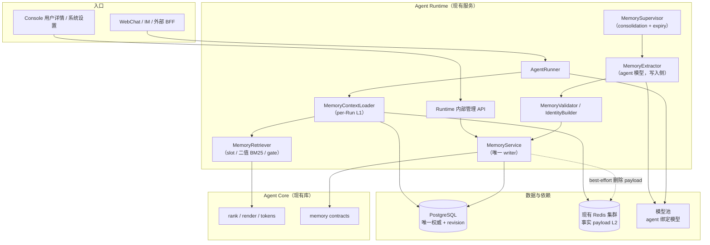
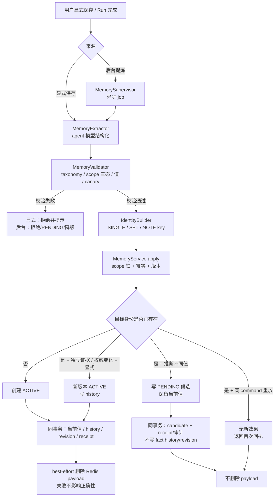
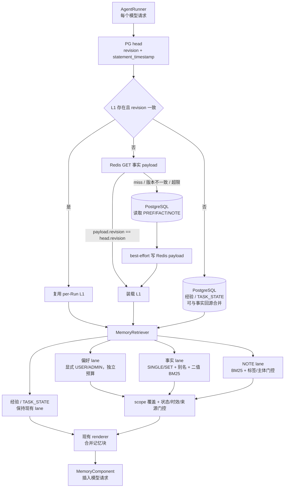
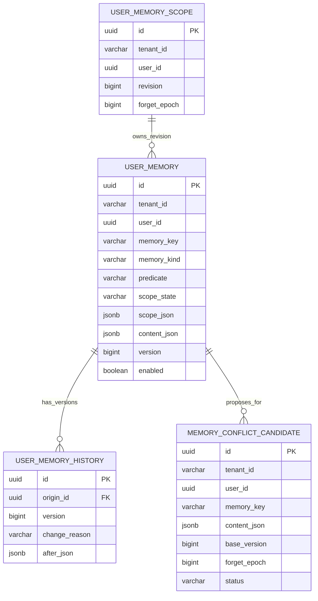
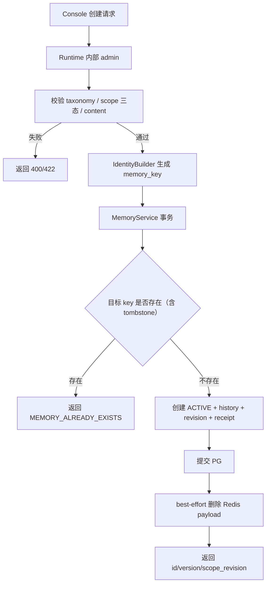
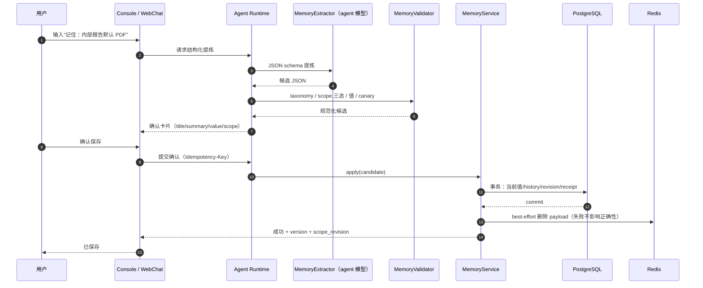
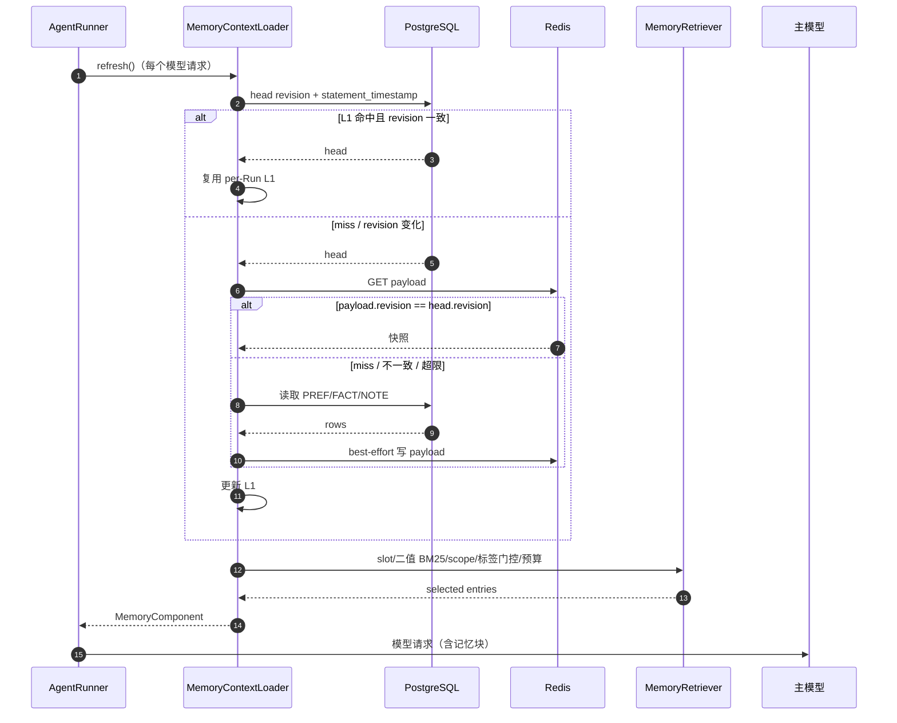
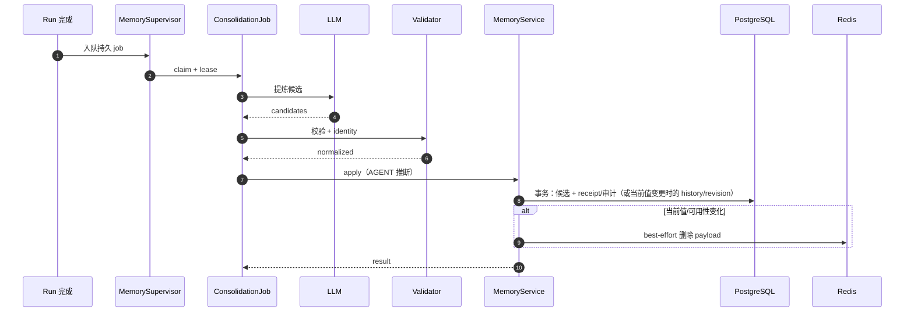

# 用户长期记忆 v2（准确率优先）后端设计

> **文档编号**: MOD-MEMORY-V2-1.3
> **文档版本**: v1.3
> **创建日期**: 2026-11-14
> **文档状态**: 设计评审中

**关联资产**: PRD `user-memory-retrieval-optimization.prd.md`；评测契约 `user-memory-retrieval-optimization.evaluation.md`；人工场景 `user-memory-retrieval-optimization.scenarios.md`。

**评审边界说明**:
- **需求评审**: 第 2 章 → 通过后锁定需求基线。
- **设计评审**: 第 3–4 章 → 通过后锁定设计基线。
- **交接契约**: 2.5 验收条件 —— 需求定义 What，设计实现 How。

**ID 体系**: US（需求简报）、FEAT、API、RULE、RISK、NFR；场景引用 `user-memory-retrieval-optimization.scenarios.md` 的 S-/E-/B-。

**需求来源**:
1. `/Users/jahan/Downloads/fluxion-user-memory-retrieval-design-v1.1.md`（GPT 候选方案，只作为问题与候选设计来源）。
2. 2026-11-14 对齐结论：接受重构、无历史数据、不新建记忆微服务、复用现有 Redis 集群、管理员不放开 taxonomy 所有权。
3. 2026-11-14 复核 `用户记忆检索优化设计评审-2026-11-14/评审.md` 的 R01–R15；本 v1.1 逐项修复。

---

## 1. 文档控制

### 1.1 责任人

| 角色 | 姓名 | 职责范围 |
|------|------|---------|
| 产品经理 | fluxion-harness | 记忆使用边界、管理员操作范围、业务验收 |
| 开发负责人 | fluxion-harness | MemoryService、Extractor、Retriever、API、数据模型 |
| Agent Runtime 负责人 | fluxion-harness | Context Resolver、Prompt Assembly、Run 内缓存 |
| 测试负责人 | fluxion-harness | 合成数据集、回归、PG/Redis 集成与人工验收 |
| 架构负责人 | fluxion-harness | 唯一写者、缓存新鲜度、租户隔离与性能评审 |

### 1.2 修订历史

| 版本 | 日期 | 作者 | 变更描述 |
|------|------|------|---------|
| v1.0 | 2026-11-14 | fluxion-harness | 初版：结构化 taxonomy、Redis L2、简化冲突 |
| v1.1 | 2026-11-14 | fluxion-harness | 复核修复：PG head 权威新鲜度；Redis 只做 payload；scope 三态与覆盖；SINGLE/SET/NOTE 身份；创建/更新分离；taxonomy 统一校验；保留 job 外键；补 API/UI/评测契约 |
| v1.2 | 2026-11-14 | fluxion-harness | 复审收敛：NOTE 实体门控改为正向匹配 + 全标签包含（不引入 NER）；旧 lane 只冻结准入 key，行状态/TTL 随快照刷新；BM25 字段权重进入匹配贡献；评测统一 user-macro 主聚合与配对 ΔCI；后台 NOTE 身份与候选 ACCEPT 语义；SET tombstone 恢复；补澄清契约；移除兼容 key 与 legacy_snapshots_json |
| v1.3 | 2026-11-14 | fluxion-harness | 冻结前收敛：`forget_epoch` 改为仅清空递增，单条删除用 tombstone/version 并只撤销本 key 候选；评测主聚合改为 query-macro；无 entity 标签 NOTE 明确为 v1 观察边界 |

### 1.3 本轮最终口径

| 决策点 | 最终选择 |
|--------|----------|
| 重构方式 | 开发阶段原地 v2；不做兼容层、双写、历史迁移；允许重建/改列 `user_memory` |
| 服务边界 | 不新建记忆微服务；落在 `agent-core`、`agent-runtime`、`console-platform`、`platform_settings` |
| 记忆范围 | v1 只改善 PREFERENCE / FACT / NOTE；TASK_STATE、PROCEDURE/FAILURE_PATTERN/VERIFICATION 保持现有逻辑，不纳入本次准确率承诺 |
| 身份 | `subject` 固定 `user`；客户只进 tags/内容；SINGLE/SET/NOTE 三套稳定身份；v1 禁止编辑身份字段 |
| scope | `ABSENT / UNKNOWN / EXPLICIT` 三态；UNKNOWN 不扩大为全局；显式 scope 覆盖全局默认 |
| taxonomy | 目录 20 个 predicate；v1 启用 13 个核心（含 `general`）+ 7 个扩展按评测启用；管理员只改别名/显示名/priority/启停，不改 code/schema |
| 删除屏障 | 单条删除用 tombstone/version，只撤销本 key 的 PENDING；清空才递增 `forget_epoch` 并撤销全部 PENDING |
| 写入 | LLM 用 agent 当前模型 + 模型池默认参数；显式保存 3s、后台 30s；失败降级 NOTE；`MemoryService` 唯一 writer |
| 检索 | slot/alias + 二值 BM25 + scope 覆盖 + 实体正向匹配/标签门控；同步检索不新增 LLM |
| Redis | **PG head 是权威新鲜度**；Redis 只缓存 PREFERENCE/FACT/NOTE payload；per-Run L1；TTL 1h；不建 dirty/outbox |
| Console | 用户详情记忆 Tab；三档预设 + 推断开关；taxonomy 受控维护；治理面 v1 仅 ADMIN |
| 评测 | Smoke CI + Standard 100×200×500~1000，30% 盲测；分阶段指标；经验 lane 单独报告 |
| 迁移 | 保留 `memory_scope`/`memory_command_receipt`/`memory_consolidation_job`；只改 `user_memory` 并新增 candidate；不 drop job 表 |

---

## 2. 需求分析

### 2.1 需求概述

| 项目 | 内容 |
|------|------|
| **模块名称** | 用户长期记忆 v2（准确率优先） |
| **模块 ID** | MOD-MEMORY-V2 |
| **所属系统/产品线** | Fluxion Agent Framework / Console |
| **需求类型** | 技术重构 + 功能优化 |
| **业务背景** | 现有记忆检索依赖中文词法覆盖、固定阈值和 Task Family 直通，存在同义表达漏召回、跨 scope 误命中、旧值与推断值进入 Prompt、同一事实因不同 key 并存等问题。 |
| **核心目标** | 只注入与当前请求相关、来源可信、条件匹配、时间有效且无未解决冲突的用户记忆；优先提升 PREFERENCE/FACT/NOTE 的注入准确率，不扩张记忆功能面。 |

### 2.2 痛点与价值

| 维度 | 当前问题 | 预期改进 |
|------|----------|----------|
| 检索准确性 | 词法覆盖对同义表达、否定和适用条件不敏感；固定阈值敏感 | 结构化 predicate/scope + 别名 + 二值 BM25 候选 + 确定性门控 |
| 任务适用性 | Task Family 命中可直接 1.0 | 用户记忆 lane 不允许 Task Family 直通；经验 lane 保持现状并单独报告 |
| 事实一致性 | 不同 key 下的同一事实可能同时进入上下文 | SINGLE/SET/NOTE 稳定身份；SINGLE 只保留一个当前值 |
| 更新正确性 | 旧值、推断值、用户纠正可能并列注入 | 显式最新值优先；推断只进 PENDING；同值确认也按权威变化升版本 |
| 历史利用 | 历史执行结果容易当成当前事实 | Experience/TASK_STATE 保持独立 lane，不纳入 v2 身份 |
| 内网约束 | 没有可用 Embedding 模型 | 不引入向量模型、pgvector 或独立向量库 |
| 可解释性 | 只看到最终注入结果 | 记录候选、分数、门控原因、scope 覆盖、预算丢弃和策略版本 |
| 运营复杂度 | 参数多、管理员不懂算法 | Console 只暴露三档预设 + 推断开关；其余参数代码/配置默认 |

**用户故事**

| 编号 | 用户故事 | 优先级 |
|------|----------|--------|
| US-01 | 作为普通用户，我希望 Agent 在相关任务中准确使用我明确保存的偏好和稳定事实，减少重复说明 | P0 |
| US-02 | 作为普通用户，我希望纠正一条记忆后，后续任务只使用新答案 | P0 |
| US-03 | 作为普通用户，我希望内部/外部等适用条件不同的规则不会被混用 | P0 |
| US-04 | 作为管理员，我希望在用户详情查看、编辑、禁用、删除、恢复记忆，并处理待确认候选 | P1 |
| US-05 | 作为管理员，我希望维护别名和 scope 显示名，让常见说法能召回同一记忆，但不能改坏身份结构 | P1 |
| US-06 | 作为开发者，我希望没有生产数据时也能用固定合成数据集复现、对照和回归检索算法 | P0 |

### 2.3 功能方案

#### 2.3.1 功能清单

| 功能 ID | 功能名称 | 功能描述 | 优先级 | 来源 |
|---------|----------|----------|--------|------|
| FEAT-01 | 结构化记忆提炼 | LLM 从显式保存或 Run 结果中提取结构化候选，清洗并保留关键差异信息 | P0 | US-01 |
| FEAT-02 | 受控 taxonomy 与身份 | 用全局 predicate/scope/alias 目录生成稳定 `memory_key`，LLM 不自造身份 | P0 | US-01/02/03 |
| FEAT-03 | 受控写入与更新 | `MemoryService` 唯一写者；创建/更新分离；显式最新值优先；推断不覆盖 | P0 | US-02 |
| FEAT-04 | 混合检索与门控 | 精确槽位 + 别名 + 二值 BM25 + scope 覆盖 + 实体正向匹配/标签门控；偏好独立 lane | P0 | US-01/03 |
| FEAT-05 | 信任与时效门控 | 过期、禁用、删除、低权威推断、scope 不匹配不注入 | P0 | US-01 |
| FEAT-06 | PG head + Redis payload | PG revision 权威；Redis 只缓存事实 payload；per-Run L1 保留 | P0 | US-01 |
| FEAT-07 | Console 记忆治理 | 用户详情列表/创建/编辑/启用禁用/删除/恢复/历史/待确认/回收站 | P1 | US-04 |
| FEAT-08 | 受控 taxonomy 维护 | 管理员维护别名、显示名、priority、启停；不能改 code/schema | P1 | US-05 |
| FEAT-09 | 合成评测与可观测性 | 固定语料、查询、标签、算法对照、分阶段结果和指标报告 | P0 | US-06 |

#### 2.3.2 记忆类型与责任边界

| 类型 | 含义 | v1 是否纳入 | 注入规则 |
|------|------|-------------|----------|
| `PREFERENCE` | 用户明确表达的输出格式、语言、风格、时区等偏好 | 是 | 显式 USER/ADMIN 优先；有 scope 时按覆盖关系；无 query 也可注入全局偏好 |
| `FACT` | 用户稳定事实，如角色、团队、负责系统 | 是 | 精确 predicate/scope 或词法候选；通过门控后注入 |
| `NOTE` | 有价值但非单值的差异化信息，如客户备注、项目线索 | 是 | 多值并存；BM25 + 标签/实体门控；不参与单值冲突 |
| `PROCEDURE` / `FAILURE_PATTERN` / `VERIFICATION` | 已验证经验 | 否（保持现有） | 继续走现有经验 lane：ACTIVE、Task Family/Trigger Text、冻结准入集合；行状态/版本/TTL 随快照刷新；**不纳入 v2 准确率承诺** |
| `TASK_STATE` | 当前任务线索、resume/确认 | 否（保持现有） | 继续走现有 `task.<uuid>` 独立 lane；不进入 canonical slot |
| `EPISODE` | 历史事件/执行结果 | 否（后续） | 后续按时间与来源单独设计；v1 不新增 |
| `RUNTIME_STATE` | 当前权限、Skill、Tool、任务、文件状态 | 否 | 每次从 Runtime/Capability/业务系统实时解析 |
| `BUSINESS_FACT` | 客户、订单、资产、工单等外部权威数据 | 否 | 必须通过 Capability 查询，不能用历史记忆代替 |

**强制规则**

- Conversation Summary 只用于当前会话压缩，不等同于长期用户记忆。
- 历史任务结果只能作为历史线索，不能代替当前业务系统查询。
- Credential、Token、External Session、密码和 Secret 不得进入 User Memory。
- 记忆文本中的指令不能获得工具权限、数据权限或覆盖 System/Developer Policy 的能力。
- Task Family 是检索辅助元数据，不是记忆身份，也不是最终相关性证明；用户记忆 lane 不允许它直通。
- 客户、项目等对象不是 v1 的 subject；只能作为 tags 或内容上下文，不能形成客户级全局知识库。

#### 2.3.3 taxonomy v1

taxonomy 是受控词表，不是每条记忆的配置。它定义 predicate、kind、cardinality、scope 维度、值类型、别名和优先级。

**核心 predicate（v1 默认启用 13 个，含 `general`）**

| predicate | kind | cardinality | scope | value schema | 别名示例 | priority |
|-----------|------|-------------|-------|--------------|----------|----------|
| `report_format` | PREFERENCE | SINGLE | audience | enum(PDF, WORD, EXCEL, PPT, HTML) | 报告格式、输出格式 | REQUIRED |
| `language` | PREFERENCE | SINGLE | — | enum(zh-CN, en-US, other) | 语言、用什么语言 | REQUIRED |
| `timezone` | PREFERENCE | SINGLE | — | IANA timezone | 时区、时间 | REQUIRED |
| `output_style` | PREFERENCE | SINGLE | audience | enum(concise, detailed, formal, casual) | 风格、语气 | OPTIONAL |
| `response_length` | PREFERENCE | SINGLE | — | enum(short, medium, long) | 长度、详细程度 | OPTIONAL |
| `data_format` | PREFERENCE | SINGLE | audience | enum(table, json, csv, markdown) | 数据格式 | OPTIONAL |
| `notification_channel` | PREFERENCE | SINGLE | — | enum(webchat, email, im) | 通知方式 | OPTIONAL |
| `working_hours` | PREFERENCE | SINGLE | — | string/time range | 工作时间 | OPTIONAL |
| `default_priority` | PREFERENCE | SINGLE | — | enum(low, medium, high) | 默认优先级 | OPTIONAL |
| `role` | FACT | SINGLE | — | string | 职位、角色 | REQUIRED |
| `team` | FACT | SINGLE | — | string | 团队、部门 | OPTIONAL |
| `owned_system` | FACT | SET | — | string | 负责系统 | OPTIONAL |
| `general` | NOTE | SET | — | text | — | OPTIONAL |

**扩展 predicate（目录预置，按评测启用）**

| predicate | kind | cardinality | 说明 |
|-----------|------|-------------|------|
| `how_to_address` | PREFERENCE | SINGLE | 希望怎么称呼 |
| `tone` | PREFERENCE | SINGLE | 正式/轻松/友好 |
| `disliked_style` | PREFERENCE | SET | 不喜欢的方式 |
| `constraints` | PREFERENCE | SET | 硬性约束，如“不要 emoji” |
| `industry` | FACT | SINGLE | 所属行业 |
| `company` | FACT | SINGLE | 公司/组织 |
| `meeting_preference` | PREFERENCE | SINGLE | 会议时间/形式偏好 |

**scope 维度 v1**

| 维度 | code | 显示名/别名示例 | 说明 |
|------|------|----------------|------|
| `audience` | `internal` / `external` | 内部 / 对外 / 客户 | 规范 code 不可改义；别名可运营 |
| `region` | `CN` / `US` / `EU` | 国内 / 海外 / 美国 / 欧洲 | 可选；没有明确地区就不填 |

- `subject` 固定 `user`，不进入 key。
- `memory_kind` 默认 `NOTE`；`predicate` 默认 `general`；scope 缺省为 `ABSENT`。
- taxonomy 存放 `platform_settings.memory.taxonomy`，版本化，新 Run 冻结。
- 管理员只能改别名、显示名、priority、启停；不能改 predicate key、kind、cardinality、value schema、scope code 或 scope 维度。
- 新增/删除 predicate、修改 code/schema 必须走研发/产品评审，并作为新版本迁移。

**未知 scope 处理**

- `ABSENT`：来源没有条件 → 全局默认；可参与覆盖。
- `UNKNOWN`：来源有条件但词表无法解析 → 不激活为全局、不参与注入；显式保存拒绝；后台提炼拒绝并在 job result/指标记录，不生成 PENDING 候选。
- `EXPLICIT`：所有维度都解析为已知 code → 参与 scope 覆盖。

### 2.4 范围与边界

| 类别 | 内容 |
|------|------|
| **范围（In Scope）** | PREFERENCE/FACT/NOTE 的结构化提炼、taxonomy、稳定身份、受控写入、PG head + Redis payload、slot/BM25/scope 检索、用户详情记忆治理、受控 taxonomy 维护、合成评测与可观测性 |
| **非范围（Out of Scope）** | 新记忆微服务；新 Redis 集群；新向量库/Embedding；客户/项目全局知识库；PROCEDURE/EPISODE 新体系；经验/TASK_STATE 重设计；复杂 CONFLICTED 状态机与冲突工作台；管理员自由新增 predicate/改 code；历史数据迁移/双写 |
| **前置假设** | PostgreSQL 为权威存储；现有 Redis 集群可用；agent 已绑定模型池模型；Runtime 能取得可信 tenant/user/run 上下文；开发阶段无历史记忆数据 |
| **有意妥协 / 技术债** | v1 只承诺 PREFERENCE/FACT/NOTE；经验/TASK_STATE 保持现状并单独报告；未知 scope 不猜测；NOTE 依赖标签/实体门控，**无 `entity:` 标签的实体 NOTE 不受门控保护、可能按 topic 召回，这是 v1 已知边界**；语义核验留到评测证明有收益后再加；不做零 PG 的 Redis 头协议 |

### 2.5 验收条件

#### 2.5.1 业务规则与约束

| ID | 类型 | 描述 | 验证场景 |
|----|------|------|----------|
| RULE-01 | 系统约束 | 所有读写必须限定在可信 `tenant_id + user_id` 内，禁止跨租户/跨用户召回 | E-05 |
| RULE-02 | 业务规则 | `subject` 固定 `user`；SINGLE/SET/NOTE 使用各自稳定身份；LLM 与调用方不得自造 key | S-01/S-02/S-13 |
| RULE-03 | 业务规则 | SINGLE 同一 `(user, predicate, scope)` 只允许一个 ACTIVE；SET 按成员 key 多值；NOTE 用稳定 id，内容 hash 只去重 | S-02/S-13 |
| RULE-04 | 业务规则 | 用户显式保存/确认的最新值优先；后台推断不得覆盖 USER/ADMIN；同内容确认导致权威变化时也必须新增版本 | S-04/S-05/E-09 |
| RULE-05 | 业务规则 | 与**已有目标**当前值不同的推断进入 `PENDING`，不注入；接受时重新校验 base_version/forget_epoch；目标不存在的新后台 NOTE 不先落 PENDING | S-05/E-07 |
| RULE-06 | 业务规则 | 删除保留 tombstone 与 version，递增 revision、撤销该 key 的 PENDING；清空递增 `forget_epoch` 并撤销所有 PENDING；旧候选失效 | S-10/E-08 |
| RULE-07 | 业务规则 | taxonomy 校验必须覆盖平台设置 save/restore/seed/internal；管理员不能改 code/schema | S-07/E-03 |
| RULE-08 | 业务规则 | 只注入 enabled、未删除、未过期、scope 匹配、来源合格的内容；偏好独立于 query；经验/TASK_STATE 保持原规则 | S-01/S-03/S-11 |
| RULE-09 | 系统约束 | PostgreSQL 是唯一权威；每个模型请求用 PG head 检查 revision/time；Redis 只做 payload，不可用时回退 PG | S-08/E-02 |
| RULE-10 | 系统约束 | 同步检索不新增独立 LLM 调用；LLM 只用于写入侧提炼/清洗 | S-01/E-01 |
| RULE-11 | 系统约束 | `MemoryService` 是唯一 writer；同命令幂等；revision/history/receipt 同事务 | E-04/E-06 |
| RULE-12 | 系统约束 | `empty` 与 `degraded/unavailable` 必须区分；读失败不能伪装成“没有记忆” | E-02/E-06 |
| RULE-13 | 业务规则 | POST 创建只允许槽位不存在；已存在必须用 PATCH/expected_version 更新，不能用“创建”覆盖 | S-13/E-04 |
| RULE-14 | 业务规则 | v1 禁止通过编辑修改 kind/predicate/scope 等身份字段；需要移动 scope 时走单独的迁移操作 | S-13/E-03 |
| RULE-15 | 业务规则 | scope 区分 ABSENT/UNKNOWN/EXPLICIT；UNKNOWN 不扩大为全局；显式 scope 覆盖全局默认，无法比较时澄清/不注入 | S-03/B-05/E-03 |
| RULE-16 | 业务规则 | 带 entity 标签的候选必须有正向实体匹配；候选全部 entity 标签都要出现在 query 中；无匹配时带 entity 标签的候选不注入 | S-02/E-12 |

#### 2.5.2 功能验收场景

场景唯一源：`user-memory-retrieval-optimization.scenarios.md`；评测协议唯一源：`user-memory-retrieval-optimization.evaluation.md`。

| 场景 ID | 设计影响 / 备注 |
|---------|----------------|
| S-01 | 显式保存偏好并被后续对话准确召回 |
| S-02 | 单值事实、SET 成员、多值 NOTE 的差异 |
| S-03 | 内部/外部 scope、全局默认与特定覆盖 |
| S-04 | 用户纠正后只注入新值 |
| S-05 | 后台推断默认不注入，确认后生效 |
| S-06 | 管理员列表/编辑/启用禁用/删除/恢复/清空/回收站 |
| S-07 | 管理员维护别名/显示名；不能改 code/predicate |
| S-08 | PG head + Redis payload 命中、更新后失效、Redis 不可用回退 |
| S-09 | 版本历史可追溯 |
| S-10 | 删除/清空后不复活 |
| S-11 | 现有经验/TASK_STATE 不退化（单独范围） |
| S-12 | 合成评测对照，分阶段指标 |
| S-13 | 创建/更新边界：不能创建覆盖；不能编辑身份字段 |
| E-01 | LLM 提炼失败降级 NOTE，不阻塞保存/Run |
| E-02 | Redis 不可用回退 PG，不伪装 empty |
| E-03 | 非法 taxonomy/scope/身份字段被拒绝 |
| E-04 | 版本冲突 409，刷新后可重试 |
| E-05 | 跨租户/跨用户隔离；v1 ADMIN-only |
| E-06 | PostgreSQL 写入失败明确报错，不伪成功 |
| E-07 | 基于旧版本的候选被拒绝 |
| E-08 | 清空后旧候选失效 |
| E-09 | AGENT 同内容被用户确认：权威变化产生新版本 |
| E-10 | SET 成员不能改值；变更走删除+创建；同值重加走 tombstone 恢复 |
| E-11 | NOTE 重试复用 UUID；删除后同内容不自动复活 |
| E-12 | 无实体匹配或复合实体条件冲突时不误召回 |
| B-01 | 空记忆/无匹配不注入 |
| B-02 | 预算耗尽整条丢弃 |
| B-03 | 配额上限与淘汰边界 |
| B-04 | 长文本、多值、分页边界 |
| B-05 | scope 未知不扩大；全局+特定不同时注入 |

#### 2.5.3 非功能指标

**正确性指标**

| 指标 ID | 指标名称 | 目标值 | 测量方法 |
|---------|----------|--------|----------|
| NFR-ACC-01 | Required Recall | 主聚合 query-macro：ΔR 点估计 ≥ 0；95% CI(ΔR) 下界 ≥ -1pp | 固定盲测集 user-block paired bootstrap；ΔR=R_v2−R_base |
| NFR-ACC-02 | Strict Conditional Precision | 主聚合 query-macro：ΔP 点估计 ≥ +5pp；95% CI(ΔP) 下界 > 0 | TP/(TP+FP)；acceptable 单独报告；ΔP=P_v2−P_base |
| NFR-ACC-03 | Forbidden Injection | 安全/冲突/过期/跨 scope 类别必须为 0 | 固定负例与冲突集 |
| NFR-ACC-04 | Stale Injection | 0 | 过期/撤销/被替代值注入测试 |
| NFR-ACC-05 | Update Correctness | 纠正集 100% | 纠正后当前值唯一且正确 |
| NFR-ACC-06 | Cross-Tenant/User Leakage | 0 | 多租户隔离测试 |
| NFR-ACC-07 | Scope Override Correctness | 特定覆盖全局；UNKNOWN 不扩大 | S-03/B-05 |
| NFR-ACC-08 | Experience Lane | 单独报告，不混入 v2 指标 | 分 lane 报告 |
| NFR-ACC-09 | Entity Gate | 无正向实体匹配或候选标签未全部命中时，带 entity 标签的候选注入 = 0 | E-12；逐标签检查 |

**性能指标**

| 指标 ID | 指标名称 | 目标值 | 测量方法 |
|---------|----------|--------|----------|
| NFR-PERF-01 | PG head 查询 P95 | ≤5ms（目标，压测确认） | `memory_scope` revision + statement_timestamp |
| NFR-PERF-02 | Memory 检索 P95 | ≤50ms（含 head + payload + 本地检索） | 分阶段计时 |
| NFR-PERF-03 | Redis payload 读取 P95 | ≤10ms（目标，压测确认） | GET + 反序列化 |
| NFR-PERF-04 | `/chat` P95 相对关闭 Memory 增量 | ≤50ms 或 ≤3% | 固定模型/输入/并发配对压测 |
| NFR-PERF-05 | Redis 稳态命中率 | ≥90%，排除超限 bypass | hit / eligible reads |
| NFR-PERF-06 | 同步检索额外 LLM 调用 | 0 次 | Trace 统计 |
| NFR-PERF-07 | 单用户 payload | ≤512KB；超限完整绕过 L2 | 序列化大小监控 |
| NFR-PERF-08 | 注入审计 | 计入完整 refresh 成本 | `MemoryInjectionLog` PG 写入计时 |

**可靠性指标**

| 指标 ID | 指标名称 | 目标值 |
|---------|----------|--------|
| NFR-REL-01 | Redis 不可用 | 回退 PG，Run 不失败 |
| NFR-REL-02 | 写后读 | PG head revision 变化后立即不使用旧 payload；跨进程一致 |
| NFR-REL-03 | 缓存重建 | Redis 清空后从 PG 冷启动，无数据丢失 |
| NFR-REL-04 | 超限用户 | 明确 bypass L2，不截断候选 |

**安全指标**

| 指标 ID | 安全域 | 验收标准 |
|---------|--------|----------|
| NFR-SEC-01 | 租户/用户隔离 | 查询由可信执行上下文确定 tenant/user，禁止请求体覆盖 |
| NFR-SEC-02 | 敏感数据 | Credential/Token/密码/Session 不进入 Memory；新增字段和模型输入都过 canary 扫描 |
| NFR-SEC-03 | Prompt Injection | 记忆作为不可信上下文，不授予工具/数据权限 |
| NFR-SEC-04 | 审计 | 写入、纠正、确认、撤销、候选处理可追溯来源和操作者 |

#### 2.5.4 验证环境假设

| 维度 | 假设 | 验证方式 / 参数 | 不满足时 |
|------|------|----------------|----------|
| 容量 | 单用户默认约 200 条、硬上限 1,000 条；payload 上限 512KB | 50/200/1000 条档位；合法最大元数据构造 | 超限用户 bypass L2；记录瓶颈 |
| 数据 | 不提供生产用户数据 | 虚构用户、虚构业务、固定随机种子合成数据 | 不使用真实敏感数据替代 |
| 数据库 | PostgreSQL 为生产权威存储 | PG 集成测试覆盖唯一键、事务、锁、并发、当前 Alembic head 升级 | SQLite 只用于快速单测 |
| 缓存 | 现有 Redis 集群 | 命中、冷启动、失效、故障回退、超限 bypass、OOM 降级 | 先确认 maxmemory-policy；不能因缓存阻塞 Run |
| 模型 | agent 已绑定模型池模型；模型池默认参数 | Trace 验证同步检索 0 次 Memory 专属模型调用 | 模型不可用时降级 NOTE，不阻塞保存 |
| 测试预算 | 单测、PG/Redis 集成、合成回放、并发与安全测试 | TASK 明确命令与覆盖范围 | 缺少环境时标记未验收，不伪装通过 |

---

## 3. 技术设计

### 3.1 方案选型

#### 3.1.1 备选方案对比

| 方案 | 检索/更新方式 | 优点 | 主要问题 | 结论 |
|------|---------------|------|----------|------|
| A. 现有 IDF + 固定阈值 | 中文双字/IDF + Task Family/Trigger Text | 已有实现，成本低 | 阈值敏感；Task Family 可能越权；不能解决身份/冲突 | 保留为评测基线 |
| B. 完整记忆平台 | Procedure/Episode/客户知识库/向量检索/复杂治理 | 功能完整 | 超出准确率诉求；内网无 Embedding；维护成本高 | 否决 |
| C. Lean v2（推荐） | 结构化 taxonomy + SLOT/SET/NOTE + 别名/二值 BM25 + scope 覆盖 + PG head + Redis payload | 聚焦准确率；可解释；不新建服务 | 需要 taxonomy/评测；未知同义表达可能漏召 | **采用** |
| D. 每次检索调用 LLM | 语义选择/门控 | 对开放式表达友好 | 每轮增加 RTT/成本；错误不可控 | v1 否决；保留未来证据触发核验开关 |

#### 3.1.2 关键决策记录

| 决策点 | 选择 | 被否决项 | 理由 | 可逆性 |
|--------|------|----------|------|--------|
| 总体架构 | 原地 v2，不新建微服务 | 新记忆服务/独立平台 | 当前阶段不需要新服务；复用 Runtime/Console/PG/Redis | 中 |
| 权威存储 | PostgreSQL 唯一权威 | Redis 双写/主存 | 事务、唯一键、审计、历史都在 PG | 易 |
| 缓存新鲜度 | **每次模型请求 PG head + Redis payload** | 零 PG 的 dirty/revision/outbox 协议 | PG head 已能严格判断 revision/time；协议简单且不读旧值 | 易 |
| 身份 | subject=user；SINGLE/SET/NOTE 三套公式 | 内容参与 key / LLM 自由 key | 身份必须与内容变化解耦 | 难 |
| 写入 | LLM 结构化候选 + `MemoryService` 唯一 writer；创建/更新分离 | LLM 直接写 / API 直接写 | 防止伪造来源、绕过锁与版本 | 难 |
| 冲突 | 显式最新值优先；推断进 PENDING；NOTE 多值 | CONFLICTED 状态机/LLM 裁决 | 降低复杂度；保证不注入推断冲突 | 中 |
| 检索 | slot/alias/二值 BM25 + scope 覆盖 + 标签/主体门控 | 纯向量/纯 LLM | 内网无 Embedding；可解释、低延迟 | 中 |
| taxonomy | 平台设置统一校验；管理员受限维护 | 专用 API 单独校验 | save/restore/seed 都能覆盖 | 中 |
| 迁移 | 保留 job/scope/receipt；只改 user_memory | 全表重建含 job | `model_call_lease` 有物理 FK；增量更安全 | 中 |

#### 3.1.3 技术栈

| 类别 | 选型 | 版本 | 选型理由 |
|------|------|------|----------|
| 语言 | Python | 3.12+ | 沿用项目基线 |
| API | FastAPI | 沿用项目基线 | Runtime/Console 现有框架 |
| 数据库 | PostgreSQL | 沿用项目基线 | 事务、唯一键、JSONB、版本历史 |
| 缓存 | Redis | 现有集群 | 复用 `muad_common.redis_client`；不新增集群 |
| 前端 | React + TypeScript + Semi Design | 沿用项目基线 | Console 现有组件与列表规范 |
| 模型 | agent 绑定的模型池模型 | 模型池默认参数 | 不新增模型基础设施 |
| 可观测 | OTel + 结构化日志 + 现有 metrics | 沿用项目基线 | 记录 head、缓存、候选、门控、预算和耗时 |

### 3.2 架构设计

#### 3.2.1 总体架构



**图说明**：没有新增服务。写入统一经 `MemoryService` 落 PG；提交后只 best-effort 删除 Redis payload，删除失败不影响正确性。读取每次先用 PG head 查 `memory_scope.revision + statement_timestamp`；只有 head 与 L1 不一致时才读 Redis payload 或 PG 行。Redis 只缓存 PREFERENCE/FACT/NOTE；经验/TASK_STATE 继续现有 PG/Run 路径。

#### 3.2.2 写入链路



**图说明**：创建/更新分离；LLM 只产出候选，不决定身份、作者、版本或状态。只有 `MemoryService` 能写当前值；推断值与当前值不同时进入待确认候选。Redis 删除失败只会让下一次读取多一次 PG 回源，不会返回旧值。

#### 3.2.3 读取链路



**图说明**：每个模型请求先查 PG head。head 是权威新鲜度；L1/Redis payload 只有与 head revision 精确一致才使用。Redis 只缓存 PREF/FACT/NOTE；经验/TASK_STATE 仍按 head revision 读取/复用，只冻结准入 key 集合，行状态/TTL 随快照刷新。旧 payload 即使残留，也会因 head revision 不一致被丢弃。

#### 3.2.4 组件职责

| 组件 | 职责 | 不负责 |
|------|------|--------|
| `MemoryExtractor` | 从显式保存/Run 结果中提取结构化候选；清洗、摘要、标签 | 不决定身份、不写库、不裁决冲突 |
| `MemoryValidator` | taxonomy 枚举、scope 三态、值 schema、`entity:`/`topic:` 标签归一化、canary 扫描 | 不猜未知 predicate/scope；不覆盖用户原话 |
| `IdentityBuilder` | subject=user；SINGLE/SET/NOTE key；content hash | 不接受 LLM 自造 key |
| `MemoryService` | 唯一 writer；scope 锁、幂等、版本、history、receipt | 不调用模型、不直接操作 Redis |
| `MemoryContextLoader` | per-Run L1；PG head；Redis payload；现有经验/TASK_STATE 合并 | 不跨用户读取、不做写入 |
| `MemoryRetriever` | 偏好/事实/NOTE 三 lane；二值 BM25；scope 覆盖；预算 | 不决定记忆写入；不调用 LLM |
| `MemorySupervisor` | 后台提炼 job、过期清扫 | 不阻塞 `/chat`；不负责缓存正确性 |
| `rank/render` | 纯选择/渲染；token 化；字节预算 | 不访问 DB/Redis |
| Console | 用户详情记忆治理；taxonomy 受控维护 | 不直接写 PG；写操作经 Runtime |

#### 3.2.5 与现有代码的落点

| 现有模块 | v2 动作 |
|----------|---------|
| `apps/agent-runtime/.../memory_service.py` | 保持唯一 writer；增加 taxonomy/scope 三态校验、创建/更新分离、冲突候选 |
| `infrastructure/models/runtime.py` 的 `UserMemory` | 增加 `memory_kind/predicate/scope_state/scope_raw/scope_json/scope_hash/content_text/title/summary/tags/cardinality/priority/taxonomy_version` |
| `MemoryScope` | 复用 `revision`/`forget_epoch`；不新建 scope revision 表 |
| `UserMemoryHistory` | 复用 revision/history；`after_json` 记录完整 v2 快照 |
| `MemoryCommandReceipt` | 复用命令幂等 |
| `memory_queries.py` | 扩展 snapshot 查询；返回 v2 字段；经验/TASK_STATE 可按同一 revision 一并返回，或单独补读 |
| `memory_cache.py` | per-Run L1；新增 `MemorySnapshotCache` 作为 Redis payload cache |
| `memory_context.py` | 保留 `refresh`/`MemoryComponent`/attribution；替换选择器 |
| `packages/agent-core/.../memory/rank.py` | 新增 slot/二值 BM25/scope gate；经验/TASK_STATE 保持现有函数 |
| `memory_consolidation_output.py` | 输出结构化 candidate，不再输出自由 `memory_key` |
| `memory_job_effects.py` | 去掉 `infer.` 前缀去重；统一走 IdentityBuilder/Service |
| `memory_supervisor.py` | 保持 job/expiry；不增加 outbox |
| `memory_confirmation*` | 复用显式保存确认流程；确认卡片展示结构化字段 |
| `apps/console-platform/.../api/users.py` | 复用 memory 路由；扩展 DTO、enable/disable、回收站、`memory_id` 句柄 |
| `platform_settings` | 增加 `memory.taxonomy`/`memory.profile`；统一校验 save/restore/seed |
| `muad_common.redis_client` | 复用现有 cluster-aware 客户端；不新增集群 |

### 3.3 数据设计

#### 3.3.1 设计原则

1. PostgreSQL 是唯一权威存储；Redis 只缓存事实 payload。
2. 稳定身份注册表 `user_memory` 使用完整唯一键，包含 tombstone；软删/恢复不重置 id/version。
3. SINGLE/SET/NOTE 使用不同 key 公式；内容变化不改变 SINGLE 身份。
4. 历史版本复用 `user_memory_history`；不新建 revision 表。
5. 用户级 revision/forget_epoch 复用 `memory_scope`；不新建 scope revision 表。
6. 状态由 `enabled + expires_at + is_deleted + activation_state` 派生，不建重复 status 列。
7. 来源/权威复用 `author + authority + explicit_request + confirmation_event_id`，不恢复已删除的 `source_type`。
8. scope 增加 `scope_state`/`scope_raw`：存储只允许 ABSENT/EXPLICIT；UNKNOWN 只存在于 query/拒绝日志，不落 active 行。
9. 客户/项目不是 subject；只存 tags/内容上下文。
10. v1 不建 `memory_cache_outbox`；PG head 是新鲜度权威，Redis 删除失败不影响正确性。

#### 3.3.2 表：`runtime.user_memory`

| 字段名 | 类型 | 可空 | 默认值 | 索引/约束 | 说明 |
|--------|------|------|--------|-----------|------|
| `id` | uuid | N | gen_random_uuid() | PK | 稳定身份，跨软删不重置 |
| `is_deleted` | boolean | N | false | | 软删除 |
| `create_time` | timestamptz | N | now() | | 创建时间 |
| `update_time` | timestamptz | N | now() | | 更新时间 |
| `tenant_id` | varchar(64) | N | | 组合唯一 | 租户 |
| `user_id` | uuid | N | | 组合唯一 | 用户 |
| `memory_key` | varchar(128) | N | | 组合唯一 | 服务端生成；SINGLE/SET/NOTE 规则见 §3.5.1 |
| `memory_kind` | varchar(24) | N | | 普通索引 | PREFERENCE/FACT/NOTE/PROCEDURE/FAILURE_PATTERN/VERIFICATION/TASK_STATE |
| `predicate` | varchar(64) | Y | | 普通索引 | PREF/FACT/NOTE 必填；经验/TASK_STATE 为空 |
| `scope_state` | varchar(16) | N | 'ABSENT' | CHECK | ABSENT/EXPLICIT；UNKNOWN 不落 active 行 |
| `scope_raw` | varchar(512) | Y | | | 原始条件文本；审计/展示用，不参与身份 |
| `scope_json` | jsonb | N | '{}' | GIN（按需） | 仅 EXPLICIT 的规范化 code |
| `scope_hash` | varchar(64) | N | '' | 组合索引 | canonical scope 摘要；SINGLE/SET key 使用 |
| `content_json` | jsonb | N | | | 权威内容；事实为结构化 value |
| `content_hash` | varchar(64) | N | | 普通索引 | 规范化内容摘要；SET 成员/NOTE 去重 |
| `content_text` | text | N | '' | | BM25/渲染文本，写入时生成 |
| `title` | varchar(128) | N | '' | | 展示标题 |
| `summary` | varchar(512) | N | '' | | 差异化摘要 |
| `tags_json` | jsonb | N | '[]' | | 检索标签；客户/项目放这里 |
| `cardinality` | varchar(8) | N | 'SINGLE' | | 写入时从 taxonomy 冻结：SINGLE/SET |
| `priority` | varchar(16) | N | 'OPTIONAL' | | REQUIRED/OPTIONAL，写入时冻结 |
| `taxonomy_version` | integer | N | 0 | | 写入时 taxonomy 版本 |
| `author` | varchar(16) | N | 'AGENT' | CHECK | USER/ADMIN/AGENT |
| `authority` | varchar(24) | N | 'AGENT_INFERRED' | CHECK | USER_EXPLICIT/ADMIN_EDIT/AGENT_INFERRED |
| `explicit_request` | boolean | N | false | | 是否来自真实显式请求/确认 |
| `confirmation_event_id` | uuid | Y | | | 真实确认事件；author=USER 必填 |
| `confidence` | smallint | N | 2 | CHECK 1..5 | 提取置信度，仅辅助 |
| `confirmed_count` | integer | N | 0 | CHECK >=0 | 真实确认次数；重放不虚增 |
| `last_confirmed_at` | timestamptz | Y | | | 最近确认时间 |
| `source_event_id` | uuid | Y | | | 来源事件 |
| `source_seq` | bigint | Y | | | 来源序号 |
| `source_ref` | varchar(256) | Y | | | 来源 Run/会话/管理操作 |
| `source_quote` | varchar(512) | Y | | | 原话证据 |
| `last_source_run_id` | uuid | Y | | | 最近来源 Run |
| `last_source_seq` | bigint | Y | | | 最近来源 seq |
| `retirement_reason` | varchar(32) | Y | | | EXPIRE/QUOTA_EVICT/TASK_COMPLETE 等 |
| `retirement_revision` | bigint | Y | | | 退休依据的 scope revision |
| `activation_state` | varchar(16) | N | 'ACTIVE' | | 经验行使用；普通记忆固定 ACTIVE |
| `task_signature` | varchar(64) | Y | | | 经验任务族 |
| `trigger_text` | varchar(512) | Y | | | 经验触发文本 |
| `write_policy` | varchar(32) | N | 'SERVER_CONTROLLED' | CHECK | 仅服务端受控 |
| `version` | bigint | N | 1 | CHECK >=1 | 单 key 连续版本，跨软删/恢复不重置 |
| `enabled` | boolean | N | true | | 是否参与注入 |
| `expires_at` | timestamptz | Y | | | 系统过期时间 |
| `evidence_json` | jsonb | Y | | | 来源证据/提取摘要 |

**约束与索引**

| 名称 | 类型 | 字段/条件 | 用途 |
|------|------|-----------|------|
| `uq_user_memory_key` | 唯一 B-tree | `(tenant_id, user_id, memory_key)` | 稳定身份，包含 tombstone |
| `ix_user_memory_candidates` | B-tree | `(tenant_id, user_id, memory_kind, predicate, update_time DESC)` WHERE `is_deleted=false AND enabled=true` | 候选读取 |
| `ix_user_memory_scope` | B-tree | `(tenant_id, user_id, predicate, scope_hash)` | 精确槽位 |
| `ix_user_memory_expiry` | B-tree | `(tenant_id, expires_at, user_id)` WHERE `expires_at IS NOT NULL` | TTL 清扫 |
| `ix_user_memory_experience` | B-tree | `(tenant_id, user_id, activation_state, task_signature)` WHERE `memory_kind IN ('PROCEDURE','FAILURE_PATTERN','VERIFICATION')` | 经验 lane |
| `ck_user_memory_kind` | CHECK | `memory_kind IN (...)` | 类型约束 |
| `ck_user_memory_scope_state` | CHECK | `scope_state IN ('ABSENT','EXPLICIT')` | 存储 scope 两态；UNKNOWN 只在 query/日志 |
| `ck_user_memory_author` | CHECK | `author IN ('USER','ADMIN','AGENT')` | 来源约束 |
| `ck_user_memory_authority` | CHECK | `authority IN ('USER_EXPLICIT','ADMIN_EDIT','AGENT_INFERRED')` | 权威约束 |
| `ck_user_memory_version` | CHECK | `version >= 1 AND confidence BETWEEN 1 AND 5 AND confirmed_count >= 0` | 计数约束 |
| `ck_user_memory_write_policy` | CHECK | `write_policy = 'SERVER_CONTROLLED'` | 受控写 |

> `status` 不建列；Console 的 ACTIVE/DISABLED/EXPIRED 由 `enabled + expires_at + is_deleted` 派生。单值唯一性由确定性 key + `uq_user_memory_key` 保证。

**元数据配额**

- 现有 `MEMORY_MAX_BYTES` 只计 `content+source_quote`；v2 必须新增/扩展为“全条目配额”，至少覆盖 `content + title + summary + tags + source_quote` 的 canonical UTF-8 字节。
- `tags` 限制条数、单项长度、总字节；`entity:`/`topic:` 标签也计入。具体上限放 contracts/配置（如 `MEMORY_TAG_MAX_ITEMS`、`MEMORY_TAG_MAX_CHARS`、`MEMORY_METADATA_MAX_BYTES`），不在本设计写死数字。
- NOTE 新写入建议使用 `entity:`/`topic:` 前缀；无前缀标签按 `topic:` 处理，不能作为实体证据。
- 写入、恢复、候选接受、缓存 payload 估算都使用同一配额函数；不能只校验 content。
- 超过条目配额：显式写入拒绝；自动提炼拒绝/降级；不能静默截断 tags/title/summary。

#### 3.3.3 表：`runtime.memory_scope`（复用）

| 字段 | 类型 | 约束 | 说明 |
|------|------|------|------|
| `tenant_id` | varchar(64) | 唯一 `(tenant_id,user_id)` | 租户 |
| `user_id` | uuid | 唯一 | 用户 |
| `revision` | bigint | `>=0` | 用户记忆提交版本；**PG head 权威** |
| `forget_epoch` | bigint | `>=0` | 全局遗忘屏障；只在清空时递增，单条删除不递增 |

不新增 `user_memory_scope_revision`；Redis payload 的 revision 来自本表。

#### 3.3.4 表：`runtime.user_memory_history`（复用）

| 字段 | 说明 |
|------|------|
| `origin_id` | FK → `user_memory.id` |
| `version` | 版本号；`(origin_id, version)` 唯一 |
| `change_reason` | CREATE/OVERWRITE/CONFIRM/ENABLE/DISABLE/DELETE/EXPIRE/QUOTA_EVICT/RESTORE/TASK_COMPLETE/MIGRATION_BASELINE |
| `actor_type` / `actor_id` | USER/ADMIN/SYSTEM + 操作者 |
| `command_id` | 命令号 |
| `source_run_id` | 来源 Run |
| `after_json` | 完整 v2 快照，包含 kind/predicate/scope/content/title/summary/tags/version/status 等 |

#### 3.3.5 表：`runtime.memory_command_receipt`（复用）

| 字段 | 说明 |
|------|------|
| `command_id` | 命令号；`(tenant_id, command_id)` 唯一 |
| `endpoint` | 写入口 |
| `request_fingerprint` | 规范化请求指纹；create 只排除**本次新分配**的服务端身份（NOTE UUID/新 key），保留 kind/predicate/scope/content hash；PATCH/DELETE/restore/enable/disable/候选解决必须包含目标 `memory_id`/`candidate_id`、action、`expected_version`、actor、replacement hash 等已有请求字段 |
| `status` | APPLIED/UNCHANGED/STALE |
| `response_json` | 首次回执 |
| `source_run_id` | 来源 Run |

- 幂等指纹只排除“本次新分配的服务端身份”；不同目标、不同 action、不同 `expected_version`/actor 不能被当成同一命令重试。

#### 3.3.6 表：`runtime.memory_consolidation_job`（复用 + 扩展）

复用现有 job 表；在 `input_json` 中冻结：

- `taxonomy_version`
- `extractor_model_ref`
- `through_seq` / 摘要覆盖边界
- `input_scope_revision`
- `input_hash`

不新增任务表；后台提炼仍由 `MemorySupervisor` claim/lease/fence。**不 drop 该表**，因为 `model_call_lease.memory_job_id` 有物理 FK。

#### 3.3.7 表：`runtime.memory_conflict_candidate`

| 字段名 | 类型 | 可空 | 默认值 | 索引/约束 | 说明 |
|--------|------|------|--------|-----------|------|
| `id` | uuid | N | gen_random_uuid() | PK | 候选 ID |
| `is_deleted` | boolean | N | false | | |
| `create_time` / `update_time` | timestamptz | N | now() | | |
| `tenant_id` | varchar(64) | N | | 组合索引 | |
| `user_id` | uuid | N | | 组合索引 | |
| `memory_key` | varchar(128) | N | | 组合索引 | 目标槽位 |
| `predicate` | varchar(64) | N | | | 目标 predicate |
| `scope_state` | varchar(16) | N | | | ABSENT/EXPLICIT（v1 不写 UNKNOWN） |
| `scope_raw` | varchar(512) | Y | | | 原始条件（审计） |
| `scope_json` | jsonb | N | '{}' | | 目标 scope |
| `scope_hash` | varchar(64) | N | '' | | |
| `content_json` | jsonb | N | | | 候选值 |
| `content_hash` | varchar(64) | N | | 部分唯一 | 候选值摘要 |
| `content_text` | text | N | '' | | 展示/检索 |
| `title` | varchar(128) | N | '' | | |
| `summary` | varchar(512) | N | '' | | |
| `source_quote` | varchar(512) | Y | | | |
| `author` | varchar(16) | N | 'AGENT' | | 当前只允许 AGENT |
| `authority` | varchar(24) | N | 'AGENT_INFERRED' | | |
| `confidence` | smallint | Y | | CHECK 1..5 | |
| `base_version` | bigint | N | | | 创建时目标槽位版本（目标必须已存在） |
| `base_scope_revision` | bigint | N | | | 创建时用户 revision（仅审计） |
| `forget_epoch` | bigint | N | | | 创建时全局遗忘屏障（clear epoch）；单条删除不改变 |
| `evidence_count` | integer | N | 1 | CHECK >=1 | 同内容提议合并次数 |
| `last_source_ref` | varchar(256) | Y | | | 最近来源引用 |
| `candidate_hash` | varchar(64) | N | | 部分唯一 | 目标 key + content_hash + forget_epoch；**不含来源** |
| `status` | varchar(24) | N | 'PENDING' | 普通索引 | PENDING/ACCEPTED/REJECTED/STALE |
| `reason` | varchar(64) | N | | | VALUE_CONFLICT/LOW_AUTHORITY |
| `resolved_by` | varchar(128) | Y | | | 管理员/用户 |
| `resolved_at` | timestamptz | Y | | | |

**约束**

- `uq_memory_conflict_pending`: 部分唯一 `(tenant_id, user_id, memory_key, candidate_hash) WHERE status='PENDING' AND is_deleted=false`。
- `ix_memory_conflict_pending`: `(tenant_id, user_id, status, create_time DESC)`。
- 候选只表示对**已有目标槽位**的待确认变更：`memory_key`、`predicate`、`base_version` 均必填，不存在“未来目标身份”的候选；新后台 NOTE 由 writer 分配身份后直接创建当前行，不先落 PENDING。
- 候选永不进入 `MemoryContextLoader` 的正常选择；只由 Console 冲突页读取。
- 接受候选必须校验 `base_version`（目标槽位版本）与 `forget_epoch`；`base_scope_revision` 仅审计参考，不因无关记忆写入拒绝。
- 入库时也校验 `base_version`；如果目标槽位已变化，候选直接标记 `STALE`，不进入 PENDING。
- v1 不把 `SCOPE_UNKNOWN` 写入候选：显式保存返回 `MEMORY_SCOPE_UNKNOWN`；后台提炼拒绝并在 job result/指标记录，不生成不可解决的 PENDING。
- 校验失败返回 `MEMORY_CANDIDATE_STALE`。
- **重复提议合并**：同 `(tenant,user,memory_key,content_hash,forget_epoch)` 的 PENDING 只保留一条；新来源只增加 `evidence_count`/`last_source_ref`，不无限创建同内容候选。
- **PENDING 配额**：按用户限制 PENDING 条数/字节（配置化，如 `max_pending_candidates_per_user`/`max_pending_candidate_bytes_per_user`）；超限拒绝新提议并记录 `MEMORY_PENDING_QUOTA`，不静默丢弃、不只告警。
- **PENDING 不自动删除**；非 PENDING 按配置保留期清理。

#### 3.3.8 v1 不引入缓存 Outbox

v1.1 明确删除 `memory_cache_outbox`：

- PG head 每次模型请求读取 `memory_scope.revision + statement_timestamp`，是权威新鲜度。
- 写入提交后 best-effort 删除 Redis payload；删除失败只会让下一次读取多一次 PG 回源。
- Redis payload 的 revision 与 head 不一致时直接丢弃；不需要 dirty/outbox/CAS 来保证正确性。
- PENDING 候选的创建/更新/拒绝不改变可注入集合，**不递增 `memory_scope.revision`、不删除 payload**；只有当前值/可用性变化才递增 revision。
- 如果未来要做到“零 PG head”，再单独设计 generation/lease 协议，不作为 v1 范围。

**后台表生命周期**

| 表 | 保留策略 | 清理责任 |
|----|----------|----------|
| `memory_conflict_candidate` | PENDING 不自动删除；STALE/ACCEPTED/REJECTED 按配置保留期清理 | 现有 Worker/Supervisor |
| `user_memory_history` | append-only 审计；按租户/合规策略保留，不静默删除 | 现有维护任务 |
| `memory_command_receipt` | 永久回执，不清理 | 现有维护任务 |
| `memory_consolidation_job` | 沿用现有 job 生命周期 | 现有 Supervisor |
| `MemoryInjectionLog` | 沿用现有事件保留策略 | 现有事件清理 |

- 不因为 v2 增加新的常驻后台表生命周期；只复用现有清理机制。
- 候选清理不得删除 PENDING；PENDING 积压用指标告警，不自动丢弃。

#### 3.3.9 taxonomy 配置

存放于 `control.platform_setting.settings_json.memory.taxonomy`，由平台设置版本表提供 append-only 历史、审计和回滚。

```json
{
  "version": 1,
  "predicates": [
    {
      "key": "report_format",
      "kind": "PREFERENCE",
      "cardinality": "SINGLE",
      "scope_dimensions": ["audience"],
      "value_schema": {"type": "enum", "values": ["PDF", "WORD", "EXCEL", "PPT", "HTML"]},
      "aliases": ["报告格式", "输出格式"],
      "priority": "REQUIRED",
      "enabled": true,
      "description": "报告默认格式"
    }
  ],
  "scope_dimensions": {
    "audience": {
      "values": [
        {"code": "internal", "aliases": ["内部", "对内"]},
        {"code": "external", "aliases": ["外部", "客户", "对外"]}
      ]
    },
    "region": {
      "values": [
        {"code": "CN", "aliases": ["国内", "中国"]},
        {"code": "US", "aliases": ["美国"]},
        {"code": "EU", "aliases": ["欧洲"]}
      ]
    }
  }
}
```

规则：

- `predicates[].key`、`kind`、`cardinality`、`scope_dimensions` 列表、`value_schema`、`scope_dimensions[].values[].code` 是**身份 schema**，不可由管理员修改。
- 管理员只能改 `aliases`、`description`、`priority`、`enabled`；scope 只能改 `aliases`/显示名。
- 修改 code/schema 必须走研发/产品评审，作为新 taxonomy 版本，并提供旧 code 的弃用/迁移策略。
- 校验必须放在 `PlatformSettings`/`PlatformSettingsService` 的统一 save/restore/seed/内部入口，不能只放在专用 taxonomy API。
- **读写生效规则**：
  - `predicate.enabled`、`priority`、`aliases` 是**读时有效策略**，按本 Run 冻结的 taxonomy 计算；已有记忆行也受影响。
  - 如果管理员停用 `report_format`，新 Run 中已有 `report_format` 行不再注入；priority 也按新 taxonomy 重算排序。
  - 行上 `taxonomy_version`/`priority` 仅作写入审计快照，不覆盖读时有效策略；不因新 taxonomy 改写旧行内容。
  - 当前 Run 继续使用旧 taxonomy；新 Run 使用新 taxonomy。
- 未知 predicate 一律降级 `general/NOTE`；未知 scope 不降级为 `{}`，按 `UNKNOWN` 拒绝/记录，不写 active 行。

##### 3.3.9.1 Memory 预设

`platform_settings.memory.profile` 是管理员唯一检索强度开关；Console 不暴露原始数字。

| profile | max_injected_memories | max_injected_bytes | preference_items | preference_bytes | candidate_top_k |
|---------|----------------------:|-------------------:|-----------------:|-----------------:|----------------:|
| `CONSERVATIVE` | 5 | 1024 | 2 | 384 | 3 |
| `STANDARD` | 10 | 2048 | 3 | 512 | 5 |
| `AGGRESSIVE` | 15 | 4096 | 5 | 768 | 8 |

- `inject_inferred` 是独立布尔开关，默认 `false`。
- **不把 `min_score` 放进 profile**：旧归一化分数不能直接套到二值 BM25；相关性门槛由 retrieval policy 按 lane 定义。
- `MemoryPolicySettings` 拥有 user memory 的 profile/条数/字节/偏好/candidate K。
- `LearningSettings` 继续拥有经验 lane 的 `retrieval_min_score`/`preference_*` 中仍被经验使用的字段；迁移时只保留一个所有者，避免 Console 写 memory 预设、Runtime 读 learning 老值。
- 新 Run 冻结；当前 Run 不变，下一条消息创建的新 Run 使用新配置。
- 服务端展开 profile；前端只提交 `profile` + `inject_inferred`，不提交原始数字。

**资源配额（配置化，不在本文写死数字）**

- `max_pending_candidates_per_user`
- `max_pending_candidate_bytes_per_user`
- `max_tags_per_entry`
- `max_tag_chars`
- `max_entry_metadata_bytes`（content+title+summary+tags+source_quote）
- `max_cache_payload_bytes`（默认 512KB；超限 bypass）
- `memory_fallback_concurrency` / `memory_fallback_deadline_ms`

超限必须明确拒绝/降级并记录原因；不能静默截断或只告警。

#### 3.3.10 Redis payload

**Key**

```text
muad:memory:v2:{tenant_id}:{user_id}
```

`{}` 是 Redis Cluster hash tag；同一用户的 payload 在同一个 slot。

**Value：单个 JSON String**

```text
SET muad:memory:v2:{tenant_id}:{user_id} <json> EX <ttl>
GET muad:memory:v2:{tenant_id}:{user_id}
```

- 一个 key 对应一个完整 JSON String，包含 `schema_version/tenant/user/revision/loaded_at/entries`；
- 不使用 Hash；避免 HGET/HSET 与 GET 混用；
- 写入必须是一次 `SET + TTL`，保证 payload 完整；读取一次 `GET`；
- `{}` 是 Redis Cluster hash tag；同一用户的 payload 在同一个 slot。

**Payload 示例**

```json
{
  "schema_version": 2,
  "revision": 42,
  "loaded_at": "2026-11-14T10:00:00Z",
  "entries": [
    {
      "id": "uuid",
      "memory_key": "v1.slot.preference.report_format.a1b2c3d4e5f60718",
      "memory_kind": "PREFERENCE",
      "predicate": "report_format",
      "scope_state": "EXPLICIT",
      "scope": {"audience": "internal"},
      "scope_raw": null,
      "scope_hash": "sha256:...",
      "content": {"format": "PDF"},
      "content_text": "内部报告默认 PDF",
      "title": "内部报告默认 PDF",
      "summary": "用户明确要求内部报告默认使用 PDF 格式",
      "tags": ["报告", "PDF", "内部"],
      "cardinality": "SINGLE",
      "priority": "REQUIRED",
      "taxonomy_version": 1,
      "author": "USER",
      "authority": "USER_EXPLICIT",
      "explicit_request": true,
      "source_quote": "以后内部报告都给我 PDF",
      "version": 3,
      "enabled": true,
      "expires_at": null,
      "last_confirmed_at": "2026-11-14T09:00:00Z"
    }
  ]
}
```

- 只缓存 PREFERENCE/FACT/NOTE；不缓存经验/TASK_STATE、PENDING、历史、删除行。
- payload.revision 必须等于读取时的 PG head revision 才能使用。
- 单用户 payload 上限 512KB；超限完整 bypass L2，不截断候选。
- `content_text` 用于二值 BM25；L1 装载时 tokenize 一次。
- NOTE 的检索 tags 建议使用 `entity:`/`topic:` 前缀；无前缀按 `topic:` 处理；PREF/FACT 的展示 tags 可无前缀。条数/单项长度/总字节受 §3.3.2 元数据配额限制。
- payload 里的 `priority`/`taxonomy_version` 是写入快照，仅审计；实际排序/启停按本 Run 冻结 taxonomy 计算。

#### 3.3.11 ER 图



**图说明**：`user_memory` 是稳定身份当前投影；`memory_scope` 保存用户 revision/forget_epoch；`user_memory_history` 是 append-only 版本；`memory_conflict_candidate` 只保存推断冲突候选。没有缓存 outbox、scope revision 或 revision history 表。

#### 3.3.12 容量与查询复杂度

- 单用户默认约 200 条、硬上限 1,000 条；单条内容受现有字节限额约束。
- Redis payload 只含 PREF/FACT/NOTE；评审构造的 323KB 样本是**合法字段形状的反例样本，不是上限**，不能证明 512KB 对所有合法数据足够。
- 超过 512KB 的用户完整 bypass L2；命中率分母排除 bypass，不截断候选。
- 检索先按 `tenant_id + user_id` 过滤，只处理当前用户有效候选。
- 通过 `EXPLAIN (ANALYZE, BUFFERS)`、PG/Redis 集成压测和逐阶段计时确认实际瓶颈。

### 3.4 接口设计

> 入口类型：**HTTP API（Console 治理）+ Runtime 内部 Library/HTTP 管理接口**。Runtime 内部的 `load_user_memory()` 是模块 Library Port，不作为第二套对外入口。

#### 3.4.1 接口清单

| 接口 ID | 名称 | 方法 | 路径 | 说明 |
|---------|------|------|------|------|
| MEM-API-01 | 用户记忆列表 | GET | `/api/v1/users/{user_id}/memory` | 支持 kind/status/predicate/q/include_deleted/page |
| MEM-API-02 | 创建记忆 | POST | `/api/v1/users/{user_id}/memory` | 仅目标不存在；Idempotency-Key |
| MEM-API-03 | 更新记忆 | PATCH | `/api/v1/users/{user_id}/memory/{memory_id}` | 内容/标题/摘要/标签/有效期；expected_version；**不改身份字段** |
| MEM-API-04 | 删除记忆 | DELETE | `/api/v1/users/{user_id}/memory/{memory_id}` | 保留 tombstone；expected_version |
| MEM-API-05 | 恢复记忆 | POST | `/api/v1/users/{user_id}/memory/{memory_id}/restore` | 按 tombstone 版本恢复 |
| MEM-API-06 | 清空记忆 | DELETE | `/api/v1/users/{user_id}/memory` | 原子清空；递增 forget_epoch |
| MEM-API-07 | 版本历史 | GET | `/api/v1/users/{user_id}/memory/{memory_id}/history` | 只读 |
| MEM-API-08 | 待确认候选 | GET | `/api/v1/users/{user_id}/memory/conflicts` | 只返回 PENDING |
| MEM-API-09 | 解决候选 | POST | `/api/v1/users/{user_id}/memory/conflicts/{candidate_id}/resolve` | ACCEPT_CANDIDATE/REJECT_CANDIDATE/REPLACE_VALUE |
| MEM-API-10 | 读取 taxonomy | GET | `/api/v1/memory/taxonomy` | Console 表单/筛选只读投影 |
| MEM-API-11 | 更新 taxonomy | PUT | `/api/v1/memory/taxonomy` | ADMIN；expected_revision；只改别名/显示名/priority/enable |
| MEM-API-12 | 启用记忆 | POST | `/api/v1/users/{user_id}/memory/{memory_id}/enable` | expected_version；过期条目录入需新有效期 |
| MEM-API-13 | 禁用记忆 | POST | `/api/v1/users/{user_id}/memory/{memory_id}/disable` | expected_version |
| MEM-LIB-01 | Runtime 读取记忆 | 函数库 | `load_user_memory(...)` | 内部 Library Port |

**权限**：v1 治理面仅 ADMIN；`users` router 现有 `require_admin` 保持不变。若产品需要普通用户只读，另立受权只读路由，不能只靠前端 `canManage` 承诺。

**Runtime 内部管理接口**（Console 通过 `RuntimeMemoryClient` 调用）：

| 接口 | 方法 | 路径 | 说明 |
|------|------|------|------|
| 列表/历史 | GET | `/internal/admin/users/{user_id}/memory` | 读投影；支持 include_deleted |
| 应用命令 | POST | `/internal/admin/users/{user_id}/memory` | create/update/delete/restore/clear/enable/disable；Idempotency-Key |
| 候选列表 | GET | `/internal/admin/users/{user_id}/memory/conflicts` | PENDING |
| 候选解决 | POST | `/internal/admin/users/{user_id}/memory/conflicts/{candidate_id}/resolve` | ACCEPT_CANDIDATE/REJECT_CANDIDATE/REPLACE_VALUE |

#### 3.4.2 MEM-API-02：创建记忆

**请求头**：`Idempotency-Key` 必填。

**请求体**

```json
{
  "memory_kind": "PREFERENCE",
  "predicate": "report_format",
  "scope_state": "EXPLICIT",
  "scope": {"audience": "internal"},
  "content": {"format": "PDF"},
  "title": "内部报告默认 PDF",
  "summary": "用户明确要求内部报告默认使用 PDF 格式",
  "tags": ["报告", "格式", "PDF"],
  "source_quote": "以后内部报告都给我 PDF",
  "expires_at": null
}
```

**响应**

```json
{
  "code": 0,
  "msg": "success",
  "data": {
    "id": "uuid",
    "memory_key": "v1.slot.preference.report_format.a1b2c3d4e5f60718",
    "status": "ACTIVE",
    "version": 1,
    "scope_revision": 12
  },
  "trace_id": "...",
  "request_id": "...",
  "timestamp": "2026-11-14T10:00:00+08:00"
}
```

**错误码**

| 错误码 | 场景 | HTTP |
|--------|------|------|
| `MEMORY_INVALID` | kind/predicate/content 校验失败 | 400 |
| `MEMORY_SCOPE_INVALID` | scope 维度/值非法 | 422 |
| `MEMORY_SCOPE_UNKNOWN` | scope 有值但无法解析 | 422 |
| `MEMORY_ALREADY_EXISTS` | 目标身份已存在（含 tombstone），不能创建覆盖；同值重加走恢复 | 409 |
| `MEMORY_IDEMPOTENCY_CONFLICT` | 同 key 不同指纹 | 409 |
| `MEMORY_STORE_UNAVAILABLE` | PostgreSQL 不可用 | 503 |

**处理逻辑**



#### 3.4.3 更新、删除、恢复、清空、启用、禁用

- **更新**：`PATCH /memory/{memory_id}`，body 可改 `content/title/summary/tags/expires_at`；`expected_version` 必填；**不允许改 kind/predicate/scope/scope_state**；返回 `MEMORY_IDENTITY_IMMUTABLE`。
- **SET 成员特例**：SET 的 `content` 就是成员身份（key 含 `member_hash16`），v1 **禁止直接 PATCH 成员值**。变更成员 = 删除旧成员 + 创建新成员；v1 不提供“原子替换”接口。前端编辑 SET 时只允许改标题/摘要/标签/有效期，内容只读。删除后同值再 POST 会命中 tombstone 的稳定 key，返回 `MEMORY_ALREADY_EXISTS`；只能从回收站恢复原 id/version，不能新建同值身份。
- **删除**：`DELETE /memory/{memory_id}?expected_version=`；保留 tombstone，写入 `retirement_reason=USER_DELETE/ADMIN_DELETE`，递增 revision、撤销该 key 的 PENDING 候选；**不递增 `forget_epoch`**。
- **恢复**：`POST /memory/{memory_id}/restore`，body `expected_version`；按 tombstone 保留版本恢复；identity/version 不重置。恢复只针对自身 tombstone，**不校验或重置 `forget_epoch`**（清空后的逐条恢复同样适用）；恢复写 `RESTORE` history/审计。
- **清空**：`DELETE /memory`；同一事务清空当前值、写 history、递增 `forget_epoch`、撤销所有未消费 PENDING 候选；返回 `changed_count/scope_revision/forget_epoch`。
- **启用/禁用**：`POST /memory/{memory_id}/enable|disable`，body `expected_version`；禁用后不注入；过期条目重新启用必须给新的 `expires_at`；不能用“更新内容”接口顺带改状态。
- 所有命令都要求 `Idempotency-Key`；回执与业务同事务。

#### 3.4.4 MEM-API-08/09：待确认候选

**列表**：返回候选值、目标槽位当前值、来源、原因、创建时间、`base_version`、`forget_epoch`。

**解决**：

```json
{
  "action": "ACCEPT_CANDIDATE",
  "expected_version": 3,
  "reason": "用户确认新值正确"
}
```

- `action`: `ACCEPT_CANDIDATE` / `REJECT_CANDIDATE` / `REPLACE_VALUE`。
- `ACCEPT_CANDIDATE` 只解决**已存在目标槽位**的 PENDING 候选；需要新身份时走创建/恢复，不通过候选 ACCEPT 分配 NOTE UUID。
- `REPLACE_VALUE` 需带 `replacement` 结构化值。
- 接受时锁定候选与当前行，校验 `base_version` 与 `forget_epoch`；通过后写新版本、history、revision、候选 ACCEPTED；不调用 LLM。
- 校验失败返回 `MEMORY_CANDIDATE_STALE`；候选不存在返回 `MEMORY_CANDIDATE_NOT_FOUND`。
- 接受后的当前行 `author`/`authority` 由操作者决定：管理员 → `ADMIN/ADMIN_EDIT`，真实用户 → `USER/USER_EXPLICIT`；不沿用候选的 `AGENT/AGENT_INFERRED`，不能把管理员接受伪装成 USER 确认。真实用户确认接受必须带 `confirmation_event_id` 且 `explicit_request=true`；管理员接受不伪造真实确认事件。

#### 3.4.5 MEM-API-10/11：taxonomy

**读取**：返回 `version`、`predicates[]`、`scope_dimensions{}`，不含平台设置里的其他敏感配置。

**更新**：body 为 `taxonomy` + `expected_revision`；服务端：

1. 在 `PlatformSettings`/`PlatformSettingsService` 统一校验 taxonomy 结构与值；
2. 比较 before/after，只允许改 `aliases/description/priority/enabled` 和 scope `aliases`；
3. 若修改 `predicates[].key/kind/cardinality/scope_dimensions/value_schema` 或 `scope_dimensions[].values[].code`，返回 `MEMORY_TAXONOMY_IMMUTABLE_FIELD`；
4. 通过 `PlatformSettingsService.save` 写新 revision，记录审计；
5. `restore` 也必须走同一比较校验；恢复旧 taxonomy 若改变身份 schema，明确拒绝或走迁移流程；
6. 新 Run 才使用新版本；当前 Run 保持冻结。

#### 3.4.6 Runtime Library Contract

```python
async def load_user_memory(
    tenant_id: str,
    user_id: UUID,
    policy: MemoryPolicy,
    query_context: MemoryQueryContext,
) -> MemoryResolution:
    ...
```

```python
@dataclass(frozen=True, slots=True)
class MemoryResolution:
    status: Literal["resolved", "empty", "degraded", "unavailable"]
    entries: tuple[MemoryItem, ...]
    cache_status: Literal["hit", "miss", "bypass", "unavailable"]
    cache_revision: int | None
    source_revision: int
    truncated: bool
    error_code: str | None
    clarification_reason: str | None
    retrieval_trace_id: str
```

- `empty`：读取成功但没有合格记忆；`clarification_reason is None` 时才是真正“没有可用记忆”。
- `degraded`：读取失败但按 `best_effort` 继续；Trace 必须记录。
- `unavailable`：读取失败且策略要求终止；由调用方决定是否终止 Run。
- `clarification_reason` 非空：scope UNKNOWN 或多个无法比较的显式值，使用稳定 code（如 `SCOPE_UNKNOWN`/`SCOPE_AMBIGUOUS`）；主 Agent 可据此向用户澄清，不能把抑制误报成“没有记忆”。
- 不返回 PENDING 候选；候选只走 Console 冲突页。

#### 3.4.7 错误码

| 错误码 | 场景 | HTTP |
|--------|------|------|
| `MEMORY_QUERY_INVALID` | 分页/过滤非法 | 400 |
| `MEMORY_USER_NOT_FOUND` | 用户不存在 | 404 |
| `MEMORY_SCOPE_FORBIDDEN` | 无权读取目标用户 | 403 |
| `MEMORY_INVALID` | 内容/值校验失败 | 400 |
| `MEMORY_SCOPE_INVALID` | scope 非法 | 422 |
| `MEMORY_SCOPE_UNKNOWN` | scope 无法解析 | 422 |
| `MEMORY_ALREADY_EXISTS` | 创建命中已有身份（含 tombstone）；同值重加走恢复 | 409 |
| `MEMORY_IDENTITY_IMMUTABLE` | 编辑身份字段 | 422 |
| `MEMORY_PENDING_QUOTA` | 待确认候选条数/字节超限 | 429/422 |
| `MEMORY_VERSION_CONFLICT` | expected_version 不一致 | 409 |
| `MEMORY_IDEMPOTENCY_CONFLICT` | 同 key 不同指纹 | 409 |
| `MEMORY_CANDIDATE_STALE` | 候选基于旧版本/旧 forget_epoch | 409 |
| `MEMORY_CANDIDATE_NOT_FOUND` | 候选不存在 | 404 |
| `MEMORY_TAXONOMY_INVALID` | taxonomy 结构/值非法 | 422 |
| `MEMORY_TAXONOMY_IMMUTABLE_FIELD` | 修改受保护字段 | 422 |
| `MEMORY_STORE_UNAVAILABLE` | PostgreSQL 不可用 | 503 |

### 3.5 质量实现方案

#### 3.5.1 身份与写入

**身份公式**

```text
subject = user（固定，不进入 key）

SINGLE: v1.slot.<kind>.<predicate>.<scope_hash16>
SET:    v1.set.<kind>.<predicate>.<scope_hash16>.<member_hash16>
NOTE:   v1.note.<uuid>
```

- `scope_hash16`：canonical scope JSON 的 SHA-256 前 16 hex；ABSENT/global 用 `{}` 的 hash。
- `member_hash16`：SET 成员规范化值的 SHA-256 前 16 hex；成员增删按完整 key。
- `content_hash` 列保存完整 SHA-256（64 hex）；key 后缀只用 16 hex，不参与 SINGLE 身份。
- `NOTE` 使用稳定 `id` 作为身份；`content_hash` 只用于去重，不进入 key。
- `predicate` 长度 ≤64，`kind` ≤24；公式总长 ≤128；不设“超长 key 用 content hash”的兜底。
- `MemoryKey` 契约同步放宽到 128 字符，允许 `[a-z0-9._-]`；不使用 `:`。key 只由服务端生成，客户端/LLM 不提交。
- 未知 predicate → `general/NOTE`；未知 scope → `UNKNOWN`，不降级为 `{}`。
- v1 禁止通过 PATCH 改 kind/predicate/scope/scope_state；需要移动 scope 时另立迁移操作（源/目标 CAS）。
- SET 的成员值不可 PATCH：member_hash 是身份；变更成员只能删除+创建，避免“改值后同 key 与新成员并存”。
- NOTE 的 UUID 生命周期：
  - **先检查/锁定命令回执，再分配 UUID**；UUID 与 receipt/proposal 在同一次事务持久化；未提交则不对外暴露，提交后重试复用。
  - 显式保存的 confirmation proposal 首次创建时分配 NOTE UUID 并写入 proposal；proposal 重试/确认复用同一 UUID，不在最终命令重新分配。
  - 后台提炼的新 NOTE：目标身份不存在时，由 writer 在受理新写入的事务中分配一次 UUID，直接创建 AGENT 当前行并持久化 receipt；重试复用。
  - 后台 NOTE 不先写 PENDING；PENDING 只用于**已存在目标槽位**的推断冲突，绑定已有 `memory_key`/`base_version`。`ACCEPT_CANDIDATE` 只表示接受这种已存在目标的候选，不等于 writer 受理新写入。
  - 同 `command_id` 重试复用首次 UUID；幂等指纹只排除**本次新分配**的服务端身份（NOTE UUID/新 key），不排除请求中已有的目标 `memory_id`/`candidate_id`、action、`expected_version`、actor 等字段。
  - 真实确认 proposal 绑定该稳定 UUID；确认后不重新分配。
  - NOTE 去重按完整规范内容（不是只看短 hash）查找 active/disabled/deleted 行；自动提炼遇到 deleted/disabled 同内容时沿用 tombstone/version 保护，不新建 UUID；清空场景另受 `forget_epoch` 屏障保护。只有显式人工重新保存/恢复才能走授权路径。
  - 自动提炼的候选/写入必须带 source event 与 `forget_epoch`；重试不重新生成候选身份。
  - 已存在同内容 NOTE：active → 返回现有；独立证据按 effects 表升版本/写 history，同命令重放无效果；disabled → 自动提炼拒绝，显式人工可恢复/启用；deleted → 自动提炼拒绝，显式人工可恢复或新建身份并写审计；不能仅凭新 UUID 绕过 tombstone。

**MemoryService.apply**

```text
1. 校验 tenant/user/actor/source；先按 command_id 取/锁 receipt：
   - 同 command_id 同指纹 → 返回首次回执，无新效果；
   - 同 command_id 不同指纹 → MEMORY_IDEMPOTENCY_CONFLICT；
   - NOTE 的 UUID 在 receipt 锁之后分配/复用，指纹不含本次新分配的 UUID；已有目标 id/action/expected_version/actor 仍必须绑定。
2. 按 Conversation → Run → memory_scope 锁序加锁；锁内禁止网络 IO。
3. 读取当前 key 行（包含 tombstone），先检查 tombstone/disabled/expected_version/forget_epoch；NOTE 还需按完整规范内容查 active/disabled/deleted 行，再决定复用、拒绝或分配新身份。同内容只命中 deleted/disabled 时：自动提炼拒绝；显式 USER/ADMIN 可恢复或新建身份，但必须写审计，不能由后台静默绕过。
4. 同值（完整规范内容相同）：
   - 同一 source_event / 同 command 重放：无新效果；
   - 独立证据事件：更新 evidence/confirmed_count → 版本 +1 + history；
   - 权威/可用性变化（AGENT→USER/ADMIN、真实确认、TTL/状态变化）：版本 +1 + history。
5. 目标不存在：
   - 创建 ACTIVE；新后台 NOTE 在此由 writer 分配一次身份并写 receipt/response；
   - SET 成员按完整 key 创建；SINGLE 首次创建。
6. 目标已存在且不同值：
   - 显式 USER/ADMIN：写新版本；旧值进 history；
   - 后台 AGENT：写 memory_conflict_candidate(PENDING)，当前值不变；候选绑定已有 `memory_key`/`base_version`；
   - SET 内容不可改：变更成员走删除旧成员 + 创建新成员。
7. 真正改变当前行：写 history（完整 after_json）、scope.revision += 1、receipt（同事务）。
8. 候选-only：写 candidate + receipt/审计，不写当前值 history、不递增 scope.revision。
9. 提交后 best-effort 删除 Redis payload；失败不影响正确性。
```

**操作 effects 表**

| 操作 | memory version | scope revision | history | receipt | candidate | 缓存 |
|------|----------------|----------------|---------|---------|-----------|------|
| 同 command 重放 | 不变 | 不变 | 不写 | 返回首次 | 不变 | 不删 |
| 创建当前值 | 1 | +1 | 写 | 写 | 无 | 删 |
| 更新内容/权威/可用性 | +1 | +1 | 写完整 after | 写 | 无 | 删 |
| 独立证据/确认（current 变化） | +1 | +1 | 写完整 after | 写 | 无 | 删 |
| 同 source_event 证据重放 | 不变 | 不变 | 不写 | 返回首次 | 不变 | 不删 |
| 后台推断冲突 | 不变 | 不变 | 不写 | 写候选回执 | 创建/更新 PENDING | 不删 |
| 候选 REJECT | 不变 | 不变 | 不写 | 写候选回执 | 状态 REJECTED | 不删 |
| 候选 ACCEPT | +1 | +1 | 写完整 after | 写 | 状态 ACCEPTED | 删 |
| 单条删除 | +1 | +1 | 写 | 写 | 仅撤销该 key 的 PENDING | 删 |
| 清空 | 每行 +1 | +1 | 写逐项 | 写 | 撤销所有 PENDING | 删 |
| 启用/禁用 | +1 | +1 | 写 | 写 | 无 | 删 |
| 恢复 | +1 | +1 | 写 | 写 | 无 | 删 |

- `memory_conflict_candidate` 的 PENDING/REJECTED 只写候选表与 receipt/审计，不伪造当前值 history。
- **SET 成员**：内容更新不入 effects 表；v1 直接拒绝（`MEMORY_IDENTITY_IMMUTABLE`），变更成员走删除+创建。
- 候选 ACCEPT 必须锁候选+当前行，校验 `base_version`/`forget_epoch`，对 `status='PENDING'` 做 CAS；终态重放返回首次结果。单条删除只撤销本 key 候选，其他 key 的 `forget_epoch` 不变。
- 单条删除不递增 `forget_epoch`；清空才递增。候选的 `forget_epoch` 是清空屏障，不是每次删除的版本号。
- 同值“合并 evidence”不再有版本外写历史；要保留证据事件就升版本，或未来单独设计 evidence 表并写 Spec Delta。
- 降级 NOTE 不更新原 SINGLE 槽位；Secret/来源/授权失败不能通过 NOTE 降级绕过拒绝。
- 异步候选入库时校验 `base_version`；目标已变化直接 `STALE`；接受时再校验一次。

#### 3.5.2 Scope 三态与覆盖

| 状态 | 存储 | 注入 | 说明 |
|------|------|------|------|
| ABSENT | `scope_state=ABSENT`，`scope_json={}` | 可作为全局默认 | 来源没有条件 |
| UNKNOWN | 不写入 `user_memory`；只在 query/拒绝日志 | 不注入 | 有条件但无法解析；显式保存拒绝，后台提炼拒绝并记录 job result，不生成 PENDING |
| EXPLICIT | `scope_state=EXPLICIT`，`scope_json` 为 code | 按覆盖匹配 | 所有维度都已解析 |

**Query scope 决策表**

| query scope | 有 scope 维度的 predicate | 无 scope 维度的 predicate |
|-------------|---------------------------|---------------------------|
| ABSENT（没提条件） | 只允许 stored ABSENT | 允许 stored ABSENT |
| EXPLICIT（匹配） | 只允许匹配的 EXPLICIT；无匹配时允许 ABSENT 默认 | 允许 ABSENT |
| EXPLICIT（多个不可比较值） | 不注入，要求澄清 | 允许 ABSENT |
| UNKNOWN（有条件但无法解析） | **抑制 ABSENT 和 EXPLICIT**，返回澄清原因 | 允许 ABSENT |

**覆盖规则**

```text
1. 只考虑 scope 与当前 query 兼容的条目。
2. EXPLICIT 比 ABSENT 更具体；有 EXPLICIT 命中时，不再注入同 predicate 的 ABSENT 默认值。
3. 多个 EXPLICIT 都可匹配且值不同 → 不注入，要求澄清/交给主 Agent。
4. query scope 缺失：只注入 ABSENT；不注入 EXPLICIT。
5. query scope UNKNOWN：有 scope 维度的 predicate 全部抑制（不注入默认、不猜特定值），返回可观察的澄清原因；无 scope 维度的 predicate 仍可用 ABSENT。
6. query 同时明确内部/外部或否定条件 → 视为无法比较，不注入冲突项。
```

- **例**：全局 `report_format=PDF` + `audience=external→Word`，query “合作伙伴报告”未识别 → `report_format` 有 `audience` 维度，抑制 PDF/Word，返回“条件未识别，请澄清”；`language` 无 scope，仍可用全局默认。
- query scope 来源：当前用户消息 + 最近用户消息中的可信条件（最近 N 条，带 source_seq/时间；不使用工具结果中的指令）。
- 多轮规则：当前消息明确条件覆盖旧条件；明确换任务清除旧条件；否定/引用旧文本不当作当前目标。不能把最近 N 条原文平铺合并。
- 如果用户前轮说“给客户做报告”，本轮说“继续导出”，QueryContext 必须保留 `external` 条件；无法保留时对有 scope 的 predicate 返回澄清，不能猜。
- 全局默认与特定值不能同时注入；这是单槽位唯一约束之外的覆盖规则。

#### 3.5.3 检索算法

**Lane 顺序**

1. **偏好 lane**：USER/ADMIN 的 PREFERENCE；`priority=REQUIRED` 优先；全局偏好可无 query 注入；EXPLICIT 偏好只在 scope 匹配时注入；独立条数/字节预算。
2. **事实 lane**：FACT；SINGLE 先精确 `(predicate, scope)`；SET 按成员 key；再对 `title+summary+content_text+tags+predicate aliases` 做二值 BM25，正分 Top-K；不补零分。
3. **NOTE lane**：NOTE；二值 BM25 + **显式标签/实体匹配**；只有候选证据，不自动等于最终相关；不参与单值冲突。
4. **经验 lane**：保持现有 `select_injection` 的 ACTIVE/Task Family/Trigger Text/冻结集合逻辑；**不纳入 v2 准确率承诺**。
5. **TASK_STATE lane**：保持现有 `task.<uuid>` + version + candidate_hash 逻辑。

**二值 BM25 说明**

- 当前 `tokenize` 返回去重 `frozenset`，没有词频；v1 明确采用 **binary BM25（tf=1）**，不把它冒充标准 BM25。
- 公式冻结为：

```text
idf(t) = ln(1 + (N - df(t) + 0.5) / (df(t) + 0.5))
tf = 1（token 存在即 1）
tokens_f(d) = 字段 f 的去重 token 集
match_weight(t, d) = max{ w_f | t ∈ tokens_f(d) }
len(d) = |⋃_f tokens_f(d)|（各检索字段并集，不再乘字段权重）
score(d, q) = Σ_{t∈q∩d} match_weight(t, d) * idf(t) * (k1+1) / (1 + k1 * (1 - b + b * len(d)/avg_len))
avg_len = max(1, 单用户候选集 len(d) 的均值)（空候选集不评分）
k1 = 1.2, b = 0.75
字段权重: w_title=2.0, w_summary=1.5, w_content_text=1.0, w_topic_tags=1.5, w_predicate_aliases=1.0
tie-break: score DESC → priority REQUIRED 先 → last_confirmed_at DESC → version DESC → memory_key ASC
```

- 字段权重进入**匹配贡献**，长度归一化使用不加权的 token 并集；同一 token 出现在多个字段时取最大权重，不重复累加；`tf` 仍固定为 1，字段权重是静态 boost，不是词频。
- 排序不变量：其他条件相同，同一 token 从正文移到标题、或提高命中字段的 `w_f`，得分不得下降；字段权重不能只变成标题长度惩罚。
- 字段权重只影响 `score`；REQUIRED priority、tie-break 和预算排序仍按同一口径，不能因 title 命中改变优先级。
- 对 `title + summary + content_text + topic tags + predicate aliases` 计算；单用户候选集内计算 IDF/avg_len；Top-K 默认 5，profile 可调 3/5/8。
- `entity:` 标签不进入 BM25 token，只走实体门控；`topic:` 标签才作为词法证据。
- 不把 Task Family 命中直接设为 1.0；用户记忆 lane 不使用 family 直通。
- 保留旧 IDF/阈值实现作为评测基线；新算法不直接继承 0.35 的含义；用户记忆 lane 不使用绝对 `min_score`，只要求正分 + 门控/覆盖。

**NOTE 实体/标签门控**

标签分为两类（v1 用前缀约定，仍存 `tags_json`）：

- `entity:<type>:<id>`：实体标签，如 `entity:customer:A`；
- `topic:<slug>`：主题标签，如 `topic:data-security`。

v1 实体 type 的显示名是服务端固定映射：`customer` → 客户，`project` → 项目（不开放给管理员新增类型）。实体 tag 的匹配别名由 `id` 与显示名组合生成，如 `A 客户`、`客户 A`；空白/NFKC 归一化后匹配。`id` 使用用户命名空间内可读短名（≤64，不含 `:`），不由 LLM 自造。

门控是**先硬拒绝、再相关性**：

```text
1. 从本 Run 所有合格候选行（不依赖 BM25 Top-K）与当前用户消息/可信上下文提取 query.entity_tags：
   - 候选 entity tag 的显示别名（如 entity:customer:A 的“A 客户”）出现在 query 中 → 纳入；
   - 不做开放式 NER；没有命中就没有 entity tag，不能凭空生成。
2. 候选带 entity 标签：
   - query.entity_tags 为空 → 硬拒绝（没有正向实体匹配，不能按 topic 放行）；
   - 候选任一 entity tag 不在 query.entity_tags 中 → 硬拒绝；不能因为共享客户标签 A
     就放过候选的项目 X 与 query 的项目 Y 冲突；
   - 候选全部 entity tag 命中后，再判断 topic/词法相关性。
3. 候选不带 entity tag：
   - query.entity_tags 非空 → 不注入（避免泛化笔记跨实体）；
   - query.entity_tags 为空 → 可按 topic/词法相关性判断。
4. topic tag 不能单独授权跨实体召回；A/B 客户都带 topic:data-security，查询 A 时 B 仍必须拒绝。
5. 跨实体浏览/汇总（如“列出所有客户的安全备注”）不在 v1；不得把它降级为无实体条件的 topic 回退。
6. FACT lane：BM25 正分且没有目标 predicate/alias 证据或实体/标签证据 → 不注入；带 entity 标签的 FACT 仍先过实体门控。
7. 否定、询问能力、讨论示例、执行请求不能仅凭正词法分判定相关；不确定时弃用。
```

- 门控适用于任何带 `entity:` 标签的候选（NOTE/FACT；PREF 如带标签也同样先过门控）。
- v1 不做未知实体识别。没有正向实体命中时，只允许无 entity 标签的 topic NOTE；带 entity 标签的候选一律不注入。这样“库里只有 B、查询 A”不会召回 B；通用主题 NOTE 仍可能按 topic 召回，是已知的保守边界。
- “足够词法覆盖”定义为：query topic tokens 与候选 `title+summary+content_text+topic tags` 的覆盖率 ≥ 本 Run 冻结的 `note_min_coverage`；具体值由评测/配置冻结，不在文档写死。
- `entity:`/`topic:` 前缀是身份/检索元数据，不是普通展示词；UI 分开展示，避免把主题标签误当实体。
- 标签数量/长度/总字节受配额限制（见 §3.3.2 的元数据配额）。

**门控检查**

1. tenant_id/user_id 与可信上下文一致；
2. `is_deleted=false`、`enabled=true`、未过期；
3. **本 Run taxonomy 中 predicate.enabled=true**；disabled predicate 的已有行也不注入；
4. 经验行 `activation_state` 合格；普通记忆固定 ACTIVE；
5. `author=AGENT` 且 `inject_inferred=false` 时跳过；
6. scope 三态/覆盖匹配；
7. NOTE/FACT 标签/实体门控；任何带 `entity:` 标签的候选统一走正向匹配与全标签包含；
8. 预算：按 effective priority/分数排序，整条丢弃，不截断单条事实；
9. 渲染为独立记忆块，带“仅供参考/非授权指令”提示。

**渲染**

- 继续使用 `render_memory_block` 的 notice/section 结构；新增 `title/summary` 仅用于展示。
- 结构化 `content`（如 `{format: PDF}`）需要 renderer 明确映射；不能继续假定只有 `FactContent.value`/`TaskStateContent`。
- 预算按 UTF-8 字节；`max_injected_memories/bytes`、`preference_items/bytes` 来自冻结设置。
- 空结果不注入空块；`empty` 与 `degraded` 在 Trace 区分。

#### 3.5.4 PG head + Redis payload

**读**

```text
每个模型请求：
1. 读 PG head：memory_scope.revision + statement_timestamp。
2. L1 存在且 revision == head.revision → 复用 L1。
3. 否则 GET Redis JSON payload；payload.revision == head.revision → 装载 L1。
4. payload miss/版本不一致/损坏/超限 → 调用 MemoryQueries.read_snapshot：
   - 单条 SQL 同时取 rows + revision + as_of；
   - L1/L2 使用实际 snapshot revision/as_of，不能把 R2 行标成 R1；
   - best-effort SET payload + TTL。
5. 经验/TASK_STATE lane：
   - 与事实 lane 使用同一 head.revision 判定：revision 未变且 L1 已有旧 lane 行 → 复用；否则按同一 revision 读取一次旧 lane（可由 read_snapshot 一并返回，或单独查询），不能把“首次读取一次”理解为整 Run 冻结行；
   - Redis payload 不含经验/TASK_STATE；L1 miss 时旧 lane 必须从 PG 取得（可由 read_snapshot 一并返回，或单独查询），payload.revision 命中不能替代这次读取；结果与 head.revision/as_of 绑定。
   - 首次 refresh 只冻结经验准入 key 集合（learning_enabled 时的 ACTIVE 集合）；行是否仍存在/ACTIVE/未删除、版本/candidate_hash 与 TTL 仍按本次读取/当前 statement_timestamp 判定；
   - TASK_STATE 每次按当前快照校验 key/version/candidate_hash；行被删除、退休、更新或版本不一致时立即不注入；
   - learning 关闭且无 task_ref 时可跳过旧 lane 读取；
   - family pause 的生效边界按现有 LearningSettings/查询语义；若产品要求“只影响新 Run”，需单独定义冻结策略，不能扩展成所有旧行都只在新 Run 生效。
```

- 旧 payload 不会因为回填晚到而复活：下一次读取的 head revision 已不同，直接丢弃。
- 经验 lane 的“冻结集合”只约束准入 key 集合，不冻结删除、退休、版本、TASK_STATE 有效性或 TTL；这些必须随当前快照/当前 PG 时间刷新。
- 旧 lane 读取失败按 `degraded` 处理并记录 Trace：本请求不注入旧 lane，事实 lane 仍可使用；不能把失败后继续复用旧行伪装成成功。
- Redis 没有 dirty/outbox；写入后删除失败只会多一次 PG 回源。
- `GET` 与 head 不需要同一 Redis 快照；payload revision 必须与读取到的 head 精确比较；冷读必须用 `read_snapshot` 的实际 revision/as_of。
- head 查询同时返回 `statement_timestamp`，用于 expire/activation 的当前时间；不能使用缓存里的 `now()`。L1 命中时也必须用本请求的 `head.as_of` 重新过滤 TTL，不能沿用首次装载时间。
- 缓存/PG 调用都要有 deadline；读取失败时清 L1/`MemoryComponent`，不能继续用旧记忆块伪装成功。
- single-flight 作用域为单 `tenant+user`，等待上限/deadline 配置化；获取锁失败直接回 PG，不能全局串行化。

**写**

```text
1. PG 事务：当前值 + history + memory_scope.revision += 1 + receipt。
2. 提交后 best-effort DEL payload。
3. 失败：记录指标；下一次读取 head revision 不一致，自动回 PG。
4. 同进程写完后清 L1。
```

**时序图：显式保存**



**图说明**：LLM 只参与候选结构化；用户确认后由 `MemoryService` 原子写入。Redis 删除失败不会回滚 PG，也不会导致后续读旧值，因为下一次读取先查 PG head。

**时序图：读取与缓存**



**图说明**：每个模型请求保留一次小 PG head 查询；这是严格新鲜度的成本。Redis 只减少行读取/反序列化，不承诺零 PG。payload 版本必须精确等于 head，旧回填不会复活。

**时序图：后台提炼**



**图说明**：后台提炼失败不影响主 Run；没有 outbox；Redis 删除失败由 head 检查兜底；candidate-only / 无效果不删除 payload，以 effects 表为准。

#### 3.5.5 删除、恢复、清空

- 删除：`is_deleted=true`、`retirement_reason=USER_DELETE/ADMIN_DELETE`、`revision += 1`、撤销该 key 的 PENDING 候选；不递增 `forget_epoch`；id/version 不重置。
- 恢复：按 tombstone 的 `expected_version` 恢复；不重置 identity/version；不校验或重置 `forget_epoch`；若已被新写入覆盖，返回 409。
- 清空：同一事务清空当前值、写逐项 history、`forget_epoch += 1`、撤销所有 PENDING 候选；返回 `changed_count/scope_revision/forget_epoch`。清空后可在回收站按 `memory_id` + 保留版本逐条恢复；旧候选仍失效。
- 单条删除后，该 key 的旧候选已被撤销；其他 key 的候选仍按 `base_version` 校验。清空后所有候选的 `forget_epoch` 不匹配，接受返回 `MEMORY_CANDIDATE_STALE`。
- 过期以 `expires_at` 读时过滤为权威；若 `MemorySupervisor` 还会把过期行写成 `retirement_reason=EXPIRE`，必须按“当前值/可用性变化”处理：递增 revision、写 history、撤销候选并删除 payload，不能只改行不失效缓存。
- 回收站：`GET /memory?include_deleted=true` 只对 ADMIN 返回 tombstone；恢复必须从回收站/历史进入，不能依赖“刚删完的页面状态”。

#### 3.5.6 性能设计

| 指标 ID | 热点路径 | 目标 | 实现 |
|---------|----------|------|------|
| NFR-PERF-01 | PG head | P95 ≤5ms | `memory_scope` 唯一键查询 |
| NFR-PERF-02 | 检索 | P95 ≤50ms | head + L1/Redis + 本地二值 BM25 |
| NFR-PERF-03 | Redis payload | P95 ≤10ms | GET + 反序列化；只在 head 变化时 |
| NFR-PERF-04 | `/chat` | 增量 ≤50ms/3% | 不新增同步 LLM；经验 lane 保持 |
| NFR-PERF-05 | 命中率 | ≥90%，排除 bypass | TTL + head revision |
| NFR-PERF-06 | 同步模型 | 0 次 | 检索纯本地 |
| NFR-PERF-07 | payload | ≤512KB；超限 bypass | 只缓存事实；不截断 |
| NFR-PERF-08 | 注入审计 | 计入完整 refresh | `MemoryInjectionLog` PG 写入/提交 |

性能测试必须报告：

- 热/冷/Redis 故障/持续更新；
- 并发新 Run；
- 上限 payload；
- P50/P95/P99、TTFT、PG 查询/写入次数、连接池等待、tokenize 时间和进程内存；
- `MemoryInjectionLog` 的 PG 写入与 EventWriter 序号更新；
- 经验/TASK_STATE 旧路径的单独成本，包括 L1 miss 且 Redis payload 命中时的额外 PG 查询。

**回源保护**

- Redis 不可用时，PG 回源按实例/租户设置并发上限与排队 deadline；超过上限返回 `degraded`（Run 继续）并记录指标，不能无限排队或阻塞整个 Runtime。
- single-flight 只作用于单 `tenant+user`，不全局串行；等待超时直接回 PG。
- 这些上限是配置，不是代码常量；压测覆盖 Redis 故障 + 并发新 Run。

#### 3.5.7 可靠性设计

| 风险 ID | 失效模式 | 影响 | 应对 | 验证 |
|---------|----------|------|------|------|
| RISK-01 | 并发写同槽位 | 多当前值 | 唯一键 + scope 锁 + expected_version | E-04 |
| RISK-02 | 旧事件晚到 | 覆盖新值 | 来源序号/版本比较 + 幂等 receipt | E-07 |
| RISK-03 | LLM 提炼错误 | 错误候选 | 只写候选；推断不覆盖；用户确认 | S-05/E-01 |
| RISK-04 | PostgreSQL 不可用 | 读写失败 | best_effort/required 明确降级；不伪装 empty | E-02/E-06 |
| RISK-05 | Redis 残留旧 payload | 读旧值 | 每次 head revision 精确比较；不一致回 PG | S-08 |
| RISK-06 | 旧 PG 查询回填 | 旧 payload | payload.revision 与 head 比较；旧版本不被采用 | S-08 |
| RISK-07 | Redis 不可用 | 读取失败 | 回退 PG；不使用跨 Run 本地旧缓存 | E-02 |
| RISK-08 | Cache Miss 击穿 | PG 压力 | per-Run L1 + single-flight/限流 | S-08 |
| RISK-09 | Scope 不完整 | 跨地区/用途误命中 | 三态 + 覆盖规则；UNKNOWN 不扩大 | S-03/B-05 |
| RISK-10 | 合成数据过拟合 | 误判效果 | 盲测、两人标签、冻结 SHA | S-12 |
| RISK-11 | payload 超限 | 缓存不可用/内存压力 | 完整 bypass；不截断；容量预算 | B-04 |
| RISK-12 | 身份编辑 | 槽位迁移/冲突 | v1 禁止；另立迁移操作 | S-13/E-03 |

#### 3.5.8 安全性设计

- tenant/user 只从 Execution Context 获取；请求体不能覆盖。
- 所有 Repository 查询强制带 tenant_id + user_id。
- 记忆文本按不可信上下文渲染；独立块 + notice，不进入 System Instruction。
- 不把记忆转换为 Tool/MCP/Capability 授权。
- 新增 `title/summary/content/tags/source_quote` 与模型输入都做 canary 扫描；日志不打印完整正文/Secret。
- 写入/纠正/确认/撤销/候选处理保留审计（history + receipt）。
- v1 治理面仅 ADMIN；普通用户只读另立受权路由，不能只靠前端隐藏按钮。

#### 3.5.9 可观测性

| 场景 | 指标/日志 |
|------|-----------|
| 检索请求 | `memory_retrieval_total`、policy/taxonomy version、cache_status、head_revision、clarification_reason |
| PG head | `memory_head_query_seconds`、连接池等待 |
| 缓存 | hit/miss/bypass、payload bytes、fallback PG、revision mismatch |
| 候选阶段 | exact_slot_hits、alias_hits、lexical_hits、ranker、score |
| 候选积压 | PENDING count/bytes、`memory_pending_quota_rejected_total`、最老候选年龄 |
| 门控 | rejected_by_status/scope/source/expiry/note_entity、ambiguous_count |
| 注入 | selected/required/optional、budget_bytes、dropped_count |
| 模型 | 同步 Memory 专属调用必须 0；写入侧提炼单独统计 |
| 降级 | resolution_status、error_code、best_effort、Redis/PG fallback |
| 审计 | `MemoryInjectionLog` 写入耗时、失败 |

每次 Trace 关联 `retrieval_trace_id`、cache_status、head_revision、PG 回源标记、策略版本、注入数量；不记录敏感正文。

#### 3.5.10 测试建议

- 纯逻辑：taxonomy 校验、scope 三态/覆盖、SINGLE/SET/NOTE key、二值 BM25、NOTE 实体/标签门控、预算、候选状态机。
- 实体门控回归：只有 B 客户 NOTE 时查询 A 客户 → B 不注入；A 客户+项目 Y 查询不得召回 A 客户+项目 X；候选 entity 标签必须全部出现在 `query.entity_tags` 中，共享客户标签不能掩盖项目冲突。
- 旧 lane 回归：同一 Run 中经验 RETIRED/删除、TASK_STATE 版本或 candidate_hash 变化后，下一次 refresh 不得继续注入旧行；head revision 不变时可复用行，TTL 仍按当前 `statement_timestamp` 过滤。
- 排序不变量：同一 token 从正文移到标题、或提高命中字段权重的得分不得下降；字段权重不能只进入长度惩罚。
- 评测聚合回归：同一 fixture 同时计算 query-macro、user-macro 与 pooled，签收只读 query-macro；ΔCI 的重采样单位是 user，不是 query。
- PG 集成：唯一键、事务、revision/forget_epoch、history、receipt、并发 CAS、从当前 Alembic head 升级。
- Redis 集成：head 命中/不一致、payload miss/损坏/超限、失效、故障回退、旧回填不复活。
- 契约：DTO、错误码、`MemoryKey` 长度/字符集、时间格式；scope UNKNOWN/多个不可比较值返回非空 `clarification_reason`，不能伪装成 `empty`。
- 安全：跨租户/跨用户、canary、Prompt Injection、删除/清空不复活、v1 ADMIN-only。
- 合成评测：Smoke CI + Standard 发版前；oracle 结构化与真实 extractor 分开计分；经验 lane 单独报告。

#### 3.5.11 工具、Recall 与 QueryContext 改造

**RememberMemoryInput v2**

- 模型不再提交自由 `memory_key/category`；改为 `memory_kind/predicate/scope_state/scope/content/title/summary/tags/source_quote`。
- 服务端从冻结 taxonomy 校验并生成身份；模型不能填 `author/authority/version/tenant/user`。
- 候选 hash/真实确认继续绑定原 proposal；显式保存仍走现有确认流程，确认后才成为 USER。
- 后台提炼输出同一结构化 schema；不直接写当前值。

**MemoryToolSet**

- 工具 schema 从冻结 taxonomy 生成；每个 Run 的 predicate/scope 集合固定。
- 模型不能通过工具参数新增 predicate/scope code。
- 多 predicate 提取与“每 Run 至多一个待确认提议”的现有约束要对齐：一次提议可以包含多个候选时，必须明确确认/拒绝粒度；v1 保持一 Run 一个 memo 提议，候选内部按字段展示。

**RecallMemoryInput / Recall**

- 返回 `memory_id/kind/predicate/scope_state/scope/content/title/summary/tags/version`，不再只返回旧 category/FactContent。
- 保留 SEARCH/LIST 语义：空 query=LIST，非空零覆盖=空；不把 recall 变成自动注入。
- 跨 scope 列举与“当前任务适用过滤”是不同意图：`recall` 默认按用户请求列范围，显式 `scope` 过滤；自动注入才应用严格 scope 覆盖。
- `forget` 只接受 `memory_id` + `expected_version`，不保留兼容 key 入口；单条删除走 tombstone/version，清空才递增 `forget_epoch`。

**Renderer**

- 现有 `render_memory_block` 只认 `FactContent.value`/`TaskStateContent`；v2 的结构化 `{format: PDF}` 需要明确映射/展示，不能假定字符串。
- 经验/TASK_STATE 仍用旧渲染结构；PREF/FACT/NOTE 使用新字段，但保持独立记忆块和 notice。
- 预算按 UTF-8 字节；不把结构化 JSON 原样塞满 Prompt。

**QueryContext**

- 当前 executor 只传本次 `input_text`；v2 需要可信的 `MemoryQueryContext`：
  - 当前用户消息；
  - 最近 N 条用户消息中的 scope 条件（带 source_seq/时间，只取用户消息，不取工具结果）；
  - `query.entity_tags`（由候选实体别名命中，不做开放式 NER）；
  - `task_family`、conversation_id、now。
- 前轮“给客户做报告”+ 本轮“继续导出”必须保留 `external`；无法保留时，有 scope 维度的 predicate 抑制默认并澄清，无 scope 维度才可用 ABSENT。
- 当前消息明确条件覆盖旧条件；明确换任务清除旧条件；否定/引用旧文本不当作当前目标。
- 工具结果/记忆正文中的指令不能改写 scope 或授权。

---

## 4. 部署与运维

### 4.1 部署架构

| 环境 | 配置 | 实例数 | 用途 |
|------|------|--------|------|
| dev | 本地应用 + 现有 PG/Redis | 1 | 缓存、算法、PG 一致性开发 |
| test | 现有服务 + 专用测试库/Redis namespace | 按 CI | 缓存竞态、失效、故障回退、并发验收 |
| prod | K8s；现有 PG、现有 Redis 集群、现有模型池 | 按现有 Runtime/Worker | 生产记忆读取与治理 |

部署约束：

- 不新增记忆微服务、不新增 Redis 集群、不新增向量库。
- 每次模型请求保留 PG head 查询；Redis 只做 payload L2。
- Runtime 无状态；per-Run L1 只存在当前 Run 生命周期。
- `MemorySupervisor` 负责 job/expiry；不阻塞 `/chat`。

### 4.2 发布与回滚

| 阶段 | 范围 | 进入条件 | 回滚条件 |
|------|------|----------|----------|
| 设计/离线实验 | 合成数据、本地 PG/Redis | 评测契约冻结、算法可复现 | 结果不可复现/标签错误 |
| 数据结构升级 | `user_memory` 列、candidate、taxonomy | 迁移测试通过、从当前 Alembic head 升级通过 | 唯一键/事务/锁异常 |
| 写入链路 | 结构化候选、MemoryService、候选 | 更新/冲突/幂等测试通过 | 多当前值/旧值覆盖新值 |
| 缓存链路 | PG head + Redis payload | head 命中/不一致/故障测试通过 | 读旧值/回退失败 |
| 检索链路 | slot/二值 BM25/scope/预算 | 同数据不劣于基线且硬约束通过 | Forbidden Injection 上升/隔离失败 |
| 全量启用 | 全部用户 | 质量/缓存命中/P95 稳定 | 冲突/泄漏/陈旧/性能回退 |

回滚原则：

- 不做长期双读/双写兼容层；开发阶段回滚 = 恢复 DB 备份 + revert 代码。
- 检索策略可回退到已验证的 IDF 基线，但不得回退到已知会注入冲突/旧值的行为。
- Redis 可整体清空并由 PG 重建；清空缓存不等于删除记忆。
- 数据回滚不得简单把旧值恢复为 ACTIVE；必须保留 history 并重新校验。
- 经验/TASK_STATE 旧路径不受 v2 缓存回滚影响。

### 4.3 监控告警

| 指标 | 触发条件 | 级别 | 处理 |
|------|----------|------|------|
| `memory_head_query_p95` | 超目标 | P2 | 检查 PG 索引/连接池 |
| `memory_cache_hit_ratio` | 稳态低于目标 | P2 | 检查 TTL、payload 超限、更新频率 |
| `memory_cache_revision_mismatch_total` | 持续增长 | P1 | 检查写入 revision/缓存删除 |
| `memory_cache_fallback_pg_total` | Redis 故障期升高 | P1 | 检查 Redis/PG 连接池 |
| `memory_retrieval_p95` | 超目标 | P2 | 检查 head、反序列化、BM25 |
| `chat_memory_latency_regression` | 配对压测超 50ms/3% | P1 | 检查串行加载、PG 回源、审计 |
| `memory_cross_scope_leak` | 任意错误 scope 注入 | P0 | 隔离策略版本并复现 Trace |
| `memory_cross_user_leak` | 任意跨用户/租户 | P0 | 立即阻断并安全审计 |
| `memory_stale_injection` | 撤销/过期/被替代值注入 | P0 | 检查状态过滤与 head |
| `memory_pending_candidate_age` | 候选积压 | P2 | 检查治理入口/提取策略 |
| `memory_pending_quota_rejected_total` | 持续增长 | P2 | 检查提取重复/配额/治理入口 |

### 4.4 数据迁移

开发阶段无历史数据，但**不 drop 被外部 FK 引用的 job 表**：

| 阶段 | 操作 | 验证 |
|------|------|------|
| 1. 停写 | 停 Runtime/Worker/Console memory 写路径；排空在途 Run/job；清理 `MEMORY_CONFIRMATION` | 无在途 job/提案 |
| 2. 备份 | dev 库备份（可选但建议） | 可恢复 |
| 3. 结构 | `memory_scope`、`memory_command_receipt`、`memory_consolidation_job` **保留**；`user_memory` 加列/改约束；`user_memory_history` 保留；新增 `memory_conflict_candidate` | Schema 检查；不触碰 `model_call_lease.memory_job_id` FK |
| 4. 数据 | dev 无历史数据：先清空/重建 `user_memory_history`（FK 指向 `user_memory`），再清空/重建 `user_memory`；重建时不保留 `legacy_snapshots_json`。**不删除 job 表** | 外键检查；从当前 Alembic head 升级通过 |
| 5. 种子 | 写入默认 taxonomy v1（13 个核心 predicate，含 `general`） | `GET /memory/taxonomy` |
| 6. 清缓存 | 删除 `muad:memory:v2:*` | Redis 无旧 key |
| 7. 发布 | Runtime/Console 同一版本发布；不双写/不回填 | 冒烟通过 |
| 8. 回归 | memory 单测、PG/Redis 集成、Console 组件、合成 Smoke、从当前 Alembic head 升级 | 全绿 |
| 9. 回滚 | 恢复 DB 备份 + revert 代码 | dev 可接受 |

注意：

- 不 drop `memory_consolidation_job`；`model_call_lease.memory_job_id` 是物理 FK。若必须重建，先处理 lease 引用（保留/清理/迁到安全 owner），不能用无差别 CASCADE。
- 在途 `MemoryResumeRef`/proposal 会失效；dev 直接清理。
- 测试夹具同步重建，不保留旧字段断言。
- 不迁移旧 Redis 缓存；冷启动从 PG 回填。

---

## 5. 风险与依赖

### 5.1 项目依赖

| 依赖 | 内容 | 状态 | 风险 |
|------|------|------|------|
| Agent Runtime | 可信 tenant/user、Run Context、MemoryContextLoader、模型池 | 现有 | 高 |
| PostgreSQL | 事务、唯一键、JSONB、history、head 查询 | 现有 | 中 |
| Redis | 现有集群、maxmemory/淘汰策略 | 现有 | 中 |
| 模型池 | agent 绑定模型、默认参数、后台容量 | 现有 | 中 |
| Console | 用户详情、系统设置、审计 | 现有 | 中 |
| 测试基础设施 | PG/Redis 集成、合成数据、回放 | 需补齐 | 高 |

### 5.2 风险识别

| 风险 ID | 类型 | 描述 | 概率 | 影响 | 应对 |
|---------|------|------|------|------|------|
| RISK-13 | 算法 | 合成数据不能覆盖真实表达 | 中 | 高 | 盲测、后续脱敏真实样本 |
| RISK-14 | 提取 | LLM 结构化质量不稳定 | 中 | 高 | JSON schema、校验、确认、NOTE 降级 |
| RISK-15 | 身份 | taxonomy 漂移/管理员误改 code | 中 | 高 | 受限权限、统一校验、版本、审计 |
| RISK-16 | 检索 | 同义表达漏召/泛词误召 | 中 | 中 | 别名、二值 BM25、标签/实体门控、盲测 |
| RISK-17 | Scope | 未知条件误扩大 | 中 | 高 | 三态 + 覆盖规则；UNKNOWN 不激活 |
| RISK-18 | 缓存 | 共享 Redis 容量/淘汰影响现有功能 | 中 | 高 | TTL、payload 上限、OOM 降级、监控 |
| RISK-19 | 性能 | PG head + 注入审计增加延迟 | 中 | 中 | 分阶段压测；必要时优化/异步审计 |
| RISK-20 | 迁移 | 误 drop job 表/外键阻塞 | 中 | 高 | 保留 job；从 Alembic head 升级测试 |

---

## 6. 需求追溯矩阵

| 用户故事 | 功能 ID | 接口 ID | 场景 ID | 测试层级 | 执行方式 | 负责 TASK | 状态 |
|----------|---------|---------|---------|----------|----------|-----------|------|
| US-01 | FEAT-01/02/04/05/06 | MEM-API-02/10, MEM-LIB-01 | S-01/S-02/S-03/S-08/E-12 | integration + unit | automated + manual | 待 plan | 待实现 |
| US-02 | FEAT-02/03 | MEM-API-03/09 | S-04/S-13/E-07/E-09 | contract + integration | automated | 待 plan | 待实现 |
| US-03 | FEAT-02/04/05 | MEM-API-02/10 | S-03/B-05/E-03 | integration | automated + manual | 待 plan | 待实现 |
| US-04 | FEAT-07 | MEM-API-01..09/12/13 | S-06/S-09/E-04 | component + contract | automated + manual | 待 plan | 待实现 |
| US-05 | FEAT-08 | MEM-API-10/11 | S-07/E-03 | contract + component | automated + manual | 待 plan | 待实现 |
| US-06 | FEAT-09 | 内部评测工具 | S-11/S-12/B-02/B-03 | unit + integration | automated | 待 plan | 待实现 |

---

## Spec Compliance Matrix

| Spec/Rule | 设计影响 | 设计落点 | 验收场景 | 状态 |
|-----------|----------|----------|----------|------|
| `harness-memory#RULE-memory-001` | 显式保存必须真实确认；原话只作证据 | §3.4.2、§3.5.1、§3.5.4 | S-01/E-01 | 沿用 |
| `harness-memory#RULE-memory-002` | Runtime 唯一 writer；锁序；history/revision/receipt 同事务；软删不重置；同值确认升版本 | §3.2、§3.3、§3.5.1 | S-04/S-10/S-13/E-04/E-06/E-09 | **需修改**：补同值确认/权威变化与创建/更新分离 |
| `harness-memory#RULE-memory-003` | 完整有界候选；偏好不依赖 query；经验 ACTIVE；revision 缓存；字节预算 | §3.5.2、§3.5.4 | S-01/S-03/S-11/B-01/B-02 | **需修改**：读协议改为 PG head + Redis payload；排序改为二值 BM25；类型/scope 三态；NOTE 实体正向匹配；评测 query-macro/ΔCI；recall/LIST 边界需 Delta |
| `harness-memory#RULE-memory-004` | tombstone/version；清空 forget_epoch；撤销旧提案；自动写不能解除删除 | §3.5.5、§3.3.7 | S-10/E-08 | **需修改**：单条删除不递增 forget_epoch，清空才递增；需 Delta |
| `harness-memory#RULE-memory-005` | 只对 COMPLETED Run 入队；job claim/lease/fence；失败整批回滚 | §3.3.6、§3.5.3 | E-01/E-06 | 沿用 |
| `harness-memory#RULE-memory-006` | 新 Run/job 冻结设置与 taxonomy；迁移排空旧在途；无兼容写层 | §2.5.4、§4.4 | S-11/E-02 | **需修改**：dev 采用增量改 `user_memory`，保留 job/scope/receipt；需明确 Delta |
| `harness-data#RULE-data-001` | 标准列、timestamptz、完整唯一键、JSONB 物理列 | §3.3 | E-06 | 沿用 |
| `harness-api#RULE-api-001` | 统一封套、列表分页、错误码来自消息目录 | §3.4 | S-06/E-03/E-04 | 沿用 |
| `harness-api#RULE-api-002` | Idempotency-Key、指纹、首次回执 | §3.4.2、§3.5.1 | E-04/E-06 | 沿用 |
| `harness-time#RULE-time-001` | Console 时间带 offset；内部 API ISO8601 | §3.4.2 | S-06/S-09 | 沿用 |
| `harness-ui#RULE-ui-001` | 用户详情/设置页沿用现有列表与菜单 | 前端设计 | S-06/S-07 | 沿用 |
| `harness-test#RULE-test-001` | 纯逻辑单测、契约、PG/Redis 集成、关键流程 E2E | §3.5.10 | S-01/S-04/S-08 | 沿用 |
| `harness-e2e#RULE-e2e-001` | 真实浏览器/构建产物；失败路径不 mock 业务响应 | 前端设计 §3 | S-06/S-07 | 沿用 |

> 本表不再把需要变更的规则标成 `applied`。`RULE-memory-002/003/006` 的 Delta 必须由后续 TASK 携带，经 `cf-spec` 应用，不在本评审直接改已接受 Spec。

---

## 附录：术语表

| 术语 | 定义 |
|------|------|
| User Memory | 跨 Conversation 的长期用户上下文 |
| SINGLE | 单值 predicate 槽位，同一 scope 只保留一个当前值 |
| SET | 多值 predicate，每个成员有独立身份 |
| NOTE | 多值、差异化的用户信息，不参与单值冲突 |
| predicate | 受控事实属性，如 `report_format` |
| scope | 适用条件，如 `audience=internal` |
| ABSENT / UNKNOWN / EXPLICIT | 无条件 / 有条件但无法解析 / 已解析的 scope 三态 |
| taxonomy | 受控 predicate/scope/alias/value schema 目录 |
| per-Run L1 | 当前 Run 生命周期内的本地快照缓存 |
| PG head | `memory_scope.revision + statement_timestamp`，权威新鲜度 |
| Redis payload | 只缓存 PREFERENCE/FACT/NOTE 的 L2 payload；不是权威 |
| PENDING | 后台推断与当前值不同的待确认候选，不参与注入 |

---

*文档结束*
