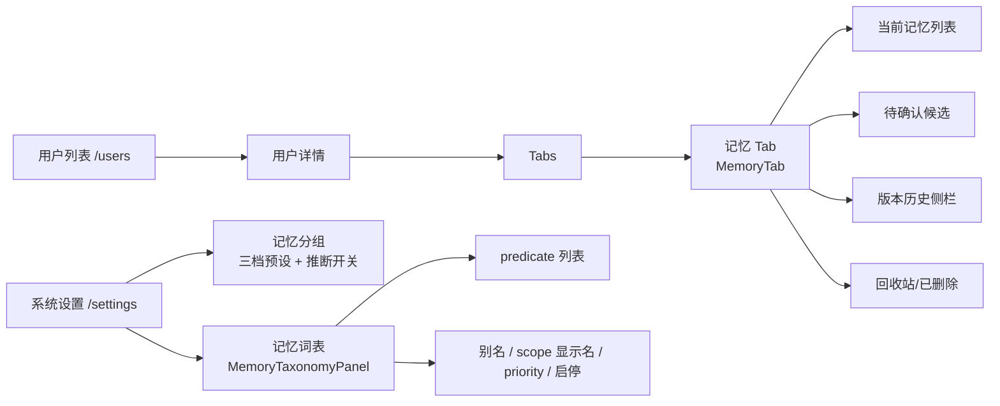
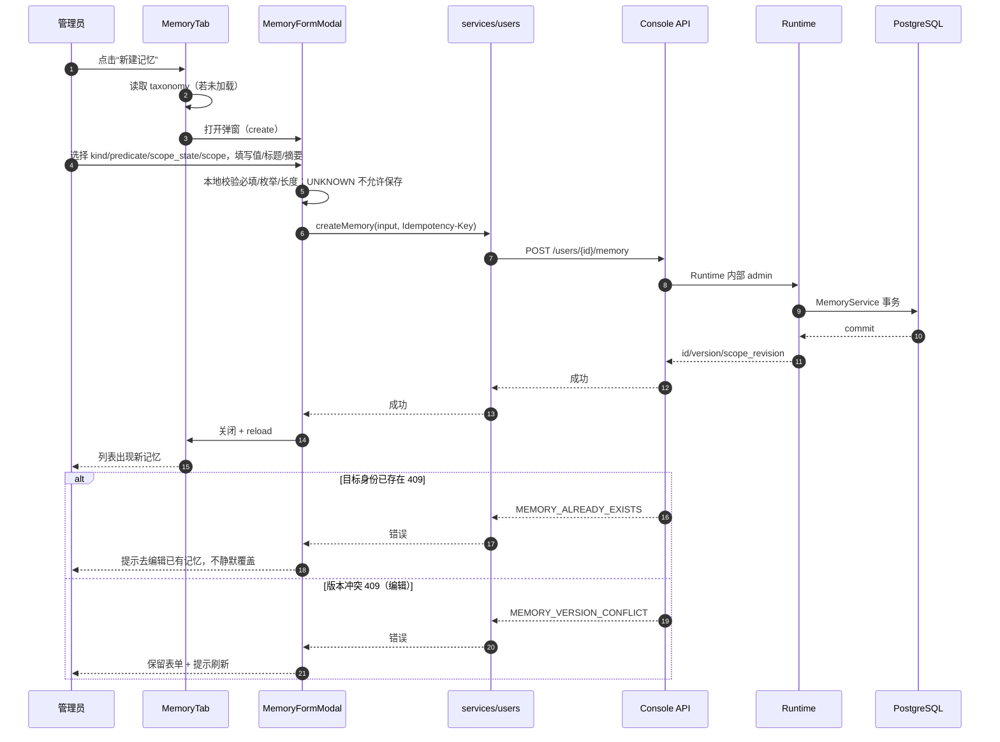
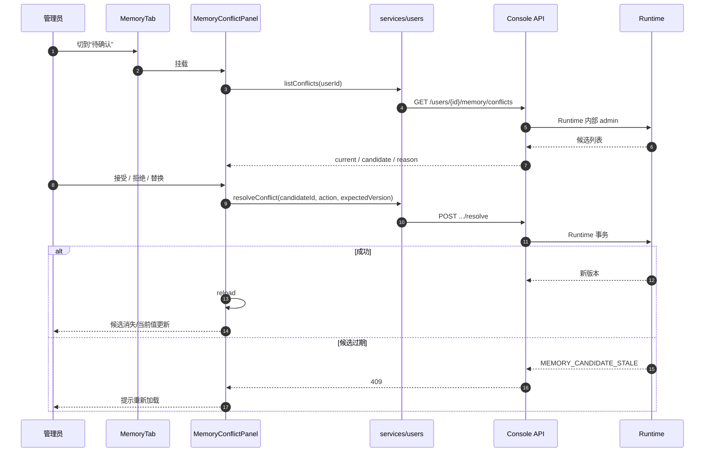
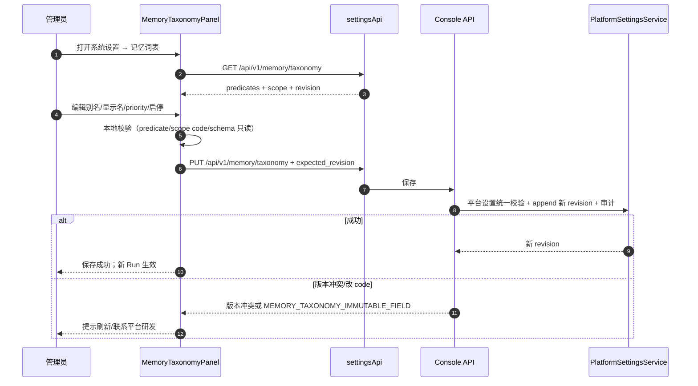
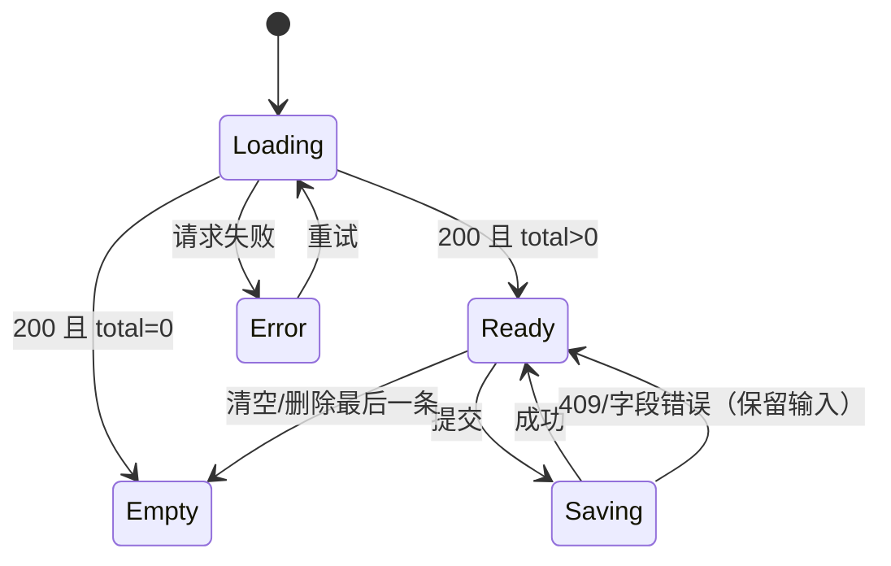

# 用户长期记忆 v2（准确率优先）Console 前端设计

> **文档编号**: FE-MEMORY-V2-1.3
> **文档版本**: v1.3
> **创建日期**: 2026-11-14
> **文档状态**: 设计评审中

**关联资产**: 后端设计 `user-memory-retrieval-optimization.backend.design.md`；PRD `user-memory-retrieval-optimization.prd.md`；场景 `user-memory-retrieval-optimization.scenarios.md`。

**评审边界说明**:
- **需求评审**: 第 2 章 → 通过后锁定需求基线。
- **设计评审**: 第 3 章 → 通过后锁定设计基线。

**ID 体系**: US（来自需求简报）、FEAT、CMP、NFR；场景引用 `user-memory-retrieval-optimization.scenarios.md` 的 S-/E-/B-。

---

## 1. 文档控制

### 1.1 责任人

| 角色 | 姓名 | 职责范围 |
|------|------|---------|
| 产品经理 | fluxion-harness | 记忆治理范围、管理员操作边界、交互验收 |
| 前端负责人 | fluxion-harness | 页面、组件、状态、错误处理 |
| 后端负责人 | fluxion-harness | DTO、契约、错误码、taxonomy API |
| 测试负责人 | fluxion-harness | 组件测试、人工验收、关键 E2E |

### 1.2 修订历史

| 版本 | 日期 | 作者 | 变更描述 |
|------|------|------|---------|
| v1.0 | 2026-11-14 | fluxion-harness | 按对齐结论设计：用户详情记忆 Tab、结构化表单、待确认候选、受控 taxonomy、三档预设 |
| v1.1 | 2026-11-14 | fluxion-harness | 复核修复：ADMIN-only、启用/禁用、回收站、scope 三态、身份字段只读、预设改为服务端展开、预算/评测口径同步 |
| v1.2 | 2026-11-14 | fluxion-harness | 同步后端 v1.2：SET 删除后同值重加走回收站恢复，不是新建；后台 NOTE 不在候选 ACCEPT 时分配身份 |
| v1.3 | 2026-11-14 | fluxion-harness | 同步后端 v1.3：单条删除不递增 forget_epoch；评测 query-macro 口径 |

---

## 2. 需求分析

### 2.1 需求概述

| 项目 | 内容 |
|------|------|
| **模块名称** | 用户长期记忆 v2 Console |
| **需求类型** | 页面重构 + 交互优化 |
| **业务背景** | 现有 Memory Tab 以自由 `memory_key/category/value` 为主，管理员无法看到 predicate/scope/结构化值，也无法处理后台推断与当前值的冲突；检索参数对管理员不可解释。 |
| **核心目标** | 让管理员能看懂、能维护、能纠错用户记忆；让 taxonomy 的别名/scope 可运营；不把算法参数暴露给管理员。 |

### 2.2 功能方案

| 功能 ID | 功能名称 | 功能描述 | 优先级 | 来源 |
|---------|----------|----------|--------|------|
| FEAT-01 | 用户记忆列表 | 在用户详情查看记忆：标题/摘要、kind/predicate/scope、当前值、来源、状态、版本、更新时间 | P0 | US-01/04 |
| FEAT-02 | 结构化创建/编辑 | 按 taxonomy 动态表单创建/编辑；服务端生成 key；`memory_id` 为句柄 | P0 | US-01/04 |
| FEAT-03 | 启用/禁用/删除/恢复/清空 | 带 `expected_version` 的管理动作；禁用/启用是独立动作；回收站可发现已删除记录 | P0 | US-04 |
| FEAT-04 | 待确认候选 | 查看推断候选 vs 当前值，接受/拒绝/替换；候选不注入 | P0 | US-02/04 |
| FEAT-05 | 版本历史 | 按 `memory_id` 查看历史、actor、原因、前后值 | P1 | US-04 |
| FEAT-06 | taxonomy 维护 | 管理员维护别名、显示名、priority、启停；不能改 predicate key/kind/cardinality/value schema/scope code | P1 | US-05 |
| FEAT-07 | 三档预设 | 系统设置 Memory 分组只显示保守/标准/积极 + 推断开关；服务端展开参数 | P1 | US-01 |
| FEAT-08 | 权限 | v1 治理面仅 ADMIN；非管理员不渲染记忆治理入口；不承诺普通用户只读 | P0 | US-04 |

### 2.3 范围与边界

| 类别 | 内容 |
|------|------|
| **范围（In Scope）** | 用户详情 Memory Tab、创建/编辑/启用/禁用/删除/恢复/清空、回收站、待确认候选、版本历史、系统设置里的 Memory 预设、taxonomy 受控维护 |
| **非范围（Out of Scope）** | 新一级菜单；独立记忆页面；taxonomy predicate 新增/删除；cardinality/value schema/scope code 编辑；复杂冲突工作台；批量导入/导出；客户/项目知识库；普通用户只读 |
| **有意妥协 / 技术债** | v1 治理面仅 ADMIN；不做移动端专门布局；不做多选批量操作；taxonomy 编辑只覆盖别名/显示名/priority/启停；复杂筛选后续按使用反馈增加 |

### 2.4 验收条件

场景唯一源：`user-memory-retrieval-optimization.scenarios.md`。

| 场景 ID | 前端设计影响 / 备注 |
|---------|--------------------|
| S-01 | 显式保存偏好：表单、确认、列表刷新 |
| S-02 | 单值事实、SET 成员与多值 NOTE 的列表/表单差异 |
| S-03 | scope 三态、全局默认与特定覆盖；UNKNOWN 不扩大 |
| S-04 | 编辑纠正；版本冲突提示 |
| S-05 | 待确认候选页；接受/拒绝 |
| S-06 | 列表/编辑/启用/禁用/删除/恢复/清空/回收站 |
| S-07 | taxonomy 别名/显示名维护；不能改 predicate/scope code |
| S-08 | PG head + Redis payload 对用户不可见；更新后立即新会话生效；Redis 故障时页面不报假成功 |
| S-09 | 历史侧栏；刷新后仍可见 |
| S-10 | 清空确认；清空后列表为空、候选消失 |
| S-11 | 经验/TASK_STATE 不在此页管理，不发生回归 |
| S-13 | 创建不能覆盖已有槽位；编辑不能改身份字段 |
| E-01 | 提炼失败降级 NOTE，页面提示可保存原文 |
| E-02 | Redis 故障不影响页面保存/列表读取 |
| E-03 | 非法 scope（含 UNKNOWN）/taxonomy/身份字段被拒绝 |
| E-04 | 409 版本冲突：保留表单、提示刷新 |
| E-05 | 无权限/跨用户不可见；v1 治理面仅 ADMIN |
| E-06 | 保存失败明确报错，不伪成功 |
| E-07 | 候选过期：提示重新加载 |
| E-08 | 清空后候选失效 |
| E-09 | AGENT 同内容被用户确认后权威/版本变化 |
| E-10 | SET 成员内容只读；变更走删除+创建；删除后同值重加只能从回收站恢复原身份 |
| E-11 | NOTE 重试复用 id；删除后同内容不自动复活 |
| B-01 | 空列表/空候选空态 |
| B-02 | 长文本/多值/最大条数边界 |
| B-03 | 配额上限提示 |
| B-04 | 分页边界/筛选无结果 |
| B-05 | scope 未知不扩大；全局+特定不同时展示 |

#### 2.4.1 验证环境假设

| 维度 | 假设 | 验证方式 | 不满足时 |
|------|------|----------|----------|
| 浏览器 | 现有 Console 支持的 Chrome/Edge 版本 | Playwright projects / 人工 | 记录缺失项 |
| 数据 | 至少一个用户、一个 agent、一个已绑定模型；taxonomy 已 seed | 测试 fixture | 记录 owner |
| 后端 | Runtime/Console/PG/Redis 可用 | 健康检查 | 拆分场景 |
| 权限 | ADMIN 与非 ADMIN 账号各一个 | 人工登录 | 记录缺失项 |
| 测试预算 | 组件测试覆盖表单/空态/错误；关键旅程 E2E | Task tests | 记录未覆盖风险 |

---

## 3. 前端技术设计

### 3.1 技术选型

| 类别 | 选型 | 版本 | 选型理由 |
|------|------|------|----------|
| 框架 | React | 18 | 现有 Console |
| 语言 | TypeScript | 5.7 | 现有 Console |
| UI | Semi Design | 现有版本 | 现有列表/表单/侧栏组件 |
| 国际化 | react-i18next | 现有 | 所有文案走词条 |
| 数据请求 | 现有 `api/client` + `services/users` / `services/settingsApi` | 现有 | 复用错误处理、Idempotency-Key、trace |
| 路由 | 现有 Console 路由 | 现有 | 不新增一级菜单 |

### 3.2 页面与路由结构

| 页面 | 路由/入口 | 布局 | 说明 |
|------|-----------|------|------|
| 用户列表 | `/users` | 现有列表 | 不变 |
| 用户详情 | `/users` → 用户详情抽屉/弹层 | 现有 Tabs | 新增/重构“记忆” Tab |
| 系统设置 | `/settings` | 左侧分组 + 右侧面板 | 新增“记忆”预设 + “记忆词表”自定义面板 |

> `RULE-ui-001` 固定十二项菜单；不新增“记忆”一级菜单。记忆治理在用户详情，taxonomy 在系统设置。

**页面结构图**



**图说明**：记忆治理放在用户详情，符合“用户级记忆”的操作上下文；系统设置只放全局预设和 taxonomy。两者都不新增一级菜单。

### 3.3 组件设计

```text
<UserDetailTabs>                         # 现有容器
└─ <MemoryTab>                           # 容器：列表/筛选/分页/动作
   ├─ <MemoryToolbar>                    # 展示：创建、关键词、筛选
   ├─ <MemoryListTable>                  # 展示：DataTable 列
   │  └─ <MemoryValuePreview>            # 展示：值/摘要/标签
   ├─ <MemoryFormModal>                  # 容器：创建/编辑
   │  ├─ <MemoryPredicateSelect>         # 展示：taxonomy predicate
   │  ├─ <MemoryScopeFields>             # 展示：scope 动态字段
   │  └─ <MemoryValueField>              # 展示：按 value schema 渲染
   ├─ <MemoryConflictPanel>              # 容器：待确认候选
   ├─ <MemoryRecycleBinPanel>            # 容器：已删除记录/恢复
   ├─ <MemoryHistorySideSheet>           # 现有，改为 memory_id
   └─ <MemoryActionConfirm>              # 展示：启用/禁用/删除/清空确认

<SettingsPage>                           # 现有容器
└─ <MemorySettingsPanel>                 # 容器：三档预设 + 推断开关
   └─ <MemoryProfileFields>              # 展示：预设说明

<SettingsPage>
└─ <MemoryTaxonomyPanel>                 # 容器：taxonomy 受控维护
   ├─ <MemoryPredicateTable>             # 展示：predicate 列表
   ├─ <MemoryAliasEditor>                # 展示：别名/显示名编辑
   └─ <MemoryScopeValueEditor>           # 展示：scope code 只读 + 别名编辑
```

| 组件 ID | 组件名 | 类型 | 复用来源 | 职责 |
|---------|--------|------|----------|------|
| CMP-01 | `MemoryTab` | 容器 | 现有 `MemoryTab.tsx` 重构 | 列表、筛选、分页、动作、刷新 |
| CMP-02 | `MemoryToolbar` | 展示 | 新拆 | 创建、关键词、kind/status/predicate 筛选 |
| CMP-03 | `MemoryListTable` | 展示 | `DataTable` | 列、状态、操作 |
| CMP-04 | `MemoryFormModal` | 容器 | `FormModal` | 动态表单、提交、错误 |
| CMP-05 | `MemoryPredicateSelect` | 展示 | `Select` | 从 taxonomy 读 predicate |
| CMP-06 | `MemoryScopeFields` | 展示 | `Select` | 选择 ABSENT/EXPLICIT；按 predicate 的 scope 维度渲染；UNKNOWN 只读展示 |
| CMP-07 | `MemoryValueField` | 展示 | `Input`/`Select`/`DatePicker` | 按 value schema 渲染 |
| CMP-08 | `MemoryConflictPanel` | 容器 | 新 | 候选列表、接受/拒绝/替换 |
| CMP-09 | `MemoryHistorySideSheet` | 容器 | 现有 | 按 `memory_id` 读历史 |
| CMP-10 | `MemoryTaxonomyPanel` | 容器 | 新 | 系统设置里的受控 taxonomy 维护 |
| CMP-11 | `MemorySettingsPanel` | 容器 | 现有 Settings | 三档预设 + 推断开关 |
| CMP-12 | `MemoryRecycleBinPanel` | 容器 | 新 | 已删除记录列表、恢复；ADMIN-only |

> 分层纪律：`MemoryTab`/`MemoryConflictPanel`/`MemoryTaxonomyPanel` 负责取数与状态；表格、字段、状态标签只接收 props，事件上抛。

**Memory 预设（系统设置 → 记忆）**

| 预设 | 注入条数 | 注入字节 | 偏好条数 | 偏好字节 | 候选 K |
|------|---------:|---------:|---------:|---------:|-------:|
| 保守 | 5 | 1024 | 2 | 384 | 3 |
| 标准 | 10 | 2048 | 3 | 512 | 5 |
| 积极 | 15 | 4096 | 5 | 768 | 8 |

- 页面只显示三档单选 + “注入未确认推断”开关；
- 不显示原始数字；前端只提交 `profile` 和 `inject_inferred`，由服务端展开；
- `min_score` 不进入预设：旧归一化分数不能直接套到二值 BM25；经验 lane 的阈值仍由 `LearningSettings` 独有；
- 修改只影响新 Run，页面提示“当前 Run 不受影响；下一条消息创建的新 Run 生效”；
- predicate 启停/priority/别名在新 Run 对**已有记忆行**同样生效；当前 Run 继续使用旧 taxonomy。页面提示不能只说“只影响未来写入”。
- 保存失败/版本冲突沿用系统设置现有错误处理。

### 3.4 组件接口契约

#### CMP-01 `MemoryTab`

| Props | 类型 | 必填 | 默认 | 说明 |
|-------|------|------|------|------|
| `userId` | `string` | 是 | — | 当前用户 |
| `canManage` | `boolean` | 是 | — | v1 仅 ADMIN；false 时不渲染治理 Tab |
| `onMutated` | `() => void` | 否 | — | 写操作成功后刷新用户计数 |

| Events | 载荷 | 触发 |
|--------|------|------|
| `onMutated` | — | 创建/编辑/启用禁用/删除/恢复/清空/候选处理后 |

#### CMP-04 `MemoryFormModal`

| Props | 类型 | 必填 | 说明 |
|-------|------|------|------|
| `visible` | `boolean` | 是 | 创建/编辑共用 |
| `mode` | `"create" \| "edit"` | 是 | 创建不传 id；编辑传 `memory_id` |
| `taxonomy` | `MemoryTaxonomy` | 是 | predicate/scope/value schema |
| `initial` | `MemoryItem \| null` | 否 | 编辑初始值 |
| `saving` | `boolean` | 是 | 禁用提交 |
| `error` | `MemoryFormError \| null` | 否 | 字段/全局错误 |
| `onSubmit` | `(input: MemoryWriteInput) => void` | 是 | 上抛 |
| `onCancel` | `() => void` | 是 | 关闭 |

- 编辑模式：`memory_kind`/`predicate`/`scope`/`scope_state` 只读，不能改身份字段；只改内容/标题/摘要/标签/有效期。
- **SET 成员**：编辑时 `content` 也视为身份，只读；变更成员 = 删除旧成员 + 新建新成员。v1 不提供“原子替换”按钮，页面给明确说明。删除后重新添加同值会命中 tombstone（`MEMORY_ALREADY_EXISTS`），UI 应引导到回收站“恢复原身份”，不能承诺“可作为新成员重新创建”。
- 创建模式：`scope_state` 由表单选择 `EXPLICIT` 或 `ABSENT`；`UNKNOWN` 不允许保存，提示补齐条件。
- 标题/摘要/tags 的长度和条数按 contracts 配置校验；服务端错误定位到字段，不在前端写死上限。
- 创建命中已有槽位返回 `MEMORY_ALREADY_EXISTS`，引导用户去编辑，不静默覆盖。

#### CMP-08 `MemoryConflictPanel`

| Props | 类型 | 必填 | 说明 |
|-------|------|------|------|
| `userId` | `string` | 是 | 用户 |
| `canManage` | `boolean` | 是 | v1 仅 ADMIN 可操作 |
| `onResolved` | `() => void` | 否 | 成功后刷新 |

#### CMP-10 `MemoryTaxonomyPanel`

| Props | 类型 | 必填 | 说明 |
|-------|------|------|------|
| `canManage` | `boolean` | 是 | v1 仅 ADMIN |
| `taxonomy` | `MemoryTaxonomy` | 是 | 当前版本 |
| `revision` | `number` | 是 | 平台设置 revision |
| `saving` | `boolean` | 是 | 保存中 |
| `errors` | `Record<string,string>` | 否 | 字段错误 |
| `onSave` | `(draft, expectedRevision) => void` | 是 | 保存 |
| `onReload` | `() => void` | 是 | 409 后刷新 |

- predicate key/kind/cardinality/value schema/scope code 只读；别名、显示名、priority、启停可编辑。
- “新增/删除 predicate”不渲染；显示“请联系平台研发”。

#### CMP-12 `MemoryRecycleBinPanel`

| Props | 类型 | 必填 | 说明 |
|-------|------|------|------|
| `userId` | `string` | 是 | 用户 |
| `onRestored` | `() => void` | 否 | 恢复后刷新 |

- 列表来自 `GET /memory?include_deleted=true`；仅 ADMIN。
- 恢复需要 `memory_id` + 保留版本；恢复后 identity/version 不重置。
- 空态明确“没有已删除记忆”，不把 403/失败伪装成空。

#### 3.4.1 前端 DTO 映射

| DTO | 关键字段 | 用途 |
|-----|----------|------|
| `MemoryItem` | `id`、`memory_key`（只读）、`memory_kind`、`predicate`、`scope_state`、`scope_raw`、`scope`、`content`、`title`、`summary`、`tags`、`status`、`version`、`author`、`authority`、`source_quote`、`expires_at`、`update_time` | 列表/详情 |
| `MemoryWriteInput` | 创建：`memory_kind`、`predicate`、`scope_state`、`scope`、`content`、`title`、`summary`、`tags`、`source_quote`、`expires_at`；编辑：`memory_id`、`expected_version` + 内容字段（不含身份字段） | 创建/编辑 |
| `MemoryStateInput` | `memory_id`、`expected_version`、`expires_at?` | 启用/禁用 |
| `MemoryConflictItem` | `candidate_id`、`memory_id`、`current`、`candidate`、`reason`、`base_version`、`forget_epoch`、`create_time` | 待确认列表 |
| `MemoryTaxonomy` | `version`、`predicates[]`、`scope_dimensions{}` | 动态表单/词表页 |
| `MemoryProfile` | `profile`、`inject_inferred` | 系统设置 |
| `MemoryHistoryItem` | `version`、`change_reason`、`actor_type`、`actor_id`、`after`、`create_time` | 历史侧栏 |

- 字段名与后端 DTO 一致；UI 展示文案走 i18n，不把英文枚举直接展示给用户。
- 时间由后端返回带 offset 的 Console 格式，前端统一 `DateTimeText` 渲染。
- `memory_key` 只读；所有编辑/启用禁用/删除/恢复使用 `memory_id`。
- 删除后的记录只在回收站/`include_deleted=true` 中出现，刷新后仍可发现。

### 3.5 状态与数据流

#### 3.5.1 列表

```text
MemoryTab 初始化
  → listMemory(userId, {page,page_size,kind,status,predicate,q,include_deleted})
  → loading / empty / error
  → 渲染 DataTable
  → 创建/编辑/启用禁用/删除/恢复/清空/候选成功
  → reload + onMutated
```

- 筛选变化重置 page=1。
- 请求序号 `requestSeq` 防止旧响应覆盖新响应（沿用现有实现）。
- 关键词输入使用“回车/按钮”生效，避免每次输入请求。

#### 3.5.2 创建/编辑



**图说明**：表单不提交 `memory_key`，只提交 kind/predicate/scope_state/scope/content/title/summary/source_quote；服务端生成 key。创建只能命中不存在的身份；编辑额外带 `memory_id` 和 `expected_version`，且身份字段只读。

#### 3.5.3 待确认候选



**图说明**：候选页只处理后台推断与当前值的差异，不做完整冲突工作台；旧值仍在当前列表，候选不注入。

#### 3.5.4 taxonomy 维护



**图说明**：taxonomy 是平台设置版本的一部分；管理员只能改别名、显示名、priority、启停。新增/删除 predicate、修改 cardinality/value schema/scope code 的入口不渲染，页面显示“请联系平台研发”。保存校验必须在平台设置统一层，专用 API 不能绕过。

### 3.6 UI 状态

| 状态 | 表现 | 说明 |
|------|------|------|
| loading | 表格骨架/Spin | 不渲染旧数据 |
| empty | `EmptyState` + “暂无记忆” | 创建按钮仍可见（有权限） |
| error | `ErrorState` + 重试 | 不把失败显示成空列表 |
| read-only | v1 不提供；非 ADMIN 不渲染治理入口 | 保持现有 users router ADMIN-only |
| saving | 提交按钮 loading，表单禁用 | 防重复提交 |
| version conflict | Banner + “刷新后重试” | 保留用户输入 |
| already exists | 提示去编辑已有槽位 | 创建不覆盖 |
| taxonomy immutable | 字段禁用 + 说明 | 不提供绕过入口 |
| no permission | 不渲染整个 Tab/入口；API 403 | 与现有 Console 权限一致 |
| recycle bin empty | 明确“没有已删除记忆” | 不把 403/失败伪装成空 |

**状态图**



### 3.7 样式方案

- 沿用 Semi Design token 与现有列表布局；不引入新 CSS 框架。
- 用户详情内不重复页头/说明块；列表采用“左上操作 + 右上筛选 + 表格 + 右下分页”。
- 值/摘要用 `TableText` 截断；完整内容在编辑/详情中展示。
- 状态用 `StatusTag`：ACTIVE 绿色、DISABLED 灰色、EXPIRED 橙色、PENDING 蓝色。
- scope/tags 用 `Tag` 展示；不把长 JSON 直接铺在表格里。

### 3.8 可访问性与兼容性

- 表单字段有 label、必填标识、错误文本关联；键盘可操作。
- 弹窗打开后焦点进入第一个字段，关闭后回到触发按钮。
- 删除/清空使用 `ConfirmAction`，文案明确不可逆/可恢复。
- 颜色不是唯一状态信号，状态标签带文字。
- 浏览器兼容按现有 Console 基线；不做移动端专项适配。

### 3.9 现有代码改造点

| 文件 | 改造 |
|------|------|
| `modules/user-identity/UserDetailTabs.tsx` | 保留“记忆”Tab；仅 ADMIN 渲染；向 `MemoryTab` 传 `canManage`、`onMutated`；不新增一级菜单 |
| `modules/user-identity/MemoryTab.tsx` | 重构列表/表单/筛选；保留命令上下文、DataTable、PaginationFooter、ConfirmAction、FormModal、HistorySideSheet；增加启用/禁用/回收站 |
| `modules/user-identity/memoryTypes.ts` | 新增 `MemoryKind`、`predicate`、`scope_state`、`scope_raw`、`scope`、`content`、`title`、`summary`、`tags`、`conflict` 类型 |
| `modules/user-identity/memoryOptions.ts` | 标签从 taxonomy/词条读取；不再硬编码 category 列表 |
| `modules/user-identity/services/users.ts` | 扩展 list（include_deleted）/create/update/delete/restore/clear/enable/disable/conflicts/taxonomy 调用 |
| `modules/user-identity/MemoryHistorySideSheet.tsx` | 入参从 `memory_key` 改为 `memory_id`；展示 v2 字段 |
| `modules/settings/pages/SettingsPage.tsx` | 增加“记忆”自定义分组/面板；不破坏现有通用设置 |
| `modules/settings/components/SettingsGroupPanel.tsx` | 如通用渲染无法覆盖，改为按 group key 分派 `MemorySettingsPanel`/`MemoryTaxonomyPanel` |
| `modules/settings/hooks/usePlatformSettings.ts` | 复用现有加载/保存/冲突；taxonomy 走专用 API 或设置字段 |
| `i18n` 词条 | 新增 `user.memory.*`、`settings.memory.*`、错误码文案 |

### 3.10 自动回归建议

- 组件测试：
  - 列表 loading/empty/error；ADMIN-only 不渲染；
  - 表单按 taxonomy 动态渲染；必填/枚举/长度错误；UNKNOWN 不可保存；
  - 编辑身份字段只读；创建已存在提示去编辑；
  - 启用/禁用/回收站/恢复；
  - 409 保留输入并提示；
  - 冲突接受/拒绝/过期提示；
  - taxonomy 只读字段禁用。
- 契约测试：
  - DTO 字段/枚举/时间格式；
  - `memory_id` 路径、`expected_version`、`Idempotency-Key`、`include_deleted`。
- E2E（关键旅程，真实后端）：
  - 管理员在用户详情创建一条偏好 → 列表出现 → 编辑为另一值 → 历史可查；
  - 禁用 → 不再注入；回收站恢复 → identity/version 不重置；
  - 管理员处理一条待确认候选 → 当前值更新；
  - 非 ADMIN 访问用户记忆接口 403；不出现“只读但可访问”的假承诺。

---

## 4. 风险与依赖

| 风险 | 影响 | 应对 |
|------|------|------|
| taxonomy 字段过多导致表单复杂 | 管理员不会用 | 只显示 core predicate；扩展默认折叠/按需启用 |
| dynamic value schema 渲染差异 | 表单错误/不一致 | 统一 `MemoryValueField`；服务端二次校验 |
| 409/候选过期处理不清晰 | 用户重复操作 | Banner + 刷新 + 保留输入 |
| 现有 MemoryTab 测试依赖旧字段 | 回归失败 | 同步更新 fixture/断言；不保留旧字段兼容 |
| 系统设置通用表单不支持嵌套 taxonomy | 实现复杂 | 自定义 `MemoryTaxonomyPanel`，不塞进通用字段渲染 |
| 权限差异 | 非 ADMIN 访问记忆治理 | v1 仅 ADMIN；路由 403；不渲染入口 |

---

## 附录：术语表

| 术语 | 定义 |
|------|------|
| Memory Tab | 用户详情中的记忆治理页签 |
| taxonomy | predicate/scope/alias/value schema 的受控目录 |
| SLOT | 单值 predicate 槽位 |
| NOTE | 多值差异化信息 |
| PENDING | 后台推断与当前值不同的待确认候选 |
| `memory_id` | 治理 API 的稳定句柄；`memory_key` 只读 |

---

*文档结束*
