# 定时任务与自然语言调度 v2 后端设计

> **文档编号**: MOD-SCHEDULE-V2-1.0
> **文档版本**: v1.0
> **创建日期**: 2026-11-15
> **文档状态**: 设计评审中
> **设计输入**: 外部评审稿 `fluxion-scheduled-task-v2.design-full.md`（2026-11-14）+ 2026-11-14/15 两轮架构评审结论
> **设计基线**: 接受破坏性重构；不做兼容层、双写或旧状态映射；开发阶段允许重建调度表。

**评审边界说明**:
- **需求评审**: 第 2 章（需求分析）→ 通过后锁定需求基线。
- **设计评审**: 第 3-4 章（技术设计 + 部署运维）→ 通过后锁定设计基线。
- **交接契约**: 2.5 验收条件；场景唯一源为 `scheduled-task-v2.scenarios.md`。

**ID 体系**: US、FEAT、API、RULE、NFR、RISK；场景使用 S-/E-/B-。

**本版关键结论（先读）**:

1. **Agentic 是 P0**。Worker 不再只是 Skill 执行器；它成为通用持久执行平面，内嵌与 Runtime 共用的 `AgentExecutionKernel`。
2. **Agentic 必须完整**。Kernel 从 Runtime 现有 executor 抽取，不允许“P0 简化版”、TODO stub 或只返回文本的半成品。
3. **Fire 只做 occurrence 台账，不做第二套 claim**。Scheduler 完成“时间 + 准入 + Fire/Execution 原子落库”，Worker 只 claim Execution。
4. **Fire 身份不含 revision**。`(tenant_id, schedule_id, scheduled_at)` 是 occurrence 唯一键；revision 是 Fire 的属性。
5. **WebChat 完全不投递**。WebChat 定时任务只做任务中心 pull；问题、结果、状态都通过任务中心查询。
6. **MSSWWEB 只保证契约不返工**。Task Center service/contracts 不依赖 WebChat，并用 Fake surface 契约测试钉住；**MSSWWEB 任务中心（路由、BFF 页面、接入文档）另立需求**——既不在本需求，也不在 MSSW 入口需求里做。
7. **Human-in-the-loop 是任务中心待处理事项**，不是独立待办模块；WebChat 不推进会话，WeCom 推送到创建时会话。
8. **Console 权限保持现状**。Builder 与 Admin 当前为同一人，本设计不引入 Console ADMIN-only。
9. **开发阶段一次性重建**。保留 `task.workspace/workspace_lease`，其余调度相关表重建；不做历史数据兼容。
10. **P0 Agentic 允许 ASYNC Skill**。Agent 循环已在 `packages/agent-core`（`AgentRunner`/`RunnerCheckpoint`）；本轮做的是**泛化 Kernel 的 suspension/事件端口**并让 Runtime、Worker 各实现一份 `ExecutionAdapter`，不是重写循环。Task-owned async operation、model capacity、artifact 通过 Runtime 内部 API 使用，Worker 不跨 schema 直写 `runtime.*`。
11. **Snapshot 采用 B**：每个 Execution 冻结“依赖范围内”的完整非密钥 JSON，不保存整库 catalog；随 Execution 保留期释放，不执行完立即释放。
12. **P0 承诺任务产物下载**：复用 `runtime.artifact.task_id`（值为 `task_execution.id`；该列今天从未写入）；Task-owned 行 `run_id` 必须为 NULL，存储键按 task 生成，补写入/版本端点、任务中心下载端点与 owner+agent 授权。
13. **DST P0 策略**：gap=`SKIP`，fold=`FIRST`；gap/second-fold 只写 SCHEDULE 审计事件，不伪造 UTC Fire；P1 再扩展。
14. **更新/确认/ONCE**：更新按旧 Revision **未开始（started_at IS NULL）** 的 Execution 取消；Draft 必须由用户经**鉴权确认端点**确认（记录 surface+ref，模型运行在工具上下文无法调用）；ONCE 准入失败进入终态，只允许新建。
15. **ASYNC 竞态**：调用身份唯一（不含 input_hash）+ input_hash 冲突判定 + 进入等待前 ready-check + 持久 receipt/水位 + PG 周期补扫 + wake-up hint（仅提示，不作正确性来源）；迟到结果只记录，不得复活终态。
16. **Owner 联合契约**：`owner_type=RUN|TASK`；Run/Task 互斥；不要把 ToolOperation 的 `task_id` 当 owner。
17. **WAITING_EXTERNAL 三类**：ASYNC_OPERATION / EXTERNAL_POLL / BATCH_FANIN；`wait_payload_json.operations[]` 是唯一等待索引，不另设便捷列。
18. **取消矩阵**：`FUTURE_ONLY` 保留 active Execution + OPEN interaction；`ALL_ACTIVE` 才终止并关闭。
19. **全局锁序**：runtime_operation → Schedule → Fire → root → parent → child → event/outbox。
20. **本轮评审修订（2026-11-15）**：started_at/finished_at、ONCE 只新建、Snapshot 补 MCP/模型池、多个 ASYNC operation、产物版本下载、draft_hash 71 字符均已在正文按 P0 定义，此处只做索引，不再作为延后项。

---

## 目录

- [1. 文档控制](#1-文档控制)
- [2. 需求分析](#2-需求分析)
- [3. 技术设计](#3-技术设计)
- [4. 部署与运维](#4-部署与运维)
- [5. 风险与依赖](#5-风险与依赖)
- [6. 需求追溯矩阵](#6-需求追溯矩阵)
- [Spec Compliance Matrix](#spec-compliance-matrix)
- [附录：术语表](#附录术语表)

---

## 1. 文档控制

### 1.1 责任人

| 角色 | 姓名 | 职责范围 |
|------|------|---------|
| 产品负责人 | fluxion-harness | 需求基线、自然语言行为、业务验收 |
| 后端负责人 | fluxion-harness | Kernel、Schedule/Fire/Execution、Worker、数据与接口 |
| Runtime 负责人 | fluxion-harness | Kernel 抽取、交互式 Run 适配、Memory/Tool/Model 装配 |
| IM Gateway 负责人 | fluxion-harness | WebChat/WeCom surface、任务中心读面、主动投递 |
| 前端负责人 | fluxion-harness | WebChat 定时任务 Tab、Console 运营页 |
| 测试负责人 | fluxion-harness | 并发、时区、幂等、Human、迁移与 E2E |

### 1.2 修订历史

| 版本 | 日期 | 作者 | 变更描述 |
|---|---|---|---|
| v0.1 | 2026-11-14 | OpenAI | 原定时任务设计稿 |
| v0.2 | 2026-11-15 | fluxion-harness | 按代码事实与评审结论重构：Agentic Kernel P0、Fire 幂等、WebChat pull、MSSWWEB surface、一次性重建 |
| v1.0 | 2026-11-15 | fluxion-harness | 形成可评审的后端设计基线 |
| v1.1 | 2026-11-15 | fluxion-harness | 评审修订：确认与生效合并为 API-27；异步结果改「收件箱 + 补扫 + hint」；Kernel 边界改为端口泛化 + 两份适配器；occurrence 改本地计划槽口径；补非创建命令幂等台账；删 `pending_operation_id`/`current_revision_no`/同名唯一；修正表名与迁移步骤；与 MSSW 入口设计对齐（ChatSurface 认证、入口非隔离边界、`origin_bot_account_id`、独立 `schedule.draft.ready` 卡片）；MSSWWEB 任务中心明确另立需求（本需求只锁契约） |

### 1.3 设计输入与已锁定决策

| 决策 | 结论 |
|---|---|
| Agentic | P0；Kernel 从 Runtime 抽取，Runtime/Worker 共用；不做简化版 |
| 记忆 | 定时 Agentic 只读注入，冻结 revision；不写长期记忆 |
| WebChat | 完全不投递；任务中心 pull；多会话不绑定 Conversation |
| MSSWWEB | 同一 TaskCenterService/contracts，接口按 ChatSurface 认证（`soc-token` → Console 验签 → `ChatPrincipal`）；**任务中心落地另立需求**（路由 `/api/v1/msswwweb/task-center/*` + BFF 页面 + 接入文档），本需求只锁契约 |
| Human 询问 | 任务中心待处理事项；WeCom 推送到创建时会话；无独立待办模块 |
| Console 权限 | 保持现状；不引入 ADMIN-only |
| 数据库 | 开发阶段一次性重建；保留 workspace 两表；不做 importer/双写 |
| 周期 | P0 只做 CRON/ONCE + IANA；RRULE/工作日历 P1 |
| Misfire | P0 只做 SKIP + `missed_count`；FIRE_ONCE/CATCH_UP P1 |
| Skill 身份 | 保留 `skill_id` UUID；移除 `intent_key` |
| SQL 契约 | 现有 `task_execution` 的 `execution_mode` 改名为 `skill_execution_mode`；新增 `task_type` |
| Agentic 工具 | P0 允许 MCP + SYNC/ASYNC Skill；ASYNC 走工具级 suspension |
| Async/Capacity/Artifact owner | Runtime 拥有 `runtime.*`；Worker 通过内部 API 以 `owner_type=TASK` 使用；不跨 schema 直写 |
| Snapshot | B：每个 Execution 冻结依赖范围内完整非密钥 JSON；大小上限 + 保留期 |
| Task artifact | P0 支持任务中心下载；复用 `runtime.artifact.task_id` |
| DST | gap=SKIP，fold=FIRST；gap/second-fold 写 SCHEDULE 事件，不建 Fire；P1 扩展 |
| 确认 | Draft 经鉴权确认端点确认（surface+ref 落库）；模型在工具上下文无法代确认 |
| 版本 | `config_version`（用户配置 CAS）与调度进度分离 |
| ASYNC 竞态 | 调用身份唯一 + input_hash 冲突 + 进入等待前 ready-check + 结果水位 + PG 补扫 + 迟到 CAS |
| Owner | `owner_type=RUN/TASK`；Run/Task 互斥；Task 用 `owner_task_execution_id` |
| 等待种类 | ASYNC_OPERATION / EXTERNAL_POLL / BATCH_FANIN |
| 取消 | FUTURE_ONLY / ALL_ACTIVE 两档 |
| 锁序 | operation → Schedule → Fire → root → parent → child → event/outbox |
| ONCE | 准入失败 ENDED(ADMISSION_FAILED)；只允许新建 |
| Kernel 边界 | `AgentRunner` 已在 agent-core；本轮泛化 suspension/事件端口 + 两份 `ExecutionAdapter` |
| Artifact / Capacity | 现有 HTTP 面只有 artifact 读与 Probe 容量；Task-owned 写入与容量预留是**新增接口** |
| 结果唤醒 | 不做 Runtime→Worker 入站回调：持久结果 + PG 补扫 + 独立 wake-up hint |
| 表名 | 新 Fire 表统一 `task.schedule_fire`；运行操作表是 `task.runtime_operation` |

---

## 2. 需求分析

### 2.1 需求概述

| 项目 | 内容 |
|---|---|
| 模块名称 | 定时任务与自然语言调度 |
| 模块 ID | MOD-SCHEDULE-V2 |
| 所属系统 | Fluxion Agent Execution Platform |
| 需求类型 | 架构重构 + 核心能力补齐 |
| 业务背景 | 现有定时任务只支持“已审批 Skill + 固定参数 + CRON/ONCE”，无法承接 IM 自然语言表达的提醒、定时查询和 Agentic 任务；Fire 历史、Human 协作、并发策略、通道差异和上下文持久化均缺失 |
| 核心目标 | 用户在 WebChat/WeCom 用自然语言创建、查询和管理定时任务；平台可靠解析意图、验证依赖、冻结上下文、按时执行、保留每次触发历史，并按 surface 能力呈现结果 |

### 2.2 痛点与价值

| 维度 | 当前问题 | 目标 |
|---|---|---|
| 自然语言 | 只有 `create_schedule` 工具，必须有 Skill 与 delivery route；没有 Draft/确认 | 三模式 Draft + Preflight + 确认 |
| 执行模式 | 只有 Skill；REMINDER/AGENTIC 不可表达 | 统一 `task_type`：REMINDER/SKILL/AGENTIC/BATCH |
| 创建可靠性 | 依赖缺失通常在触发时才暴露 | Draft 阶段校验；永久错误明确反馈 |
| Fire 历史 | 跳过只写 `last_skipped_at`，没有 occurrence 台账 | `schedule_fire` 每个处理区间可追溯 |
| 并发 | 同 Schedule 可无限重叠 | SKIP_IF_RUNNING/QUEUE/ALLOW_PARALLEL |
| 通道 | WebChat 定时任务创建后投递失败；WeCom 主动推送与 WebChat 混在一起 | WebChat pull；WeCom PUSH；MSSWWEB 只锁契约（落地另立需求） |
| Human | 执行中缺参数只能失败 | WAITING_HUMAN + resume 同一 Execution |
| 时区 | 只有 CRON/ONCE + croniter | IANA + 本地墙钟；P1 RRULE |
| 版本 | Skill 最新版解析已有，但 Snapshot 缺工具/授权/记忆 | Snapshot v4 |
| 上下文 | `input_template` 自由 JSON，缺少规范化目标/授权范围 | Revision 单一来源 + Context |

**用户故事**

| 编号 | 用户故事 | 优先级 |
|---|---|---|
| US-01 | 作为用户，我希望在 WebChat/WeCom 用自然语言创建提醒、Skill 或 Agentic 定时任务 | P0 |
| US-02 | 作为用户，我希望创建前看到“做什么、何时、时区、结果在哪看”，确认后才生效 | P0 |
| US-03 | 作为用户，我希望查看每次计划触发的历史、结果、失败原因和跳过原因 | P0 |
| US-04 | 作为用户，我希望 Skill 更新后下一次触发自动使用最新版，历史执行不漂移 | P0 |
| US-05 | 作为 WebChat 用户，我希望在“定时任务”Tab 主动查看结果，不被聊天流推送打断 | P0 |
| US-06 | 作为用户，我希望暂停、恢复、取消、修改我的定时任务 | P0 |
| US-07 | 作为用户，我希望创建时的条件、参数和输出偏好在后续触发中不丢失 | P0 |
| US-08 | 作为用户，我希望任务按我的 IANA 时区和当地日历触发 | P0 |
| US-09 | 作为用户，我希望 Agentic 任务缺信息时能在任务中心回答并继续同一个执行 | P0 |
| US-10 | 作为用户，我希望同一任务不会无限重叠，可选择跳过、排队或有限并行 | P0 |
| US-11 | 作为 Console 使用者，我希望查看 Schedule/Fire/Execution 并执行暂停/恢复/取消 | P0 |
| US-12 | 作为后续 MSSWWEB 接入方，我希望任务中心契约与 WebChat 同形，后续另立需求只加路由和页面 | P0 |
| US-13 | 作为 Agentic 用户，我希望任务只使用我授权的工具，且不能动态扩权 | P0 |
| US-14 | 作为用户，我希望 Agentic 任务读取我的长期记忆但不偷偷写入记忆 | P0 |

### 2.3 功能方案

#### 2.3.1 功能清单

| 功能 ID | 功能名称 | 功能描述 | 优先级 | 来源 |
|---|---|---|---|---|
| FEAT-01 | 三模式 | REMINDER / SKILL / AGENTIC（BATCH 为内部执行类型） | P0 | US-01 |
| FEAT-02 | 自然语言创建 | 解析目标、规则、参数、时区、模式；生成 Draft | P0 | US-01/02 |
| FEAT-03 | Draft + Preflight | 服务端校验依赖、授权、凭据、配额、投递能力 | P0 | US-02 |
| FEAT-04 | Fire 台账 | 每个处理区间独立 Fire；跳过/失败/取消可追溯 | P0 | US-03 |
| FEAT-05 | 每次 Fire Admission | 重新解析最新 Skill/Agent/Model/Tool/MCP/Grant | P0 | US-04 |
| FEAT-06 | Snapshot v4 | 冻结 Agent/Model/Tool/Skill/MCP/Memory/Budget/Allowlist | P0 | US-04/13/14 |
| FEAT-07 | WeCom PUSH | WeCom 创建的任务按创建时会话主动投递 | P0 | US-05 |
| FEAT-08 | WebChat 任务中心 pull | 定时任务 Tab 查询 Schedule/Fire/Execution/结果/待处理 | P0 | US-05 |
| FEAT-09 | 自然语言生命周期 | 查询、修改、暂停、恢复、取消、下次触发 | P0 | US-06 |
| FEAT-10 | Revision + Context | 每次修改追加 Revision；Fire 绑定 Revision | P0 | US-07 |
| FEAT-11 | IANA + CRON/ONCE | 本地墙钟计算；DST 可解释 | P0 | US-08 |
| FEAT-12 | Human-in-the-loop | WAITING_HUMAN + 任务中心回答 + 同一 Execution 恢复 | P0 | US-09 |
| FEAT-13 | 并发策略 | SKIP_IF_RUNNING / QUEUE / ALLOW_PARALLEL | P0 | US-10 |
| FEAT-14 | 完整历史 | Fire/Execution/事件/投递分离 | P0 | US-03 |
| FEAT-15 | Console 运营 | 查看、暂停、恢复、取消；无创建入口；权限保持现状 | P0 | US-11 |
| FEAT-16 | 永久依赖错误反馈 | NEEDS_ATTENTION + 可操作说明；不刷屏 | P0 | US-04 |
| FEAT-17 | MSSWWEB surface-ready | TaskCenterService 不依赖 WebChat，Fake surface 契约测试覆盖；落地另立需求 | P0 | US-12 |
| FEAT-18 | Agentic Kernel | Runtime/Worker 共用完整 Kernel | P0 | US-01/13/14 |
| FEAT-19 | 配额与保留 | 用户级 Schedule/Fire/Agentic 配额、最小间隔、历史保留 | P0 | US-03/10 |
| FEAT-20 | RRULE/日历 | 工作日、节假日、例外日期、复杂周期 | P1 | US-08 |
| FEAT-21 | ASYNC Skill 工具 | Agentic allowlist 支持 ASYNC Skill，工具级 suspension + 唤醒 | P0 | US-01/13 |
| FEAT-22 | Task 产物下载 | 任务中心按 owner+agent 下载任务产物 | P0 | US-05 |
| FEAT-23 | DST 策略 | gap=SKIP、fold=FIRST；gap/second-fold 写 SCHEDULE 事件，不伪造 Fire | P0 | US-08 |
| FEAT-24 | 可信确认 | Draft + confirmation_event；模型同轮自确认拒绝 | P0 | US-02 |

#### 2.3.2 三种执行模式

| 模式 | 适用场景 | 创建时 | 每次 Fire | 依赖 |
|---|---|---|---|---|
| `REMINDER` | 固定文本提醒 | 文本、时间、时区、delivery | ReminderExecutor 直接生成结果 | 无 Skill/Model/Tool |
| `SKILL` | 固定业务意图与参数 | `skill_id` + `input_template` + 时间 | 解析最新 artifact，执行 Skill | Skill 必须有效 |
| `AGENTIC` | 自然语言目标、多步、组合工具 | `goal` + `tool_allowlist` + budget + memory mode | Kernel 在 allowlist 内推理；ASYNC Skill 走工具级 suspension | Agent/Model/Tool/Grant |
| `BATCH` | 单次 Execution 内部批量 | 由 TaskPlan 生成 Child | 现有 Parent/Child fan-in | 由父任务决定 |

规则：

1. 固定文本且不需要业务数据 → REMINDER。
2. Skill 与输入映射确定、不需要额外推理 → SKILL。
3. 需要动态选择工具、组合结果或处理条件 → AGENTIC。
4. 模型只能建议模式；模式、依赖、allowlist、budget 由服务端校验。
5. AGENTIC 不等于任意工具调用；工具必须在 allowlist 内，每次调用仍受 Snapshot/Tool Policy/用户授权约束。
6. AGENTIC 允许 MCP 工具、SYNC Skill、ASYNC Skill；ASYNC Skill 提交后 Execution 进入 `WAITING_EXTERNAL`，结果到达后唤醒同一 Execution，不新建 Fire/Run。
7. 不同客户/不同业务目标必须拆成不同 Schedule；Parent/Child 只用于单 Schedule 单次执行内部。

#### 2.3.3 创建前 Draft 与 Preflight

| 检查项 | REMINDER | SKILL | AGENTIC |
|---|---:|---:|---:|
| 时间规则、IANA 时区、期限合法 | 必须 | 必须 | 必须 |
| 用户/Agent 身份与入口授权 | 入口身份 | 必须 | 必须 |
| Skill 存在/启用/最新 artifact 可用 | 不需要 | 必须 | 不需要 |
| Skill 输入模板语法/变量 | 不需要 | 必须 | 不需要 |
| Skill 业务参数 Schema | 不需要 | P1（P0 由 Skill 运行时校验） | 不需要 |
| Tool/MCP 已注册/启用/授权 | 不需要 | 按 Skill 依赖 | 逐个 allowlist 校验 |
| Model/凭据配置 | 不需要 | Skill 需要时 | 必须 |
| Agentic tool allowlist | 不需要 | 不需要 | 必须且非空 |
| Agentic ASYNC Skill 能力 | 不需要 | 不需要 | 工具/结果收件箱/唤醒协议可用 |
| Agentic budget | 不需要 | 不需要 | 必须 |
| 用户确认动作（鉴权端点） | 必须 | 必须 | 必须 |
| 输出/投递目标合法 | 必须 | 必须 | 必须 |
| 用户配额/最小间隔 | 必须 | 必须 | 必须 |
| 文本/Context 敏感信息扫描 | 必须 | 必须 | 必须 |

Preflight 是静态可执行性校验，不是提前执行一次业务任务：

- 不执行写操作、不产生扫描、不产生不可逆副作用。
- 外部服务瞬时不可用不在本轮故障治理范围；一次网络探测不构成长期可用保证。
- 必需项失败时不得创建 ACTIVE Schedule；Draft 进入 `REJECTED` 或保持 `PENDING` 等待补齐。
- 创建/更新必须由**用户在鉴权后的确认端点**确认：surface 在用户显式选择后调用 `POST /internal/schedule-drafts/{id}/confirm`（带用户身份），服务端把 `confirmation_surface/confirmation_ref/confirmed_by/confirmed_at` 落库。模型运行在 Runtime 工具上下文，调不到这个端点，所以“同轮自确认”在协议层不可达；WebChat/MSSWWEB 用**独立的** `schedule.draft.ready` 事件卡片（不复用 Run 的 `confirmation.required`：那是同一 Run 的确认恢复路径，`resume` 与“确认 Draft 并生效”语义不同，混用会让客户端调错端点）；WeCom 用按钮/明确回复，由 Gateway 核验后代理调用。
- P0 的 Skill 业务参数不做创建前 JSON Schema 校验（当前 Skill 没有 input schema）；Skill 运行时返回 `SKILL_INPUT_INVALID` 时由 Fire/Execution 留档。P1 增加 `input_schema_json` 后再前移。

#### 2.3.4 每次 Fire 的 Admission

1. 检查 Schedule 仍 ACTIVE、Revision 未变、Fire 未取消。
2. 校验用户 AgentAccessGrant、Agent enabled。
3. 解析当前 Agent Definition / Binding。
4. 按模式解析：
   - REMINDER：只校验用户/入口/投递能力。
   - SKILL：解析最新 Published Artifact、Manifest、Skill/MCP 依赖、用户 Grant。
   - AGENTIC：解析 Agent/Model/凭据、MCP catalog、工具 allowlist、记忆 revision、budget；ASYNC Skill 还需校验结果收件箱/唤醒协议可用。
5. 创建不可变 Execution Snapshot v4。
6. 通过后创建 Fire + Execution；不通过：
   - 永久错误：Fire `FAILED_ADMISSION`；CRON 进入 `NEEDS_ATTENTION`，ONCE 进入 `ENDED(ADMISSION_FAILED)`。
   - 临时错误：CRON Fire `FAILED_ADMISSION`，继续下一次 occurrence，累计连续失败；达到阈值再 `NEEDS_ATTENTION`。ONCE 允许**同一次 Admission 内**一次有界重试（事务外、不跨 tick、不落持久重试状态）；仍失败则 `ENDED(ADMISSION_FAILED)`，不进入 NEEDS_ATTENTION。
7. ONCE 准入失败不得靠“resume 从 now 重算”复活；用户只能新建 ONCE。

版本规则：

- Schedule 只保存 `skill_id` 逻辑身份；不 pin artifact digest。
- 每次 Fire 解析最新有效 artifact；Execution Snapshot 固定本次版本。
- 已运行 Execution 不因新版本漂移。
- 新版本兼容时自动使用；新版本改变必填参数/依赖/输出契约时，P1 的 Skill input schema 会在 Admission 失败并要求用户更新；P0 由 Skill 运行时返回 `SKILL_INPUT_INVALID`。
- 本期不建设全局 Skill 更新广播/运营通知中心。

#### 2.3.5 自然语言生命周期

| 用户表达 | 动作 | 规则 |
|---|---|---|
| “我有哪些定时任务？” | LIST | 返回当前用户可访问 Schedule |
| “每天 8 点的天气任务是什么状态？” | QUERY | 按目标/名称/规则定位；多匹配澄清 |
| “把天气改成每天 9 点” | UPDATE | Draft + diff + 确认；新 Revision |
| “暂停天气任务” | PAUSE | `FUTURE_ONLY`：停未来；保留 active Execution 和 OPEN Human；不取消 RUNNING |
| “恢复天气任务” | RESUME | 重新 Admission；从 now 重算 next_fire_at；不补发暂停期 |
| “取消天气任务” | CANCEL | `FUTURE_ONLY` 或 `ALL_ACTIVE`；后者终止 QUEUED/RUNNING/WAITING_* 并关闭 Human |
| “下次什么时候执行？” | NEXT_FIRE | 按用户 IANA 时区返回 |
| “把深圳改成广州” | UPDATE_CONTEXT | 新 Revision；关键字段确认 |
| “最近一次为什么失败？” | QUERY_FIRE | 返回 Fire/Execution/错误码/修复动作 |
| “刚才那次继续执行” | RESUME_EXECUTION | 仅 WAITING_HUMAN；同一 Execution |

规则：

- 命中多条必须澄清，禁止猜测。
- 修改时间、目标、参数、模式、工具范围先展示差异并确认。
- Pause/Resume 可逆动作可直接执行，但返回结果。
- Cancel 区分 `FUTURE_ONLY`（保留进行中）与 `ALL_ACTIVE`（终止进行中并关闭 Human）；不能只停未来却关闭 interaction。
- 每次更新追加 Revision；历史 Fire 保留旧 Revision。
- 自然语言命令由 Runtime 识别，ScheduleService 执行确定性状态变更。

#### 2.3.6 WebChat / WeCom / MSSWWEB 呈现口径

| 入口 | 主动投递 | 结果位置 | delivery_intent |
|---|---|---|---|
| WeCom | 是 | 创建时会话 + 平台历史 | `PUSH` |
| WebChat | 否 | WebChat「定时任务」Tab | `NONE` |
| MSSWWEB（另立需求） | 否 | BFF 任务中心页 | `NONE` |

约束：

- Schedule Revision 的 `context_json.source` 保存 `origin_bot_account_id/origin_channel` 仅审计（术语对齐 MSSW 入口设计：`control.bot_account.id` 就是“入口”）；投递策略由 `delivery_intent` 表达。
- `delivery_intent` 由 surface 的投递能力决定，不由客户端 body 指定。**能力来自 channel 的静态映射**（`WECOM → PUSH`；`WEBCHAT/MSSWWEB → NONE`）——`control.bot_account` 没有 capability 列，MSSW 入口设计也只把 entry 当来源标签，不为它新造能力字段。
- 入口不是数据隔离边界：同一 `platform_user + agent` 的 Schedule/Execution/产物跨 WebChat/MSSWWEB 可见，按 ID 读取只做 tenant/user/agent 核属，不按 entry/channel 做 404（对齐 MSSW 设计 §3.1.1 第 7 条）。
- WebChat/MSSWWEB 不写 `task_delivery`、不写 channel notification、不推聊天流。
- 结果先写 Execution，再由任务中心查询；WeCom 先写 Execution，再投递。
- WeCom 保存可路由 bot/channel identity 与接收方 identity，不保存易失 WebSocket 对象。
- 默认只推送最终结果或必须告知用户的失败/待处理信息，不推送每个中间步骤。

#### 2.3.7 每次调度完整历史

| 视图 | 内容 |
|---|---|
| Schedule 列表 | 状态、模式、规则摘要、时区、下次/最近触发 |
| Schedule 详情 | 当前 Revision、原始指令、规范化目标、上下文摘要、依赖 Key |
| Fire 历史 | 每个处理区间的计划时间、实际时间、Fire 状态、Execution、跳过/失败原因、missed_count |
| Execution 详情 | Snapshot 版本、参数、步骤/事件、耗时、输出、错误 |
| Delivery 详情 | 是否 Push、目标、状态、消息引用；WebChat 无记录 |
| 待处理 | OPEN HumanInteraction、NEEDS_ATTENTION、deadline |
| DST 事件 | gap/second-fold 的 SCHEDULE 审计事件；不伪造 Fire |

**契约口径**：`occurrence_count` 计**本地计划槽**——正常触发、跳过区间、DST gap 各消耗一个槽；fold 的第二次只是同一槽的另一种映射，不额外计数。`schedule_fire` 只承载**实际触发过的 UTC 时刻**；连续跳过用 `missed_count` 表达；DST gap/second-fold 写 SCHEDULE 事件，不占用 Fire 唯一键。这是高频 Schedule 唯一可运维的口径。

#### 2.3.8 Human-in-the-loop

**定义**：定时/Agentic Execution 在回合边界缺关键信息或需要确认时，暂停同一个 Execution，向用户提问；用户回答后从断点继续，不新建 Fire/Execution。

**边界**：

- 只在模型回合边界暂停 Human；ASYNC Skill 的挂起属于工具级 suspension，不是 Human。
- 工具中途需要验证码/审批 → 确定性错误，由模型下一回合决定是否问用户。
- 问题属于 `task_human_interaction`，不属于某个 Conversation。
- WebChat/MSSWWEB：任务中心“待处理”；不推进会话。
- WeCom：推送到 Schedule 创建时的 `delivery_route`；用户回复后按 `user+agent+conversation` 匹配 OPEN interaction。
- 同一 Execution 最多一个 OPEN interaction；同一用户可同时有多个（不同 Execution/任务）。
- 超时：`TIMED_OUT`，Execution `CANCELLED(HUMAN_TIMEOUT)`。

**为什么不做独立待办模块**：

- `task_human_interaction` 已经是唯一状态源；待办只是 `status=OPEN` 的查询视图。
- 独立 Todo 表会产生第二份状态，且与 Execution 生命周期不一致。
- 未来若做统一待办中心，只能是只读投影，不是新权威。

#### 2.3.9 单客户单 Schedule

- A/B/C 客户周报 → 三个独立 Schedule，每个只含一个客户和一条规则。
- Agent 识别复合指令时引导拆分，不能创建模糊的多客户 Schedule。
- Parent/Child 只用于单 Schedule 单次执行内部（如 A 客户多站点报告）。
- 不把多个独立客户合并成一个 Schedule。

### 2.4 范围与边界

| 类别 | 内容 |
|---|---|
| In Scope | 三模式；自然语言创建/管理；Draft/Preflight；可信确认；Fire 台账；Runtime Admission；Snapshot v4（依赖范围完整 JSON）；最新 Skill；WeCom PUSH；WebChat pull 任务中心；上下文；IANA/CRON/ONCE + DST 策略；Human；并发；Console 查看/暂停/恢复/取消；MSSWWEB surface-ready；Agentic Kernel；ASYNC Skill 工具级 suspension；任务产物下载；配额/保留 |
| Out of Scope | 通用待办中心；通知中心；群 Webhook 模板；BPMN/任意 DAG；Multi-Agent Team；WebChat 主动推送；Console 创建 Schedule；跨多个客户的复合 Schedule；MSSWWEB 任务中心的路由/BFF 页面/接入文档（另立需求）；RRULE/工作日历（P1）；FIRE_ONCE/CATCH_UP（P1）；Skill input schema（P1）；mid-tool Human resume（ASYNC Skill 的工具级 suspension 除外）；多人会签/审批流 |
| 前置假设 | PostgreSQL 是权威；Redis 只做 wake-up/cancel hint；Worker 无状态扩展；Runtime 提供 Agent Core；用户/授权体系已存在；WebChat 多会话；MSSWWEB 使用 ChatSurface |
| 有意妥协 | P0 只做 CRON/ONCE + SKIP misfire；P0 任务中心只做 WebChat，MSSWWEB 只保证契约不返工；Console 权限不重构 |

### 2.5 验收条件

#### 2.5.1 业务规则与约束

| ID | 类型 | 描述 | 验证场景 |
|---|---|---|---|
| RULE-01 | 业务规则 | Console 无创建入口；创建只经 WebChat/WeCom 自然语言 | S-13/E-12 |
| RULE-02 | 业务规则 | 模式限定 REMINDER/SKILL/AGENTIC | S-01/S-02/S-03 |
| RULE-03 | 系统约束 | 创建 ACTIVE 前必须通过 Draft/Preflight | S-02/E-01 |
| RULE-04 | 系统约束 | 每次 Fire 重新校验最新依赖/授权 | S-04/E-02/E-10 |
| RULE-05 | 系统约束 | Schedule 不 pin Artifact；Execution Snapshot 固定本次版本 | S-04 |
| RULE-06 | 业务规则 | 不同客户/独立目标拆 Schedule | S-02/B-07 |
| RULE-07 | 系统约束 | `(schedule_id, scheduled_at)` 只生成一个 Fire | S-08/E-03 |
| RULE-08 | 业务规则 | WebChat/MSSWWEB `NONE`；WeCom `PUSH` | S-11/E-11 |
| RULE-09 | 系统约束 | Schedule 保存 IANA timezone | S-01/B-01 |
| RULE-10 | 系统约束 | Fire 使用绑定的 Revision/Context | S-04/E-05 |
| RULE-11 | 业务规则 | Human 支持 resume/cancel/deadline | S-09/S-10/E-07 |
| RULE-12 | 系统约束 | Fire、Execution、Delivery 状态分离 | S-07 |
| RULE-13 | 业务规则 | 关键修改需确认；多匹配澄清 | S-04/E-05/E-08 |
| RULE-14 | 系统约束 | 永久依赖错误形成 Fire 历史并说明修复动作 | E-02/E-10 |
| RULE-15 | 系统约束 | 结果先持久化再投递 | S-11 |
| RULE-16 | 业务规则 | Cancel 默认停未来；运行中取消需显式选择 | S-06 |
| RULE-17 | 系统约束 | WebChat 定时任务不写 delivery/notification，不推聊天流 | S-11/E-11 |
| RULE-18 | 系统约束 | Human 问题不属于任何 Conversation；WebChat 只在任务中心 | S-09/E-08 |
| RULE-19 | 系统约束 | TaskCenterService 不依赖 WebChat；MSSWWEB 只锁契约，路由另立需求 | S-12 |
| RULE-20 | 系统约束 | Agentic 只使用 allowlist 内工具；越权拒绝 | S-03/E-10 |
| RULE-21 | 系统约束 | 定时 Agentic 记忆只读；不写长期记忆 | S-16 |
| RULE-22 | 系统约束 | 所有变更命令有幂等键；同键同指纹重放首次结果 | S-14/E-04 |
| RULE-23 | 系统约束 | 所有时间 `timestamptz`；内部 ISO8601，Console 带 offset | B-01 |
| RULE-24 | 系统约束 | Agentic 支持 ASYNC Skill；工具级 suspension + 同一 Execution 唤醒 | S-17 |
| RULE-25 | 系统约束 | Task artifact 按 owner+agent 下载，不要求 Conversation | B-11 |
| RULE-26 | 系统约束 | 创建/更新必须经用户鉴权确认端点；模型无法代确认 | E-14 |
| RULE-27 | 系统约束 | ONCE 准入失败终态；不能改时间、不能靠 resume 复活 | E-13 |
| RULE-28 | 业务规则 | DST gap=SKIP、fold=FIRST；gap/second-fold 写 SCHEDULE 事件，不伪造 Fire | B-01 |

#### 2.5.2 功能验收场景

> 场景唯一源：`scheduled-task-v2.scenarios.md`。本节只引用全局场景 ID 与设计影响，不复制完整步骤。

| 场景 ID | 设计影响 / 备注 |
|---|---|
| S-01 | REMINDER 创建、时区确认、WeCom 投递 |
| S-02 | SKILL 创建、Draft、Fire、WebChat 任务中心 |
| S-03 | AGENTIC 创建、allowlist、Kernel、记忆只读 |
| S-04 | 修改时间；旧 Revision 未开始 Execution 取消；未生成 Fire 不伪造；新 Revision |
| S-05 | 暂停/恢复；QUEUED 取消；不补发 |
| S-06 | 取消；运行中执行显式选择 |
| S-07 | Fire/Execution/Delivery 历史分离 |
| S-08 | 双 Scheduler/双 Worker 幂等 |
| S-09 | WebChat Human 待处理 + resume |
| S-10 | WeCom Human 推送 + 回复 + resume |
| S-11 | WebChat 无投递；任务中心 pull |
| S-12 | MSSWWEB 契约 surface-ready（本迭代无 Tab） |
| S-13 | Console 查看/暂停/恢复/取消；无创建 |
| S-14 | 同 `Idempotency-Key` 重放 |
| S-15 | Agentic 工具越权拒绝 |
| S-16 | Agentic 记忆只读、不写入 |
| S-17 | Agentic ASYNC Skill：提交、WAITING_EXTERNAL、结果唤醒、resume |
| E-01 | 缺时区/参数 → 澄清，不创建 |
| E-02 | Skill 删除 → NEEDS_ATTENTION，不刷屏 |
| E-03 | 重复 claim/重复 Fire |
| E-04 | 同键不同 payload → mismatch |
| E-05 | 更新竞态 → version conflict |
| E-06 | Pause 与 claim 竞态 |
| E-07 | Human 超时 |
| E-08 | 多 OPEN Human → 澄清 |
| E-09 | WeCom route 失效 |
| E-10 | Fire 时工具缺失/撤权 |
| E-11 | WebChat 无 delivery/notification |
| E-12 | Console 越权创建 → 无入口/拒绝 |
| E-13 | ONCE 准入失败 → ENDED(ADMISSION_FAILED)，只允许新建 |
| E-14 | 模型同轮 draft→create（无用户确认动作）→ 拒绝 |
| E-15 | Human 回答 vs 取消/deadline 竞态 → 不复活 |
| B-01 | DST gap/fold |
| B-02 | 错过区间 `missed_count` |
| B-03 | max_occurrences/until |
| B-04 | 配额/最小间隔 |
| B-05 | QUEUE 并发 |
| B-06 | ALLOW_PARALLEL max |
| B-07 | 单客户拆分 |
| B-08 | Agentic deadline/budget |
| B-09 | 长文本/大量工具结果 |
| B-10 | Fire/Event 保留与分页 |
| B-11 | 无 Conversation 的任务产物下载 |
| B-12 | 排队旧 Execution 更新取消 |

#### 2.5.3 非功能指标

| 指标 ID | 名称 | 目标 | 测量 |
|---|---|---|---|
| NFR-PERF-01 | Scheduler due lag | 待压测确定 | `scheduled_at` 与 `claimed_at` |
| NFR-PERF-02 | Draft/创建 API P95 | 待实测 | 同部署规格压测 |
| NFR-PERF-03 | 任务中心列表 P95 | 待实测 | 分页 + 索引 |
| NFR-PERF-04 | Agentic 每 Fire 额外调度开销 | 0（Scheduler 不调用模型） | Trace |
| NFR-REL-01 | Fire 重复率 | 0（同一 occurrence） | 唯一约束 + 并发测试 |
| NFR-REL-02 | Fire 处理区间留档率 | 100%（在保留期内） | 对账 |
| NFR-REL-03 | Execution 结果持久化 | 100% | DB 对账 |
| NFR-SEC-01 | 跨用户/租户访问成功数 | 0 | 安全测试 |
| NFR-SEC-02 | Secret 进入 Snapshot/Event/API | 0 | 契约/扫描 |
| NFR-OBS-01 | Fire 可追溯率 | 100% | Fire/Execution/Event 对账 |

#### 2.5.4 验证环境假设

| 维度 | 假设 | 验证方式 | 不满足时 |
|---|---|---|---|
| 容量 | 待压测确定；高频 Schedule 用分钟级 fixture | 基准 fixture / 压测 | 记录缺失项与 owner |
| 硬件 | 现有 Worker/Runtime 规格 | 人工检查 | 记录缺失项与 owner |
| 依赖 | PostgreSQL、Redis、Artifact Store、IM Gateway、真实浏览器 | 人工检查 | 记录缺失项与 owner |
| 测试预算 | Task 只跑相关 unit/integration；全量/E2E 在 CI | 任务文档声明 | 记录未覆盖风险 |

---

## 3. 技术设计

### 3.1 方案选型

#### 3.1.1 核心决策

| 决策点 | 选择 | 不采用 | 原因 |
|---|---|---|---|
| 调度权威 | PostgreSQL Schedule + Fire | Redis TTL/内存 Cron | 持久化、审计、多副本唯一 |
| Scheduler | Worker 内 SchedulerLoop | 独立调度集群 | 当前规模可由 PG claim 支撑 |
| Admission | Scheduler 事务外解析 + 短事务落库 | Worker 二次 claim Fire | 避免第二套 lease/reclaim；保留现有 CAS |
| 执行权威 | Worker TaskExecution + lease | Scheduler 直接执行 | 调度与执行隔离 |
| Agentic 宿主 | Worker 内嵌共享 Kernel | Worker 调 Runtime Run / 新服务 | 单一执行 owner；无双状态/双 lease |
| Kernel | 从 Runtime executor 抽取 | 新写简化 Agent 框架 | 不做半成品；复用完整能力 |
| 版本 | Schedule 逻辑引用；每 Fire resolve latest；Execution 固定 Snapshot | Schedule pin Artifact | 始终使用最新版 |
| 历史 | Schedule / Revision / Fire / Execution 分离 | 只存 last_run | 每次触发可追溯 |
| 投递 | `delivery_intent` + surface capability | 所有通道主动推送 | WebChat pull；WeCom push |
| 并发 | Schedule 级策略 + claim 时原子检查 | 默认无限并发 | 避免重复与堆积 |
| 队列 | PG `FOR UPDATE SKIP LOCKED` + lease | Kafka/Temporal | 当前无需重型基础设施 |
| 周期 | P0 CRON/ONCE + IANA | P0 RRULE | 降低首期复杂度；RRULE P1 |
| Agentic 工具 | P0 MCP + SYNC/ASYNC Skill | 只做 MCP/SYNC | 用户要求 ASYNC Skill P0；Kernel 支持工具级 suspension |
| Async/Capacity/Artifact owner | Runtime 拥有 `runtime.*`，Worker 调内部 API | Worker 跨 schema 写 runtime 表 | 保持单一 owner；P0 性能足够，后续可抽共享 execution schema |
| Snapshot | B：依赖范围完整非密钥 JSON + 大小上限 | hash-only / 整库 catalog | 可独立重建，避免 resolver 失效 |
| DST | gap=SKIP，fold=FIRST | 实现自行猜 | 本地时间非一一映射，必须显式策略 |
| 确认 | Draft + 鉴权确认端点 | 仅 draft_hash | 模型在工具上下文无法代确认 |
| 版本 | `config_version` 用户配置 CAS；调度进度独立 | 一个 version 所有写都 +1 | 避免 Scheduler 触发让编辑 Draft 失效 |

#### 3.1.2 Kernel 边界与两份适配器

**事实基线**：Agent 循环已经在 `packages/agent-core`（`agent/runner.py` 的 `AgentRunner`、`continuation.py` 的 `RunnerCheckpoint`/`RuntimeEventPort`）。Runtime 侧的 `application/executor.py` 是**适配器**：模型池与凭据、容量租约、记忆注入、工具结果外置、压缩、事件映射、取消/预算。所以本设计要做的不是“再写一个 Agent 框架”，而是两件事：

1. **泛化 Kernel 的端口**：`agent/suspension.py` 的 `ToolSuspensionPort` 现在直接吃 `MemorySuspendRequest`/`MemoryConfirmationProposal`；要抽出中立的“整回合挂起/恢复”协议（问题、输入 schema、挂起原因、恢复载荷），Memory 只是其中一种实现。
2. **各实现一份 `ExecutionAdapter`**：
   - Runtime adapter：RunRecord、conversation、canonical_event、交互式记忆读写、SSE。
   - Worker adapter：TaskExecution、task_event、只读记忆、lease/cancel、任务结果。

**收益**：

- 一套 Agent 循环/工具策略/压缩/验证/模型池。
- 一个执行 owner（Worker lease），无双 lease。
- 定时 Agentic 不需要创建 Run，不会触发 Runtime 的对话通知。
- Human resume 与 Execution 生命周期一致。

**Kernel 完成的判据**（用于验收，不用“行数下降”这类代理指标）：

- 依赖边界：Kernel 不 import `agent-runtime`/`agent-worker`；Worker 适配器不 import `runtime.*` 的 ORM。
- 共享契约：同一组 Kernel 契约测试在 Runtime 与 Worker 适配器上各跑一遍（含工具挂起、恢复、取消、预算耗尽）。
- 回归：Runtime 全量测试绿；Worker 的恢复/取消/迟到结果行为符合 §3.5.8。
- 不允许 `NotImplementedError`/TODO stub；不允许 `if runtime/worker` 分支。

**代价**：端口泛化 + 第二份适配器是 P0 关键路径，工作量大头在适配器，不在循环。

#### 3.1.3 为什么 Fire 不做第二套 claim

**不采用**：Scheduler 只生成 Fire，Worker claim Fire 后再 Admission/创建 Execution。

**原因**：

1. Fire 需要 `lease_owner/lease_until`、reclaim、崩溃恢复，等于第二套 Task lease。
2. Worker 崩溃会留下永久 `CLAIMED` Fire。
3. 现有 Scheduler 已有成熟的 `revision + next_fire_at` CAS，能处理 pause/update/delete 竞态。
4. Admission 在 Scheduler 事务外完成，短事务落 Fire + Execution + next_fire_at，原子性最好。
5. Fire 只做台账，Worker 只 claim Execution，模型最简单。

#### 3.1.4 为什么不兼容旧表

- 现有 `task_schedule` 的 recurrence/params/delivery 全在一张表；v2 需要 Revision 单一来源。
- 现有 `task_execution.execution_mode=ASYNC` 与 v2 的三种模式语义冲突。
- 现有 delivery 状态在 `task_execution` 上，v2 需要独立 Delivery 权威。
- 现有 `task_event.task_id` NOT NULL，无法存 Schedule/Fire 事件。
- 开发阶段无历史数据；一次性重建比兼容映射更简单、更正确。

#### 3.1.5 Async / Capacity / Artifact 的 owner

**P0 选择：Runtime 仍是 `runtime.*` 的 owner；Worker 通过内部 API 使用 Task-owned 能力。**

**接口现状必须说清**：artifact 的 HTTP 面只有 `GET /internal/artifacts/{id}`（resolve），容量 HTTP 面是 Probe 专用（`ProbeCapacityPort`/API-17），工具结果收件箱已有 `POST /internal/tool-results`。因此“Task 容量预留”“Task artifact 写入/版本”“ASYNC 操作提交/取消”都是**本轮新增接口**，不是现成能力；实现与契约测试都要列入任务。

```text
Worker AgenticExecutor / Kernel
  -> Capacity 预留 API（新增）：owner_type=TASK, task_execution_id, workload=BACKGROUND
  -> Async Operation API（新增提交/取消；结果收件箱已有）：ASYNC Skill
  -> Artifact API（写入/版本为新增，读取已有）：Task-owned artifact
Runtime
  -> runtime.model_call_lease / tool_operation / tool_result_inbox
  -> runtime.artifact
  -> 持久结果留在 Task-owned inbox；Worker 按 WAITING_EXTERNAL 补扫，wake-up hint 只做提示
```

理由：

- 表 owner 不变；Worker 不跨 schema 直写 `runtime.*`。
- 复用现有 async result inbox / continuation / capacity 逻辑，不复制第三套。
- 模型调用本身是网络瓶颈；容量/操作 API 的一次往返可接受。P1 可用批量预留（一次 API 预租多次 call）优化。
- 如果未来压测证明 API 开销显著，正解是**抽出共享 `execution` schema + 共享 repository** 或独立 capacity service，而不是让 Worker 直接写 runtime 表。

**不采用**：

- Worker 直接 `INSERT/UPDATE runtime.tool_operation/model_call_lease/artifact`：性能略好，但破坏表 owner、迁移耦合、审计边界；不作为主方向。
- 新建一套 Task 专用 async 表：协议重复，结果消费/取消/唤醒要维护两份。

**Owner 联合契约**：

| 表/类型 | Run owner | Task owner | 约束 |
|---|---|---|---|
| `ToolOperation` | `run_id` | `owner_type=TASK` + `owner_task_execution_id` | `run_id` 可空；两 owner XOR；`owner_task_execution_id` 不复用 `task_id`（后者是提交产生的 Task） |
| `ToolResultInbox` | `run_id` | `task_execution_id` | `receipt_event_type=RUN_EVENT/TASK_EVENT` + 逻辑 `receipt_event_id`；跨 schema 不建双 FK |
| `RuntimeOperation` | `source_run_id` | `task_execution_id` | `source_run_id` 可空；XOR |
| `ModelCallLease` | `run_id` | `owner_type=TASK` + `task_execution_id` | 现有 `num_nonnulls` 扩为四选一 |
| `RuntimeExecutionRef` | `type=RUN` | `type=TASK` | 凭据解析按 owner 校验 tenant/actor/agent |
| `Artifact` | `run_id` | `task_id`（Execution id） | 现有 XOR；Task writer/download |

**ASYNC 竞态协议（P0 必须）**：

1. **调用身份唯一**：`(tenant, owner_type, owner_id, source_tool_call_id)` 唯一；重试返回同一 operation。`input_hash` **不进唯一键**，只用于冲突判定——同一 call 换了参数必须显式失败（`TOOL_OPERATION_INPUT_MISMATCH`），不能静默生成第二个 operation。
2. **进入等待前 ready-check**：锁 Execution 后查 operation/result inbox；result 已 ready → `CONTINUE`，不进入 `WAITING_EXTERNAL`。
3. **持久水位**：`wait_payload_json.operations[]` 每项记录 `operation_id/call_id/status/receipt_seq/consumed_event_id`；重复结果按 `event_id` 幂等；不能用单一全局水位跳过乱序结果。
4. **持久结果 + 周期补扫**：结果只以 Task-owned inbox 为准；Worker/补扫器按 `WAITING_EXTERNAL` 扫 ready 结果。不设计 Runtime→Worker 的入站回调（多副本、重试与补扫都会变成第二套正确性来源），唤醒只走独立的 wake-up hint 通道（键与 cancel hint 分开），丢 hint 只影响延迟不影响正确性。
5. **迟到结果**：Execution 已终态时只记 `late`/事件，不能 CAS 回 QUEUED。
6. **崩溃恢复**：提交成功但 checkpoint 前崩溃，reclaim 按 `source_tool_call_id` 找回 operation，并核对 `input_hash`；ready 则继续，pending 则补写等待状态。

### 3.2 架构设计

#### 3.2.1 目标架构图

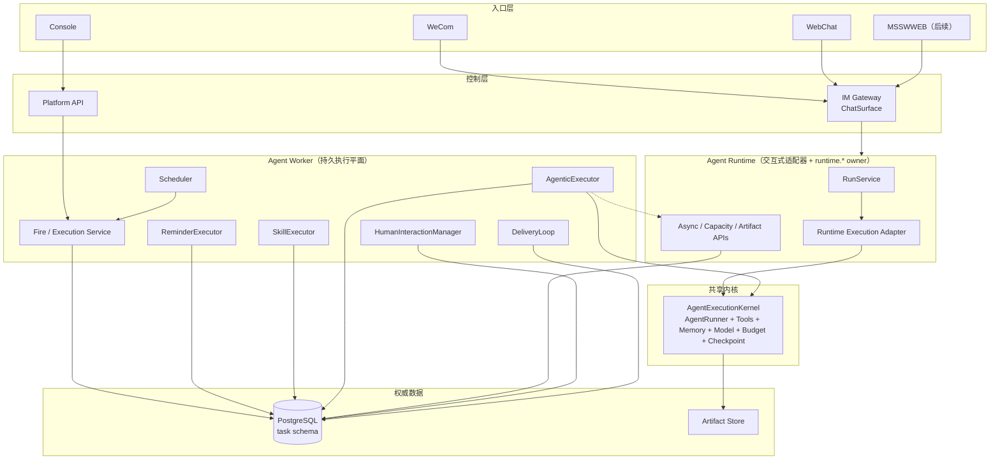

**步骤说明**：

1. 用户从 WeCom、WebChat 或 MSSWWEB 进入 Runtime；Console 只做运营查看/操作。
2. Runtime 解析自然语言，生成 `ScheduleDraft`，调用 Draft/Preflight 服务。
3. 用户确认后，ScheduleService 写 `task_schedule` + `task_schedule_revision`。
4. Scheduler 只做“时间 + Admission + Fire/Execution 原子落库”，不执行任务。
5. Worker claim `task_execution`，按 `task_type` 分派 Reminder/Skill/Agentic/Batch。
6. AgenticExecutor 调用共享 `AgentExecutionKernel`；Runtime 交互式 Run 也调用同一个 Kernel。
6b. ASYNC Skill 的 operation、模型容量 lease、Task artifact 由 Runtime 的 `Async / Capacity / Artifact APIs` 以 `owner_type=TASK` 提供；Worker 不跨 schema 直写 `runtime.*`。
7. 结果先写 Execution，再按 `delivery_intent` 决定 WeCom PUSH 或任务中心 pull。
8. WebChat/MSSWWEB 任务中心读取同一套 Schedule/Fire/Execution；不复制结果存储。
9. Human 询问写入 `task_human_interaction`；WebChat 任务中心回答，WeCom 回复匹配。
10. 所有事件写 `task_event`；所有投递写 `task_delivery`。

#### 3.2.2 组件职责

| 组件 | 职责 | 不负责 |
|---|---|---|
| Schedule Intent Parser | Runtime 内解析 Draft/Lifecycle Command | 不直接写 DB |
| ScheduleDraftService | Preflight、Draft 持久化、确认令牌 | 不执行任务 |
| ScheduleService | 创建/更新/暂停/恢复/取消、Revision | 不执行任务 |
| Scheduler | due 扫描、Admission、Fire/Execution 原子写入、推进 next_fire_at | 不调用模型、不执行 Skill |
| Fire/Execution Service | Fire 台账、Execution 创建、并发策略 | 不执行任务 |
| Runtime Admission | 每次 Fire 校验当前依赖/权限/版本 | 不改写用户意图 |
| SnapshotBuilder | 冻结 Agent/Model/Tool/Skill/MCP/Memory/Budget/Allowlist | 不跨 Fire 复用 |
| Worker Claimer | PG claim、lease、heartbeat、reclaim | 不以本地内存为权威 |
| ReminderExecutor | 固定文本提醒 | 不访问 Skill/Tool/Model |
| SkillExecutor | 按冻结 Snapshot 执行 Skill | 不重新理解自然语言 |
| AgenticExecutor | Kernel + 持久化 TaskSpec | 不越过 Allowlist |
| AgentExecutionKernel | Agent 循环、工具、记忆、压缩、预算、checkpoint | 不直接写业务 DB |
| Runtime Async/Capacity/Artifact APIs | Task-owned ASYNC Skill、模型容量 lease、Task artifact 写/读 | 不创建 Run；不跨 schema 由 Worker 直写 |
| HumanInteractionManager | HumanTask、resume、cancel、deadline | 不占 Worker 槽位等待 |
| DeliveryLoop | PUSH 投递、重试、ack | 不改变 Execution 终态 |
| TaskCenterService | WebChat/MSSWWEB 查询/操作 | 不写 Schedule/Execution |
| Console | 查看、暂停、恢复、取消、审计 | 不创建/编辑用户任务意图 |

#### 3.2.3 三种模式创建与执行流程

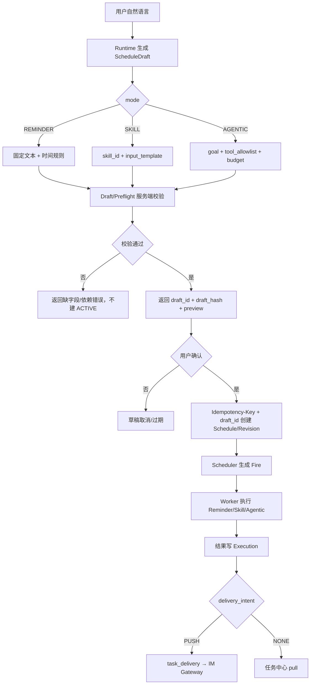

**步骤说明**：

1. Runtime 把用户表达解析成 `ScheduleDraft`，模式只是候选，最终由服务端校验。
2. REMINDER 只保留固定文本、时间、时区、delivery intent。
3. SKILL 保留 `skill_id`、输入模板、时间；不 pin artifact。
4. AGENTIC 保留规范化目标、具体工具 allowlist、budget、memory mode。
5. Draft/Preflight 校验依赖、授权、凭据、配额、投递能力；失败不创建 ACTIVE。
6. 校验通过返回 `draft_id/draft_hash/preview`；用户必须确认。
7. 确认时带 `Idempotency-Key` + `draft_id`；服务端校验 hash/owner/expiry 后创建 Schedule + Revision 1。
8. Scheduler 生成 Fire；Worker 按模式执行；结果写 Execution。
9. `delivery_intent=PUSH` 走 DeliveryLoop；`NONE` 只进任务中心。

#### 3.2.4 Agentic Kernel 架构

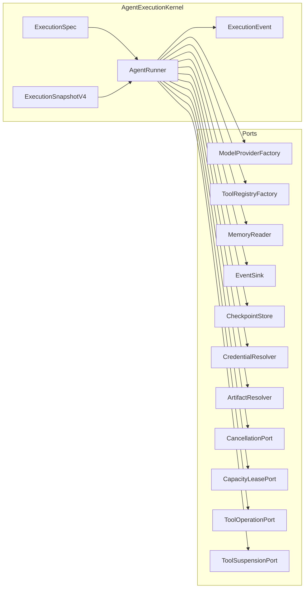

**步骤说明**：

1. Worker/Runtime 根据冻结 Snapshot 构建 `ExecutionSpec`。
2. Kernel 通过 `ModelProviderFactory` 取冻结模型与当前凭据；密钥不进 Snapshot；`CapacityLeasePort` 以 `owner_type=TASK` 向 Runtime 申请/结算容量。
3. Kernel 通过 `ToolRegistryFactory` 只构建 allowlist 内工具；MCP/Skill 工具 schema 已在 Snapshot 冻结。
4. Kernel 通过 `MemoryReader` 读取只读记忆；定时任务不写长期记忆。
5. Kernel 通过 `EventSink` 写事件；Runtime 写 canonical_event，Worker 写 task_event。
6. Kernel 通过 `CheckpointStore` 写回合边界 checkpoint；Human resume 从这里恢复。
7. Kernel 通过 `CancellationPort` 响应 cancel_requested/lease 失效。
8. Kernel 通过 `ArtifactResolver` 读写产物；Task artifact 走 Runtime API，Worker 不跨 schema 直写 `runtime.artifact`。
9. ASYNC Skill 通过 `ToolOperationPort` 提交/取消，通过 `ToolSuspensionPort` 挂起；结果到达后 Worker 唤醒同一 Execution，从 checkpoint 恢复 pending tool call。

**Agentic 执行时序**：

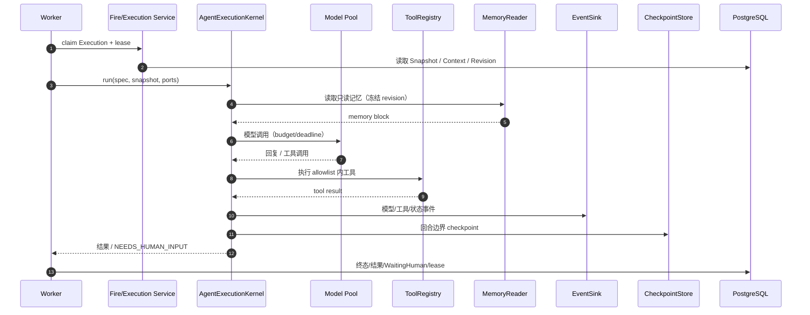

**步骤说明**：

1. Worker 按现有 lease 领取 Execution，读取冻结 Snapshot、Context、Revision。
2. Kernel 构建 Model/Tool/Memory/Event/Checkpoint 端口。
3. 读取只读记忆；失败时降级为空记忆并记录事件，不阻断任务。
4. 模型调用受 budget/deadline 约束；工具只在 allowlist 内构建。
5. 工具结果按 `retry_safety` 标记；有副作用工具不盲目重跑。
6. 事件写 `task_event`；checkpoint 只在回合边界写。
7. Kernel 返回最终结果或 `NEEDS_HUMAN_INPUT`。
8. Worker 写终态/结果或 `WAITING_HUMAN`，释放/续租 lease。

**ASYNC Skill 工具级 suspension 时序**：

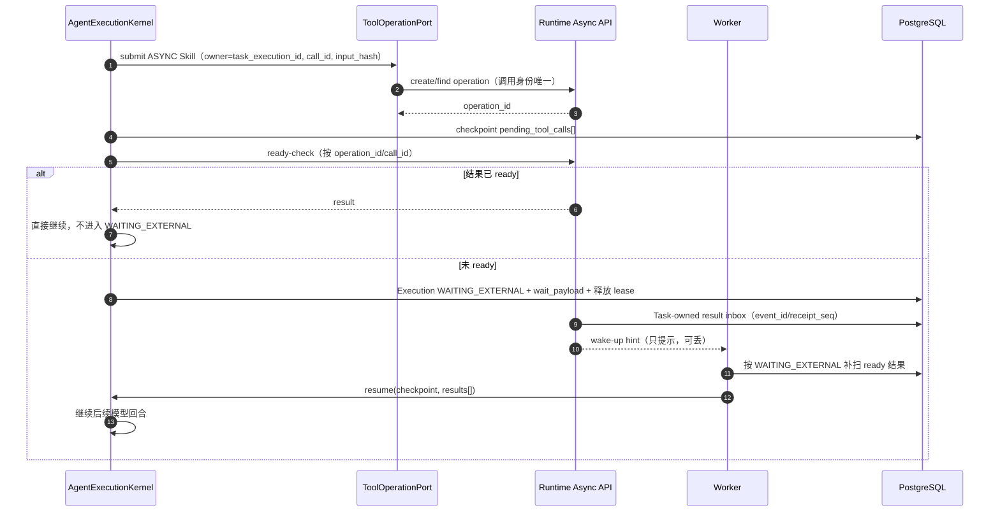

**步骤说明**：

1. Kernel 提交 ASYNC Skill，**调用身份** `(tenant, owner_type/owner_id, call_id)` 唯一；重试返回同一 operation，`input_hash` 只用于冲突判定。
2. Runtime 创建/找回 operation；Worker 不直接写 `runtime.tool_operation`。
3. Kernel 先写 checkpoint `pending_tool_calls[]`（支持同一回合多个 ASYNC 调用）。
4. **进入等待前**按 operation_id/call_id 做 ready-check；结果早到则直接继续，避免“结果先到、等待后到”丢唤醒。
5. 未 ready 才进入 `WAITING_EXTERNAL`，写 `wait_kind=ASYNC_OPERATION` + `wait_payload_json.operations[]`（每项含 operation_id/call_id/receipt_seq）+ `consumed_event_id`，释放 lease。
6. Runtime 结果进入 Task-owned inbox；Worker 周期补扫 ready 结果。**没有** Runtime→Worker 入站回调：回调要处理多副本、重试与重复消费，收益只是延迟，而正确性已经由 inbox + 补扫保证。
7. 崩溃恢复：提交成功但 checkpoint 前崩溃，reclaim 按 `call_id` 找回 operation 并核对 `input_hash`；ready 继续，pending 补等待。
8. 迟到结果：Execution 已终态时只记 `late`/事件，不能 CAS 回 QUEUED；重复结果按 `event_id` 幂等。
9. 不新建 Fire/Run/Execution；结果与 checkpoint 的消费水位持久化。

#### 3.2.5 Schedule 状态机

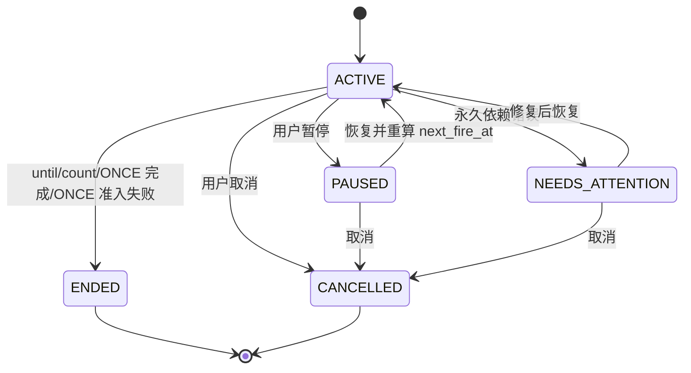

**步骤说明**：

1. `ACTIVE` 是唯一允许生成新 Fire 的状态。
2. `PAUSED` 停止未来 Fire；取消 QUEUED 且 `started_at IS NULL`；RUNNING/WAITING_EXTERNAL/WAITING_HUMAN 继续，OPEN Human 保留。
3. `NEEDS_ATTENTION` 只用于永久依赖错误；停止未来 Fire，避免刷屏。
4. `ENDED` 由 until/max_occurrences/ONCE 完成/ONCE 准入失败进入，`end_reason` 区分 COMPLETED/MISSED/EXHAUSTED/ADMISSION_FAILED。
5. `CANCELLED` 由用户取消进入；历史保留；软删只用于管理员清理。

**Fire 状态**：

```text
CREATED → EXECUTION_CREATED
        → SKIPPED
        → FAILED_ADMISSION
        → CANCELLED
```

**Execution 状态**：

```text
QUEUED → RUNNING → WAITING_EXTERNAL
                 → WAITING_HUMAN
                 → COMPLETED / FAILED / CANCELLED
```

**Human 状态**：

```text
OPEN → RESOLVED / CANCELLED / TIMED_OUT
```

#### 3.2.6 Human 询问与多会话路由

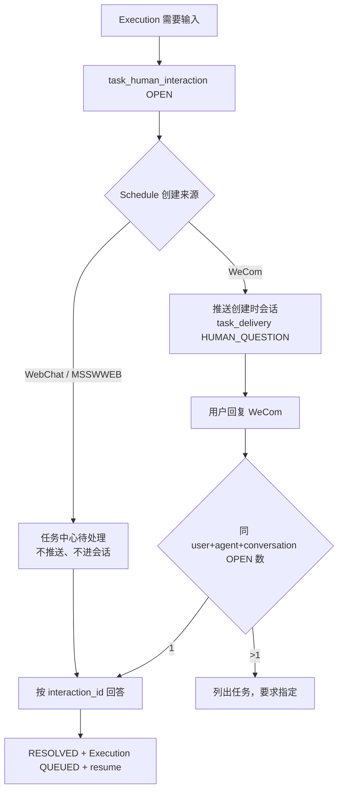

**步骤说明**：

1. Agentic Kernel 在模型回合边界返回 `NEEDS_HUMAN_INPUT`。
2. Worker 写 `task_human_interaction`，Execution → `WAITING_HUMAN`，释放 lease。
3. WebChat/MSSWWEB 不推送：任务中心“待处理”查询到该 interaction；问题不属于任何 Conversation。
4. WeCom 按 Schedule 的 `delivery_route` 推送问题；用户回复后，Gateway 先按 `user+agent+conversation` 查 OPEN interaction。
5. 只有一个 OPEN 时直接绑定；多个时列出任务让用户指定；没有则按普通聊天处理。
6. 回答写入后，同一事务把 interaction 置 `RESOLVED`、Execution 置 `QUEUED`、`lease_epoch+1`；必须同时满足 Execution `status=WAITING_HUMAN`、`cancel_requested=false`、`deadline_at > PG now`、lease 已释放；否则拒绝，不复活终态。
7. Worker 重新 claim，加载 `task_execution_checkpoint`，Kernel 从断点继续同一个 Execution；Human resume 不消耗业务 attempt（用 `resume_count` 单独记）。
8. 超时独立 sweeper 置 `TIMED_OUT`，同一事务关闭 OPEN interaction、Execution `CANCELLED(HUMAN_TIMEOUT)`；取消任务同样关闭 OPEN interaction。问题 `deadline_at` 不得晚于 Execution `deadline_at`。

**WeCom Human 回复时序**：

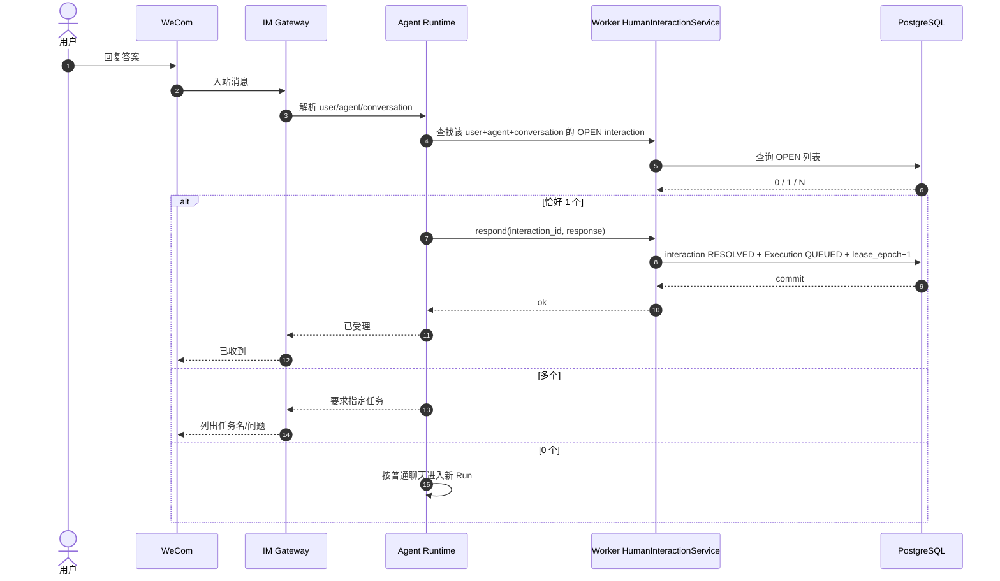

**步骤说明**：

1. WeCom 回复先到 IM Gateway；Gateway 只做路由/身份，不直接改 Execution。
2. Runtime 按 `user+agent+conversation` 查 Worker 的 OPEN interaction，不按文本猜。
3. 恰好一个：Runtime 调 Worker 回答接口；Worker 在同一事务写 response、RESOLVED、Execution QUEUED、lease_epoch+1。
4. 多个：Runtime 要求用户指定任务；不把答案绑定到任意一个。
5. 零个：按普通聊天创建新 Run，不影响定时任务。
6. 回答成功后 Worker 重新 claim；结果仍按原 Schedule 的 delivery_intent 呈现。
7. WebChat 不经过此路径；WebChat 在任务中心按 `interaction_id` 回答。

#### 3.2.7 WebChat / MSSWWEB 任务中心 pull

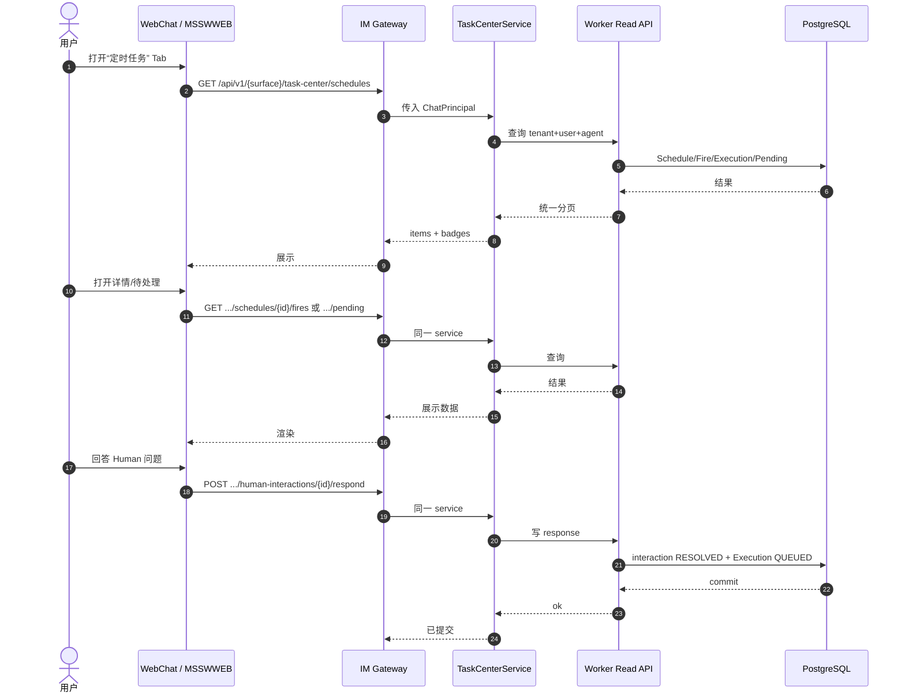

**步骤说明**：

1. WebChat 与 MSSWWEB 使用同一 `TaskCenterService`；区别只在 `ChatSurface` 的认证与路由前缀。
2. `ChatPrincipal` 提供 tenant/user/agent；entry/channel 只做来源元数据，不做过滤。
3. 任务中心只读 Schedule/Fire/Execution/Pending；不复制结果存储。
4. WebChat 不写 `task_delivery`/notification，不推聊天流。
5. 本需求不挂载 MSSWWEB 路由；MSSWWEB 任务中心另立需求，落地时只加 route + BFF 页面，不改 service/contracts。
6. Human 回答按 `interaction_id`；多会话无歧义。
7. 读接口分页；详情按需加载 Fire/Execution/事件，避免 N+1。
8. 与 MSSW 入口设计的边界一致：Schedule/Execution 的所有者是 `platform_user`（不是 entry）；同一用户同 Agent 的产物跨入口可下载（MSSW D-04）；入口停用/解绑只影响授权，不影响已有 Schedule 的读取与清理。
9. **定时任务不写 `runtime.channel_notification`**：MSSW 设计里的 `TASK_RESULT` 未读是“会话内立即任务”的口径；定时任务的结果只在任务中心（徽标来自 API-17），否则会把定时结果灌进聊天红点。

#### 3.2.8 创建 Draft / 确认时序

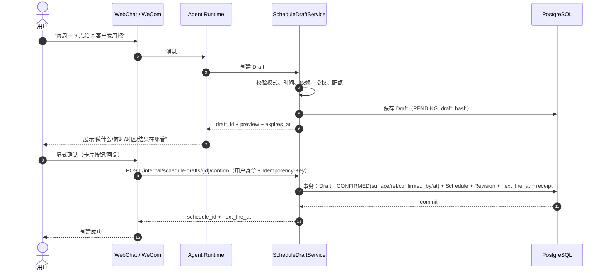

**步骤说明**：

1. Runtime 只生成 Draft，不直接写 Schedule。
2. Draft 服务端校验并持久化；`draft_hash` 绑定用户确认的完整载荷。
3. 用户确认由 surface 在用户显式选择后调用 `POST /internal/schedule-drafts/{id}/confirm`（用户身份）；服务端校验 draft 归属与 hash，把 Draft 置 CONFIRMED 并记录 `confirmation_surface/confirmation_ref/confirmed_by_user_id/confirmed_at`。WebChat/MSSWWEB 用独立的 `schedule.draft.ready` 事件卡片（不是 Run 的 `confirmation.required`/resume）；WeCom 按钮/明确回复由 Gateway 核验后代理调用。
4. 确认请求本身就是创建/更新入口（§3.4.4）：同一事务里落 CONFIRMED、Schedule/Revision、next_fire_at 与 idempotency receipt；`confirmed_at` 超过 `confirmation_ttl`（租户平台设置）视为过期。
5. 模型的 `draft→create` 工具调用没有用户确认动作，返回 `SCHEDULE_CONFIRMATION_REQUIRED`，不产生任何副作用。
6. 同 key 同指纹重放首次结果；同 key 不同指纹返回 mismatch。
7. Draft 过期不自动创建；用户必须重新预览确认。
8. **聊天流里的确认卡片**：Runtime 在生成 Draft 的同一回合写一条 canonical 事件 `schedule.draft.ready`（payload：`draft_id/draft_hash/preview/expires_at`），前端据此渲染卡片；确认按钮调 API-31（surface 路由）→ API-27。它**不是** `confirmation.required`（后者绑定 Run interrupt + resume，用于同一 Run 的确认恢复）。

#### 3.2.9 Scheduler 原子写入

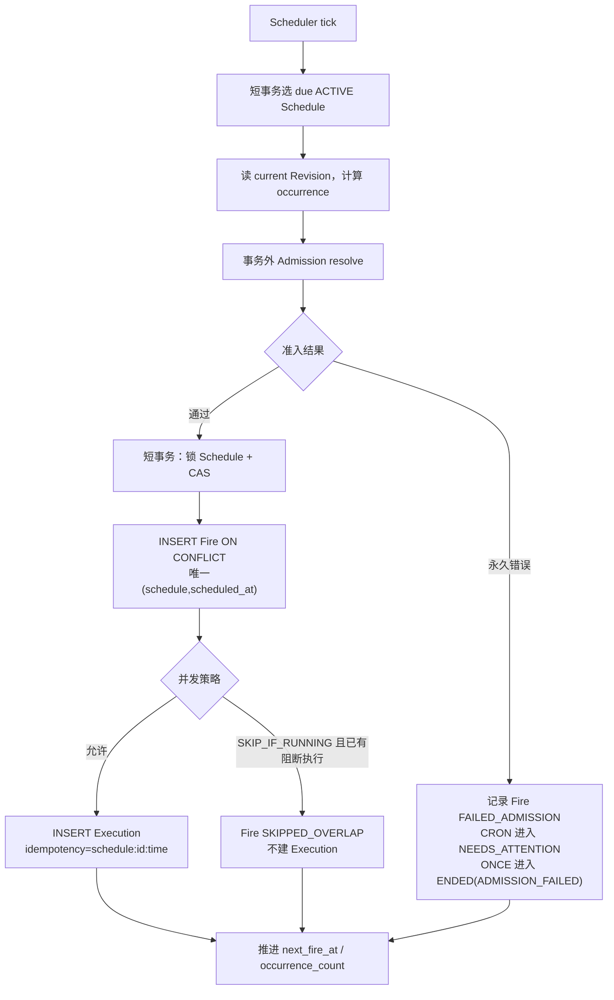

**步骤说明**：

1. Scheduler 短事务选出 due Schedule，只拿 id；事务结束释放锁。
2. 读 current Revision，计算 occurrence；不下载 Skill、不调用模型。
3. Admission 在事务外通过 Console `resolve-definition`/Credential/MCP API 完成。
4. 短事务重新锁 Schedule，校验 `status/current_revision_id/next_fire_at`；竞态失败则不写。
5. `INSERT schedule_fire` 以 `(tenant_id,schedule_id,scheduled_at)` 唯一；冲突视为已处理。
6. 允许执行时 `INSERT task_execution`，幂等键 `schedule:{schedule_id}:{scheduled_at}`；冲突不重复。
7. SKIP_IF_RUNNING 且已有**阻断执行**（同 Schedule 全部非终态根执行，含 QUEUED）时，Fire 记 `SKIPPED_OVERLAP`，不建 Execution。
8. 同事务推进 `next_fire_at`、`occurrence_count`、`last_fire_at`；提交。
9. Worker 只 claim Execution；Fire 不再需要 lease/CLAIMED 状态。
10. ONCE 永久准入失败不进入 NEEDS_ATTENTION；Schedule 直接 `ENDED(ADMISSION_FAILED)`，用户只能新建。

#### 3.2.10 更新 / 暂停 / 恢复 / 取消

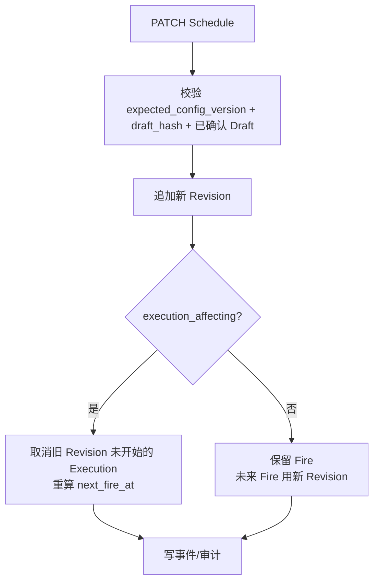

**步骤说明**：

1. Update 必须带 `expected_config_version` + `draft_id/draft_hash`，且 Draft 处于 CONFIRMED、确认人是本次 actor；服务端 CAS。
2. 每次修改追加 Revision；不 UPDATE 旧 Revision。
3. `execution_affecting` 包括模式、目标、Skill、参数、重复规则、时区、allowlist、budget、delivery intent。
4. 关键字段变化时，取消**旧 Revision 且 `started_at IS NULL`** 的 Execution 及其 Fire；运行中/已开始 Execution 保留旧 Snapshot；尚未生成 Fire 的只重算 `next_fire_at`，不能要求不存在的 Fire 显示 CANCELLED。
5. 只改 name/tags/description 时，不取消 Fire；未来 Fire 用新 Revision。
6. Pause：停止未来 Fire；取消 QUEUED 且 `started_at IS NULL`；RUNNING/WAITING_* 继续，OPEN Human 保留；Resume：重算 next_fire_at，不补发暂停期。
7. Cancel：`FUTURE_ONLY` 停未来 + 取消 QUEUED 且 `started_at IS NULL`，保留 RUNNING/WAITING_*/OPEN Human；`ALL_ACTIVE` 才终止全部并原子关闭 Human、取消 external operation；历史保留。

#### 3.2.11 Delivery

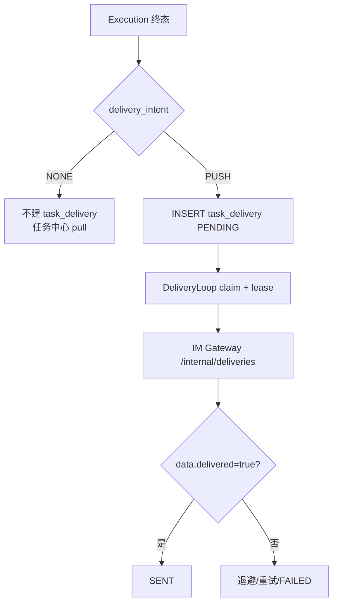

**步骤说明**：

1. 终态先写 Execution/事件，再决定投递。
2. WebChat/MSSWWEB `NONE`：不建 Delivery，不写通知，任务中心 pull。
3. WeCom `PUSH`：建 `task_delivery`，`delivery_key=execution:{id}:final`。
4. DeliveryLoop 先预留 attempt/lease 再发送；只有 `delivered=true` 才 SENT。
5. 失败按退避/上限重试；耗尽 FAILED，记录错误。
6. Human 问题使用 `delivery_kind=HUMAN_QUESTION`，`delivery_key=human:{interaction_id}`。
7. Delivery 状态不回写 Execution 业务终态。

### 3.3 数据设计

#### 3.3.1 数据模型总览

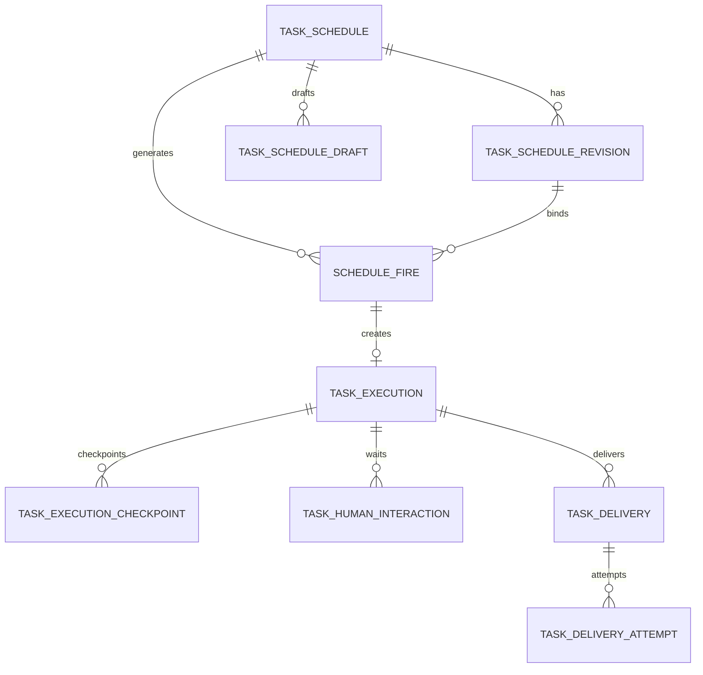

**步骤说明**：

1. Schedule 是身份/状态；Revision 是不可变配置；Fire 是一次 occurrence；Execution 是真实执行。
2. 一个 Schedule 有多个 Revision；Fire 绑定创建时的 Revision。
3. 一个 Fire 最多一个根 Execution；Child 用 parent_id/root_id，不再建 Fire。
4. Execution 有 checkpoint、human interaction、delivery。
5. WebChat/MSSWWEB 没有 Delivery 行；任务中心直接读 Execution。
6. 所有表在 `task` schema；`workspace/workspace_lease` 保留，不属于本模型。

#### 3.3.2 `task.task_schedule`

| 字段 | 类型 | 可空 | 说明 |
|---|---|---:|---|
| id | uuid | N | PK，`gen_random_uuid()` |
| tenant_id | varchar(64) | N | 租户 |
| owner_user_id | uuid | N | 创建用户 |
| agent_id | uuid | N | 所属 Agent |
| name | varchar(160) | N | 可读名称 |
| status | varchar(24) | N | ACTIVE/PAUSED/NEEDS_ATTENTION/ENDED/CANCELLED |
| current_revision_id | uuid | Y | FK → revision.id；创建事务内回填，ACTIVE 状态下应用保证非空（避免 Schedule↔Revision 循环 FK 必须延迟） |
| next_fire_at | timestamptz | Y | 下一次 UTC Fire；ENDED/PAUSED/NEEDS_ATTENTION 为 NULL |
| last_fire_at | timestamptz | Y | 最近计划 Fire |
| occurrence_count | bigint | N | 已消耗的本地计划槽；正常 Fire +1，跳过区间 +1+missed_count，DST gap +1，fold 第二次不计 |
| config_version | bigint | N | 用户配置 CAS；只有配置变更 +1；Scheduler 进度不改变它 |
| attention_reason | varchar(64) | Y | 永久错误码 |
| attention_since | timestamptz | Y | 进入 NEEDS_ATTENTION 时间 |
| ended_at | timestamptz | Y | ENDED/CANCELLED 时间 |
| end_reason | varchar(32) | Y | COMPLETED/MISSED/EXHAUSTED/ADMISSION_FAILED/USER_CANCELLED |
| created_by | uuid | N | 创建人 |
| is_deleted | boolean | N | 管理员清理 |
| create_time / update_time | timestamptz | N | 标准时间 |

索引：

- `ix_task_schedule_due`：`(status, next_fire_at) WHERE status='ACTIVE' AND is_deleted=false`。
- `ix_task_schedule_owner`：`(tenant_id, owner_user_id, status, update_time DESC)`。
- `ix_task_schedule_agent`：`(agent_id, status)`。

规则：

- `status` 是未来 Fire 的唯一开关；Fire/Execution 状态不回写。
- `config_version` 用于 Update/Draft CAS；Revision 号由 `current_revision_id` join 得出，不冗余存列；Scheduler 推进 `next_fire_at` 使用 `current_revision_id + next_fire_at` CAS，不增加 `config_version`。
- Schedule 名称不做唯一约束：同名是正常现象，按自然语言查询命中多条时走澄清，而不是让创建失败。
- `next_fire_at` 是派生缓存；可由 Revision + last_fire_at 重算，不作为配置来源。
- `occurrence_count` 计**本地计划槽**：正常 Fire +1；错过区间 +1+`missed_count`；DST gap +1；fold 第二次不计（同一槽）；`max_occurrences` 与它比较，不按 Execution 数。

#### 3.3.3 `task.task_schedule_revision`

| 字段 | 类型 | 可空 | 说明 |
|---|---|---:|---|
| id | uuid | N | PK |
| tenant_id | varchar(64) | N | 租户 |
| schedule_id | uuid | N | FK → schedule.id |
| revision_no | int | N | 从 1 递增 |
| mode | varchar(16) | N | REMINDER/SKILL/AGENTIC |
| instruction_raw | text | N | 用户原始自然语言 |
| normalized_goal | text | N | 规范化目标/提醒文本 |
| recurrence_kind | varchar(16) | N | CRON/ONCE（P0） |
| cron_expr | varchar(128) | Y | CRON 表达式 |
| run_at | timestamptz | Y | ONCE 时间 |
| timezone | varchar(64) | N | IANA |
| schedule_policy | jsonb | N | 三模式共用：concurrency_policy/max_concurrency/until/max_occurrences/dst_gap_policy/dst_fold_policy |
| context_json | jsonb | N | 参数、输出偏好、来源 conversation/message/entry/channel、授权范围；不含 Secret |
| execution_spec | jsonb | N | 模式执行配置（见下） |
| delivery_intent | varchar(16) | N | PUSH/NONE |
| delivery_route_id | uuid | Y | FK → delivery_route.id；NONE 可空 |
| preflight_json | jsonb | N | 校验摘要（脱敏） |
| created_by | uuid | N | 修改用户 |
| is_deleted | boolean | N | 固定 false |
| create_time / update_time | timestamptz | N | 插入时相同；之后不更新 |

约束：

- `UNIQUE(schedule_id, revision_no)`。
- Revision 创建后不可 UPDATE；纠错通过新 Revision。
- `execution_spec` 按模式：
  - REMINDER：`{"reminder_text": "..."}`
  - SKILL：`{"skill_id": "...", "input_template": {...}}`
  - AGENTIC：`{"goal": "...", "tool_allowlist": [...], "output_contract": {...}, "budget": {...}, "memory_mode": "READ_ONLY"}`
- `schedule_policy` 三模式共用：
  - `concurrency_policy`: SKIP_IF_RUNNING/QUEUE/ALLOW_PARALLEL
  - `max_concurrency`: int
  - `until`: timestamptz nullable
  - `max_occurrences`: int nullable
  - `dst_gap_policy`: SKIP（P0）
  - `dst_fold_policy`: FIRST（P0）
- `context_json` 与 `execution_spec` 是唯一配置来源；`task_schedule` 不复制。
- `delivery_intent=PUSH` 时 `delivery_route_id` 必须非空；`NONE` 时可为空。
- 时间字段全部 `timestamptz`；不使用 `timestamp`。

#### 3.3.4 `task.task_schedule_draft`

| 字段 | 类型 | 可空 | 说明 |
|---|---|---:|---|
| id | uuid | N | PK |
| tenant_id | varchar(64) | N | 租户 |
| owner_user_id | uuid | N | 用户 |
| agent_id | uuid | N | Agent |
| kind | varchar(16) | N | CREATE/UPDATE |
| base_schedule_id | uuid | Y | UPDATE 目标 |
| base_config_version | bigint | Y | UPDATE CAS 基线 |
| draft_hash | varchar(71) | N | canonical JSON `sha256:` + 64 hex；与 API 同格式 |
| payload_json | jsonb | N | 完整 Draft/Patch |
| preview_json | jsonb | N | 确认卡片数据 |
| status | varchar(16) | N | PENDING/CONFIRMED/CANCELLED/EXPIRED/REJECTED |
| expires_at | timestamptz | N | 过期时间 |
| confirmation_surface | varchar(16) | Y | 确认来源：WEBCHAT/WECOM/MSSWWEB |
| confirmation_ref | varchar(256) | Y | surface 侧持久标识（WebChat 消息事件 / WeCom 入站消息） |
| confirmed_by_user_id | uuid | Y | 确认用户 |
| confirmed_at | timestamptz | Y | 确认时间 |
| schedule_id | uuid | Y | 创建/更新后的 Schedule |
| idempotency_key | varchar(128) | N | 创建幂等键 |
| is_deleted | boolean | N | 标准 |
| create_time / update_time | timestamptz | N | 标准 |

约束：

- `UNIQUE(tenant_id, idempotency_key) WHERE is_deleted=false`。
- `(tenant_id, owner_user_id, status, expires_at)` 索引。
- `CHECK (draft_hash ~ '^sha256:[0-9a-f]{64}$')`；存储/传输同格式。
- Draft 只能由 owner 确认；跨用户/租户 404。
- Draft 不是 Schedule 的替代；确认后才写 Schedule。
- 创建/更新要求 Draft 为 CONFIRMED：`confirmation_surface/confirmation_ref/confirmed_by_user_id/confirmed_at` 必须齐备；`UNIQUE(tenant_id, confirmation_surface, confirmation_ref) WHERE status='CONFIRMED' AND is_deleted=false` 保证一次用户动作只确认一个 Draft（防重放）。
- 确认动作只能经 `POST /internal/schedule-drafts/{id}/confirm` 在用户身份下发生；模型工具上下文没有这条通路。
- `draft.idempotency_key` 是**创建 Draft** 的幂等键（`endpoint=schedule-drafts`）；确认/生效使用新的 `Idempotency-Key`（`endpoint=schedule-confirm`），由 `task_submission` 记录；两者不能混用。

#### 3.3.5 `task.schedule_fire`

| 字段 | 类型 | 可空 | 说明 |
|---|---|---:|---|
| id | uuid | N | PK |
| tenant_id | varchar(64) | N | 租户 |
| schedule_id | uuid | N | FK |
| schedule_revision_id | uuid | N | 绑定 Revision |
| scheduled_at | timestamptz | N | UTC occurrence |
| status | varchar(24) | N | CREATED/EXECUTION_CREATED/SKIPPED/FAILED_ADMISSION/CANCELLED |
| execution_id | uuid | Y | 根 Execution FK |
| skip_reason | varchar(32) | Y | OVERLAP/MISFIRE/QUOTA/PAUSED_BY_UPDATE |
| missed_count | int | N | 本区间额外错过数；正常为 0 |
| dst_resolution | varchar(24) | Y | FOLD_FIRST（gap/second-fold 不建 Fire，写 SCHEDULE 事件） |
| admission_error_code | varchar(64) | Y | 永久/临时错误码 |
| is_deleted | boolean | N | 标准 |
| create_time / update_time | timestamptz | N | 标准 |

约束：

- `UNIQUE(tenant_id, schedule_id, scheduled_at)`。
- `UNIQUE(execution_id) WHERE execution_id IS NOT NULL`。
- 索引：`(status, scheduled_at)`、`(tenant_id, create_time)`、`(schedule_id, scheduled_at DESC)`。
- **不含 revision**：revision 是 Fire 的属性，不是 occurrence 身份。
- 无 `claimed_at/lease`：Fire 不是工作项。

#### 3.3.6 `task.task_execution`

| 字段 | 类型 | 可空 | 说明 |
|---|---|---:|---|
| id | uuid | N | PK |
| tenant_id | varchar(64) | N | 租户 |
| parent_id / root_id | uuid | Y | Parent/Child |
| item_key | varchar(128) | Y | Child 幂等 |
| schedule_id | uuid | Y | 来源 Schedule |
| schedule_fire_id | uuid | Y | 来源 Fire |
| schedule_revision_id | uuid | Y | 来源 Revision |
| scheduled_at | timestamptz | Y | 计划 UTC 时间；调度 FIFO/并发判断用；立即任务为空 |
| source_run_id / source_operation_id / source_tool_call_id | uuid/varchar | Y | 立即任务来源 |
| completion_mode | varchar(16) | Y | JOIN/DETACH |
| agent_id | uuid | N | Agent |
| actor_user_id | uuid | N | 用户 |
| task_type | varchar(16) | N | SKILL/REMINDER/AGENTIC/BATCH |
| skill_id | uuid | Y | SKILL 必填；REMINDER/AGENTIC 为空 |
| skill_artifact_id | uuid | Y | SKILL 必填 |
| trigger_type | varchar(16) | N | IMMEDIATE/SCHEDULED |
| skill_execution_mode | varchar(16) | Y | SYNC/ASYNC/AUTO；原 execution_mode 改名 |
| status | varchar(24) | N | QUEUED/RUNNING/WAITING_EXTERNAL/WAITING_HUMAN/COMPLETED/FAILED/CANCELLED |
| wait_kind | varchar(24) | Y | ASYNC_OPERATION/EXTERNAL_POLL/BATCH_FANIN；HUMAN 用 WAITING_HUMAN |
| wait_payload_json | jsonb | Y | wait_kind 对应载荷：operations[]（每项 operation_id/call_id/receipt_seq/consumed_event_id）/external_ref/not_before/batch_ref |
| started_at | timestamptz | Y | 首次开始执行时间；判断“未开始”用 `started_at IS NULL`，不用 QUEUED |
| finished_at | timestamptz | Y | 终态时间 |
| input_json | jsonb | N | 本次输入/参数 |
| result_json | jsonb | Y | 结果 |
| result_artifact_id | uuid | Y | 主结果产物；多产物按 task_id 查询 |
| error_code / error_message | varchar/text | Y | 错误 |
| failure_class | varchar(24) | Y | BUSINESS/CONFIG/TIMEOUT/HUMAN_TIMEOUT/ASYNC_FAILED/ATTEMPTS_EXHAUSTED |
| cancel_requested | boolean | N | 协作取消 |
| deadline_at | timestamptz | N | 硬 deadline；NOT NULL |
| execution_snapshot_schema_version | int | N | v4 |
| execution_snapshot_json | jsonb | N | 冻结快照（B：依赖范围完整 JSON） |
| snapshot_hash | varchar(128) | N | sha256 |
| snapshot_bytes | int | N | 快照字节数；用于配额/告警 |
| priority / attempt / max_attempts / not_before | int/timestamptz | N | 现有调度 |
| lease_epoch / lease_owner / lease_until / heartbeat_at | bigint/string/timestamptz | Y | 现有 lease |
| resume_count | int | N | Human/外部续接次数；不消耗 attempt |
| last_resume_reason | varchar(16) | Y | HUMAN/EXTERNAL |
| last_checkpoint_id | uuid | Y | 最新 checkpoint |
| idempotency_key | varchar(256) | N | 幂等 |
| is_deleted | boolean | N | 标准 |
| create_time / update_time | timestamptz | N | 标准 |

约束/索引：

- `UNIQUE(tenant_id, idempotency_key) WHERE is_deleted=false`。
- `UNIQUE(parent_id, item_key) WHERE parent_id IS NOT NULL AND is_deleted=false`。
- `UNIQUE(schedule_fire_id) WHERE schedule_fire_id IS NOT NULL AND parent_id IS NULL`：一个 Fire 最多一个根 Execution。
- `(status, not_before, priority, create_time)`、`(schedule_id, status)`、`(lease_until) WHERE status='RUNNING'`。
- `(schedule_id, status, scheduled_at)` 支撑并发/FIFO；`(status, scheduled_at)` 支撑调度 claim。
- `(schedule_fire_id)` 支撑 Fire 详情；等待索引只有 `wait_payload_json.operations[]`（每项 operation_id/call_id/receipt_seq/consumed_event_id），不设便捷列以免两份真相。
- `(wait_kind, not_before)` 支撑 WAITING_EXTERNAL 补扫；`(status, not_before)` 支撑 claim。
- `started_at` 只在首次 QUEUED→RUNNING/EXTERNAL/HUMAN 时写一次；reclaim/续接不得清空；更新取消用 `started_at IS NULL`。
- `resume_count`/`last_resume_reason` 只做审计；Human/EXTERNAL 续接不消耗 `attempt`。

**移除**：`delivery_route_id/delivery_mode/delivery_status/delivery_key/delivery_attempts/delivered_at` 全部移到 `task_delivery`。

**应用不变量**：`trigger_type=SCHEDULED` 时 `schedule_id/schedule_fire_id/schedule_revision_id` 必须非空；`task_type=SKILL` 时 `skill_id/skill_artifact_id` 必须非空；`REMINDER/AGENTIC` 时二者为空。DB 允许空是为了立即任务和不同模式共存，校验在 `ExecutionService` 入口完成。

#### 3.3.7 `task.task_execution_checkpoint`

| 字段 | 类型 | 可空 | 说明 |
|---|---|---:|---|
| id | uuid | N | PK |
| tenant_id | varchar(64) | N | 租户 |
| execution_id | uuid | N | FK |
| checkpoint_no | int | N | 递增 |
| state_json | jsonb | N | messages/pending_question/pending_tool_calls[]/budget_used/consumed_event_seq；不含 Secret |
| create_time | timestamptz | N | 创建时间 |
| is_deleted | boolean | N | 标准 |
| update_time | timestamptz | N | 标准 |

约束：

- `UNIQUE(execution_id, checkpoint_no)`。
- `(execution_id, checkpoint_no DESC)` 索引。
- Checkpoint 在**模型回合边界**或**工具级 suspension** 写；Human 只存回合边界，ASYNC Skill 存 pending tool call（call_id/operation_id），不存工具内部不可序列化状态。
- 保留策略与 Execution 一致；不单独无限增长。

#### 3.3.8 `task.task_human_interaction`

| 字段 | 类型 | 可空 | 说明 |
|---|---|---:|---|
| id | uuid | N | PK |
| tenant_id | varchar(64) | N | 租户 |
| execution_id | uuid | N | FK |
| owner_user_id | uuid | N | 用户 |
| agent_id | uuid | N | Agent |
| interaction_type | varchar(16) | N | INPUT/CONFIRM |
| status | varchar(16) | N | OPEN/RESOLVED/CANCELLED/TIMED_OUT |
| question | text | N | 用户可见问题 |
| input_schema | jsonb | Y | 回答字段 |
| response_json | jsonb | Y | 用户回答 |
| delivery_route_id | uuid | Y | WeCom 推送路由；WebChat 为空 |
| source_message_id | varchar(256) | Y | WeCom 来源消息 |
| deadline_at | timestamptz | N | 截止 |
| resolved_at | timestamptz | Y | 解决时间 |
| is_deleted | boolean | N | 标准 |
| create_time / update_time | timestamptz | N | 标准 |

约束：

- `UNIQUE(execution_id) WHERE status='OPEN' AND is_deleted=false`：一个 Execution 同时最多一个 OPEN。
- `(status, deadline_at)` 索引：超时 sweep。
- `(tenant_id, owner_user_id, status, deadline_at)`：任务中心待处理。
- 问题不属于 Conversation；`delivery_route_id` 只用于 WeCom 推送。
- `source_message_id` 只做审计/回复匹配，不做权限。
- `deadline_at` 不得晚于 Execution `deadline_at`；超时或 `ALL_ACTIVE` 取消必须关闭 OPEN interaction；`FUTURE_ONLY` 保留。
- 回答必须同时 CAS Execution `WAITING_HUMAN`、`cancel_requested=false`、`deadline_at > PG now`；不得复活终态。

#### 3.3.9 `task.task_event`

| 字段 | 类型 | 可空 | 说明 |
|---|---|---:|---|
| id | uuid | N | PK |
| tenant_id | varchar(64) | N | 租户 |
| entity_type | varchar(16) | N | SCHEDULE/FIRE/EXECUTION/HUMAN/DELIVERY/ARTIFACT/ASYNC |
| entity_id | uuid | N | 实体 id |
| seq | bigint | N | 每实体递增 |
| event_type | varchar(64) | N | 事件类型 |
| payload_json | jsonb | N | 脱敏载荷 |
| occurred_at | timestamptz | N | 业务发生时间 |
| trace_id | varchar(64) | Y | Trace |
| is_deleted | boolean | N | 标准 |
| create_time / update_time | timestamptz | N | 标准 |

约束：

- `UNIQUE(tenant_id, entity_type, entity_id, seq)`。
- `(entity_type, entity_id, create_time)`、`(event_type, create_time)` 索引。
- 不建物理 FK：多态审计表，按 `RULE-data-001` 的审计引用例外处理；entity 归属由写入方保证。
- 事件追加写；不替代 Schedule/Fire/Execution 当前状态。
- 事件类型见 §3.5.10。

#### 3.3.10 `task.task_delivery` / `task.task_delivery_attempt`

`task_delivery`：

| 字段 | 类型 | 可空 | 说明 |
|---|---|---:|---|
| id | uuid | N | PK |
| tenant_id | varchar(64) | N | 租户 |
| execution_id | uuid | N | FK |
| delivery_route_id | uuid | N | FK |
| delivery_kind | varchar(24) | N | PUSH/HUMAN_QUESTION |
| delivery_key | varchar(160) | N | 稳定键 |
| status | varchar(16) | N | PENDING/SENT/FAILED/CANCELLED |
| attempt_count | int | N | 已尝试 |
| lease_owner / lease_until | string/timestamptz | Y | 发送预留 |
| last_error_code / last_error_message | varchar/text | Y | 错误 |
| sent_at | timestamptz | Y | 送达时间 |
| is_deleted | boolean | N | 标准 |
| create_time / update_time | timestamptz | N | 标准 |

约束：

- `UNIQUE(tenant_id, delivery_key) WHERE is_deleted=false`。
- `(status, update_time)`、`(execution_id)` 索引。
- WebChat/MSSWWEB 不建行；`NONE` 没有 Delivery。
- `delivery_key` 固定：`execution:{execution_id}:final` / `human:{interaction_id}`。

`task_delivery_attempt`：

| 字段 | 类型 | 说明 |
|---|---|---|
| id | uuid | PK |
| tenant_id | varchar(64) | 租户 |
| delivery_id | uuid | FK |
| attempt_no | int | 从 1 递增 |
| request_ref / response_ref | varchar(256) | 请求/回执引用 |
| status | varchar(16) | PENDING/SENT/FAILED |
| error_code | varchar(64) | 错误码 |
| started_at / finished_at | timestamptz | 时间 |
| is_deleted / create_time / update_time | 标准 | |

约束：`UNIQUE(delivery_id, attempt_no)`。

#### 3.3.11 复用表

| 表 | 处理 |
|---|---|
| `task.delivery_route` | 保留；route/channel/bot/external recipient 不变 |
| `task.task_submission` | 保留，作为 Idempotency-Key 记录；补 `schedule_draft_id` 可选审计 |
| `task.runtime_operation` / `task.runtime_result_outbox` | 保留；`runtime_result_outbox` 改为引用 `task_event_id`（单列 FK）而非 `(task_id,task_event_seq)`；`task_id` 保留查询/审计，不建复合 FK |
| `runtime.model_call_lease` | 增加 `task_execution_id` 逻辑 UUID + owner_type=TASK；跨 schema 不建物理 FK |
| `runtime.tool_operation` / `tool_result_inbox` | 增加 Task owner（`task_execution_id`）；结果/continuation/cancel 支持 TASK |
| `runtime.artifact` | 复用 `task_id` XOR `run_id`；Task-owned 行 `run_id` 为 NULL、存储键按执行生成；新增写入/版本端点与下载授权 |
| `task.workspace` / `task.workspace_lease` | 保留；Skill 沙箱租约，不属于调度模型 |

#### 3.3.12 一致性约束

- Schedule Revision 插入与 `current_revision_id/config_version` 更新同一事务；Scheduler 只改 `next_fire_at/last_fire_at/occurrence_count`，不改 `config_version`。
- Fire 插入、Execution 插入、`next_fire_at` 推进同一事务。
- `(tenant_id,schedule_id,scheduled_at)` 与 Execution 幂等键共同保证 occurrence 唯一。
- 终态事务先写 `task_event`，拿 `event_id` 再写 `runtime_result_outbox`；outbox 不再用 `(task_id,seq)` 复合 FK。
- 锁序固定：`runtime_operation（如有）→ Schedule（如有）→ Fire（如有）→ root Execution → Parent → Child → event/outbox`；提交、取消、fan-in、deadline、reclaim、终态统一使用；立即任务无 Schedule 时从 operation 开始。
- 现有 `lock_task_tree` 的 `runtime_operation → root → parent → child` 保持不变；新路径先完成 operation/Schedule/Fire 锁，再调用它；不得先锁 Execution 再取 operation 锁。
- Human 回答/超时/取消必须双侧 CAS；不得把终态 Execution 改回 QUEUED。
- Fire/Execution 的创建/取消按旧 Revision 判断；未开始的旧 Execution 取消，运行中的保留旧 Snapshot。
- Task artifact 通过 `runtime.artifact.task_id` 关联 Execution；下载按 owner+agent 授权，不要求 Conversation。
- Snapshot 与 Execution 创建同一事务边界；Snapshot 创建后不可变。
- 终态、TaskEvent、Delivery 记录先持久化，再发送。
- Delivery 状态不反向修改 Execution 业务终态。
- Cancel/软删不删除 Fire/Execution/Delivery 历史。
- 查询按 `tenant_id + owner_user_id` 或 Console 授权范围。
- 所有时间 `timestamptz`；Recurrence 统一由 Schedule 服务计算，Worker 不使用系统本地时区。

### 3.4 接口设计

#### 3.4.1 接口边界与认证

- Runtime/Worker 内部接口：`/internal/*`，`X-Internal-Service` + `X-Tenant-Id` + `X-Actor-User-Id`（变更类）。
- **surface 认证沿用 MSSW 入口设计的 ChatSurface**：WebChat 用 Cookie 会话、MSSWWEB 用 `soc-token`（Console `/internal/channel/external-principal` 验签并解析 `ChatPrincipal`），MSSWWEB 路由挂 `/api/v1/msswwweb`、WebChat 挂 `/api/v1/webchat`；客户侧 BFF 只调我们的 Gateway，从不直连 `/internal/*`。
- 新增端点的身份口径：API-27（确认 Draft）由 **IM Gateway** 以已解析的 ChatPrincipal 调用（`X-Actor-User-Id` 必须等于 Draft owner）；API-28/29/30（artifact 写入、容量预留、ASYNC 操作）走**服务身份 + `owner_type=TASK` + `task_execution_id`**，服务端按 owner 复核 tenant/actor/agent，不接受客户端伪造。
- Console：现有 `/api/v1/schedules`、`/api/v1/tasks`；权限保持现状；无创建入口。
- 统一响应 `{code,msg,data,trace_id,request_id,timestamp}`；成功码 `"0"`。
- 列表 `{items,page,page_size,total}`；`page>=1`，`1<=page_size<=100`。
- 错误码只来自 `config/api-messages.yaml` + `ErrorCode`。

#### 3.4.2 接口清单

| 接口 ID | 名称 | 方法 | 路径 | 入口 |
|---|---|---|---|---|
| API-01 | 创建 Schedule Draft | POST | `/internal/schedule-drafts` | Runtime |
| API-04 | 暂停 | POST | `/internal/schedules/{id}/pause` | Runtime/Console |
| API-05 | 恢复 | POST | `/internal/schedules/{id}/resume` | Runtime/Console |
| API-06 | 取消 | POST | `/internal/schedules/{id}/cancel` | Runtime/Console |
| API-07 | Schedule 详情 | GET | `/internal/schedules/{id}` | Runtime/Console |
| API-08 | Fire 历史 | GET | `/internal/schedules/{id}/fires` | Runtime/Console |
| API-09 | Execution 详情 | GET | `/internal/executions/{id}` | Runtime/Console |
| API-10 | Human 回答 | POST | `/internal/human-interactions/{id}/respond` | Runtime/Gateway |
| API-11 | 取消 Execution | POST | `/internal/executions/{id}/cancel` | Runtime/Console |
| API-12 | 任务中心列表（surface 挂载） | GET | `/api/v1/webchat/task-center/schedules` | WebChat |
| API-13 | 任务中心详情（surface 挂载） | GET | `/api/v1/webchat/task-center/schedules/{id}` | WebChat |
| API-14 | 任务中心 Fire 历史（surface 挂载） | GET | `/api/v1/webchat/task-center/schedules/{id}/fires` | WebChat |
| API-15 | 任务中心 Execution 详情（surface 挂载） | GET | `/api/v1/webchat/task-center/executions/{id}` | WebChat |
| API-16 | 任务中心待处理（surface 挂载） | GET | `/api/v1/webchat/task-center/pending` | WebChat |
| API-17 | 任务中心徽标（surface 挂载） | GET | `/api/v1/webchat/task-center/badges` | WebChat |
| API-18 | 任务中心 Human 回答（surface 挂载） | POST | `/api/v1/webchat/task-center/human-interactions/{id}/respond` | WebChat |
| API-19 | 任务中心暂停/恢复/取消（surface 挂载） | POST | `/api/v1/webchat/task-center/schedules/{id}/actions` | WebChat |
| API-20 | Console Schedule 列表 | GET | `/api/v1/schedules` | Console（保留） |
| API-21 | Console Schedule 详情 | GET | `/api/v1/schedules/{id}` | Console（保留） |
| API-22 | Console Fire 历史 | GET | `/api/v1/schedules/{id}/fires` | Console（新增） |
| API-23 | Console Schedule 操作 | POST | `/api/v1/schedules/{id}/actions` | Console（保留能力） |
| API-24 | Console Task 列表/详情 | GET | `/api/v1/tasks`、`/api/v1/tasks/{id}` | Console（保留） |
| API-25 | WebChat 任务产物下载 | GET | `/api/v1/webchat/task-center/artifacts/{artifact_id}` | WebChat |
| API-26 | MSSWWEB 任务产物下载（契约预留，另立需求交付） | GET | `/api/v1/msswwweb/task-center/artifacts/{artifact_id}` | MSSWWEB（不在本需求） |
| API-27 | 确认 Draft 并执行（创建/更新） | POST | `/internal/schedule-drafts/{id}/confirm` | IM Gateway（已解析 ChatPrincipal；外部 BFF 不直连内部端点） |
| API-28 | Task artifact 写入/版本 | POST | `/internal/artifacts` | Worker（服务身份 + TASK owner） |
| API-29 | Task 容量预留/续租/结算 | POST | `/internal/model-capacity/reservations`（扩展 owner=TASK） | Worker（服务身份） |
| API-30 | ASYNC 操作提交/取消 | POST | `/internal/tool-operations` | Worker（服务身份 + TASK owner） |
| API-31 | surface 确认 Draft | POST | `/api/v1/{surface}/schedule-drafts/{id}/confirm` | IM Gateway（ChatPrincipal）→ API-27 |

> API-12..19 是同一组 handler 按 ChatSurface 挂载：`/api/v1/webchat/task-center/*` 与 `/api/v1/msswwweb/task-center/*` 路径与投影同形。**MSSWWEB 那批（含接入文档 `docs/operations/bff-agent-integration.md`）另立需求**，本需求不交付、也不改 MSSW 入口需求的设计。

> API-02/03（创建/更新）不单独暴露：它们是 API-27 确认事务内的应用服务方法，避免“确认”和“生效”之间再夹一次模型回合。

> API-28/29/30 是**本轮新增**能力：现有 artifact HTTP 面只有读取，容量 HTTP 面只有 Probe，tool-results 只有结果入站；三者都不接受 Task owner。

> MSSWWEB 同形挂载 `/api/v1/msswwweb/task-center/*` 属于另立需求；本需求不暴露该路由。

API-09/15 的 Execution 详情额外返回 `wait_kind/wait_payload_json/started_at/finished_at`；前端按 `wait_kind` 展示等待类型。

#### 3.4.3 API-01 Draft

请求：

```json
{
  "mode": "AGENTIC",
  "instruction": "每周一 9 点给 A 客户发周报",
  "timezone": "Asia/Shanghai",
  "recurrence": {"kind": "CRON", "cron": "0 9 * * 1"},
  "context": {
    "parameters": {"customer": "A"},
    "output": {"format": "markdown", "language": "zh-CN"}
  },
  "execution_spec": {
    "goal": "汇总 A 客户上周数据并生成周报",
    "tool_allowlist": [
      {"source": "MCP", "server_key": "crm", "tool_name": "customer.report"},
      {"source": "SKILL", "skill_id": "uuid", "tool_name": "report.render"}
    ],
    "budget": {"max_steps": 12, "max_tool_calls": 20, "max_tokens": 0},
    "memory_mode": "READ_ONLY"
  }
}
```

Header：`Idempotency-Key: <uuid>`。Draft 创建本身也幂等：同 key 同指纹返回首次 Draft；不同指纹返回 mismatch。

响应：

```json
{
  "draft_id": "uuid",
  "draft_hash": "sha256:...",
  "status": "PENDING",
  "preview": {
    "mode": "AGENTIC",
    "what": "汇总 A 客户上周数据并生成周报",
    "when": "每周一 09:00 Asia/Shanghai",
    "first_fire_at": "2026-11-16T09:00:00+08:00",
    "delivery": "WebChat 任务中心（不推送）",
    "dependencies": ["crm.customer.report", "report.render"],
    "budget": {"max_steps": 12, "max_tool_calls": 20}
  },
  "expires_at": "2026-11-16T09:00:00+08:00"
}
```

错误码：

- `SCHEDULE_DRAFT_INVALID`
- `SCHEDULE_TIMEZONE_REQUIRED`
- `SCHEDULE_DEPENDENCY_MISSING`
- `SCHEDULE_GRANT_DENIED`
- `SCHEDULE_PARAMETER_INCOMPLETE`
- `SCHEDULE_QUOTA_EXCEEDED`
- `SCHEDULE_DELIVERY_UNSUPPORTED`

#### 3.4.4 API-27 确认并执行 Draft（创建 / 更新）

**为什么确认和生效是同一个请求**：确认是用户动作，创建/更新是确定性状态变更；把两者拆成「确认 → 模型再调创建」会让生效依赖模型的下一次工具调用。确认请求本体就是唯一的生效入口，模型的创建工具只能产出 Draft。

请求：

```json
{
  "draft_hash": "sha256:...",
  "name": "A 客户周报"
}
```

Header：`Idempotency-Key: <uuid>`（`endpoint=schedule-confirm`）。

事务（`kind=CREATE`）：

1. `FOR UPDATE` 锁 Draft，校验 owner == 调用 actor、`status=PENDING`、`draft_hash` 一致、未过期；校验 `(tenant, surface, ref)` 未被占用后置 `CONFIRMED + confirmed_by_user_id/confirmed_at`。
2. 校验 Draft payload 与当前依赖（P0 用快照；P1 用 input schema）。
3. 创建 Schedule + Revision 1 + 首个 next_fire_at。
4. Draft 回填 `schedule_id`；写 `task_submission` 首次响应。
5. 提交后返回 `schedule_id/status/revision/config_version/next_fire_at`。

事务（`kind=UPDATE`）：

1. 同上的 Draft 锁与确认落库；`expected_config_version` 取 Draft 的 `base_config_version`。
2. `expected_config_version` 与 Schedule 当前值不一致 → `SCHEDULE_VERSION_CONFLICT`（Draft 保持 PENDING，用户可重新发起修改）。
3. 追加 Revision；关键字段变化时取消旧 Revision 且 `started_at IS NULL` 的 Execution/Fire；重算 `next_fire_at`；运行中/已开始 Execution 保留旧 Snapshot。
4. Draft 回填 `schedule_id`；写 `task_submission` 首次响应。

规则：

- Draft 必须属于同一 owner 与目标 Schedule；`base_config_version` 由 Draft 携带，不接受请求体覆盖。
- 模型工具侧不存在“确认”能力：任何 `draft→create` 的工具调用都返回 `SCHEDULE_CONFIRMATION_REQUIRED`（Draft 仍为 PENDING）。
- 重放：同 `Idempotency-Key` + 同指纹返回首次响应；Draft 已 CONFIRMED 但键不同 → `SCHEDULE_DRAFT_EXPIRED`（一次确认只生效一次）。

#### 3.4.5 API-04/05/06 生命周期

暂停：

```json
{"reason": "USER_REQUEST"}
```

- ACTIVE → PAUSED；停止未来 Fire；QUEUED 且 `started_at IS NULL` → CANCELLED；RUNNING/WAITING_* 继续，OPEN Human 保留。
- 幂等：已 PAUSED 返回当前状态。

恢复：

- PAUSED/NEEDS_ATTENTION → 重新 Admission → ACTIVE；从 now 重算 next_fire_at；不补发暂停期。
- ONCE：准入失败已进入 `ENDED(ADMISSION_FAILED)`，不能 resume、不能改时间；用户只能新建。
- 失败：保持原状态 + 错误。

取消：

```json
{"scope": "FUTURE_ONLY", "reason": "USER_REQUEST"}
```

| scope | 未来 Fire | QUEUED 且 started_at IS NULL | RUNNING | WAITING_EXTERNAL | WAITING_HUMAN | OPEN Human |
|---|---|---|---|---|---|---|
| `FUTURE_ONLY`（默认） | 停 | 取消 | 保留 | 保留 | 保留 | 保留，用户仍可答 |
| `ALL_ACTIVE` | 停 | 取消 | 协作取消 | 取消 operation，Execution 终态 | 取消，Execution 终态 | 原子关闭 |

- `ALL_ACTIVE` 才允许“终止当前执行”；新接口只暴露 `scope`，不保留 `cancel_running` 双语义。
- `FUTURE_ONLY` 不能关闭 interaction，否则会出现“Execution 等、Interaction 已关”的卡死。
- `QUEUED` 但 `started_at` 非空（reclaim/续接）视为已开始，`FUTURE_ONLY` 保留，不按状态一刀切。
- 外部取消意图持久化；取消失败不回滚 Schedule 停未来，但 Execution 留失败/待核实状态。
- 历史保留；软删只用于管理员清理。

#### 3.4.6 API-12..19 WebChat 任务中心

列表：

```text
GET /api/v1/webchat/task-center/schedules?agent_id=&status=&mode=&page=&page_size=
```

- `agent_id` 可选；缺省列出 `ChatPrincipalResponse.agents` 中全部授权 Agent 的任务。
- 详情/徽标/待处理/回答必须使用同一 agent 范围；撤销授权后 404/403。
- MSSWWEB（另立需求）复用同一 service；`agent_id` 来自 BFF 解析的授权集合。
- Fire 历史返回 `items`（真实 Fire）+ `dst_events`（`DST_GAP_SKIPPED`/`DST_FOLD_SECOND_SKIPPED`）；前端在“调度历史”展示事件，不伪造 Fire。

返回：

```json
{
  "items": [
    {
      "schedule_id": "uuid",
      "agent_id": "uuid",
      "name": "A 客户周报",
      "mode": "AGENTIC",
      "status": "ACTIVE",
      "timezone": "Asia/Shanghai",
      "config_version": 3,
      "next_fire_at": "2026-11-16T09:00:00+08:00",
      "last_fire": {
        "scheduled_at": "2026-11-09T09:00:00+08:00",
        "status": "EXECUTION_CREATED",
        "execution_status": "COMPLETED",
        "missed_count": 0,
        "dst_resolution": null
      },
      "needs_attention": false,
      "pending_human": false
    }
  ],
  "page": 1,
  "page_size": 20,
  "total": 1
}
```

待处理：

```text
GET /api/v1/webchat/task-center/pending?agent_id=&type=&page=&page_size=
```

返回统一分页：

```json
{
  "items": [
    {
      "kind": "HUMAN",
      "interaction_id": "uuid",
      "schedule_id": "uuid",
      "execution_id": "uuid",
      "schedule_name": "A 客户周报",
      "question": "请选择客户",
      "deadline_at": "2026-11-16T10:00:00+08:00",
      "input_schema": {}
    },
    {
      "kind": "NEEDS_ATTENTION",
      "schedule_id": "uuid",
      "reason": "TOOL_MISSING",
      "action": "修复工具后恢复任务"
    }
  ],
  "page": 1,
  "page_size": 20,
  "total": 2
}
```

- `type=HUMAN|NEEDS_ATTENTION` 可选；缺省全部。
- 前端 `listPending` 接收 `PendingPage`，不是裸数组；分页/过滤与列表一致。

徽标：

```text
GET /api/v1/webchat/task-center/badges
-> {"pending_human": 2, "needs_attention": 1}
```

回答：

```text
POST /api/v1/webchat/task-center/human-interactions/{id}/respond
{"response": {"customer": "A"}}
```

- 校验 owner、OPEN、deadline、input_schema。
- 同一事务：interaction RESOLVED、Execution QUEUED、`lease_epoch+1`、事件；必须 CAS Execution `WAITING_HUMAN`、`cancel_requested=false`、`deadline_at > PG now`。
- 幂等：同 interaction 同 response 返回首次结果；不同 response 409。
- Human resume 不增加 `attempt`，只增加 `resume_count`。

动作：

```text
POST /api/v1/webchat/task-center/schedules/{id}/actions
{"action": "pause|resume|cancel", "scope": "FUTURE_ONLY|ALL_ACTIVE"}
```

- 与内部 API 共用 ScheduleService；WebChat 只允许 owner。
- Console 使用现有 `/api/v1/schedules`，不新增创建。

**Task 产物下载**：

```text
GET /api/v1/webchat/task-center/artifacts/{artifact_id}?version=&checksum=
```

- 授权：`artifact.task_id → task_execution` 的 `tenant_id + actor_user_id + agent_id`；不要求 Conversation。
- 必须带 `version` + `checksum`（来自详情 DTO）；服务端返回该不可变版本；不匹配 → `ARTIFACT_VERSION_CONFLICT`，不返回“最新版”冒充。
- 返回流式字节 + `Content-Disposition`；`checksum`/`version` 在详情 DTO。
- 跨用户/跨 Agent/已删除/内部留档 → 404；下载失败不伪造成功。
- MSSWWEB 同形挂载 `/api/v1/msswwweb/task-center/artifacts/{id}` 属于另立需求。

**Console API（保留现状权限）**：

```text
GET  /api/v1/schedules                 # 列表：新状态/模式/字段
GET  /api/v1/schedules/{id}            # 详情：当前 Revision/依赖/投递意图
GET  /api/v1/schedules/{id}/fires      # Fire 历史（新增）
POST /api/v1/schedules/{id}/actions    # pause|resume|cancel
GET  /api/v1/tasks                     # 现有 Task 列表，补 WAITING_HUMAN/task_type
GET  /api/v1/tasks/{id}                # 现有 Task 详情，补 Snapshot/Human
```

- Console 不提供 `POST /api/v1/schedules` 或任何创建/编辑用户意图的接口。
- 权限保持现状；不新增 `require_admin`。
- 现有 `PUT pause/resume` 可在本次重构中统一为 `POST actions`；前端同步更新，不做双路由兼容。

#### 3.4.7 错误码

| 错误码 | HTTP | 含义 |
|---|---:|---|
| `SCHEDULE_DRAFT_INVALID` | 400 | Draft/规则非法 |
| `SCHEDULE_TIMEZONE_REQUIRED` | 422 | 无法确定时区 |
| `SCHEDULE_DEPENDENCY_MISSING` | 422 | Skill/Tool/MCP 不存在/未启用 |
| `SCHEDULE_GRANT_DENIED` | 403 | 用户无授权 |
| `SCHEDULE_PARAMETER_INCOMPLETE` | 422 | 必填参数缺失 |
| `SCHEDULE_DRAFT_EXPIRED` | 409 | Draft 过期/已用 |
| `SCHEDULE_CONFIRMATION_REQUIRED` | 409 | Draft 未确认、确认人不是本次 actor 或确认已过期 |
| `SCHEDULE_VERSION_CONFLICT` | 409 | expected_config_version 不一致 |
| `SCHEDULE_NOT_FOUND` | 404 | 不存在/不可见 |
| `SCHEDULE_STATE_INVALID` | 409 | 当前状态不允许动作 |
| `SCHEDULE_AMBIGUOUS` | 422 | 自然语言命中多个 |
| `SCHEDULE_OCCURRENCE_DUPLICATE` | 409 | Fire 幂等键冲突（内部） |
| `SCHEDULE_ADMISSION_FAILED` | 422 | 触发时准入失败 |
| `SCHEDULE_QUOTA_EXCEEDED` | 429 | 配额/最小间隔 |
| `SCHEDULE_DELIVERY_UNSUPPORTED` | 422 | surface/route 不支持投递 |
| `SNAPSHOT_TOO_LARGE` | 422 | Execution Snapshot 超过配置上限 |
| `ASYNC_OPERATION_UNAVAILABLE` | 503/422 | Task-owned ASYNC Skill 协议不可用 |
| `TASK_ARTIFACT_NOT_FOUND` | 404 | 任务产物不存在/无权 |
| `ARTIFACT_VERSION_CONFLICT` | 409 | 产物版本/checksum 不匹配 |
| `SCHEDULE_CONFIRMATION_REPLAY` | 409 | 同一 surface 确认引用已用于另一个 Draft |
| `TOOL_OPERATION_INPUT_MISMATCH` | 409 | 同一 tool call 以不同参数重试（调用身份相同、input_hash 不同） |
| `EXECUTION_NOT_RESUMABLE` | 409 | Execution 不可恢复 |
| `HUMAN_INTERACTION_EXPIRED` | 410 | Human 超时 |
| `TASK_ACCESS_DENIED` | 403 | 无权访问 |

> 新增错误码必须同时进入 `error_codes.py` 与 `config/api-messages.yaml`；不在本文写死展示文案。

#### 3.4.8 时间与封套

- 内部 API `datetime` 出参 `.isoformat()`（UTC 或带 offset）。
- Console 面向前端 `%Y-%m-%d %H:%M:%S%z`，复用 `format_console_time`。
- WebChat 前端用 `DateTimeText` 转本地时区。
- 封套字段：`code/msg/data/trace_id/request_id/timestamp`；成功码 `"0"`。
- 列表分页统一 `{items,page,page_size,total}`。

### 3.5 质量实现方案

#### 3.5.1 幂等与 CAS

- 所有创建/更新/取消/恢复/回答命令必须带 `Idempotency-Key`，并**统一落在 `task.task_submission`**（它就是 `/internal/tasks`、`/internal/schedules` 的提交幂等台账，不是 Task 专用）：
  - `endpoint` 取值固定枚举：`tasks` / `schedule-drafts` / `schedule-confirm` / `schedule-actions` / `execution-cancel` / `human-respond`（短标识，不放完整 URL 或 UUID）。
  - 指纹 = 规范化 JSON 的 SHA256，含 `endpoint`、`tenant_id`、actor、目标 id（schedule/execution/interaction）、动作参数（`expected_config_version` / `cancel_scope` / 回答载荷 hash）。
  - 并发由 `pg_advisory_xact_lock((tenant_id, idempotency_key, endpoint))` 串行化，partial unique 兜底；同键同指纹重放首次持久化结果，不同指纹 `IDEMPOTENCY_MISMATCH`。
- `task_submission` 记录 `(tenant_id,idempotency_key,endpoint)` + canonical JSON fingerprint；同键同指纹重放首次结果，不同指纹 `IDEMPOTENCY_MISMATCH`。
- Draft 确认另外校验 `draft_hash/owner/status/expiry`，以及 `confirmed_by_user_id == actor`、`confirmed_at` 在 TTL 内、（tenant, surface, ref）未被别的 Draft 占用。
- Schedule 更新用 `expected_config_version` CAS；Fire 创建用 `(schedule_id,scheduled_at)` 唯一；Execution 创建用 `(tenant_id,idempotency_key)` 唯一。
- Worker 终态用 `status=RUNNING AND lease_owner=me AND lease_epoch=... AND lease_until>now` CAS。
- Human 回答用 interaction `OPEN` + Execution `WAITING_HUMAN` + response hash + 双侧 CAS。
- 所有唯一键在软删表上加 `WHERE is_deleted=false`；append-only 表用完整唯一键。

#### 3.5.2 Fire 幂等算法

```text
occurrence_key = (tenant_id, schedule_id, scheduled_at)
execution_key  = "schedule:{schedule_id}:{rfc3339_utc_us(scheduled_at)}"   # 固定 UTC、微秒精度、Z 结尾

Scheduler:
  1. 短事务选 due schedule
  2. 读 revision + 计算 occurrence（先判定 DST gap/second-fold）
  3. Admission resolve（事务外）
  4. 短事务：
     SELECT schedule FOR UPDATE
     if status != ACTIVE or current_revision_id != revision or next_fire_at != occurrence: return
     if DST gap:
        写 SCHEDULE 事件 DST_GAP_SKIPPED; occurrence_count += 1; advance next_fire_at; COMMIT; return
     if DST second-fold (policy FIRST):
        写 SCHEDULE 事件 DST_FOLD_SECOND_SKIPPED; advance next_fire_at; COMMIT; return
     INSERT fire ON CONFLICT (tenant_id,schedule_id,scheduled_at) DO NOTHING
     if inserted:
        if admission failed: fire.status=FAILED_ADMISSION; attention policy（ONCE → ENDED）
        else:
           INSERT execution ON CONFLICT (tenant_id,idempotency_key) DO NOTHING
           fire.status=EXECUTION_CREATED; fire.execution_id=execution.id
     advance next_fire_at / occurrence_count / last_fire_at
     COMMIT
```

- Fire 冲突 = 已处理；不重复 Execution。幂等键字符串必须用固定格式（UTC、微秒、`Z`），否则同一 occurrence 的对账会分裂成两个键。
- **ONCE 的“有界重试”只发生在同一次 Admission 内**（事务外、不跨 tick、不落持久重试状态）：Fire 一旦落库就是终局，不存在第二条 Fire，也不存在“重试后补建 Execution”。
- Execution 冲突 = 已存在；Fire 关联已有 Execution。
- 同一事务保证不会出现 Fire 无 Execution（除 SKIPPED/FAILED_ADMISSION）或 Execution 无 Fire。
- 更新 Schedule 不改变已生成 Fire 的 Revision；未来 Fire 用新 Revision。
- 关键字段更新时按**旧 Revision 且 `started_at IS NULL`** 的 Execution 取消；已开始（含 reclaim/Human 续接回 QUEUED）保留旧 Snapshot；尚未生成 Fire 的只重算 `next_fire_at`，不能要求不存在的 Fire 显示 CANCELLED。
- Scheduler 推进 `next_fire_at` 使用 `current_revision_id + next_fire_at` CAS，不增加 `config_version`；编辑 Draft 不会因正常触发失效。

**为什么 revision 不进 key**：

- occurrence 身份是计划时刻，不是配置版本。
- 同一时刻在 Schedule 更新后仍应只触发一次。
- revision 进 key 会让同一 occurrence 在更新后得到第二个 Fire，回退现有幂等保护。

#### 3.5.3 并发策略

| 策略 | Fire 创建 | Execution claim |
|---|---|---|
| `SKIP_IF_RUNNING` | 查同 Schedule **阻断执行**：全部非终态根执行（QUEUED/RUNNING/WAITING_EXTERNAL/WAITING_HUMAN）；有则 Fire `SKIPPED_OVERLAP` | 二次兜底；不允许则跳过 |
| `QUEUE` | 总是建 Fire + Execution QUEUED | 锁 Schedule，若存在 `RUNNING/WAITING_EXTERNAL/WAITING_HUMAN` 则保持 QUEUED；按 `scheduled_at,create_time` FIFO 领取 |
| `ALLOW_PARALLEL` | 总是建 Fire + Execution QUEUED | 占槽数 = `RUNNING/WAITING_EXTERNAL/WAITING_HUMAN`；达到 `max_concurrency` 时保持 QUEUED |

- **阻断集**（Fire 创建/`SKIP_IF_RUNNING`）包含 QUEUED；**占槽集**（claim/`QUEUE/PARALLEL`）不包含 QUEUED，避免候选/自己阻塞自己。
- 必须排除：候选自身、Child Execution、自己的 `WAITING_EXTERNAL` 续接；`WAITING_EXTERNAL` 原执行续接不占新槽。
- FIFO 使用 `task_execution.scheduled_at`（调度任务）或 Fire 的 `scheduled_at`；`create_time` 作 tie-break。立即任务没有 `scheduled_at`，走现有 priority/create_time。
- **QUEUE / PARALLEL 的 claim 必须分两步**：① SQL 预筛掉“同 Schedule 已有占槽执行”的行（`NOT EXISTS` 子查询），避免被挡住的队头每次都被选中、空转并挤掉别的 Schedule；② 领到候选后在 Schedule 行锁内**复检**一次占槽数（`NOT EXISTS` 单独不足以拦住两个 Worker 并发通过）。预筛只减少空转，正确性在锁内复检。
- claim 排序对调度任务必须用 `(scheduled_at, create_time)`（现有 claim 只有 `(priority, create_time)`，`worker/claimer.py`）；否则 QUEUE 的 FIFO 不成立。被挡住的 Execution 保持 QUEUED 并在下一轮重新评估，不写 `not_before` 退避（避免把“排队”伪装成“未到期”）。
- 锁序固定：`runtime_operation（如有）→ Schedule（如有）→ Fire（如有）→ root Execution → Parent → Child`；Scheduler/claim/暂停/更新/取消/终态同序；立即任务无 Schedule 时从 operation 开始，不能先锁 Execution 再取 operation 锁。现有 `lock_task_tree` 的 operation→root→parent→child 不变，新路径先完成前置锁再调用它。
- `max_concurrency` 来自 Revision `schedule_policy`；P0 默认 1。
- `QUEUE` 不单独建队列表；Execution 的 `QUEUED + scheduled_at` 就是队列顺序。
- Human WAITING 视为占槽；避免同一 Schedule 在等待人工时又开新执行。
- `task_execution.wait_payload_json.operations[]` 是等待索引（operation_id/call_id/receipt_seq/consumed_event_id）；`task_execution_checkpoint.state_json.pending_tool_calls[]` 是 Kernel 恢复状态；两者以 call_id 关联，不是两份可变真相。
- `WAITING_EXTERNAL` claim 按 `wait_kind`：ASYNC_OPERATION 等结果 inbox；EXTERNAL_POLL 到 `not_before` 后读 external_ref；BATCH_FANIN 等 Child 终态聚合；三者都不占用 Worker 执行槽。
- 活动数查询使用 `(schedule_id,status,scheduled_at)` 索引；在 Schedule 行锁内计数，避免两个 Worker 同时通过。

#### 3.5.4 Draft / 确认

- Draft 是唯一的“待确认配置”载体；不建 preflight token 表。
- `draft_hash` = canonical JSON（含 mode/recurrence/context/execution_spec/delivery_intent）的 SHA-256。
- Draft 确认只经鉴权确认端点发生（surface 在用户显式动作后调用），落 `confirmation_surface/confirmation_ref`；创建时校验确认人是本次 actor 且在 TTL 内。模型同轮 `draft→create` 没有这条动作，返回 `SCHEDULE_CONFIRMATION_REQUIRED`。
- **重放优先级**：先查 `Idempotency-Key + endpoint + fingerprint`；同键同指纹直接重放首次响应（即使 Draft 已是 CONFIRMED/EXPIRED）；同 Draft 不同键/不同 payload 才 409。
- Draft 确认后不可修改；修改必须新建 Draft。
- Draft 过期/已取消且无幂等重放 → 409；不自动重建。
- Draft 的 owner 从 `ChatPrincipal`/可信上下文取得，不接受 body 指定。
- Draft 预览展示：做什么、何时、时区、首次触发、结果在哪看、依赖、预算、失败修复动作。
- Update Draft 绑定 `base_config_version` + `draft_hash`；确认后创建/更新时 CAS `expected_config_version`。

#### 3.5.5 Admission 校验

| 模式 | 校验 |
|---|---|
| REMINDER | Schedule ACTIVE、Revision 一致、用户/Agent 存在、delivery_intent 与 route 能力匹配、配额 |
| SKILL | 上述 + AgentAccessGrant + Skill enabled + latest artifact READY + input_template 变量语法 + Skill/MCP 依赖授权 |
| AGENTIC | 上述 + Agent/Model enabled + 凭据可解析 + tool_allowlist 每个工具存在/启用/授权 + MCP catalog revision + memory 可读（失败降级为空 + 事件）+ budget 合法 + ASYNC Skill 的 operation/result/wakeup 协议可用 |

错误分类：

- 永久：`SKILL_MISSING/SKILL_DISABLED/ARTIFACT_MISSING/GRANT_REVOKED/AGENT_DISABLED/MODEL_MISSING/CREDENTIAL_MISSING/TOOL_MISSING/TOOL_REVOKED/SCHEMA_INCOMPATIBLE/ASYNC_OPERATION_UNAVAILABLE`。
- 临时：`RESOLVE_UNAVAILABLE/DB_TIMEOUT/NETWORK_TIMEOUT`。
- 永久 → CRON `NEEDS_ATTENTION`；ONCE `ENDED(ADMISSION_FAILED)`；临时 → CRON Fire `FAILED_ADMISSION` + 继续；ONCE 有界重试后 `ENDED(ADMISSION_FAILED)`；连续 N 次临时失败再进 `NEEDS_ATTENTION`（仅 CRON）。
- `SNAPSHOT_TOO_LARGE` 按永久配置错误处理；不截断 Snapshot。

#### 3.5.6 Agentic Kernel 完整能力清单

| 能力 | P0 要求 |
|---|---|
| Model | Model Pool、模型选择、凭据解析、重试、token budget、超时、取消 |
| Prompt | System prompt、模板版本、输出契约、上下文组装 |
| Context | 历史/任务上下文、压缩、工具结果外置、预算 |
| Tools | ToolRegistry、schema 校验、MCP、SYNC/ASYNC Skill tools、并行/串行、工具权限 |
| Allowlist | 只构建 Snapshot 内工具；越权 `TOOL_NOT_ALLOWED`；不动态扩展 |
| Memory | READ_ONLY 注入；taxonomy/revision 冻结；不写长期记忆 |
| Events | 模型/工具/状态/结果事件；Runtime→canonical_event，Worker→task_event |
| Checkpoint | 回合边界 + ASYNC Skill 工具级 suspension；Human resume；pending tool call 可恢复 |
| Human | `NEEDS_HUMAN_INPUT` → WAITING_HUMAN → resume 同一 Execution；超时；双侧 CAS |
| Async Skill | ToolOperationPort/CapacityLeasePort 以 Task owner 调 Runtime；结果唤醒同一 Execution |
| Artifact | Task-owned artifact writer/download；Runtime owner，Worker 不跨 schema 直写 |
| Cancel/Deadline | 每个模型回合/工具回合检查 cancel_requested、lease、deadline；ASYNC operation 可取消 |
| Verification | 现有 answer verifier / 工具结果校验不丢 |
| Result | 文本 + artifact；Execution 终态写 result_json/result_artifact_id |
| Security | Secret 剥离、Prompt Injection、工具授权、最小权限 |
| Observability | Trace/metrics/event seq/失败分类 |
| Tests | Runtime 现有测试全绿；Worker/Runtime parity；无 `if runtime/worker` 分支 |

**硬性约束**：

- Kernel 不得 import `agent-runtime`/`agent-worker`；只依赖 `agent-core` + contracts。
- 不允许 `NotImplementedError`、TODO stub、只返回文本的简化版。
- 非目标（multi-agent、BPMN、任意 DAG、多人会签）明确排除，不留半成品。
- Runtime 先切换到 Kernel 并通过全部现有测试；Worker 再接入。
- E2E：Agentic Schedule → MCP 工具 → ASYNC Skill → 记忆只读 → Human 一次 → resume → 结果 → 任务中心可见。
- ASYNC Skill / capacity / artifact 必须走 Runtime 内部 API；Kernel 不直接写 `runtime.*`，Worker 不跨 schema 直写。
- Kernel 的 checkpoint 必须覆盖 `WAITING_EXTERNAL` 的 pending tool call；不能只存 Human 问题。
- 同一模型回合可有多个 ASYNC operation：`pending_tool_calls[]` 按 call_id 聚合；每个 call 有独立 `operation_id/receipt_seq/consumed_event_id`；结果乱序按 call_id 匹配；全部 terminal 后恢复；部分失败按 execution policy 失败/询问，不丢已完成结果。

**Agentic 重试与副作用**：

- 每个 Tool Call 必须带稳定 `tool_call_id`；支持幂等的工具用 `execution_id:step_no:tool_call_id` 作为幂等键，重试不重复副作用。
- 工具结果使用现有 `ToolRetrySafety`：`READ_ONLY / IDEMPOTENT / NON_RETRYABLE`；`UNVERIFIED` 是结果状态（`TASK_RESULT_UNVERIFIED`），不是 retry safety 枚举。
- 已执行有副作用工具后崩溃，reclaim 不得盲目重跑；按现有 `TASK_RESULT_UNVERIFIED` 语义失败/告警。
- Kernel checkpoint 覆盖两类：模型回合边界（Human）与 ASYNC Skill 工具级 suspension（pending tool call）；不序列化工具内部不可恢复状态。

#### 3.5.7 Snapshot v4

**P0 方案 B：每个 Execution 冻结“依赖范围内”的完整非密钥 JSON。**

```json
{
  "schema_version": 4,
  "snapshot_bytes": 48213,
  "agent": {
    "id": "uuid",
    "key": "agent-key",
    "revision": 3,
    "instructions": "完整 System Prompt",
    "runtime_config": {}
  },
  "model": {
    "id": "uuid",
    "revision": 2,
    "deployment_id": "uuid",
    "policy_hash": "sha256:...",
    "model_json": {"model_id": "...", "base_url": "...", "params": {}},
    "pool_members": [],
    "summary_model": null
  },
  "policy": {
    "compaction": {},
    "egress": {},
    "async_tools": {},
    "learning": {}
  },
  "skills": [
    {
      "skill_id": "uuid",
      "artifact_id": "uuid",
      "version": "1.2.0",
      "checksum": "sha256:...",
      "storage_key": "relative/key",
      "source": "ADMIN",
      "execution_mode": "ASYNC",
      "frontmatter": {}
    }
  ],
  "tools": [
    {
      "source": "MCP",
      "server_id": "uuid",
      "tool_name": "customer.report",
      "input_schema": {},
      "schema_hash": "sha256:...",
      "catalog_revision": 4,
      "retry_safety": "READ_ONLY"
    },
    {
      "source": "SKILL",
      "skill_id": "uuid",
      "tool_name": "report.render",
      "execution_mode": "ASYNC",
      "artifact_id": "uuid",
      "checksum": "sha256:...",
      "retry_safety": "IDEMPOTENT"
    }
  ],
  "mcp": [
    {
      "server_id": "uuid",
      "key": "crm",
      "endpoint": "https://...",
      "headers": {"X-Tenant": "..."},
      "secret_header": "Authorization",
      "catalog_revision": 4,
      "catalog_hash": "sha256:...",
      "definitions": []
    }
  ],
  "memory": {
    "mode": "READ_ONLY",
    "taxonomy_version": 2,
    "revision": 42,
    "payload_hash": "sha256:...",
    "block": {"entries": [], "rendered_text": "冻结的注入块"}
  },
  "budget": {"max_steps": 12, "max_tool_calls": 20, "max_tokens": 0, "deadline_at": "..."},
  "allowlist": ["MCP:crm:customer.report", "SKILL:uuid:report.render"],
  "prompt_template": {"version": "v1", "text": "完整模板"},
  "context": {"hash": "sha256:...", "summary": {}},
  "grants": {"agent_access": true, "skill_grants": ["uuid"], "mcp_grants": ["uuid"]}
}
```

规则：

- 内联 `execution_snapshot_json` + `snapshot_hash`；不建 Snapshot 表。
- **B 的“完整”是依赖范围**：Agent 完整 instructions/runtime_config、Model 完整非密钥定义 + pool members/summary model、Policy、allowlist 对应的 Skill artifact 元数据/frontmatter、工具完整 input_schema、Memory 注入块、Prompt 模板；不冻结整个 Skill/MCP catalog，不冻结 Skill 代码字节。
- MCP 快照保留 `key/endpoint/非密 headers/secret_header` 和完整 definitions；不保存 `auth_secret` 明文；恢复时按 CredentialResolver 取当前 secret。
- Model pool 成员/摘要模型按冻结引用保存；恢复不重新解析当前配置。
- `skills`：SKILL 恰好 1 个；REMINDER 0 个；AGENTIC 0..N 个（allowlist 涉及的 Skill artifact 全部冻结）。
- `tools`：allowlist 对应的全部 MCP/Skill 工具；AGENTIC 的 ASYNC Skill 记录 `execution_mode=ASYNC`、artifact/checksum。
- `memory.block` 存**实际注入内容**，不只 hash；若记忆读取失败，block 为空并记录 `memory_degraded=true`，不阻断任务。
- `snapshot_bytes` 为序列化字节数；超过配置上限 → Draft/Admission `SNAPSHOT_TOO_LARGE`，不静默截断。
- 不含 `api_key`/MCP auth_secret/用户 Secret；只留 deployment/credential 引用；hash 也必须剥离 Secret。
- Snapshot 创建后不可变；随 Execution 保留期释放，不执行完立即释放；等待 Human/ASYNC 期间一直保留。
- 工具 schema hash 只做校验；完整 schema 已在 `tools[].input_schema`，不需要再查 catalog。
- Agentic 的 `context` 只存摘要/hash；完整任务 context 在 Revision/Execution input，避免重复。

#### 3.5.8 Human resume

```text
Kernel -> NEEDS_HUMAN_INPUT(question, input_schema, deadline)
Worker -> task_human_interaction OPEN; Execution WAITING_HUMAN; checkpoint; release lease (same tx)
User -> respond (task center or WeCom)
Worker -> CAS interaction OPEN + Execution WAITING_HUMAN + cancel_requested=false + deadline>now; validate response
       -> interaction RESOLVED; Execution QUEUED; lease_epoch++; resume_count++; event (same tx)
Worker -> claim; load last_checkpoint; Kernel.resume(checkpoint, response)
Kernel -> continue; final result
Timeout sweep -> interaction TIMED_OUT; Execution CANCELLED(HUMAN_TIMEOUT); event; delivery (same tx)
```

规则：

- Human 只在回合边界 checkpoint；ASYNC Skill 的工具级 suspension 另走 pending tool call checkpoint。
- 同 Execution 最多一个 OPEN；多 OPEN 属于不同 Execution，分别回答。
- WebChat 回答只认 `interaction_id`；WeCom 回复按 `user+agent+conversation` 匹配，多个时澄清。
- 回答必须 CAS Execution `WAITING_HUMAN`、`cancel_requested=false`、`deadline_at > PG now`；取消/超时后回答不得复活。
- 取消/超时：`ALL_ACTIVE` 或超时同一事务关闭 OPEN interaction；`FUTURE_ONLY` 保留；问题 deadline 不得晚于 Execution deadline。
- Human resume 不增加 `attempt`，只增加 `resume_count`；`last_resume_reason=HUMAN`。
- Human 问题投递失败不回滚 Execution；任务中心仍可回答；WeCom delivery 记录失败。
- 回答非法 schema 时不改变状态，返回字段错误。
- Checkpoint、WAITING_HUMAN、释放 lease 同一事务；受 owner/epoch/lease 守卫。

#### 3.5.9 Delivery

- `delivery_intent=NONE`：不建 `task_delivery`、不写 notification、不推聊天流。
- `delivery_intent=PUSH`：建 `task_delivery`，DeliveryLoop 先预留 attempt/lease，再调用 IM Gateway。
- `delivery_key` 稳定：`execution:{execution_id}:final` / `human:{interaction_id}`。
- 只有 `data.delivered=true` 才 SENT；2xx 但无确认按可重试失败。
- Delivery 状态不回写 Execution；失败不伪装业务失败。
- WebChat/MSSWWEB 任务中心不依赖 Delivery；直接读 Execution。
- Task artifact 是 pull 资源，不写 Delivery；下载按 owner+agent 授权，并带 version+checksum 防止版本漂移。
- WeCom 问题推送使用 `HUMAN_QUESTION`；正文含任务名、问题、deadline、回复方式；不暴露内部栈/Secret。

#### 3.5.10 事件类型

| 实体 | 事件 |
|---|---|
| SCHEDULE | CREATED/UPDATED/PAUSED/RESUMED/CANCELLED/NEEDS_ATTENTION/ENDED/DST_GAP_SKIPPED/DST_FOLD_SECOND_SKIPPED |
| FIRE | CREATED/EXECUTION_CREATED/SKIPPED/FAILED_ADMISSION/CANCELLED |
| EXECUTION | QUEUED/CLAIMED/WAITING_EXTERNAL/WAITING_HUMAN/RESUMED/COMPLETED/FAILED/CANCELLED/RECLAIMED/DEADLINE_EXCEEDED |
| HUMAN | REQUESTED/RESOLVED/TIMED_OUT/CANCELLED |
| DELIVERY | ENQUEUED/SENT/FAILED/CANCELLED |
| ARTIFACT | REGISTERED/DOWNLOADED |
| ASYNC | SUBMITTED/RESULT_RECEIVED/CANCELLED/FAILED |

- 事件追加写；`seq` 每实体递增；`occurred_at` 与 `create_time` 分开。
- `seq` 分配必须在实体行锁内完成（Schedule/Fire/Execution/Human/Delivery/Artifact/Async 对应行 `FOR UPDATE`），或退化为 `pg_advisory_xact_lock(hash(entity_type,entity_id))`；不能无锁 `max(seq)+1`，否则并发会撞唯一键。
- 事件是审计，不是状态权威；状态变更仍写实体当前值。
- 事件写入与业务变更同一事务；失败一起回滚。
- 与聊天面分离：`schedule.draft.ready` 属于 **Runtime canonical event**（会话流），不属于本表；本表只记 Schedule/Fire/Execution 等调度实体的审计事件，二者不互相替代。

#### 3.5.11 Misfire / 配额 / 保留 / 公平性

**Misfire（P0）**：

- `misfire_grace_sec` 来自租户平台设置。
- `next_fire_at < now - grace`：不补发；写一条 Fire `SKIPPED`，`skip_reason=MISFIRE`，`missed_count = 额外错过的 occurrence 数`；`occurrence_count += 1 + missed_count`；推进到 now 之后第一个 occurrence。
- 连续错过区间用 `missed_count` 表达；不逐条伪造 Fire。
- P1 再增加 `FIRE_ONCE/CATCH_UP_LIMITED`；P0 契约不预留半成品枚举。

**DST（P0）**：

- `schedule_policy.dst_gap_policy=SKIP`：本地不存在的时刻不触发；**不建 Fire**，写 SCHEDULE 事件 `DST_GAP_SKIPPED`（带 local_date/local_time）；`occurrence_count += 1`，因为它是计划 occurrence。
- `schedule_policy.dst_fold_policy=FIRST`：重复本地时刻只触发第一次；第二次**不建 Fire**，写 SCHEDULE 事件 `DST_FOLD_SECOND_SKIPPED`；FIRST 下第二次不计入 occurrence_count。
- P1 再增加 `SHIFT_FORWARD`/`SECOND`/`BOTH`；届时若要把 gap/second 变成 Fire，再引入本地日历 occurrence 身份。
- Fire 只承载真实 UTC occurrence；`dst_resolution` 只记录 FOLD_FIRST 等正常 Fire 的解析结果。
- Scheduler 在计算 occurrence 时先判定 DST：gap 写事件、`occurrence_count += 1`、推进 next_fire_at，不建 Fire；若达到 max_occurrences/until → `ENDED(EXHAUSTED)`；fold 第二次写事件、推进 next_fire_at，不建 Fire。
- 任务中心 Fire 历史额外展示 DST 事件；不伪造 UTC `scheduled_at`。
- 计数口径与 §2.3.7 一致：`occurrence_count` 计本地计划槽（gap 计一次、fold 第二次不计），`schedule_fire` 只记实际触发的 UTC 时刻。

**配额（配置化，不在本文写死）**：

- `max_schedules_per_user`
- `min_schedule_interval_sec`
- `max_fires_per_day_per_user`
- `max_agentic_runs_per_day_per_user`
- `max_concurrent_agentic_executions_per_user`
- `max_fire_history_days` / `max_execution_history_days`
- `max_snapshot_bytes`（Agentic snapshot 上限）
- `confirmation_ttl`（Draft 确认有效期）
- **原子边界**：用户维度 quota 用 `pg_advisory_xact_lock(hash(tenant,user,'quota'))` 或 `task.user_quota` 日桶原子 upsert；不能只靠不同 Schedule 行锁。
- 超限：Draft 拒绝；Fire 创建记录 `SKIPPED(QUOTA)` + 事件；不静默。

**保留**：

- Fire/Event/Execution/Snapshot 按配置保留；高频 Schedule 的 Fire 按月分区或按日期清理。
- Snapshot 随 Execution 保留期释放，不执行完立即释放；Human/ASYNC 等待期间保留。
- 任务中心分页读取；不在请求中扫全表。
- 保留不是“永久 100%”；NFR 的 100% 指保留期内。

**公平性**：

- Scheduler 按 `(next_fire_at, tenant_id)` 前进游标；单租户 resolve 失败只跳过自己。
- 不同租户的 due Schedule 不因固定前缀饿死。

#### 3.5.12 可观测性

| 指标 | 说明 |
|---|---|
| `schedule_active_count` | ACTIVE 数量（gauge） |
| `schedule_due_lag_seconds` | 计划到 Fire 创建延迟 |
| `schedule_fire_created_total` | Fire 生成数 |
| `schedule_fire_duplicate_total` | 唯一约束阻止重复数 |
| `schedule_fire_skipped_total` | 跳过数（label: reason） |
| `schedule_admission_failed_total` | 准入失败数（label: reason/class） |
| `schedule_needs_attention_total` | NEEDS_ATTENTION 数（gauge） |
| `task_execution_duration_seconds` | Execution 耗时（label: task_type） |
| `task_waiting_human_count` | WAITING_HUMAN 数（gauge） |
| `task_waiting_external_count` | WAITING_EXTERNAL 数（gauge） |
| `task_human_timeout_total` | Human 超时数 |
| `task_snapshot_bytes` | Snapshot 字节数分布/上限告警 |
| `task_async_operation_total` | ASYNC Skill operation（label: status） |
| `task_artifact_download_total` | 任务产物下载（label: outcome） |
| `task_delivery_sent_total` / `task_delivery_failed_total` | 投递结果 |
| `task_query_only_total` | WebChat/MSSWWEB 任务中心查询数 |
| `schedule_timezone_resolution_error_total` | 时区解析失败 |
| `schedule_misfire_total` | 错过处理数 |

- 指标登记进 Worker `CATALOG`；gauge/counter 区分。
- Trace 字段：tenant_id、脱敏 owner_user_id、schedule_id、revision、fire_id、execution_id、agent_id、skill_key/version、task_type、timezone、scheduled_at、delivery_intent、trace_id。
- 不把用户原始指令、敏感参数、Secret 放入 label。

#### 3.5.13 安全

1. owner/tenant 来自可信上下文；body 不接受 owner。
2. Draft/确认绑定 owner + draft_hash；跨用户 404。
3. Agentic tool allowlist 来自 Registry + Grant；Kernel 只构建 allowlist。
4. 每次 Tool Call 经过 Tool Policy；不动态加工具。
5. Context/Instruction 是不可信业务数据，不能覆盖 System Prompt/Policy/授权。
6. Credential 按当前用户/Agent 解析；Snapshot 只存引用。
7. WebChat/MSSWWEB 查询按 `tenant + platform_user + agent` 核属，入口不是隔离边界；Console 现状不变。
8. Secret 扫描：instruction/context/preflight/event/snapshot 不落 Secret；命中拒绝或脱敏。
9. Human 问题/回答不含 Secret；输入 schema 校验。
10. Task artifact 下载按 `artifact.task_id → task_execution` 校验 tenant/owner/agent；不要求 Conversation；下载必须带 version+checksum，跨用户/跨 Agent 404。
11. ASYNC Skill / Capacity API 只接受内部服务身份 + `owner_type=TASK` + `task_execution_id`；不接受客户端伪造 owner；operation 幂等键含 call_id/input_hash。
12. 审计：Schedule/Fire/Execution/Human/Delivery/Artifact/Async 关键动作写事件。

#### 3.5.14 测试建议

- Unit：Recurrence（CRON/ONCE/DST gap/fold 事件与 `occurrence_count` 口径）、Fire key（固定 UTC 微秒格式）、状态机、并发策略、misfire、quota、draft hash/确认（含 surface/ref 唯一与重放）、allowlist、memory mode、snapshot 大小、wait_kind。
- Integration：双 Scheduler、Update/Pause 竞态、Fire/Execution 原子性、Worker crash/reclaim、QUEUE/PARALLEL（含被挡住的队头不空转、两个 Worker 并发不越过 `max_concurrency`）、Human resume/timeout、Human 回答 vs 取消/deadline 竞态、WebChat no delivery、MSSWWEB fake surface、Task artifact 无会话下载（含写入端点 owner 校验）、ASYNC Skill JOIN 恢复、ASYNC 结果早到/回执丢失/checkpoint 前崩溃/重复结果/同一 call 改参数（`TOOL_OPERATION_INPUT_MISMATCH`）/多 operation、ONCE 准入失败修复、全局锁序（operation/Schedule/tree）。
- Contract：枚举、错误码、API schema、Migration v2（outbox event_id、owner union、循环 FK、config_version、draft_hash 71）。
- E2E：Agentic Schedule → MCP → ASYNC Skill → memory read-only → human → resume → result → task center。
- Security：cross-tenant/user、tool allowlist、prompt injection、secret scan、Task artifact 越权/版本、模型同轮自动确认拒绝。
- Performance：due scan、fire batch、task center pagination、Agentic kernel overhead、capacity API 批量预留。

---

## 4. 部署与运维

### 4.1 部署架构

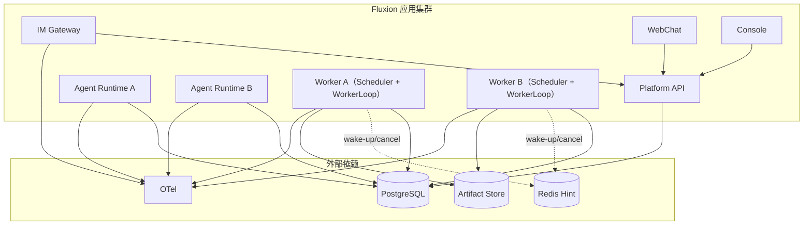

**步骤说明**：

1. Runtime/Worker 无状态；多副本。
2. Worker 同进程运行 SchedulerLoop 与 WorkerLoop，也可按角色拆分；PG 权威。
3. 多 Scheduler 通过 PG row lock + `(schedule_id,scheduled_at)` 唯一保证唯一。
4. Redis 只做 wake-up/cancel hint；不是队列权威。
5. Artifact Store 提供 Skill 产物；Worker 本地缓存可丢弃。
6. WebChat/MSSWWEB 经 IM Gateway；Console 经 Platform API。
7. Agentic Kernel 是库，不是新服务；Runtime/Worker 各自装配 ports。

### 4.2 发布与回滚

| 阶段 | 操作 | 进入条件（独立验收门禁） | 回滚 |
|---|---|---|---|
| 1 | Spec Delta + 目标 schema + 一次性重建 | 设计批准 + 迁移可重放（备份恢复演练） | DB 备份 |
| 2 | Kernel 端口泛化 + Runtime 适配 | 依赖边界检查 + 共享 Kernel 契约测试 + Runtime 全量测试绿 | 旧镜像 |
| 3 | Worker 适配器 + Reminder/Skill 执行 | Worker 契约测试（恢复/取消/迟到结果）+ 并发测试绿 | 旧镜像 |
| 4 | Draft/Schedule/Fire/Execution/Delivery | 双 Scheduler/幂等/QUEUE 队头测试绿 | 旧镜像 |
| 5 | WebChat 任务中心 + MSSWWEB 契约（不落地路由） | E2E 绿 + Fake surface 契约测试绿 | 旧镜像 |
| 6 | Human/配额/保留 + ASYNC Skill | 场景验收（S-17/E-07/E-15）+ Task-owned inbox 集成测试绿 | 旧镜像 |

- 每个阶段是可独立交付的批次：阶段 2 完成后 Runtime 生产路径已走泛化 Kernel，阶段 3 才允许 Worker 接入；不允许“先合并 Worker 适配器再回头改 Kernel”。
- 回滚以**阶段**为单位（镜像回滚 + 该阶段新增表/端点的开关），不是只能整库恢复。

- 不做双写/兼容视图；一个版本切换所有消费者。
- 破坏性迁移前备份；回滚整体恢复备份 + 旧镜像。
- 不在回滚时把 Schedule 改回 pin 旧 Artifact。

### 4.3 监控告警

| 指标 | 条件 | 级别 | 处理 |
|---|---|---|---|
| due lag | 超过压测预算 | P1 | 检查 Scheduler/DB 锁 |
| Fire/Execution 对账差异 | >0 且不可解释 | P1 | 检查事务/幂等 |
| Admission Failed | 突增 | P1 | 检查 Skill/Tool/Grant |
| NEEDS_ATTENTION | 长期未处理 | P2 | 提醒用户修复 |
| Human 超时 | 超阈值 | P2 | 检查交互/deadline |
| Delivery Failed | 持续 | P1 | 检查 IM Gateway |
| Timezone Error | >0 | P1 | 检查 TZDB/输入 |
| Duplicate Fire | 实际重复执行 | P0 | 停调度/查唯一约束 |

### 4.4 一次性重建迁移

**范围**：开发阶段；保留 `task.workspace/workspace_lease`，重建调度相关表。

Drop 顺序：

```text
task.runtime_result_outbox
task.runtime_operation
task.task_submission
task.task_event
task.task_execution_checkpoint
task.task_human_interaction
task.task_delivery_attempt
task.task_delivery
task.task_execution
task.schedule_fire
task.task_schedule_draft
task.task_schedule_revision
task.task_schedule
task.delivery_route
```

Create 顺序相反；保留 `task.workspace`/`workspace_lease`。

**循环 FK 与依赖**：

1. 先建 `task_schedule`（不建 `current_revision_id` FK）和 `task_schedule_revision`；再 `ALTER TABLE` 加 `current_revision_id` FK（或使用 DEFERRABLE）。
2. 先建 `schedule_fire`（不建 `execution_id` FK）和 `task_execution`（不建 `schedule_fire_id` FK）；再按需加 FK。
3. `runtime_result_outbox` 改为 `task_event_id` 单列 FK → `task_event.id`；保留 `task_id` 查询列，不再建 `(task_id,task_event_seq)` 复合 FK。
4. `runtime.model_call_lease` 加 `task_execution_id`（逻辑 UUID，跨 schema 不建 FK）+ `owner_type`；`ck_model_call_lease_owner` 改为 `num_nonnulls(run_id,memory_job_id,probe_id,task_execution_id)=1`。
5. `runtime.tool_operation` / `tool_result_inbox` 加 `owner_type` + `owner_task_execution_id`；`run_id` 改可空；`tool_operation.task_id` 保持“提交产生的 Task”，不复用为 owner；唯一键按 owner 分列。
6. `tool_result_inbox.receipt_event_id` 改为 `receipt_event_type=RUN_EVENT/TASK_EVENT` + 逻辑 UUID；跨 schema 不建双 FK，Task receipt 由 `task.task_event` 校验。
7. `task.runtime_operation.source_run_id` 改可空 + `task_execution_id`；XOR owner。
8. `runtime.model_call_lease` 的 `num_nonnulls` 扩为 `run_id,memory_job_id,probe_id,task_execution_id` 四选一。
9. `RuntimeExecutionRef` 增加 `type=TASK`；凭据解析支持 Task owner。
10. `runtime.artifact` 复用 `task_id`（值 = `task_execution.id`）：Task-owned 行 `run_id` 为 NULL（XOR 不变），存储键不得依赖 `run_id`（改为 `tasks/{tenant}/{execution_id}/...`），并新增写入/版本端点（API-28）与 owner+agent 下载校验。
11. `task.task_execution` 加 `started_at/finished_at/wait_kind/wait_payload_json`；等待索引只用 `wait_payload_json.operations[]`。
12. `task.task_execution_checkpoint.state_json` 支持 `pending_tool_calls[]` 多 operation。
13. 旧 `WAITING` 任务（如有）映射 `WAITING_EXTERNAL`：`external_ref_json` 含 `batch_ref` → `wait_kind=BATCH_FANIN`；否则 `EXTERNAL_POLL`；`wait_payload_json` 按迁移时事实重写。
14. `task.schedule_fire` 不新增 gap 身份；gap/second-fold 写 SCHEDULE 事件。
15. `draft_hash` 统一 `varchar(71)`（含 `sha256:`）。
16. 迁移后跑 `alembic upgrade head` + schema contract tests。
17. 更新所有 ORM/contracts/Console/WebChat/e2e fixtures；不保留旧列断言。

迁移方式：

- Alembic revision（下一个可用编号，当前 memory 为 0049，建议 0050）。
- upgrade：drop/create + alter；不导入历史数据。
- downgrade：`raise` 并要求从备份恢复；遵循现有破坏性迁移先例。
- 开发阶段无历史数据；如果后续需要保留，另写一次性 importer，不走双写。

**开发阶段无历史数据**；如果后续需要保留，另写一次性 importer，不走双写。

---

## 5. 风险与依赖

### 5.1 项目依赖

| 依赖 | 内容 | 状态 | 风险 |
|---|---|---|---|
| Agent Runtime | Kernel 抽取、Model/Tool/Memory 装配、交互式回归 | P0 | 高 |
| Agent Worker | Scheduler、Fire、Execution、Lease、三种 Executor | P0 | 高 |
| Console Platform | Skill/MCP/Grant/Model 解析；Console 页面 | P0 | 高 |
| IM Gateway | ChatSurface、WebChat/MSSWWEB、WeCom push | P0 | 高 |
| Artifact Store | Skill artifact 最新版/缓存；Task artifact | 已有/需扩展 | 中 |
| Runtime Async/Capacity | Task owner、结果收件箱、唤醒、artifact API | 需扩展 | 高 |
| PostgreSQL | 权威存储、行锁、唯一约束、分区 | 已有 | 中 |
| Redis | wake-up/cancel hint | 已有 | 低 |
| 浏览器 | WebChat/Console E2E | 已有 | 中 |

### 5.2 风险

| ID | 风险 | 概率 | 影响 | 应对 | 验证 |
|---|---|---|---|---|---|
| RISK-01 | Kernel 抽取变成两套 Agent 实现 | 中 | 极高 | 先 Runtime 适配 + 全量测试，再 Worker；无分支 | parity |
| RISK-02 | Agentic 半成品 | 中 | 极高 | P0 能力清单；无 stub；E2E | S-03/S-15/S-16 |
| RISK-03 | Fire 重复/丢失 | 低 | 极高 | 复合唯一 + 同事务 + CAS | S-08/E-03 |
| RISK-04 | 并发策略不原子 | 中 | 高 | Schedule 行锁 + 阻断/占槽集分离 | B-05/B-06 |
| RISK-05 | Draft 重放创建重复 | 中 | 高 | draft_hash + confirmation + Idempotency-Key | S-14/E-04 |
| RISK-06 | Human 回复串任务/复活终态 | 中 | 高 | interaction_id + 双侧 CAS + 多 OPEN 澄清 | S-09/S-10/E-07/E-08 |
| RISK-07 | WebChat 误投递 | 中 | 高 | delivery_intent=NONE + 测试 | S-11/E-11 |
| RISK-08 | MSSWWEB 返工（另立需求落地时） | 中 | 中 | TaskCenterService surface-neutral + fake surface test | S-12 |
| RISK-09 | 迁移破坏 workspace/outbox | 低 | 高 | 保留 workspace 两表；outbox event_id；备份 | migration |
| RISK-10 | 时区/DST 错误 | 中 | 高 | IANA + 墙钟 + gap/fold 策略 + 测试 | B-01 |
| RISK-11 | 高频 Fire/Snapshot 存储膨胀 | 中 | 中 | missed_count + 保留/分区 + snapshot 上限 | B-02/B-10 |
| RISK-12 | Console 权限风险 | 低 | 中 | 保持现状；记录为已知风险 | S-13 |
| RISK-13 | ASYNC Skill 结果/唤醒丢失 | 中 | 高 | Task-owned operation + 结果收件箱 + PG 补扫 + wake-up hint | S-03/S-15 |
| RISK-14 | Task artifact 越权/无会话下载 | 中 | 高 | owner+agent 授权 + 无 Conversation 校验 | S-11/B-09 |
| RISK-15 | Snapshot 过大 | 中 | 中 | 大小上限 + 指标 + 拒绝不截断 | S-03/B-08 |
| RISK-16 | ASYNC 结果早到/唤醒丢失 | 中 | 高 | ready-check + 水位 + 补扫 + 迟到 CAS | S-17 |
| RISK-17 | Task owner 迁移不完整 | 中 | 高 | owner union + XOR + receipt kind；不跨 schema 直写 | S-17 |
| RISK-18 | 取消留下 WAITING 卡死 | 中 | 高 | FUTURE_ONLY 保留 interaction；ALL_ACTIVE 关闭并取消 operation | S-06/E-15 |
| RISK-19 | DST gap 占用真实 UTC Fire | 中 | 高 | gap/second-fold 只写 SCHEDULE 事件 | B-01 |
| RISK-20 | 产物版本漂移 | 中 | 中 | 下载带 version+checksum；冲突 409 | B-11 |

---

## 6. 需求追溯矩阵

| US | FEAT | API | 场景 | 层级 |
|---|---|---|---|---|
| US-01 | FEAT-01/02/18/21 | API-01/27 | S-01/S-02/S-03/S-17 | E2E |
| US-02 | FEAT-03/24 | API-01/27 | S-02/E-01/E-14 | E2E |
| US-03 | FEAT-04/14 | API-08/09/14/15 | S-07 | integration/E2E |
| US-04 | FEAT-05/06/16 | API-27/08 | S-04/E-02/E-10/E-13 | E2E |
| US-05 | FEAT-07/08/17/22 | API-12..19/25 | S-11/S-12/B-11 | E2E |
| US-06 | FEAT-09 | API-04..06/19/27 | S-04/S-05/S-06 | E2E |
| US-07 | FEAT-10 | API-01/27 | S-04/E-05 | E2E |
| US-08 | FEAT-11/23 | API-01/27 | B-01 | unit/integration |
| US-09 | FEAT-12 | API-10/16/18 | S-09/S-10/E-07/E-15 | E2E |
| US-10 | FEAT-13 | API-27 | B-05/B-06/B-12 | integration |
| US-11 | FEAT-15 | API-20 | S-13/E-12 | E2E |
| US-12 | FEAT-17 | API-12..19 | S-12 | contract |
| US-13 | FEAT-06/18 | API-01/27 | S-03/S-15 | E2E |
| US-14 | FEAT-06/18 | API-01/27 | S-16 | E2E |

---

## Spec Compliance Matrix

| Spec / Rule | 处理 | 设计落点 | 验证 |
|---|---|---|---|
| `harness-worker#RULE-worker-001` | **需修改**：`task_type` 增加 REMINDER/AGENTIC；`WAITING` 拆分 WAITING_EXTERNAL/WAITING_HUMAN；等待种类 ASYNC/EXTERNAL_POLL/BATCH_FANIN；Fire 台账；ASYNC Skill 工具级 suspension；deadline 仍 NOT NULL；全局锁序 | §3.3.6/§3.5.2/§3.5.3/§3.5.6/§3.3.12 | S-08/E-03/B-08/S-17 |
| `harness-time#RULE-time-001` | **需修改**：P0 支持 CRON/ONCE + IANA + DST gap/fold 事件；`occurrence_count` 按本地计划槽、Fire 只记实际触发 UTC；所有时间 timestamptz；内部 ISO/Console offset | §2.3.7/§3.3.3/§3.4.8/§3.5.11 | B-01 |
| `harness-api#RULE-api-001` | 复用：封套/分页/错误目录 | §3.4.1/§3.4.7 | contract |
| `harness-api#RULE-api-002` | 复用：Idempotency-Key + canonical fingerprint + partial unique | §3.5.1 | S-14/E-04 |
| `harness-im#RULE-im-002` | 复用：渠道差异只在 surface/adapter；核心域无 WECOM/MSSWWEB 枚举 | §2.3.6/§3.2.7 | S-11/S-12 |
| `harness-data#RULE-data-001` | **需修改**：新表/partial unique/FK/timestamptz；事件表多态审计例外；outbox event_id；Task owner union | §3.3/§4.4 | contract/migration |
| `harness-snapshot#RULE-snapshot-001` | **需修改**：Snapshot v4 B（依赖范围完整 JSON）；0..N Skill；MCP endpoint/headers/secret_header；model pool/summary；Memory 内容/Budget/Allowlist；大小上限 | §3.5.7 | S-03/S-15/S-16/S-17/B-08 |
| `harness-secret#RULE-secret-001` | 复用：Secret 不进 Snapshot/Event/API | §3.5.13 | security |
| `harness-auth#RULE-auth-001` | 复用：三层授权；Console 现状不变；WebChat owner-scoped；Task artifact owner+agent | §3.5.5/§3.5.13 | S-13/S-15/B-11 |
| `harness-mcp#RULE-mcp-001/002` | 复用：MCP catalog/Server 级授权；Tool 级不做授权；Snapshot 存 endpoint/非密 headers/secret_header，不存 auth_secret | §3.5.5/§3.5.6/§3.5.7 | S-03/S-17 |
| `harness-model#RULE-model-001` | 复用：Agent 显式 model_id；OPENAI 兼容；Snapshot 冻结 pool members/summary model | §3.5.6/§3.5.7 | S-03/S-17 |
| `harness-skill#RULE-skill-001` | 复用：Artifact Store/checksum/缓存 | §3.5.5 | S-04 |
| `harness-arch#RULE-arch-001` | 复用：部署单元/指标 | §4.1/§3.5.12 | ops |
| `harness-log#RULE-log-001` | 复用：logging-kit/trace | §3.5.12 | ops |
| `harness-e2e#RULE-e2e-001` | **需修改**：WebChat 任务中心 pull；移除 WebChat 主动投递 | §2.3.6/前端设计 | S-11 |
| `harness-test#RULE-test-001` | 复用：契约/集成/E2E 分层 | §3.5.14 | all |
| `harness-i18n#RULE-i18n-001` | 复用：词条/语言协商 | 前端设计 | UI |
| `harness-front#RULE-front-001/002/003` | 复用：服务层/拦截器/组件边界 | 前端设计 | UI |

---

## 附录：术语表

| 术语 | 定义 |
|---|---|
| Schedule | 持续性任务安排：目标、规则、时区、期限、上下文 |
| Revision | Schedule 的不可变配置版本 |
| Draft | 待用户确认的创建/更新配置；Preflight 结果 |
| Fire | 某一个计划 occurrence 的持久化台账 |
| Execution | Fire 对应的真实执行实例 |
| missed_count | 一次跳过区间内连续错过的 occurrence 数 |
| Snapshot v4 | 冻结 Agent/Model/Tool/Skill/MCP/Memory/Budget/Allowlist 的执行快照 |
| Kernel | Runtime/Worker 共用的 Agent 执行内核 |
| delivery_intent | PUSH / NONE；由 surface 能力决定 |
| ChatSurface | WebChat/MSSWWEB 的认证、principal、路由、delivery capability 抽象 |
| WAITING_HUMAN | Execution 等待用户回答的持久状态 |
| NEEDS_ATTENTION | 永久依赖错误，停止未来 Fire，等待修复 |
| TaskCenter | WebChat/MSSWWEB 的定时任务 pull 页面与查询接口 |
| MSSWWEB | 外部业务平台 BFF 入口；定时任务中心另立需求，本需求只锁契约 |
