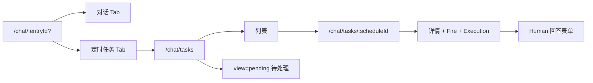
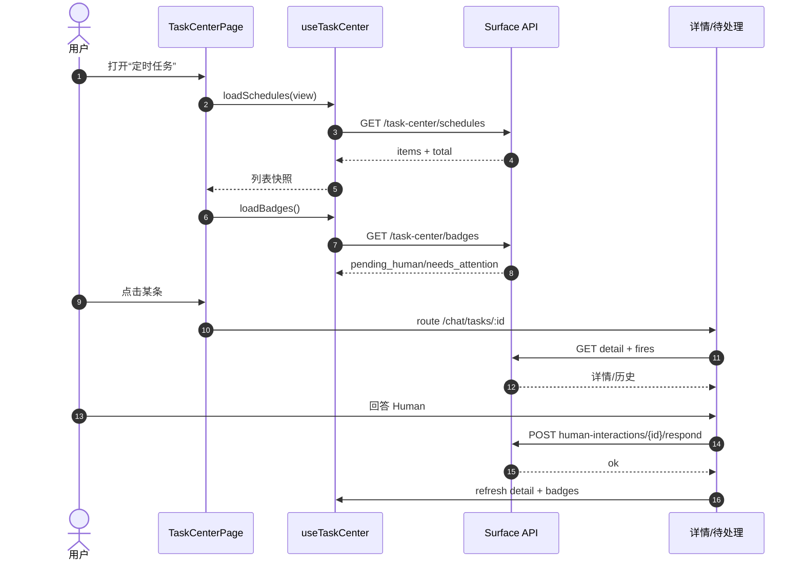

# 定时任务与自然语言调度 v2 前端设计

> **文档编号**: FE-MOD-SCHEDULE-V2-1.0
> **文档版本**: v1.0
> **创建日期**: 2026-11-15
> **文档状态**: 设计评审中
> **后端设计**: `scheduled-task-v2.backend.design.md`
> **场景唯一源**: `scheduled-task-v2.scenarios.md`

**评审边界说明**:

- **需求评审**: 第 2 章（需求分析）→ 通过后锁定需求基线。
- **设计评审**: 第 3 章（前端技术设计）→ 通过后锁定设计基线。
- **本设计只覆盖**: WebChat 定时任务 Tab、WebChat 待处理 Human 交互、Console 现有 Schedule/Task 页面适配；MSSWWEB 任务中心另立需求，本需求只保证后端契约可复用（前端不实现）。

**关键结论（先读）**:

1. WebChat 新增“定时任务”Tab，**pull 模式**；结果、状态、待处理问题都在 Tab 内查询，不进聊天流、不写投递。
2. Human 询问是任务中心的一条待处理事项；WebChat 多会话不绑定 Conversation，用户按 `interaction_id` 回答。
3. WebChat 任务中心与 MSSWWEB 任务中心共用同一套后端契约；前端只实现 WebChat，MSSWWEB 由 BFF 后续接入。
4. Console 不新增页面、不新增创建入口、不改权限；只更新 Schedule/Task 的状态、字段和 Fire 历史。
5. 不做独立“待办模块”：定时任务 Tab 内增加“待处理”视图/徽标即可。

---

## 目录

- [1. 文档控制](#1-文档控制)
- [2. 需求分析](#2-需求分析)
- [3. 前端技术设计](#3-前端技术设计)
- [4. 风险与依赖](#4-风险与依赖)
- [附录：术语表](#附录术语表)

---

## 1. 文档控制

### 1.1 责任人

| 角色 | 姓名 | 职责范围 |
|---|---|---|
| 前端负责人 | fluxion-harness | WebChat 任务中心、Console 适配 |
| 设计/交互 | fluxion-harness | Tab、列表、详情、待处理交互 |
| 后端负责人 | fluxion-harness | 契约、分页、状态、Human API |

### 1.2 修订历史

| 版本 | 日期 | 作者 | 变更描述 |
|---|---|---|---|
| v0.1 | 2026-11-15 | fluxion-harness | 初稿：WebChat 定时任务 Tab + 待处理视图，Console 适配 |

---

## 2. 需求分析

### 2.1 需求概述

| 项目 | 内容 |
|---|---|
| 模块名称 | 定时任务与自然语言调度 v2（前端） |
| 模块 ID | FE-MOD-SCHEDULE-V2 |
| 需求类型 | 新页面 + 现有页面适配 |
| 业务背景 | 定时任务从“只支持 Skill + 主动投递”扩展为三模式；WebChat 改为 pull 任务中心；Console 需要展示 Fire/Execution/Human 新状态 |
| 核心目标 | WebChat 用户在一个独立的“定时任务”Tab 中查看、管理、回答任务；Console 使用者继续查看/暂停/恢复/取消；MSSWWEB 后续复用同一契约 |

### 2.2 功能方案

| 功能 ID | 功能名称 | 功能描述 | 优先级 | 来源 |
|---|---|---|---|---|
| FE-FEAT-01 | WebChat 定时任务 Tab | 在 WebChat 工作区新增“定时任务”Tab | P0 | US-05 |
| FE-FEAT-02 | Schedule 列表 | 状态、模式、下次触发、最近结果、徽标 | P0 | US-03/05 |
| FE-FEAT-03 | Schedule 详情 | 当前配置摘要、依赖、下次触发、操作 | P0 | US-05/06 |
| FE-FEAT-04 | Fire 历史 | 每次处理区间的状态、时间、跳过/失败原因、Execution | P0 | US-03 |
| FE-FEAT-05 | Execution 详情 | 结果、产物、事件、错误、Snapshot 摘要 | P0 | US-03 |
| FE-FEAT-06 | 待处理 | OPEN HumanInteraction + NEEDS_ATTENTION；回答表单 | P0 | US-09 |
| FE-FEAT-07 | 操作 | 暂停、恢复、取消；二次确认 | P0 | US-06 |
| FE-FEAT-08 | 空/错/加载态 | 无任务、无待处理、加载失败、权限失败 | P0 | US-05 |
| FE-FEAT-09 | Console 适配 | 新状态/新字段/Fire 历史；无创建、无权限变更 | P0 | US-11 |
| FE-FEAT-10 | MSSWWEB 契约预留 | 前端不实现，后端契约 surface-neutral | P0 | US-12 |
| FE-FEAT-11 | 响应式/可访问性 | 窄屏 Tab/列表/详情可用；键盘可操作 | P0 | US-05 |

### 2.3 范围与边界

| 类别 | 内容 |
|---|---|
| In Scope | WebChat “定时任务”Tab；列表/详情/Fire/Execution/待处理；暂停/恢复/取消；Console 现有 Schedule/Task 页面适配 |
| Out of Scope | MSSWWEB 任务中心（路由/BFF 页面/接入文档，另立需求）；独立待办中心；通知中心；WebChat 主动推送；Console 创建入口；Console 权限重构；RRULE 可视化编辑器（P1） |
| 有意妥协 | P0 只做 CRON/ONCE 展示；不做 RRULE/日历 UI；MSSWWEB 只保证契约，不写 BFF 页面 |

### 2.4 验收条件

> 场景唯一源：`scheduled-task-v2.scenarios.md`。前端设计只列影响，不复制步骤。

| 场景 ID | 前端设计影响 |
|---|---|
| S-01 | 创建 Reminder 后，任务出现在 WebChat/WeCom；WebChat 只在 Tab 可见 |
| S-02 | Skill 任务列表/详情/结果 |
| S-03 | Agentic 任务详情展示 allowlist、budget、记忆只读标记 |
| S-04 | 修改后详情更新，Fire 历史保留旧 Revision |
| S-05 | 暂停/恢复状态与操作反馈 |
| S-06 | 取消二次确认；运行中执行选择 |
| S-07 | Fire/Execution 历史分栏 |
| S-08 | 重复触发不在 UI 显示重复 |
| S-09 | 待处理问题、回答、resume、状态刷新 |
| S-10 | WeCom 问题不进入 WebChat 会话；任务中心仍可答 |
| S-11 | WebChat 不出现聊天流结果；只在 Tab |
| S-12 | MSSWWEB 不显示 Tab；契约测试不依赖 WebChat |
| S-13 | Console 查看/暂停/恢复/取消；无创建 |
| S-14 | 创建重试不产生重复项 |
| S-15 | Agentic 工具越权错误展示 |
| S-16 | 记忆只读标记；无“写入记忆”提示 |
| E-01 | 创建缺时区/参数时的错误提示 |
| E-02 | NEEDS_ATTENTION 徽标、原因、修复动作 |
| E-03 | 重复 Fire 不在 UI 重复 |
| E-04 | Draft 过期/幂等冲突提示 |
| E-05 | 版本冲突提示刷新 |
| E-06 | 暂停竞态后的状态 |
| E-07 | Human 超时状态 |
| E-08 | 多待处理项的区分 |
| E-09 | WeCom 路由失效的提示 |
| E-10 | 工具缺失/撤权的 NEEDS_ATTENTION |
| E-11 | WebChat 无投递记录/无聊天消息 |
| E-12 | Console 无创建入口 |
| B-01 | DST 本地时间展示 |
| B-02 | missed_count 展示 |
| B-03 | ENDED 原因展示 |
| B-04 | 配额/最小间隔错误 |
| B-05/B-06 | QUEUE/PARALLEL 状态展示 |
| B-07 | 多客户 Schedule 拆分提示 |
| B-08 | Agentic deadline/budget 展示 |
| B-09 | 长结果/产物列表 |
| B-10 | 历史分页/保留提示 |

#### 2.4.1 验证环境假设

| 维度 | 假设 | 验证方式 | 不满足时 |
|---|---|---|---|
| 容量 | 每用户 Schedule 列表分页；Fire 历史分页 | fixture / Playwright | 记录缺失项与 owner |
| 硬件 | 现有 Chrome/Chromium；桌面 + 窄屏 | Playwright projects | 记录缺失项与 owner |
| 依赖 | 真实后端、真实 PG、真实 CHAT 会话 | E2E/人工 | 记录缺失项与 owner |
| 测试预算 | Task 跑组件/契约；E2E 在 CI | 任务文档声明 | 记录未覆盖风险 |

---

## 3. 前端技术设计

### 3.1 技术选型

| 类别 | 选型 | 说明 |
|---|---|---|
| 框架 | React 18 + TypeScript | 现有 Console/WebChat |
| 组件库 | Semi Design | 现有 |
| 路由 | React Router | 现有 |
| 数据请求 | 现有 `api/client` + typed service | 不新增请求库 |
| 状态 | 页面/控制器 hooks | 遵循 WebChat 现有控制器模式 |
| 样式 | 现有 WebChat CSS + tokens | 不引入新样式体系 |
| 时间 | `DateTimeText` | 浏览器本地时区 |
| i18n | `react-i18next` | 词条进 catalog |

### 3.2 页面与路由结构

| 页面 | 路由 | 布局 | 说明 |
|---|---|---|---|
| WebChat 对话 | `/chat/:entryId?` | 现有会话工作区 | 不变 |
| WebChat 定时任务 | `/chat/tasks` | 顶栏 Tab + 任务中心 | 新增；静态路由优先于 `:entryId` |
| WebChat 任务详情 | `/chat/tasks/:scheduleId` | 列表 + 详情/侧栏 | 新增；支持深链 |
| WebChat 待处理 | `/chat/tasks?view=pending` | 任务中心 + 待处理过滤 | 新增；徽标入口 |
| Console Schedule | `/schedules` | 现有管理页 | 适配状态/字段/Fire 历史 |
| Console Task | `/tasks` | 现有管理页 | 适配执行状态/等待人工 |
| MSSWWEB | 另立需求接入 | 外部页面 | 本需求不做 |

**路由规则**:

1. `/chat/tasks` 必须注册在 `/chat/:entryId?` 之前；React Router 静态段优先，不把 `tasks` 当 entryId。
2. Tab 切换不取消正在运行的对话 Run；对话状态由现有 `useRunEvents` 控制器持有。
3. `scheduleId` 深链无效/越权时显示 404 态，不静默回列表。
4. 从任务中心返回对话时，保留原 `entryId`/`conversation` 查询参数（如存在）。



**步骤说明**:

1. WebChat 工作区顶部增加两个 Tab：“对话”“定时任务”。
2. 点击“定时任务”切到 `/chat/tasks`，不卸载对话控制器。
3. 任务中心内先看列表；点击某条进入详情。
4. 待处理是列表的过滤视图，不新增一级菜单。
5. 详情内可回答 Human 问题、暂停/恢复/取消、查看 Fire/Execution。
6. 返回对话时恢复原会话参数。

### 3.3 组件设计

```text
<WebchatWorkspaceTabs>              # 容器：Tab 切换，不卸载对话
├─ <ChatWorkspace>                  # 现有会话工作区（复用）
└─ <WebchatTaskCenterPage>          # 容器：任务中心
   ├─ <TaskCenterToolbar>           # 展示：刷新/过滤/视图切换
   ├─ <TaskCenterBadge>             # 展示：待处理/需关注计数
   ├─ <ScheduleListPanel>           # 容器：列表数据
   │  └─ <ScheduleRow>              # 展示：状态/模式/下次/最近
   ├─ <PendingInteractionPanel>     # 容器：待处理列表
   │  └─ <PendingInteractionRow>    # 展示：任务名/问题/deadline
   └─ <ScheduleDetailPanel>         # 容器：详情
      ├─ <ScheduleSummary>          # 展示：配置/时区/依赖/操作
      ├─ <FireHistoryTable>         # 展示：Fire 历史
      ├─ <ExecutionDetailPanel>     # 容器：结果/产物/事件
      └─ <HumanResponseForm>        # 容器：回答表单
```

| 组件 ID | 组件名 | 类型 | 复用/新建 | 职责 |
|---|---|---|---|---|
| CMP-01 | `WebchatWorkspaceTabs` | 容器 | 新建 | Tab 切换；保留对话状态 |
| CMP-02 | `WebchatTaskCenterPage` | 容器 | 新建 | 路由、查询、错误边界 |
| CMP-03 | `ScheduleListPanel` | 容器 | 新建 | 列表分页/过滤/刷新 |
| CMP-04 | `ScheduleRow` | 展示 | 新建 | 状态/模式/时间/最近结果 |
| CMP-05 | `TaskCenterBadge` | 展示 | 新建 | `pending_human`/`needs_attention` |
| CMP-06 | `PendingInteractionPanel` | 容器 | 新建 | 待处理列表/空态 |
| CMP-07 | `ScheduleDetailPanel` | 容器 | 新建 | 详情数据/操作 |
| CMP-08 | `ScheduleSummary` | 展示 | 新建 | 配置/时区/依赖/预算 |
| CMP-09 | `FireHistoryTable` | 展示 | 新建 | Fire 分页/跳过/失败/DST 事件 |
| CMP-10 | `ExecutionDetailPanel` | 容器 | 新建 | 结果/产物/事件 |
| CMP-11 | `HumanResponseForm` | 容器 | 新建 | schema 表单/提交/错误 |
| CMP-12 | `ScheduleActions` | 展示 | 新建 | pause/resume/cancel/edit |
| CMP-13 | `CancelScheduleModal` | 展示 | 新建 | FUTURE_ONLY/ALL_ACTIVE 二次确认 |
| CMP-14 | `ScheduleStatusTag` | 展示 | 复用 `StatusTag` | 新状态映射 |
| CMP-15 | `ModeTag` | 展示 | 新建 | REMINDER/SKILL/AGENTIC |
| CMP-16 | `ArtifactList` | 展示 | 复用现有产物组件 | 结果产物/checksum/version |
| CMP-17 | `RelativeTime`/`DateTimeText` | 展示 | 复用 | 本地时区 |
| CMP-18 | `ConsoleScheduleHistory` | 展示 | 新建 | Console Fire 历史 |
| CMP-19 | `AgentFilter` | 展示 | 新建 | 授权 Agent 过滤 |
| CMP-20 | `TaskArtifactList` | 容器 | 新建 | 任务产物下载/错误 |
| CMP-21 | `EditScheduleAction` | 展示 | 新建 | 预填对话修改；不做全量编辑器 |

**分层纪律**:

- 容器组件负责数据与状态；展示组件只收 typed props/events。
- 不复制 WebChat 的认证/传输逻辑；任务中心通过 surface client 注入。
- 不把服务端状态复制到多个组件；列表/详情/待处理各自一个 controller。
- 不在展示组件里拼 API、读 Cookie、写 localStorage。

### 3.4 组件接口契约

```ts
type ScheduleMode = 'REMINDER' | 'SKILL' | 'AGENTIC';
type ScheduleStatus = 'ACTIVE' | 'PAUSED' | 'NEEDS_ATTENTION' | 'ENDED' | 'CANCELLED';
type CancelScope = 'FUTURE_ONLY' | 'ALL_ACTIVE';
type FireStatus = 'CREATED' | 'EXECUTION_CREATED' | 'SKIPPED' | 'FAILED_ADMISSION' | 'CANCELLED';
type ExecutionStatus = 'QUEUED' | 'RUNNING' | 'WAITING_EXTERNAL' | 'WAITING_HUMAN' | 'COMPLETED' | 'FAILED' | 'CANCELLED';

interface ScheduleListItem {
  schedule_id: string;
  agent_id: string;
  name: string;
  mode: ScheduleMode;
  status: ScheduleStatus;
  timezone: string;
  next_fire_at: string | null;
  last_fire: {
    scheduled_at: string;
    status: FireStatus;
    execution_status: ExecutionStatus | null;
    missed_count: number;
    dst_resolution: string | null;
  } | null;
  needs_attention: boolean;
  pending_human: boolean;
}

interface HumanPendingItem {
  kind: 'HUMAN';
  interaction_id: string;
  schedule_id: string;
  execution_id: string;
  schedule_name: string;
  question: string;
  deadline_at: string;
  input_schema: Record<string, unknown> | null;
}

interface AttentionPendingItem {
  kind: 'NEEDS_ATTENTION';
  schedule_id: string;
  schedule_name: string;
  reason: string;
  action: string;
}

type PendingItem = HumanPendingItem | AttentionPendingItem;

interface PendingPage {
  items: PendingItem[];
  page: number;
  page_size: number;
  total: number;
}

interface Badges {
  pending_human: number;
  needs_attention: number;
}

interface ScheduleDetail extends ScheduleListItem {
  config_version: number;
  revision_no: number;
  instruction: string;
  normalized_goal: string;
  // 契约 `DraftContext`：参数与输出偏好（原 `context_summary` 已按代码事实更名）。
  context: {parameters: Record<string, unknown>; output: Record<string, unknown>};
  dependencies: string[];
  delivery_intent: 'PUSH' | 'NONE';
  // 三模式共用的调度策略（并发/until/max_occurrences/DST 两种策略都在这一个对象里）。
  policy: {
    concurrency_policy: 'SKIP_IF_RUNNING' | 'QUEUE' | 'ALLOW_PARALLEL';
    max_concurrency: number;
    until: string | null;
    max_occurrences: number | null;
    dst_gap_policy: 'SKIP';
    dst_fold_policy: 'FIRST';
  };
  budget: {max_steps: number; max_tool_calls: number; max_tokens: number} | null;
  memory_mode: 'READ_ONLY' | null;
  end_reason: 'COMPLETED' | 'MISSED' | 'EXHAUSTED' | 'ADMISSION_FAILED' | 'USER_CANCELLED' | null;
  attention_reason: string | null;
}

interface FireItem {
  fire_id: string;
  scheduled_at: string;
  status: FireStatus;
  skip_reason: string | null;
  missed_count: number;
  dst_resolution: string | null;
  admission_error_code: string | null;
  execution_id: string | null;
  execution_status: ExecutionStatus | null;
}

interface DstEvent {
  event_id: string;
  event_type: 'DST_GAP_SKIPPED' | 'DST_FOLD_SECOND_SKIPPED';
  local_date: string;
  local_time: string;
  timezone: string;
  occurred_at: string;
}

interface FireHistoryPage {
  items: FireItem[];
  dst_events: DstEvent[];
  page: number;
  page_size: number;
  total: number;
}

interface TaskArtifact {
  artifact_id: string;
  name: string;
  media_type: string;
  size: number;
  checksum: string;
  version: string;
}

interface ExecutionDetail {
  execution_id: string;
  status: ExecutionStatus;
  wait_kind: 'ASYNC_OPERATION' | 'EXTERNAL_POLL' | 'BATCH_FANIN' | null;
  wait_payload: Record<string, unknown> | null;
  result: Record<string, unknown> | null;
  result_artifacts: TaskArtifact[];
  error_code: string | null;
  error_message: string | null;
  failure_class: string | null;
  started_at: string | null;
  finished_at: string | null;
  snapshot: {schema_version: number; agent: string; model: string; tools: string[]; memory_mode: string | null; snapshot_bytes: number};
}
```

**约束**:

- 前端不展示 Secret、内部 endpoint、完整 Prompt。
- `input_schema` 只用于生成表单；不信任前端，后端二次校验。
- `input_schema` 为空时渲染自由文本回答（提交 `{"answer": "..."}`）；不能只渲染提交按钮。
- Task artifact 下载按 `artifact_id`；checksum/version 展示；不要求 Conversation。
- `NEEDS_ATTENTION` 是待处理项，不是 Human；操作引导修复后恢复。
- `WAITING_EXTERNAL` 显示“等待异步 Skill 结果”，不显示为失败。
- 状态/错误码只映射 catalog；未知值显示原始 code + 通用文案。
- 时间字段全部按 ISO 接收，`DateTimeText` 转本地；不手写 `toLocaleString`。

### 3.5 状态与数据流



**数据流规则**:

1. 页面加载先拉列表和徽标；列表失败显示错误态，徽标失败不阻塞列表。
2. 详情按 `scheduleId` 拉取；Fire 历史分页；Execution 详情按需拉取。
3. 待处理视图是 `GET /task-center/pending` 的独立快照；回答成功后刷新待处理 + 徽标 + 当前详情。
4. 暂停/恢复/取消成功后刷新列表/详情；不乐观伪造最终状态。
5. 切换 Tab 不取消对话 Run；任务中心自己的请求可取消/忽略过期响应（epoch/AbortController）。
6. 页面隐藏/切走不轮询；回到 Tab 或手动刷新时拉取。P0 不做 SSE/浏览器推送。
7. 聊天流里的定时任务确认卡片由现有 ChatPage 渲染 `schedule.draft.ready` 事件；按钮调用 `/api/v1/{surface}/schedule-drafts/{id}/confirm`，**不走** Run 的 `confirmation.required`/resume 通道。
7. 所有错误保留当前有效内容，不清空为“空成功”。
8. 深链/越权/不存在显示 404，不静默跳列表。

### 3.6 UI 状态

| 状态 | 触发 | 展示 |
|---|---|---|
| Loading | 首屏/刷新 | 骨架屏；保留旧内容时显示轻量 loading |
| Empty | 无 Schedule | 空态 + “去对话创建”说明；不显示假数据 |
| Error | 列表/详情失败 | 错误态 + 重试；保留旧内容 |
| Unauthorized | 跨用户/越权 | 404/无权限态；不显示存在性 |
| Pending | `pending_human>0` | Tab 徽标 + 待处理列表 |
| NeedsAttention | `needs_attention>0` | 红色/琥珀徽标 + 原因 + 修复动作 |
| WaitingHuman | Execution `WAITING_HUMAN` | 详情内回答表单 |
| WaitingExternal | Execution `WAITING_EXTERNAL` | 显示“等待异步 Skill 结果”，不显示失败 |
| Ended | `ENDED` | `end_reason` 标签；操作只读；ONCE 提供“重新创建”，不提供“修改” |
| Cancelled | `CANCELLED` | 只读；历史保留 |
| VersionConflict | 更新/操作 409 | 提示刷新；不覆盖 |
| Quota | 429 | 明确配额/最小间隔；不静默 |
| Artifact | 结果有产物 | 列表/下载；按 checksum/version 展示 |
| DstResolution | Fire 有 `dst_resolution` | 显示“因夏令时跳过/第一次” |

**状态色/文案**:

- `ACTIVE` 绿色；`PAUSED` 琥珀；`NEEDS_ATTENTION` 红色；`ENDED` 灰色；`CANCELLED` 灰色。
- `REMINDER` / `SKILL` / `AGENTIC` 用不同 tag；不把 AGENTIC 标成“危险”。
- `SKIPPED` 显示 `skip_reason` + `missed_count`；不显示为失败；DST 跳过显示 `dst_resolution`。
- `FAILED_ADMISSION` 显示修复动作；不显示内部堆栈。
- `WAITING_HUMAN` 显示问题/截止时间；过期为 `TIMED_OUT`。
- `WAITING_EXTERNAL` 按 `wait_kind` 显示：ASYNC_OPERATION=等待异步 Skill；EXTERNAL_POLL=等待外部轮询；BATCH_FANIN=等待子任务聚合；不显示为失败。
- 取消弹窗提供 `FUTURE_ONLY`（保留进行中/待处理）和 `ALL_ACTIVE`（终止全部）两档；默认 FUTURE_ONLY。
- 任务产物下载失败显示明确错误；不伪造成功。
- “修改”动作：P0 用对话预填“修改任务 X：…”回到聊天，走 Draft/确认；不做结构化全量编辑器。
- 任务中心顶部有 Agent 过滤（来自授权 Agent 集合）；缺省全部授权 Agent；切换过滤刷新列表/徽标/待处理。

### 3.7 样式方案

- 复用 WebChat 现有 CSS tokens/间距/字体；新增 `task-center.css` 只做布局。
- 桌面：左侧任务列表 + 右侧详情；待处理为列表过滤/顶部入口。
- 窄屏：列表/详情单列，返回按钮；Tab 可横向滚动。
- 任务列表行高与现有会话侧栏一致；状态 tag 不换行。
- 不使用新的 UI 组件库；不复制 Console 管理表格样式到 WebChat。
- 详情侧栏/抽屉优先复用 Semi `SideSheet`；深链保持可分享。
- 长结果/产物列表可折叠；不截断关键错误。

### 3.8 可访问性与兼容性

- Tab 使用 `role="tablist"`/`role="tab"`/`aria-selected`；键盘左右切换。
- 列表行可键盘聚焦；操作按钮有 `aria-label`。
- 徽标有文本替代；不只靠颜色。
- 表单错误关联字段；`input_schema` 生成必填标记。
- 时间用 `DateTimeText`；时区显示 IANA + 本地时间。
- 窄屏 1024 断点与现有 WebChat 抽屉一致。
- 不引入 `toLocaleString` 手写；契约测试会红。

### 3.9 前端服务层

新增 `apps/console-platform/frontend/src/modules/webchat/services/taskCenterApi.ts`：

```ts
listSchedules(params): Promise<Page<ScheduleListItem>>
getSchedule(id): Promise<ScheduleDetail>
listFires(id, params): Promise<FireHistoryPage>
getExecution(id): Promise<ExecutionDetail>
downloadArtifact(id, version, checksum): Promise<Blob>
listPending(params): Promise<PendingPage>
getBadges(): Promise<Badges>
respondHuman(id, response): Promise<void>
scheduleAction(id, action, options?: { scope?: CancelScope }): Promise<ScheduleDetail>
```

规则：

- 只走 `api/client`；统一 envelope/错误。
- 不读 Cookie/不拼认证头；由 WebChat 现有 client/surface 注入。
- 请求带 `X-Request-Id`；写操作带 `Idempotency-Key`。
- 错误码映射到 i18n；未知码显示通用文案 + code。
- 分页参数 `page>=1`、`page_size<=100`；前端不猜后端默认值。

### 3.10 Console 适配

**SchedulePage**:

- 状态枚举更新为 `ACTIVE/PAUSED/NEEDS_ATTENTION/ENDED/CANCELLED`；`end_reason` 作为次级标签。
- 列表字段：mode、timezone、next_fire_at、last_fire、needs_attention、pending_human。
- 详情：当前 Revision、依赖、delivery_intent、预算（AGENTIC）、记忆只读标记。
- 新增“调度历史”Tab：Fire 列表 + Execution 链接；分页。
- 操作改为 `POST /api/v1/schedules/{id}/actions`（`pause|resume|cancel`）；前端 `services/schedules.ts` 同步更新，不保留旧 `PUT pause/resume` 双路由。
- 无创建入口；不新增权限；不引入 ADMIN-only。
- 现有深链 `?scheduleId=` 保留；404 态保留。

**TaskPage**:

- 状态新增 `WAITING_EXTERNAL/WAITING_HUMAN`；`FAILED_CONFIG` 不再存在（准入失败在 Fire）。
- `task_type` 显示 REMINDER/SKILL/AGENTIC/BATCH。
- 详情显示 Snapshot schema、tool allowlist、memory mode、Human 交互。
- 已有任务列表/详情/时间线复用；不新建 Console 页面。

**E2E/契约影响**:

- 现有 `SchedulePage` 状态常量、`ScheduleListItem`、`task-schedule` 服务测试需要更新。
- 现有 e2e 的暂停/恢复/删除选择器保留；状态文案更新。
- 不新增 Console 创建入口 E2E（仅验证不存在）。

### 3.11 MSSWWEB 预留

- 前端不实现 MSSWWEB 页面；BFF 由业务平台负责。
- 后端 `TaskCenterService` 使用 `ChatPrincipal`，不依赖 WebChat；MSSWWEB 后续只加 `/api/v1/msswwweb/task-center/*` 路由。
- 本需求不挂载路由；契约测试用 Fake MSSWWEB surface 覆盖同一 service。
- MSSWWEB 任务中心（含 `bff-agent-integration.md` 的定时任务章节）属于**另立需求**；本需求不改该文档，也不交付 MSSWWEB 页面。
- 数据按 `tenant+user+agent` 共享；WebChat 创建的任务在 MSSWWEB Tab 上线后可见。

### 3.12 前端改动清单

| 文件/模块 | 改动 |
|---|---|
| `apps/console-platform/frontend/src/App.tsx` | 注册 `/chat/tasks`、`/chat/tasks/:scheduleId` 静态路由，放在 `/chat/:entryId?` 之前 |
| `modules/webchat/ChatPage.tsx` | 增加“对话 / 定时任务”Tab shell；切 Tab 不卸载对话控制器 |
| `modules/webchat/task-center/`（新） | `TaskCenterPage`、列表/详情/Fire/Execution/Pending/Human 表单 |
| `modules/webchat/services/taskCenterApi.ts`（新） | typed API client；统一 envelope/错误 |
| `modules/webchat/types.ts` | 增加 TaskCenter DTO 类型 |
| `modules/webchat/webchat.css` / `task-center.css` | Tab 与任务中心布局；复用 tokens |
| `modules/task-schedule/services/schedules.ts` | 新状态/模式/字段；`POST actions` |
| `modules/task-schedule/SchedulePage.tsx` | 状态/字段/徽标；无创建 |
| `modules/task-schedule/ScheduleDetailSideSheet.tsx` | Revision/依赖/投递/Fire 历史 Tab |
| `modules/task-schedule/TaskPage.tsx` | `WAITING_HUMAN/WAITING_EXTERNAL`、`task_type` |
| `modules/task-schedule/TaskDetailSideSheet.tsx` | Snapshot/allowlist/memory/Human 摘要 |
| `i18n` 词条 | `chat.tabs.*`、`taskCenter.*`、新状态/错误码 |
| 前端测试 | `test_task_schedule_services.py`/组件测试更新；新增 task center 组件测试 |

---

## 4. 风险与依赖

| 风险 | 影响 | 应对 |
|---|---|---|
| WebChat Tab 卸载对话控制器 | 正在生成的回答丢失 | Tab 只切视图，不卸载对话；控制器由页面持有 |
| 任务中心变成第二套结果存储 | 数据不一致 | 只读 Worker API；不复制结果 |
| 待处理做成独立模块 | 状态重复 | 只做 `pending` 视图/徽标 |
| 状态文案与 Console/e2e 不一致 | 回归失败 | 更新 catalog/测试；未知码兜底 |
| Human 多会话歧义 | 答错任务 | 只认 `interaction_id`；WeCom 多 OPEN 澄清 |
| MSSWWEB 另立需求落地时返工 | 路由/契约重写 | TaskCenterService surface-neutral；fake surface 契约测试 |
| 时间格式不统一 | 用户看到错时 | `DateTimeText`；不手写本地化 |

---

## 附录：术语表

| 术语 | 定义 |
|---|---|
| Task Center | WebChat/MSSWWEB 的定时任务 pull 页面 |
| Pending | OPEN HumanInteraction + NEEDS_ATTENTION 的视图 |
| Tab | WebChat 顶部“对话 / 定时任务”切换 |
| ChatSurface | WebChat/MSSWWEB 的认证、principal、路由抽象 |
| delivery_intent | PUSH/NONE；WebChat/MSSWWEB 为 NONE |
| Fire | 一次计划 occurrence 的台账 |
| Execution | Fire 对应的真实执行 |
