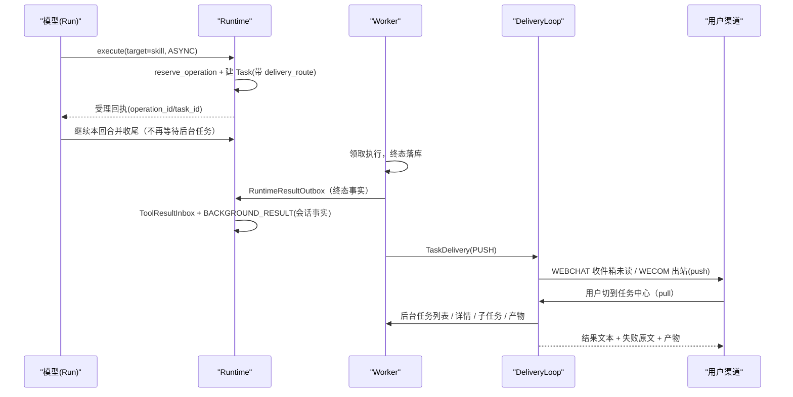

# ASYNC Skill 后台执行与结果投递 设计

> **文档编号**: MOD-ASYNC-BG-1.0
> **文档版本**: v0.5
> **创建日期**: 2026-11-17
> **文档状态**: 设计评审中
> **设计输入**: 会话对齐结论（2026-11-17）+ 当前代码核对（2026-11-18）
> **修订**: v0.5 收回后台专用读服务/DTO，复用现有 `TaskCenterService`/`ExecutionDetail`/surface router；v0.4 收敛容量口径、发件边界、迟到物化与统一 Artifact 依赖；v0.3 补子任务明细、产物聚合与前端设计；v0.2 补任务中心承载；v0.1 初稿

**流程说明**: 本目录当前没有独立 PRD。若沿用 `workflow: full`，进入 `cf-task:plan` 前需要补一份轻量 PRD，或明确由 `unified-artifact-delivery` 的需求基线吸收本设计。

**评审边界说明**:
- **需求评审**: 第 2 章 → 通过后锁定需求基线。
- **设计评审**: 第 3-5 章 → 通过后锁定设计基线。
- **交接契约**: 2.5 验收条件；场景唯一源为 `async-skill-background.scenarios.md`。

**ID 体系**: FEAT、NFR、RISK、RULE；场景使用 S-/E-/B-。

**本版关键结论（先读）**:

1. **Run 侧 ASYNC = 后台任务**：提交即返回受理回执；Run 不再等待后台结果、不再因此长期占用会话。`JOIN` 只保留在**任务内部**（agentic Task 调子技能等结果继续推理）。Run 在当前回合内仍是 RUNNING，准入仍可能 `RUN_BUSY`；本需求消除的是后台任务等待造成的长时间占用，不是把单会话改成并发多 Run。
2. **结果必达靠两条既有通道**：用户投递（`TaskDelivery` → `DeliveryLoop`：WEBCHAT 持久收件箱、WECOM 出站 push）与会话事实（`RuntimeResultOutbox` → `ToolResultInbox` → canonical `BACKGROUND_RESULT`）。**所有拥有 runtime operation 的 Run 根任务**（`source_run_id/source_operation_id` 非空、`parent_id` 为空）终态都写结果发件；没有 operation 的 Run 任务、定时任务不写，任务中心仍可读。
3. **发件解绑与终态去重**：`RuntimeResultOutbox` 目前只由 JOIN 写；不解绑，后台任务的网页投递会确定性失败（`WEBCHAT_RESULT_NOT_PUBLISHED`）。同时，`_submitted_detached_task` 不能继续扫描工具参数里的 `completion_mode`，改为查询本 Run 已受理的 DETACH operation。
4. **错误原样，但有界且脱敏**：失败正文 = 原始 `stderr`（经凭据脱敏与截断）；`TASK_RESULT_UNVERIFIED` / `TASK_ATTEMPTS_EXHAUSTED` / `TASK_DEADLINE_EXCEEDED` 只表达**任务级处置**，不覆盖错误正文。任务记录保留较完整的脱敏原文；模型/发件使用有界投影；外部投递正文有独立展示上限。
5. **迟到结果物化**：Run 已终态时结果仍写成会话事实（`BACKGROUND_RESULT`），模型下一轮可读。收件事务只做数据库写入；迟到物化由独立的 `LateBackgroundResultPump` 完成，不恢复执行、不复活 Run。
6. **网页侧的结果落点是任务中心（pull）**：任务中心从「定时任务」扩展为「定时任务 / 后台任务」两组。任务结果、失败原文、产物和子任务都在任务中心详情读取；聊天时间线不写任务结果消息。WebChat 的 `TASK_RESULT` 通知只作为未读信号，不新增聊天消息。
7. **任务中心读面复用现有任务中心**：扩展 `TaskCenterService`、`WorkerClient`、Worker `TaskService.list` 与共享 `ExecutionDetail`；不新增后台专用读服务/DTO。`ExecutionDetail` 的 snapshot schema 3/4 不兼容是一个契约 bug，放宽为 `>=3` 并补齐字段即可。现有 `build_task_center_router(surface)` 是 surface 中立的，未来 Web IM 通道挂同一 router 复用同一套列表/详情。
8. **产物依赖统一 Artifact 能力**：任务中心的后台产物读取必须建立在 `unified-artifact-delivery` 的 Worker 输出登记、`OUTPUT` 类型与逻辑文件/版本口径上；本设计不重复实现文件登记与投递。
9. **零表结构迁移；只改契约、状态语义与读面**。`completion_mode` 列保留（任务内部仍在使用）；历史 JOIN 任务按原样读取。
10. **Run 取消不取消已提交的 DETACH 任务**：后台任务独立执行；任务中心本期只读，取消/重试后续单开。

---

## 2. 需求分析

### 2.1 需求概述

| 项目 | 内容 |
|------|------|
| **模块名称** | ASYNC Skill 执行与投递（Runtime / Worker / 契约） |
| **需求类型** | 重构 + 缺陷修复 + 读面补齐 |
| **业务背景** | 内网测试中接入真实平台 Skill（`weak-pwd-manager`），ASYNC 技能失败后模型拿不到具体错误（接口报错、traceback 被替换成通用文案），且提交期间整条会话被锁（新消息 `RUN_BUSY`）。用户要求：错误原样返回、后台执行不阻塞会话、结果走统一投递。 |
| **核心目标** | ASYNC Skill 成为纯粹的「后台任务」：提交即返回，终态是一个事实，同时驱动用户投递与模型可见；失败原因与 SYNC 一致地原样呈现；网页侧可在任务中心按执行记录读取结果与产物。 |

### 2.2 痛点与价值

| 痛点 | 现状证据 | 本设计后 |
|------|---------|---------|
| 失败原因被吞 | `worker/execution_outcomes.py::classify_failure` 把可重试形状的失败转成 `TASK_RESULT_UNVERIFIED` 并**改写 message** | message 恒为原始 `stderr`（脱敏/有界投影）；处置语义由 `error_code` 承担 |
| 会话被锁 | JOIN 任务进 `WAITING_TOOL`，新消息 `RUN_BUSY`（`run_service.py` 的 `_resume_active`/`resume`） | Run 不再等待后台任务；`WAITING_TOOL` 不再由 Run 侧 ASYNC 产生；当前回合内仍按单 Run 准入 |
| 结果投递不出 | 网页入箱要求 `RuntimeResultOutbox` 已出结论，而它只由 JOIN 写（`terminal_tasks.py::_enqueue_result`） | 拥有 operation 的 Run 根任务终态都发件；DETACH 不再被跳过 |
| 终态重复 | `_submitted_detached_task` 靠工具参数里的 `completion_mode` 判断 DETACH；新工具不再暴露该参数 | 改为查询本 Run 已受理的 DETACH operation，终态通知抑制稳定 |
| 模型失明 | 迟到结果只写回执标记事件，正文停在收件箱（`tool_result_receipts.py`） | 迟到结果由独立泵物化为 `BACKGROUND_RESULT`，下一轮上下文可见 |
| 网页无处可取 | 任务中心只覆盖定时任务（`im-gateway/api/task_center.py`）；临时任务结果只在通知里，摘要还是固定文案 | 任务中心新增「后台任务」分组，详情含结果文本、失败原文、产物与子任务 |
| 详情契约不匹配 | `ExecutionDetail` 要求 `snapshot_schema_version >= 4`；立即任务冻结的是 3，且缺 agent/task/子任务字段 | 放宽 schema 到 `>=3`，在共享 `ExecutionDetail` 上补字段；不新增第二套后台详情 |
| 长错误直接撞契约 | `ToolResultRequest.error_message` 上限 2048；JOIN 根超限会被改成 `SKILL_RESULT_INVALID`；DETACH 全量发件后会让终态事务回滚 | 发件前统一脱敏/截断；完整脱敏原文留任务记录；外部正文有独立展示上限 |
| 容量口径依赖 JOIN | `_capacity` 只统计 `SUBMIT_PENDING` 或 JOIN 未终态 operation | 统计所有「仍在执行/排队」的 operation 状态；不再依赖 JOIN |
| 产物没有落库 | Worker 只把 `SKILL_OUTPUT_DIR` 文件放进执行信封 `outputs[]`，没有登记 Artifact | 依赖统一 Artifact 需求完成登记；本设计只读产物，不重复实现 |

### 2.3 功能方案

| 功能ID | 功能名称 | 功能描述 | 优先级 |
|--------|---------|---------|--------|
| FEAT-01 | 后台执行不阻塞 | 工具调用立即返回受理回执；后台任务不再产生 Run 侧 `WAITING_TOOL`，Run 可继续当前回合并在回合结束后接受新消息 | P0 |
| FEAT-02 | 结果必达 | 拥有 operation 的 Run 根任务终态统一写 Runtime 结果发件；用户投递按既有 `DeliveryLoop` 走（WebChat 收件箱 / 企微 push） | P0 |
| FEAT-03 | 错误原样 | 失败正文为原始 `stderr`（脱敏、有界）；任务级分类码独立表达处置；完整原文保留在任务记录 | P0 |
| FEAT-04 | 模型可见 | 任务结果（含失败原文）作为会话事实落库；迟到结果由独立泵物化，模型下一轮可读 | P0 |
| FEAT-05 | 容量口径修正 | Run 的后台任务并发限制按「仍在执行/排队」的 operation 计数，RESULT_RECEIVED/MATERIALIZED 不占配额 | P1 |
| FEAT-06 | 结果落点为任务中心 | 网页侧新增「后台任务」分组：列表 + 详情（结果 / 失败原文 / 产物 / 子任务），用户切 Tab 时拉取 | P0 |
| FEAT-07 | 部分失败可辨识 | 批量扇出任务能看出「哪些子任务失败、错在哪」；`BEST_EFFORT` 聚合下父任务虽为完成态，也要显示部分失败计数 | P0 |
| FEAT-08 | 后台读面契约 | 扩展现有任务中心列表与 `ExecutionDetail`；按 actor + 授权 Agent 过滤；不新增后台专用读服务 | P0 |

### 2.4 范围与边界

| 类别 | 内容 |
|------|------|
| **范围（In Scope）** | Runtime 提交与等待路径、Worker 终态发件与错误分类、契约 `error_message` 上限与有界投影、投递正文渲染、迟到结果物化、容量计数；**任务中心扩展**：Worker 任务列表/执行详情补字段与过滤、Gateway `task-center/tasks` 列表路由（复用现有 `TaskCenterService`/surface router）、WebChat 任务中心的「后台任务」分组与详情（含子任务/产物聚合）。 |
| **非范围（Out of Scope）** | ① 批量扇出 / fan-in——现成能力，一行不改；② 定时任务链路（任务中心里它的列表/详情/动作均不改）；③ 任务内部 agentic 子技能的 JOIN 等待；④ Console 管理端；⑤ 表结构与迁移；⑥ 投递通道本身（WebChat 收件箱、企微出站）；⑦ 聊天对话框内注入任务结果消息；⑧ 后台任务的取消/重试等写操作（本期只读，后续单开）；⑨ Run 取消不取消已提交的后台任务；⑩ 文件产物的登记/投递实现（归 `unified-artifact-delivery`）。 |
| **前置依赖** | `unified-artifact-delivery` 完成：Worker `SKILL_OUTPUT_DIR` 输出登记、`OUTPUT` 类型、逻辑文件/版本口径、产物交付状态。未合入时，本设计的 S-02/S-06 产物步骤标记为依赖项，不作为本需求单独验收。 |
| **有意妥协 / 技术债** | ① WebChat 的 `TASK_RESULT` 通知只做未读信号，不做任务标题/点击深链（通知面板已移除）；② 超长 stderr 的外部正文按展示上限截断，完整脱敏原文在任务中心；③ Run 取消不追溯取消后台任务。 |

### 2.4.1 两类父子任务（本设计只涉及其中之一）

平台里「父任务 / 子任务」有两套完全不同的机制，本次只动第二类里的 Run 侧语义：

| 维度 | 批量扇出（一次请求 N 个 item，如导出 A~E 五个客户周报） | 任务内子技能（agentic 任务执行中再调一个 ASYNC 技能） |
|------|--------------------------------------------------------|--------------------------------------------------------|
| 触发 | 一次调用带 N 个 item，父任务按 item 拆 child | 任务执行到一半自己决定调用 |
| 结构 | 1 个父任务 + N 个 child（`parent_id` / `root_id`，`(parent_id, item_key)` 唯一去重） | 1 个 child，挂在当前任务的 operation 上 |
| 并发 | 受冻结 `concurrency` 限制：超限 child 进停放，兄弟终态时按剩余名额释放 | 单条等待 |
| 收口 | 全部终态后同事务 fan-in，按 `aggregate_mode` 落父任务终态并写 `FAN_IN` | 结果回父任务收件箱，父任务继续推理 |
| 与 Run 的关系 | 无（父任务本身就是后台任务） | 无（完全发生在 worker 内部） |
| 本设计是否触碰 | **否**（现成能力，一行不改；任务中心只读子任务明细） | **仅 Run 侧不等待**；任务内部等待保留 |

### 2.4.2 Run 取消与后台任务

- `/stop` 只取消当前 Run；已提交的后台任务继续执行，结果仍写任务记录与用户投递。
- 理由：后台任务提交后已脱离 Run 的生命周期，强行级联取消会与 Worker 的 claim/lease、投递重试、任务记录状态产生第二套取消语义。
- 本期不提供任务取消按钮；需要时另开需求，在 Task 侧实现协作取消与投递终态。

### 2.5 验收条件

#### 2.5.1 功能验收场景

| 场景ID | 设计影响 / 备注 |
|--------|----------------|
| S-01 | FEAT-01：本轮回复结束后会话可继续，无因后台任务产生的 `RUN_BUSY` |
| S-02 | FEAT-02/04/06：成功结果在任务中心可取，并在下一轮上下文可见；产物步骤依赖统一 Artifact |
| S-03 | FEAT-03/04/06：失败原文（接口错误 / traceback）在任务中心与下一轮上下文可见 |
| S-04 | FEAT-02：企微会话收到同一份结果/失败正文；不重复 |
| S-05 | FEAT-06/08：任务中心两个分组互不混淆；后台详情复用共享执行详情；查询参数深链可直达 |
| S-06 | FEAT-07：批量扇出任务能定位哪些子任务失败、各自错误原文可见；子任务可辨认 |
| S-07 | FEAT-07：`BEST_EFFORT` 部分失败在列表与详情都显示计数 |
| E-01 | 提交未获受理：不产生后台任务，模型与用户都能看到明确失败 |
| E-02 | 投递失败：按既有重试与终态处置，不丢事实 |
| E-03 | 撤销 Agent 后后台任务详情/产物不可见 |
| E-04 | 长 stderr / 大结果不会让任务停在 RUNNING 或丢失原文 |
| B-01 | 超长 stderr：任务记录保留脱敏原文，模型/外部正文按各自上限截断并留痕 |
| B-02 | 迟到结果：Run 已终态后才到，仍落会话事实，下一轮可读 |
| B-03 | 停止当前会话不取消已提交的后台任务；任务继续执行并可读 |

#### 2.5.2 非功能指标

| 指标ID | 指标名称 | 目标值 | 测量方法 |
|--------|---------|-------|---------|
| NFR-REL-01 | 结果不丢 | 拥有 runtime operation 的 Run 根任务终态 100% 产生结果发件；投递失败可重试至既有上限 | 集成用例 + 投递表状态 |
| NFR-REL-02 | 终态不因发件失败回滚 | 长错误/大结果/发件构造失败不得回滚任务终态 | 负向集成用例 |
| NFR-PERF-01 | 提交开销 | 与现状同量级（不新增同步往返） | 现有提交用例耗时对比 |
| NFR-PERF-02 | 任务中心分页 | 列表/子任务分页由 Worker 在 DB 侧完成，不做全量扫描后内存分页 | 查询计数/接口用例 |
| NFR-SEC-01 | 归属不变 | 结果只能进原 Run 的会话与原用户收件箱；任务中心按 actor + 授权 Agent 过滤 | 既有绑定校验 + 越权用例 |
| NFR-OBS-01 | 截断可见 | 错误/结果被截断时任务记录或日志有明确痕迹，不静默吞掉 | 负向用例 + 日志断言 |

#### 2.5.3 验证环境假设

| 维度 | 假设 | 验证方式 / 参数 | 不满足时 |
|------|------|----------------|---------|
| 容量 | 单 Run 并发后台任务受 `pending_operation_limit` 约束；全局队列沿用 Worker claim/lease | 集成用例 | 记录缺失项与 owner |
| 依赖 | PG + Redis；网页侧需要 WebChat 前端；企微侧以 gateway 桩代替；产物步骤需要统一 Artifact 能力 | `make acceptance` 与组件用例 | 记录缺失项与 owner |
| 测试预算 | Task tests 覆盖 unit/integration；全量回归与 E2E 留 CI | 任务文档声明 | 记录未覆盖风险与 owner |

---

## 3. 技术设计

### 3.1 方案选型

| 方案 | 说明 | 结论 |
|------|------|------|
| A. 保留 JOIN + 调大上限 + 在 Run 终态外发失败原因 | 不解决会话阻塞 | 否 |
| B. 默认 DETACH，保留 completion_mode 供模型选择 | 引入第二套语义，且模型无从判断 | 否 |
| **C. Run 侧恒为后台任务；JOIN 只留任务内部** | 语义单一、复用既有投递链、无迁移 | **采用** |

**为什么保留 `CompletionMode` 列/枚举**：worker 内部 agentic 任务调用 ASYNC 子技能时依赖 JOIN 等结果继续推理（`worker/agentic_skills.py`），这条链与 Run 无关。删掉它会把 agentic 任务打残，属于无关改动。模型工具面可以不再暴露 `completion_mode`，但持久层与任务内部协议保留。

**为什么复用现有任务中心读面，而不是另建一套**：

- `TaskCenterService` 与 `build_task_center_router(surface)` 本来就是 surface 中立的：数据范围是 `tenant + 平台用户 + 授权 Agent 集合`，入口/渠道只作元数据。新增后台分组只需要在同一 service/router 上增加列表方法，未来 Web IM 通道挂同一个 router 就复用，不需要重新对接。
- `ExecutionDetail` 的 snapshot schema 3/4 不兼容是**契约 bug**，不是拆两套 DTO 的理由：放宽为 `>=3`、补齐 `agent_id/task_type/skill_name/parent_id/item_key/counts/partial_failure/children` 即可。
- 另建 `BackgroundTaskDetail`/专用读服务会复制状态、分页、授权和产物聚合逻辑，未来其它 surface 还要再维护一份；这是本版明确避免的设计。
- `ExecutionDetail` 仍是唯一执行详情契约；定时任务继续使用，后台任务复用同一读面，差异只体现在返回字段是否为空。

### 3.2 架构设计



| 层级 | 职责 | 本设计的影响 |
|------|------|-------------|
| Runtime（提交/等待） | 身份、幂等、容量、受理回执 | 不再等待后台任务；提交恒带路由；容量按活跃 operation 计数 |
| Worker（执行/终态） | 执行、重试分类、终态落库 | 错误正文不被改写；Run 任务一律发件；发件前有界投影 |
| Runtime（收件/上下文） | 结果受理、会话事实、上下文投影 | 收件只写 DB；迟到结果由独立泵物化 |
| DeliveryLoop | 渠道分流、重试、审计 | 不改；发件全量化后前置自然满足 |
| Worker（后台读面） | 后台任务列表/详情/子任务/产物聚合 | 扩展 `TaskService.list` 与 `execution_detail`；不新增服务/详情路由 |
| Gateway（任务中心） | 面向 chat 用户的任务读面与产物下载 | 新增后台任务列表路由；详情复用现有执行详情；定时任务路由不变 |
| WebChat 前端（任务 Tab） | pull 的任务中心（无轮询、切 Tab 即读） | 新增「后台任务」分组；结果、产物、子任务展示 |

### 3.3 数据设计

无表结构变更、无迁移。关键关系：

| 表 | 作用 | 本设计的影响 |
|----|------|-------------|
| `tool_operation` | 一次工具调用的幂等与状态载体 | 容量计数改为「活跃执行」状态集合；DETACH 结果不再依赖 Run 消费 |
| `task_execution` | 后台任务 | `error_code`（处置）/ `error_message`（脱敏原文）分工；无新列 |
| `runtime_result_outbox` | Worker → Runtime 的结果发件 | **拥有 operation 的 Run 根任务**都写；无 operation 的 Run 任务与定时任务不写 |
| `tool_result_inbox` | Runtime 受理的结果收件箱 | 迟到结果新增「待物化」消费路径；复用 `late`/`materialized`/`canonical_event_id` |
| `task_delivery` | 用户投递意图 | 不改 |
| `canonical_event` | 会话事实 | 新增迟到结果的 `BACKGROUND_RESULT`；`BACKGROUND_RESULT_LATE` 只作内部回执 |
| `runtime.artifact` | 文件产物 | **由统一 Artifact 需求拥有**；本设计只读 `OUTPUT` 与逻辑文件/版本 |
| 子任务（`task_execution.parent_id`） | 批量扇出的 item 载体 | 详情按 `parent_id` 分页读取；产物聚合含子任务 `OUTPUT` |
| 父任务结果计数 | `result_json = {mode,total,succeeded,failed,cancelled}` | 列表/详情用它表达「部分失败」 |

**错误字段口径**

| 字段 | 语义 | 取值示例 |
|------|------|---------|
| `error_code` | 任务为什么终止（处置） | `TASK_RESULT_UNVERIFIED`、`TASK_ATTEMPTS_EXHAUSTED`、`TASK_DEADLINE_EXCEEDED`、脚本自身的确定性错误码 |
| `error_message` | 脱敏后的原始 stderr（含 traceback）；任务记录保留较完整版本 | `Traceback (most recent call last): ...` |
| `result` | 成功时的结构化结果；大结果以 Artifact 引用表达 | Skill 输出的 JSON / 产物引用 |

**容量状态口径**

| 状态 | 是否占后台任务并发 | 说明 |
|------|------------------|------|
| `SUBMIT_PENDING` | 是 | 已预留、尚未拿到 Worker 受理 |
| `SUBMITTED` | 是 | Worker 已受理但尚未确认 Task 绑定 |
| `TASK_ACCEPTED` | 是 | Task 已创建，等待执行 |
| `RUNNING` | 是 | 正在执行 |
| `RESULT_RECEIVED` | 否 | 执行已结束，结果已回 Runtime；只剩物化 |
| `MATERIALIZED` | 否 | 结果已进入会话事实，等待被 Run 消费 |
| `COMPLETED` / `FAILED` / `CANCELLED` / `LATE` | 否 | 终态 |

> `pending_operation_limit` 是 **per-Run 的活跃 operation 上限**，不是 per-user 的后台任务配额。全局积压仍由 Worker 并发、Task deadline 与平台队列承担；本期不新增用户级配额。

**发件边界**

| 数据 | 上限/处理 |
|------|----------|
| 沙箱单流 stdout/stderr | 既有 `MAX_OUTPUT_BYTES`（64 KiB/流） |
| `task_execution.error_message` | 存储脱敏后的完整/较完整 stderr（TEXT，无新列） |
| `ToolResultRequest.error_message` | 有界投影（设计目标 8192 字符，由 `MAX_TOOL_ERROR_MESSAGE_CHARS` 拥有）；超限截断 + 日志，**不得让校验异常回滚终态** |
| `ToolResultRequest.result` | 既有 256 KiB 协议上限；超限写 `TOOL_RESULT` Artifact，outbox 只发引用/预览 |
| 外部投递正文错误摘要 | 独立展示上限（设计目标 4096 字符，由 `DELIVERY_ERROR_DISPLAY_CHARS` 拥有）；任务中心显示任务记录中的完整原文 |

### 3.4 接口设计

#### 3.4.1 `ToolResultRequest`（内部契约）

**文件**: `packages/contracts/src/muad_contracts/tool_runtime.py`

| 字段 | 变更 | 说明 |
|------|------|------|
| `error_message` | 上限 2048 → 8192 | 容纳真实 traceback；超限由 Worker 在构造前截断，不抛校验异常 |
| `error_code` | 语义不变 | 表达处置，不表达具体错误 |
| `result` | 上限不变（256 KiB） | 超限由 Worker 写 Artifact 并改发引用；不得让终态事务回滚 |
| 其余字段 | 不变 | `terminal_status` / 快照绑定不变 |

**Worker 发件条件**（`terminal_tasks.py::_enqueue_result`）：

| 任务 | 条件 | 行为 |
|------|------|------|
| Run 拥有的根任务（有 operation） | `parent_id IS NULL`、`source_run_id IS NOT NULL`、`source_operation_id IS NOT NULL` | **无论 completion_mode 是 JOIN 还是 DETACH，都写 `RuntimeResultOutbox`** |
| Run 拥有的根任务（无 operation） | `parent_id IS NULL`、`source_run_id IS NOT NULL`、`source_operation_id IS NULL` | 不写 outbox（没有 operation owner 可绑定）；任务中心仍可读，记录 `RESULT_PUBLISH_NOT_APPLICABLE` |
| Task-owned 子任务 | `parent_id IS NOT NULL` 且 `completion_mode=JOIN` | 沿用现有 `TaskToolOperationOwner` 路径，回父 Execution 收件箱 |
| 定时任务 | `source_run_id IS NULL` | 不写 outbox；结果由任务中心/既有定时投递读取 |

**Worker 发件前处理**（`terminal_tasks.py`）：

1. **在进入终态事务前**完成 `redact_text` / `redact_value` 凭据擦除，得到 `redacted_error`；
2. `TaskExecution.error_message` 保存 `redacted_error`（较完整，受沙箱单流上限约束）；`ToolResultRequest.error_message` 另取 `truncate(redacted_error, MAX_TOOL_ERROR_MESSAGE_CHARS)`，写 `error_message_truncated` 日志（只记录原长度、截断长度、task_id，不记录正文）；
3. **在进入终态事务前**把超过协议字节上限的 `result` 写 `TOOL_RESULT` Artifact，替换为引用/预览；
4. 终态事务内只组装确定性字段（`event_id`/`task_event_seq`/已冻结的 owner/已绑定的快照 hash）并插入 outbox；`ToolResultRequest` 的结构校验在准备阶段完成，事务内不应因正文长度再次失败；
5. 若事务内仍发生非预期校验/插入失败，**用 savepoint 只回滚 outbox 写入**，保留任务终态与本事务内其它事实，并显式记录 `RESULT_PUBLISH_FAILED` 告警与指标；禁止静默吞掉，也禁止让任务回到 RUNNING。

> 改动 `MAX_ERROR_CHARS` / `MAX_RESULT_CHARS` 等模块级常量时，必须重生成 `docs/configuration-inventory.csv` 并跑 `tests/test_configuration_inventory.py`（`test/harness-test` 的硬要求）。

#### 3.4.2 `execute` 工具契约

**文件**: `apps/agent-runtime/.../application/skill_tools.py`

| 变更 | 说明 |
|------|------|
| 删除 `completion_mode` 模型参数（含 legacy 别名） | Run 侧 ASYNC 恒为后台执行；`execute_skill` handler 固定传 `CompletionMode.DETACH`，不再读取参数或默认 JOIN；SYNC 的拒绝分支随之删除 |
| 保留 `execute_skill` 兼容别名 | 只作为工具名别名；不再接受 `completion_mode` |
| 描述更新 | 「ASYNC 提交后台执行，完成后结果会出现在任务中心/送达会话」 |
| `target` 仍必填 | 不自动猜测 skill；漏 `target` 返回可行动字段错误（与统一 Artifact 需求的 `execute` 契约一致） |

#### 3.4.3 DETACH 终态识别（替换 `_submitted_detached_task`）

**现状**: `run_service.py` 扫描 `ASSISTANT_TURN.tool_calls[].arguments.completion_mode`。

**问题**: 删除模型参数后，新调用不再带 `DETACH`，扫描恒为 false，Run 终态通知不再抑制，用户收到重复结果。

**新口径**:

```text
Run 终态前查询 runtime.tool_operation：
  tenant_id = run.tenant_id
  run_id = run.id
  completion_mode = 'DETACH'
  task_id IS NOT NULL
  is_deleted = false
存在即视为「本 Run 已提交后台任务」，Run 完成通知按 NOT_REQUIRED 处理。
```

- 不依赖工具参数、不依赖 canonical event 形状；
- 历史 JOIN 任务不受影响（查询只认 DETACH）；
- 补回归测试：工具参数不含 `completion_mode`，但 operation 为 DETACH。

#### 3.4.4 后台任务读面（复用现有任务中心）

**结论**: 不新增后台专用读服务/DTO。现有 `TaskCenterService`、`build_task_center_router(surface)`、`WorkerClient`、Worker `TaskService` 与共享 `ExecutionDetail` 已覆盖大部分能力，只补列表过滤、详情字段、子任务分页和产物聚合。

**实现落点**：

| 单元 | 落点 | 职责 |
|------|------|------|
| Worker | `application/task_service.py::TaskService.list` | 增加 `agent_ids` / `background_only` 过滤；复用现有分页/排序 |
| Worker | `application/schedule_read.py::ScheduleReadService.execution_detail` | 扩展共享 `ExecutionDetail`：agent/task/skill/counts/children/artifact_total；子任务分页 |
| Gateway | `application/task_center.py::TaskCenterService` | 新增 `list_tasks`；`get_execution` 继续复用，只加 `children_page` 与 Agent 核属 |
| Gateway | `application/worker_client.py` | 新增 `list_tasks` 内部调用；`get_execution` 复用 |
| Frontend | `task-center/backgroundState.ts`（或同目录 controller） | 列表/详情控制器；展示组件无请求 |

| 接口 | 变更 | 说明 |
|------|------|------|
| `GET /internal/tasks` | 扩展 | 新增 `agent_ids` / `background_only=true` 查询；复用现有分页/actor 过滤；不新增后台专用路由 |
| `GET /internal/executions/{id}` | 扩展 | 新增 `children_page`；返回扩展后的共享 `ExecutionDetail`；不新增后台详情路由 |

> Gateway/WebChat 的接口见 §3.4.5；后台任务列表仍挂现有 `build_task_center_router(surface)`，不是 WebChat 专属实现。

**列表查询条件**：

```text
tenant_id = :tenant
actor_user_id = :actor
agent_id IN (:agent_ids)
trigger_type = 'IMMEDIATE'
schedule_id IS NULL
parent_id IS NULL
source_run_id IS NOT NULL
is_deleted = false
ORDER BY create_time DESC
```

> 该过滤保证：批量子任务（有 parent_id）、任务内子技能（有 parent_id）、定时任务（有 schedule_id）不会混入后台任务列表。  
> `agent_ids` 必填且非空；缺省/空集合一律按无权限返回空页或 404，**不得回退到租户全量**。  
> `list` 与 `count` 必须共用同一条件 helper；禁止先分页再按 Agent 内存过滤，保证 `total` 与 `items` 同源。

**`TaskCenterTaskItem` 列表契约**（shared，不叫 `BackgroundTaskItem`；未来 surface 复用）

| 字段 | 类型 | 说明 |
|------|------|------|
| `task_id` | uuid | 任务标识 |
| `agent_id` | uuid | 归属 Agent |
| `task_type` | string | `SKILL` / `AGENTIC` / `BATCH` / `REMINDER` |
| `skill_name` | string | 展示名：冻结快照 `skills[0].name`；缺失回落 `key`；再缺失回落 `task_type + 短 id` |
| `status` | enum | 任务状态 |
| `counts` | object | `{total,succeeded,failed,cancelled}`；非 BATCH 也返回 0 值 |
| `partial_failure` | bool | `status=COMPLETED` 且 `task_type=BATCH` 且 `result.mode=BEST_EFFORT` 且 `result.failed>0` |
| `child_total` / `child_finished` | int | 子任务进度；无子任务为 0（沿用既有字段名，不引入 `child_done` 第二套命名） |
| `has_artifacts` | bool | 父或直接子任务是否有 `OUTPUT`；整页一次批量查询，不做逐行 N+1 |
| `create_time` / `finished_at` | time | 列表按 `create_time` 倒序 |

> 列表响应沿用统一分页封套 `{items, page, page_size, total}`；`items` 为上面的 item 数组，`total` 与 `items` 使用同一条件 helper。

**`ExecutionDetail` 扩展字段**（后台与定时共用）

| 字段 | 类型 | 说明 |
|------|------|------|
| 既有字段 | — | `execution_id/status/wait_kind/wait_payload/result/result_artifacts/error_code/error_message/failure_class/started_at/finished_at/snapshot_*` |
| `snapshot_schema_version` | int | 约束从 `>=4` 放宽为 `>=3`；定时任务仍写 4，立即任务写 3 |
| `result_artifacts` | array | 后台聚父自身 ∪ 直接子任务的 `OUTPUT`；每项沿用统一 `TaskArtifactRef`，含 `deliveries[]`；定时任务既有直接产物语义不变 |
| `agent_id` | uuid | 归属 Agent；所有生产构造点从 `TaskExecution.agent_id` 取，Gateway 用它核属 |
| `task_type` | string | 任务类型 |
| `skill_name` | string | 展示名，口径同列表 |
| `parent_id` / `item_key` | uuid/string/null | 子任务自描述；父任务为 null |
| `counts` | object | 同列表；默认 0 值 |
| `partial_failure` | bool | 同列表；默认 false |
| `artifact_total` | int | 逻辑文件总数（不是版本数）；默认 0 |
| `children` | object | `{items,page,page_size,total}`；由 `children_page` 查询参数控制，默认第一页 20、上限 100 |

> 后台任务的 `result_artifacts` 聚合父自身与直接子任务的 `OUTPUT`；定时任务的既有语义不变（直接产物）。所有详情都返回 `agent_id`，Gateway 统一校验。  
> `TaskResultCounts` 与 `TaskChildItem` 是共享小契约（任务中心/未来 surface 复用），不是后台专用 DTO；`ExecutionDetail` 仍是唯一执行详情契约。

**子任务 item 契约**

| 字段 | 类型 | 说明 |
|------|------|------|
| `task_id` | uuid | 子任务标识 |
| `item_key` | string | 既有 batch 项键；仅作稳定标识 |
| `label` | string | 用户可辨认的条目标签：优先 `input_json` 的 `label/name/title/customer` 等短字符串，其次显式 `item_key`，最后短 id；不渲染原始对象 |
| `status` | enum | 子任务状态 |
| `error_code` | string/null | 子任务处置码 |
| `error_message_summary` | string/null | 首行、≤200 字符；空时回落 `error_code` |
| `artifact_count` | int | 该子任务 `OUTPUT` 逻辑文件数 |
| `started_at` / `finished_at` | time | 执行时间 |

> 完整 `error_message` 只在单个执行详情的 `error_message` 字段返回；子任务表只给摘要。点开子任务继续使用同一个执行详情路由。

**产物聚合口径**：

- 以统一 Artifact 需求的 `OUTPUT` 与逻辑文件身份为准；不能按 `artifact_id` 简单去重，否则同一文件多版本会显示成多个文件。
- 父任务详情聚合父自身与**直接子任务**的产物；不递归到任意深度（当前结构只有一层子任务）。
- 返回前按逻辑文件取最新已确认版本；`artifact_total` 为逻辑文件数；单次最多返回 100 个，超出给 `artifact_total` 供前端提示。
- 下载仍按 `artifact_id + version + checksum`，由既有任务中心下载路由处理。
- 跨 Schema 只读聚合遵守 `persistence/harness-data#RULE-001` 与 Conventions：只读、每条查询带 `tenant_id` 与 `is_deleted=false`、按页批量 JOIN，不做逐行查询；Worker 不写 `runtime.*`。

#### 3.4.5 任务中心读面（Gateway / WebChat）

| 接口 | 变更 | 说明 |
|------|------|------|
| `GET /webchat/task-center/tasks` | **新增** | 后台任务列表；`TaskCenterService.list_tasks`，复用现有 surface router |
| `GET /webchat/task-center/executions/{id}` | 复用 | 后台/定时共用执行详情；新增可选 `children_page`；不新增后台详情路由 |
| `GET /webchat/task-center/artifacts/{id}` | 复用 | 产物下载 |
| `GET /webchat/task-center/schedules/*` | 不改 | 定时任务分组完全沿用 |

**Gateway 归属**：

- 列表：把 `ChatIdentity.agents` 的授权集合作为 `agent_ids` 传给 Worker；Worker 在 DB 侧过滤，禁止「先分页再内存过滤」。
- 详情：继续复用 `TaskCenterService.get_execution`；读到 `ExecutionDetail.agent_id` 后与 `ChatIdentity.agents` 取交集，不满足返回 404（不泄露存在性）。
- 子任务：同一个执行详情路由带 `children_page`，不新增 children 路由。
- 产物下载：沿用 `TaskCenterService.open_artifact` 的授权 Agent 循环，与详情口径一致。
- 错误口径：未授权/不存在统一 404；分页非法统一 `COMMON_VALIDATION_ERROR`；不返回「存在但无权」的差异化错误。

**未来 surface**：`TaskCenterSurface` 只决定路由前缀与确认来源；后台任务列表/详情逻辑全在共享 `TaskCenterService`，其他 Web IM 通道挂同一 `build_task_center_router(surface)` 即可复用，不需要重新对接一套任务接口。

#### 3.4.6 工具结果形态（失败时）

失败时模型/会话事实的形态：

```json
{"terminal_status": "FAILED", "result": null, "error_code": "TASK_RESULT_UNVERIFIED", "error_message": "Traceback ..."}
```

成功时只承诺 `result`（结构化结果或 Artifact 引用）；`stdout`/`stderr`/`exit_code`/`outputs` 不作为 `BACKGROUND_RESULT` 的必带字段。SYNC 与 ASYNC 的**失败正文口径**一致，不宣称整个执行信封完全同形。

### 3.5 质量实现方案

| 关注点 | 方案 |
|--------|------|
| 幂等 | 提交沿用 `(run_id, source_tool_call_id)` 唯一 + `input_hash`；重投沿用 `delivery_key` |
| 失败处置矩阵 | `retryable=False` → `FAILED`（精确码）；`retryable=True` + `READ_ONLY/IDEMPOTENT` → 有界重试；`NON_RETRYABLE`（含未声明）→ `UNVERIFIED`，**正文不变** |
| 结果必达 | 拥有 operation 的 Run 根任务终态发件 → Runtime 受理 → 投递；投递失败按既有退避与上限处置并留审计事件 |
| 发件边界 | 脱敏/截断/大结果外置在终态事务前完成；事务内只组装确定性字段；非预期失败用 savepoint 回滚 outbox、保留终态并记录 `RESULT_PUBLISH_FAILED` |
| 迟到结果 | 收件只写 DB；`LateBackgroundResultPump` 有界领取 `late=true AND materialized=false`，事务外准备 Artifact，事务内写 `BACKGROUND_RESULT` 并置 `materialized=true`；不恢复 Run、不消耗 lease |
| 迟到幂等 | `BACKGROUND_RESULT` 的 `source_event_id` 复用 `muad:tool-result:{event_id}:result`；并发/重试命中唯一约束 |
| 会话删除 | 会话已删除时不写 `BACKGROUND_RESULT`，不复活会话；留日志/指标，任务记录仍可诊断 |
| 不提前唤醒 | Continuation 的 `has_ready` / `_ready_predicate` 只把 JOIN operation 的未物化结果视为等待就绪；DETACH 结果可以被物化，但不得唤醒 `WAITING_TOOL` Run |
| 容量 | `_capacity` 统计 `SUBMIT_PENDING/SUBMITTED/TASK_ACCEPTED/RUNNING`；RESULT_RECEIVED/MATERIALIZED/终态不占 |
| 任务中心归属 | 列表按 `tenant + actor + agent_ids`；详情读 `ExecutionDetail.agent_id` 后与授权集合取交集；子任务/产物同口径。跨用户/跨 Agent 按不存在处理 |
| 读时机 | 用户切到任务 Tab 时读一次；翻页、打开详情、点下载才再读；不引入轮询、SSE 或后台刷新 |
| 分组语义 | 「定时任务」= 现有 Schedule 视图；「后台任务」= 由会话提交、无 Schedule 归属的根任务；两者不混排 |
| 部分失败 | `status=COMPLETED`、`task_type=BATCH`、`mode=BEST_EFFORT`、`failed>0` 时，列表与详情都标注「N 项中 M 项失败」 |
| 子任务分页 | 复用执行详情路由的 `children_page`，默认 20、上限 100；失败行在列表内即可见摘要 |
| 脱敏 | `stderr` 落库/展示/投递前做 `redact_text`；日志只记长度/哈希，不记正文；「原样」= 不被通用文案替换，不是绕过脱敏 |
| 可观测 | 投递尝试/失败沿用既有指标与事件；新增 `background_result_late_materialized_total{status}`、`error_message_truncated_total`、`result_externalized_total`；日志带 `task_id/run_id/execution_id`，不带正文 |

**Spec Delta 要求**：`worker/harness-worker#RULE-001` 目前写「终态收到迟到结果只留审计，不得恢复执行」。本设计允许把迟到结果物化为 `BACKGROUND_RESULT` 供下一轮读取，但**仍不恢复/不复活 Run**。实施时必须通过 Task Spec Delta 把这条规则改写为「迟到结果不得恢复执行；可物化为会话事实，需可观测且幂等」，不能靠设计文档和 Spec 冲突上线。

**`LateBackgroundResultPump` 实现口径**：

```text
候选（有界、SKIP LOCKED）：
  tool_result_inbox.late = true
  tool_result_inbox.materialized = false
  tool_result_inbox.is_deleted = false
  run_record / conversation 仍存在且 conversation.is_deleted = false
  ORDER BY create_time, id
  LIMIT batch_size
```

1. 事务外：用 `ArtifactResultWriter` 做整轮大结果外置，生成引用/预览；
2. 事务内：锁 inbox 行 + run 行；再次确认仍 `late=true AND materialized=false`；
3. 追加 canonical `BACKGROUND_RESULT`，`source_event_id = uuid5(..., f"muad:tool-result:{event_id}:result")`；
4. 置 `inbox.materialized=true`、`inbox.canonical_event_id=新事件 id`；
5. 若会话已删除/不存在：不写事件，记 `background_result_late_skipped_total{reason}`，行保持审计状态；
6. 不调用 `ensure_execution`、不续 Run lease、不改 Run 状态。

> 由于 `BACKGROUND_RESULT` 的 `source_event_id` 与普通物化路径同形，重复/并发物化命中唯一约束，不会写两条。

**等待就绪过滤（必须与发件全量化同批）**：

`continuation_service.has_ready` / `_ready_predicate` 目前把任意未物化、非 late 的 `ToolResultInbox` 都视为等待就绪。发件全量化后，DETACH 结果也会进入收件箱；如果同一 Run 还因历史 JOIN operation 处于 `WAITING_TOOL`，DETACH 结果会提前唤醒它，跳过真正等待的 JOIN。

修正口径：

```text
等待就绪 = 存在未物化、非 late、且 operation.completion_mode = JOIN 的 ToolResultInbox
          或存在可消费的 canonical event
```

- DETACH 结果仍可被 `materialize_results` 物化为 `BACKGROUND_RESULT`，只是**不参与 WAITING_TOOL 的就绪判定**；
- 新 Run 侧不再产生 JOIN operation，但历史 JOIN 任务、滚动发布期间和未来任务内部等待仍需要这条过滤；
- 补测试：历史 JOIN 等待 + DETACH 结果先到，Run 不得提前 CONTINUE。

### 3.6 已排除的改动（评审时确认过、明确不做）

| 曾考虑 | 不做的原因 |
|--------|-----------|
| 改 `_webchat_result_settled` / `_inbox_blocker` 的投递前置 | 发件全量化后前置自然满足；改了是多余逻辑 |
| 改 `task_service._task_deadline` 的 JOIN 分支 | task-owned 的 JOIN 仍在用，不动 |
| 新增 `error_detail_json` 列 | `error_message` 装脱敏原文已够；加列只会带来迁移 |
| 投影 `BACKGROUND_RESULT_LATE` 事件类型 | 该事件只有回执标记、没有正文；改为独立泵物化成 `BACKGROUND_RESULT` |
| 新增后台专用读服务 / `BackgroundTaskDetail` | 会复制状态、分页、授权与产物聚合；改为扩展共享 `TaskCenterService` 与 `ExecutionDetail` |
| 在 `receive_result` 内直接做迟到物化 | 会把文件 IO/大结果外置拉进收件事务；改用独立泵 |
| 继续用工具参数判断 DETACH | 新工具不再暴露 `completion_mode`；改查 operation |

### 3.7 依赖与实施顺序

**依赖 `unified-artifact-delivery`**：

| 依赖项 | 用途 | 未合入时 |
|--------|------|----------|
| Worker `SKILL_OUTPUT_DIR` 输出登记 | 任务中心产物列表有数据 | S-02/S-06 产物步骤标记为依赖 |
| `OUTPUT` 类型与逻辑文件/版本 | 后台详情产物聚合 | 不能按 `TASK_OUTPUT` 硬编码 |
| `TaskArtifactRef.deliveries[]` | 任务中心产物状态徽标（每个目标状态/错误码/是否可重试） | 前端隐藏徽标，不伪造 PENDING |
| Artifact 投递 Pump | 文件实际送到会话/外部通道 | 文件交付不纳入本需求验收 |

**与 `unified-artifact-delivery` 的跨文档对齐（必须同步修改）**：

| 统一设计中的表述 | 本设计生效后的口径 |
|------------------|-------------------|
| 目标矩阵「ASYNC JOIN Task → RUN_CONVERSATION」 | Run 侧 ASYNC 一律 DETACH；JOIN 只留在任务内部。文件按来源入口能力投递（会话发布 / 外部通道路由）；任务记录只提供可见性，不是投递目标 |
| 任务中心产物写 `TASK_OUTPUT` | 统一读 `OUTPUT` 与逻辑文件/版本；本设计不硬编码 `TASK_OUTPUT` |
| 前端唯一改动点是 `TaskArtifactList` 状态徽标 | 本设计新增后台任务分组/详情；`TaskArtifactList` 的状态徽标仍是产物状态的唯一展示口径 |
| 文件交付与文本交付边界 | 文本结果走 `task_delivery`；文件产物走 `artifact_delivery`/Pump；两者不互相代替 |

**推荐顺序**：

1. 统一 Artifact：Worker 输出登记、`OUTPUT`、产物状态、任务中心产物读面；
2. 本设计：错误原样 + 发件全量化 + 迟到泵；
3. 本设计：后台读面 + 任务中心分组；
4. 本设计：Run 侧后台语义 + 容量口径；
5. 测试与场景收口。

---

## 4. 部署与运维

### 4.1 部署架构

无新增服务、无新配置项。Runtime / Worker / Gateway / WebChat 前端需同批发布（契约字段语义 + 任务中心读面同时生效）。`LateBackgroundResultPump` 是 Runtime 内的受监督循环，不新增部署单元。

> 前端交互稿见 `.code-flow/tasks/2026-11-17/async-skill-background/async-skill-background.mock.html`（前端设计 §6）；用于评审列表/详情/子任务/产物状态的真实交互，不是生产代码。

### 4.2 发布与回滚

| 阶段 | 操作 | 验证 |
|------|------|------|
| 1 | 发布 contracts 与 Worker 读面扩展（`TaskService.list` / `execution_detail`，不新增服务或详情路由） | 旧任务中心/Console 用例通过 |
| 2 | 发布 Worker：错误有界投影、发件全量化、DETACH 识别 | 新任务产生 outbox；长错误不再回滚终态 |
| 3 | 发布 Runtime：迟到泵、JOIN-only 等待就绪过滤 | 迟到结果下一轮可见；WAITING_TOOL 不被 DETACH 提前唤醒 |
| 4 | 发布 Runtime 提交语义与容量口径 | 新 ASYNC 全部 DETACH；活跃 operation 计数正确 |
| 5 | 发布 Gateway/WebChat 后台任务分组 | 列表/详情/子任务/产物可用 |

回滚：

- 后台读面/前端回滚只影响读，不影响任务执行与发件；
- Worker 回滚后历史 outbox 仍由结果分发器按原 event_id 重投；
- 迟到泵回滚后 `late=true AND materialized=false` 行保留，重新上线继续处理；
- 不反向删除已提交的 operation/task/outbox。

### 4.3 监控告警

- outbox PENDING 积压、FAILED 增速；
- `WEBCHAT_RESULT_NOT_PUBLISHED` / `DELIVERY_UNCONFIRMED` / `DELIVERY_ATTEMPT_ABANDONED`；
- 迟到泵待物化数量、最老年龄、失败数；
- 错误/结果截断次数、大结果外置次数；
- 任务中心读面 P95、子任务分页慢查询。

### 4.4 数据迁移

无表结构迁移。历史数据：

- 历史 JOIN 任务：Run 仍可能 `WAITING_TOOL`，按原样读取；
- 历史 DETACH 任务：本设计上线后其终态发件由新代码处理（若已终态则不再补发）；
- 历史 `task_execution.error_message` 不重写；读者按原值展示；
- `runtime.artifact` 的类型/版本迁移归统一 Artifact 需求。

### 4.5 实施批次

| 批次 | 内容 | 依赖 |
|------|------|------|
| 批 0 | 统一 Artifact 依赖：Worker 输出登记、`OUTPUT`、产物状态 | 统一需求 |
| 批 1 · 错误原样 | 失败分类不改写正文；脱敏/有界投影；契约与投递正文上限 | 无 |
| 批 2 · 结果必达 | 发件全量化；DETACH 识别；迟到物化泵 | 批 1 |
| 批 3 · 后台读面 | 扩展 Worker 任务列表/执行详情；Gateway 后台任务列表路由 + 现有详情复用 | 批 0、批 2 |
| 批 4 · 任务中心 UI | WebChat「后台任务」分组、详情三段、子任务表、路由/词条 | 批 3 |
| 批 5 · Run 不再等待 | 提交恒后台、删除工具参数、容量口径、终态通知判定 | 批 2 |
| 批 6 · 口径收敛 | 测试断言改写、场景复核、Spec Delta | 批 1~5 |

**明确不动**：批量扇出 / fan-in、定时任务链路、Console 管理端、表结构（无迁移）、WebChat 收件箱与企微出站这两条通道本身、聊天对话框注入任务结果。

---

## 5. 风险与依赖

| 风险ID | 描述 | 影响 | 缓解 |
|--------|------|------|------|
| RISK-01 | 发件解绑未先于「取消等待」上线 | 网页投递确定性失败 | 实施顺序固定为「先解绑发件，再取消等待」 |
| RISK-02 | agentic 任务回归 | 任务内部子技能等待失效 | 只动 Run 路径；`test_task_handoff` 与 scheduled v2 套件守 |
| RISK-03 | 长 stderr/大结果撞协议上限 | 终态事务回滚或原文丢失 | 发件前有界投影/外置；负向用例；构造失败不回滚终态 |
| RISK-04 | 容量口径误把 RESULT_RECEIVED 当未终态 | 配额永久占满 | 只统计活跃执行状态；快速/迟到两种窗口测试 |
| RISK-05 | 历史测试大量引用 JOIN 语义 | 回归成本高 | 按批拆分，先小批（错误原样）后大批（状态机） |
| RISK-06 | 任务中心扩分组带来前端工作量 | 工期 | 与「错误原样」拆批；读面独立 |
| RISK-07 | 列表展示名依赖 Task 快照 | 展示为空 | `name` → `key` → `task_type + 短 id` 三级回落；留日志 |
| RISK-08 | 批量扇出子任务多、产物多 | 详情响应过大 | 子任务分页 + 产物聚合截断并给总数 |
| RISK-09 | per-Run 上限不是 per-user 配额 | 多轮提交仍可打满全局队列 | 监控积压；需要时另开用户级配额需求 |
| RISK-10 | Run 取消不取消后台任务 | 用户停止后任务继续跑 | 明确范围；任务中心只读；后续单开取消需求 |
| RISK-11 | 任务中心产物依赖统一 Artifact | S-02/S-06 产物步骤无法单独验收 | 依赖顺序固定；未合入时标记依赖项 |
| RISK-12 | 扩展共享 `ExecutionDetail` 影响定时详情 | schema 版本/新字段导致旧断言或客户端失败 | 放宽到 `ge=3`、字段带默认值/可选；定时与后台共用回归测试；不新增并行 DTO |
| RISK-13 | 原始 stderr 含凭据 | 泄露到 API/投递 | 统一 `redact_text`；Spec Delta / canary 测试 |
| RISK-14 | `TASK_RESULT` 通知面板已移除 | 用户可能不知道去任务中心 | 任务 Tab 常驻；后续可加未读徽标（本期不做） |

---

## 6. 需求追溯矩阵

| FEAT | 设计章节 | 场景 |
|------|---------|------|
| FEAT-01 | 3.2 / 3.4.2 / 3.5 | S-01 / E-01 / B-03 |
| FEAT-02 | 3.2 / 3.3 / 3.4.1 / 3.4.3 | S-02 / S-04 / E-02 |
| FEAT-03 | 3.3 / 3.4.1 / 3.5 | S-03 / B-01 / E-04 |
| FEAT-04 | 3.3 / 3.5 | S-02 / S-03 / B-02 |
| FEAT-05 | 3.3 / 3.5 | integration：快速完成 / 迟到 / 并发窗口（容量用例） |
| FEAT-06 | 3.4.4 / 3.4.5 / 3.5 | S-02 / S-03 / S-05 |
| FEAT-07 | 3.3 / 3.4.4 / 3.5 | S-06 / S-07 |
| FEAT-08 | 3.4.4 / 3.4.5 / 3.5 | S-05 / E-03 |

## Spec Compliance Matrix

| Spec/Rule | 约束 | 落点 | 备注 |
|-----------|------|------|------|
| `snapshot/harness-snapshot#RULE-snapshot-001` | Run/Task 快照冻结与重试不刷新 | 3.4.2 / 3.5 | 提交时冻结 `retry_safety` 与预算不变 |
| `artifact/harness-skill#RULE-skill-001` | 制品不可变、缓存与子进程口径 | 3.7 | 产物登记归统一 Artifact；本设计不改 |
| `im/harness-im#RULE-006` | 任务中心按可信 Principal + 授权 Agent；产物按执行 owner 核属 | 3.4.4 / 3.4.5 | 新增 agent_ids 过滤 |
| `persistence/harness-data#RULE-001` | Runtime 拥有 Artifact 写入权；跨 Owner 只读聚合必须带 tenant/软删条件、批量补齐 | 3.4.4 | Worker 只读 `runtime.artifact` 做聚合，不写 |
| `worker/harness-worker#RULE-001` | 异步结果持久重放；终态收到迟到结果不得恢复执行 | 3.4.3 / 3.5 | **需 Spec Delta**：允许迟到结果物化为会话事实，但仍不恢复执行 |
| `worker/harness-worker#RULE-003` | 投递意图与业务执行状态分离 | 3.3 / 3.5 | `task_delivery` 文本投递不改；文件归 unified |
| `api/harness-api#RULE-api-001/002` | 统一封套、分页、幂等 | 3.4.4 / 3.4.5 | 新列表复用分页契约 |
| `secret/harness-secret#RULE-secret-001` | 密钥不得进入日志/API/IM | 3.4.1 / 3.5 | stderr 脱敏；日志不记正文 |
| `logging/harness-log#RULE-log-001` | 统一日志与脱敏 | 3.5 | 截断/外置只记长度与 ID |
| `test/harness-test#RULE-test-001` | 真实 PG/Redis/HTTP 集成；测试分层 | 2.5.3 / 4.5 | 负向用例、分页用例、越权用例 |

---

## 附录：术语表

| 术语 | 定义 |
|------|------|
| ASYNC Skill | `execution: ASYNC` 的技能，运行时提交后台任务执行 |
| JOIN / DETACH | 提交时结果归属：回 Run（任务内部用） / 投递给用户（Run 用） |
| 发件 | Worker 终态写 `RuntimeResultOutbox`，是网页投递/模型可见的前置 |
| 迟到结果 | Run 已终态后才到达的结果；物化为会话事实，但不恢复执行 |
| 后台任务 | 由会话提交、无 Schedule 归属的根任务；任务中心「后台任务」分组的数据源 |
| 活跃 operation | `SUBMIT_PENDING/SUBMITTED/TASK_ACCEPTED/RUNNING`，占用 per-Run 后台任务并发 |
| 逻辑文件 | 统一 Artifact 需求的用户可见文件身份；一个逻辑文件可有多个不可变版本 |
