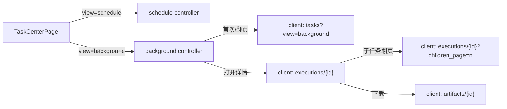

# ASYNC Skill 后台执行与结果投递 前端设计

> **文档编号**: FE-ASYNC-BG-1.0
> **文档版本**: v0.4
> **创建日期**: 2026-11-17
> **文档状态**: 设计评审中
> **设计输入**: `async-skill-background.design.md`（v0.5）
> **修订**: v0.4 补可点击交互稿（`async-skill-background.mock.html`）与任务页文案调整；v0.3 复用现有执行详情与任务页查询参数，收回后台专用详情类型/路由；v0.2 细化后端读契约、失败计数、产物状态依赖；v0.1 初稿

**评审边界说明**:
- **需求评审**: 第 2 章 → 通过后锁定需求基线。
- **设计评审**: 第 3 章 → 通过后锁定设计基线。

**ID 体系**: FE、CMP、NFR；场景使用 S-/E-/B-。

**本版关键结论（先读）**:

1. **只动 WebChat 任务中心**：在现有「任务」页里新增「后台任务」分组，定时任务分组与它的列表/详情/动作**一行不改**。
2. **结果不注入聊天**：任务结果、失败原文、产物一律在任务中心呈现；聊天时间线不新增任何任务结果消息。WebChat 的 `TASK_RESULT` 通知只作为未读信号（通知面板已移除），任务中心是唯一结果读取面。
3. **读时机沿用现有纪律**：切到任务 Tab 时读一次；翻页、打开详情、点下载才再读；**不加轮询、不加 SSE**。
4. **子任务是详情里的三段之一**：结果（成功摘要 / 失败计数 / 失败原文）→ 产物 → 子任务表；失败子任务在表内即可见摘要，点开看该子任务的完整原文。
5. **部分失败必须显性**：`BEST_EFFORT` 聚合下父任务状态是完成态，列表与详情都要显示「N 项中 M 项失败」的计数，不只一个布尔徽标。
6. **不改现有任务页路由**：`/chat/tasks/:scheduleId` 仍是定时任务详情；后台任务列表用 `/chat/tasks?view=background`，详情用 `/chat/tasks?view=background&taskId=<id>`。`parseChatTabs` 保持只解析 tab/scheduleId，`WebchatTaskCenterPage` 从现有 `location.search` 读取 `view/taskId`，避免新增保留段和改路由解析器。
7. **产物状态依赖统一 Artifact**：`TaskArtifactList` 的交付状态来自 `unified-artifact-delivery` 的 `TaskArtifactRef.deliveries[]`；`deliveries=[]` 表示未请求推送（NONE），字段缺失时隐藏徽标，不伪造 `PENDING`。

---

## 2. 需求分析

### 2.1 需求概述

| 项目 | 内容 |
|------|------|
| **模块名称** | WebChat 任务中心（后台任务分组） |
| **需求类型** | 功能开发 |
| **业务背景** | ASYNC Skill 改为后台执行后，结果与产物需要用户可自助获取；聊天对话框不是投递面，现有通知面板已移除 |
| **核心目标** | 用户在任务中心能看到自己的后台任务列表、结果文本、失败原文、全部产物，并能定位到具体子任务的失败；定时任务分组保持原行为 |

### 2.2 功能方案

| 功能ID | 功能名称 | 功能描述 | 优先级 |
|--------|---------|---------|--------|
| FE-01 | 分组与路由 | 工作区 Tab 从「定时任务」改为「任务」，任务页提供「定时任务 / 后台任务」两个分组；后台列表/详情用现有 `/chat/tasks` 查询参数深链；定时任务路由不变 | P0 |
| FE-02 | 后台任务列表 | 分页列表：Skill 名、状态、部分失败计数、子任务进度、时间、是否含产物；按创建时间倒序 | P0 |
| FE-03 | 后台任务详情 | 三段式：结果（成功摘要 / 失败计数 / 失败原文全文）、产物列表（可下载）、子任务表；显示任务类型与所属 Agent | P0 |
| FE-04 | 子任务表 | 分页；可辨认条目标签；失败行置红并显示错误摘要（首行，≤200 字符），点开进子任务详情看全文 | P0 |
| FE-05 | 状态与空态 | 加载、空列表、读取失败（可重试）、部分失败计数、产物截断提示 | P0 |
| FE-06 | 产物状态 | 复用 `TaskArtifactList`；按 `deliveries[]` 展示每个目标的交付徽标与失败原因 | P1（依赖统一 Artifact） |

### 2.3 范围与边界

| 类别 | 内容 |
|------|------|
| **范围（In Scope）** | WebChat 任务页的分组切换、后台任务列表与详情、子任务表、产物下载、空/错/部分失败状态、深链与 i18n 词条、现有路由解析器扩展 |
| **非范围（Out of Scope）** | 定时任务分组任何改动；任务取消/重试等写操作；聊天时间线注入；Console 管理端任务页；轮询与实时推送；通知面板/任务结果通知点击深链；后台任务未读徽标 |
| **前置依赖** | 后端任务中心契约（共享 `TaskCenterService`/`ExecutionDetail`）；产物展示依赖 `unified-artifact-delivery` 的 Worker 输出登记与 `TaskArtifactRef.deliveries[]`。未合入时产物区显示「暂无产物」并保留依赖说明，不伪造数据。 |
| **有意妥协 / 技术债** | ① 详情一次拉结果/产物/第一页子任务，子任务翻页再请求；② 长错误默认折叠，用户点开看全文；③ 通知只作未读信号，用户需从任务 Tab 进入后台任务组 |

### 2.4 验收条件

| 场景ID | 设计影响 / 备注 |
|--------|----------------|
| S-01 | FE-01：本轮回复结束后会话可继续；任务中心后台组出现该任务 |
| S-02 | FE-02/03：列表出现该任务，详情可见结果与产物并下载（产物依赖统一 Artifact） |
| S-03 | FE-03/04：失败原文全文；子任务失败时链路可追 |
| S-05 | FE-01：两个分组互不混排；定时任务原有交互不变；后台深链可直达 |
| S-06 | FE-04：批量扇出时能定位哪些子任务失败；子任务标签可辨认 |
| S-07 | FE-02/03：`BEST_EFFORT` 部分失败在列表与详情都显示计数 |
| E-03 | 撤销 Agent 后后台任务详情/产物不可见（后端 404，前端显示不存在） |
| E-04 | 长错误/大结果不显示为「一直运行」；详情可读，正文有截断提示 |

| 指标ID | 指标名称 | 目标值 | 测量方法 |
|--------|---------|-------|---------|
| NFR-FE-01 | 读请求纪律 | 切 Tab 1 次、翻页 1 次、开详情 1 次、子任务翻页 1 次；无定时器 | 组件用例断言请求次数 |
| NFR-FE-02 | 大子任务量 | 子任务表分页，单页不渲染超过 100 行 | 组件用例 |
| NFR-FE-03 | 路由确定性 | `?view=background&taskId=` 刷新/重进后仍打开同一任务；`/chat/tasks/:scheduleId` 不被查询参数覆盖 | 组件用例 |

**验证环境假设**：WebChat 前端可登录、后端任务中心读面可用；企微推送不在前端验证范围（由 S-04 覆盖）；产物步骤需要统一 Artifact 能力。

---

## 3. 前端技术设计

### 3.1 技术选型

| 类别 | 选型 | 说明 |
|------|------|------|
| 框架 | React 18 + TypeScript | 与 Console/WebChat 一致 |
| 组件库 | Semi Design | 与任务中心一致 |
| 文案 | react-i18next（flat key） | 新增词条走 `chat.taskCenter.background.*` |
| 数据 | 既有 typed client + 错误码 | 不新增 HTTP 封装层 |

### 3.2 页面与路由结构

| 路由 | 形态 | 说明 |
|------|------|------|
| `/chat/tasks` | 现有任务页 | 默认「定时任务」分组 |
| `/chat/tasks?view=background` | 后台任务列表 | 分组入口；`parseChatTabs` 仍返回 `scheduleId=null` |
| `/chat/tasks?view=background&taskId=<id>` | 后台任务详情 | 同一个 `/chat/tasks` 路由，用查询参数表达 |
| `/chat/tasks/:scheduleId` | 现有定时任务详情 | 不变；`scheduleId` 路径优先于查询参数 |

**路由解析契约**：

- `parseChatTabs` **不新增字段**，继续只返回 `{tab, scheduleId}`；`background` 不会出现在路径段，因此不需要保留段解析。
- `WebchatTaskCenterPage` 从现有 `location.search` 读取：
  - `view=pending`：现有待处理视图；
  - `view=background`：后台任务分组；
  - `taskId=<uuid>` 仅在 `view=background` 时生效；缺省显示后台列表，有值显示后台详情。
- `/chat/tasks/:scheduleId` 与 `?view=background&taskId=` 互斥；路径存在时按定时任务详情处理，忽略 `taskId` 查询。
- 不修改 `useWorkspaceTabs` 的 `tab/scheduleId` 契约，也不改 `ChatPage` 的任务路由选择；只有 `WebchatTaskCenterPage` 内部增加查询参数解析。

> 这与现有 `?view=pending` 的读法一致：查询参数只是任务页内部视图，不新增路由层。

**文案调整**：

- 工作区 Tab `chat.tabs.tasks`：`定时任务` → `任务`（因为它现在包含两个分组）。
- 任务页标题 `chat.taskCenter.label`：`定时任务中心` → `任务中心`。
- 分组标签：`定时任务` / `后台任务`；`定时任务` 仍指现有 Schedule 视图。
- 定时任务详情标题、空态、动作文案保持不变。

### 3.3 组件设计

| 组件 | 职责 | 复用 |
|------|------|------|
| `TaskCenterPage` | 分组壳、路由解析、控制器装配 | 复用，新增分组入口 |
| `BackgroundTaskListPanel` | 列表、分页、状态、部分失败计数、子任务进度 | 新建（布局参考 `ScheduleListPanel`） |
| `BackgroundTaskDetailPanel` | 三段式详情容器；消费扩展后的 `ExecutionDetail`，展示任务类型/Agent/计数 | 新建 |
| `TaskResultSection` | 结果文本 / 失败计数 / 失败原文（可折叠、可复制） | 新建 |
| `TaskArtifactList` | 产物列表与下载、交付状态徽标 | **复用现有** |
| `ChildTaskTable` | 子任务分页表，失败行置红 + 可辨认标签 + 摘要 | 新建 |
| `PartialFailureBadge` | 「N 项中 M 项失败」展示 | 新建（可并进列表/详情头部） |

### 3.4 组件接口契约

**CMP-01 `BackgroundTaskListPanel`**

| Props | 类型 | 说明 |
|-------|------|------|
| `state` | `BackgroundTaskListState` | 列表/加载/错误/分页 |
| `agents` | `readonly AgentOption[]` | 授权 Agent 过滤 |
| `onOpen(taskId)` | `(id: string) => void` | 打开后台详情 |
| `onPage(page)` | `(page: number) => void` | 翻页 |
| `onAgentChange(agentId)` | `(id: string \| null) => void` | 过滤 |
| `onRefresh()` | `() => void` | 显式刷新 |

**CMP-02 `BackgroundTaskDetailPanel`**

| Props | 类型 | 说明 |
|-------|------|------|
| `task` | `ExecutionDetail \| null` | 详情（共享执行详情，后台字段可空） |
| `downloads` | `ArtifactDownloadState` | 下载状态 |
| `onBack()` | `() => void` | 返回后台列表 |
| `onRefresh()` | `() => void` | 重读详情 |
| `onChildPage(page)` | `(page: number) => void` | 子任务翻页 |
| `onOpenChild(taskId)` | `(id: string) => void` | 打开子任务详情 |
| `onDownload(artifact)` | `(a: TaskArtifact) => void` | 下载 |

**CMP-03 `ChildTaskTable`**

| Props | 类型 | 说明 |
|-------|------|------|
| `items` | `readonly TaskChildItem[]` | 子任务行 |
| `page` / `pageSize` / `total` | number | 分页事实 |
| `onPage(page)` | `(page: number) => void` | 翻页 |
| `onOpenChild(taskId)` | `(id: string) => void` | 打开子任务 |

**数据契约**（复用后端任务中心契约；列表为 `TaskCenterTaskItem`，详情为扩展后的 `ExecutionDetail`，子任务为 `TaskChildItem`）：

```text
TaskCenterTaskItem {
  task_id; agent_id; task_type; skill_name; status;
  counts: { total; succeeded; failed; cancelled };
  partial_failure; child_total; child_finished; has_artifacts;
  create_time; finished_at;
}

ExecutionDetail {
  execution_id; agent_id; task_type; skill_name; parent_id; item_key; status;
  wait_kind; wait_payload; result;
  result_artifacts: TaskArtifact[];
  artifact_total;
  error_code; error_message; failure_class;
  counts; partial_failure; started_at; finished_at;
  snapshot_schema_version; snapshot_bytes;
  children: { items: TaskChildItem[]; page; page_size; total };
}

TaskChildItem {
  task_id; item_key; label; status; error_code;
  error_message_summary; artifact_count; started_at; finished_at;
}
```

> 前端不新增 `BackgroundTaskDetail` 类型；把现有 `ScheduleExecutionDetail` 改名为 `ExecutionDetail`（不保留双类型/别名），后台与定时详情共用，只消费新增字段。

`TaskArtifact` 在现有字段上增加：

| 字段 | 类型 | 说明 |
|------|------|------|
| `deliveries` | `DeliveryStatus[]` | 每个目标一项；空数组表示未请求推送（NONE）；字段缺失表示依赖尚未合入，隐藏徽标 |
| `deliveries[].target_key` | string | 渠道中立目标身份（会话/外部通道） |
| `deliveries[].status` | `DELIVERED \| DEGRADED \| PENDING \| UNKNOWN \| FAILED` | 后端统一状态；`DELIVERING` 折叠为 `PENDING` |
| `deliveries[].error_code` | `string \| null` | 失败/待核实原因稳定码 |
| `deliveries[].retryable` | boolean | 是否仍有自动重试 |

> 若统一 Artifact 尚未合入，`deliveries` 字段缺失，`TaskArtifactList` 隐藏徽标；不默认成 `PENDING`，避免把「未知」伪装成「待投递」。`deliveries=[]` 是明确的 NONE，不是缺失。

### 3.5 状态与数据流



- `TaskCenterPage` 从现有 `location.search` 读 `view`/`taskId`（与 `view=pending` 同一读法）；`useWorkspaceTabs` 的 `tab/scheduleId` 契约不变。
- `TaskCenterClient` 新增 `listTasks`；`getExecution` 增加可选 `childrenPage` 查询参数，不新增详情 client。
- `background` controller 持有列表/详情的 `loading/error/page`；组件不重复请求。
- 打开详情一次请求返回结果、产物、第一页子任务；子任务翻页复用同一个执行详情路由，只带 `children_page`，不新增 children 路由。
- 下载仍走既有 `artifactDownload` 控制器；状态变化不自动触发下载。
- 切走 Tab 即卸载，不保留定时器。

### 3.6 UI 状态

| 状态 | 表现 |
|------|------|
| 加载 | 骨架屏（与任务中心一致） |
| 空列表 | 「还没有后台任务」+ 说明何时会出现 |
| 读取失败 | 错误提示 + 重试按钮；不自动重试 |
| 部分失败 | 列表行与详情头部都显示「N 项中 M 项失败」计数；`partial_failure` 为 false 时不显示 |
| 长错误 | 详情给全文，默认折叠到 N 行并可展开/复制；子任务行只给首行摘要 |
| 产物截断 | 显示「共 X 个产物，仅展示前 100 个」 |
| 产物状态缺失 | `deliveries` 缺失时不显示徽标；不伪造 `PENDING`；`deliveries=[]` 显示 NONE |
| 子任务标签缺失 | 回落 `item_key` 或短 id；不渲染原始 JSON |

### 3.7 样式方案

- 沿用 `task-center.css` 的间距与状态色：状态徽标用既有 `StatusTag`；失败行左侧色条；与定时任务分组保持同一视觉语言，不引入新主题。
- 部分失败计数用既有 Tag/Badge 风格，放在状态旁，不挤压操作列。
- 结果/错误正文使用等宽字体区域，支持复制；长文本可折叠。

### 3.8 可访问性与兼容性

- 分组切换用原生 button/Tab，键盘可达；`aria-selected` 与当前分组一致。
- 状态徽标有可读文本，不只靠颜色。
- `FAILED` 原因使用 `role="alert"` 或等价可读标记。
- 子任务行是原生 button，`aria-label` 含标签与状态。
- 不改变既有定时任务分组的键盘下载路径。

---

## 4. 风险与依赖

| 风险 | 影响 | 缓解 |
|------|------|------|
| 查询参数与既有任务路由混淆 | 打开错任务 | 组件用例覆盖 `?view=background&taskId=`、`/chat/tasks/:scheduleId` 优先级、旧 `?view=pending`；`parseChatTabs` 不改 |
| 产物依赖统一 Artifact | S-02/S-06 产物步骤无法单独验收 | 依赖顺序固定；字段缺失隐藏徽标；不伪造 |
| 子任务/产物量大 | 详情渲染慢 | 子任务分页、产物截断并提示总数 |
| 与定时任务分组混淆 | 用户找错地方 | 分组标签明确 + 深链直达 + 空态文案区分 |
| 通知面板已移除 | 用户可能不知道去任务中心 | 任务 Tab 常驻；未读徽标本期不做，记录为技术债 |
| 长错误/大结果 | 渲染卡顿 | 详情折叠 + 截断提示；完整文本只在一个详情请求返回 |
| 多 Agent 过滤 | 列表/详情越权或分页错误 | 过滤由后端 `agent_ids` 完成；前端只传授权集合，不做“先分页再过滤” |

## 5. 测试建议

- **纯函数**：`tests/frontend/test_scheduled_v2_workspace.py` 保持不变，继续守护 `parseChatTabs` 的既有契约。
- **组件/控制器**：新增 `tests/frontend/test_async_skill_background_task_center_ui.py`：
  - 分组切换只发一次列表请求；
  - 打开详情只发一次详情请求；
  - 子任务翻页发一次 `executions/{id}?children_page=` 请求；
  - 部分失败计数渲染；
  - 长错误折叠/展开；
  - 产物状态缺失时不渲染徽标；
  - 子任务标签缺失时回落。
- **契约**：后端 `TaskCenterTaskItem` / `ExecutionDetail` / `TaskChildItem` 与前端类型一一对应；`children_page` 默认/上限。
- **既有回归**：`test_scheduled_v2_task_center_ui.py` 继续守护定时任务分组不变。

## 6. 交互稿

- 文件：`.code-flow/tasks/2026-11-17/async-skill-background/async-skill-background.mock.html`
- 形态：单文件、无外部依赖的静态交互稿；数据为模拟，下载按钮只提示“真实服务提供”。
- 已覆盖：
  - 工作区 Tab「对话 / 任务」；任务页「定时任务 / 后台任务」分组；
  - 后台任务列表：成功、部分失败、失败、运行中、含产物；
  - 后台详情：结果、失败原文展开、产物按目标交付状态、子任务表；
  - 子任务详情：可辨认标签、完整错误原文、返回父任务；
  - 深链：`?view=background&taskId=...`，刷新后保持。
- 视觉基线：按本地 WebChat 真实任务中心（暗色 Semi tokens、12px 元信息、卡片边框与状态 Tag）还原；不引入新主题。
- 用途：设计评审/前端实现参照，不作为生产代码或测试资产。

## Spec Compliance Matrix

| Spec/Rule | 约束 | 落点 | 备注 |
|-----------|------|------|------|
| `frontend/harness-frontend` | 服务层与拦截器口径 | 3.5 | 复用既有 typed client 与错误码 |
| `i18n/harness-i18n` | 词条与语言协商 | 3.6 | 新增词条扁平化并双语 |
| `ui/harness-ui` | 列表、状态与视觉 | 3.7 | 复用现有 Tag/列表样式，不新增主题 |
| `im/harness-im#RULE-006` | 任务中心按授权 Agent 读取 | 3.5 / 4 | 过滤在后端完成，前端不越权 |
| `test/harness-test#RULE-test-001` | 组件/纯函数测试真实边界 | 5 | 真实 esbuild/React 静态渲染 |

## 附录：术语表

| 术语 | 定义 |
|------|------|
| 后台任务 | 由会话提交、无 Schedule 归属的根任务 |
| 部分失败 | `BEST_EFFORT` 聚合下父任务完成但存在失败子任务 |
| 后台任务查询参数 | `/chat/tasks?view=background&taskId=<id>`：在现有任务页内切换后台列表/详情，不新增路由 |
| 逻辑文件 | 统一 Artifact 需求的用户可见文件身份；一个逻辑文件可有多个版本 |
