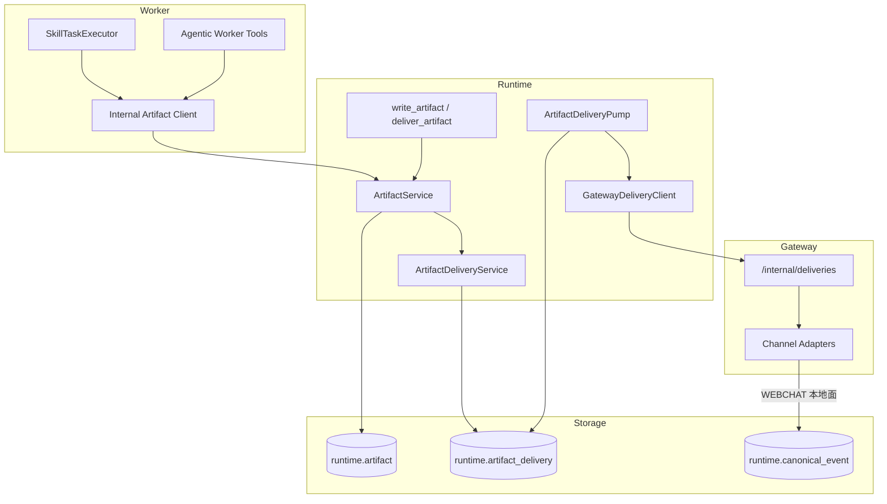

# 平台统一文件产物投递 后端设计

> **文档编号**: MOD-ARTIFACT-DELIVERY-1.0
> **文档版本**: v1.0
> **创建日期**: 2026-11-17
> **文档状态**: 设计评审中
> **设计输入**: `.code-flow/tasks/2026-11-17/unified-artifact-delivery/unified-artifact-delivery.prd.md`

**评审边界说明**:
- **需求评审**: 第 2 章 → 通过后锁定需求基线。
- **设计评审**: 第 3-4 章 → 通过后锁定设计基线。
- **交接契约**: 2.5 验收条件；场景唯一源为 `unified-artifact-delivery.scenarios.md`。

**ID 体系**: US、FEAT、API、RULE、NFR、RISK；场景使用 S-/E-/B-。

**本版关键结论（先读）**:

1. **不可变版本 = 一行 = 一个 `artifact_id`**：每次写入产生独立产物行，字节/checksum/存储键永不改变；同一逻辑文件由稳定身份（owner + 产出调用身份 + 规范路径）关联各版本。用户可见文件统一为 `OUTPUT` 类型，`AGENT_OUTPUT` / `TASK_OUTPUT` 只做类型统一，入站附件、`TRANSCRIPT`、`TOOL_RESULT` 不变。
2. **只有一套投递意图**：新增 `runtime.artifact_delivery`；每个「不可变版本 + target」一条，稳定 key；`DELIVERED`/`DEGRADED` 是成功终态，`UNKNOWN`（发送结果未知）不自动重发。
3. **只有一套投递执行者**：`ArtifactDeliveryPump` 在 Runtime；Worker 只登记候选产物，成功终态事务写 outbox，由 Runtime 激活投递。
4. **目标只有一类：路由**。会话（WebChat）与外部通道共用同一消息通道（Gateway 投递接口），不保留 Runtime 侧的站内发布特例；`TASK_RECORD` 不再作为投递目标——文件在任务/执行记录可见属于可见性，不是送达。**新增通道 = 新增适配器**：浏览器侧接口（历史/SSE/通知/下载/任务详情）不变，未来 IM 通道只实现产物出站。
5. **`SKILL_OUTPUT_DIR` 全部文件都是用户产物**：无 `deliverables` 白名单；中间文件必须放 `SKILL_DATA_DIR` 或 `/tmp`。
6. **模型不是交付必要条件**：Run 侧 ASYNC 后台任务（DETACH）、任务内部 JOIN、定时 SKILL/AGENTIC 都由执行边界登记候选 + 成功终态 outbox + 投递意图完成；后台/定时一律主动发送。Run 侧不再依赖 JOIN 等待。
7. **一起修三个 Agent 能力缺陷**：`execute` 的 `target` 契约、`WORKSPACE_ROOT` 绝对化、Artifact 类型统一。
8. **不做 Console 投递管理页**：状态跟随所属 Run/Task/Skill 执行记录，不建设全局看板。

---

## 2. 需求分析

### 2.1 需求概述

| 项目 | 内容 |
|------|------|
| **模块名称** | 平台统一文件产物投递 |
| **模块ID** | MOD-ARTIFACT-DELIVERY |
| **需求类型** | 技术重构 + 能力补齐 + Bug 修复 |
| **业务背景** | 文件输出/登记/投递分散在 Runtime 内联、Worker 任务、模型工具三条路径；后台/定时无模型时交付不可靠；当前测试误用 `big-output`、`execute` 漏 `target`、`WORKSPACE_ROOT` 相对路径，暴露平台能力缺口。 |
| **核心目标** | 所有执行形态的产物走同一 Artifact 模型、同一 DeliveryIntent、同一 DeliveryPump；已投递不重复，状态跟随执行记录。 |

### 2.2 痛点与价值

| 维度 | 内容 |
|------|------|
| **目标用户** | 业务 Skill 作者、最终用户、任务/执行记录查看者；当前约 200 人。 |
| **当前问题** | Runtime 的 `deliver_artifact` 同步发送、无持久重试；Worker 只回 `result_artifact_id` 单产物；`SKILL_OUTPUT_DIR` 在 Worker 路径只返回元数据不登记；Agentic Worker 没有内置文件工具；`AGENT_OUTPUT`/`TASK_OUTPUT` 两套读取/下载分支。 |
| **业务影响** | 后台/定时文件可能不交付；重试/并发可能重复发送；作者无法只靠输出目录完成交付；不同执行形态行为不一致。 |
| **预期价值** | 文件交付由平台保证；所有执行形态一套语义；同一 artifact+target 只出现一次；作者只写 `SKILL_OUTPUT_DIR`。 |

### 2.3 功能方案

| 功能ID | 功能名称 | 设计落点 |
|--------|---------|----------|
| FEAT-01 | 统一输出目录契约 | `SKILL_OUTPUT_DIR` 全量收集；`ArtifactService` |
| FEAT-02 | 统一 Artifact 模型 | `artifact_type=OUTPUT`；版本即行（`artifact_id` = 版本身份）；逻辑文件身份 |
| FEAT-03 | 统一 DeliveryIntent | `runtime.artifact_delivery` + `artifact_delivery_attempt` |
| FEAT-04 | 统一 DeliveryPump | Runtime `ArtifactDeliveryPump`；会话与外部通道共用 Gateway 投递 |
| FEAT-05 | 已投递不可重复 | unique delivery key；`UNKNOWN` 不自动重发 |
| FEAT-06 | 后台/定时自动交付 | 执行期登记候选 + 成功终态 outbox + 主动发送 |
| FEAT-07 | 平台内置文件工具 | Runtime/Agentic 工具注册 `write_artifact`/`deliver_artifact` |
| FEAT-08 | 交付状态随执行记录 | `TaskArtifactRef.deliveries[]`；无新页面 |
| FEAT-09/10 | 文档/旧 Skill 迁移 | 文档与迁移任务 |
| FEAT-11 | `execute` 契约修复 | `execute` required `target` + actionable error |
| FEAT-12 | `WORKSPACE_ROOT` 绝对化 | `WorkspaceLayout` 启动归一 |

### 2.4 范围与边界

| 类别 | 内容 |
|------|------|
| **范围** | 文件/产物登记、投递、去重、状态、审计；Run/Task/Skill/Agentic/定时；WebChat/外部通道共用同一消息通道；`OUTPUT` 类型统一与版本即行；`execute` 契约；`WORKSPACE_ROOT` 绝对化 |
| **非范围** | 文本终态/Human/通知未读；入站附件；Console 投递管理页/全局看板；`big-output`；2 分钟调度配额；旧 Skill 全量迁移；产物保留期/清理 |
| **前置假设** | Artifact Store 可用；Runtime/Worker/Gateway 同一租户；现有 `task_delivery` 文本投递保留；`SKILL_OUTPUT_DIR` 全量用户产物 |

### 2.5 验收条件

#### 2.5.1 业务规则与约束

| ID | 类型 | 描述 | 验证场景 |
|----|------|------|---------|
| RULE-01 | 投递 | 同一不可变版本 + target 的 `DELIVERED`/`DEGRADED` 是终态，重复请求只返回首次结果；新 lease epoch 不构成重发理由 | S-02/E-01/E-02 |
| RULE-02 | 投递 | 投递失败不回滚业务终态；任务可 COMPLETED 而交付 FAILED/PENDING | E-03/E-05 |
| RULE-03 | 输出 | `SKILL_OUTPUT_DIR` 全部合法文件都是用户产物，无白名单；写入用途由受信执行路径显式声明 | S-02/S-03/B-03 |
| RULE-04 | 归属 | Artifact/DeliveryIntent 必须按 tenant + owner + agent 核属 | B-04 |
| RULE-05 | 失败 | 执行失败/取消/失约只登记候选，不激活自动交付 | E-06/E-12 |
| RULE-06 | 迁移 | `AGENT_OUTPUT`/`TASK_OUTPUT` 只做类型统一；开发期旧数据可清空，不做回填/双读 | — |
| RULE-07 | 未知 | 发送结果未知（超时/无回执）进入 `UNKNOWN` 待核实，不自动重发文件也不补发取件链接 | E-10 |
| RULE-08 | 主动发送 | 后台/DETACH/定时文件使用主动发送，不借用入站回调或“最新 reply_ref” | S-03/S-06/E-11 |
| RULE-09 | 版本 | 取件链接绑定不可变版本；追加版本后旧链接内容不变 | B-06 |
| RULE-10 | 目标 | 目标按来源 Run 的入口能力解析；JOIN 只决定等待关系，不决定渠道；无路由不等于已送达 | S-03/B-05/E-11 |
| RULE-11 | 契约 | 会话面向浏览器的接口保持路径与语义不变；任务详情只新增附加字段；新增通道只新增适配器 | S-05/E-11 |

#### 2.5.2 功能验收场景

| 场景ID | 设计影响 |
|--------|---------|
| S-01 | 交互式 Run 写文件并交付；状态跟随 Run |
| S-02 | Run 侧 ASYNC 后台任务输出自动交付；JOIN 仅任务内部；不重复 |
| S-03 | 定时 SKILL 无模型交付（Run 侧 ASYNC 后台任务由 S-02 覆盖） |
| S-04 | 定时 AGENTIC 使用平台文件工具 |
| S-05 | WebChat 会话/任务记录可见；刷新不重复 |
| S-06 | 外部通道直发/降级 |
| E-01/E-02 | 重复调用/并发重复 |
| E-03 | Gateway 失败重试 |
| E-04 | 降级链接 |
| E-05 | 无交付路由 |
| E-06 | 失败/取消半成品不交付 |
| E-08/E-09 | execute/workspace 缺陷修复 |
| E-10 | 发送结果未知：不自动重发，待核实 |
| E-11 | Run 终态后的晚到文件仍送达会话 |
| E-12 | 成功终态后崩溃：outbox 重放，不重不漏 |
| B-01..B-07 | 多文件、追加版本、限额、越权、多目标、并发重复登记 |

完整人工步骤见 `unified-artifact-delivery.scenarios.md`。

#### 2.5.3 非功能指标

| 指标ID | 要求 |
|--------|------|
| NFR-REL-01 | 已确认送达的版本不重复；Gateway 按 `(tenant, delivery_key)` 去重（运行期 TTL），永久事实落在 `artifact_delivery` 与 attempt 表；结果未知不自动重发 |
| NFR-REL-02 | DeliveryIntent 持久化；进程崩溃后由 Pump 继续 |
| NFR-SEC-01 | 交付/下载按 tenant/owner/agent 核属，拒绝跨租户 |
| NFR-OBS-01 | 状态、尝试、错误码、trace 跟执行记录 |
| NFR-PERF-01 | 投递异步，不阻塞 Skill/Task 终态 |

#### 2.5.4 验证环境假设

| 维度 | 假设 |
|------|------|
| 容量 | 200 人；单次输出受文件数/单文件/总量预算；多文件场景用 2–5 个文件 |
| 硬件 | 现有四单元 + PG/Redis；不新增服务 |
| 依赖 | 真实 PG、真实 Redis、真实 Gateway `/internal/deliveries`；外部通道用现有测试探针 |
| 测试预算 | 单元 + contract + integration；浏览器 E2E 人工场景 |

---

## 3. 技术设计

### 3.1 方案选型

| 维度 | 方案A：只统一服务层 | 方案B：统一 Artifact + Intent + Pump | 方案C：Gateway 统一 |
|---|---|---|---|
| 功能完备 | 中 | 高 | 中 |
| 实现复杂度 | 低 | 中高 | 高（Gateway 不拥有 Artifact/会话事件） |
| 维护成本 | 高（多路径仍在） | 低 | 中 |
| 风险 | 后台交付仍不完整 | 迁移成本 | 跨服务职责倒置 |
| 结论 | 否决 | **选择** | 否决 |

**关键决策**:

| 决策点 | 选择 | 否决项 | 理由 |
|--------|------|--------|------|
| 投递 Owner | Runtime（意图与执行） | Worker 各自投递 | Runtime 拥有 Artifact 与投递意图；Gateway 负责真实发送与回执（会话产物由 WEBCHAT 通道落发布事实） |
| 输出类型 | `OUTPUT` 物理合并 | 保留 `AGENT_OUTPUT`/`TASK_OUTPUT` | 一套下载/发布/投递语义，避免按来源分叉 |
| 版本身份 | 每个不可变版本一个 `artifact_id`，逻辑文件身份关联版本 | 原地追加版本（复用 `artifact_id`） | 投递去重、取件链接、Gateway 校验都要求“id ⇒ 不可变字节” |
| 交付入口 | 声明式全量输出 + 工具显式交付；成功终态 outbox 激活 | 只靠模型 `deliver_artifact`；登记与 enqueue 分两次独立调用 | 后台/定时没有模型；两次调用之间有丢失窗口 |
| 目标模型 | 只有一类：路由（含 WebChat 会话） | `RUN_CONVERSATION` / `TASK_RECORD` 目标 | 会话与外部通道共用消息通道；可见性不是送达 |
| 重复控制 | unique delivery key + 持久回执 + `UNKNOWN` 待核实 | 仅内存/短 TTL 去重 | 崩溃/多副本/超时仍会重复 |

### 3.2 架构设计



**分层职责**:

| 层 | 职责 |
|---|---|
| Skill/Agentic/Worker | 只产出文件/声明输出；不直接调用通道 |
| Runtime ArtifactService | 统一登记 `OUTPUT` Artifact；校验 owner/租户/limits |
| Runtime ArtifactDeliveryService | 创建/查询 DeliveryIntent；稳定 key；状态机 |
| Runtime ArtifactDeliveryPump | 领取 `PENDING`，按路由执行；确定未发送的重试、未知的待核实、降级与终态 |
| Gateway | 真实发送与回执；WEBCHAT 把会话产物落成发布事实与通知；按 delivery key 去重 |
| Console/Task Center | 只读所属执行记录的文件/状态；无新页面 |

### 3.3 数据设计

#### 3.3.1 `runtime.artifact`：版本即行 + 类型统一

保留现有表与 owner XOR（`run_id`/`task_id`），**不新增第三套 owner 列**，避免双源；改变的是**版本身份**：

| 字段 | 变化 | 说明 |
|---|---|---|
| `artifact_type` | `AGENT_OUTPUT` / `TASK_OUTPUT` → `OUTPUT` | 用户可见文件统一类型；入站 `INBOUND_*`、`TRANSCRIPT`、`TOOL_RESULT` 不变 |
| `run_id` / `task_id` | 不变 | XOR 约束继续保证 owner 唯一；`run_id` 保留 FK |
| `conversation_id` | 不变 | Task 产物若有来源会话则写入；定时无会话为 NULL |
| `agent_id` / `user_id` | 不变 | 交付/下载归属 |
| `logical_file_id` | **新增** UUID | 同一逻辑文件的各版本共享；逻辑身份 = owner + 产出调用身份 + 规范路径 |
| `version` | **新增** int | 版本号从 metadata 提为列；`UNIQUE (tenant_id, logical_file_id, version)` |
| `metadata_json` | 收窄 | 只放展示/来源信息（`filename`/`output_source`/`relative_path`），不再承载版本历史 |

**不可变语义**：每次写入产生**新行、新 `artifact_id`**，`storage_key` 按 `(tenant, owner, artifact_id)` 生成；旧行的字节、checksum、存储键永不改变。追加以 `base_version` CAS（锁逻辑文件身份 + 唯一约束兜底并发写入）。

**类型统一**：单条 UPDATE；当前是开发节点，旧产物数据可直接清空，不做历史回填、不做 owner/路径回填、不保留双读兼容分支。

```sql
UPDATE runtime.artifact
SET artifact_type = 'OUTPUT'
WHERE artifact_type IN ('AGENT_OUTPUT', 'TASK_OUTPUT');
```

- 代码中 `AGENT_OUTPUT_ARTIFACT_TYPE`、`TASK_OUTPUT_ARTIFACT_TYPE` 删除或改为 `OUTPUT` 单一常量；
- `DOWNLOADABLE_TASK_ARTIFACT_TYPES`、`PUBLISHABLE_ARTIFACT_TYPES`、`_delivery_refusal`、`list_attachments`、任务中心 `_artifacts` 全部改读 `OUTPUT`；
- 下载/取件/投递的版本解析从“行内 `metadata_json.versions`”改为“按 `logical_file_id` 查版本行”；
- 不保留双写/兼容分支。

#### 3.3.2 `runtime.artifact_delivery` + `runtime.artifact_delivery_attempt`

| 字段 | 类型 | 空 | 说明 |
|---|---|---|---|
| `id` | UUID | N | PK |
| `tenant_id` | varchar(64) | N | 租户 |
| `artifact_id` | UUID | N | FK `runtime.artifact.id`（**不可变版本**） |
| `owner_type` | varchar(8) | N | `RUN` / `TASK`（与 artifact owner 同源，用于查询） |
| `owner_id` | UUID | N | run_id 或 task_id |
| `target_key` | varchar(256) | N | 渠道中立的目标身份：channel + bot + 接收者 + **实际会话身份**（群聊必须含 chatid） |
| `route_json` | JSONB | N | 冻结点发送目标（channel/bot/单聊或群聊身份/接收目标） |
| `delivery_key` | varchar(320) | N | `artifact:{artifact_id}:{target_key}`；版本即行 ⇒ 新版本天然新键 |
| `status` | varchar(16) | N | `PENDING` / `DELIVERING` / `DELIVERED` / `DEGRADED` / `UNKNOWN` / `FAILED` |
| `attempt_count` | int | N | 默认 0 |
| `lease_owner` | varchar(128) | Y | Pump 租约 |
| `lease_epoch` | int | N | 栅栏：每次领取递增，旧 epoch 的回执不得落库 |
| `lease_until` | timestamptz | Y | 租约到期 |
| `last_error_code` | varchar(64) | Y | 稳定码 |
| `last_error_message` | text | Y | 脱敏说明 |
| `fallback_url` | text | Y | DEGRADED 取件链接（绑定不可变版本） |
| `delivered_at` | timestamptz | Y | 成功/未知终态时间 |

`runtime.artifact_delivery_attempt`：`delivery_id`、`attempt_no`、`lease_epoch`、`started_at`、`finished_at`、`outcome`、`error_code`、`receipt_json`。**发送回执独立记账**：每次真实尝试一行，成功回执永久保留，重试不覆盖历史。

**索引**:

- `UNIQUE (tenant_id, delivery_key) WHERE is_deleted = false`
- `(status, update_time)` 供 Pump 扫描
- `(artifact_id)`
- `(owner_type, owner_id)`
- attempt 表 `UNIQUE (delivery_id, attempt_no)`

**状态机**:

```text
PENDING --claim--> DELIVERING --ack(DELIVERED)------> DELIVERED
                         |--ack(DEGRADED)-----------> DEGRADED
                         |--definitely-not-sent-----> PENDING (attempt++, backoff)
                         |--outcome-unknown---------> UNKNOWN (no auto-resend)
                         |--permanent/exhausted-----> FAILED
```

- `DELIVERED` / `DEGRADED` 是成功终态，重复 enqueue 返回首次结果；成功回执**永久**约束该 `delivery_key`，新 lease epoch 不是重发理由；
- `UNKNOWN` 表示“已发出但没拿到结论”：**不自动重发文件，也不补发取件链接**，由后台核实（对账/人工）处置；
- `FAILED` 是失败终态，不自动重发；只有显式管理动作才可重建意图；
- `DELIVERING` 是内部租约态，用户可见状态折叠为 `PENDING`；
- 没有 `TASK_RECORD` 目标：文件在任务/执行记录可见属于**可见性**，不是送达；未请求推送就没有投递意图。

#### 3.3.3 `task_delivery` 收窄为文本

文本终态/Human 问题仍走 `task.task_delivery`；**文件发送分支退出**（单一发送者 = `ArtifactDeliveryPump`）。两套状态不互相改写。

#### 3.3.4 `task.task_artifact_outbox`

成功终态 CAS 的同一事务写入：`execution_id`、最终文件清单（`artifact_id`/`logical_file_id`/`checksum`）、`delivery_targets`、`idempotency_key`、`status`。Runtime 按既有后台循环幂等消费（先例：`runtime_result_outbox`），消费成功置 `APPLIED`；重复消费同键不重复建意图。取消/失败/失约的 attempt 不写本表，候选产物只保留在产物面供诊断。

### 3.4 接口设计

#### 3.4.1 函数接口（Runtime 内部）

| 函数 | 入参 | 返回 | 错误 |
|---|---|---|---|
| `ArtifactService.register_candidate` | owner、purpose、path、metadata | 候选版本（或已有版本） | `OUTPUT_INVALID`/`OUTPUT_TOO_LARGE` |
| `ArtifactService.activate` | 候选清单 + 成功终态事务 | 已确认版本 | `OUTPUT_ACTIVATION_CONFLICT` |
| `ArtifactDeliveryService.enqueue` | artifact、target | `DeliveryIntent` | `DELIVERY_TARGET_INVALID` |
| `ArtifactDeliveryService.status` | artifact | `deliveries[]` | 无 |
| `ArtifactDeliveryPump.tick` | none | 处理条数 | 内部记录 metrics |

**激活顺序**：执行期间写入的是**候选**；成功终态 CAS 的同一事务写最终文件清单 + 投递 outbox 行；Runtime 幂等消费 outbox 后原子确认产物并创建 DeliveryIntent。取消/失败/失约的 attempt 不激活。

`purpose`（`OUTPUT` / `TOOL_RESULT` / `TRANSCRIPT`）由**受信执行路径**显式给出，不从目录位置推断；只有 `OUTPUT` 进入自动交付链路。

#### 3.4.2 Worker → Runtime 内部 API

**API-01 `POST /internal/artifacts`（扩展现有）**

- 请求：`task_execution_id`、`purpose`（`OUTPUT`/`TOOL_RESULT`/`TRANSCRIPT`）、`logical_file_id`/`base_version`、`filename`、`media_type`、`size`、`checksum`、`source_run_id`、`conversation_id`、`relative_path`；
- 字节 multipart 与现有 `TaskArtifactClient` 同形；每次写入返回**新的** `artifact_id`；
- 返回 `artifact_id`、`logical_file_id`、`version`、`checksum`。

**API-02 `POST /internal/artifact-deliveries`（新增）**

- 请求：`artifact_id`（不可变版本）、`target_key`/`route`、`owner_type`、`owner_id`；
- 返回 `delivery_id`、`status`、`delivery_key`；
- 幂等：同 `(tenant, delivery_key)` 返回首次结果；
- 服务身份 + `X-Tenant-Id` + `X-Actor-User-Id`；Worker 不直写 `runtime.*`。

**API-03 `POST /internal/artifact-deliveries/statuses`（新增，批量只读）**

- 请求：`artifact_ids`；
- 返回每个 artifact 的 `deliveries[]`（`target_key`、`status`、`error_code`、`retryable`）；
- 供 Gateway 任务中心/执行详情补状态，避免 Worker 直读 Runtime 表。

**API-04 `POST /internal/webchat/conversations/{conversation_id}/artifacts`（新增，受信会话发布）**

- 请求：`artifact_id`（不可变版本）、`source_run_id`（Task 产物必需）、`task_id`（可选）、`delivery_key`；
- 行为：按 `task_execution`（或来源 Run）复核产物属于目标会话的用户与 Agent，写一条 canonical `ARTIFACT_CREATED`（`source_event_id` 按会话 + 产物版本派生），并按 `delivery_key` 至多写一条 `TASK_RESULT` 通知；两者同事务提交；
- 返回：`seq`、`notification_id`（已存在时返回原行）；
- 供 Gateway 的 WEBCHAT 通道在产物投递时调用；Task-owned 产物（`run_id`/`conversation_id` 为 NULL）经本入口发布后，WebChat 下载解析按发布事实授权，不再要求产物自身带会话。

#### 3.4.3 `deliver_artifact` 工具

```text
deliver_artifact(artifact_id=... | path=...)
```

- 解析 artifact/path，校验 owner/tenant；`path` 只走统一登记服务（产生不可变版本），不绕过登记；
- 选择 target：按**来源 Run 的入口能力**解析成一条路由（WebChat 会话或外部通道），JOIN 不决定渠道；
- 调用 `enqueue`，短等待（有界）返回 `DELIVERED/DEGRADED/PENDING/UNKNOWN/FAILED`；
- 不直接调 Gateway/写 canonical event。

#### 3.4.4 `execute` 工具契约

- `execute` 的 `target` 保持必填判别字段；
- `execute_skill` 是 skill 的规范别名；
- 在 `ToolExecutionPipeline.prepare_execution` 捕获 schema 校验错误时，产出 `TOOL_ARGUMENTS_INVALID`，消息只指出缺失/非法字段路径，不泄露参数值；
- 工具描述明确：
  - 技能用 `execute_skill`；
  - 草稿用 `execute target=draft`；
  - 工作区用 `execute target=workspace`；
- 不为漏 `target` 自动猜 `skill`（避免把错误调用静默执行）。

#### 3.4.5 交付契约扩展

- `packages/contracts/src/muad_contracts/delivery.py` 增加 artifact 目标 key，例如 `artifact:{artifact_id}:{target_key}`；`target_key` 必须含 channel、bot、接收者与**实际会话身份**（群聊含 chatid）；
- `DeliveryRequest` 的 `delivery_key` 校验接受该形态；Gateway 按 `(tenant_id, delivery_key)` 去重（运行期是 Redis TTL，不是永久账本——永久事实在 `artifact_delivery` 与 attempt 表）；
- `TaskArtifactRef` 增加 `deliveries[]`（`target_key`、`status`、`error_code`、`retryable`、`fallback_url`），由 Runtime 批量状态接口填充；
- 取件令牌绑定**不可变版本**：`FetchGrant` 固化 `artifact_id`（版本行）与 `checksum`；追加版本后旧链接内容不变；
- `TaskArtifactRef` 的版本/checksum 语义不变，下载仍按不可变版本；
- WebChat 取件解析放宽到"已发布的 Task 产物"：`_owned_artifact` 不再因 `conversation_id IS NULL` 直接拒绝，改由发布事实（`ARTIFACT_CREATED` + checksum）授权；`_source_owner` 增加 `task_id → task.task_execution` 分支（与 `TaskArtifactOwner` 同口径）；
- 会话面契约稳定：历史、Run SSE、通知流、下载与任务详情的既有字段与路径不变，新增内容只能是附加字段（`deliveries[]`）。

#### 3.4.6 目标解析矩阵

| 执行形态 | owner | target（唯一一类：路由） |
|---|---|---|
| Run 内联 Skill（WebChat 入口） | RUN | `WEBCHAT` 路由：会话 = 来源会话，落成发布事实 + 通知 |
| Run 内联 Skill（外部入口） | RUN | 来源通道路由，**主动发送**（不借用入站回调） |
| `deliver_artifact` 交互式 | RUN | 同来源 Run 的路由 |
| ASYNC Task（Run 侧，后台） | TASK | **按来源 Run 的入口能力**：WebChat → 会话发布/通知；企微 → 外部通道路由主动发送；任务记录只提供可见性，不是投递目标 |
| 任务内部 JOIN（agentic 子技能） | TASK | 结果回父 Execution，不直接投递用户；文件随父任务记录/父任务交付链路可见 |
| ASYNC DETACH Task（任务内部/无 Run 等待） | TASK | 冻结的投递路由；无路由则无投递意图（文件仅执行记录可见） |
| 定时 SKILL/AGENTIC（有 PUSH 路由） | TASK | 冻结路由，主动发送 |
| 定时 SKILL/AGENTIC（无路由/仅 pull） | TASK | 无投递意图（`NONE`），不伪造送达 |
| Agentic Worker 内置工具 | RUN/TASK | 当前执行路由；无 route 则 `NONE` |

> 没有“任务记录”投递目标：文件随任务/执行记录可见属于可见性；`NONE` 表示未请求推送。只有明确要求推送却缺少有效路由才失败。

### 3.5 质量实现方案

#### 可靠性

| 风险 | 应对 |
|---|---|
| 重复调用/并发 | unique delivery key；Gateway `(tenant, delivery_key)` 去重；Pump 租约/epoch fencing |
| 发送后崩溃未标记 | 持久 attempt 账本 + 成功回执永久约束；拿不到结论进 `UNKNOWN`，不自动重发 |
| 发送超时 | 区分“确定未发送”（退避重试）与“结果未知”（`UNKNOWN` 待核实）；未知时不补发取件链接 |
| 多副本 Pump | `FOR UPDATE SKIP LOCKED` + lease_until；过期租约结算；epoch 递增 |
| 多文件部分失败 | 每 artifact/目标独立 intent/status；成功不重发 |
| 失败/取消/失约 | 候选不激活；文件保留诊断 |
| 会话产物 | 与外部通道同一消息通道；WebChat 通道落发布事实并推通知，不依赖 Run 流生命周期 |
| 交互式交付延迟 | 工具 enqueue 后**立即领取一次**（不等 tick）；tick 只负责后台任务、重试与补偿 |
| 通知与卡片重复 | 一个产物版本 = 至多 1 张会话卡 + 至多 1 条通知，两者按同一 `delivery_key` 去重；刷新只看到 1 张卡 |
| 迁移 | 开发期可清空旧产物；类型统一单条 UPDATE；旧数据不做回填/承接 |

#### 安全

- Artifact/Delivery 按 `tenant_id + owner + agent_id + user_id` 核属；
- 会话产物落发布事实前沿用 `publish_artifact_to_conversation` 的会话/owner 校验（或等价受信校验）；
- 外部投递沿用 Gateway `/internal/deliveries` 的 artifact 归属核验，并在发送前复核接收权限与连接所有权；
- `deliver_artifact(path=...)` 只接受 workspace 相对路径，拒绝绝对路径/`..`/symlink 逃逸；
- 日志/审计不记录文件正文或凭据。

#### 可观测性

- `artifact_delivery_total{target,status}`；
- `artifact_delivery_attempts_total{target,result}`；
- `artifact_delivery_unknown_total{target}`（需要人工核实的积压）；
- `artifact_delivery_oldest_pending_seconds`；
- 日志字段：`artifact_id`、`delivery_id`、`owner_type/id`、`target_key`、`status`、`error_code`；
- 不做全局管理页，指标供运维监控。

### 3.6 `WORKSPACE_ROOT` 绝对化

- `workspace_layout_from_settings` 解析 `Path(root).expanduser().resolve()`；根目录统一为绝对路径；
- 启动日志打印 resolved root（不含敏感信息）；`SandboxSpec` 继续严格校验绝对路径；
- 相对路径目前按进程 cwd 解析；若产品要求“拒绝相对路径”，改为启动失败并更新 `.env.example`（设计建议：归一 + 启动日志，保持本地可用）；
- 测试覆盖相对/绝对、`target=workspace` 的 `pwd` 与写文件。

---

## 4. 部署与运维

### 4.1 部署架构

| 单元 | 变化 |
|---|---|
| agent-runtime | 新增 `ArtifactDeliveryPump` 循环；Artifact/Delivery 服务；内部 API（含受信会话发布入口） |
| agent-worker | Skill 输出登记 + enqueue；Agentic 注册平台文件工具；不直发文件 |
| im-gateway | `/internal/deliveries` 支持 artifact delivery key；WEBCHAT 通道实现产物出站（会话发布事实 + 通知）；任务中心状态批量查询 |
| console-platform | 既有任务/执行详情展示状态；不新增页面 |
| DB | 新增 `artifact_delivery`；`artifact_type` 迁移 |

### 4.2 发布与回滚

1. 先做 `artifact_type` 类型统一 + 新增表（开发期可直接清空旧产物）；
2. 部署 Runtime（双读？不新增双写；Pump 可处理新表）；
3. 部署 Worker（输出登记/enqueue）；
4. 部署 Gateway（key/status）；
5. 前端只读状态。

回滚：停止新 enqueue；保留已投递记录；`artifact_type` 可反向 UPDATE；未处理 PENDING 在回滚前 drain 或标记失败。

### 4.3 监控告警

- pending 积压、最老 pending 年龄、FAILED 增速、DEGRADED 比例；
- Gateway 5xx/超时、artifact resolve 失败；
- 迁移后 `AGENT_OUTPUT`/`TASK_OUTPUT` 残留为 0。

### 4.4 数据迁移

| 阶段 | 操作 | 验证 |
|---|---|---|
| 1 | 开发期清空/重建 `runtime.artifact`（或保留旧行，仅做类型 UPDATE） | 无旧版本形态残留 |
| 2 | 新增 `artifact_delivery` / `artifact_delivery_attempt` / `logical_file_id` 与 `version` 列及唯一约束 | schema |
| 3 | `UPDATE artifact_type`（若保留旧行） | 只剩 `OUTPUT` |
| 4 | 切换代码只读 `OUTPUT` 与版本身份 | 旧常量扫描为 0 |

不做历史回填、不做旧投递回执承接、不做双读兼容。生产上线前是否清空由发布单单独决定，本需求不提供迁移脚本之外的补偿逻辑。

---

## 5. 风险与依赖

| 风险ID | 描述 | 概率 | 影响 | 应对 |
|---|---|---|---|---|
| R-01 | 版本即行改动触及下载、取件与 Gateway 校验 | 中 | 高 | 统一“`artifact_id` ⇒ 不可变字节”一个口径；开发期数据可清空；改动点逐处登记 |
| R-02 | 发送超时后重复发送 | 中 | 高 | `UNKNOWN` 待核实 + 持久 attempt 回执 + 崩溃/超时窗口测试 |
| R-03 | Task 目标误判（任务记录/会话/外部） | 中 | 中 | 目标解析矩阵 + 单测/集成覆盖 |
| R-04 | 多文件/大文件预算 | 中 | 中 | 平台 limits + 每文件独立状态 |
| R-05 | `execute` 自动猜 target 引入误执行 | 低 | 高 | 不猜；返回可行动错误 |
| R-06 | 本地 `WORKSPACE_ROOT` 归一改变路径 | 低 | 中 | 启动日志 + 测试；生产绝对路径不变 |
| R-07 | 会话产物改走统一通道需要 WebChat 通道实现产物出站（当前未装配 sink） | 高 | 中 | 实现 `OutboundArtifactDelivery` + 本地面 sink；未装配即显式失败，不静默降级 |

---

## 6. 需求追溯矩阵

| 用户故事 | 功能ID | 接口/设计 | 场景 | 测试层级 |
|---|---|---|---|---|
| US-01 | FEAT-01/02 | ArtifactService/`SKILL_OUTPUT_DIR` | S-02/S-03 | integration |
| US-02 | FEAT-03/04/05 | DeliveryIntent/Pump | S-05/E-01/E-02/E-10 | integration |
| US-03 | FEAT-06 | Worker output enqueue | S-03/S-04 | integration |
| US-04 | FEAT-08 | TaskArtifactRef status | S-05/E-04 | contract/component |
| US-05 | FEAT-07 | Agentic tools | S-04 | integration |
| US-06 | FEAT-11/12 | execute/workspace | E-08/E-09 | unit/contract |

## Spec Compliance Matrix

| Spec/Rule | 设计影响 | 设计落点 | 场景 |
|---|---|---|---|
| `im/harness-im#RULE-im-002` | 投递契约渠道中立 | §3.4/3.5 | S-06 |
| `im/harness-im#RULE-im-005` | 会话删除后不可见 | §3.4/3.5 | E-05/B-04 |
| `im/harness-im#RULE-006` | Task artifact owner/version | §3.3/3.4 | S-05/B-04 |
| `worker/harness-worker#RULE-003` | 意图与业务状态分离 | §3.3/3.5 | E-03/E-04 |
| `artifact/harness-skill#RULE-skill-001` | 不可变 Artifact Store | §3.3 | B-06 |
| `api/harness-api#RULE-api-002` | 幂等/重放 | §3.4 | E-01/E-02 |
| `secret/harness-secret#RULE-secret-001` | 日志/审计脱敏 | §3.5 | B-04 |
| `test/harness-test#RULE-test-001` | 真实 PG/Redis/HTTP 集成 | §2.5.4/§7 | all |
| `persistence/harness-data#RULE-001` | Runtime 拥有 Artifact，Worker 经内部 API | §3.2/3.4 | S-03/S-04 |

---

*文档结束*
