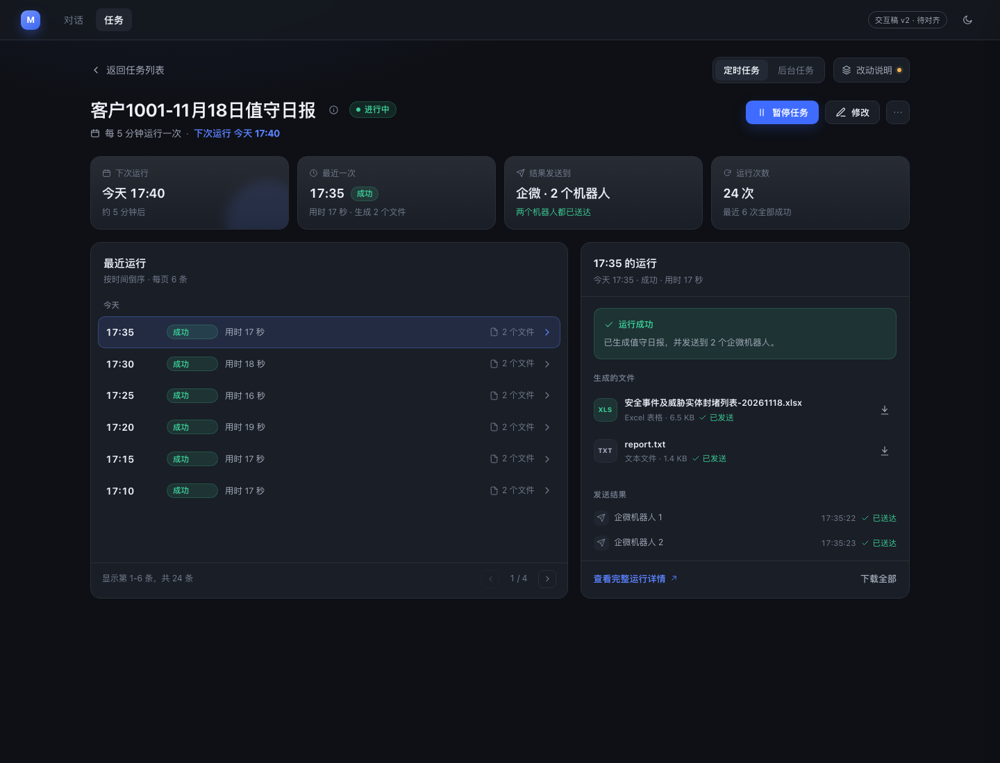
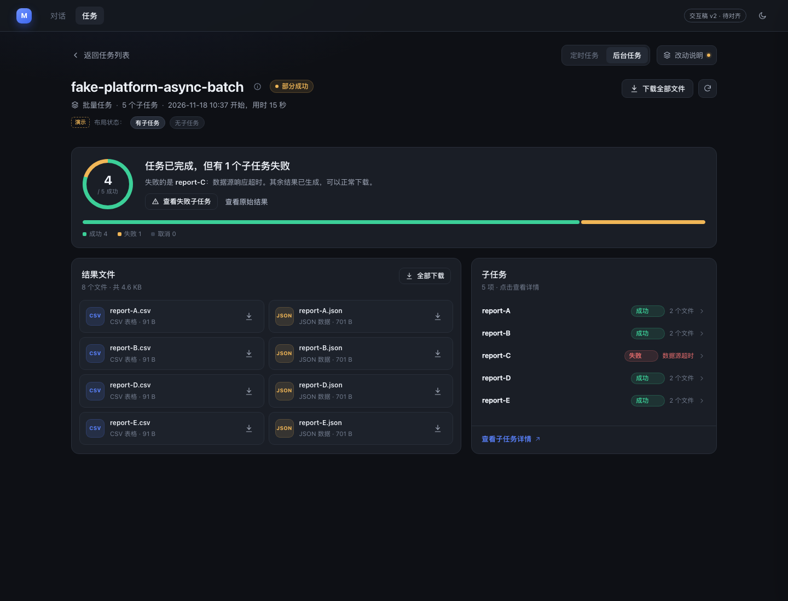
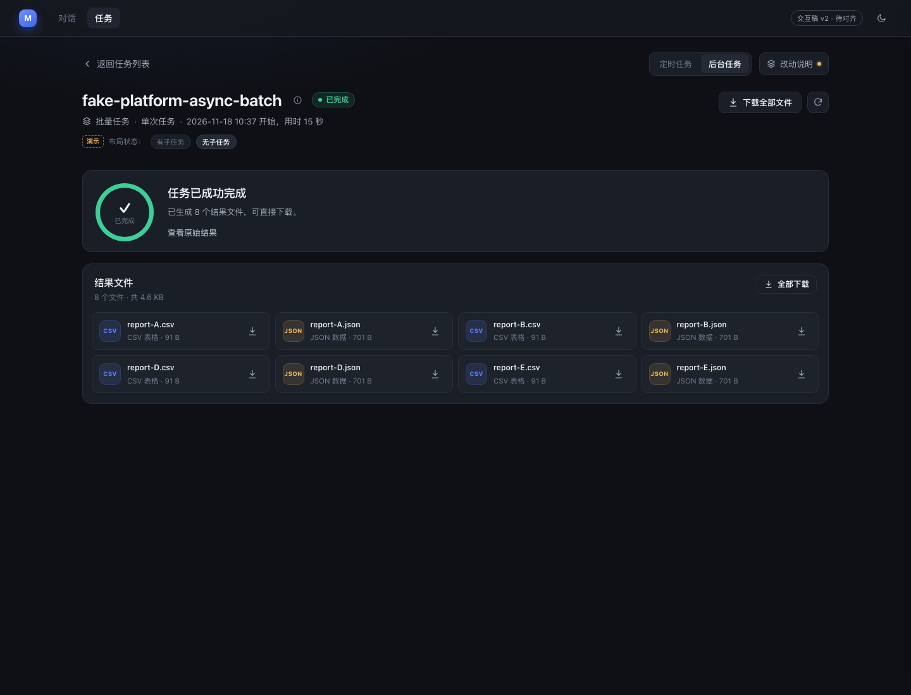

# 任务详情页改版细化设计

状态：交互已对齐，待实现
日期：2026-11-19
适用页面：任务中心 → 定时任务详情 / 后台任务详情
交互稿：[prototype.html](./prototype.html)

代码流程设计：
- [前端设计](./task-detail-redesign.frontend.design.md)
- [后端设计](./task-detail-redesign.backend.design.md)
- [验收场景](./task-detail-redesign.scenarios.md)
- [任务计划](./task-detail-redesign.md)

预览：







---

## 1. 背景与问题

现有两个详情页把内部实现事实直接铺在首屏，用户需要先理解状态机、版本号和文件校验才能看懂任务是否正常。

| 现有问题 | 用户感受 |
| --- | --- |
| 触发历史每行同时显示「已创建执行」「已完成」 | 一次运行出现两个状态，不知道看哪个 |
| 时区、配置版本、Revision、依赖 UUID、投递枚举占据首屏 | 与技术无关的用户不知道这些字段有什么用 |
| 执行详情展示 Snapshot schema、Snapshot 大小、原始结果 JSON | 像调试页面，不像任务结果页 |
| 产物展示 MIME、版本、sha256、每条重复的「企微 已交付」 | 文件名和下载入口被技术信息淹没 |
| 后台任务直接用原始 JSON 和四张计数卡表达结果 | 无法一眼看出「成功几个、失败哪个」 |
| 8 个文件平铺，每行重复「未请求推送」 | 列表很长，但没有增加有效信息 |
| 空的夏令时事件、保留策略提示仍占位 | 页面出现与当前任务无关的说明 |
| 没有统一分页，触发历史靠「查看全部」 | 长历史无法在详情页内连续浏览 |

## 2. 目标与非目标

### 2.1 目标

1. 用户进入详情页 10 秒内回答四个问题：
   - 下次什么时候运行？
   - 最近一次运行得怎么样？
   - 结果发送到了哪里？
   - 一共运行了多少次？
2. 每次运行只显示一个用户状态（成功 / 进行中 / 等待中 / 失败 / 已跳过）。
3. 首屏只保留有行动价值的信息：时间、状态、结果、文件、发送去向、操作。
4. 技术字段统一收进任务名旁的「技术信息」弹层，默认不占页面空间。
5. 运行列表与运行详情在桌面端等高；运行列表使用统一分页组件。
6. 后台任务无子任务时自动切换为单任务布局，不显示空的子任务卡和 0 项计数。

### 2.2 非目标

- 不改变调度、执行、投递、产物保留的任何业务语义。
- 不重做任务中心列表页和待处理页。
- 不新增任务编辑流程；「修改」「暂停 / 恢复」「取消」沿用现有动作与权限。
- 不把技术信息从产品中删除；只是降低首屏权重。
- 不在本期实现 ZIP 打包下载接口。

## 3. 信息架构与文案原则

### 3.1 定时任务详情

```text
返回任务列表
任务名 + 技术信息图标 + 状态            暂停 / 恢复   修改   ⋯
频率 · 下次运行时间
────────────────────────────────────────────────────────
下次运行 | 最近一次 | 结果发送到 | 运行次数
────────────────────────────────────────────────────────
最近运行（分页）                    某次运行详情
  时间  状态  用时  文件数            结果摘要 / 文件 / 发送结果
  时间  状态  用时  文件数            ...
  ...
  分页
```

### 3.2 后台任务详情

```text
返回任务列表
任务名 + 技术信息图标 + 状态            下载全部文件  刷新
任务类型 · 子任务数 · 开始时间 / 用时
────────────────────────────────────────────────────────
结果摘要（4/5 成功 / 无子任务单状态）
────────────────────────────────────────────────────────
结果文件（有子任务：2 列；无子任务：全宽 4 列） | 子任务（无子任务时隐藏）
```

### 3.3 文案对照

| 旧文案 | 新文案 | 说明 |
| --- | --- | --- |
| 触发历史 | 最近运行 | 用户关心「运行」，不关心「触发」这个内部动作 |
| 已创建执行 + 已完成 | 成功 | 一次运行只保留一个结论 |
| 执行详情 | 某次运行（`17:35 的运行`） | 与列表行一一对应 |
| 产物 | 结果文件 | 用户能直接理解 |
| 投递 / PUSH | 结果发送到 | 说明结果去了哪里 |
| Revision / 配置版本 | 技术信息 → Revision / 配置版本 | 默认隐藏 |
| Snapshot schema 版本 / Snapshot 大小 | 技术信息 → 运行快照 | 默认隐藏 |
| 校验值 / MIME / 版本 | 技术信息 / 文件详情 | 首屏不显示 |
| 未请求推送 | 不展示 | 没有发送就不需要提示 |
| 夏令时事件（无事件时） | 不展示 | 空区块不占位 |
| 早于某时间的触发记录可能已清理 | 不展示 | 运维提示，不进入用户详情页 |

### 3.4 状态映射

运行状态由 `FireStatus + ExecutionStatus` 合成一个用户状态：

| 数据状态 | 用户状态 | 颜色 |
| --- | --- | --- |
| `execution_status = COMPLETED` | 成功 | 绿 |
| `execution_status = RUNNING` | 进行中 | 蓝 |
| `execution_status = QUEUED` | 排队中 | 灰 |
| `execution_status = WAITING_EXTERNAL / WAITING_HUMAN` | 等待中 | 琥珀 |
| `execution_status = FAILED` | 失败 | 红 |
| `execution_status = CANCELLED` | 已取消 | 灰 |
| `fire.status = SKIPPED` 且无执行 | 已跳过 | 灰，附跳过原因 |
| `fire.status = FAILED_ADMISSION` | 未运行 | 红，附修复提示 |
| `fire.status = CREATED / EXECUTION_CREATED` 且无执行状态 | 待执行 | 灰 |

定时任务本身的状态继续使用：`进行中 / 已暂停 / 需关注 / 已结束 / 已取消`。

## 4. 页面细化

### 4.1 定时任务详情

#### 4.1.1 页头

- 任务名：不拼接频率、模式等元信息。
- 技术信息图标：任务名后的小 `i`，点击弹出技术信息。
- 状态 pill：进行中 / 已暂停 / 需关注 / 已结束 / 已取消。
- 副标题：`每 5 分钟运行一次 · 下次运行 今天 17:40`。
  - 相对时间由前端根据 `next_fire_at` 计算；超过 24 小时显示日期。
  - 已暂停时显示：`已暂停 · 恢复后继续每 5 分钟运行`。
  - 已结束时显示结束原因，不显示下次运行。
- 操作：
  - 主按钮：`暂停任务` / `恢复任务`，根据 `status` 切换。
  - 次按钮：`修改`。
  - 更多菜单：`刷新状态`、`全部运行记录`、`取消任务`。
  - `取消任务` 必须二次确认；确认文案说明「不再自动运行，已有结果保留」。

#### 4.1.2 概览指标

四张指标卡，桌面端一行四列，窄屏两列。

| 指标 | 数据来源 | 展示 | 空值 |
| --- | --- | --- | --- |
| 下次运行 | `next_fire_at` | `今天 17:40` + `约 5 分钟后` | `无后续运行` |
| 最近一次 | `last_fire.status` / `duration_ms` / `artifact_count` | `17:35` + 状态 pill + `用时 17 秒 · 生成 2 个文件` | `尚未运行` |
| 结果发送到 | `delivery_intent` + 最新运行的产物 `deliveries` | `企微 · 2 个机器人` + `两个机器人都已送达` | `仅保存在任务中` |
| 运行次数 | Fire 列表的 `total` | `24 次` + `最近 6 次全部成功` | `0 次` |

说明：

- 「最近一次」通过 `last_fire.execution_id` 拉取一次最新执行详情，聚合文件数与发送结果；`execution_id` 为空时只显示状态。
- 「最近 6 次全部成功」只在当前页 6 条全部成功时成立；否则显示「最近 6 次有 N 次异常」，不把部分成功说成全部成功。
- 「用时」默认采用**端到端**口径：`schedule_fire.scheduled_at` → 该执行最后一个 `runtime.message_delivery.delivered_at`；没有投递记录时回退到 `task_execution.finished_at`；仍未结束则为空。
- 若评审决定改为「执行耗时」，只替换后端 `duration_ms` 计算口径，前端不变。
- 发送目标按 `deliveries[].target_label` 聚合去重；没有产物或纯文本运行时，退化为「推送到会话」，不伪造机器人数量。

#### 4.1.3 最近运行列表

- 标题：`最近运行`，副标题 `按时间倒序 · 每页 6 条`。
- 每页 6 条；使用统一分页组件 `PaginationFooter`：
  - 左侧：`显示第 1-6 条，共 24 条`
  - 右侧：`1 / 4` + 上一页 / 下一页
  - 不显示每页条数下拉（与现有 FireHistory 用法保持一致）。
- 行内容：
  - 时间（`17:35`，跨天时显示日期分组）
  - 一个用户状态 pill
  - `用时 17 秒`
  - `2 个文件`
  - 选中态：主色边框 + 浅色背景。
- 点击行：
  - 高亮当前行；
  - 右侧详情加载该次执行的 `execution_id`；
  - 若该 Fire 没有 `execution_id`（跳过 / 准入失败），右侧显示原因，不发请求。
- 空状态：`暂无运行记录`。
- 错误状态：保留旧列表内容 + 行内错误提示 + 重试按钮；不把整页清空。
- 保留策略提示不再放在列表下方；如确实需要，只在「全部运行记录」页展示。

#### 4.1.4 右侧运行详情

- 头部：`17:35 的运行` + `今天 17:35 · 成功 · 用时 17 秒`。
- 结果区：
  - 成功：绿色浅底，标题 `运行成功`，正文是结果摘要；
  - 失败：红色浅底，标题 `运行失败`，正文是错误摘要；
  - 等待：琥珀色，说明「等待你的回答」或「等待外部结果」，不显示为失败。
- 文件区：`生成的文件`
  - 文件名、类型（Excel 表格 / 文本文件 / CSV 表格 / JSON 数据）、大小；
  - 发送状态聚合：`已发送` / `发送失败` / `部分送达`；未请求发送则不显示；
  - 行尾下载按钮。
- 发送结果：按机器人目标聚合，最多显示 3 行，超出显示「还有 N 个」。
  - 每行：机器人名称 + 发送时间 + 已送达 / 发送失败。
- 底部操作：
  - `查看完整运行详情`：打开现有 Execution 详情（或后续的独立抽屉）；
  - `下载全部`：本期逐个触发下载；若产品要求 ZIP，另立接口。
- 加载态：保持固定最小高度，避免左右两栏高度跳动。
- 空态：未选择运行时显示 `选择左侧一次运行查看结果`；跨页时若选中项不在当前页，自动选中当前页第一条。

#### 4.1.5 技术信息弹层

任务名后的 `i` 打开，所有用户可见，默认关闭。内容：

- 时区（`Asia/Shanghai（北京时间）`）
- 配置版本
- Revision
- 依赖技能 / 工具 allowlist
- 运行快照（schema + 大小）
- 投递方式
- 预算 / 记忆模式（有值时）

不展示 `instruction`、`normalized_goal`、`context` 等内部 Prompt/参数。

### 4.2 后台任务详情

#### 4.2.1 页头

- 任务名（`skill_name`）。
- 技术信息图标（任务名后）。
- 状态 pill：已完成 / 部分成功 / 失败 / 进行中 / 等待中 / 已取消。
- 副标题：`批量任务 · 5 个子任务 · 2026-11-18 10:37 开始，用时 15 秒`。
- 操作：`下载全部文件`、`刷新`。
- 无子任务时副标题改为：`批量任务 · 单次任务 · 2026-11-18 10:37 开始，用时 15 秒`。

#### 4.2.2 结果摘要

**有子任务：**

- 环形图：成功数 / 总数（如 `4 / 5 成功`），成功绿、失败琥珀；
- 标题：`任务已完成，但有 1 个子任务失败`；
- 正文：指出失败子任务及原因摘要（`report-C：数据源响应超时`）；
- 操作：`查看失败子任务`（滚动/定位到失败行）、`查看原始结果`（打开技术信息）；
- 进度条：成功 / 失败 / 取消 分段；
- 图例：`成功 4 · 失败 1 · 取消 0`。

**无子任务：**

- 环形图改为 `✓ 已完成`，不再显示 `0 / 1 成功`；
- 标题：`任务已成功完成`；
- 正文：`已生成 8 个结果文件，可直接下载`；
- 隐藏失败按钮、进度条、计数图例；
- 如果单任务失败：显示 `任务失败` + 错误摘要 + `查看完整错误`；
- 如果单任务没有产物：隐藏文件区，直接展示结果正文或错误正文。

**运行中 / 等待中：**

- 不显示空的成功/失败结论；
- 显示当前阶段（如「等待外部结果」），保留刷新按钮。

#### 4.2.3 结果文件

- 有子任务：两列卡片；
- 无子任务：全宽四列（≤1080px 两列，≤760px 单列）；
- 卡片内容：类型图标、文件名、类型 + 大小、下载按钮；
- 文件发送状态：
  - 全部目标 DELIVERED → `已发送`；
  - 任一 FAILED → `发送失败`；
  - 部分 DEGRADED → `部分送达`；
  - 无 deliveries → 不显示；
- 不显示 MIME、版本、sha256、`未请求推送`；这些进入技术信息或文件详情；
- 默认最多展示前 8 个；超出显示「共 N 个，仅展示前 8 个」；
- `下载全部`：本期逐个调用现有下载；不伪装成 ZIP。

#### 4.2.4 子任务

- 仅在 `children.total > 0` 时渲染；无子任务时整卡隐藏。
- 行内容：子任务名称、状态 pill、文件数、失败原因摘要（仅失败行）、进入详情箭头。
- 使用现有子任务分页控制器；分页组件沿用 `PaginationFooter`。
- 点击子任务进入现有子任务详情（复用 `openChild`）。
- 子任务名称优先 `label`；没有 label 时用 `item_key` 的安全短标签，不展示 UUID。

#### 4.2.5 技术信息弹层

- 执行 Agent（显示名优先，未知时显示「未知 Agent」；不把 UUID 放首屏）
- 任务类型
- 任务 ID
- 开始 / 结束时间
- 投递状态
- 原始结果 JSON（折叠在弹层内）

## 5. 交互规范

### 5.1 等高两栏

- 桌面端（≥1080px）：`grid-template-columns: minmax(0, 1.42fr) minmax(360px, .98fr)`，`align-items: stretch`。
- 两张卡片 `display: flex; flex-direction: column`。
- 左侧列表 `flex: 1`；分页 `margin-top: auto`。
- 右侧详情底部操作区 `margin-top: auto`。
- 加载中保持最小高度（建议 `min-height: 480px`），避免高度跳动。
- 窄屏（<1080px）自动上下堆叠，不强制等高。

### 5.2 统一分页

- 组件：`components/common/PaginationFooter.tsx`。
- 每页 6 条；请求 `/fires?page=N&page_size=6`。
- 后端 `page_size` 现有契约支持 1–100，不需要迁移。
- 翻页行为：
  - 当前选中运行仍在目标页 → 保留选中；
  - 不在目标页 → 选中目标页第一条并加载其执行详情。
- 无分页选择器；如需每页条数下拉，另行评审（当前统一组件的选项为 15/30/50/100）。

### 5.3 技术信息弹层

- 入口：任务名后的 `i` 按钮，`aria-label="技术信息"`，`aria-expanded` 同步。
- 桌面端锚定在标题下方；移动端宽度 `calc(100vw - 32px)`。
- 同时只允许一个弹层打开。
- 点击外部、按 Esc、点击关闭按钮关闭。
- 使用 Semi `Popover` 或等价浮层，处理视口边缘碰撞；不要用会被 `overflow: hidden` 裁切的绝对定位容器。
- 技术字段只读，不提供编辑入口。

### 5.4 操作与确认

- 暂停 / 恢复：主按钮，提交中禁用并显示 loading；成功后更新状态和副标题。
- 修改：打开现有修改向导。
- 取消任务：更多菜单内，危险色；二次确认；确认后状态改为「已取消」，禁用暂停/恢复。
- 失败提示：保留旧内容，显示明确错误，不整页白屏。
- 所有动作防重复提交，错误码走现有 i18n 兜底。

### 5.5 响应式与可访问性

- 420px 宽度下无横向滚动。
- 标题、状态、操作在窄屏自动换行；运行列表隐藏「用时/文件数」列，保留时间 + 状态 + 详情入口。
- 状态不能只靠颜色表达，必须有文字。
- 列表行使用原生 `button` 或带 `role="button"` 的可聚焦元素；支持 Enter/Space。
- 技术信息弹层打开后焦点进入弹层，关闭后回到触发按钮。
- 时间统一走 `DateTimeText`；相对时间只作为补充，不替代绝对时间。

## 6. 数据与接口

### 6.1 数据映射

| UI 元素 | 现有字段 | 结论 |
| --- | --- | --- |
| 任务名 / 状态 / 下次运行 | `ScheduleDetail.name/status/next_fire_at` | 直接支持 |
| 最近一次状态 | `LastFireSummary.status/execution_status` | 直接支持 |
| 运行次数 | `FireHistoryPage.total` | 直接支持 |
| 最近运行每行 | `FireItem.scheduled_at/status/execution_status/execution_id` | 支持，但缺耗时/文件数 |
| 运行详情 | `ExecutionDetail.started_at/finished_at/result/result_artifacts/error_*` | 直接支持 |
| 文件列表 | `TaskArtifact.name/media_type/size/deliveries` | 直接支持 |
| 发送结果 | `TaskArtifact.deliveries[].target_label/status` | 有产物时支持；纯文本运行缺 run-level 汇总 |
| 后台子任务 | `ExecutionDetail.children` / `TaskChildItem` | 直接支持 |
| 后台文件总数 | `ExecutionDetail.artifact_total` | 直接支持（父任务聚合子产物） |
| 无子任务判断 | `children.total === 0` / `child_total === 0` | 直接支持 |
| 技术信息 | `ScheduleDetail` + `ExecutionDetail` | 直接支持 |
| 原始结果 | `ExecutionDetail.result` | 直接支持 |

### 6.2 需要新增的返回字段（不需要数据库迁移）

`packages/contracts/src/muad_contracts/scheduling.py`：

```python
class LastFireSummary(ContractModel):
    ...
    execution_id: UUID | None = None      # 可选：便于首屏拉取最近一次执行详情
    duration_ms: int | None = None        # 端到端耗时；未结束为空
    artifact_count: int = Field(default=0, ge=0)

class FireItem(ContractModel):
    ...
    duration_ms: int | None = None
    artifact_count: int = Field(default=0, ge=0)
```

前端 `types.ts` 同步增加：

```ts
export interface ScheduleLastFire {
  ...
  execution_id: string | null;
  duration_ms: number | null;
  artifact_count: number;
}

export interface FireItem {
  ...
  duration_ms: number | null;
  artifact_count: number;
}
```

字段是 additive，旧客户端忽略即可。

### 6.3 查询实现

现有 `apps/agent-worker/src/muad_agent_worker/application/schedule_read.py` 已经有：

- `fire_history()`：`ScheduleFire` outer join `TaskExecution.status`；
- `_child_artifact_counts()`：按 `runtime.artifact.task_id` 统计 `DISTINCT logical_file_id`；
- `_artifact_deliveries()`：聚合 `task.task_message_outbox` + `runtime.message_delivery`；
- `_artifacts_with_children()`：父任务聚合子产物。

新增一个批量 helper，避免 N+1：

```python
async def _execution_run_facts(
    self, *, tenant_id: str, execution_ids: Sequence[uuid.UUID]
) -> dict[uuid.UUID, ExecutionRunFacts]:
    # 1) task.task_execution: started_at / finished_at
    # 2) runtime.message_delivery:
    #    owner_type='TASK' AND owner_id IN ids
    #    AND message_key = 'execution:' || owner_id::text || ':final'
    #    max(delivered_at) per owner_id
    # 3) runtime.artifact:
    #    artifact_type='OUTPUT' AND task_id IN ids
    #    count(DISTINCT logical_file_id) per task_id
```

耗时计算：

```text
last_delivered = max(message_delivery.delivered_at)
finished_at = task_execution.finished_at
end_time = last_delivered or finished_at
duration_ms = (end_time - schedule_fire.scheduled_at) if end_time else None
```

说明：

- 采用端到端口径，实测 17:35 那轮约 16.8 秒；执行本身只有约 0.39 秒。
- 如果任务没有投递（`delivery_intent=NONE`），回退到执行结束时间。
- 运行中 / 等待中返回 `duration_ms=null`，前端显示「进行中」而不是 0 秒。
- `artifact_count` 与子任务现有统计口径一致：`DISTINCT logical_file_id`，只统计 `artifact_type='OUTPUT'`。

索引现状：

- `runtime.artifact` 已有 `ix_artifact_task (task_id) WHERE task_id IS NOT NULL`；
- `runtime.message_delivery` 已有 `(tenant_id, message_key, target_key)` 唯一索引，按执行键查询可用；
- 不需要新增迁移。

### 6.4 暂不支持 / 降级

| 能力 | 现状 | 本期处理 |
| --- | --- | --- |
| 纯文本运行的发送目标 | 只有产物级 `deliveries`，没有 run-level 汇总 | 显示「推送到会话」，不显示机器人数量 |
| 下载全部 ZIP | 只有单文件下载 | 逐个触发下载；ZIP 另立接口 |
| 历史运行耗时 | 旧执行可能没有 `finished_at` | 显示 `—`，不猜测 |
| 技术信息权限 | 当前无详情级权限控制 | 所有用户可见；后续如需管理员限制，只隐藏入口 |

## 7. 前端实现方案

### 7.1 组件拆分

建议新增/调整：

| 文件 | 变更 |
| --- | --- |
| `task-center/ScheduleDetailPanel.tsx` | 重排页头、指标、运行列表 + 右侧详情；移除底部技术卡 |
| `task-center/BackgroundTaskDetailPanel.tsx` | 重排页头、结果摘要、文件区、条件子任务卡；移除底部技术卡 |
| `task-center/TaskArtifactList.tsx` | 增加紧凑卡片/网格模式；文件行隐藏版本与校验值 |
| `task-center/TaskResultSection.tsx` | 有子任务 / 无子任务两种摘要；原始 JSON 移入技术信息 |
| `task-center/ChildTaskTable.tsx` | 行样式与失败摘要；保留现有分页 |
| `task-center/labels.tsx` | 新增单一运行状态映射；保留旧 tag 供其他页面使用 |
| `task-center/taskCenterState.ts` | 首屏 fires `page_size=6`；最近一次自动加载；选中运行状态 |
| `components/common/PaginationFooter.tsx` | 不改；沿用 |
| `task-center.css` | 新增详情页布局类；避免影响列表页 |
| `locales/zh-CN.json` / `en-US.json` | 新增文案键，移除不再使用的详情文案 |

建议抽出两个共享小块：

- `TaskInfoButton` / `TaskInfoPopover`：任务名旁的技术信息入口 + 内容容器；
- `RunStatusPill`：把 Fire + Execution 合成一个用户状态。

页面级布局仍保留在两个 DetailPanel 内，避免过度抽象。

### 7.2 数据流

定时任务：

```text
open(scheduleId)
  → getSchedule()
  → listFires(page=1, page_size=6)
  → 选中第一条有 execution_id 的 Fire
  → getExecution(execution_id)
  → 渲染右侧详情

翻页
  → listFires(page=N)
  → 选中规则：保留当前选中；否则选当前页第一条
  → getExecution()
```

后台任务：

```text
open(taskId)
  → getExecution(taskId)
  → 渲染结果摘要 / 文件 / 子任务
  → children.total === 0 ? 单任务布局 : 双栏布局
```

### 7.3 i18n 建议键

| Key | 中文 |
| --- | --- |
| `chat.taskCenter.detail.techInfo` | 技术信息 |
| `chat.taskCenter.detail.techInfoHint` | 排查问题时使用，日常不需要关注 |
| `chat.taskCenter.run.status.SUCCESS` | 成功 |
| `chat.taskCenter.run.status.RUNNING` | 进行中 |
| `chat.taskCenter.run.status.WAITING` | 等待中 |
| `chat.taskCenter.run.status.FAILED` | 失败 |
| `chat.taskCenter.run.status.SKIPPED` | 已跳过 |
| `chat.taskCenter.run.duration` | 用时 {{seconds}} 秒 |
| `chat.taskCenter.run.artifacts` | {{count}} 个文件 |
| `chat.taskCenter.detail.recentRuns` | 最近运行 |
| `chat.taskCenter.detail.selectRun` | 选择左侧一次运行查看结果 |
| `chat.taskCenter.background.single.completed` | 任务已成功完成 |
| `chat.taskCenter.background.single.files` | 已生成 {{count}} 个结果文件 |
| `chat.taskCenter.background.single.label` | 单次任务 |
| `chat.taskCenter.artifact.delivered` | 已发送 |
| `chat.taskCenter.artifact.deliveryFailed` | 发送失败 |
| `chat.taskCenter.artifact.partiallyDelivered` | 部分送达 |

保留现有 `common.pageRange` / `common.perPage` / `common.items`，分页复用。

### 7.4 CSS 结构

新增详情页专属前缀，例如：

```css
.task-detail-split { display: grid; align-items: stretch; ... }
.task-detail-runs { display: flex; flex-direction: column; }
.task-detail-runs-list { flex: 1; }
.task-detail-run-detail { display: flex; flex-direction: column; }
.task-detail-run-detail-footer { margin-top: auto; }
.task-detail-metrics { ... }
.task-detail-tech-popover { ... }
```

不要复用 `.chat-task-fact-list` 作为首屏布局类；它可以保留给技术信息或旧页面。避免修改 `.chat-task-center` 的列表页样式。

## 8. 测试与验收

### 8.1 后端

- `tests/agent_worker/test_scheduled_v2_read_api.py`：
  - Fire 列表返回 `duration_ms` / `artifact_count`；
  - 有投递时取最后 `delivered_at`，无投递时回退 `finished_at`；
  - 运行中返回 `duration_ms=null`；
  - `artifact_count` 只统计 `OUTPUT` 且按 `logical_file_id` 去重；
  - 最近一次 `last_fire` 与 Fire 列表口径一致；
  - 批量 6 条时无 N+1（可用查询计数或 SQL 日志断言）。
- `tests/contracts/test_scheduled_v2_contracts.py`：
  - 新字段 additive，旧 JSON 反序列化通过；
  - `artifact_count >= 0`、`duration_ms` 可空。
- `tests/gateway/test_scheduled_v2_task_center.py`：API 封套与字段透传。

### 8.2 前端

- `tests/frontend/test_scheduled_v2_task_center_ui.py`：
  - 首屏不渲染 Revision / Snapshot / 校验值 / UUID；
  - 运行列表每页 6 条，分页 footer 渲染；
  - 点击行加载 execution 并显示详情；
  - 技术信息默认关闭，点击打开；
  - 无子任务时子任务卡不渲染，文件卡全宽；
  - 状态只显示一个用户状态；
  - 无横向滚动（静态渲染类断言）。
- `tests/frontend/test_task_schedule_services.py`：fires 请求带 `page_size=6`。

### 8.3 验收清单

- [ ] 定时任务首屏只有任务名、状态、频率、下次运行、四个指标。
- [ ] 运行列表每页 6 条，统一分页，翻页后右侧详情正确联动。
- [ ] 左右两栏桌面端等高；窄屏堆叠无横向滚动。
- [ ] 技术信息只在任务名旁的小 i 中，点击外部/Esc 关闭。
- [ ] 后台任务有子任务：4/5 环形图 + 文件双列 + 子任务卡。
- [ ] 后台任务无子任务：隐藏子任务卡、文件全宽、单状态环、无 0 项计数。
- [ ] 首屏不出现 Revision、Snapshot、sha256、MIME、UUID、原始 JSON。
- [ ] 失败/跳过/等待状态都有明确用户文案，不显示为成功。
- [ ] 下载仍可用；无 ZIP 时不宣称打包下载。

## 9. 决策记录

### 9.1 已确认

- 运行列表每页 6 条，使用统一分页组件。
- 左右两栏桌面端等高；窄屏上下堆叠。
- 后台任务无子任务时隐藏子任务卡、文件卡全宽。
- 技术信息入口挂在任务名旁，所有用户可见。
- 首屏不展示 Revision、Snapshot、sha256、MIME、Agent UUID、原始 JSON。

### 9.2 待确认

1. **用时口径**：端到端（计划触发 → 最后发送完成，实测约 17 秒）还是执行耗时（约 0.3–0.7 秒）？本文默认端到端。
2. **下载全部**：本期逐个下载，还是另立 ZIP 接口？本文默认逐个下载。
3. **纯文本运行的发送目标**：本期显示「推送到会话」，不显示机器人数量；是否需要在后续补 run-level 投递汇总？

## 10. 文件索引

交互稿与预览：

- `./prototype.html`
- `./screenshots/`

关键源码：

- `apps/console-platform/frontend/src/modules/webchat/task-center/ScheduleDetailPanel.tsx`
- `apps/console-platform/frontend/src/modules/webchat/task-center/BackgroundTaskDetailPanel.tsx`
- `apps/console-platform/frontend/src/modules/webchat/task-center/taskCenterState.ts`
- `apps/console-platform/frontend/src/modules/webchat/task-center/TaskArtifactList.tsx`
- `apps/console-platform/frontend/src/modules/webchat/task-center/TaskResultSection.tsx`
- `apps/console-platform/frontend/src/components/common/PaginationFooter.tsx`
- `apps/console-platform/frontend/src/modules/webchat/task-center.css`
- `packages/contracts/src/muad_contracts/scheduling.py`
- `apps/agent-worker/src/muad_agent_worker/application/schedule_read.py`
- `apps/agent-runtime/src/muad_agent_runtime/api/webchat_history.py`
- `task.task_execution` / `task.schedule_fire` / `runtime.artifact` / `runtime.message_delivery`

## 11. 原型使用说明

直接打开 `prototype.html`，无需构建：

- 右上角切换深浅色；
- 页面顶部切换「定时任务 / 后台任务」；
- 点击「改动说明」查看 12 条设计取舍；
- 定时任务：点击运行行查看右侧联动，底部翻页可切页；
- 后台任务：点「有子任务 / 无子任务」切换布局演示；
- 技术信息：点任务名后的 `i`。
