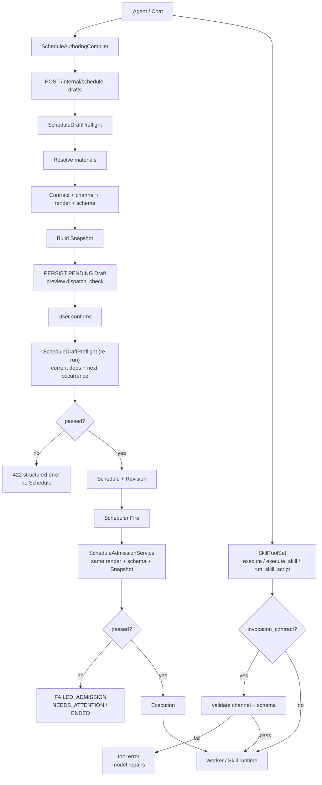

# Skill 调度与对话调用可调用性 — 增量后端设计

> **文档编号**: MOD-SCHED-DISPATCH-v2.0
> **创建日期**: 2026-11-20
> **文档状态**: 设计评审中
> **设计基线**: 已实现的 `scheduled-task-v2`（Draft → Confirm → Fire → Execution）
> **重要**: 这是增量设计，不重写调度器。核心变化是把“确认前真实试跑”改成“调度准入预检”（Dispatch Preflight）：不执行 Skill、不投递、不产生产物；正式执行只发生在用户确认后的 Fire。

---

## 1. 文档控制

| 版本 | 日期 | 作者 | 变更描述 |
|---|---|---|---|
| v0.1 | 2026-11-20 | code-flow | 基于 fluxion-harness 代码事实的增量化草稿 |
| v1.0 | 2026-11-20 | code-flow | 设计评审稿（真实试跑 + trial gate 方向） |
| v2.0 | 2026-11-20 | code-flow | 方向调整：Trial → Dispatch Preflight；契约只保留调用通道与参数；删除真实试跑/投递 |

---

## 2. 需求分析

### 2.1 需求概述

| 项目 | 内容 |
|---|---|
| 模块名称 | Skill 调度与对话调用可调用性 |
| 模块ID | MOD-SCHED-DISPATCH |
| 所属系统 | fluxion-harness：agent-worker + agent-runtime + console-platform |
| 需求类型 | 功能补强 + 安全门禁 |
| 业务背景 | 用户用自然语言创建定时任务或在对话中直接调用 Skill，agent 生成结构化配置。平台没有机器可读的 Skill 调用契约，agent 可能选错通道或漏必填参数，直到运行时才失败；把确定任务改成 AGENTIC 又会引入 `TASK_NO_PROGRESS`。 |
| 核心目标 | 保证 Skill 调用在运行前被正确解析、通道匹配、参数校验；定时任务在确认前预检，对话调用在进程启动前校验；数据准确性仍由 Skill/业务负责。 |

**典型事故（2026-11-18）**

1. 用户要求“每天生成客户 22921947 的 MSSP 值守日报”。
2. agent 以 SKILL 模式保存了 `input_template: {company_id, date}`，没有 `argv`。
3. Skill 入口 `run.py` 只读 argv，缺少 `--company-id`，运行期报：
   `run.py: error: the following arguments are required: --company-id`。
4. agent 改成 AGENTIC，出现 `TASK_NO_PROGRESS`；预算、日期计算、工具面都开始需要人工介入。

**结论**：根因不是 description 写得不好，而是平台没有可校验的调用契约。描述是路由信息，不是调用合同。

### 2.2 现有实现基线（代码事实）

| 能力 | 现有实现 |
|---|---|
| Draft | `POST /internal/schedule-drafts`，`ScheduleDraftService` + `ScheduleDraftPreflight` |
| 试跑 | `POST/GET /internal/schedule-drafts/{id}/test-run`，`ScheduleTrialRunService` 真实执行并投递 |
| 确认 | `POST /internal/schedule-drafts/{id}/confirm`，`ScheduleConfirmService` |
| Skill 执行 | `SKILL_PLAN` 使用 `skill_id` + `input`（stdin）+ `argv`（CLI）+ `window`；Worker 真实执行 |
| Fire 准入 | `ScheduleAdmissionService` 每次 Fire 解析依赖并冻结 Snapshot；当前不校验 Skill 参数 schema |
| 对话调用 | `SkillToolSet.execute` / `execute_skill` / `run_skill_script` 直接启动 Skill；当前不校验 contract |
| Agentic | `AGENT_TURN` 使用 prompt + tools_allow；`TASK_NO_PROGRESS` 带 last failure |
| 试跑事实 | `ScheduleTrialFact` / `SchedulePreview.trial` 已存在 |
| 工具校验 | Preflight 已校验 Skill 存在、AgentTurn 的 tools_allow 存在；不校验工具名合法性 |
| 导入链路 | Console `skill_validator._frontmatter()` 用白名单重建 frontmatter，未知字段会被丢弃 |
| Agent 目录 | `prompt_skill()` 只投影 name/description/platform_label，不包含调用契约 |

**缺口**

1. 没有 `invocation_contract`，平台不知道 Skill 用 argv 还是 stdin。
2. 没有参数 schema，未知/缺失/格式错误直到运行期才暴露。
3. 真实试跑会产生执行、投递、产物和外部副作用，不能作为确认门禁。
4. `SKILL:<uuid>:*` 会被当作普通工具名冻结，运行时才失败。
5. SKILL_PLAN 失败后 agent 可能静默降级成 AGENTIC。
6. 对话直接调用 `execute`/`execute_skill` 没有 contract 守卫，通道错配同样到运行期才暴露。

### 2.3 功能清单

| 功能ID | 功能名称 | 描述 | 优先级 |
|---|---|---|---|
| FEAT-01 | Skill 调用契约 | `SKILL.md` frontmatter 声明 `version` / `invocation` / `schema`；定时与对话共用 | P0 |
| FEAT-02 | 导入保留与校验 | 导入链路保留 contract；非法 contract 显式拒绝 | P0 |
| FEAT-03 | Authoring 契约感知 | 按 contract 生成 `SKILL_PLAN`；缺值反问用户；禁止静默降级 AGENTIC | P0 |
| FEAT-04 | Draft 调度预检 | 解析、渲染、schema 校验、Snapshot 构建；不执行 Skill | P0 |
| FEAT-05 | Confirm 预检门禁 | 用当前依赖 + 下一次触发重跑预检；失败不建 Schedule | P0 |
| FEAT-06 | Fire 重校验 | 每次 Fire 用当前 Skill 版本重新校验；不兼容明确失败 | P0 |
| FEAT-07 | 结构化修复 | 技术错误回 agent，业务缺口问用户 | P0 |
| FEAT-08 | self-creator 指导 | 生成可执行 Skill 时写 contract 并自检；定时任务额外要求 | P1 |
| FEAT-09 | 工具通配拒绝 | `SKILL:<uuid>:*` 拒绝 + allowed_values；裸 `*` 合法 | P1 |
| FEAT-10 | 删除真实试跑 | 删除 `/test-run`、trial 执行/投递/卡片 | P0 |
| FEAT-11 | 对话直接调用校验 | `execute`/`execute_skill`/`run_skill_script` 启动前按同一 contract 校验；失败回模型修复 | P0 |

### 2.4 范围与边界

| 类别 | 内容 |
|---|---|
| In Scope | `invocation_contract`、导入保留、authoring 契约感知、Draft 预检、Confirm 预检门禁、Fire 重校验、对话直接调用校验、结构化修复、self-creator 指导、工具通配拒绝、删除真实试跑 |
| Out of Scope | 确认前真实试跑/手动诊断；业务数据/产物校验；新调度器、Run Ledger、auto-disable、legacy 迁移；Console-side contract overlay；artifact 版本锁定；`both` 双通道；未知显式工具名注册表；多脚本契约；位置参数/短选项；default-true boolean；自由格式 stdin（`additionalProperties: true`）；发布时批量影响预览；新前端页面 |
| 前置假设 | scheduled-task-v2 已上线；Skill artifact 可携带 frontmatter；self-creator 可更新；需要定时调度的存量 Skill 可以改造 |
| 有意取舍 | P0 一个 Skill 只支持一条调用通道（argv 或 stdin）；`both` 有真实需求再加。存量 ACTIVE Schedule 不重建；补 contract 后按同一 Fire 规则校验，不满足则显式失败。 |

### 2.5 业务规则与验收

| ID | 规则 | 场景 |
|---|---|---|
| RULE-01 | 可定时调度的 `SKILL_PLAN` 必须有 `invocation_contract`（`version`/`invocation`/`schema`）；缺失或非法时不得创建新 Draft | E-03 |
| RULE-02 | `invocation=argv` 时按 schema 校验 `argv`、`input` 必须为空；`invocation=stdin` 时按 schema 校验 `input`、`argv` 必须为空；能否为空由 schema 的 `required` 决定；boolean 是存在型开关 | E-01/E-04/B-06/B-07 |
| RULE-03 | 校验分两段：创建时校验结构/模板；预检与 Fire 校验渲染后的具体值 | E-05 |
| RULE-04 | Draft 创建/更新必须同步预检；失败返回结构化错误且不落 Draft | S-01/S-05 |
| RULE-05 | Confirm 必须用当前依赖与下一次触发重跑预检；失败不建 Schedule；`REMINDER` 不参与 | S-02/E-07/E-09 |
| RULE-06 | Fire 必须用当前 Skill 版本重新校验；不兼容是永久 admission 失败，不建 Execution | S-03/E-08 |
| RULE-07 | 预检不得执行 Skill、不得创建 Execution/Fire/Revision/投递 | S-06 |
| RULE-08 | 技术参数错误回 agent；业务缺口问用户；契约/依赖问题由平台/作者处理，用户不调试 CLI flag | S-05/E-02 |
| RULE-09 | `SKILL:<uuid>:*` 明确拒绝并返回 allowed_values；裸 `tools_allow=["*"]` 仍合法 | E-06/B-01 |
| RULE-10 | 已知 Skill + 确定参数的任务优先 `SKILL_PLAN`；禁止静默降级 `AGENT_TURN`；预算来自 PlatformSettings | S-04 |
| RULE-11 | contract 随 artifact 冻结，导入必须保留；契约变化需要新版本 | B-04 |
| RULE-12 | 存量 ACTIVE Schedule 不重建；补 contract 后按同一 Fire 规则校验，失败进入待处理，不静默执行 | B-02 |
| RULE-13 | 对话直接调用只对默认入口按同一 contract 校验，辅助脚本跳过；可修复参数错误 retryable；校验通过后继续现有执行链路；无 contract 保持现有行为 | S-07/E-10/E-11/B-05 |

**NFR**

| ID | 要求 |
|---|---|
| NFR-PERF-01 | Draft 预检同步完成，不执行 Skill；一次依赖解析 + 纯函数校验 |
| NFR-PERF-02 | 对话直接调用校验在进程启动前完成；纯函数校验，不新增依赖解析 |
| NFR-REL-01 | 预检失败不留下半个 Draft/Schedule；Confirm 原子 |
| NFR-REL-02 | 并发 confirm 只成功一次；Draft hash/PENDING/expiry 校验保持 |
| NFR-SEC-01 | contract/argv 不落密钥；日志不记录完整 argv 或业务正文 |
| NFR-OBS-01 | 每次预检/确认/Fire 有 trace_id、code、repair、contract version、artifact checksum |
| NFR-COMPAT-01 | `REMINDER` 不受影响；存量 Schedule 不重建 |

**验证环境**

| 维度 | 假设 |
|---|---|
| 依赖 | 现有 PostgreSQL/Redis、agent-worker、agent-runtime、真实 Skill artifact |
| 测试数据 | 契约 fixture + MSSP 本地 Skill；不执行真实业务 Skill |
| 测试预算 | TASK tests 只跑相关 pytest；全量 pytest/acceptance 留 CI |

---

## 3. 技术设计

### 3.1 关键决策

| 决策 | 选择 | 理由 |
|---|---|---|
| 门禁语义 | **Dispatch Preflight**，不执行 Skill | 真实试跑有副作用/投递/产物，不能作为确认门禁 |
| 对话调用 | 同一 contract，在进程启动前同步校验 | 对话不是调度预检；但有契约时应尽早拦截通道/参数错误 |
| 契约范围 | 默认入口；辅助脚本不套用 | `run_skill_script` 可执行参数不同的辅助脚本，套主入口会误拦 |
| 参数错误重试 | 仅 `SKILL_INVOCATION_INVALID` 标记 `retryable=true` | 现有分类把 `error.detail` 当确定性；不标记会直接 NO_PROGRESS |
| 布尔参数 | 存在型开关：true=裸 flag，false=省略 | 真实 skill 用 `action="store_true"`，`=true` 会退出 2 |
| 空参数 | 由 schema 的 `required` 决定 | 零参数脚本 / `{}` stdin 合法；不加 `allow_empty` |
| 契约存放 | `SKILL.md` frontmatter `invocation_contract` | 随不可变 artifact 版本冻结；定时与对话共用 |
| 调用通道 | `invocation: argv \| stdin`，P0 单通道 | 一次事故就是通道错配；单通道最清晰，`both` 有需求再加 |
| 参数校验 | 两段式：结构/模板 + 渲染后值 | `{{previous_day}}` 创建时不是日期，渲染后才是 |
| 校验复用 | Draft / Confirm / Fire 共用同一套函数 | 避免三条路各写一套、确认与运行漂移 |
| Trial | 删除 | 不执行、不投递、不产生产物；无 trial 状态/超时/租约 |
| 版本策略 | 每次 Fire 重新解析 + 重校验，不锁版本 | 与现有“每次 Fire 解析当前依赖”一致；避免跑已撤销 artifact |
| 工具通配 | `SKILL:<uuid>:*` 拒绝 + allowed_values | 没有可信的“Skill 声明 tools”来源；拒绝比猜安全 |
| Agent 修复 | 技术错误回 agent；业务缺口问用户 | 用户不应看 CLI flag/schema |
| self-creator | 增加契约写作指导与模板 | agent 需要知道怎么写，否则新 Skill 仍会漏 |
| 数据模型 | 不新增表；`preview.dispatch_check` 替代 `preview.trial` | 最小改动；无 trial 执行行 |

### 3.2 架构



**关键点**：Draft、Confirm、Fire 三个入口共用同一套渲染、schema 校验和 Snapshot 构建；预检不产生任何执行/投递行。

### 3.3 契约与数据设计

#### 3.3.1 `invocation_contract`

```yaml
invocation_contract:
  version: 1
  invocation: argv
  schema:
    type: object
    properties:
      company-id:
        type: string
        pattern: "^[0-9]+$"
        description: "客户 ID，例如 22921947"
      date:
        type: string
        format: date
      no-wecom-push:
        type: boolean
    required: [company-id]
    additionalProperties: false
```

stdin 版本：

```yaml
invocation_contract:
  version: 1
  invocation: stdin
  schema:
    type: object
    properties:
      company_id:
        type: string
        pattern: "^[0-9]+$"
      date:
        type: string
        format: date
      no_wecom_push:
        type: boolean
    required: [company_id]
    additionalProperties: false
```

约束：

- `version`：契约版本，P0 只接受 `1`。
- `invocation`：`argv` 或 `stdin`；P0 单通道。
- `schema`：JSON Schema，必须 `type: object`、`additionalProperties: false`；`required` 必须是已声明字段。
- `argv` 的属性名是长选项名（不含 `--`）；`help` / `version` 是保留名，不允许声明。
- 契约绑定 Skill 的**默认入口**（`muad.skill.json` 的 `entrypoint` / `select_entry_script`）；辅助脚本不在契约范围。
- `description` 可选，用于 authoring 把自然语言映射到参数；不参与校验。
- 不包含 `allow_empty`、`output_format`、`test.fixed_argv`、`test.safe_argv`：这些是执行/业务语义。

#### 3.3.2 两段式校验

| 阶段 | 时机 | 校验内容 |
|---|---|---|
| 结构 | authoring / Draft 创建 | 通道匹配、未知参数、重复参数、必填项存在、`--help`/`--version`、模板变量白名单 |
| 渲染 | Draft 预检 / Confirm / Fire | 按 Schedule 时区渲染 `{{fire_date}}` / `{{previous_day}}` / `{{fire_time}}`，再用完整 schema 校验 `format`/`pattern`/`enum`/`range` |

- 渲染前允许模板字符串；渲染后不允许模板残留。
- 对话直接调用没有调度 occurrence，不接受 `{{fire_date}}` / `{{previous_day}}` / `{{fire_time}}` 调度模板；模型必须给具体值（可用 `current_time` 等平台工具）。
- `argv` 只支持长选项：`--key value`、`--key=value`；值以 `-` 开头时用 `--key=value`。
- `type: boolean` 是存在型开关：`true` 传裸 `--flag`，`false` 省略；拒绝 `--flag=true|false`。P0 不支持 default-true / `BooleanOptionalAction`。
- 重复选项、短选项、裸位置参数、`--` 终止符、未知选项一律拒绝。
- schema 必须 `additionalProperties: false`（argv 与 stdin 相同）；能否为空由 schema 的 `required` 决定，`argv=[]` / `input={}` 可以合法。
- 示例：`--date {{previous_day}}` 在结构阶段通过；渲染后 `2026-11-19` 通过 `format: date`；`2026-13-01` 拒绝。

#### 3.3.3 数据与持久化

- **不新增表**。
- `invocation_contract` 存在 `artifact.frontmatter_json`，随 artifact 不可变。
- `TaskScheduleDraft.preview_json.dispatch_check` 保存 Draft 创建时的预检事实。
- `TaskScheduleRevision.preflight_json` 保存 Confirm 时重跑的最新预检事实。
- 删除 `ScheduleTrialFact` / `SchedulePreview.trial`；不再写 `TaskExecution.input_json.trial_draft_id`。
- 预检不写 `TaskExecution` / Fire / Revision / delivery。

#### 3.3.4 导入保留

- `SkillManifest` 增加 `invocation_contract: SkillInvocationContract | None`。
- `_build_manifest` 严格解析；非法 contract 导入失败，不静默丢弃。
- Console `_frontmatter()` 白名单增加 `invocation_contract`，否则导入时会被丢掉（GPT 复查已确认）。
- 真实 zip 导入 → `frontmatter_json.invocation_contract` → resolve → preflight 全链路测试。

### 3.4 接口变更

| 接口 | 变更 |
|---|---|
| `POST /internal/schedule-drafts` | 创建/更新时同步预检；失败 422；成功返回 `preview.dispatch_check`；不自动 trial |
| `GET /internal/schedule-drafts/{id}` | 返回 `preview.dispatch_check`；不再返回 `preview.trial` |
| `POST /internal/schedule-drafts/{id}/confirm` | 用当前依赖 + 下一次触发重跑预检；失败 422，不建 Schedule |
| `POST/GET /internal/schedule-drafts/{id}/test-run` | **删除** |

对话直接调用不是 HTTP 接口：走 `SkillToolSet` 的 tool result，错误结构见 §3.5.5。

**新增错误码**

| code | HTTP | 场景 |
|---|---|---|
| `SCHEDULE_INVOCATION_CONTRACT_MISSING` | 422 | Skill 没有 `invocation_contract` 或契约非法 |
| `SCHEDULE_ARGV_INVALID` | 422 | argv 结构/必填/格式非法，或 `invocation=argv` 时 `input` 非空 |
| `SCHEDULE_INPUT_INVALID` | 422 | input 结构/必填/格式非法，或 `invocation=stdin` 时 `argv` 非空 |
| `SCHEDULE_TOOL_WILDCARD_UNSUPPORTED` | 422 | `SKILL:<uuid>:*` |
| `SCHEDULE_ADMISSION_FAILED` | 422 | 依赖解析失败、Snapshot 构建失败等无法归类的预检失败（复用现有码） |

**对话调用 tool error（不是 HTTP）**

| code | 场景 |
|---|---|
| `SKILL_INVOCATION_INVALID` | 有 contract，通道/参数不满足；`error.detail` 带 field/reason/repair/allowed_values；**`retryable=true`**，仅此码可重试 |

**Fire admission 错误码（永久失败）**

| code | 场景 |
|---|---|
| `SKILL_CONTRACT_MISSING` | Fire 时 Skill 没有可用的 contract |
| `SKILL_ARGS_INVALID` | 渲染后的参数不满足当前 contract |
| `WILDCARD_NOT_SUPPORTED` | 存量 Revision 带 `*` |

**错误封套**

沿用现有 `ApiResponse`：

```json
{
  "code": "SCHEDULE_ARGV_INVALID",
  "msg": "定时任务参数不合法",
  "data": {
    "field": "payload.argv",
    "reason": "MISSING_REQUIRED",
    "invocation": "argv",
    "required": ["company-id"],
    "allowed_values": ["--company-id <customer-id>", "--date <YYYY-MM-DD>", "--no-wecom-push"],
    "repair": "PROVIDE_SKILL_ARGV"
  },
  "trace_id": "...",
  "request_id": "...",
  "timestamp": "..."
}
```

- `field` 指向 payload 路径；`entry` 用于工具条目。
- `allowed_values` 给 agent 直接替换，不需要用户解读。
- 不返回完整 argv/input 中的敏感值。

### 3.5 关键流程

#### 3.5.1 Draft 创建/更新（预检）

1. `parse_draft_request` → 校验时区/结构/secret。
2. 计算 recurrence 与 `first_fire_at`。
3. `ScheduleDraftPreflight` 解析依赖材料。
4. 按 payload 校验：
   - `SKILL_PLAN`：从 resolved skill 读取 contract；校验 `invocation`；结构校验 `input`/`argv`；模板变量白名单。
   - `AGENT_TURN`：拒绝 `SKILL:<uuid>:*`；校验 tools/model/credential；prompt 非空。
   - `REMINDER`：保留现有依赖/投递校验，不做 Skill 契约校验。
5. 按 `first_fire_at` + 时区渲染；完整 schema 校验；构建 Snapshot。
6. 成功：落 PENDING Draft，`preview.dispatch_check` 写入通道、契约版本、渲染后参数、依赖、snapshot hash/bytes。
7. 失败：返回结构化错误，**不落 Draft**。

#### 3.5.2 Confirm（重跑预检）

1. 入口先做幂等重放（现有 `TaskSubmissionService`）。
2. 读取 Draft（不加锁）→ 用当前依赖 + 当前下一次触发重跑预检。
3. 失败：422；Draft 保持 PENDING；不建 Schedule。
4. 成功：`FOR UPDATE` 锁 Draft → 复核 hash/PENDING/expiry/confirmation ref。
5. 创建/更新 Schedule + Revision；把最新 `dispatch_check` 写入 `preflight_json`；提交。
6. `REMINDER` 跳过 Skill 契约预检，保留现有 recurrence/delivery 校验。

#### 3.5.3 Authoring

- `ScheduleAuthoringContext` 已带 `ResolvedSkill`，直接读 `frontmatter.invocation_contract`。
- `invocation=argv`：
  - 生成 `argv`；`input` 必须为空；
  - 缺必填业务值 → `ScheduleFieldError(field="payload.argv", reason="MISSING_REQUIRED", repair="PROVIDE_SKILL_ARGV", allowed_values=...)`；
  - 不允许改成 `AGENT_TURN`。
- `invocation=stdin`：生成 `input`，`argv` 为空；错误字段 `payload.input`。
- 已知 Skill + 确定参数 → `SKILL_PLAN`；只有需要模型推理时才 `AGENT_TURN`。
- `SKILL:<uuid>:*` → `TOOL_WILDCARD_UNSUPPORTED` + allowed_values；裸 `*` 保持合法。
- 预算来源是 `PlatformSettings.agent`；不提供 per-draft 数值。

#### 3.5.4 Fire（重校验）

- `admission_request_from_revision` 解析 Revision payload；按 `scheduled_at` 渲染 `input`/`argv`。
- `ScheduleAdmissionService` 解析当前 artifact；`build_snapshot` 前执行 contract 校验：
  - 没有 contract → `SKILL_CONTRACT_MISSING`（永久）；
  - 通道/参数不满足 → `SKILL_ARGS_INVALID`（永久）；
  - `*` → `WILDCARD_NOT_SUPPORTED`（永久）。
- 失败：`record_admission_failure` 写 Fire `FAILED_ADMISSION`；CRON → `NEEDS_ATTENTION`，ONCE → `ENDED`；不建 Execution。
- 成功：沿用现有 Snapshot/Execution/Worker 链路。

#### 3.5.5 对话直接调用

- 对话中 agent 通过 `execute` / `execute_skill` / `run_skill_script` 调 Skill。
- 契约绑定**默认入口**（`select_entry_script` / `muad.skill.json` 的 `entrypoint`）：
  - `execute_skill` 总是校验默认入口；
  - `run_skill_script` / `execute(target=skill, script=...)` 只有选中的脚本等于默认入口才校验；
  - 辅助脚本（如 `check_status.py`）保持现有规则，不套用主入口契约。
- `load_skill.manifest` 返回 `entrypoint` + `invocation_contract`，模型能按需读取调用依据；不扩技能目录。
- 有 contract：
  - 按 `invocation` 校验通道；按 schema 校验具体值（不接受调度模板）；
  - 失败返回 `SKILL_INVOCATION_INVALID`，`error.detail` 带 field/reason/repair/allowed_values，**`retryable=true`**；
  - 只有可修复的参数错误 retryable；skill key/权限/契约缺失等保持不可重试；
  - 复用 `max_identical_failures`，不新增循环控制。
- 无 contract：保持现有行为，不阻断对话调用；记录 `contract_missing` 观测。
- 守卫阶段不写 Draft/Schedule/Fire/Execution/Snapshot；**校验通过后继续现有执行链路**，ASYNC 仍按现有逻辑提交 operation/Execution。
- 与 Fire 的共同点：同一份 contract、同一校验函数；差异：对话不解析 Schedule、不构建 Snapshot、不经过 Confirm。

#### 3.5.6 错误修复循环

```text
Draft/Confirm 预检失败
  → 422 + data{field, reason, repair, allowed_values, invocation}
  → agent 修正参数，重新提交 Draft
  → 最多自动修 2 次
  → 仍失败：
       - 业务值缺失 → 问用户一个业务问题
       - 契约缺失/非法 → 告知用户 Skill 暂不可调度（作者/平台处理）
       - 依赖撤销/版本变化 → 告知用户需要重新配置或联系管理员
```

**约束**：技术错误不展示 `--company-id`/schema 字段给最终用户；用户只回答业务问题或确认卡片。agent 的 `draft_schedule` 工具必须把 `AppError.data` 原样回给模型，不能只返回一句“400 参数错误”。

### 3.6 self-creator 与存量 Skill

#### 3.6.1 self-creator 更新

- `skills/self-skill-creator/SKILL.md`：
  - Step 1 确认脚本入口通道：`argparse`/`sys.argv` → `argv`；`sys.stdin`/`json.load` → `stdin`；歧义问作者。
  - Step 4 frontmatter 模板增加 `invocation_contract`（所有可执行 Skill；纯指令/MCP-only 不必）；契约只描述默认入口，辅助脚本不写契约。
  - Step 6 自检增加契约检查：boolean 是存在型开关；零参数由 schema 的 `required` 决定；`additionalProperties: false`。
  - “不要做的事”增加：不要用 `--help` 反推契约；不要给纯指令/MCP-only Skill 硬造契约；不要给辅助脚本套主入口契约。
- 新增 `skills/self-skill-creator/references/invocation-contract.md`：格式、argv/stdin 示例、从 argparse 推导、boolean 存在型开关、零参数、默认入口/辅助脚本边界、常见错误、自检清单。
- 修正 `references/skill-md.md`：删除“frontmatter 只写 name/description”，允许 `execution` / `invocation_contract`。
- 测试：正向 fixture（导入 + preflight 通过）、反向 fixture（漏必填 → `MISSING_REQUIRED`）、通道歧义（问作者）。

#### 3.6.2 存量 Skill

- `skills/daily-duty-report-mssp-local`：`run.py` 是 argv → 加 `invocation: argv` + `schema`。
- 生产 `daily-duty-report-mssp`：按实际部署入口补 `argv` 或 `stdin`，发新版本。
- 存量 Skill：优先给需要定时调度的补 contract；对话调用有 contract 时校验，无契约保持现有行为，不必全量改造。

### 3.7 质量与可观测性

| 场景 | 实现 |
|---|---|
| 指标 | `schedule_preflight_total{status,mode,code}`、`schedule_confirm_blocked_total{code}`、`schedule_admission_failure_total{code}`、`skill_invocation_guard_total{status,code}` |
| 审计 | draft create/preflight/confirm/blocked；对话调用 guard 失败；记录 draft_hash、contract version、artifact checksum、invocation、error_code |
| 日志 | 结构化；不记录完整 argv/input 或业务正文；只记录字段名/错误码 |
| 并发 | Confirm 现有 Draft 行锁；预检在锁外；并发 confirm 只一个成功 |
| 清理 | 无 trial 执行；无新增表；沿用现有 task retention |

---

## 4. 部署与回滚

| 阶段 | 操作 | 验证 |
|---|---|---|
| 1 | 发布 contract 模型 + 导入保留（无行为变化） | 现有 pytest；真实 zip 导入 round-trip |
| 2 | 给需要调度的 Skill 补 contract（MSSP local/production、self-creator 指导） | 导入 + resolve + preflight |
| 3 | 开启对话直接调用守卫（默认入口有 contract 时校验；辅助脚本跳过；无 contract 保持现有行为） | 默认入口参数错误在进程启动前被拦截；aux script 不回归 |
| 4 | 开启 Draft 预检 + Confirm 预检门禁 | 新 Draft 成功/失败路径；零执行/投递 |
| 5 | 开启 Fire 重校验 | 版本漂移/缺契约显式失败 |
| 6 | 删除 `/test-run`、trial service/fact/前端卡片 | 无 trial 引用；卡片显示 dispatch_check |

- **不使用 feature flag**：避免兼容层；按“先补契约、再开门禁”的顺序发布。
- 回滚：回退门禁代码；contract 留在 artifact 中无副作用；不删除历史数据。
- 存量 ACTIVE Schedule：上线前扫描/预检；不满足新契约的任务在 Fire 进入 `NEEDS_ATTENTION`，由 UPDATE Draft 修复。

---

## 5. 风险与依赖

| 风险 | 影响 | 缓解 |
|---|---|---|
| 契约与真实脚本不一致 | 预检通过但执行失败 | Skill 自己的 CI 用真实入口测试；Fire 失败显式进入待处理 |
| 对话调用时 Skill 没有 contract | 无法提前校验，仍可能运行期失败 | 保持现有行为；记录 `contract_missing`，推动作者补契约 |
| 存量 Skill 没有 contract | 新 Draft 无法创建 | 上线前补 contract；不可调度 Skill 不强制 |
| 存量 Schedule 参数不满足新契约 | Fire 进入 NEEDS_ATTENTION | 上线前扫描/预检；UPDATE Draft 修复 |
| agent 修复循环 | 多轮重试 | 技术/业务错误分层；最多自动修 2 次 |
| Skill 版本升级改变通道/参数 | 旧 Schedule 失败 | 每次 Fire 重校验，显式失败 |
| 工具通配/未知工具名 | 运行期工具缺失 | P0 拒绝 `*`；未知显式工具名 follow-up |
| 辅助脚本不在契约范围 | 可能绕过主入口参数校验 | 保持现有 debug 工具边界；如需收紧，限制 `run_skill_script`，不扩契约 |
| 契约过大 | Snapshot 超限 | 沿用 `max_snapshot_bytes`；预检即失败 |

---

## 6. 需求追溯

| 用户故事 | FEAT | 场景 | 主责 TASK |
|---|---|---|---|
| US-01/04 | FEAT-03/04/07 | S-01/S-05/E-01/E-02/E-04 | TASK-002/003/006 |
| US-02 | FEAT-10 | S-06 | TASK-003/007 |
| US-03 | FEAT-01/02 | B-04/E-03 | TASK-001 |
| US-05 | FEAT-05/06 | S-02/S-03/E-07/E-08 | TASK-004/005 |
| US-06 | FEAT-08 | S-04 | TASK-006 |
| US-04 | FEAT-09 | E-06/B-01 | TASK-002 |
| US-07 | FEAT-11 | S-07/E-10/E-11/B-05 | TASK-008 |

## Spec Compliance Matrix

| Spec/Rule | 设计落点 | 验收场景 | 状态 |
|---|---|---|---|
| `artifact/harness-skill#RULE-artifact-001` | invocation_contract 随 artifact 冻结、导入保留 | B-04/E-03 | applied |
| `api/harness-api#RULE-api-001` | 统一封套/错误码/预检边界/确认幂等 | E-01/E-02/E-04/S-01/S-02 | applied |
| `worker/harness-worker#RULE-worker-001` | Fire 重校验与真实执行状态 | S-03/E-08 | applied |
| `snapshot/harness-snapshot#RULE-snapshot-001` | 预检构建 Snapshot、不落 Execution | S-06 | applied |
| `time/harness-time#RULE-time-001` | argv/input 模板按 IANA 时区渲染 | S-01/E-05 | applied |
| `test/harness-test#RULE-test-001` | 真实边界测试、预检零副作用 | 全部 | applied |
| `artifact/harness-skill#RULE-artifact-001` | 对话调用读取同一 contract，进程启动前校验 | S-07/E-10/B-05 | applied |

---

*文档结束*
