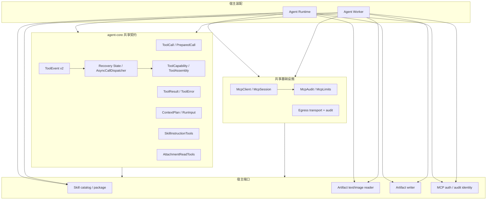
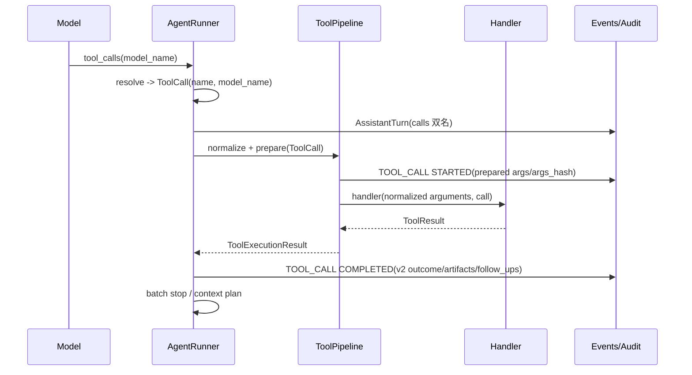
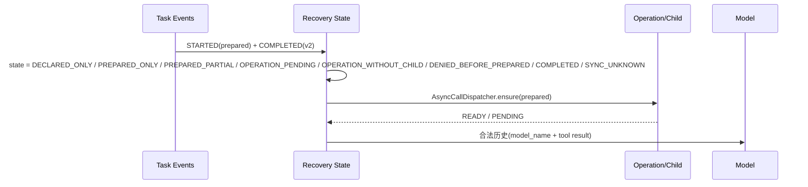
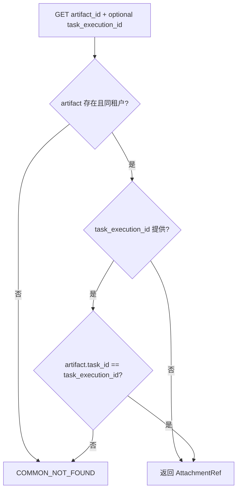
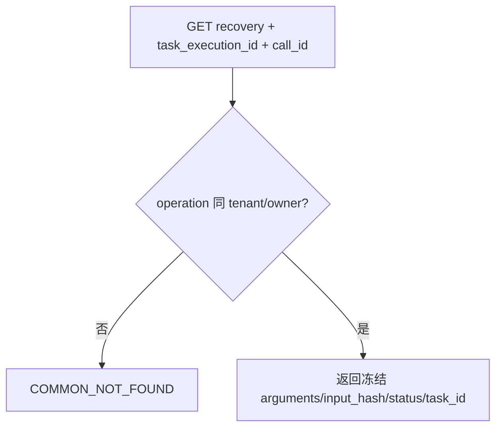

# Agent 执行契约统一模块需求与设计一体化文档

> **文档编号**: MOD-EXEC-CONTRACT-001
> **文档版本**: v1.1
> **创建日期**: 2026-11-21
> **文档状态**: 设计评审中

**评审边界说明**:

- **需求评审**: 第 2 章（需求分析）→ 通过后锁定为需求基线 v1.0
- **设计评审**: 第 3-4 章（技术设计 + 部署运维）→ 通过后锁定设计基线 v1.x
- **交接契约**: 2.5 验收条件 — 需求定义 What，设计实现 How
- **场景唯一源**: `agent-execution-contracts.scenarios.md`；本文只引用 S-/E-/B- 编号，不复制场景步骤。

**ID 体系**: US（来自 PRD）、FEAT、API、RULE、RISK、NFR；场景 S-/E-/B-

---

## 1. 文档控制

### 1.1 责任人

| 角色 | 姓名 | 职责范围 |
|------|------|---------|
| 产品经理 | | 需求定义、业务验收 |
| 开发负责人 | | 技术方案、代码实现 |
| 测试负责人 | | 测试策略、质量保证 |
| 架构师 | | 契约边界与宿主端口审核 |

### 1.2 修订历史

| 版本 | 日期 | 作者 | 变更描述 |
|------|------|------|---------|
| v0.1 | 2026-11-21 | code-flow | 初始设计：三份共享契约、宿主端口、无兼容层迁移 |
| v1.0 | 2026-11-21 | code-flow | 补齐 ContextPlan、typed result、共享 MCP、部署与测试矩阵 |
| v1.1 | 2026-11-21 | code-flow | 按架构复查补齐 prepared 调用持久化、恢复状态机、来源化 ContextPlan/受保护预算、摘要覆盖水位、工具完成事件、Worker execute 路由、MCP 重放/逻辑审计/有界性、升级历史读取契约 |

---

## 2. 需求分析

### 2.1 需求概述

| 项目 | 内容 |
|------|------|
| **模块名称** | Agent 执行契约统一 |
| **模块ID** | MOD-EXEC-CONTRACT |
| **所属系统/产品线** | Agent Runtime / Agent Worker / 共享 Agent Core |
| **需求类型** | 技术重构（契约统一 + 缺陷修复） |
| **业务背景** | Runtime 与 Worker 共用 `AgentRunner`，但工具身份、结果语义、上下文边界、MCP 会话与恢复规则各自实现，已产生 8 个可复现缺陷（见 PRD 2.1）。逐点修补会继续让同一类缺陷在另一宿主复发。 |
| **核心目标** | 用能力、调用与结果、恢复与上下文三份共享契约统一两个宿主；删除隐藏入口、字符串成败推断、重复 MCP 和兼容层，使每个事实只在一个层判定。 |

### 2.2 痛点与价值

| 维度 | 内容 |
|------|------|
| **目标用户** | 对话用户、定时任务用户、Skill 作者/运营、平台运维/安全、Runtime/Worker 开发者 |
| **当前问题** | 工具成功被误判失败（MCP 数组）、显式 `retryable:false` 被翻转、默认预算丢用户目标/Skill 正文、micro 节省被 snip 覆盖、Worker 缺 `load_skill`/`read_attachment`、崩溃恢复名称不匹配、确定性失败后继续写、Worker MCP 复用过期会话且无 Egress 审计、MCP 图片/资源静默丢失 |
| **业务影响** | 外部动作可能重复执行；长任务/定时任务输出偏离用户目标；大结果不可回读；关闭的能力可被绕过；审计缺口；同一 MCP 故障在两个宿主表现不同 |
| **预期价值** | 消除误判与重复副作用；上下文连续性可验证；Worker 与 Runtime 能力对等；MCP 会话/审计/错误分类统一；后续新增工具只需装配端口 |

**架构复查补充（v1.1）**

- **真实执行调用**：外部执行前落库归一化/Hook/授权后的 `PreparedCall`；恢复以 prepared 事实为准，不以 assistant 原始参数重放。
- **恢复状态机**：operation/子 Task/无 checkpoint/同步结果未知四个窗口都有明确处置；operation 与执行载体幂等同时存在。
- **重放语义**：MCP 失败分别表达“可恢复 / 已发送 / 结果确定 / Owner 声明可重放”，`retry_safety` 参与 `retryable` 与业务重试决策；会话重建与业务重试分开。
- **来源化上下文**：显式 `RunInput`、`MessageOrigin`、活跃 Skill 集合；受保护上下文有字节预算和超限可见降级。
- **摘要覆盖**：`covers_up_to_seq` 只覆盖被摘要历史；连续摘要合并旧事实；pinned/当前工作不被跳过。
- **工具完成事件**：版本化共享契约持久化 outcome、产物角色、follow-ups；恢复重建失败/止损事实。
- **Worker 执行路由**：`execute` 映射冻结 allowlist/schema/retry_safety；只有说明的 Skill 不可执行。
- **MCP 逻辑审计**：解码/校验后记录逻辑结果，HTTP 200 + isError/RPC/ID 错配不得记成功；响应/SSE/媒体有界。
- **开发阶段 cutover**：本需求上线是破坏性切换；cutover 时删除旧 `runtime.canonical_event` / `task.task_event` 数据（开发库可整体重置），不迁移、不保留 v1 运行时分支；旧会话不再续接。

**用户故事**

| 编号 | 用户故事 | 优先级 |
|------|---------|--------|
| US-01 | 作为对话用户，我希望工具成功不会被本地误判为失败、失败也不会被当成功，以便不重复执行外部动作、不丢失结果 | P0 |
| US-02 | 作为长任务用户，我希望 Agent 始终保留我的原始目标、当前指令和正在使用的 Skill 说明 | P0 |
| US-03 | 作为定时 Agent 用户，我希望后台任务能读取 Skill 正文/资源和已外置的大结果 | P0 |
| US-04 | 作为平台运维/安全，我希望关闭的 Skill 脚本调试不能被隐藏工具名绕过，MCP 调用有统一会话恢复、Egress 审计和错误分类 | P0 |
| US-05 | 作为开发者，我希望两个宿主共用同一套工具身份、结果、上下文和恢复契约 | P0 |
| US-06 | 作为 Skill 作者，我希望调度 Agent 按 SKILL.md 和 references 执行 | P1 |

### 2.3 功能方案

| 功能ID | 功能名称 | 功能描述 | 优先级 | 来源 |
|--------|---------|---------|--------|------|
| FEAT-01 | 统一调用身份 | `ToolCall` 同时携带内部名与模型名；事件、审计、checkpoint、恢复只用内部名，provider 只用模型名 | P0 | US-01、US-05 |
| FEAT-02 | 类型化工具结果与失败 | handler 返回 `ToolResult`；失败用 `ToolError`/outcome 表达；pipeline 不再解析正文 | P0 | US-01、US-05 |
| FEAT-03 | 批次止损 | 确定性失败后在批次边界停止后续串行调用，并显式记录未执行结果 | P0 | US-01 |
| FEAT-04 | 统一上下文计划 | 显式当前输入/来源/活跃 Skill；`ContextPlan` 统一 prefix/pinned/older/working 与受保护预算 | P0 | US-02 |
| FEAT-05 | 能力装配与唯一执行入口 | 能力声明 + 装配校验；删除隐藏别名；Worker 补齐 Skill 指令/资源/检索、附件读取与 execute 路由 | P0 | US-03、US-04、US-06 |
| FEAT-06 | 共享 MCP 会话、治理与内容 | Runtime/Worker 共用 MCP 协议/会话/Egress/错误分类；图片与嵌入资源转 artifact 或显式标记 | P0 | US-01、US-03、US-04 |
| FEAT-07 | 规范与文档收敛 | Spec/docs 按新契约重写；删除别名、兼容层、重复实现的描述 | P1 | US-05 |

#### FEAT-01 统一调用身份

**设计要点**

- provider 返回的 `ModelToolCall` 保持协议名；内核在 `AgentRunner._accept_response` 解析成 `ToolCall`（`call_id / name / model_name / arguments`）。
- `on_assistant_turn` 回调改为 `AssistantTurn`，同时携带模型消息与已解析 `ToolCall`；宿主没有机会持久化未解析名称。
- **`on_tool_prepared` 在 handler IO 之前**写入 `PreparedCall`：归一化后的 `args_hash` + 脱敏 `args_preview`、来源/技能/工具/执行模式/`retry_safety`；事件写入失败即中止该调用，不允许无持久事实的外部执行。原始归一化参数只进入 operation 行。
- 参数默认值由 `ToolDefinition.normalize_arguments` 声明；Hook 改参后重新归一化并落库。assistant 原始参数只用于 provider 回放。
- `AgentRunState.pending_tool_calls`、planner、audit、checkpoint 全部使用 `ToolCall.name`。
- 恢复以 `PreparedCall` 为锚：operation 已登记则幂等找回，子 Task 未创建则幂等补齐；只有 checkpoint 不是恢复的唯一入口。
- 同步工具已执行但结果未落库时，标记 `OUTCOME_UNKNOWN`；`READ_ONLY`/`IDEMPOTENT` 才允许按原 operation/business key 重试，`NON_RETRYABLE` 返回确定性失败。

#### FEAT-02 类型化工具结果与失败

**设计要点**

- `ToolHandler` 返回 `ToolResult`（content/outcome/follow_ups/artifacts/call_id）；失败通过 `ToolError` 或 `ToolResult.outcome` 表达。
- 删除 `ToolDefinition.outcome_parser`、`ToolDefinition.follow_up_messages`、`tool_failure_outcome`、`diagnostic_evidence_outcome` 的正文推断职责。
- pipeline 捕获 `ToolError` 后生成统一错误体；模型侧 `{"error": {...}}` 形状由 typed outcome 生成，不再反向解析。
- 整轮外置端口改为 `finish_round(Sequence[ToolResult]) -> Sequence[ToolResult]`；artifact 引用由 typed `artifacts` 携带，不再从正文 JSON 提取。
- **工具完成事件 v2**：共享契约持久化 `status`、`outcome`、`content`/预览、`artifacts[]`（`role=RESULT|IMAGE|ATTACHMENT|REPORT`）、`follow_ups[]`（图片用 artifact 引用，不存 base64）；恢复侧用同一 codec 重建 tool 消息、失败事实与止损状态。
- 完成事件写入之前崩溃：prepared 事实 + operation 状态决定“等待/可重放/结果未知”，不得把缺失结果当成功。

#### FEAT-03 批次止损

**设计要点**

- 批次循环在每批开始前调用统一 `ensure_can_continue(state)`：取消、deadline、`no_progress` 三者一致。
- `no_progress` 置位后，后续未开始的调用生成 `ToolResult(outcome=NOT_EXECUTED)` 与明确 tool 消息；不进入失败计数。
- 已发出的并行只读批正常收口。
- 已触发的止损保持到执行结束；同批成功只清理重试计数。恢复时未执行占位结果不参与失败状态转换，也不覆盖真实失败证据。

#### FEAT-04 统一上下文计划

**设计要点**

- `AgentRunRequest` 增加显式 `RunInput`（`message_id / content / origin / source`）；`ModelMessage` 增加可选 `message_id`、`source_event_id` 与 `MessageOrigin`。历史 USER、工具 follow-up、后台结果、当前输入不再靠 role 区分。
- `plan_context(messages, input: RunInput, active_skills)` 计算 `prefix / pinned / older / working`；`pinned` = 当前 Run 输入 + 每个活跃 Skill 最近一次 `load_skill` 组（若已在 working，不重复）。
- Runtime 恢复从当前 Run 的成功完成事实回载活跃 Skill 的完整指令组，独立于近期历史窗口；已在窗口内的有界预览同样替换为完整正文。消息内容合并保留输入身份与事件来源。
- 不再把当前输入后的整个工具过程设为不可压缩 `current_turn`；`working` 是当前输入后的工具过程，由 `trim`/`snip`/`micro` 按最近 tail 预算保留；`older` 是当前输入之前的可摘要历史。
- 受保护上下文有 UTF-8 字节总预算：当前输入始终保留；活跃 Skill 按最近优先纳入，超预算的 Skill 产生可见提示/指标，不静默消失。
- `compact_history` 按 micro → snip 顺序基于上一层输出计算；摘要只覆盖 `older`，`coverage_seq` 取 `older` 的实际事件边界，不取会话最大 seq。
- 连续摘要：摘要输入包含旧摘要事实 + 新增 `older`；输出替换旧摘要；`coverage_seq` 单调不回退；旧摘要覆盖事实不得丢。
- `protected_event_ids` 记录 pinned 的来源事件；重建时即使 `seq <= coverage_seq` 也必须按 id 回载，并通过 `MessageOrigin` 放回 pinned，避免被覆盖水位跳过。
- 摘要 transcript 只存档被替换的 `older` 原文；pinned 不进入 transcript 的“被摘要”范围；摘要阈值按 `older` 字节计算。

#### FEAT-05 能力装配与唯一执行入口

**设计要点**

- `ToolCapability` + `ToolDefinition.capabilities`；`ToolAssembly.require(...)` 在装配期校验提示词承诺。
- 删除 `ToolRegistry` 兼容命名空间和全部隐藏别名；模型唯一执行入口是 `execute(target=...)`。
- 共享 `SkillInstructionTools`（load/read resource/search）与 `AttachmentReadTools`（read text/view image），宿主注入 catalog/package/artifact 端口。
- Worker `execute(target=skill)` 由 `SkillExecutionRouter` 解析：`skill_key + tool` → 冻结 `SnapshotSkill`/`SnapshotTool` → allowlist key `SKILL:<skill_id>:<tool>`；`tool` 省略时仅当该 Skill 只有一个可执行工具才自动选择，否则 `SKILL_TOOL_REQUIRED`。
- `SnapshotSkill` 增加正式 `key` 字段；快照构建从 `ResolvedSkill.key` 复制，`prompt_skills`、catalog、`SkillExecutionRouter`、`AgenticSkillTools._skill_key`/子 Task 快照统一使用 `entry.key`，不从 `frontmatter.key` 推断。测试必须使用真实导入/快照链路（frontmatter 无 key）。
- 路由保留每个 Skill 工具的 `input_schema`、`retry_safety`、`execution_mode`；只有说明文档、没有可执行工具的 Skill 返回 `SKILL_NOT_EXECUTABLE`。
- Worker 的 Skill 结果统一走共享 `SkillExecutionOutcome` 映射（status/result/stdout/stderr/exit_code/outputs → `ToolResult`），不再压成裸字符串；ASYNC 子 Task 快照冻结所选工具 `retry_safety`。
- `read_attachment` 按 tenant + task execution 校验；跨域 404 不泄露存在性。

#### FEAT-06 共享 MCP 会话、治理与内容

**设计要点**

- 共享 `McpClient`/`McpSession`/`McpResult`/`McpError`；Runtime/Worker 只注入 transport、auth、audit、artifact writer。
- Worker 的 MCP 与同步 Skill 共享当前 claim 的既有受控 Egress 宿主和 Execution 持久额度；挂起恢复只更新执行段，不重置计数。MCP 借用进程连接池，同步 Skill 不关闭宿主执行段。定时快照的 `SnapshotBudget.egress_budget` 正式冻结 Agent 定义中的预算。
- 任何失败丢弃会话；404/会话失效下一次重新 initialize。重新初始化会话与重新执行业务调用分别决策。
- 失败事实分开表达：`recoverable`（新尝试是否可能成功）、`sent`（请求是否已发出）、`outcome_known`（结果是否确定）、`replay_safe`（Owner `retry_safety` 为 READ_ONLY/IDEMPOTENT，或存在业务幂等键）。模型侧 `retryable = recoverable and (not sent or replay_safe)`；`outcome_known` 用于提示“结果是否可核实”，不作为非重放安全工具的自动重试许可。
- `isError` 不自动可重试；`timeout/connect/5xx/429` 按发送阶段与 `retry_safety` 决策；`NON_RETRYABLE` 已发送且结果未知时返回“结果未知、禁止自动重做”。
- 逻辑 MCP 结果在解码/校验后写审计：HTTP 200 + `isError`/RPC error/ID 错配记 ERROR；关闭预算时仍写审计；HTTP attempt observer 只记录传输事实，不替代逻辑审计。
- MCP 响应、SSE 帧、解码媒体与合计内容有界；限制由进程级 `McpLimits` 所有，在接收/解码阶段检查，不先整包读入。
- MCP 工具 `effect` 来自冻结 catalog；缺失/非法时 fail-closed 为 `WRITE`，不再由宿主硬编码 `READ`。
- 图片/嵌入资源写入 artifact；无 artifact 端口时输出显式描述/不支持标记，不返回空串。
- 宿主 MCP handler 把 `McpResult`（text/artifacts/unsupported）映射为 `ToolResult`；`isError` 抛 `McpError`，不返回“成功空结果”。
- `McpError` 属于 `platform-sdk`，不能继承 `agent-core.ToolError`（依赖方向）；宿主 MCP handler 捕获后映射为 `ToolError(code/message/retryable/status)`，由 pipeline 生成 outcome。

#### FEAT-07 规范与文档收敛

**设计要点**

- Spec 按新代码事实重写；删除“保留别名”“默认不注册但可调用”等自相矛盾表述。
- 代码检索门禁：无 `register_compatibility`、无 `tool_failure_outcome`、无第二份 `_McpSession`。

### 2.4 范围与边界

| 类别 | 内容 |
|------|------|
| **范围（In Scope）** | `packages/agent-core` 的工具身份/结果/上下文/能力契约；Runtime 与 Worker 的工具装配、prepared 调用持久化与恢复；共享 MCP 客户端、会话、Egress、逻辑审计、有界内容；Skill 指令/资源工具与附件回读；Worker `execute` 路由与结果转换；开发阶段破坏性 cutover；相关 Spec/docs 与测试 |
| **非范围（Out of Scope）** | Console/IM/前端 UI；MCP catalog 发现与缓存；Skill 导入/校验/审批；模型 provider 协议本身；新增压缩层；动态插件/工具发现；跨租户/跨用户 artifact 共享；Worker 的 PDF/图片抽取（`view_image` 仅做图片直读）；旧事件的执行双读；旧 payload 迁移/兼容；旧会话续接 |
| **前置假设** | 允许内部破坏性契约变更；开发库旧事件可删除/整体重置；Artifact Store 为共享 RWX PVC；PostgreSQL/Redis 拓扑不变；发布前按完整 cutover 暂停调度/停止 claim/处置等待任务；Runtime/Worker 同版本部署 |
| **有意妥协 / 技术债** | `execute(target=...)` 仍由宿主实现（Runtime 的 draft/workspace/task 与 Worker 的定时 Skill 语义差异大），本轮只统一其能力声明与结果契约；不为了共享而抽象一个巨大的执行端口。Worker 的 `read_attachment` 只支持文本/图片直读，不做 PDF/docx 抽取。 |

### 2.5 验收条件

#### 2.5.1 业务规则与约束

| ID | 类型 | 描述 | 验证场景 |
|----|------|------|---------|
| RULE-01 | 调用身份/恢复 | 一次调用在 prepared、事件、checkpoint、恢复中使用同一 `name`；恢复以归一化后的 prepared 事实为准，不以 assistant 原始参数重放 | S-06、E-05、E-07、E-08 |
| RULE-02 | 结果语义/持久化 | 成功正文是数据；失败只由 `ToolError`/`outcome` 表达；工具完成事件持久化 outcome/产物角色/follow-ups，恢复可重建 | S-01、E-01、B-03、B-04 |
| RULE-03 | 上下文 | 显式当前输入/来源/活跃 Skill；`prefix/pinned` 不被删除；历史 USER、follow-up、后台结果不靠 role 推断 | S-02、E-02、B-02 |
| RULE-04 | 能力 | 提示词承诺的能力必须有对应工具；关闭的能力不可被隐藏名称绕过 | S-07、E-04、B-05 |
| RULE-05 | MCP 重放 | 会话失败即丢弃/重建；业务重试由 `recoverable/sent/outcome_known/replay_safe` 决定；`NON_RETRYABLE` 已发送未知不自动重试 | S-09、E-01、E-09 |
| RULE-06 | 止损 | 确定性失败在下一批开始前生效；未执行调用有显式结果 | S-05 |
| RULE-07 | 无兼容层 | 不保留别名、双协议、双写、执行双读、v1 运行时读取分支；开发阶段 cutover 直接删除旧事件 | S-07、E-04 |
| RULE-08 | 恢复状态机 | operation 与执行载体幂等同时存在；无 checkpoint 仍核对声明/prepared/operation；prepared-only 返回 NOT_EXECUTED；同步未知不承诺原调用重放 | S-06、E-07、E-08、E-10 |
| RULE-09 | 完成事件 | v2 事件含 outcome、content/预览、`artifacts[].role`、`follow_ups[]`；恢复用同一 codec 重建 | S-04、S-08 |
| RULE-10 | 摘要覆盖 | `covers_up_to_seq` 只覆盖被摘要历史；连续摘要合并旧事实且水位单调；pinned/当前工作不被跳过 | E-06 |
| RULE-11 | 恢复前态 | assistant 声明、prepared 部分完成、执行前拒绝都要逐 call 对账；不把声明窗口当首次执行 | E-07、E-10、E-11、E-12 |
| RULE-12 | MCP 审计/有界 | 逻辑结果在解码校验后审计；HTTP 200+isError/RPC/ID 错配记 ERROR；响应/SSE/媒体有界 | S-09、E-09、B-06 |

#### 2.5.2 功能验收场景

> 场景唯一源：`agent-execution-contracts.scenarios.md`。

| 场景ID | 设计影响 / 备注 |
|--------|----------------|
| S-01 | MCP 返回 JSON 数组仍按数据处理；typed result + 共享 MCP 内容转换 |
| S-02 | 长任务当前输入/活跃 Skill 保留；ContextPlan + 44 条消息夹具 |
| S-03 | 定时 Agent 读取 Skill 正文/资源；共享 SkillInstructionTools |
| S-04 | 外置结果回读；标记在预览之外；typed artifacts + AttachmentReadTools |
| S-05 | 确定性失败后写工具不执行；批次止损 + typed NOT_EXECUTED |
| S-06 | 提交后收口前崩溃恢复；prepared 事实 + operation/子 Task + 事件双名 |
| S-07 | 关闭脚本调试后的隐藏入口不可执行；能力装配 + 删除别名 |
| S-08 | MCP 图片/资源转 artifact/描述；多产物角色与 follow-up 重建 |
| S-09 | MCP 本次 404、下一次重新 initialize；逻辑审计 |
| E-11 | assistant 已声明、尚未 prepared；恢复逐 call 补 NOT_EXECUTED，不重跑首次执行 |
| E-12 | 未知工具/schema/授权拒绝 completed 无 prepared；保留拒绝事实 |
| E-13 | cutover 删除旧事件；回滚只能重置开发库/回退镜像 |
| E-01 | MCP `isError` 统一分类；共享 McpError |
| E-02 | 压缩失败保留原历史；ContextPlan 降级 |
| E-03 | 跨 Task artifact 读取拒绝；附件端口 scope |
| E-04 | 能力缺失装配失败；ToolAssembly |
| E-05 | 未知工具名不执行；ToolCall 解析 |
| E-06 | 连续两次摘要后恢复/新 Run；覆盖水位与 pinned 不丢 |
| E-07 | 首轮无 checkpoint 仍核对 prepared/operation |
| E-08 | operation 已登记、子 Task 未创建；恢复补齐载体 |
| E-09 | MCP 写工具已发送结果未知；`NON_RETRYABLE` 不自动重试 |
| E-10 | prepared 后、operation 前崩溃；返回 NOT_EXECUTED |
| B-01 | 无 Skill/MCP 时不注册/不承诺 |
| B-02 | 预算边界不丢当前输入、不产生孤儿 tool |
| B-03 | MCP null/number/string/错误数据键按数据处理 |
| B-04 | typed 非重试失败确定性停止（不使用正文错误 JSON） |
| B-05 | 全部隐藏别名删除后的行为 |
| B-06 | MCP 响应/SSE/媒体超限显式失败 |

#### 2.5.3 非功能指标

| 指标ID | 指标名称 | 目标 | 测量方法 |
|--------|---------|------|---------|
| NFR-REL-01 | 压缩/内容转换失败不失败 Run | 100% 保留原历史/原结果 | 注入失败的单测 |
| NFR-REL-02 | prepared 调用先落库再外部执行 | 100% | 写失败中止用例 |
| NFR-REL-03 | 恢复不重复业务调用 | 0 次 | 三个恢复窗口用例 |
| NFR-REL-04 | 连续摘要不跳过 pinned/当前工作 | 0 次 | 两次摘要 + 新 Run 用例 |
| NFR-SEC-01 | 关闭能力不可绕过；附件 scope | 0 绕过；跨 Task 404 | 契约/集成测试 |
| NFR-SEC-02 | MCP 逻辑审计 | HTTP 200 逻辑失败记 ERROR | 审计探针用例 |
| NFR-OBS-01 | 关键事实可观测 | 未执行、压缩层、MCP 重建、Egress、能力缺失均有指标/日志 | 单测断言 + /metrics |
| NFR-PERF-01 | 无新增热路径网络往返 | 0 新增同步调用 | 代码审查 + 基准 |
| NFR-PERF-02 | MCP 接收有界 | 响应/SSE/媒体/合计不超上限 | 限制用例 |
| NFR-COMPAT-01 | 无执行双写/双读/别名/v1 运行时分支；开发阶段 cutover 直接删除旧事件 | 0 处运行时双路径；旧会话不续接 | 代码检索门禁 + cutover 检查 |
| NFR-TEST-01 | 全链路可验证 | 模型名→prepared→执行→持久→恢复→回读 | 测试矩阵 |

#### 2.5.4 验证环境假设

| 维度 | 假设 | 验证方式 | 不满足时 |
|------|------|---------|---------|
| 容量 | 44 条消息/14 轮/27 次调用夹具；单 Run 并发按现有容量 profile | 单测/集成夹具 | 记录缺失项与 owner |
| 硬件 | 开发机或 CI runner；无新增服务 | 本地/CI | 记录缺失项 |
| 依赖 | PostgreSQL、Redis、共享 PVC、模拟 MCP server | `make acceptance` / 集成测试 | 记录缺失项 |
| 测试预算 | Task 内跑 unit/integration/contract；浏览器 E2E 按项目规定人工执行 | 任务文档 Tests | 记录未覆盖风险 |

---

## 3. 技术设计

### 3.1 方案选型

#### 备选方案对比

| 对比维度 | 方案A：逐点修补 | 方案B：共享契约 + 宿主端口（采用） | 方案C：全工具集共享（含 execute） |
|---------|----------------|-----------------------------------|-----------------------------------|
| 功能完备性 | 修 8 点，契约继续分叉 | 三份契约覆盖 8 点，新增能力有落点 | 覆盖更广，但 execute 宿主语义差异大 |
| 实现复杂度 | 低 | 中高，一次性破坏性迁移 | 高，需要重写执行路由 |
| 维护成本 | 持续分叉 | 单一所有权 | 共享层过重，易变成上帝对象 |
| 风险 | 同类缺陷复发 | 迁移面大，但有类型/测试门禁 | 过度抽象，回归面最大 |
| 结论 | 不采用 | **采用** | 不采用 |

#### 关键决策记录

| 决策点 | 选择 | 被否决项 | 理由 | 可逆性 |
|--------|------|---------|------|--------|
| 工具身份 | `ToolCall.name` + `model_name`，内核解析一次 | 宿主各自解析/回退 | 恢复契约必须跨宿主一致 | 难回退（事件 schema） |
| 执行事实 | prepared 调用先落库，恢复以它为准 | 从 assistant 原始参数重放 | argv/Hook 默认值会导致 input mismatch | 难回退（事件 schema） |
| 恢复 | 统一恢复状态机 + `AsyncCallDispatcher.ensure` | 只重提交 operation | 必须同时确保执行载体；无 checkpoint 也要核对 | 中 |
| 结果契约 | typed `ToolResult`/`ToolError` + v2 完成事件 | 字符串 + JSON 形状推断 | 成功正文是数据，失败必须显式；恢复需 outcome/artifacts/follow_ups | 难回退（全 handler） |
| 上下文 | `ContextPlan` + 显式 `RunInput`/`MessageOrigin`/活跃 Skill | 首条/最后一条 USER 推断 | 历史 USER、follow-up、后台结果不能用 role 判断 | 易回退（纯函数） |
| 摘要覆盖 | `covers_up_to_seq = coverage_seq`（older 边界）+ protected reload + 连续摘要合并 | 会话最大 seq / 只压当前请求 | 避免跳过 pinned/当前工作，保持旧摘要事实 | 中 |
| 能力 | 静态 `ToolCapability` + 装配校验 | 动态插件/发现 | 只覆盖实际能力，防止承诺漂移 | 易回退 |
| MCP | 共享 `McpClient` + 注入端口 + 逻辑审计 | 两套实现 / HTTP observer 代替逻辑审计 | 已产生会话/Egress/错误/内容/审计五类分叉 | 中 |
| 兼容 | 删除执行别名/双协议/双写；开发阶段 cutover 删除旧事件 | 执行兼容层 / v1 运行时分支 | 项目明确不要 back-compat shim；开发库可直接重置 | 不可回退（数据删除） |

#### 技术栈

| 类别 | 选型 | 版本 | 理由 |
|------|------|------|------|
| 语言 | Python | 3.12+ | 现有栈 |
| 框架 | FastAPI / asyncio / httpx | 现有 | 不新增运行时 |
| 数据库 | PostgreSQL / Redis | 现有 | 无新增表/流 |
| 共享包 | `muad-agent-core`、`muad-platform-sdk`、`muad-contracts` | workspace | 符合 `RULE-arch-001` 依赖方向 |

### 3.2 架构设计



#### 契约所有权

| 契约 | 所有者 | 宿主职责 | 禁止 |
|------|--------|---------|------|
| 调用身份 | `agent-core/tools/identity.py` + `agent/runner.py` | provider 适配、事件落库 | 宿主自行解析/回退名称 |
| 执行事实 | `agent-core/tools/identity.py` + `agent/runner.py` | prepared 事件落库、写失败中止 | 无持久事实的外部执行 |
| 恢复 | `agent-core/agent/recovery.py` | operation/子 Task 端口、cutover | 恢复只重提交 operation |
| 结果与失败 | `agent-core/tools/result.py` + `pipeline.py` | 业务 outcome 构造、外置/artifact 写入 | 宿主解析正文判断成败 |
| 事件 | `packages/contracts/tool_events.py` | 写 v2、只读 v1 历史 | 宿主各拼 payload/恢复 |
| 上下文 | `agent-core/context/plan.py` | 摘要模型调用、transcript/审计 | 各压缩层自行推导边界 |
| 能力 | `agent-core/tools/capabilities.py` | 具体工具注册 | 提示词承诺与注册分离 |
| MCP | `platform-sdk/mcp_client.py` + `mcp_audit.py` + `mcp_limits.py` | transport/auth/audit/artifact 端口 | 宿主各写会话/内容/审计 |
| Skill 指令/资源 | `agent-core/tools/skill_instructions.py` | catalog/package 端口 | 宿主复制工具定义 |
| 附件读取 | `agent-core/tools/attachments.py` | text/image 读取端口 | 宿主复制 schema/响应形状 |

#### 模块落点

**新增**

- `packages/agent-core/src/muad_agent_core/tools/identity.py`：`ToolCall`、`ToolCallResolver`、`PreparedCall`
- `packages/agent-core/src/muad_agent_core/tools/result.py`：`ToolResult`、`ToolError`、`ArtifactRef`、错误体生成
- `packages/agent-core/src/muad_agent_core/tools/capabilities.py`：`ToolCapability`、`ToolAssembly`
- `packages/agent-core/src/muad_agent_core/tools/skill_instructions.py`：共享 load/read/search
- `packages/agent-core/src/muad_agent_core/tools/attachments.py`：共享 read attachment/view image
- `packages/agent-core/src/muad_agent_core/agent/recovery.py`：恢复状态机、`AsyncCallDispatcher` 端口
- `packages/agent-core/src/muad_agent_core/context/plan.py`：`ContextPlan`、`RunInput`/`MessageOrigin`、`plan_context`、`render_context`
- `packages/contracts/src/muad_contracts/tool_events.py`：v2 prepared/completed 契约
- `packages/platform-sdk/src/muad_platform_sdk/mcp_client.py`：`McpClient`、`McpSession`、`McpResult`、`McpError`
- `packages/platform-sdk/src/muad_platform_sdk/mcp_content.py`：MCP content → text/artifact/unsupported
- `packages/platform-sdk/src/muad_platform_sdk/mcp_audit.py`：`McpAuditEvent`、逻辑审计 writer
- `packages/platform-sdk/src/muad_platform_sdk/mcp_limits.py`：`McpLimits`、流式读取/SSE/媒体上限
- Worker `application/agentic/skill_router.py`：`SkillExecutionRouter`、`SkillExecutionRoute`

**修改**

- `agent-core/tools/registry.py`：删除 `_compatibility`；增加 `capabilities`
- `agent-core/tools/pipeline.py`：typed result、`ToolError`、删除正文推断
- `agent-core/tools/planner.py`：`PlannedToolCall` → `ToolCall`
- `agent-core/agent/runner.py`：`AssistantTurn`、`ToolCall`、批次止损、typed round
- `agent-core/context/compactor.py`：消费 `ContextPlan`，删除重复边界逻辑
- `agent-core/context/summary.py`：与 `ContextPlan` 对齐
- Runtime `application/executor.py`、`skill_tools.py`、`mcp_runtime_adapter.py`、`attachments/tools.py`、`context_compaction.py`、`api/artifacts.py`、`api/tool_operations.py`、`application/async_tools/task_operations.py`
- `packages/contracts/src/muad_contracts/scheduling.py`：`SnapshotSkill.key` 正式字段
- Worker `application/schedule_admission.py`：快照复制 `ResolvedSkill.key`
- Worker `worker/agentic_skills.py`：`AsyncCallDispatcher.ensure`、`SkillExecutionRouter`、typed 结果映射
- Worker `application/agentic/run.py`、`tools.py`、`events.py`、`mcp.py`、`compaction.py`、`artifacts.py`、`infrastructure/task_artifact_client.py`、`infrastructure/task_operation_client.py`

**删除**

- `ToolRegistry.register_compatibility` / `_compatibility`
- `execute_skill` / `run_skill_script` / `workspace_shell` / `skill_draft_shell` 隐藏别名
- `ToolDefinition.outcome_parser` / `follow_up_messages`
- `tool_failure_outcome` / `diagnostic_evidence_outcome` 的正文推断；`skill_execution_outcome`
- Runtime/Worker 两份 `_McpSession` 与 `_content_text`
- MCP 逻辑审计复用 `DatabaseAttemptObserver` 的分支（保留其 HTTP/传输用途）
- Worker `_fold_events` 的执行恢复名称回退（旧 payload 已在 cutover 前升级为 v2）

#### 两条执行链

**Run（对话）**



**Task（Worker 恢复）**



#### 外部依赖

| 外部系统 | 依赖类型 | 协议 | 超时 | 降级策略 |
|---------|---------|------|------|---------|
| MCP Server | HTTP | Streamable HTTP | 现有 MCP 超时 | 丢弃会话；按错误分类重试 |
| Artifact Store | RWX PVC | 文件 | 本地 IO | 读取失败返回明确错误；不影响 Run 终态 |
| PostgreSQL | DB | SQL | 现有 | 不新增表；审计/事件沿用现有事务 |
| Redis | 共享限流/预算 | Redis | 现有 | Egress 预算不可用时按现有 fail-closed 策略 |

### 3.3 数据设计

**无新增数据库表、无迁移**。开发阶段 cutover 直接删除旧事件；本次只改变进程内契约与事件 payload，并扩展一个内部查询参数。

#### 进程内契约

```python
@dataclass(frozen=True, slots=True)
class ToolCall:
    call_id: str
    name: str           # registry / audit / checkpoint / recovery
    model_name: str     # provider-facing only
    arguments: Mapping[str, JsonValue]

class MessageOrigin(StrEnum):
    SYSTEM = "SYSTEM"
    USER_INPUT = "USER_INPUT"          # 当前 Run 的显式输入
    USER_ANSWER = "USER_ANSWER"        # ask_user/澄清回答
    TOOL_FOLLOW_UP = "TOOL_FOLLOW_UP"  # view_image 等追加的 user 消息
    BACKGROUND_RESULT = "BACKGROUND_RESULT"
    ASSISTANT = "ASSISTANT"
    TOOL = "TOOL"
    SUMMARY = "SUMMARY"
    MEMORY = "MEMORY"
    UNKNOWN = "UNKNOWN"

@dataclass(frozen=True, slots=True)
class RunInput:
    message_id: str
    content: ModelContent
    origin: MessageOrigin = MessageOrigin.USER_INPUT
    source: str = "USER"               # USER / SCHEDULE / BACKGROUND ...

# ModelMessage 增加可选字段（provider 序列化忽略）：
#   message_id: str | None
#   source_event_id: str | None     # protected reload 用
#   source_event_seq: int | None    # coverage_seq 计算用
#   origin: MessageOrigin = MessageOrigin.UNKNOWN

@dataclass(frozen=True, slots=True)
class ArtifactRef:
    artifact_id: str
    media_type: str
    filename: str | None = None
    checksum: str | None = None
    size: int | None = None

@dataclass(frozen=True, slots=True)
class ToolResult:
    content: str
    outcome: ExecutionOutcome = field(default_factory=not_applicable_outcome)
    follow_ups: tuple[ModelMessage, ...] = ()
    artifacts: tuple[ArtifactRef, ...] = ()
    call_id: str = ""
    def with_identity(self, call: ToolCall) -> ToolResult: ...

class ToolError(Exception):
    def __init__(
        self,
        code: str,
        message: str,
        *,
        detail: Mapping[str, Any] | None = None,
        retryable: bool = False,
        platform_sessions: Mapping[str, Any] | None = None,
    ) -> None: ...

@dataclass(frozen=True, slots=True)
class AssistantTurn:
    message: ModelMessage
    calls: tuple[ToolCall, ...]

@dataclass(frozen=True, slots=True)
class ToolDefinition:
    name: str
    description: str
    input_schema: Mapping[str, Any]
    effect: ToolEffect
    handler: ToolHandler | None = None
    capabilities: frozenset[ToolCapability] = frozenset()
    normalize_arguments: Callable[[Mapping[str, Any]], Mapping[str, Any]] | None = None
    externalizable_result: bool = True
    concurrency: ToolConcurrency = ToolConcurrency.SERIAL
    resource_key: Callable[[Mapping[str, Any]], str | None] | None = None
    retry_safety: ToolRetrySafety = DEFAULT_TOOL_RETRY_SAFETY

@dataclass(frozen=True, slots=True)
class ToolExecutionResult:
    call: ToolCall
    result: ToolResult
    status: str          # SUCCEEDED / FAILED / POLICY_DENIED

@dataclass(frozen=True, slots=True)
class PreparedCall:
    call: ToolCall               # arguments 已归一化/经 Hook（仅内存）
    args_hash: str
    args_preview: Mapping[str, Any]  # 脱敏/有界，供审计与恢复诊断
    source: str                  # SKILL / MCP / PLATFORM
    skill_id: UUID | None = None
    skill_key: str | None = None
    tool_name: str | None = None
    execution_mode: str | None = None
    retry_safety: ToolRetrySafety = DEFAULT_TOOL_RETRY_SAFETY

class ArtifactRole(StrEnum):
    RESULT = "RESULT"            # 工具正文外置
    IMAGE = "IMAGE"
    ATTACHMENT = "ATTACHMENT"
    REPORT = "REPORT"
    TRANSCRIPT = "TRANSCRIPT"

@dataclass(frozen=True, slots=True)
class ToolEventArtifact:
    artifact_id: str
    role: ArtifactRole
    media_type: str
    filename: str | None = None
    checksum: str | None = None
    size: int | None = None

@dataclass(frozen=True, slots=True)
class ToolFollowUp:
    kind: str                    # image / text
    artifact_id: str | None = None
    media_type: str | None = None
    text: str | None = None

# 事件 payload 的共享 Pydantic 契约放在 muad_contracts.tool_events；
# 版本号随 payload 持久化，Runtime/Worker 共用同一 codec。
TOOL_EVENT_SCHEMA_VERSION = 2

@dataclass(frozen=True, slots=True)
class ToolCompleted:
    tool_call_id: str
    tool_name: str
    status: str
    outcome: ExecutionOutcome
    content: str
    artifacts: tuple[ToolEventArtifact, ...] = ()
    follow_ups: tuple[ToolFollowUp, ...] = ()

class ToolResultRoundPort(Protocol):
    async def finish_round(
        self, results: Sequence[ToolResult]
    ) -> Sequence[ToolResult]: ...

@dataclass(frozen=True, slots=True)
class ContextPlan:
    prefix: tuple[ModelMessage, ...]      # system / memory / summary
    pinned: tuple[Group, ...]             # 当前 Run 输入 + 每个活跃 Skill 最近 load_skill
    older: tuple[Group, ...]              # 当前输入之前的可摘要历史
    working: tuple[Group, ...]            # 当前输入之后的工具过程（tail 压缩）
    coverage_seq: int                     # older 的事件边界；摘要覆盖水位
    protected_event_ids: tuple[str, ...]  # pinned 的来源事件，重建时越过覆盖水位回载
    pinned_bytes: int
    pinned_omitted: tuple[str, ...]       # 超预算被省略的 Skill key，渲染可见提示
    # render: prefix + pinned + (summary|older) + working；working 由 trim/snip 保留最近 tail
```

`RunInput` 由宿主显式传入；`MessageOrigin` 让 `ContextPlan` 区分历史 USER、工具 follow-up、后台结果与当前输入。`active_skills` 由 runner 在成功 `load_skill` 后累积，并在恢复时从已完成 `load_skill` 事件重建（不只依赖内存）；plan 为每个活跃 Skill 取最近一次正文组（最多一组），按最近优先纳入受保护预算。`coverage_seq` 由 `older` 组内 `source_event_seq` 的最大值计算；工具组包含 assistant 声明与其全部 tool 结果的事件 seq。`pinned`、`older`、`working` 互斥；`older` 是当前输入之前的可摘要历史，`working` 是当前输入之后的工具过程。
class ToolCapability(StrEnum):
    SKILL_CATALOG = "skill.catalog"
    SKILL_INSTRUCTIONS = "skill.instructions"
    SKILL_RESOURCE = "skill.resource"
    SKILL_EXECUTE = "skill.execute"
    ATTACHMENT_READ = "attachment.read"
    ATTACHMENT_WRITE = "attachment.write"
    ATTACHMENT_DELIVER = "attachment.deliver"
    MCP_CALL = "mcp.call"
    WORKSPACE = "workspace"
    DRAFT = "draft"
    TASK_QUERY = "task.query"
    MEMORY = "memory"

@dataclass(frozen=True, slots=True)
class McpArtifact:
    media_type: str
    data: bytes
    filename: str | None = None
    uri: str | None = None

@dataclass(frozen=True, slots=True)
class McpServerConfig:
    server_id: UUID
    key: str
    endpoint: str
    headers: Mapping[str, str]
    secret_header: str | None
    auth_secret: str | None = field(default=None, repr=False)  # 只在内存；不 repr/日志

@dataclass(frozen=True, slots=True)
class McpResult:
    text: str
    artifacts: tuple[McpArtifact, ...] = ()
    unsupported: tuple[str, ...] = ()

class McpError(Exception):
    code: str
    message: str
    recoverable: bool          # 新尝试是否可能成功
    sent: bool                 # 请求是否已发出
    outcome_known: bool        # 结果是否确定
    replay_safe: bool          # Owner retry_safety / 业务幂等键
    retryable: bool            # 模型侧：recoverable and (not sent or replay_safe)
    status_code: int | None
    attempt_id: str

@dataclass(frozen=True, slots=True)
class McpLimits:
    max_response_bytes: int
    max_sse_event_bytes: int
    max_content_items: int
    max_artifact_bytes: int
    max_total_bytes: int

@dataclass(frozen=True, slots=True)
class McpAuditEvent:
    server_key: str
    tool_name: str
    call_id: str
    rpc_method: str
    request_id: str
    http_status: int | None
    rpc_error_code: str | None
    is_error: bool
    sent: bool
    outcome_known: bool
    result_status: str         # OK / ERROR / DENIED
    error_code: str | None
    latency_ms: int
    attempt_id: str
    business_trace_id: UUID | None = None

@dataclass(frozen=True, slots=True)
class SkillExecutionRoute:
    skill: SnapshotSkill
    tool: SnapshotTool
    allowlist_key: str
    input_schema: Mapping[str, Any]
    retry_safety: ToolRetrySafety
    execution_mode: str

@dataclass(frozen=True, slots=True)
class TaskToolOperationRecoveryView:
    operation_id: UUID
    status: OperationStatus
    task_id: UUID | None
    tool_name: str | None
    arguments: dict[str, Any]   # operation 行冻结的原始归一化参数
    input_hash: str
```

`ArtifactRef` 属于 `agent-core` 的工具结果契约；`McpArtifact` 属于 `platform-sdk`，承载未落盘的媒体字节。依赖方向是 `agent-core -> platform-sdk`，所以 `platform-sdk` 不 import `agent-core`；宿主 MCP 适配器负责把 `McpArtifact` 写入 artifact，再映射成 `ArtifactRef` 放进 `ToolResult.artifacts`。

**`SnapshotSkill.key`**

- `SnapshotSkill` 增加正式 `key: str` 字段；`schedule_admission._snapshot_skills` 从 `ResolvedSkill.key` 复制，不允许依赖 `frontmatter.key`。
- `prompt_skills`、catalog、`SkillExecutionRouter`、`load_skill` 统一使用 `entry.key`；快照 hash 随字段变化，开发阶段 cutover 重置旧 Task。
- 机检必须走真实导入/快照链路（导入生成的 frontmatter 通常没有 `key`），不得手工塞 `frontmatter.key` 掩盖问题。

#### 事件契约（版本化 v2）

事件 payload 由 `muad_contracts.tool_events` 的共享 Pydantic 模型定义，Runtime canonical event 与 Worker `task_event` 共用同一 codec。`schema_version` 随 payload 持久化。

**Assistant Turn**

```json
{
  "schema_version": 2,
  "text": "...",
  "reasoning_content": null,
  "tool_calls": [
    {
      "id": "call-1",
      "name": "skill__<uuid>__run",
      "registry_name": "skill::<uuid>::run",
      "arguments": {}
    }
  ]
}
```

- `name` 保留 provider 协议名，供历史回放。
- `registry_name` 是恢复/审计/重提交唯一身份；历史升级事件允许 `null`，新执行写入必须非空。
- Runtime canonical event 与 Worker `task_event` 使用同一形状。

**Prepared call（`TOOL_CALL state=STARTED`）**

外部执行前写入；写入失败即中止该调用，不允许无持久事实的外部执行。

```json
{
  "schema_version": 2,
  "state": "STARTED",
  "tool_call_id": "call-1",
  "name": "skill::<uuid>::deliver_report",
  "model_name": "skill__<uuid>__deliver_report",
  "args_hash": "sha256:...",
  "args_preview": {"input": {"q": "A"}, "argv": []},
  "source": "SKILL",
  "skill_id": "<uuid>",
  "skill_key": "report",
  "tool_name": "deliver_report",
  "execution_mode": "ASYNC",
  "retry_safety": "NON_RETRYABLE"
}
```

- 事件只存 `args_hash` + **脱敏、有界**的 `args_preview`，不存原始参数；原始归一化参数只进入 operation 行（已有持久事实）。
- `args_hash` 与 operation 的 `input_hash` 同源；恢复以 operation 行为准，冲突即 `TOOL_OPERATION_INPUT_MISMATCH`。
- `source/skill_id/skill_key/tool_name/execution_mode/retry_safety` 让恢复无需重新解析当前配置。
- 没有 operation 的 `PREPARED_ONLY` 说明尚未发生外部动作；恢复返回 `NOT_EXECUTED`，由模型决定是否重新发起，不重放 assistant 原始参数。

**Tool completed（`TOOL_CALL state=COMPLETED`）**

```json
{
  "schema_version": 2,
  "state": "COMPLETED",
  "tool_call_id": "call-1",
  "tool_name": "mcp::server::lookup",
  "status": "OK",
  "outcome": {
    "business_status": "SUCCEEDED",
    "failure_layer": "NONE",
    "error_code": null,
    "retryable": false,
    "evidence_preview": "",
    "exit_code": null
  },
  "content": "{\"text\":\"...\"}",
  "artifacts": [
    {"artifact_id": "<uuid>", "role": "RESULT", "media_type": "text/plain", "filename": "tool-result.txt", "checksum": "sha256:...", "size": 1234},
    {"artifact_id": "<uuid>", "role": "IMAGE", "media_type": "image/png", "filename": "chart.png", "checksum": "sha256:...", "size": 4567}
  ],
  "follow_ups": [
    {"kind": "image", "artifact_id": "<uuid>", "media_type": "image/png"}
  ]
}
```

- `content` 是内联正文或外置引用/预览；正文外置时 `artifacts` 必须有一条 `role=RESULT`。
- `artifacts` 用 role 区分工具正文、图片、业务附件、报告；不能用一个 `artifact_id` 混表。
- `follow_ups` 只存 artifact 引用，不存 base64；恢复侧按需读取并重建图片 user 消息。
- `outcome` 持久化失败层/错误码/可重试性/证据；恢复据此重建失败与止损事实。历史升级事件允许由旧 status 推断的 `outcome`，新执行必须写 typed outcome。
- 完成事件写入前崩溃：prepared 事实 + operation/子 Task 状态决定“等待/可重放/结果未知”，不得当成功。

**开发阶段 cutover（直接删除旧事件）**

- 本需求在开发阶段上线，不迁移旧 payload：cutover 时删除旧 `runtime.canonical_event` / `task.task_event` 数据（开发库可整体重置），旧会话不再续接。
- 新代码只读 v2；不存在 v1/v2 运行时分支或迁移器；cutover 直接删除旧事件。
- 发布顺序：暂停调度生产端 → 停止 claim → 收口 RUNNING → 处置 WAITING_* → 删除旧事件/重置开发库 → 同版本部署 → 恢复生产。
- cutover 后只向前修复；回滚等于重置开发库 + 回退镜像，不保证读取新 v2 数据。
- 旧等待任务在 cutover 前完成、取消或显式重试；不允许新代码静默等待旧事实。

#### Checkpoint

- `RunnerCheckpoint.pending_tool_calls` 是 `OperationWatermark`（`operation_id`、`call_id`、`status`、`receipt_seq`、`consumed_event_id`），**没有** `tool_name`/`arguments`。
- 调用身份在 `TOOL_CALL state=STARTED` 的 prepared 事实里；完整归一化参数在 operation 行；checkpoint 只保存待定 operation 水位。
- 恢复按 `call_id` 把 prepared 事实与 operation 水位连接；不新增 checkpoint 字段，也不从 assistant 原始参数重放。
- `failure_state` 缺失时，恢复从 completed events 的 `outcome` 重建；不臆造失败。

#### 恢复状态机

恢复输入：assistant 声明（`ASSISTANT_TURN.tool_calls[]`）、prepared events、completed events、operation 行、子 Task 行、可选 checkpoint。checkpoint 不是恢复的唯一入口；按 `call_id` 逐个对账。

| 状态 | 判定 | 处置 |
|------|------|------|
| `NO_FACTS` | 无 assistant 声明、无 prepared/completed/operation | 首次执行 |
| `DECLARED_ONLY` | assistant 有声明，该 call 无 prepared/completed/operation | 尚未执行；补 `NOT_EXECUTED` tool 结果，不把它当首次执行 |
| `PREPARED_PARTIAL` | 一个 assistant 回合内部分 call prepared/completed，部分只有声明 | 已执行/已 prepared 的按各自状态处理；其余补 `NOT_EXECUTED` |
| `PREPARED_ONLY` | 有 prepared，无 operation | 尚未外部执行（异步 handler 必须先登记 operation）；返回 `NOT_EXECUTED`，由模型决定是否重新发起 |
| `OPERATION_READY` | operation 有终态结果 | 替换 tool 消息，不重提交、不重执行 |
| `OPERATION_PENDING` | operation 未终态，子 Task 存在 | 等待结果，不跑模型 |
| `OPERATION_WITHOUT_CHILD` | operation 已登记，子 Task 不存在 | 从 owner 恢复视图取冻结 arguments/input_hash，幂等补齐子 Task（`task-operation:{operation_id}:submit`），再等待 |
| `DENIED_BEFORE_PREPARED` | completed 无 prepared，且 outcome 为 `TOOL_NOT_FOUND`/`SCHEMA_INVALID`/`POLICY_DENIED` | 保留拒绝事实；不补 prepared、不执行、不重复调用 |
| `SYNC_UNKNOWN` | prepared 有、completed 无、无 operation | 返回 `OUTCOME_UNKNOWN`（`retryable=false`）；不承诺原调用重放；模型可后续发起新调用，recovery 不自动重做 |
| `COMPLETED` | prepared + completed 配对，或合法 `DENIED_BEFORE_PREPARED` | 重建历史与失败状态，继续模型回合 |

- 无 checkpoint 时仍执行同一状态机；从 assistant 声明/prepared/completed/operation 派生 turns/tool_calls/failure 计数，不直接当首次执行。
- 恢复 fold 必须保留**所有** assistant 声明（含没有结果的调用）；`context_builder` 的“只保留已配对调用”投影只用于最终模型请求，不能作为恢复输入。
- `completed` 无 `prepared` 只允许**执行前拒绝**（未知工具/schema/授权）；其他 completed 无 prepared 视为一致性错误，不猜成功。
- **异步 handler 的第一持久步骤必须是 `AsyncCallDispatcher.ensure`**：operation 登记先于任何外部副作用；否则 `PREPARED_ONLY` 不能安全处理。同步工具不适用该假设，按 `SYNC_UNKNOWN` 处理。
- operation 的 `input_hash` 与 prepared `args_hash` 不一致 → `TOOL_OPERATION_INPUT_MISMATCH`；operation 行优先。
- 子 Task 的 `source_operation_id` 指向 operation；operation 是锚，子 Task 是执行载体。
- `AsyncCallDispatcher.ensure` 通过 **operation owner 恢复视图**取得冻结的 `arguments`/`input_hash`（按 tenant + execution + call_id 限定），用于补齐子 Task；不要求 prepared 事件保存完整参数。
- `AsyncCallDispatcher.ensure` 是首次执行与恢复共用的唯一编排入口；禁止恢复只调用 `operations.submit`。

#### ContextPlan 与摘要覆盖

- `ContextPlan` 接收显式 `RunInput`、`MessageOrigin`、`active_skills`；`pinned` = 当前 Run 输入 + 每个活跃 Skill 最近一次 `load_skill` 组；`older` = 当前输入之前的可摘要历史；`working` = 当前输入之后的工具过程。
- `active_skills` 在恢复时由 `FoldedHistory` 从成功 `load_skill` 结果（call 参数里的 `skill_key`）重建，再注入 `AgentRunState`；不只依赖 runner 内存。
- `source_event_seq` 由 `context_builder`/`TaskEventSink` 在重建消息时填入；`coverage_seq` 取 `older` 组内最大值，工具组包含 assistant 声明与全部 tool 结果。
- 受保护预算按 UTF-8 字节：当前输入始终保留；活跃 Skill 按最近优先纳入；超限的 Skill 进入 `pinned_omitted`，渲染可见提示/指标。
- `coverage_seq` 是 `older`（剔除 pinned 后）组内 `source_event_seq` 的最大值；工具组取 assistant 声明与全部 tool 结果 seq 的最大值。
- 摘要 `covers_up_to_seq = coverage_seq`，不是会话最大 seq；`working` 事件 seq 高于边界，重建时不会被跳过。
- `RuntimeContextCompactor._persist` 使用 `ContextPlan.coverage_seq` 写入 `CONTEXT_SUMMARY`；不再查询 `Conversation.last_seq` 作为覆盖边界。
- 摘要事件同时持久化 `protected_event_ids`（pinned 的来源事件）；`context_builder` 读取 `seq > coverage_seq` **或 event_id ∈ protected_event_ids**，按 `MessageOrigin` 放回 pinned，避免被水位跳过。
- 摘要未启用/失败时，`older` 仍按 `history_budget_messages` 做尾部兜底裁剪（只裁 `older`，不动 `pinned`/`working`）；不推进 `coverage_seq`，丢历史在指标/日志中可见。
- `CONTEXT_SUMMARY` payload 增加 `protected_event_ids`（JSONB 内字段）；`latest_summary`/`covered_up_to` 只读 `covers_up_to_seq`，protected 回载由 `context_builder` 单独处理。
- 连续摘要：摘要输入包含旧摘要事实（parsed fields）+ 新增 `older`；输出替换旧摘要；新 coverage 必须 >= 旧 coverage；transcript 存档旧摘要消息 + 新增 `older` 原文；新 `protected_event_ids` 替代旧集合。
- 旧摘要仍在 `prefix`；新摘要事件成功后 `latest_summary` 取新事件；旧摘要覆盖事实由新摘要字段承接，不重复保留两份。
- Worker 的摘要目前是请求内派生、不写 coverage 水位；使用同一 ContextPlan/摘要字段，未来若持久化必须复用上述边界与 protected reload 语义。

#### Worker `execute` 路由

- 模型只看到 `execute(target=skill|draft|workspace)`；Worker 不再注册 `skill::<id>::<tool>` 为模型工具。
- `execute(target=skill)` schema：`skill_key`、`tool`（可选）、`input`、`argv`。
- `SkillExecutionRouter.resolve(skill_key, tool)`：
  1. 在冻结 `SnapshotSkill.key` 中查找 Skill；`SnapshotSkill` 的正式 `key` 字段由快照构建从 `ResolvedSkill.key` 复制，不依赖 `frontmatter.key`。不在 `skill_grants` → `SKILL_NOT_EFFECTIVE`。
  2. `tool` 省略时仅当该 Skill 只有一个可执行工具才自动选择；否则 `SKILL_TOOL_REQUIRED`。
  3. 校验 allowlist key `SKILL:<skill_id>:<tool>`；未授权 → `TOOL_NOT_ALLOWED`。
  4. 用冻结 `SnapshotTool.input_schema` 校验 `input`；失败 → `SKILL_ARGUMENTS_INVALID`。
  5. `argv` 走 `validate_skill_argv`。
  6. 只有说明、无任何可执行工具 → `SKILL_NOT_EXECUTABLE`。
- `SkillExecutionRoute` 携带 schema/`retry_safety`/`execution_mode`；ASYNC 子 Task 快照冻结所选工具的 `retry_safety`。
- Worker 的 `SkillExecutionResult`/`TaskExecutionError` 经共享 `SkillExecutionOutcome` 映射为 `ToolResult`（status/outcome/evidence），不再压成裸 `result/stdout` 字符串。
- `execute` 的 ToolDefinition `retry_safety` 只作为默认；参数级授权与 operation 重放安全以路由到的工具为准。

#### MCP 逻辑审计与有界性

- `McpAuditPort.record(McpAuditEvent)` 在 **解码/校验之后**调用；HTTP attempt observer 只记录传输事实，不替代逻辑审计。
- HTTP 200 + `isError`、RPC error、响应 ID 错配都写 `result_status=ERROR`，并带 `error_code`；预算关闭时仍写审计。
- 策略拒绝由宿主 policy 写 `result_status=DENIED`；不需要发 HTTP。
- `McpAuditEvent` 带 `attempt_id`/`request_id`/`call_id`/`http_status`，用于与物理传输关联；不为同一次逻辑调用写两条 MCP 审计。
- `McpLimits` 所有者是进程级 `SharedSettings`（内存/DoS 安全，统一部署）；在以下阶段检查：
  - HTTP 响应：流式读取，最多 `max_response_bytes`，超限即关闭并失败；
  - SSE：逐帧限制 `max_sse_event_bytes`，不整包 `response.text`；
  - 解码媒体：单条 `max_artifact_bytes`、条数 `max_content_items`；
  - 合计：文本 + 媒体 `max_total_bytes`，超限 `MCP_CONTENT_TOO_LARGE`。
- 工具结果外置阈值只影响落库/模型可见形态，不能限制 MCP 接收阶段；接收阶段必须用 `McpLimits`。

#### Artifact 读取

- 现有 `GET /internal/artifacts/{artifact_id}` 增加可选 `task_execution_id` 查询参数。
- 响应仍为 `AttachmentRef`（storage_key/kind/media_type/size/filename/checksum/artifact_id）。
- 校验：tenant 匹配 + `artifact.task_id == task_execution_id`（若提供）；不存在/越权一律 `COMMON_NOT_FOUND`，不泄露存在性。
- Worker 通过 `NfsArtifactStore.resolve(storage_key)` 读取共享 PVC；禁止拼路径。

#### 容量

| 维度 | 预估值 |
|------|--------|
| 新增表 | 0 |
| 新增列 | 0 |
| 事件 payload 增量 | prepared 事件 + 完成事件的 outcome/artifacts/follow_ups；单条有界 |
| MCP content 转换 | 由 `McpLimits` 在接收/解码阶段限制；artifact 写入沿用不可变写入 |
| 旧事件 | cutover 直接删除；无迁移、无 v1 decoder |

### 3.4 接口设计

#### 形态 C：函数 / 库接口

| 函数签名 | 入参 | 返回 | 错误处理 |
|---------|------|------|---------|
| `ToolDefinition.normalize_arguments(arguments) -> Mapping` | 原始参数 | 归一化参数 | `ToolError(COMMON_VALIDATION_ERROR)` |
| `ToolHandler.__call__(arguments, *, call: ToolCall) -> ToolResult` | 归一化参数 + 调用身份 | typed 结果 | `ToolError` |
| `ToolRegistry.register(definition)` | `ToolDefinition`（含 capabilities/normalizer） | `None` | `ToolAlreadyRegisteredError` |
| `ToolRegistry.resolve(call: ModelToolCall) -> ToolCall` | provider 调用 | 内部身份 | 未知名保留原名，pipeline 返回 `TOOL_NOT_FOUND` |
| `ToolAssembly.require(*capabilities)` | 能力集合 | `None` | `ToolCapabilityMissing(capability)` |
| `ToolResultRoundPort.finish_round(results)` | 本回合 `ToolResult` | 新 `ToolResult`（含 artifacts） | 失败由 runner 回滚为内联结果 |
| `AsyncCallDispatcher.ensure(call: ToolCall) -> AsyncCallState` | 调用身份 + 内存参数；operation 存在时用恢复视图 | `READY/PENDING` | 幂等提交 + 确保子 Task；确定性冲突上抛 |
| `TaskOperationRecoveryPort.get(task_execution_id, call_id) -> RecoveryView` | tenant + execution + call_id | `arguments/input_hash/status/task_id` | `COMMON_NOT_FOUND` / 越权 404 |
| `plan_context(messages, input, active_skills) -> ContextPlan` | 消息 + 显式输入 + 活跃 Skill | 计划 | 纯函数，不抛业务异常 |
| `compact_history(plan, settings) -> (ContextPlan, layers)` | 计划 + 设置 | 新计划 + 层结果 | 纯函数 |
| `render_context(plan, summary=None) -> tuple[ModelMessage, ...]` | 计划 + 摘要 | 请求消息 | 纯函数 |
| `SkillExecutionRouter.resolve(skill_key, tool) -> SkillExecutionRoute` | Skill key + 工具名 | 冻结路由 | `SKILL_NOT_EFFECTIVE` / `TOOL_NOT_ALLOWED` / `SKILL_NOT_EXECUTABLE` |
| `McpClient.call(server, tool, arguments, *, retry_safety, call_id) -> McpResult` | server + 参数 + 冻结重放安全 | typed 内容 | `McpError`（含 recoverable/sent/outcome_known/replay_safe） |
| `McpAuditPort.record(event)` | `McpAuditEvent` | `None` | 审计失败可见，不改变主结果 |
| `McpClient.aclose()` | — | — | 关闭所有会话 |

#### 能力键与工具映射

| 能力 | 工具 | 装配条件 |
|------|------|---------|
| `skill.catalog` | `search_skills` | 有生效 Skill |
| `skill.instructions` | `load_skill` | 有生效 Skill |
| `skill.resource` | `read_skill_resource` | 有生效 Skill |
| `skill.execute` | `execute(target=skill)` | 有生效 Skill |
| `attachment.read` | `read_attachment` / `view_image` | 开启外置或压缩提示 `read_attachment` |
| `attachment.write` | `write_artifact` / `append_artifact` | 宿主提供写入端口 |
| `attachment.deliver` | `deliver_artifact` | 宿主提供交付端口 |
| `mcp.call` | `mcp::<server>::<tool>` | 冻结 catalog 有 MCP 工具 |
| `workspace` | `execute(target=workspace)` | 宿主提供 workspace |
| `draft` | `execute(target=draft)` | 宿主提供 draft |
| `task.query` | `list_tasks` / `get_task` | 定时上下文 |
| `memory` | `remember` / `recall` / `forget` | 宿主开启记忆 |

> `execute` 仍是宿主实现；能力键只约束“有没有、是否可执行”，不要求两个宿主共用同一个 handler。

#### Worker `execute(target=skill)` schema

| 参数 | 类型 | 必填 | 说明 |
|------|------|------|------|
| `target` | string | 是 | `skill` |
| `skill_key` | string | 是 | 冻结 Skill 的 `frontmatter.key` |
| `tool` | string | 否 | 冻结 `SnapshotTool.tool_name`；省略时仅当该 Skill 只有一个可执行工具才自动选择 |
| `input` | object | 否 | 按所选工具冻结 `input_schema` 校验 |
| `argv` | string[] | 否 | `validate_skill_argv`；与 `input` 通道分离 |

- 路由失败：`SKILL_NOT_EFFECTIVE` / `TOOL_NOT_ALLOWED` / `SKILL_TOOL_REQUIRED` / `SKILL_ARGUMENTS_INVALID` / `SKILL_NOT_EXECUTABLE`。
- 结果走共享 `SkillExecutionOutcome`；ASYNC 子 Task 快照写入所选工具 `retry_safety`。

#### 结果与追加消息

- handler 在 `ToolResult` 中直接给出 `outcome` 与 `evidence`；pipeline 只补 `call_id`/`tool_name`/`transport_status`，不再解析正文。
- `ToolResult.follow_ups` 由 runner 在整轮结束后追加，顺序与现有 `follow_up_messages` 一致：先落全部 tool 结果，再落 follow-up 的 user 消息，避免孤儿 tool。
- 外置端口 `finish_round(Sequence[ToolResult])` 返回新的 `ToolResult`；runner 用返回的 `content` 生成 tool 消息，用 `artifacts` 报告 `tool.completed`。
- `on_tool_prepared` 在任何 handler IO 之前写入 prepared 事实；写入失败则中止该调用。`on_tool_completed` 写 v2 完成事件（outcome/artifacts/follow_ups），恢复侧用共享 codec 重建。

#### 形态 A：HTTP API（仅扩展既有内部端点）

| 接口ID | 名称 | 方法 | 路径 | 详细 |
|--------|------|------|------|------|
| API-01 | 解析产物引用（带 execution scope） | GET | `/internal/artifacts/{artifact_id}` | 下方 |
| API-02 | operation 恢复视图（冻结参数） | GET | `/internal/tool-operations/recovery` | 下方 |

##### API-01: 解析产物引用

**请求**

| 参数 | 类型 | 必填 | 说明 |
|------|------|------|------|
| `artifact_id` | UUID | 是 | 路径参数 |
| `task_execution_id` | UUID | 否 | 传入时校验 `artifact.task_id`；Worker 必传 |

**响应**

沿用现有 `ApiResponse[AttachmentRef]`，不新增字段。

**错误码**

| 错误码 | 场景 | HTTP |
|--------|------|------|
| `COMMON_NOT_FOUND` | 不存在 / 跨租户 / 跨 execution / 已删除 | 404 |

**处理逻辑**



##### API-02: operation 恢复视图

**请求**

| 参数 | 类型 | 必填 | 说明 |
|------|------|------|------|
| `task_execution_id` | UUID | 是 | owner 执行 |
| `call_id` | string | 是 | `source_tool_call_id` |

**响应**

`TaskToolOperationRecoveryView`：`operation_id`、`status`、`task_id`、`tool_name`、`arguments`（冻结原始参数）、`input_hash`、`result`（如已就绪）。

**错误码**

| 错误码 | 场景 | HTTP |
|--------|------|------|
| `COMMON_NOT_FOUND` | 不存在 / 跨租户 / 跨 execution | 404 |

**处理逻辑**



> 该端点只对受信内部调用方开放；`arguments` 是 operation 行已有事实，用于恢复补齐执行载体，不进入模型上下文或公开 API。

#### MCP 错误分类

| 错误码 | 触发 | recoverable | sent | outcome_known | replay_safe | 会话处理 |
|--------|------|-------------|------|---------------|-------------|---------|
| `MCP_TOOL_FAILED` | `result.isError == true` | true | true | true | 取自 `retry_safety` | 丢弃（会话失败即丢弃） |
| `MCP_SESSION_EXPIRED` | HTTP 404 / session 失效 | true | false | true | 不需要 | 丢弃；下一次 initialize |
| `MCP_TRANSPORT_FAILED` | connect 失败 | true | false | true | 不需要 | 丢弃 |
| `MCP_TRANSPORT_FAILED` | timeout / 5xx | true | true | false | 取自 `retry_safety` | 丢弃 |
| `MCP_TRANSPORT_FAILED` | 429 | true | true | false | 取自 `retry_safety` | 丢弃 |
| `MCP_AUTH_FAILED` | 401 / 403 | false | true | true | 不需要 | 丢弃 |
| `MCP_PROTOCOL_FAILED` | 响应 ID 错配 / 非法 JSON / 非法 content | false | true | false | 不需要 | 丢弃 |
| `MCP_CONTENT_TOO_LARGE` | 响应/SSE/媒体超限 | false | true | true | 不需要 | 丢弃 |
| `MCP_LOCAL_LIMIT` | 本地预算/限流拒绝 | true | false | true | 不需要 | 保留会话（未发请求） |

> 模型侧最终值只按一个公式计算：`retryable = recoverable and (not sent or replay_safe)`。`outcome_known` 用于提示“结果是否可核实”，不作为非重放安全工具的自动重试许可。错误码与 retryable 只在这里定义一次；两个宿主不得各自映射。
>
> `isError` 是工具级可纠正失败，但业务副作用不一定可重放；`NON_RETRYABLE` 时即使 `isError` 也不得自动重试。`timeout/5xx/429` 已发送时，只有 `READ_ONLY`/`IDEMPOTENT` 才允许；`NON_RETRYABLE` 返回“结果未知，请核实”的确定性失败。
>
> 重新初始化会话永远允许；重新执行业务调用必须额外满足上述公式。Runtime 现有 `retryable=False` 与 Worker 现有推断出的 `True` 都收敛到这张表。

#### MCP 内容转换

| MCP content | 模型可见结果 |
|-------------|-------------|
| `type=text` | 原文 |
| `type=resource` + `resource.text` | 带 `[resource: uri]` 的正文 |
| `type=resource` + `resource.blob` | 写 artifact；返回引用 + 描述 |
| `type=image` | 写 artifact；返回引用 + 描述；`view_image` 可读 |
| `audio` / 未知类型 | 显式 `[unsupported MCP content: type, mime, bytes]`；不返回空串 |
| artifact 端口不可用 | 显式说明不可用；不静默丢弃 |

### 3.5 质量实现方案

#### 性能设计

| 指标ID | 热点路径 | 目标 | 实现方案 |
|--------|---------|------|---------|
| NFR-PERF-01 | 请求构建缝 | 无新增同步网络往返 | `ContextPlan` 纯函数；摘要只调既有模型；MCP 只在真实调用时发请求 |
| NFR-PERF-02 | MCP 接收/内容转换 | 有界内存 | `McpLimits` 在 HTTP/SSE/媒体/合计阶段检查；不在整包读入后判断 |
| NFR-PERF-03 | 批次执行 | 不改变并行只读语义 | planner 仍按声明切批；stop 只在批次边界 |
| NFR-PERF-04 | prepared 持久化 | 1 次有界事件写/调用 | 与现有 STARTED 事件合并；只增加字段，不新增往返 |

#### 可靠性设计

| 风险ID | 失效模式 | 影响 | 应对 | 验证 |
|--------|---------|------|------|------|
| RISK-01 | handler 仍返回旧字符串 | 类型错误/旧语义 | 协议 + mypy + 全 handler 清单 | 单测/类型检查 |
| RISK-02 | 压缩层失败 | Run 失败 | `ContextPlan` 层保持纯函数；适配器 try/except 保留原历史 + warning/metric | E-02 |
| RISK-03 | 外置整轮失败 | 结果丢失 | 现有整轮回滚保留内联；typed round 保持该语义 | 集成测试 |
| RISK-04 | MCP 会话失败后复用 | 持续 404 | 任何失败丢弃会话；下一次 initialize | S-09/E-01 |
| RISK-05 | artifact 读取越权 | 数据泄露 | tenant + task_execution 校验；404 不泄露 | E-03 |
| RISK-06 | prepared/v2 事件缺失或写失败 | 恢复/审计失败 | 写失败中止；旧事件 cutover 删除；恢复状态机不猜 | S-06/E-07/E-13 |

> 本需求不涉及 FMEA 级安全关键系统；使用轻量风险表。

#### 安全性设计

| 指标ID | 验收标准 | 实现 |
|--------|---------|------|
| NFR-SEC-01 | 关闭的 Skill 脚本调试不可绕过 | 删除别名；唯一 `execute` 入口检查开关 |
| NFR-SEC-02 | MCP 审计无凭据 | 共享 header 组装；audit 只写 target/decision/status/error code |
| NFR-SEC-03 | 附件读取按 owner/execution | 端点校验 + `NfsArtifactStore.resolve` |
| NFR-SEC-04 | 事件/工具结果无密钥 | 沿用 `redact_text`/`redact_value`；MCP content 不写 header |

#### 可观测性设计

| 场景 | 实现 |
|------|------|
| 未执行工具 | `tool_not_executed_total{reason}` + 结构化日志（run/task/call_id） |
| prepared/恢复 | `tool_prepared_write_failed_total`、`async_call_recovery_total{state}`；日志只记 call_id/状态 |
| 压缩/摘要 | `context_compaction_total{layer,status}` / bytes saved；`context_summary_coverage_lag`、pinned bytes |
| MCP 会话 | `mcp_session_reinitialized_total` + warning（server key/code，不含 endpoint/secret） |
| MCP 审计/限制 | `mcp_audit_write_failed_total`、`mcp_content_limit_exceeded_total` |
| Egress | 复用 `egress_calls_total{platform}` + `egress_audit` |
| 能力缺失 | 装配失败日志 + `capability_assembly_failed_total{capability}` |

#### 测试策略

**单元**

- `tests/agent_core/test_tool_contract.py`：`ToolCall`/`ToolResult`/`ToolError`；归一化参数；pipeline 不解析正文；显式 typed `retryable:false`。
- `tests/agent_core/test_context_plan.py`：显式 `RunInput`/`MessageOrigin`/active skills；`source_event_seq`/工具组 seq；当前输入 vs 历史 USER vs follow-up/background；`older`/`working` 边界；受保护预算/超限提示；多轮会话长任务。
- `tests/agent_core/test_context_coverage.py`：摘要 `coverage_seq`、protected reload、连续两次摘要、旧摘要合并、pinned/当前工作不被跳过。
- `tests/agent_core/test_tool_events.py`：v2 prepared/completed codec；多 artifact role；follow-up 重建；prepared 事件只含 `args_hash`/脱敏 `args_preview`，不含原始参数/密钥。
- `tests/agent_core/test_recovery_states.py`：assistant 声明未 prepared、prepared 部分完成、执行前拒绝 completed 无 prepared、operation 无 child；逐 call 对账。
- `tests/agent_core/test_runner.py`：身份解析、unknown tool、批次止损、AssistantTurn、prepared 写失败中止。
- `tests/agent_core/test_tool_parallel_planner.py`：`ToolCall` 输入。
- `tests/platform_sdk/test_mcp_client.py`：session/404/content/error taxonomy；`recoverable/sent/outcome_known/replay_safe` 组合；READ_ONLY timeout 可重试、NON_RETRYABLE 已发送未知不自动重试。
- `tests/platform_sdk/test_mcp_audit.py`：HTTP 200 + isError/RPC/ID 错配记 ERROR；预算关闭仍审计。
- `tests/platform_sdk/test_mcp_limits.py`：响应/SSE/媒体/合计超限。

**集成 / 契约**

- `tests/agent_runtime/test_mcp_request_correlation.py`：共享 MCP；数组、isError、404、逻辑审计。
- `tests/agent_worker/test_agentic_mcp_parity.py`：同一 fake server 与 Runtime 行为一致。
- `tests/agent_worker/test_scheduled_v2_async_resume.py`：模型名 → prepared → operation/子 Task → 恢复；argv/Hook 归一化、无 checkpoint、prepared-only、operation 无 child 四个窗口。
- `tests/agent_worker/test_agentic_tool_capabilities.py`：load/read/search/read_attachment；能力缺失装配失败。
- `tests/agent_worker/test_worker_execute_router.py`：skill_key+tool → allowlist/schema/retry_safety；说明型 Skill；结果 typed 映射。
- `tests/agent_runtime/test_artifact_read_scope.py`：tenant/execution scope；跨 Task 404。
- `tests/agent_runtime/test_skill_tools.py`：共享 SkillInstructionTools；无别名；开关关闭。
- `tests/agent_runtime/test_context_builder.py`：source_event_seq/coverage_seq；多轮会话 + 当前输入 + working；active_skills 从事件重建。
- `tests/agent_worker/test_scheduled_v2_snapshot.py`：`SnapshotSkill.key` 冻结/投影/路由一致；真实导入快照（frontmatter 无 key）可执行。
- `tests/test_configuration_inventory.py`：新增/删除常量与指标同步。
- `tests/architecture/test_import_direction.py`：新增共享模块不反向依赖 app；`platform-sdk` 不 import `agent-core`。

**人工验收**

- `agent-execution-contracts.scenarios.md` 的 S-/E-/B-；浏览器 E2E 按项目规定人工执行，不进 CI。

**测试矩阵（问题 → 用例）**

| 问题 | 关键用例 |
|------|---------|
| #1 隐藏别名 | `test_skill_tools.py::test_run_skill_script_is_not_registered` |
| #2 MCP 数组/retryable | `test_tool_contract.py`、`test_mcp_client.py`、`test_runner.py` |
| #3 上下文 | `test_context_plan.py` 的 44 条消息/多轮会话夹具 |
| #4 Worker 能力 | `test_agentic_tool_capabilities.py`、`test_worker_execute_router.py` |
| #5 恢复身份/窗口 | `test_scheduled_v2_async_resume.py` 的模型名、argv/Hook、无 checkpoint、prepared-only、无 child 用例 |
| #6 批次止损 | `test_runner.py::test_terminal_failure_skips_remaining_serial_batches` |
| #7 MCP 会话/Egress | `test_mcp_client.py`、`test_agentic_mcp_parity.py`、`test_mcp_audit.py` |
| #8 MCP 内容 | `test_mcp_client.py::test_image_and_resource_content`、`test_tool_events.py` |
| #9 摘要覆盖 | `test_context_coverage.py`、`test_context_builder.py` |
| #10 恢复前态 | `test_recovery_states.py`、`test_scheduled_v2_async_resume.py` |
| #11 MCP 有界 | `test_mcp_limits.py` |

#### 无兼容层迁移清单

| 删除项 | 影响 | 同一变更内必须更新 |
|--------|------|-------------------|
| `ToolRegistry._compatibility` / `register_compatibility` | 隐藏别名不再可解析 | 所有 Hook/fixture/acceptance 调用点 |
| `execute_skill` / `run_skill_script` / `workspace_shell` / `skill_draft_shell` | 模型/Hook 只能用 `execute` | 测试、验收脚本、文档、`schedule_authoring._platform_tools`、`task_family.SKILL_TOOLS` 分类 |
| `ToolDefinition.outcome_parser` / `follow_up_messages` | 结果判定与追加消息改由 `ToolResult` 承载 | 全部 ToolDefinition 注册点 |
| handler 内部默认值（如省略 `argv` → `[]`） | 归一化前移到 `normalize_arguments`，prepared 事实才完整 | Skill/MCP/工具参数解析点与测试 |
| `SkillToolError` / `AttachmentToolError` / `TaskToolError` / `DraftShellError` / `_error_result` | 失败统一为 `ToolError`；模型错误体由 pipeline 生成 | 全部 handler 与测试 |
| `tool_failure_outcome` / `diagnostic_evidence_outcome` / `skill_execution_outcome` | 正文不再推断成败 | pipeline、execute handler、测试 |
| Runtime/Worker `_McpSession` / `_content_text` | 只剩共享 MCP | 两个适配器、测试 |
| `DatabaseAttemptObserver` 作为 MCP 逻辑审计 | MCP 改走 `McpAuditPort`；observer 只保留 HTTP/传输 | 两个 MCP 适配器、审计测试 |
| Worker `_fold_events` 名称回退 | 执行恢复只认 prepared/v2；旧事件 cutover 删除 | 事件写入、恢复测试、cutover 脚本 |
| 旧 payload v1 运行时读取分支 | cutover 直接删除旧事件；无迁移/无 v1 branch | cutover 脚本、旧事件计数、E-13 |

---

## 4. 部署与运维

### 4.1 部署架构

| 环境 | 配置 | 实例数 | 用途 |
|------|------|--------|------|
| dev | 现有开发栈 | 1 | 本地/联调 |
| prod | 现有 Runtime/Worker profile | 现有副本 | 滚动/停机发布 |

- 不新增服务/表/中间件；共享代码随现有镜像发布。
- Runtime 与 Worker 必须同版本部署（同一 release）。

### 4.2 发布与回滚

| 阶段 | 操作 | 进入条件 | 回滚 |
|------|------|---------|------|
| 1 | 暂停调度生产端（不再创建新 Fire/Execution） | 发布窗口开始 | 恢复调度 |
| 2 | 停止 Runtime/Worker 新 claim/新 Run 受理 | 生产端已暂停 | 恢复受理 |
| 3 | 收口 RUNNING；处置 WAITING_EXTERNAL/WAITING_HUMAN | 无 RUNNING；等待任务完成、取消或显式重试 | 恢复旧版本继续等待 |
| 4 | 删除旧 `runtime.canonical_event` / `task.task_event` 数据（开发库可整体重置） | 无新写入；旧会话不再续接 | 重置开发库后回退镜像 |
| 5 | 同版本部署 Runtime + Worker | 测试通过 | 重置开发库 + 回退镜像 |
| 6 | 恢复 claim/受理/调度生产，观察指标 | 无异常 | 重置开发库 + 重新 cutover |

- 不做执行事实双读/双写；旧事件在 cutover 时直接删除，不迁移、不保留 v1 分支。
- 旧等待任务不允许新代码静默等待；必须先完成、取消或显式重试，否则属于 cutover 未完成。
- cutover 后只向前修复；回滚等于重置开发库 + 回退镜像，不保证旧代码读取新 v2 数据。
- 旧会话不再续接；发布说明明确用户从新会话开始。

### 4.3 监控告警

| 指标 | 阈值 | 级别 | 处理 |
|------|------|------|------|
| `tool_not_executed_total` 异常升高 | 待定 | P2 | 检查确定性失败与批次止损 |
| `tool_prepared_write_failed_total` | >0 | P1 | 检查事件写入/DB |
| `async_call_recovery_total{state}` | 异常分布 | P2 | 检查 operation/子 Task 恢复 |
| `context_summary_coverage_lag` | >0 | P1 | 检查摘要水位/重建 |
| `mcp_session_reinitialized_total` 异常升高 | 待定 | P2 | 检查 MCP 会话过期/上游 |
| `mcp_audit_write_failed_total` | >0 | P1 | 检查逻辑审计 |
| `mcp_content_limit_exceeded_total` | >0 | P2 | 检查上游响应/限制配置 |
| `context_compaction_total{status="FAILED"}` | >0 | P1 | 检查压缩适配器 |
| `capability_assembly_failed_total` | >0 | P1 | 检查装配/发布配置 |

### 4.4 数据迁移

本需求不做数据迁移；开发阶段 cutover 直接删除旧事件。

| 阶段 | 操作 | 验证 |
|------|------|------|
| 1 | 删除旧 `runtime.canonical_event` / `task.task_event` 数据（或整体重置开发库） | 旧格式行数为 0 |
| 2 | 部署 Runtime/Worker；只读 v2 | 新会话可正常执行 |
| 3 | 旧 WAITING 任务收口/取消/重试 | cutover 清单为空 |
| 4 | 回滚仅限 cutover 前；cutover 后重置开发库 | 旧代码不读取新 v2 数据 |

---

## 5. 风险与依赖

### 5.1 项目依赖

| 依赖模块/团队 | 依赖内容 | 状态 | 风险 |
|-------------|---------|------|------|
| Runtime | 工具装配、MCP 端口、附件端点、事件 | 待实施 | 高 |
| Worker | Skill 指令工具、附件读取、恢复 | 待实施 | 高 |
| Shared packages | 契约/MCP/ContextPlan | 待实施 | 高 |
| Console | 无 UI 变更 | 无需变更 | 低 |

### 5.2 风险识别

| RISK | 类型 | 描述 | 概率 | 影响 | 应对 | 验证 |
|------|------|------|------|------|------|------|
| RISK-10 | 迁移 | 遗漏 handler 的字符串返回 | 中 | 高 | 协议 + mypy + 清单 | 单测/类型检查 |
| RISK-11 | 发布 | 在途/等待执行跨版本 | 中 | 高 | 完整 cutover + 删除旧事件；cutover 后只向前修复 | 发布检查 |
| RISK-12 | 上下文 | pinned 导致 token 增长 | 中 | 中 | 当前输入 + 每 Skill 最近正文；字节预算/超限提示 | S-02/B-02 |
| RISK-13 | MCP | 共享客户端回归 | 中 | 高 | 两宿主同套契约测试 | S-09/E-01/E-09 |
| RISK-14 | 安全 | 附件读取越权 | 低 | 高 | tenant + execution 校验 | E-03 |
| RISK-15 | 兼容 | 删除别名破坏旧 Hook/fixture | 中 | 中 | 同一变更更新所有调用点 | B-05 |
| RISK-16 | 恢复 | prepared 事件写失败后仍执行 | 低 | 高 | 写失败中止调用；不在无持久事实时发外部请求 | 单测 |
| RISK-17 | 恢复 | operation 已登记但子 Task 未建 | 中 | 高 | `AsyncCallDispatcher.ensure` 幂等补齐 | E-08 |
| RISK-18 | 摘要 | 覆盖水位超过被摘要历史 | 中 | 高 | `coverage_seq` + protected reload；连续摘要单调校验 | E-06 |
| RISK-19 | 审计 | HTTP 200 逻辑失败被记成功 | 中 | 高 | 解码后逻辑审计；独立 `McpAuditPort` | S-09/E-01 |
| RISK-20 | 恢复前态 | assistant 声明但未 prepared/部分 prepared | 中 | 高 | 逐 call 对账 + NOT_EXECUTED/拒绝事实 | E-11/E-12 |

---

## 6. 需求追溯矩阵

| 用户故事 | 功能ID | 接口ID | 场景ID | 测试层级 | 执行方式 | 负责 TASK | 状态 |
|---------|--------|--------|--------|---------|---------|----------|------|
| US-01 | FEAT-01/02/03 | API-01 | S-01、S-05、E-01、E-07、E-08、E-09、E-10、E-11、E-12、B-03、B-04 | unit/integration | auto + manual | 待分配 | 待实现 |
| US-02 | FEAT-04 | — | S-02、E-02、E-06、B-02 | unit/integration | auto + manual | 待分配 | 待实现 |
| US-03 | FEAT-05/06 | API-01 | S-03、S-04、S-08、E-03 | integration | auto + manual | 待分配 | 待实现 |
| US-04 | FEAT-05/06 | API-01 | S-09、S-07、E-04、E-09、E-13、B-05、B-06 | integration | auto + manual | 待分配 | 待实现 |
| US-05 | FEAT-01/02/04/05/06 | — | 全部 | unit/integration | auto | 待分配 | 待实现 |
| US-06 | FEAT-05 | — | S-03、B-01 | integration | auto + manual | 待分配 | 待实现 |

---

## Spec Compliance Matrix

| Spec/Rule | 设计影响 | 设计落点 | 验收场景 | 状态 |
|-----------|---------|---------|---------|------|
| `snapshot/harness-snapshot#RULE-001` | 内核只依赖中立契约/端口；checkpoint 覆盖完整回合与异步挂起；压缩/外置失败降级 | §3.2、§3.3、§3.5 | S-02、S-05、S-06、E-02、E-07、E-08 | applied |
| `arch/harness-arch#RULE-001` | 共享代码放 packages；不反向依赖 app | §3.2 模块落点 | 静态门禁 `test_import_direction.py` | applied |
| `artifact/harness-skill#RULE-skill-001` | artifact 共享 PVC/不可变/缓存 | §3.3 读取、§3.5 | S-03、S-04 | applied |
| `artifact/harness-skill#RULE-001` | 目录双上限、截断提示、search 发现 | §3.4、FEAT-05 | S-03、B-01 | applied |
| `artifact/harness-skill#RULE-002` | 非 Skill 产物前缀 | §3.3 MCP artifact | S-08 | applied |
| `artifact/harness-skill#RULE-003` | resolve 越界防护 | §3.3、§3.5 | E-03 | applied |
| `artifact/harness-skill#RULE-004` | invocation_contract 冻结/校验 | FEAT-05（不改 execute 语义） | S-03 | applied |
| `artifact/harness-skill#RULE-005` | SKILL_INVOCATION_INVALID retryable | FEAT-02 typed outcome（execute handler 构造） | B-04（错误码/retryable 契约；另有单测） | applied |
| `mcp/harness-mcp#RULE-mcp-001` | 仅 Streamable HTTP；catalog 冻结；统一 Registry | §3.4、FEAT-06 | S-09、S-08、E-09、B-06 | applied |
| `mcp/harness-mcp#RULE-mcp-002` | 认证三态；密钥不进审计/日志 | §3.4、§3.5 | E-01 | applied |
| `worker/harness-worker#RULE-001` | 异步身份/重放/恢复 | FEAT-01、§3.3 | S-06、E-07、E-08 | applied |
| `worker/harness-worker#RULE-005` | ASYNC 子 Task 不是 BATCH | FEAT-01（不改 fan-in） | S-06 | applied |
| `persistence/harness-data#RULE-data-001` | 不可变历史/回执按身份完整唯一；JSONB 配置 | 开发阶段 cutover 删除旧事件；不迁移、不保留 v1 分支 | E-13 | applied |
| `persistence/harness-data`（摘要/transcript） | 摘要文本权威、transcript 逐字存档、覆盖边界 | §3.3 ContextPlan/摘要覆盖 | E-06 | applied |
| `secret/harness-secret#RULE-001` | 密钥不进事件/审计/Prompt | §3.5 | E-01 | applied |
| `secret/harness-secret#RULE-003` | 平台失败原因脱敏 | §3.5 | E-01 | applied |
| `api/harness-api#RULE-api-001` | 内部 API 封套/错误码 | §3.4 API-01 | E-03 | applied |
| `test/harness-test#RULE-test-001` | 关键流程集成/契约测试；浏览器流程人工执行 | §3.5 测试策略 | 全部 + E-13 | applied |

---

## 附录：术语表

| 术语 | 定义 |
|------|------|
| ToolCall | 一次工具调用的执行身份：call_id + 内部名 + 模型名 + 参数 |
| ToolResult | handler 的 typed 返回：content + outcome + follow_ups + artifacts |
| ToolError | 显式失败信号：code/message/detail/retryable |
| PreparedCall | 外部执行前落库的调用事实：args_hash/脱敏 args_preview/来源/技能/工具/retry_safety；原始参数只在 operation 行 |
| ContextPlan | prefix/pinned/older/working + 覆盖水位/protected reload/受保护预算的统一上下文计划 |
| ToolCapability | 模型可见/可执行/可读取/可交付的静态能力键 |
| McpResult | MCP 调用的 typed 结果：文本 + artifact + unsupported |
| McpAuditEvent | 解码/校验后的逻辑 MCP 调用事实（含 isError/RPC/ID 错配） |
| 无兼容层 | 不保留别名、双协议、双写、执行双读、v1 运行时分支；开发阶段 cutover 直接删除旧事件 |

---

*文档结束*
