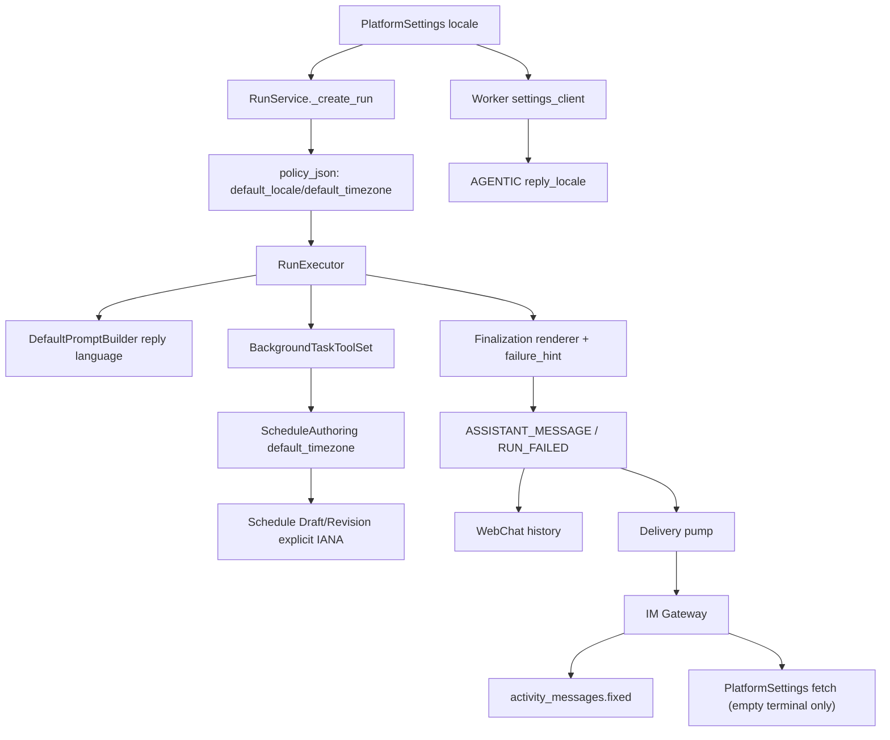

# Agent 输出语言、失败文案与平台默认时区 设计

> **文档编号**: MOD-AGENT-OUTPUT-1.0
> **文档版本**: v0.1
> **创建日期**: 2026-11-21
> **文档状态**: 设计评审中

**评审边界说明**:
- **需求基线**: PRD v0.2（`agent-output-and-platform-defaults.prd.md`）
- **设计评审**: 第 3-4 章（技术设计 + 部署）→ 通过后锁定设计基线
- **交接契约**: 2.5 验收条件；人工场景见 `agent-output-and-platform-defaults.scenarios.md`

**ID 体系**: US（来自 PRD）、FEAT（来自 PRD）、API（内部函契约）、RULE（业务/系统约束）、TC（测试建议）、RISK、NFR。

---

## 1. 文档控制

### 1.1 责任人

| 角色 | 姓名 | 职责范围 |
|------|------|---------|
| 产品经理 | | 需求定义、业务验收 |
| 开发负责人 | | 技术方案、代码实现 |
| 测试负责人 | | 测试策略、人工验收 |

### 1.2 修订历史

| 版本 | 日期 | 作者 | 变更描述 |
|------|------|------|---------|
| v0.1 | 2026-11-21 | | 初始设计：语言/失败文案/默认时区/配置与 Spec 收口 |

---

## 2. 需求分析

### 2.1 需求概述

| 项目 | 内容 |
|------|------|
| **模块名称** | Agent 输出语言、失败文案与平台默认时区 |
| **模块ID** | MOD-AGENT-OUTPUT |
| **所属系统/产品线** | Agent Runtime / Agent Worker / IM Gateway / Console 设置元数据 |
| **需求类型** | 功能优化 + Bug 修复 + 规范收口 |
| **业务背景** | 平台设置 `locale` 未完整约束 Agent 输出；失败终态把审计证据直接当用户消息；定时任务没有平台默认时区。 |
| **核心目标** | 系统设置成为 Agent 默认语言/默认时区的唯一来源；用户可见失败消息同时具备直白描述与可排查错误码。 |

### 2.2 痛点与价值

| 维度 | 内容 |
|------|------|
| **目标用户** | 租户管理员、WebChat/IM 终端用户、运维/客服 |
| **当前问题** | en-US 租户仍收到中文失败文案；`RUN_NO_PROGRESS`/`PLATFORM_AUTH_REJECTED` 直接出现在用户正文；定时任务必须显式提供时区。 |
| **业务影响** | 用户无法理解失败原因和下一步；支持成本上升；国际化体验不一致。 |
| **预期价值** | 失败自助排查路径清晰；Agent 默认语言与平台设置一致；新建定时任务少一步确认。 |

用户故事见 PRD §3.2（US-01..US-05）。

### 2.3 功能方案

#### 2.3.1 功能清单

| 功能ID | 功能名称 | 设计落点 | 优先级 | 来源 |
|--------|---------|---------|--------|------|
| FEAT-01 | Agent 默认回复语言 | §3.2/§3.4：Run 冻结 `default_locale` + 系统提示语言段 | P0 | US-01 |
| FEAT-02 | 用户语言覆盖 | §3.4：提示优先级 + 现有 memory `language` | P0 | US-02 |
| FEAT-03 | 失败消息直白描述 | §3.4：`failure_hint` + 双层收尾文本 | P0 | US-03 |
| FEAT-04 | 平台文案 locale 一致 | §3.4：收尾/IM 固定文案/Worker 投递 locale | P0 | US-01/US-03 |
| FEAT-05 | 定时任务默认时区 | §3.4：Draft 创建时读当前平台时区并显式存储 | P0 | US-04 |
| FEAT-06 | 配置与规范收口 | §3.5/§4：env 清理、设置 effect 文案、Spec Delta | P1 | US-05 |

### 2.4 范围与边界

| 类别 | 内容 |
|------|------|
| **范围（In Scope）** | Agent Core/Runtime/Worker 的提示语言、失败收尾、IM 固定文案与投递 locale、Draft 默认时区、设置页 effect 文案、相关 Spec 修订。 |
| **非范围（Out of Scope）** | Console 前端界面语言/页面时间；Console 概览统计时区；已建 Schedule 随平台时区变化自动重算（B 方案）；自动语言识别/机器翻译；新记忆子系统；模型微调。 |
| **前置假设** | `LocaleSettings` 已校验；memory `language` predicate 已存在；`remember` 需用户确认；新 Run 会把 `default_locale` 冻结进 `policy_json`；配置在服务启动时可读。 |
| **有意妥协 / 技术债** | ① 只对**新建 Draft** 应用平台默认时区；已建 Schedule 保持原值，若产品后续要求跟随，另开需求做调度器重算。② 更新 Draft 仍要求完整配置（含时区），不实现“省略即保持原值”的合并语义，避免默认值静默改写。③ 旧 `policy_json` 没有 `locale` 时不追加语言段（保持原有行为）；旧 Run 的失败文案回落 `zh-CN`，历史语言无法追溯。④ IM 入站流式 `run.failed` 仍用消息目录的 `RUN_NO_PROGRESS` 泛化文案；带平台细节的技术信息以 Runtime 终态正文为准。 |

### 2.5 验收条件

#### 2.5.1 业务规则与约束

| ID | 类型 | 描述 | 验证场景 |
|----|------|------|---------|
| RULE-01 | 业务规则 | 平台 `default_locale` 是 Agent 默认回复语言；当前消息显式要求优先，其次 memory `language` | S-01、S-02、B-02 |
| RULE-02 | 业务规则 | 用户可见失败正文不得以内部错误码/平台原文为主句；码保留在技术信息 | S-03、E-02 |
| RULE-03 | 业务规则 | 新建 Draft 未指定时区时使用当前平台 `default_timezone`，确认后显式存储 | S-04、B-01 |
| RULE-04 | 系统约束 | 显式用户时区优先；更新 Draft 必须完整配置；非法 IANA 显式失败 | S-05、B-03 |
| RULE-05 | 系统约束 | 语言/时区在 Run 或 Draft 边界读取一次；执行期不逐轮读设置 | NFR-PERF-01 |
| RULE-06 | 系统约束 | 失败文案确定性渲染，不新增模型调用；未知码仍有通用描述 + 原码 | S-03、E-02 |
| RULE-07 | 系统约束 | 平台原文/凭据不进正文；技术信息有界、脱敏 | NFR-SEC-01 |

#### 2.5.2 功能验收场景

场景唯一源：`agent-output-and-platform-defaults.scenarios.md`。

| 场景ID | 设计影响 / 备注 |
|--------|----------------|
| S-01 | en-US 平台新 Run 默认英文；提示语言段与 `policy_json` 冻结 |
| S-02 | 当前消息覆盖 + memory `language` 长期偏好 |
| S-03 | 平台鉴权失败的直白描述 + 技术信息 |
| S-04 | 新建 Draft 缺省时区使用平台默认并在卡片可见 |
| S-05 | 用户显式时区覆盖 |
| S-06 | 定时 Agentic 任务按平台默认语言回复 |
| E-01 | 设置源不可读时 Draft 创建明确失败，不落草稿 |
| E-02 | 未知工具错误码仍给通用描述并保留原码 |
| E-03 | en-US 的收尾/IM 固定文案为英文 |
| B-01 | 平台时区变更后已建 Schedule 不变、新 Draft 用新值 |
| B-02 | memory 写入禁用时仅当前消息语言覆盖生效 |
| B-03 | 显式非法 IANA 时区被字段级拒绝 |

#### 2.5.3 非功能指标

| 指标ID | 类型 | 要求 | 测量方法 |
|--------|------|------|---------|
| NFR-PERF-01 | 性能 | 新 Run / Worker AGENTIC 执行各读一次设置；仅缺省时区的 Draft 多读一次设置；无逐轮读取 | 单元/集成断言调用次数 |
| NFR-I18N-01 | 国际化 | 失败描述与固定文案 zh-CN/en-US 完整；码不翻译 | 契约测试 |
| NFR-DET-01 | 确定性 | 同一 facts 渲染同一文本 | 单元测试 |
| NFR-SEC-01 | 安全 | 不输出凭据/headers/Cookie；平台原文有界且脱敏 | 单元/契约测试 |

#### 2.5.4 验证环境假设

| 维度 | 假设 | 验证方式 / 参数 | 不满足时 |
|------|------|----------------|---------|
| 容量 | 单租户、单 Run、单 Draft；无需压测 | 真实 PG/Redis 验收栈 | 记录缺失项与 owner |
| 硬件 | 现有 dev/CI runner | `make acceptance` | 记录缺失项 |
| 依赖 | PostgreSQL、Redis、可写平台设置、可注入的 fake 平台设置客户端 | 验收环境 | 记录缺失项 |
| 测试预算 | unit + integration 为主；浏览器 E2E 按 `scenarios.md` 人工执行 | Task tests | 记录未覆盖风险 |

---

## 3. 技术设计

### 3.1 方案选型

#### 关键决策记录

| 决策点 | 选择 | 被否决项 | 理由 | 可逆性 |
|--------|------|---------|------|--------|
| 失败文案由谁生成 | Runtime 确定性渲染 + 码族映射 | 再发一次模型调用整理结论；只保留原始错误码 | 可重复、无额外模型成本；码仍需保留给支持 | 易 |
| 失败码是否展示 | 正文直白描述；末尾技术信息保留终止码/工具码/Run ID | 完全隐藏码；码混在正文 | 用户可读，同时可把码交给开发 | 易 |
| 默认语言何时读 | 每个新 Run 开始时读一次并冻结 | 每轮模型调用重读；进程启动缓存 | 避免对话中途切换；符合“每次执行读一次” | 易 |
| 默认时区何时读 | 新建 Draft 时读当前平台设置并显式存储 | 每次触发读并重算 `next_fire_at`（B 方案） | B 需要时区来源/重算/迁移，收益仅覆盖“平台搬家”罕见场景 | 中 |
| 失败码词条位置 | `packages/agent-core` 的共享 `failure_hint` | 各服务各写一份；写进 `config/api-messages.yaml` | Runtime/Worker 共用；避免污染 API 错误码的双向断言 | 易 |
| IM 固定文案 | `config/api-messages.yaml` 的 `activity_messages.fixed` + 租户 locale | 继续硬编码中文；新增 API 错误码 | 文案单一来源；不破坏错误码目录 | 易 |
| Draft 更新时区 | 仍要求完整配置 | 省略时保持原值 | 完整配置语义已在工具描述中；避免默认值静默改写 | 易 |

#### 技术栈

Python 3.12 / FastAPI / SQLAlchemy / React Console；不新增框架或依赖。

### 3.2 架构设计



#### 技术分层

- **agent-core**：共享 `failure_hint`、系统提示语言段、`AgentRunRequest.reply_locale`。
- **agent-runtime**：冻结 `policy_json.locale`、收尾 facts/renderer、Draft 默认时区、终态 payload locale。
- **agent-worker**：AGENTIC 执行开始时经 `settings_client` 读取当前 `default_locale`；后台任务投递文案复用 `failure_hint` 并按平台 locale 渲染。
- **im-gateway**：按回复 locale 渲染固定文案；**仅终态正文为空时**读取一次平台 locale 做兜底。
- **console-platform**：设置字段 `effect_key` 元数据与前端词条；不读设置做界面语言。

#### 外部依赖

无新增外部依赖；仅复用 Console 平台设置内部端点。

### 3.3 数据设计

**不新增表/列、不做数据迁移。** 变更均落在既有 JSON/契约字段：

| 载体 | 变更 | 兼容性 |
|------|------|--------|
| `policy_json.locale` | 增加 `default_locale`，保留 `default_timezone` | 旧行缺 `default_locale` → `None`：不追加语言段，失败文案回落 `zh-CN` |
| `config/api-messages.yaml` | `activity_messages.fixed` 增加 `stopped`/`broken_stream`/`task_accepted` | 新代码 + 旧配置需回退；部署顺序见 §4.2 |
| `ScheduleRevision` | 不变；仍存显式 IANA 时区 | 已建行不受影响 |

`policy_json` 目标形状：

```json
{
  "locale": {
    "default_locale": "en-US",
    "default_timezone": "Asia/Shanghai"
  }
}
```

`RUN_FAILED` 目标载荷（节选）：

```json
{
  "status": "FAILED",
  "error_code": "RUN_NO_PROGRESS",
  "final_text": "…",
  "finalization": {"schema_version": 1, "…": "…"}
}
```

### 3.4 接口设计

#### 形态 C：函数 / 库接口

| 函数/契约 | 入参 | 返回 | 错误处理 |
|-----------|------|------|---------|
| `ExecutionDefaults.locale` | 平台 `locale.default_locale` | `str \| None`（`zh-CN`/`en-US`） | schema 校验，非法值拒绝 |
| `snapshot_policy(...)` | `ExecutionDefaults` | `policy_json`，含 `locale.default_locale` | 新 Run 总是写具体值；直构缺失时写 schema 默认 |
| `execution_defaults_of(policy)` | `policy_json` | `ExecutionDefaults`，缺 locale 返回 `None` | 形状错误按现有 `_frozen_str` 逻辑回落；`None` 表示旧行 |
| `DefaultPromptBuilder.build(..., reply_locale=None)` | `instructions`、`skills`、`reply_locale` | system prompt | `reply_locale` 为空不追加语言段；未知值回落 `zh-CN` 并告警 |
| `AgenticDependencies.settings_client` | Worker 平台设置客户端 | AGENTIC 执行开始时读取 `locale.default_locale` | 不可读 → warning，`reply_locale=None`（不追加语言段，不阻断任务） |
| `AgentRunRequest.reply_locale`（Worker） | 当前平台 `default_locale` | 系统提示语言段 | 未知/不可读 → 不追加语言段 |
| `failure_hint(code, locale, tool=None)` | 工具/平台码、locale、工具名 | `FailureHint(title, next_step, known)` | 未知码返回通用描述且 `known=False`；不抛异常 |
| `render_finalization(facts, locale, run_id)` | facts、locale、Run ID | 双层文本 | 渲染失败按现有降级路径写最小文本 |
| `render_cancelled(facts, locale, run_id)` | facts、locale、Run ID | 取消文本 | 同上 |
| `ScheduleAuthoringContext.default_timezone` | 当前平台默认时区 | `compile_schedule_plan` 在 `timezone` 缺失时使用 | 非法默认值 → `INVALID_TIMEZONE` |
| `BackgroundTaskToolSet(settings_client, fallback_timezone)` | 平台设置客户端 / 回落值 | Draft 创建时解析默认时区 | 设置不可读 → `PLATFORM_SETTINGS_UNAVAILABLE` 工具错误，不落草稿 |
| `ExecutorRequest.settings_client` | Runtime 平台设置客户端 | 透传给 `BackgroundTaskToolSet` | 未注入（直构/单测）时用 `fallback_timezone`；生产已注入但读取失败 → `PLATFORM_SETTINGS_UNAVAILABLE` |
| `ActivityMessages.fixed(key)` | `stopped`/`broken_stream`/`task_accepted` | 本地化固定文案 | 缺词条回落 `en-US`，再回落 key |
| Gateway 空正文 locale | `body.tenant_id` + `settings_client.fetch_snapshot` | 仅 `terminal` 且正文为空时取 `locale.default_locale` | 读取失败 → warning + `catalog.default_locale`（不阻断投递） |

#### Draft 默认时区解析

`RunService._stream_run` 把 `self._settings_client` 放进 `ExecutorRequest`；`build_registry` 把它和本 Run 冻结的 `timezone` 一起传给 `BackgroundTaskToolSet`。仅当 `draft_schedule` / `promote_run` 的 `timezone` 缺失时才发起一次 `fetch_snapshot(tenant_id)`，用 `parse_platform_settings(...).locale.default_timezone` 作为 `ScheduleAuthoringContext.default_timezone`；Draft 仍写入解析后的具体 IANA 名。生产路径设置不可读即 `PLATFORM_SETTINGS_UNAVAILABLE`，不落草稿；`settings_client is None` 只出现在直构/单测，此时用 `fallback_timezone`（Run 冻结值）保持可测。`draft_schedule_update` 的 `timezone` 仍必填，不走此解析。

#### Draft 工具契约

- `draft_schedule`：`required = ["instruction", "payload", "recurrence"]`；`timezone` 从必填改为可选。工具描述从“Ask the user for their IANA time zone when unknown”改为“用户未指定时使用平台默认时区；仅当用户意图依赖其他时区时才追问”。
- `promote_run`：`timezone` 同样可选；缺失时用平台默认，不再回落 `UTC`。
- `draft_schedule_update`：保持 `timezone` 必填（完整配置语义），避免省略时被默认值静默改写。

#### 系统提示语言段

`DefaultPromptBuilder` 在 `instructions` 之后、技能目录之前插入：

```markdown
## Reply language
- Default: English (en-US).
- Follow an explicit language request in the current user message.
- If user memory contains a `language` preference, follow it unless the current message overrides it.
```

`zh-CN` 对应中文文案。该段是平台对语言的唯一约束；Agent instructions 不再承担默认语言。

#### 失败文案形态

正常失败（以平台鉴权为例）：

```text
执行未完成。
原因：平台登录失败，通常是凭据失效、签名不正确或账号无权限。
下一步：请联系管理员检查该平台凭据后重试。
完成情况：无法确认（没有交付物或输出契约可核对）。

技术信息（提供给开发排查）：
- 终止码：RUN_NO_PROGRESS
- 错误码：PLATFORM_AUTH_REJECTED
- 工具：execute
- Run ID：<run_id>
- 平台返回：platform_sessions: mssw=PLATFORM_AUTH_REJECTED(http=401) …（有界、脱敏）
```

预算/期限失败：

```text
执行未完成。
原因：本轮执行达到最大轮次（20/20），已停止。
下一步：拆分任务或减少排查轮次后重试。

技术信息（提供给开发排查）：
- 终止码：RUN_BUDGET_EXCEEDED
- Run ID：<run_id>
```

规则：

- 正文不再输出 `TOOL`/`CONTENT` 层、工具成功率、`证据状态` 等运维字段；这些只留在 `finalization` facts / Console 详情。
- `NO_PROGRESS` 的“原因”按 `decisive_failure.retryable` 区分“失败不可重试，已停止”与“同一失败重复达到上限，已停止”。
- 预算/期限失败若同时有业务失败证据，正文以预算/期限为主，技术信息附最近失败码/工具；不把预算误写成工具错误。
- 取消不是失败：正文说明“用户已停止、未生成最终结论”，技术信息只给 Run ID，不写错误码。
- 技术信息只保留终止码、工具码、工具名、Run ID、截断后的平台返回；不输出凭据、headers、Cookie、原始 stdout/stderr。
- `failure_hint` 按码族回退：

| 码族 | 用户可读方向 |
|------|-------------|
| `PLATFORM_AUTH_REJECTED` / `PLATFORM_SESSION_REQUIRED` / `CREDENTIAL_MISSING` / `PLATFORM_ADAPTER_NOT_FOUND` | 平台登录/凭据未配置/无权限；联系管理员检查平台配置 |
| `PLATFORM_SETTINGS_UNAVAILABLE` | 平台设置暂时不可读；稍后重试或联系管理员 |
| `PLATFORM_BUSINESS_ERROR` | 平台返回业务错误；核对业务码/参数 |
| `CONTROL_*` / `CREDENTIAL_*` | 平台控制面/凭据侧拒绝；联系管理员核对配置 |
| `MODEL_*` | 模型服务不可用/调用失败；稍后重试或联系管理员 |
| `SANDBOX_*` / `WORKSPACE_*` | 执行环境不可用/超时/超限；缩小任务或稍后重试 |
| `TOOL_*` / `SKILL_*` / `MCP_*` | 工具/技能/连接器执行失败；按技术信息修正输入 |
| `RUN_BUDGET_EXCEEDED` / `RUN_DEADLINE_EXCEEDED` | 轮次/工具/期限预算耗尽；拆分或延长 |
| `TASK_DEADLINE_EXCEEDED` / `TASK_BUDGET_EXCEEDED` / `TASK_NO_PROGRESS` | 后台任务超时/预算耗尽/失败不可继续；缩小范围或稍后重试 |
| 其他/空 | 工具/任务执行失败；把技术信息提供给管理员 |

#### IM 固定文案

`config/api-messages.yaml` 的 `activity_messages` 增加：

```yaml
activity_messages:
  fixed:
    stopped:
      zh-CN: 当前任务已停止
      en-US: This run has been stopped.
    broken_stream:
      zh-CN: 服务暂时中断，请重发消息
      en-US: The service was interrupted. Please resend your message.
    task_accepted:
      zh-CN: 任务已受理，完成后会通知你
      en-US: Task accepted. You will be notified when it finishes.
```

- `StreamRenderer` 接收 `system_text(key)`；`inbound.py` 用当前回复 locale 的 `ActivityMessages.fixed` 注入。
- `api/delivery.py` 的 `CANCELLED`/`RUN_ABANDONED` 空正文也走同一 `fixed` 目录，不再 import 硬编码常量。
- **终态正文 locale**：正常终态由 Runtime 渲染好 `final_text`（已按本 Run locale），投递契约不变；只有 `terminal` 且正文为空（旧事件/断流兜底）时，Gateway 用 `body.tenant_id` 读一次平台设置取 `locale.default_locale` 再渲染目录文案。读取失败回落 `catalog.default_locale` 并留 warning，不阻断投递。这样不新增 `DeliveryRequest` 字段，也不引入 Gateway 先发布的契约约束。

#### 后台任务投递

`agent-worker` 的 `build_delivery_message` 在 FAILED 分支用 `failure_hint(task.error_code, locale)` 生成原因，正文保留任务名与下一步，技术信息只给任务错误码；`TASK_DEADLINE_EXCEEDED` 继续用现有专用模板。文案仍由 Worker 在投递边界按 `platform.locale.default_locale` 渲染，投递契约不变。

#### 设置页 effect 文案

`platform_settings_catalog.py` 的 `_FIELD_META` 增加：

| 字段 | `effect_key` |
|------|--------------|
| `locale.default_locale` | `settings.effect.agent_reply_language` |
| `locale.default_timezone` | `settings.effect.schedule_default_timezone` |

前端只新增 `zh-CN.json`/`en-US.json` 两个词条；`SettingsFieldRow` 已有 `effectKey` 渲染，无组件改动。

### 3.5 质量实现方案

#### 性能设计

| 指标ID | 热点路径 | 实现方案 |
|--------|---------|---------|
| NFR-PERF-01 | Run 创建 / Draft 创建 | `default_locale` 随 Run 创建快照冻结一次；仅当 Draft 缺省时区时调用一次平台设置；不在每轮模型调用/工具执行中读取 |
| NFR-PERF-01 | Worker AGENTIC 执行 | 执行开始时读一次平台 locale；不逐轮读取 |
| NFR-PERF-01 | IM 空正文兜底 | 仅 `terminal` 且正文为空时读一次平台设置；正常终态零额外 I/O |
| NFR-PERF-01 | 失败收尾 | 纯函数渲染，无模型调用、无额外 I/O |

#### 可靠性设计

| 风险ID | 失效模式 | 影响 | 应对措施 | 验证场景 |
|--------|---------|------|---------|---------|
| RISK-01 | 平台设置源不可读 | 缺省时区的 Draft 无法创建 | 明确 `PLATFORM_SETTINGS_UNAVAILABLE`，不落草稿、不静默用旧值 | E-01 |
| RISK-02 | 未知错误码 | 用户只看到通用描述 | 通用描述 + 原码技术信息；记录指标/日志 | E-02 |
| RISK-03 | 旧 `policy_json` 缺 `default_locale` | 旧 Run 收尾回落中文 | 文档化兼容；新 Run 全部写入 | S-01 |
| RISK-04 | `activity_messages.fixed` 未部署 | 新网关缺文案 | 部署顺序 config → gateway；loader 回退 `en-US`/key | E-03 |
| RISK-05 | 模型不遵守语言段 | 默认语言不稳定 | 显式系统提示 + 人工验收；不依赖 prompt 生成码/技术信息 | S-01 |

#### i18n 归属

- API/入口错误文案继续只来自 `config/api-messages.yaml`（`MessageCatalog`）。
- Agent 失败收尾属于 Runtime/Agent Core 的 code-owned 模板（现有 `render.py` 的 `_REASON_LABELS`/`_SUGGESTIONS` 同口径）；`failure_hint` 放在 `packages/agent-core`，由 Runtime/Worker 共用，避免同一码族两份文案。`harness-i18n` delta 明确这一归属，不把工具/平台码塞进 API 错误码目录。

#### 安全性设计

- `failure_hint` 只返回固定文案，不拼接平台原文。
- 技术信息只放已脱敏、有界的 `evidence_preview`；沿用现有 evidence 预算与脱敏。
- `Run ID` 是允许公开的排查标识；不放凭据、Cookie、headers、请求体。
- 空正文兜底只读取已校验的 `locale.default_locale`；未知值回落目录默认，不进入 SQL/日志拼接。

#### 可观测性

| 场景 | 实现方案 |
|------|---------|
| 未知失败码 | `finalization_failure_hint_missing_total` 计数 + warning 日志（只记 code，不记正文） |
| Draft 使用平台默认时区 | info 日志（tenant/draft，不含正文）；不新增指标（正常路径） |
| 未知 locale | warning 日志并回落 `zh-CN`（不新增指标，避免无界 label） |
| 收尾渲染降级 | 沿用现有 warning/metric；新增技术信息不改变既有降级路径 |

#### 配置与规范收口

- 删除本地 `.env` 的失效 `DEFAULT_LOCALE`；`.env.example` 已无迁移键，`tests/test_configuration_convergence.py` 继续守护，不新增第二套检查。
- 设置页只加两条 `effect_key` 词条（见上），前端不新增组件/状态。
- Spec 修订按 §Spec Compliance Matrix 的 delta 执行：`harness-arch`、`harness-time`、`harness-i18n`、`harness-project-platform`、`harness-snapshot`、`harness-im`；不直接在已接受规则上改文本，走 Task 的 Spec Delta。

#### 测试建议

| 层级 | 建议测试 | 覆盖 |
|------|---------|------|
| unit | `tests/agent_core/test_failure_hints.py`（新增） | 码族、未知码、zh/en、确定性 |
| unit | `tests/agent_core/test_prompt_builder.py` / runner 测试 | 语言段、`reply_locale=None` 不追加、优先级文案 |
| unit | `tests/agent_runtime/test_finalization_render.py` | 双层文本、确定性失败标签、en-US、技术信息有界 |
| unit | `tests/agent_runtime/test_execution_defaults_settings.py` | `policy_json.locale.default_locale`、旧 policy 回落 |
| unit | `tests/agent_runtime/test_schedule_authoring_compiler.py` | 缺省时区用 default、显式覆盖、无 default 仍报错 |
| unit | `tests/agent_runtime/test_scheduled_v2_intent_tools.py` | 设置客户端取默认时区、不可读失败、更新仍必填 |
| unit | `tests/agent_runtime/test_schedule_promotion.py` | `promote_run` 缺省时区使用平台默认，不再回落 UTC |
| unit | `tests/agent_worker/test_delivery_messages.py` | 失败文案人话 + 任务码；deadline 专用模板 |
| unit | `tests/gateway/test_stream_renderer.py` | `system_text` 替换固定中文；locale 切换 |
| unit | `tests/gateway/test_delivery_locale_fallback.py`（新增） | 空正文 terminal 取平台 locale；读取失败回落目录默认 |
| unit | `tests/agent_worker/test_scheduled_v2_agentic_adapter.py` | Worker AGENTIC 读取当前 locale；设置不可读降级不阻断 |
| contract | `tests/test_error_catalog.py`、`tests/agent_worker/test_scheduled_v2_snapshot.py` | 错误码目录不受影响；快照形状无回归 |
| integration | `tests/agent_runtime/test_capacity_webchat_*` / `tests/gateway/test_capacity_webchat_gateway_sse.py` | 真实 Run 失败消息、en-US、Draft 默认时区 |
| component | `tests/frontend/test_capacity_webchat_settings_ui.py` | 设置 effect 文案渲染；无组件回归 |

---

## 4. 部署与运维

### 4.1 部署架构

无新增服务/Pod/中间件。变更随现有 Runtime/Worker/Gateway/Console 镜像发布。

### 4.2 发布与回滚

| 阶段 | 操作 | 进入条件 | 回滚 |
|------|------|---------|------|
| 1 | 更新 `config/api-messages.yaml`（`activity_messages.fixed`）与设置元数据 | 配置评审通过 | 回滚 ConfigMap |
| 2 | 滚动发布 IM Gateway/Runtime/Worker | 配置已就绪 | 镜像回滚 |
| 3 | 验证 en-US/zh-CN 语言、失败文案、Draft 默认时区 | `scenarios.md` 通过 | 同上 |

- 本设计不新增 `DeliveryRequest` 字段，不存在 `extra="forbid"` 的跨版本契约问题；服务可按任意顺序滚动。
- 新代码对旧 `policy_json`/旧投递载荷兼容；旧代码忽略 `policy_json` 新键，回滚安全。
- `activity_messages.fixed` 必须先于新 Gateway 生效；loader 对缺失键回退 `en-US`/key，避免启动失败。

### 4.3 监控告警

沿用现有指标端点；仅新增一个低基数计数器（未知失败码，见 §3.5），不新增告警规则。

### 4.4 数据迁移

无。旧 Run/Schedule 不改写、不回填；新策略只影响新 Run/新 Draft。

---

## 5. 风险与依赖

### 5.1 项目依赖

| 依赖模块/团队 | 依赖内容 | 状态 | 风险等级 |
|-------------|---------|------|---------|
| agent-core | `failure_hint`、提示语言段 | 本需求实现 | 中 |
| agent-runtime | `policy_json.locale`、收尾、Draft 默认时区 | 本需求实现 | 中 |
| agent-worker | 投递文案本地化 / AGENTIC locale | 本需求实现 | 中 |
| im-gateway | 固定文案/投递 locale | 本需求实现 | 中 |
| console-platform | 设置 `effect_key` + 前端词条 | 本需求实现 | 低 |
| memory | `language` predicate 与确认流程 | 已存在，复用 | 低 |

### 5.2 风险识别

| 风险ID | 类型 | 描述 | 概率 | 影响 | 应对措施 | 验证场景 |
|--------|------|------|------|------|---------|---------|
| RISK-01 | 体验 | 模型不严格遵守默认语言 | 中 | 中 | 显式语言段 + 人工验收；用户显式要求优先 | S-01/S-02 |
| RISK-02 | 维护 | 新工具码没有直白描述 | 中 | 低 | 码族回退 + 指标/日志；未知码仍可用 | E-02 |
| RISK-03 | 兼容 | 旧 `policy_json` 缺 locale；Worker 设置不可读 | 低 | 低 | 不追加语言段；失败文案回落中文；新 Run 全量写入；Worker 降级只留痕 | S-01 |
| RISK-04 | 部署 | 配置与新 Gateway 不同步 | 低 | 中 | 配置先行 + loader 回退 | E-03 |
| RISK-05 | 语义 | 平台时区变更后老任务不跟随 | 中 | 中 | 文档化取舍；用户可编辑/重建；另开需求做重算 | B-01 |

---

## 6. 需求追溯矩阵

| 用户故事 | 功能ID | 设计落点 | 场景ID | 测试层级 | 执行方式 | 负责 TASK |
|---------|--------|---------|--------|---------|---------|----------|
| US-01 | FEAT-01/04 | §3.3/§3.4 提示语言、locale 链 | S-01、S-06、E-03 | unit + integration | manual/auto | 待 `cf-task:plan` |
| US-02 | FEAT-02 | §3.4 语言优先级 + memory | S-02、B-02 | manual | manual | 待分配 |
| US-03 | FEAT-03 | §3.4 failure_hint/收尾 | S-03、E-02 | unit + integration | auto + manual | 待分配 |
| US-04 | FEAT-05 | §3.4 Draft 默认时区 | S-04、S-05、E-01、B-01、B-03 | unit + integration | auto + manual | 待分配 |
| US-05 | FEAT-06 | §3.5/§4 配置与 Spec | —（静态检查 + 人工核对；无独立 UI 场景） | static + manual | auto + manual | 待分配 |

---

## Spec Compliance Matrix

| Spec/Rule | 设计影响 | 设计落点 | 验收场景 | 状态/N/A 理由 |
|-----------|---------|---------|---------|--------------|
| `harness-arch` 失败跟进规则 | 改为确定性收尾；用户正文直白描述，码进技术信息 | §3.4 收尾、§3.5 | S-03、E-02 | delta |
| `harness-time#RULE-time-001` | 允许 Draft 创建时读取平台默认时区并显式存储；禁止服务器本地兜底 | §3.4 Draft | S-04、S-05、B-01、B-03 | delta |
| `harness-i18n#RULE-i18n-001` | 增加 Agent 默认语言/用户覆盖/失败码描述 | §3.2、§3.4 | S-01、S-02、E-03 | delta |
| `harness-project-platform` 平台失败回传 | 平台 detail 只进技术信息；主句用固定直白描述 | §3.4 | S-03、E-02 | delta |
| `harness-snapshot#RULE-snapshot-001` | `policy_json` 增加 `locale.default_locale`；Draft 默认时区属 authoring 输入；Worker AGENTIC 的默认回复语言是展示策略，按执行边界读取，不新增 Task 快照字段 | §3.3 | S-01、S-04 | delta |
| `harness-im` 固定文案约定 | 所有用户可见固定文案按回复 locale 取目录 | §3.4 IM | E-03 | delta |
| `harness-api` | 无公开 API/错误码/DeliveryRequest 变更；仅内部函数契约 | §3.4 | E-03 | applied |
| `harness-secret` | 技术信息不输出凭据/headers/Cookie | §3.5 | S-03、E-02 | applied |
| `harness-test` | 新增 unit/integration；浏览器 E2E 人工执行 | §3.5、scenarios | 全部 | applied |
| `harness-ui` | 设置页只加 effect 文案，无布局/组件变更 | §3.4 | S-04 | applied |

---

## 附录：术语表

| 术语 | 定义 |
|------|------|
| Draft | 定时任务创建前的待确认配置 |
| 技术信息 | 用户可见失败消息末尾的错误码、工具名、Run ID 等可复制排查信息 |
| failure_hint | 按错误码族返回直白描述与下一步的共享纯函数 |
| policy_json | Run 创建时冻结的执行期策略快照 |

---

*文档结束*
