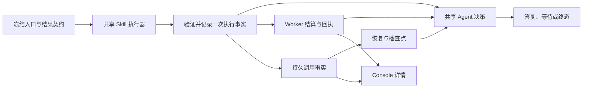

# Skill 执行结果与对话收尾后端设计

## 1. 文档控制

2026-11-24，设计 v0.2，待复核。本次补齐自建 Skill 三件套适配。需求以已确认的 [PRD](./skill-results-conversation-finalization.prd.md) 为准。实现基线为 `origin/main@1cb8ce31`。人工场景统一见 [验收场景](./skill-results-conversation-finalization.scenarios.md)。

## 2. 需求与验收

| 需求 | 设计交付 | 场景 |
| --- | --- | --- |
| US-01 / FEAT-01 | 真正执行审查，验证报告、记录退出码，允许修订与重审。自建 Skill 三件套使用同一结果契约 | S-01、E-01、B-02、B-06 |
| US-02 / FEAT-02 | 失败作为工具事实交给正常 Agent 决策 | S-04、E-02 |
| US-03 / FEAT-03、FEAT-04 | 准确报告空结果，按需暂停等待，受阻时保留正文和会话 | S-02、S-03、E-02、B-03 |
| US-04 / FEAT-05 | 实时、后台和恢复复用同一分类，详情按已存事实展示 | S-05、B-04 |
| US-02、04 / FEAT-06 | 执行权、权限、限额、安全重试与有界停止仍生效 | E-03、B-01、B-02、B-03、B-05 |

验证环境使用独立测试租户、真实构建、浏览器、Runtime、Worker、Console、PostgreSQL 与 Redis。S-01 使用真实审查器和可修复草稿，测模型实际选择的行为。S-02、S-03 使用可控测试客户数据和按契约运行的查询 Skill。负向场景使用专用 Skill、受控操作与无真实业务副作用的测试服务。故障注入和沙箱压力仅在隔离环境执行。人工验收与自动化结果分别记录。

## 3. 技术设计

### 3.1 统一结果的所有者

`packages/contracts` 定义跨服务字段和版本。共享 Skill 执行器在沙箱返回后、注册产物及生成 Worker 结果前验证一次执行结果。Runtime 与 Worker 使用同一结构，Agent Core 消费结构化结果并决定流程，恢复读取已提交事实，Console 从同一事实投影。全链路沿用调用标识及执行身份关联数据。

### 3.2 结果契约与分类

在 SKILL.md frontmatter 增加可选的 `result_contract: {version: 1, profile: ...}`。复用包解析、导入校验和已核对的 artifact checksum。导入拒绝未知版本、未知 profile、额外键及缺少确定默认入口的声明。Runtime 与 Worker 按冻结 artifact、默认入口和契约身份解析。辅助脚本、草稿 Shell、workspace Shell 保持自身执行语义。仅未声明契约的 Skill 沿用其现有默认退出分类。已声明契约的默认入口统一经过验证。

v1 使用平台维护的命名验证器。配置仅选择 profile。允许的退出码、结果形状、安全限制及可产生的业务结论均由该 profile 决定。内置审查 profile 的非零完成权限由受信发布的审查 artifact 与入口绑定，导入包的名字或自声明字段无法获得该权限。查询 profile 接受按照协议返回的只读业务结果，声明不会授予权限、自动重试或投递资格。

| Profile | 进程及结果 | 执行判定 | 业务结论 |
| --- | --- | --- | --- |
| `skill-review` | 正常 exit 0，完整一致的 JSON 报告且 error 数为零 | COMPLETED | REVIEW_PASSED |
| `skill-review` | 正常 exit 1，完整一致的 JSON 报告且 error 数大于零 | COMPLETED | REVIEW_FINDINGS |
| `customer-devices` | 正常 exit 0，完成客户选择和设备查询，确认设备数为零 | COMPLETED | NO_DEVICES |
| `customer-devices` | 正常 exit 0，查询确认存在多个可选客户，尚未做客户设备查询 | COMPLETED | NEEDS_INPUT |
| `customer-devices` | 正常 exit 0，返回已校验的设备结果 | COMPLETED | SUCCEEDED |
| 两种 profile | 报告缺失、截断、结构或来源不符，进程异常退出 | FAILED | 无已确认的业务结论 |
| 所有入口 | 宿主确认取消、超时、失去执行权、权限拒绝、出站拦截或预算耗尽 | 按原始事实分类 | 仅附带可验证的部分成果 |

业务结论与进程状态分别记录。执行字段为 `execution_status`，运行成功为 `COMPLETED`，其他值对齐宿主失败、停止、拒绝或未确认事实。业务字段沿用 `business_status` 并增加上表的新值，同步拓宽持久化字段长度以容纳枚举。原始 `exit_code` 为整数或空，空表示未取得，受信终止原因另存。进程启动失败、崩溃和结果协议违规按工具故障记录。既有已确认的业务执行错误可以继续记录原有失败层。现有 transport status 仍表达工具调用协议状态，失败判断不再依赖某一字段组合或错误正文。

- **审查入口。** 模型通过现有 `execute(target="skill", skill_key="self-skill-review", argv=[...])` 调用。托管调用使用工作区相对目标 `--target skill-drafts/<key>`，宿主按当前租户、用户和 Agent 解析草稿，注入已固定的沙箱内目标路径，并统一使用 `--format json`。拒绝绝对路径、跨草稿路径、路径逃逸及冲突的报告格式或文件输出参数。同步和受信后台调用统一读取结构化 stdout。独立 CLI 保留 `--target` 的本地路径、Markdown、JSON、`--output` 及原退出码。调用者无需先用 workspace 取绝对路径。
- **报告验证。** 受信宿主将受授权的草稿目标解析为当前调用的固定只读视图，记录租户、owner、草稿身份、源 revision 及同一视图的内容指纹。优先复用草稿 revision 和沙箱只读挂载。现有路径需要形成一致快照时，宿主在现有草稿互斥/校验边界取得快照，并使用同一快照内容计算指纹与执行，源变化时显式拒绝。仅读取已选定草稿或本次调用已授权的目标。拒绝 symlink 逃逸和可写路径替换。验证 stdout 完整、单个严格 JSON 对象、`target` 与沙箱执行目标一致、指纹匹配、计数与 findings 严重级别一致、相对文件路径和行号有效。输出完整性、正常退出、契约匹配同时成立才确认审查完成。仅报告可读且安全地保留时发布报告引用，优先复用现有结果外置与授权下载。
- **后台目标物化。** 交互审查仍使用当前同步绑定。后台验收经受信 Worker 提交入口为同一审查 artifact 建任务，并绑定只读目标的租户、owner、版本、摘要及授权引用。Worker 通过既有工作区或授权产物读取入口物化并校验该版本，再由宿主注入沙箱内目标参数。主机绝对路径和来自模型的任意路径不跨进程传递。若没有可用的固定视图或读取授权，拒绝本次审查。同步路径与后台路径复用同一个验证器。
- **业务结果验证。** 查询 profile 使用严格的带判别字段的 JSON，验证零设备、设备条目或候选客户的形状和互斥条件。候选客户以已有授权查询结果为来源，以不泄露其他租户数据的显示名称和不透明标识传递。续接时重新核对当前访问权限和选中项。引入隔离测试 Skill 实际产出这两种结果，具体业务 Skill 可在其真实输出满足契约时接入。
- **产物与控制信号。** 宿主停止事实优先于脚本内容。协议失败可保留已验证的普通部分产物，但标明不完整，报告中的数据字段不能触发 Worker fan-out、wait 或投递。平台窗口限流仍走宿主已确认的专用分支。报告验证在压缩、截断展示和外置前完成。外置失败遵循原整轮降级策略，报告正文仍可在预算内从已保留的内联事实提供。

#### 自建 Skill 三件套适配

| Skill | 现状 | 本次适配 |
| --- | --- | --- |
| `self-skill-review` | 可执行包。独立 CLI 已能生成 JSON，平台示例仍使用 workspace 绝对路径与默认 Markdown | 在 `SKILL.md` 声明审查结果契约并更新平台调用示例。宿主返回结构化执行状态、业务结论、报告引用及受信的草稿身份/版本/指纹。保留审查规则与 CLI 退出语义。优先复用现有 JSON，报告完整性不足时仅调整必要的生成或校验逻辑 |
| `self-skill-creator` | 指令包。要求有 findings 时先修再审，但依赖旧调用示例，交付示例固定写“通过” | 按已验证的业务结论分支。存在 findings 时按草稿 revision 写入修订并对新版本重审，仍有问题或执行失败时说明已完成范围和下一步。只有该版本结果已验证且通过，才使用通过文案。草稿测试继续走 `execute(target="draft")`，上传由用户明确发起 |
| `self-skill-upload` | 指令包。提交前审查，版本冲突处理表只提示取新 revision 后重试 | 根据同一结构化结果确认审查确已完成，报告与要提交的 draft_id 和 revision 一致。findings 沿用现有风险说明与用户确认，平台结构校验继续独立执行。审查执行失败或证据缺失时停在提交前。revision 冲突后取得新版本，重新做两项校验，按结果重新确认必要的风险，再按既有次数边界提交。实际提交仍使用 `expected_revision` 及已有 CAS，审批状态为 PENDING |

只有可执行审查包声明 `result_contract`。Creator 与 Upload 继续消费 `execute` 和 `skill_draft`，适配落在指令、示例及相关参考文档。Creator 的脚本指南和共用业务模板应说明，已确认空结果或需要输入属于结构化业务输出，真实执行异常继续按现有 stderr 与非零退出规则报告。普通作者只能选其入口实际实现并获准使用的 profile。审查规则参考同步更新术语与示例，`SS-R009` 的真实异常检查继续生效。其余样例和现有 Skill 维持当前调用契约，业务 profile 按 §3.2 单独接入。

受信审查声明的校验以发布构建提供的 artifact checksum 与默认入口对应关系为准。当前仓库用打包和 Console 导入分发，发布材料须从确定性构建产物生成对应校验值，随服务端发布配置交付。普通导入和草稿提交不能通过包名、版本或 `author` 获取非零完成资格。三件套各自递增包版本，经打包和导入测试，以一组版本在测试租户绑定。新 Run 才解析新版本，旧 Run 按冻结内容读取。

### 3.3 Agent 继续、等待与安全停止

每个完成的工具事实向模型提供有界脱敏的原因、证据引用、执行/业务判定和已明确禁止的重试动作。流式与恢复时保持完整的 assistant 声明及其 tool 应答回合。共享 Runner 按以下顺序裁决。

| 条件 | 处理 |
| --- | --- |
| 取消、期限、预算、执行权失效 | 停止模型和新工具派发，保留已提交部分，按现有状态收口 |
| 已确认的窗口限流 | 停止工具派发，保留已有正文并追加限流说明，另有独立故障时按真实原因收尾 |
| 普通失败或权限拒绝 | 记录原因和重试限制并交给正常模型回合。独立且仍获授权的步骤可以继续 |
| 缺少业务信息 | 使用有界的 `ask_user` 提问，取得真实输入后由当前执行继续 |
| 发生可验进展 | 允许在冻结预算内继续，保持已有产物和审计记录 |
| 达到同类失败或无改善阈值 | 关闭本轮工具派发，按持久事实确定性收尾 |
| Agent 正常结束回答 | Run 表示本轮回复已交付。正文列明业务未完成范围，审计单独保留失败与业务结果 |

**执行前重试门禁。** 将失败是否建议更正/重试与 `ToolRetrySafety` 分开，联同受信执行阶段、幂等键、依赖与此前已持久化意图，在 preflight 判断。未进入 handler 的参数错误可更正，仍须通过权限、schema 和预算。已开始的只读调用仅在错误允许且预算内重试。幂等重试只通过能复用原 operation/business key 的宿主路径，其输入语义必须一致。其他已启动且结果失败、未知或可能产生副作用的调用冻结原操作，并阻止同一能力范围的后续外部调用，直到获得可信 reconciliation。能力以规范工具身份、Skill artifact 的逻辑身份、别名和受信外部资源范围关联，排除模型参数及脚本文本提供的自我声明。遇到无法证明独立的外部能力，按可能重叠处理。模型换参数、改 call ID、改用 workspace、恢复或迟到消息均不能解除该门禁。已确定相互独立且授权的步骤可继续。可疑操作跨恢复需保留门禁事实。新聊天提交不自动创建旧操作，无可信确认时，对从上轮延续的同一外部操作仍执行安全门禁。

**循环与进展。** 失败按规范能力、错误族和失败层计数，已执行失败和被重试门禁连续拦下的同类企图都计入。忽略未派发占位和重复回放，不因无关查找或诊断成功而清零。审查按草稿稳定身份累计未改善次数，只有在同一草稿上验证到新的 revision 且 error 数下降，或经验证达到通过，才重置审查无进展计数。换参数、换调用别名、换行号、重跑同一报告均不算进展。首次 findings 正常交给 Agent，只读审查按该受信能力处理。计数使用冻结的同类失败上限以及现有绝对模型/工具预算，有意义的失败恢复可消除相应依赖阻塞，不重置无关计数。

**提问与续接。** Worker Agentic 已有 `ask_user`，沿用其是否有可回复 surface 的判断。Runtime 复用中立挂起端口和现有 WAITING_INPUT、interrupt 及 resume 写入链路，增加面向普通问答的 interrupt 类型和处理分支，沿用真实用户消息作为输入。问题和完整回合检查点一起提交，回包按 conversation、owner、interrupt、deadline、有效执行权和一次性消费校验。客户选择的候选与受信工具结果关联，用户回答不能扩大范围。该问题只收集业务信息，已有确认和写入授权流程继续使用各自入口。无答复入口时，给出任务结果或受阻解释，由对应可读 surface 展示。直接 Skill Task 的 `NEEDS_INPUT` 保留为已完成的业务结果，有可交互父执行时由父 Agent 提问，不创建第二处等待。

### 3.4 持久化、恢复与接口

- **落库。** 复用调用完成事件、`runtime.tool_call_audit`、Worker 任务交付结果和操作回执。调用审计增加可空执行判定字段，复用已存在的原始退出码、业务状态、失败层、错误码及证据列。报告复用产物及引用。Worker 完成结算与业务结果以有界结构写入已有 Task 完成事实及终态事件，失败仍用已有故障字段。已验证审查报告允许注册产物，默认只读结果禁止变作 fan-out 计划。无新表。
- **检查点。** 调用结果持久化记录 execution/business、原始退出、契约标识、受信副作用阶段、关联/幂等身份、报告和脱敏错误。以调用事实序列、水位及同一共享 reducer 更新下一步、操作门禁和进展。恢复只消费水位之后的事实且顺序稳定。已完成即直接投递已有事实。仅有 prepared 而无完成回执时按 `OUTCOME_UNKNOWN` 处理并保留门禁。只有可信事实证明未派发，才可以按从未执行处理。未就绪异步操作继续等待原 operation。结算遵守原 CAS 和 lease。恢复、后台迟到与重复交付都不得额外派发。
- **对话输出。** 模型在正常预算内得到工具结果并生成上下文回复。硬停止仍由 Runtime/Worker 用其本次请求对应的冻结语言、已提交正文、已交付产物、失败原因和可行下一步确定性渲染。缺乏事实时说明未知范围。保留已提交内容，追加脱敏说明。未提交的推理、中断输出和草稿不可宣称为完成结果。真实失败终态保留 `FAILED` 及原因。终态消息、状态和通知同事务持久化，历史与 SSE 以现有消息身份合并。技术结构经白名单从本轮决策及终态事实投影给现有历史/流入口。正常交付的受阻回复也可携带已确认的失败详情。诊断信息独立于正文储存和展示。仅支持纯文本的渠道将安全可分享的诊断收在独立末段。
- **接口。** 复用 Run 事件详情 `GET /api/v1/runs/{run_id}/events/{seq}`、`/api/v1/tasks` 的既有 Task 详情、WebChat 任务中心和对话历史/SSE。优先在各接口既有详情/结果对象内增加 `execution_status`、`business_status`、`exit_code`、`report_ref` 及安全诊断投影。现有状态、transport、消息身份和 HTTP 封套保持原语义。诊断、导出、Run/Task 详情同时消费这些字段。历史缺失字段按未记录表示，旧业务状态只展示原始已存事实，恢复依据固定旧事实而非当前定义。
- **冻结与版本。** Skill artifact 版本及冻结快照保存入口、checksum、profile 和契约版本。事件 schema 按同一共享模型发布，只有已有历史读路径接受缺失的新字段。旧在途执行于版本切换前按现有策略排空，避免混版本误判。迁移先扩容审计列与新增可空字段，终态历史不做推导式回填。回滚评审需验证新终态仍可查，且回滚前排空开始使用新契约的运行。

### 3.5 质量实现

| 层级 | 计划验证 | 候选命令或入口 |
| --- | --- | --- |
| 单元/契约 | 真实 CLI 退出码及 JSON，严格报告验证、失败归类和循环状态机，权限/限额优先级及不可安全重试 | `uv run pytest -q tests/skills/self_skill_review/test_check.py tests/agent_core/test_outcome_parser.py tests/agent_core/test_failure_state.py tests/agent_core/test_recovery_states.py` |
| 内置 Skill | 三个包真实打包及导入，默认入口与契约可解析。同名或自声明包不能获得非零完成权限。两个指令包通过实际结果引导修订或提交，并验证平台拒绝过期 revision | 复用现有 `skills/package.sh` 打包与包校验，受控环境验证 S-01、B-06；状态和版本边界由定向契约/集成测试覆盖 |
| Runtime | 模型得到失败及结果。等待、持久化及收尾。原权限、deadline 和窗口限流回归 | `uv run pytest -q tests/agent_runtime/test_skill_tools.py tests/agent_runtime/test_interrupt_checkpoint.py tests/agent_runtime/test_resume_transactions.py tests/agent_runtime/test_finalization_funnel.py` |
| Worker | 结算、真实出口失败、重试安全和后台回执。重启后同结果且无重复消费 | `uv run pytest -q tests/agent_worker/test_execution_outcomes.py tests/agent_worker/test_worker_outcomes.py tests/agent_worker/test_scheduled_v2_async_resume.py tests/agent_worker/test_runtime_operation_races.py` |
| 集成 | 独立 PG、Redis、真实 HTTP 的上线前回归。恢复水位、重复 receipt、并发续接、权限及 canary 脱敏。最少一组真实沙箱执行器的报告验证 | 将定向用例接入 `tests/acceptance/runtime` 与 `tests/acceptance/task_schedule` 后经隔离验收入口执行 |
| 联合 | API 历史、SSE 和详情一致。可见诊断与敏感字段隔离 | `uv run pytest -q tests/console_platform/test_run_event_details.py`，结合前端设计与人工场景 |

## 4. 部署与运维

沿用现有 Runtime、Worker、Console 和 Gateway。按既有链路发版时一起更新共享 contracts 与各宿主，先迁移再启用新 Skill artifact。本阶段仅给出发布依赖。执行指标以有界分类记录工具失败、有效业务结论、重试被拦截及无进展。日志使用调用标识与结构化码，禁止打印报告或原始 stdout/stderr。压缩及外置降级沿用既有 warning 与指标。

## 5. 风险与依赖

| 风险 | 处置 | 场景 |
| --- | --- | --- |
| 旧报告、伪造报告或执行控制事件被当成正常业务结果 | 固定审查目标，严格校验、宿主终止优先、排除结果中的控制字段 | E-01、B-05 |
| 审查完成后修改草稿，上传仍沿用旧结论 | 报告绑定被审版本。上传按目标版本重新审查并使用提交流程现有 CAS | B-06 |
| 非幂等效果因重试或换入口被执行两次 | 规范能力范围门禁、持久化准备/完成事实，未知状态使用原操作核实 | B-01、B-04 |
| 正常问答与待确认操作混用 | 按 interrupt 类型路由，回答绑定原问题。写权限仍由现有授权决定 | S-03、B-03 |
| 多个执行面结果含义漂移 | 单分类器和共享结果字段。事件、恢复、Worker 与 Console 交叉验证 | S-05、B-04 |

## 6. Spec Compliance Matrix

| Spec/Rule | 设计落点 | 场景 |
| --- | --- | --- |
| `arch/harness-arch#RULE-arch-001`、`arch/harness-arch#RULE-001` | §3.1 的共享契约和依赖方向 | S-05 |
| `arch/harness-arch#RULE-003`、`arch/harness-arch#RULE-004` | §3.3–3.4 正常模型回合与确定性终态，窗口限流保留部分结果 | E-02、E-03、B-05 |
| `snapshot/harness-snapshot#RULE-snapshot-001`、`snapshot/harness-snapshot#RULE-001`、`snapshot/harness-snapshot#RULE-002` | §3.2–3.4 的冻结、检查点、语言与降级 | S-01、B-04 |
| `artifact/harness-skill#RULE-004`、`artifact/harness-skill#RULE-005` | §3.2 的入口、调用参数校验与 artifact 冻结 | S-01、E-01、B-06 |
| `worker/harness-worker#RULE-worker-001`、`worker/harness-worker#RULE-001`、`worker/harness-worker#RULE-002`、`worker/harness-worker#RULE-003` | §3.3–3.4 的等待、执行权、回执与投递 | S-03、S-05、B-03、B-04 |
| `worker/harness-worker#RULE-004`、`worker/harness-worker#RULE-005`、`worker/harness-worker#RULE-006` | §3.2–3.4 的已授权执行、结果与 fan-out 分离、原调度预检 | S-05、E-01、B-03 |
| `secret/harness-secret#RULE-secret-001`、`secret/harness-secret#RULE-001`、`secret/harness-secret#RULE-002`、`secret/harness-secret#RULE-003` | §3.2–3.5 的作用域、产物授权和安全投影 | E-02、B-04 |
| `api/harness-api#RULE-api-001`、`api/harness-api#RULE-api-002` | §3.3–3.4 原 API 封套及请求幂等 | S-03、B-04 |
| `test/harness-test#RULE-test-001` | §3.5 独立验证层级 | S-01、B-04 |

实现后提议通过 Spec Delta 更新 arch 的失败跟进 Conventions，补充 artifact 结果验证、snapshot 恢复语义、Worker 映射及共享重试门禁规则。后续任务拆解再落实相关行和测试。
