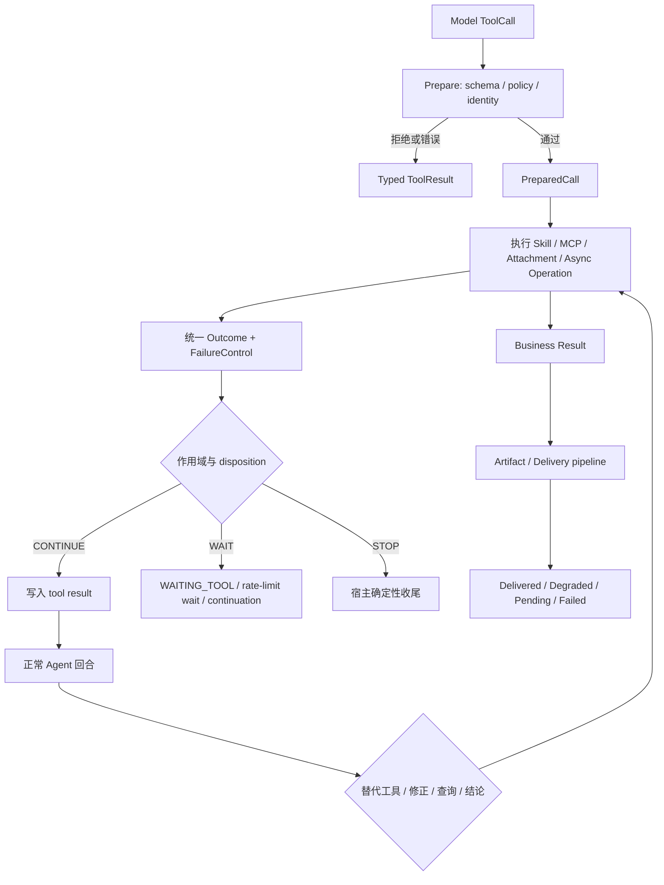
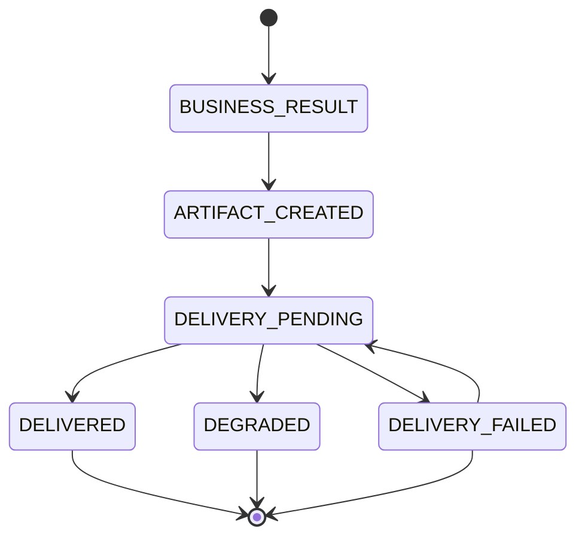

# 工具失败后的 Agent 恢复回合模块需求与设计

> **文档编号**: MOD-AGENT-FAILURE-RECOVERY-001
> **文档版本**: v0.1
> **创建日期**: 2026-11-26
> **文档状态**: 设计评审中

**评审边界说明**:

- 需求基线见 `agent-tool-failure-recovery.prd.md`。
- 本文只定义 Runtime/Worker/Agent Core 的失败控制、恢复回合、异步操作和交付边界；不拆 TASK、不实现代码。
- 人工验收场景唯一源见 `agent-tool-failure-recovery.scenarios.md`。

**ID 体系**: US、FEAT、RULE、NFR、RISK、TC；场景编号：S-/E-/B-

## 1. 文档控制

### 1.1 责任人

| 角色 | 姓名 | 职责范围 |
|------|------|---------|
| 产品负责人 | | 用户体验与业务验收 |
| 开发负责人 | | Agent Core、Runtime、Worker 接线 |
| 测试负责人 | | 契约、集成和人工场景验证 |

### 1.2 修订历史

| 版本 | 日期 | 作者 | 变更描述 |
|------|------|------|---------|
| v0.1 | 2026-11-26 | code-flow | 初始设计：统一工具失败后的恢复、等待、停止与交付语义 |

## 2. 需求分析

### 2.1 需求概述

| 项目 | 内容 |
|------|------|
| **模块名称** | 工具失败后的 Agent 恢复回合 |
| **模块ID** | MOD-AGENT-FAILURE-RECOVERY |
| **所属系统/产品线** | Agent Core / Agent Runtime / Agent Worker / IM Delivery |
| **需求类型** | 执行链路可靠性优化与缺陷修复 |
| **业务背景** | 当前工具错误已部分结构化，但失败状态、不可重试、频率限流、异步等待和宿主硬故障仍可能汇聚到同一条终止路径，导致会话过早结束。 |
| **核心目标** | 让可处理的工具失败进入正常 Agent 回合；让频率限流进入有界等待/重试；让异步操作按现有生命周期续接；只有安全、事实或执行权不可保证时才硬停止。 |

### 2.2 痛点与价值

| 维度 | 内容 |
|------|------|
| **目标用户** | WebChat、IM、定时 Task 用户，以及 Skill 作者和运行维护人员。 |
| **当前问题** | `ToolResult`、`retryable`、`no_progress`、`window_limited` 和 Run 终态之间存在语义重叠；失败后可能直接进入 `run.failed`，而不是让 Agent 读取失败事实。 |
| **业务影响** | 用户看到内部错误而不是可执行的替代方案；频率限流被误当作终止；异步操作可能被重复提交；产物已生成但未交付时可能产生伪成功。 |
| **预期价值** | 减少无必要的会话失败，保持外部副作用安全，统一 Runtime/Worker 的失败表现，并让业务完成、事实持久化和消息交付可分别核对。 |

### 2.3 功能方案

#### 2.3.1 功能清单

| 功能ID | 功能名称 | 功能描述 | 优先级 | 来源 |
|--------|---------|---------|--------|------|
| FEAT-01 | 失败控制四元组 | 将 Agent 是否继续、原调用是否重试、外部结果是否未知、停止作用域拆开表达。 | P0 | US-01, US-02, US-04 |
| FEAT-02 | 恢复回合 | 工具业务失败、参数失败、资源失败和平台失败回到正常 Agent 回合。 | P0 | US-01, US-05 |
| FEAT-03 | 限流等待重试 | 普通频率限流在剩余 Run 预算内按 `Retry-After`/退避等待，不直接结束 Run。 | P0 | US-01, US-04 |
| FEAT-04 | 异步 Operation 生命周期 | 使用 `ToolOperation`、`RunContinuation`、`WAITING_TOOL` 和 Task 等已有事实续接异步操作，不引入旧 MSSClaw 长任务会话。 | P0 | US-01, US-02 |
| FEAT-05 | 副作用和未知结果门禁 | 已发送且结果未知的原操作不能重复；恢复回合只能查询、确认或走安全替代路径。 | P0 | US-02, US-04 |
| FEAT-06 | 业务完成与交付分离 | Artifact 生成、交付接受、降级交付和最终送达独立表达，交付失败不能触发业务重跑。 | P0 | US-03, US-04 |
| FEAT-07 | 宿主硬停止 | 身份、租约、关键事实持久化、模型、deadline、总预算和停止确认失败由宿主收尾。 | P0 | US-03, US-04 |

#### 2.3.2 失败控制字段约束

设计采用一个共享的失败控制投影，字段名可在实现阶段按现有 contracts 命名调整，但语义不得合并：

| 字段 | 值域 | 说明 |
|------|------|------|
| `agent_disposition` | `CONTINUE` / `WAIT` / `STOP` | 是否允许 Agent 继续决策、等待事实，或停止当前 Run。 |
| `retry_disposition` | `ALLOW` / `WAIT_THEN_RETRY` / `BLOCK` | 原调用是否可重新执行；不代表 Run 是否结束。 |
| `scope` | `CALL` / `OPERATION` / `RUN` / `DELIVERY` | 失败影响范围。 |
| `sent` | boolean | 外部请求是否已经发送。 |
| `outcome_known` | boolean | 外部业务结果是否已确认。 |
| `evidence_status` | `NONE` / `PARTIAL` / `CONFIRMED` / `UNKNOWN` | 结果证据完整性。 |
| `retry_after` | 可选时间/时长 | 频率限流或平台返回的下次尝试提示。 |
| `security_disposition` | `NORMAL` / `DENIED` / `VIOLATION` | 普通拒绝与身份/租户/能力完整性破坏分开。 |

约束：

- `retry_disposition=BLOCK` 不得单独推出 `agent_disposition=STOP`。
- `sent=true && outcome_known=false` 时，原调用默认 `BLOCK`，但 Agent 可继续查询状态或走替代路径。
- `scope=DELIVERY` 不得触发原业务操作重跑。
- `security_disposition=VIOLATION`、关键事实丢失或执行权丢失时，升级为 `scope=RUN` 的 `STOP`。

### 2.4 范围与边界

| 类别 | 内容 |
|------|------|
| **范围（In Scope）** | Agent Core 失败状态机与 Runner 路由、ToolResult/ToolEvent/Checkpoint 事实、Runtime/Worker 接线、MCP/Skill/附件等工具失败归一化、频率限流等待、异步 Operation 续接、Artifact/Delivery 分离、审计和指标。 |
| **非范围（Out of Scope）** | 不复用 MSSClaw `longtask:<id>` 会话模型；不新增独立调度服务；不修改具体 Skill 业务规则；不绕过授权、取消、deadline、租约或总预算；不自动补偿未知的外部副作用。 |
| **前置假设** | 现有 `ToolResult`、prepared fact、v2 tool event、`ToolOperation`、`RunContinuation`、`WAITING_TOOL`、结果 Outbox 和 Delivery Audit 可作为事实载体。 |
| **有意妥协 / 技术债** | 第一阶段不引入独立的通用 Saga 引擎；部分成功/补偿未完成通过结构化 outcome 和人工介入状态表达。 |

### 2.5 验收条件

#### 2.5.1 业务规则与约束

| ID | 类型 | 描述 | 验证场景 |
|----|------|------|---------|
| RULE-01 | 业务规则 | 工具业务失败首先作为结构化工具结果交给正常 Agent 回合，不直接生成 `run.failed`。 | S-01, S-02, E-01 |
| RULE-02 | 系统约束 | `retryable` 只控制原操作重试，不控制整个 Run 是否继续。 | E-03, E-04 |
| RULE-03 | 系统约束 | 频率限流在剩余 Run 预算内等待/退避；总预算耗尽、deadline 到期或停止确认失败才硬停止。 | S-03, B-02 |
| RULE-04 | 系统约束 | 异步操作按 operation 生命周期续接；取消 operation 后不再提交该 operation 的新调用，迟到结果不得改写终态。 | S-04, E-05, B-03 |
| RULE-05 | 安全约束 | 身份、租户、Agent、Snapshot 或能力完整性不一致不得交给模型绕过，必须阻止并审计。 | E-01 |
| RULE-06 | 结果规则 | `PARTIAL`/`UNKNOWN` 证据不得被渲染为确定成功或零结果。 | E-06, B-01 |
| RULE-07 | 交付规则 | 业务完成、产物生成和渠道送达分离；交付失败只重试交付，不重跑业务操作。 | S-05, E-07 |
| RULE-08 | 宿主规则 | Prepared/Checkpoint/Event 关键事实、模型执行权或租约不可确认时，宿主确定性收尾。 | E-02, E-08 |

#### 2.5.1.1 执行边界异常的统一归类

沙箱超时、输出/资源上限、子进程终止、网络客户端超时、响应被截断、执行上下文丢失和观测记录缺失，都是同一类**执行边界异常**的不同来源。本需求不为每个底层错误码设计独立的会话流程，而是先归一化以下事实：

| 事实 | 影响 |
|------|------|
| 执行是否已经停止且停止可确认 | 不可确认时不能继续派发可能产生副作用的新调用。 |
| 外部请求是否已发送、结果是否已确认 | 决定原调用能否重试，未知结果默认禁止原操作重做。 |
| 返回内容/证据是否完整 | `PARTIAL`/`UNKNOWN` 只能支持补查、替代或诚实说明，不能推出成功或零结果。 |
| 是否只是当前工具边界受限 | 若 Run 仍安全可运行，Agent 可以继续；若执行权、隔离或事实完整性不可保证，升级为 Run 硬停止。 |

执行边界异常的具体来源由工具适配器保留在 `error_code`/诊断中；共享控制只依赖上述事实和 `FailureControl`，不依赖某个 Skill、沙箱或平台的专有名称。

#### 2.5.2 功能验收场景

| 场景ID | 设计影响 / 备注 |
|--------|----------------|
| S-01 | 普通工具失败进入恢复回合并由 Agent 改用替代路径。 |
| S-02 | 参数/资源失败后 Agent 修正调用或给出诚实结论。 |
| S-03 | 频率限流等待后重试，不提前产生失败终态。 |
| S-04 | 异步 Operation 进入等待并在结果到达后续接，不重复提交。 |
| S-05 | Artifact 已生成但消息交付失败，只重试交付。 |
| E-01 | 身份/租户/能力完整性破坏，Run 硬停止且无绕过调用。 |
| E-02 | 关键事实持久化失败，Run 硬停止并保留可诊断信息。 |
| E-03 | 已发送且结果未知，原操作被阻止，Agent 只能查询或替代。 |
| E-04 | 相同失败持续重复，恢复预算耗尽后确定性收尾。 |
| E-05 | Operation 取消后拒绝新调用，迟到结果不改写终态。 |
| E-06 | 部分/未知证据不被写成零结果或成功。 |
| E-07 | 交付失败不触发业务重跑，Outbox 使用同一交付身份重试。 |
| E-08 | 模型、deadline、租约或总预算硬停止。 |
| B-01 | 多工具批次部分成功、部分失败，成功事实保留，失败逐 call 返回。 |
| B-02 | 限流等待接近 Run deadline 时不继续等待，转为 deadline 收尾。 |
| B-03 | `JOIN` 与 `DETACH` 的异步操作分别表现为等待续接和父 Run 独立完成。 |

#### 2.5.3 非功能指标

| 指标ID | 指标名称 | 目标值 | 测量方法 |
|--------|---------|-------|---------|
| NFR-REL-01 | 副作用安全 | 不重复执行已发送且结果未知的非安全原操作 | Agent Core/Runtime/Worker 集成测试与审计记录 |
| NFR-REL-02 | 事实完整性 | 恢复、等待、硬停止和交付状态可从持久事件重建 | Checkpoint/Event 恢复测试 |
| NFR-OBS-01 | 可观测性 | 限流等待、恢复完成、降级完成、硬停止和交付失败均有结构化 outcome | 指标、审计和事件契约测试 |
| NFR-COMPAT-01 | 宿主一致性 | Runtime 与 Worker 使用同一失败控制语义 | 共享契约测试和跨宿主集成测试 |

#### 2.5.4 验证环境假设

| 维度 | 假设 | 验证方式 / 参数 | 不满足时 |
|------|------|----------------|---------|
| 依赖 | 测试可控制工具失败、平台 429、Retry-After、异步结果、交付失败和租约变化 | 共享 Tool/Runtime/Worker 测试夹具 | 记录缺失的故障注入能力与 owner |
| 存储 | 测试使用独占 PostgreSQL/Redis，不共用 dev 库 | `make acceptance` 的隔离机制 | 不执行跨层验收，先恢复隔离 |
| 通道 | WebChat 或 IM 有可观察的恢复、等待和最终交付状态 | 真实构建产物、真实服务和人工场景 | 记录通道缺失，不以单测替代 |
| 外部平台 | 可使用 fake MCP/Skill/Delivery 端点模拟结果 | 测试夹具和本地探针 | 标记外部依赖未验证 |

## 3. 技术设计

### 3.1 方案选型

| 方案 | 结论 | 原因 |
|------|------|------|
| 在每个工具 handler 中自行决定是否结束 Run | 放弃 | 会恢复成 `execute`、MCP、附件各自一套语义。 |
| 把所有错误都转换为可继续 | 放弃 | 会吞掉身份、事实持久化、租约和副作用未知等必须停止的故障。 |
| 只扩展 `retryable` | 放弃 | `retryable` 不能表达 Agent 是否继续、等待范围和交付作用域。 |
| 在共享 ToolResult/Runner/Operation/Delivery 边界增加控制投影 | 采用 | 保留现有事实载体，统一 Runtime/Worker，按作用域决定继续、等待或停止。 |

### 3.2 架构设计

#### 3.2.1 总体流程

#### 3.2.2 Runner 状态

现有 `no_progress` 不再承担所有失败控制职责，新增或等价重构以下运行时状态：

| 状态 | 作用 |
|------|------|
| `last_failure` | 最近一次结构化失败事实，供 Agent、Checkpoint 和收尾使用。 |
| `blocked_attempts` | 不能再次执行的原调用身份集合。 |
| `failure_recovery_turns` | 已消耗的失败恢复回合，用于有界恢复。 |
| `rate_limit_wait` | 当前等待的限流范围、开始时间和可重试时间。 |
| `pending_operations` | 当前 Run 关联的异步 operation 及其等待原因。 |
| `delivery_state` | 业务结果与交付结果的分离投影。 |
| `hard_stop_reason` | 仅记录宿主/安全硬停止原因，不由普通工具错误伪造。 |

路由规则：

1. 普通工具失败：追加合法 `tool` 消息，进入模型回合。
2. 频率限流：优先在工具边界等待/退避；等待不超过冻结 Run deadline 和可用预算，之后把限流事实交给模型。
3. 异步 operation：由 `RunContinuation` 决定 `WAITING_TOOL`、结果就绪续接或终态收尾。
4. `sent && !outcome_known`：记录事实并阻止原调用重试；允许状态查询或安全替代。
5. 安全/事实/执行权故障：不再发模型调用，宿主依据 Snapshot/Checkpoint/审计事实收尾。

#### 3.2.3 频率限流策略

- `LOCAL_RATE_LIMITED`、平台 429 和显式 `Retry-After` 使用 `WAIT_THEN_RETRY`。
- 等待期间不追加新的业务调用；同一调用身份保持不变。
- 退避时间由错误中的 `Retry-After` 或已有退避策略决定，不在 handler 中重复实现。
- 等待应检查取消、租约、deadline 和总预算。
- 等待超出 Run 可用预算时返回结构化限流事实，由 Agent 选择替代路径或说明暂不可用。
- `LOCAL_BUDGET_EXHAUSTED`、deadline 到期或停止确认失败不得进入等待重试。

#### 3.2.4 异步 Operation 语义

- 不引入旧 MSSClaw 的 `longtask:<id>` 会话；以 `operation_id`、`owner`、`source_tool_call_id` 和冻结 Snapshot 绑定事实。
- `JOIN` 操作使 Run 进入 `WAITING_TOOL`，结果入 inbox 后由 continuation 恢复。
- `DETACH` 操作允许父 Run 独立继续，子 Task 通过 Task/Operation 详情和交付链路完成。
- `cancel_requested` 后只发送唯一取消控制命令；不再接受该 operation 的业务新调用。
- 迟到结果标记为 `LATE`，只用于审计和对账，不改写已终态 Run/Task。

#### 3.2.5 交付状态机

- 业务工具不因渠道临时失败而重新执行。
- Delivery Outbox 使用稳定 delivery identity 重试，直到成功或确定性失败。
- `DEGRADED` 只有在用户确实收到替代形式时才成立。
- 未送达的 Artifact 不能在用户正文中宣称“已交付”。

### 3.3 数据设计

本需求第一阶段不新增业务表，复用并扩展已有事实载体：

| 载体 | 变化 |
|------|------|
| `ToolResult` / `ExecutionOutcome` | 增加或等价承载 FailureControl、evidence、retry_after 和作用域。 |
| `tool.completed` / v2 tool event | 持久化失败控制、结果证据、operation/delivery 关联。 |
| `RunnerCheckpoint` | 保存失败恢复回合、限流等待、pending operation 和硬停止事实。 |
| `ToolOperation` / `RunContinuation` | 复用现有状态、取消和结果续接；不允许新调用绕过 operation identity。 |
| Delivery Outbox / Audit | 持久化交付 pending/retry/degraded/delivered/failed。 |

若现有 JSON payload 不能向后兼容承载新字段，采用版本化 payload 和开发阶段 cutover；不保留双读、双写或按宿主分叉的旧恢复逻辑。

### 3.4 接口设计

本需求主要是函数/库接口和事件契约，不新增用户直接调用的 HTTP API。

#### 3.4.1 共享函数接口

| 函数/端口 | 入参 | 返回 | 错误处理 |
|---------|------|------|---------|
| `classify_tool_failure(exc, context)` | 异常、PreparedCall、发送阶段和结果证据 | `ExecutionOutcome` + `FailureControl` | 未知异常归为工具错误；关键宿主/安全事实显式抛出 Runner 终止异常 |
| `decide_failure_recovery(state, control)` | Runner 状态、失败控制、预算和 operation 状态 | `CONTINUE` / `WAIT` / `STOP` | 决策必须可序列化并可由恢复路径重放 |
| `wait_for_rate_limit(control, budget, cancellation)` | `retry_after`、deadline、取消检查 | 等待后重试许可或结构化限流失败 | 超出预算返回 `STOP` 或交给 Agent 的限流结果，不无限等待 |
| `resume_operation(operation_id, facts)` | operation identity、结果 inbox、checkpoint | continuation decision | 迟到/重复结果幂等处理，不改写终态 |
| `record_delivery_outcome(delivery_id, outcome)` | 稳定 delivery identity、交付事实 | persisted delivery state | 传输失败进入 outbox retry；确定性拒绝标记失败，不重跑业务工具 |

#### 3.4.2 事件字段

工具完成事件应能重建：

- `agent_disposition`；
- `retry_disposition`；
- `scope`；
- `sent` / `outcome_known`；
- `evidence_status`；
- `retry_after`（如有）；
- `operation_id` / `delivery_id`（如有）；
- `recovery_turn` 和 `hard_stop_reason`（如有）。

### 3.5 质量实现方案

#### 可靠性设计

| 风险ID | 失效模式 | 影响 | 应对措施 | 验证场景 |
|--------|---------|------|---------|---------|
| RISK-01 | 工具失败直接进入 Run 终态 | 用户无法获得替代结果 | 统一 `CONTINUE` 路由和恢复回合 | S-01, S-02 |
| RISK-02 | 限流被错误视为终止 | 丢失可恢复请求 | `WAIT_THEN_RETRY` + deadline/预算检查 | S-03, B-02 |
| RISK-03 | 未知副作用被重复执行 | 重复写入/发送/发布 | blocked attempt + operation identity | E-03 |
| RISK-04 | 异步操作被重复提交 | 外部任务重复创建 | ToolOperation/RunContinuation 对账 | S-04, E-05 |
| RISK-05 | 交付失败导致业务重跑 | 重复消息或重复业务动作 | 独立 Delivery Outbox | S-05, E-07 |
| RISK-06 | 宿主事实缺失仍继续模型 | 无法安全恢复/审计 | Prepared/Checkpoint/Event 失败硬停止 | E-02, E-08 |

#### 测试分层

- Agent Core 单元测试：失败控制矩阵、重复失败止损、限流等待、未知结果门禁、Runner 路由。
- contracts 测试：FailureControl、ToolEvent、Checkpoint、Operation 和 Delivery payload 的枚举与 round-trip。
- Runtime 集成测试：真实 PostgreSQL/Redis 下的 checkpoint、Run continuation、事件终态和 delivery outbox。
- Worker 集成测试：真实 Task/Operation、取消、迟到结果、JOIN/DETACH 和结果投递。
- MCP/Skill/执行边界测试：429/Retry-After、共享限额、会话失效、时间/输出/资源边界、子进程停止未确认、结果契约失败和观测缺失；每类只需验证代表性故障注入能落到正确的 `CONTINUE / WAIT / STOP` 与证据状态，不要求为每个底层错误码复制一套流程。
- 浏览器/IM 人工场景：只验证用户可见恢复、等待、交付和硬停止表现，不将单测结果冒充真实渠道验收。

#### 可观测性设计

指标至少覆盖：

- `tool_failure_recovery_total{disposition,scope}`；
- `tool_failure_recovery_turn_total{outcome}`；
- `tool_rate_limit_wait_total{outcome}`；
- `tool_operation_resume_total{status}`；
- `tool_delivery_outcome_total{outcome}`；
- `tool_hard_stop_total{reason}`；
- `tool_unknown_outcome_total{tool}`。

日志要求：失败证据有界、脱敏；记录 `trace_id`、`run_id`、`task_id`、`tool_call_id`、`operation_id` 和 `delivery_id`，不记录凭据和原始敏感响应。

## 4. 部署与运维

### 4.1 部署架构

不新增部署单元。共享 Agent Core 提供决策和数据结构，Runtime/Worker 分别注入事件、Checkpoint、Operation、Delivery 和取消端口。

### 4.2 发布与回滚

- Runtime 与 Worker 必须同版本发布，避免一侧理解新 FailureControl、另一侧仍按旧终态收尾。
- 事件 payload 版本切换前停止领取新的异步 operation，待在飞 operation 对账或按现有恢复协议处理。
- 回滚不能将新版本已写入的未知结果重新解释成可重试；需要使用同一版本化 codec 或执行开发阶段 cutover。

### 4.3 监控告警

高优先级告警：

- `tool_hard_stop_total` 持续增长；
- `EGRESS_STOP_UNCONFIRMED`；
- `tool_unknown_outcome_total`；
- Delivery Outbox 达到确定性失败；
- Operation 长时间停留在等待/提交中；
- 同一工具/错误控制组合的恢复回合持续增长。

### 4.4 数据迁移

当前设计不新增表。若事件或 checkpoint payload 需要版本升级，按现有开发阶段 cutover 规则处理，不做旧事件双读/双写和旧会话兼容。

## 5. 风险与依赖

| 风险/依赖 | 说明 | 处理 |
|-----------|------|------|
| 现有 `no_progress` 语义 | 当前可能同时承担重复失败和频率限流收尾 | 拆分为 recovery stop 与 rate-limit wait |
| MCP/Skill 发送阶段 | 不同工具对 sent/outcome_known 的掌握程度不同 | 统一从执行边界传入，不让宿主猜字符串 |
| Delivery 终态 | 业务结果与渠道送达跨 Runtime/Worker/Connector | 使用 delivery identity 和 Outbox 对账 |
| 异步 operation 兼容 | JOIN/DETACH、取消、迟到结果路径较多 | 先补契约/恢复测试，再拆实现 TASK |

## 6. 需求追溯矩阵

| PRD 功能 | 设计章节 | 场景 |
|---------|---------|------|
| FEAT-01 | 2.3.2, 3.2.2, 3.4.2 | E-03, E-04, E-08 |
| FEAT-02 | 3.2.2 | S-01, S-02, B-01 |
| FEAT-03 | 3.2.3 | S-03, B-02 |
| FEAT-04 | 3.2.4 | S-04, E-05, B-03 |
| FEAT-05 | 2.3.2, 3.2.2 | E-03, E-06 |
| FEAT-06 | 3.2.5 | S-05, E-07 |
| FEAT-07 | 3.2.2, 3.5 | E-01, E-02, E-08 |

## 附录：术语表

| 术语 | 定义 |
|------|------|
| 恢复回合 | 工具失败结果回到上下文后，Agent 再进行的一次正常模型决策。 |
| Operation | 异步工具或后台 Task 的稳定执行身份与生命周期记录。 |
| 频率限流 | 请求可以稍后重试的窗口限制，不等价于总预算耗尽。 |
| 结果未知 | 外部请求可能已经生效，但执行者无法确认业务结果。 |
| 硬停止 | 宿主不能安全继续发起模型或工具执行，必须依据事实收尾。 |
| 降级交付 | 用户实际收到替代形式的结果，业务交付成立但形态不同。 |

*文档结束*
