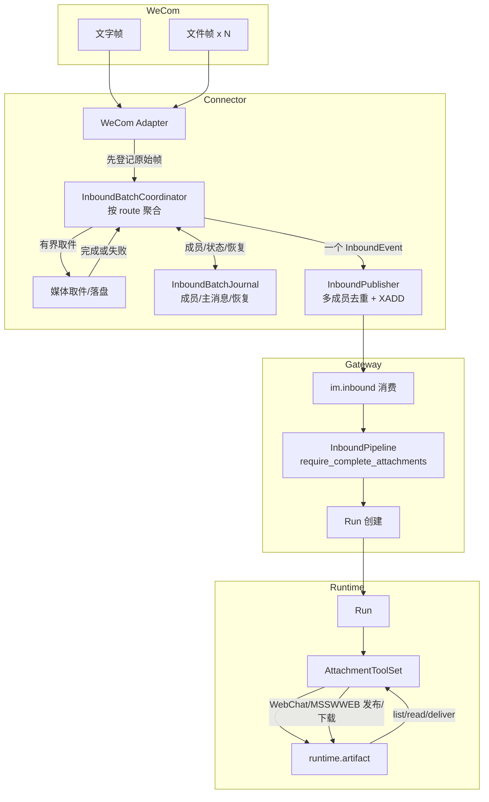

# IM 附件完整性与后台任务产物交付 模块需求与设计一体化文档

> **文档编号**: MOD-IM-ATTACH-1.0
> **文档版本**: v1.2
> **创建日期**: 2026-11-20
> **文档状态**: 已批准（用户已明确要求开始编码修复）
> **需求基线**: `im-attachment-integrity.prd.md` 修订历史 v1.4 + 2026-11-20 回归分析

**评审边界说明**:

- **需求评审**: PRD 第 2-8 章 → 已作为本设计输入
- **设计评审**: 本文件第 2-4 章 → 通过后锁定设计基线
- **交接契约**: 2.5 验收条件 + `im-attachment-integrity.scenarios.md`

---

## 1. 文档控制

### 1.1 责任人

| 角色 | 姓名 | 职责范围 |
|---|---|---|
| 产品经理 | | 业务规则、验收 |
| 开发负责人 | | Connector/Gateway/Runtime 实现 |
| 测试负责人 | | 集成测试与人工场景 |

### 1.2 修订历史

| 版本 | 日期 | 作者 | 变更描述 |
|---|---|---|---|
| v0.1 | 2026-11-20 | code-flow | 初始设计：Connector 聚合、产物 owner、附件来源标注 |
| v1.0 | 2026-11-20 | code-flow | 细化为可拆分任务的设计基线 |
| v1.1 | 2026-11-20 | code-flow | 纳入 WebChat/MSSWWEB 发布下载、批次 journal、在途成员、精确 task owner、整批重发提示 |
| v1.2 | 2026-11-20 | code-flow | 回归修订待评审：修正批次任务取消、下载阻塞、失败合并和 journal 恢复；沿用现有组件，不扩大业务范围 |

---

## 2. 需求分析

### 2.1 需求概述

| 项目 | 内容 |
|---|---|
| **模块名称** | IM 附件完整性与后台任务产物交付 |
| **模块ID** | MOD-IM-ATTACH |
| **所属系统** | agent-worker / agent-runtime / im-connector / im-gateway |
| **需求类型** | Bug 修复 + 功能补强 |
| **业务背景** | 企微把一次发送拆成文字帧和多个文件帧；现有入站逐帧建 Run，导致文字先执行、附件后到，模型误读历史工具结果。后台任务产物可被 `list_attachments` 列出，但 `read_attachment`/`deliver_artifact` 因缺少 run/conversation 归属而返回 `ATTACHMENT_NOT_FOUND`。 |
| **核心目标** | 让同一逻辑发送的 1..N 个附件与文字一起进入同一个 Run；让附件来源标注真实；让任务产物按 owner 可读、可交付。 |

### 2.2 痛点与价值

- **目标用户**：企微/WebChat/MSSWWEB 业务用户、后台任务结果查看者、平台 on-call。
- **当前问题**：
  - 文字+PDF 被拆成两个 Run，第一个 Run 没有附件；
  - 同一 route 的串行锁让文件事件被第一个 Run 阻塞约 24 秒；
  - `TOOL_RESULT` 被标成“入站”，模型误选历史任务列表；
  - 任务产物 `run_id`/`conversation_id` 为空，归属查询失败。
- **预期价值**：一次问询得到一次正确回答；任务结果无需重跑 Skill；模型不再把内部工具结果当用户附件。

**用户故事**（来自 PRD）：

| 编号 | 用户故事 | 优先级 |
|---|---|---|
| US-01 | 企微用户发送文字 + 1..N 个附件，等全部附件到位后只收到一个正确回复 | P0 |
| US-02 | 用户要求“把最近一次任务结果发我”，直接收到任务当时产物，无需重跑 | P0 |
| US-03 | 用户明确要求查看内部工具结果时可访问，但系统不把它默认标成用户附件 | P0 |
| US-04 | WebChat 文本 + 1..N 个附件仍只产生一个 Run | P1 |
| US-05 | 聚合/失败/越权有可观测指标与日志 | P1 |

### 2.3 功能方案

| 功能ID | 功能名称 | 设计落点 | 优先级 |
|---|---|---|---|
| FEAT-01 | 企微文字+多附件聚合 | Connector `InboundBatchCoordinator` + `InboundPublisher` 多成员去重 | P0 |
| FEAT-02 | 附件来源标注与显式访问 | Runtime `AttachmentToolSet` 类型标签 + 工具说明 + `allow_internal` | P0 |
| FEAT-03 | 任务产物 owner 读取/交付 | Runtime `_owned_by_actor` 增加 `artifact.user_id/agent_id` 直接归属 | P0 |
| FEAT-04 | WebChat 多附件回归 | 现有上传/提交链路，仅补测试；不改提交模型 | P1 |
| FEAT-05 | 可观测与失败语义 | Connector/Gateway 指标、日志、`require_complete_attachments` | P1 |

### 2.4 范围与边界

| 类别 | 内容 |
|---|---|
| **范围（In Scope）** | 生产 `im.inbound` 的 Connector 路径（企微文字/1..N 媒体帧）；附件枚举标签；任务产物 owner 读取/交付；WebChat 与 MSSWWEB 的本地流发布/下载；多附件回归。 |
| **非范围（Out of Scope）** | Gateway 直连适配器路径的企微分帧（该路径不持有企微 socket；生产 WECOM 走 Connector）；其他 IM 通道协议；任务调度/执行/投递模型；新数据库表/迁移；新增 UI 页面。 |
| **前置假设** | 同一 route 的文字/媒体帧由同一 Connector 处理（bot lease 单 owner）；媒体字节在 Connector 已落共享存储；`artifact.user_id/agent_id` 是任务产物的权威 owner；用户明确要求可代表内部产物交付意图。 |
| **有意妥协 / 技术债** | 聚合依赖同 route 的短窗口，不能识别协议未提供的逻辑发送身份；批次窗口给纯文本增加有界延迟。Journal 保存恢复所需元数据与已物化引用，不保存附件字节或取件凭据；重启时无法续取的在途成员按整批失败处理。 |

### 2.5 验收条件

#### 2.5.1 业务规则与约束

| ID | 类型 | 描述 | 验证场景 |
|---|---|---|---|
| RULE-01 | 业务规则 | 同一 route 的文字帧 + 1..N 媒体帧在窗口内合成一个逻辑消息；全部附件成功后才创建一个 Run。 | S-01、B-01 |
| RULE-02 | 业务规则 | 批次中任一附件失败，整批不进入业务执行；给用户逐项失败反馈。 | E-01 |
| RULE-03 | 业务规则 | 同一批次任一成员被平台重投，不创建第二个 Run；批次去重身份覆盖全部成员。 | B-02 |
| RULE-04 | 业务规则 | 附件枚举按 artifact_type 标注：入站/自产/工具结果/内部产物；`TOOL_RESULT` 不得标成入站。 | S-03 |
| RULE-05 | 系统约束 | 任务产物即使 `run_id`/`conversation_id` 为空，也可由 owner 按 `artifact.user_id/agent_id` 读取/交付；跨用户仍不可见。 | S-02、E-02 |
| RULE-06 | 系统约束 | 窗口、最大等待、批次上限必须有界；命令帧不参与聚合。 | S-04、B-03 |

#### 2.5.2 功能验收场景

场景唯一源：`im-attachment-integrity.scenarios.md`。设计影响：

| 场景ID | 设计影响 |
|---|---|
| S-01 | Connector 批次生成一个 `InboundEvent`，Gateway 只建一个 Run；附件顺序保留 |
| S-02 | `AttachmentToolSet._owned_by_actor` 走 artifact owner 直连；`deliver_artifact` 走当前会话路由 |
| S-03 | `list_attachments` 标签映射；`TOOL_RESULT` 显式读取/交付 |
| S-04 | WebChat 多 `upload_ids` 单 Run |
| E-01 | `require_complete_attachments=True`，Gateway `_handle_message` 不建 Run；提示重发整批 |
| E-02 | 跨用户任务产物 `ATTACHMENT_NOT_FOUND`，不泄露存在性 |
| E-04 | 下载超过最大等待：整批失败，不用文字建 Run |
| B-01/B-02/B-03 | 多附件、重投、窗口超时边界 |
| B-04/B-05 | 命令穿插、系统设置页上限变更 |
| S-06 | MSSWWEB 任务产物发布/下载共用本地流裁决 |
| S-05、S-07 | 单条普通文字自然到期即可执行；既有执行状态随真实执行事件展示 |
| B-06 | 慢下载期间，其他用户文字和命令不等待该下载 |
| E-05、E-06 | 重启按原批次恢复；无法恢复完整附件时整批失败 |

#### 2.5.3 非功能指标

| 指标ID | 要求 |
|---|---|
| NFR-SEC-01 | 任务产物/工具结果按租户 + user/agent 校验；未授权不进入 ToolRegistry 视野。 |
| NFR-REL-01 | 批次成员去重覆盖全部 `message_id`；重投不产生第二个 Run；发布失败保留批次重试。 |
| NFR-PERF-01 | 文本消息只增加有界聚合窗口延迟；窗口值由系统设置页 `im` 配置定义，不无限等待。 |
| NFR-OBS-01 | 合并/超时/失败/越权有指标与结构化日志，日志不含附件内容/URL/密钥。 |
| NFR-COMPAT-01 | 不新增数据库迁移；WebChat/MSSWWEB 提交契约不变；单帧消息保持原行为。 |

#### 2.5.4 验证环境假设

| 维度 | 假设 | 验证方式 | 不满足时 |
|---|---|---|---|
| 依赖 | 真实 PostgreSQL、Redis、Connector、Gateway、WS 探针；真实 WeCom 可选 | 集成/验收栈 | 记录缺失项与 owner |
| 数据 | 可构造文字 + 2..5 个媒体帧的真实回调 | WS 探针或真实企微 | 记录缺失项 |
| 预算 | Task 级 unit/integration；浏览器/真实企微人工场景 | `task finish` + 人工 | 记录未覆盖风险 |

---

## 3. 技术设计

### 3.1 方案选型

#### 3.1.1 聚合放在 Connector 还是 Gateway

| 对比维度 | 权重 | 方案A：Connector 聚合 | 方案B：Gateway 聚合 |
|---|---|---|---|
| 同 route 帧可达性 | 30% | 高：bot lease 单 owner，能看到该 bot 全部帧 | 低：Gateway 多副本 + consumer group 不保证同 route 落同一 Pod |
| 附件字节 | 25% | 高：Connector 已下载/落盘，直接合并 refs | 中：Connector 路径可合并 refs；直连适配器路径需重构取件 |
| 路由锁 | 20% | 高：聚合发生在 `im.inbound` 之前，不碰 Gateway 路由锁 | 中：必须在路由锁前做分布式批次 |
| 实现复杂度 | 15% | 中 | 高 |
| 可恢复性 | 10% | 高：批次热路径在内存 + Redis journal 恢复 | 中：需跨 Pod 批次协调 |
| **结论** | | **采用** | 否决：跨 Pod 批次协调成本过高 |

#### 3.1.2 关键决策记录

| 决策点 | 选择 | 被否决项 | 理由 | 可逆性 |
|---|---|---|---|---|
| 聚合层 | Connector `InboundBatchCoordinator` | Gateway 分布式批次 | bot lease 单 owner，天然 route 亲和 | 中 |
| 批次去重 | 内存成员集合 + Redis `InboundBatchJournal` + `InboundPublisher` 全部成员 id | 只查 PUBLISHED/只用文字 id | 覆盖等待期重复帧与 XADD 后崩溃窗口 | 中 |
| 失败语义 | 批次 `require_complete_attachments=True` | 部分成功继续 | 用户要求“等附件成功拿到”；避免误导性回答 | 易 |
| 任务产物 owner | `task_id + OUTPUT + user_id + agent_id` 精确匹配，并校验 live `task_execution` | 只查 run/conversation；允许 agent=NULL | 任务产物没有会话；不能把缺失 Agent 归属的产物跨 Agent 放行 | 易 |
| Web 面交付 | WebChat/MSSWWEB 共用 `LOCAL_STREAM_CHANNELS` 发布 + 下载裁决 | 只修 IM | 两个面共用同一套 handler；只修工具层会出现“读得到、发不出” | 易 |
| 附件标签 | 按 artifact_type 映射 | 默认排除 `TOOL_RESULT` | 用户明确要求保留访问 | 易 |
| 内部产物交付 | `allow_internal` 显式开关 | 直接放开/永久拒绝 | 保留显式请求能力，同时默认不主动外发 | 易 |
| 窗口配置 | 系统设置页 `ImSettings`，Connector 拉取并缓存 | 仅 ConnectorSettings | 用户要求默认值可在系统设置页调整；Connector 增加只读设置客户端与缓存 | 易 |
| 企微接入路径 | 固定 Connector | Gateway 直连适配器 | 生产企微由 Connector 持有 WS；直连路径不承载企微，无用户影响 | 易 |

#### 3.1.3 技术栈

Python 3.12、asyncio、Redis Streams、SQLAlchemy async、FastAPI；不新增第三方依赖、不新增数据库迁移。

#### 3.1.4 回归修订的依据与改动边界

- `b73b0e8b` 已修正 `_batch_frame` 的 coroutine 误用，并隔离单条入站消息异常；仍需保留这些修复。
- 当前批次定时器调用 `_flush` 后被其自身取消。独立真实 Redis 复现为 `PUBLISHING`、零 Stream 事件；主动 flush 则可发布。运行中的两条普通文字也没有 Run 提交记录。
- 原内存 journal 的异步方法不挂起，掩盖了取消；仅加入一次异步挂起即可复现零发布。批次关键回归必须经过真实 Redis。
- 合并事件遗漏成员事件的附件失败；下载占用唯一入站消费者；原设计承诺的批次恢复尚未实现。这些均在原需求范围内。
- 本轮只修 Connector / `im-core` 批次实现及其契约回归。沿用 bot 租约、现有 Stream、journal、Runtime 幂等和 Gateway 状态展示；不增加服务、消息队列、通用任务调度器或另一套回复状态机制，不改任务产物业务。
- 实现采用每批一个生命周期任务、一个有界媒体任务集合与并发限制。任务失败由所属 runtime/coordinator 记录并处理，不引入通用 supervisor 框架。只有取件并发需要新增 Connector 运行参数，默认与范围由 `ConnectorSettings` 定义；缓冲容量复用现有入站容量。

### 3.2 架构设计



#### 3.2.1 Connector 批次（含在途成员与 journal）

沿用 `packages/im-core/src/muad_im_core/inbound_batch.py` 的 `InboundBatchCoordinator` 与 `RedisBatchJournal`，修正生命周期和恢复实现。

**先登记，再取件**：

- 原始帧按到达顺序经现有有界队列登记，仍使用 `route_key` 分组。普通文字立即完成；媒体登记为 `PENDING` 后交给 runtime 持有的媒体任务集合，入站消费者不等待下载。
- 媒体任务以信号量限制实际取件并发；未完成批次与媒体任务集合均以现有入站容量封顶，队列本身容量保持不变，不能排空为无限等待信号量的任务。超容量显式记录并走失败反馈，不静默丢失。
- 命令与纯文本不占媒体取件名额。媒体任务的异常转换为原成员失败；批次已封闭后的迟到结果不能重新开批或生成另一个 Run。
- 批次设置沿用租户缓存与最近成功快照/默认值降级；创建时固定参数。配置读取失败、坏帧只影响当前消息，必须留下日志与指标。

**批次生命周期**：

- 每个 route 至多一个接收新成员的批次。主消息仍优先选择文字，没有文字则首个媒体；封批后主消息、成员顺序和合并事件固定。
- 每批只持有一个生命周期任务，负责等待窗口和发布重试；成员完成或显式 flush 用唤醒信号重算截止时间，不用取消任务刷新窗口。外部取消只用于停机或失去租约，不能由发布函数取消当前任务自身。
- 状态修改使用批次内的短临界区，覆盖计时到期与成员完成的竞态；不持锁等待下载、窗口或发布重试。发布中的批次仍被持有和观察，不能先移除唯一引用再执行 Redis 操作。
- 第二段独立文字先封闭前批，再创建新批。命令/不支持媒体先封闭前批，再按原独立事件发布，不加入聚合，也不等待取件完成；封批时仍有未完成成员则明确整批失败，不能把文字单独放行。
- 新媒体先按附件数量检查上限，超限成员不启动下载，追加 `ATTACHMENT_COUNT_EXCEEDED` 后封批。达到上限但没有超限时仍等待静默或最大等待。
- 静默到期要求本批没有 `PENDING` 成员；最大等待始于批次创建，同 bot 其他用户流量不改变它。到点仍未完成的成员记 `ATTACHMENT_FETCH_TIMEOUT`，整批失败。等待下载名额的时间也算在最大等待内。

**封批与发布**：

- 所有封批入口共用同一实现：合并成员事件的附件引用、`attachment_failures`、失败键及协调器产生的失败，按原顺序保留并去重；未完成成员必须先转为失败。
- 合并事件使用固定的 primary message id、reply_ref 和 event_id。沿用多成员批次的 `require_complete_attachments` 契约，由 Gateway 统一反馈、审计并禁止失败批次建 Run。
- 发布前保存 `PUBLISHING` 与不可变合并事件；成功发布并完成 journal 确认后才清理内存批次和成员索引。Redis 异常覆盖 journal 写入和发布两段，不能只保护 XADD；失败保留状态，沿用退避并记录日志/指标。
- 重试始终使用同一合并事件和主消息身份，不能把 `PUBLISHING` 退回可接收新成员的批次，也不能重新生成部分成功事件。

**最小 journal 恢复**：

- Redis key 继续由 contracts 的 `inbound_batch_key` / `inbound_batch_member_key` 定义。`PENDING` 保存 route、原帧必要元数据、成员顺序/状态、已完成事件、设置快照与恢复所需截止时间；`PUBLISHING` 另保存最终合并事件。时间须可跨进程解释，不持久化 monotonic 值；不保存附件字节或取件凭据。
- 仅在取得 bot 租约后，对该 bot 的未完成 journal 做有界扫描；恢复与续租解耦，恢复结束前不把该 bot 的新帧登记到冲突的新批次。失去租约立即停止该 bot 的取件和批次任务。
- `PUBLISHING` 重发/确认原合并事件；`PENDING` 全部物化成功则按原成员封批，仍有无法续取成员则追加明确附件失败并整批反馈。成员重投先恢复原批次，不以文件帧身份另起主消息。
- 扫描仅在启动/接管发生，不新增常驻恢复服务或第二条持久队列。损坏、缺少必要恢复事实的记录显式记失败，不补造成功 Run。
- 停机先停止接收新成员，按有界时间结束取件和封批；未确认发布的 journal 保留给接管者，不能在取消时误记 `PUBLISHED`。

#### 3.2.2 Publisher 多成员去重

扩展 `muad_im_core.ingress.InboundPublisher`：

- `publish(event, *, dedupe_ids: Sequence[str] | None = None)`：
  - 身份集合 = `dedupe_ids or (event.external_message_id,)`。
  - 对每个身份复用现有 `_begin`：任一已是 `PUBLISHED` ⇒ 使用其发布事实补齐本批其余成员标记，再返回 `DUPLICATE`；`RECEIVED`/`LOST`/缺失 ⇒ 继续。
  - XADD 一次；随后把全部身份写为 `PUBLISHED:<entry_id>`。
  - 任一步失败保持现有语义：标记停在 `RECEIVED`，由 `sweep_lost` 显式处理。
- 沿用 `is_published(message_id) -> bool`；批次入口先恢复 member→batch 身份，再查已发布事实，重复帧不下载、不合并。
- 批次主消息 id = 文字 id（无文字则首个媒体 id）；Runtime 幂等键继续使用这个 id。
- XADD 成功、全部 PUBLISHED 标记写入前崩溃：`InboundBatchJournal` 保持 `PUBLISHING` + 合并事件；任一成员重投先从 member key 找到原主消息 id，按 Journal 重发/确认，不用文件 id 另起 Run。Journal 与 PUBLISHED 标记不追求跨 key 原子，靠“主消息 id 稳定 + Runtime 幂等 + 重投检查”收敛。

#### 3.2.3 Gateway 失败语义

- `InboundEvent` / `ChannelEnvelope` 增加可选 `require_complete_attachments: bool = False`。
- Connector 合并批次在 `len(members) > 1` 时置 true。
- `_handle_message` 在 `_collect_attachments` 之后：
  - 若 `require_complete_attachments` 且 `collected.audit_outcome == "FAILED"`：不创建 Run，直接返回已受理（回执/审计已由附件链路发送）。
  - 无失败：按现有逻辑创建 Run，附件列表为全部成员 refs。
- 单帧消息保持原行为（`require_complete_attachments=False`），避免扩大行为变更。
- 超限反馈走消息目录：`ATTACHMENT_COUNT_EXCEEDED` 文案改为友好引导，例如“一次最多接收 {limit} 个附件，请分批重新发送；本次未处理”。`limit` 取当前租户 `im.inbound_batch_max_attachments`，不在网关硬编码；中英文词条同时更新。
- 多附件批次失败使用 `ATTACHMENT_BATCH_INCOMPLETE` 文案：“本次附件未全部收到，未处理；请连同说明重新发送整批附件。” 具体失败原因复用现有 `ATTACHMENT_FETCH_*`/类型/大小文案；不承诺只补失败附件。

#### 3.2.4 任务产物 owner


- `_owned_by_actor` 只对**目标任务产物**增加直接归属：
  ```python
  by_task = sa.and_(
      Artifact.task_id.is_not(None),
      Artifact.user_id == user_id,
      Artifact.agent_id == self._agent_id,  # 必须非空且精确匹配
  )
  return sa.or_(by_conversation, by_run, by_task)
  ```
  产物类型准入（`OUTPUT`/入站/`TOOL_RESULT`）在 `_delivery_refusal` 与发布层单独判定，归属谓词不按类型放宽或收紧。
- `_load` / `_load_for_update` 对命中 `task_id` 的行再复用 `task_artifacts` 的 `load_task_owner` 读 `task.task_execution`，复核 `tenant_id + actor_user_id + agent_id + is_deleted=false`；不一致即 `ATTACHMENT_NOT_FOUND`。这样不在列表 SQL 里加跨 schema 子查询，也不新增模型。
- **不放行 `agent_id=NULL`**；`user_id`/`agent_id` 任一为空或 task_execution 不匹配，一律按不可访问处理。
- 保留租户、软删校验；跨租户/跨用户仍返回 `ATTACHMENT_NOT_FOUND`。
- `list_attachments(scope="agent")` 对 `task_id` 行追加与读取相同的 live `task_execution` 条件（同租户、`actor_user_id`、`agent_id`、未删），避免“列得出但读不到”；非 task 行保持原过滤。
- `list_attachments(scope="task", task_id=<execution>)` 只列**指定执行**的产物，同样复用 live owner 谓词；缺 `task_id`、非法 UUID、把 `task_id` 用在其他 scope 都显式拒绝。它服务于“把某次定时/后台执行的结果发给我”这类明确请求，避免模型把“当前消息没有附件”误判成任务产物不可访问。工具说明同时保留“当前消息附件仍是该消息的唯一输入依据”，任务产物不是当前消息附件的替代品。
- 统一谓词放在 `task_artifacts` 的 owner helper 中，读/列复用，不复制第二套判断。
- 数据现状：当前任务写入方 `_new_row` 会写 `user_id/agent_id`；库内存在历史 `task_id` 但 owner 为空、且找不到 live `task_execution` 的行（本地抽查），本次不回填、不放行，按“归属不完整”拒绝。

#### 3.2.4.1 WebChat / MSSWWEB 发布与下载

WebChat 与 MSSWWEB 共用 `LOCAL_STREAM_CHANNELS` 和同一套 `publish_artifact_to_conversation` / `webchat_artifacts`，必须一起修：

- `publish_artifact_to_conversation(..., allow_internal=False)`：
  - `_load_publishable` 允许 `OUTPUT + task_id` 且无 `conversation_id` 的任务产物；`TOOL_RESULT` 仅在 `allow_internal=true` 时允许；`TRANSCRIPT` 继续拒绝。
  - `_source_owner` 增加 `task_id` 分支：复用 `task_artifacts` 的 `_load_owner`（`task.task_execution` 的 `actor_user_id/agent_id`）。
  - `_assert_same_owner` 要求 task owner 与目标 Run 的 user/agent 一致。
- `webchat_artifacts`：
  - `_owned_artifact` 允许 `task_id` 非空、非 TRANSCRIPT 的无会话任务产物；`TOOL_RESULT` 仍需目标会话发布事实（显式 `allow_internal` 发布后才存在）。
  - `_source_owner` 增加 task owner 分支；跨会话下载仍要求 `_assert_published` 命中目标会话的发布事实与 checksum。
  - `_reference_at` 用发布时的 artifact 行/checksum，保证下载原版本；任务版本是独立 artifact 行，不回退最新版。
- `deliver_artifact` 走 `_publish_to_conversation` 时把 `allow_internal` 透传；IM 路径仍走 Gateway `/internal/artifacts/{id}`，不新增直读存储。

#### 3.2.5 附件来源标注

- `DIRECTIONS` 增加 `internal`；`DIRECTION_LABELS` 增加：
  - `inbound` → 入站
  - `outbound` → 自产
  - `internal` → 内部产物
- `_list_line` 按 `artifact_type` 映射：
  - `INBOUND_*` → 入站
  - `OUTPUT` → 自产
  - `TOOL_RESULT` → 工具结果
  - 其他 → 内部产物
- `direction=inbound` 仍只查 `INBOUND_ARTIFACT_TYPES`；默认（无 direction）保留全量，保证显式访问。
- `LIST_ATTACHMENTS_DESCRIPTION` 明确“工具结果不是用户附件；找用户附件用 inbound”。
- 模型可见说明追加一条权威口径：**当前用户消息里的附件列表是当前请求的唯一输入依据**；当前消息没有附件时，不得拿历史附件代替，必须明确告诉用户没看到附件并请其重发。历史附件只有在用户明确要求“之前那个文件”时才使用。
- `deliver_artifact` 增加可选 `allow_internal: bool = False`：
  - `TOOL_RESULT` 默认拒绝；`allow_internal=true` 且 owner 校验通过时允许交付。
  - 工具描述要求模型只在用户明确要求时置 true；`tool_call_audit.args_preview` 保留该参数，便于审计。
  - 任务产物 `OUTPUT` 不需要该开关。

### 3.3 数据设计

- **无新增表、无迁移**。
- 复用 `runtime.artifact`：
  - `task_id`（任务执行 id）
  - `agent_id` / `user_id`（owner，历史产出跨会话检索）
  - `conversation_id` / `run_id`（可空）
  - 现有索引 `ix_artifact_agent_user_time`、`ix_artifact_task`。
  - 当前任务写入方 `_new_row` 写 `user_id/agent_id`；库内历史 `task_id` 但 owner 为空、且无 live `task_execution` 的行不回填、不放行，按“归属不完整”拒绝。
- Redis：
  - 复用 `InboundPublisher` 的 `inbound_dedupe_key` 多身份标记。
  - 沿用 `InboundBatchJournal` 的 batch JSON + member→batch 映射，保存 §3.2.1 的必要恢复字段与合并事件；TTL 覆盖重投窗口。不保存附件字节或取件凭据、不建数据库表。
  - 热路径批次仍在 Connector 内存；Journal 在登记、完成和发布边界更新，不新增事件溯源日志。发布确认后清理内存成员索引，跨重投去重由 Redis TTL 保留。
- 配置新增（系统设置页 `ImSettings`，非 ConnectorSettings）：
  - `im.inbound_batch_quiet_ms`：默认 300，范围 100–2000
  - `im.inbound_batch_max_wait_ms`：默认 5000，范围 500–30000
  - `im.inbound_batch_max_attachments`：默认 5，范围 1–20
  - 具体值在 `ImSettings` 内定义并由单测钉住；Console `platform_settings_catalog` 增加对应条目，页面按既有 catalog 渲染。
- Connector 读取路径：复用 Console 内部 `GET /internal/v1/platform-settings`（已有服务身份），按租户做进程内缓存；成功快照优先，取不到时用最近一次成功快照，从未成功则用 `ImSettings` 默认值并记 WARNING。
- 缓存周期由 Connector 实现常量定义（不在页面配置），页面保存后最多延迟一个缓存周期对新批次生效；批次参数只影响新批次，不追溯正在等待的批次。
- 本版不新增“单批总字节上限”，沿用现有单附件大小限制；若 1000 用户压测发现单批总体积需要额外保护，再评估增加 `im.inbound_batch_max_total_bytes`，不阻塞本次修复。
- 回归修订增加一个 Connector 取件并发参数，收敛在 `ConnectorSettings`；不增加平台设置项。未完成任务集合沿用已有入站容量作上限，不另外创建下载队列或无界任务池。

### 3.4 接口设计

#### 3.4.1 函数/库接口

| 接口 | 入参 | 返回 | 错误处理 |
|---|---|---|---|
| `ConnectorPlatformSettings.batch(tenant_id)` | 租户 | `ImBatchSettings`（quiet/max/count） | 缓存/最近成功/默认值；WARNING 日志 |
| `InboundBatchCoordinator.register(frame, settings)` | 原始帧与批次参数 | 是否接受新成员 | 重投关联原批次；重复直接忽略 |
| `InboundBatchCoordinator.complete(event)` | 物化后的 `InboundEvent` | 无 | 保留全部失败；已封批的迟到结果不重开批次 |
| `InboundBatchCoordinator.fail(frame, code)` | 原成员与失败原因 | 无 | 整批不执行业务 |
| `InboundBatchCoordinator.flush_route(frame, reason)` | route 与封批原因 | 无 | 同一封批实现；未完成成员不能被略过 |
| `InboundBatchCoordinator.recover(tenant_id, bot_id)` | 当前持有租约的 bot | 恢复结果 | 有界扫描，沿用原主消息；失败不伪造成功 |
| `InboundBatchCoordinator.flush_all()` | 无 | 无 | 停机有界 flush |
| `publish_artifact_to_conversation(..., allow_internal=False)` | 目标会话/Run/产物 | 发布 seq | task owner 校验；TOOL_RESULT 需显式允许 |
| `InboundPublisher.publish(event, dedupe_ids=...)` | 事件 + 成员身份集合 | `PUBLISHED` / `DUPLICATE` | 保持现有 Redis 故障语义 |
| `InboundPublisher.is_published(message_id)` | 平台消息 id | bool | Redis 故障按现有降级/告警 |
| `AttachmentToolSet._owned_by_actor(user_id)` | 当前 user | SQL 谓词 | 失败 fail closed |
| `list_attachments(direction=internal)` | 过滤 | 文本 | 非法枚举显式错误 |
| `deliver_artifact(allow_internal=...)` | 布尔 | 交付结果 | 非法/越权显式错误 |

#### 3.4.2 工具 schema 变化

- `list_attachments`：`direction` 枚举增加 `internal`；默认行为不变。
- `deliver_artifact`：增加可选 `allow_internal`（boolean，默认 false）；用户明确要求时由模型置 true，不需要确认卡片；`additionalProperties: false` 保持。
- `read_attachment`：不变。
- `execute`/`list-platforms`：不变。
- 系统设置页新增 `im.inbound_batch_*` 三项；`ATTACHMENT_COUNT_EXCEEDED` 词条更新为友好分批引导；新增 `ATTACHMENT_BATCH_INCOMPLETE` 词条，失败原因复用现有附件原因码。

#### 3.4.3 契约模型变化

- `InboundEvent`：增加 `require_complete_attachments: bool = False`。
- `ChannelEnvelope`：增加 `require_complete_attachments: bool = False`。
- 默认值保证旧生产者/旧测试序列化兼容；不新增数据库列。

### 3.5 质量实现方案

#### 3.5.1 性能

- 批次热路径只在 Connector 内存保存成员/引用；`InboundBatchJournal` 只存元数据与合并事件（不含字节），每个 route 至多一个批次，成员数受 `im.inbound_batch_max_attachments` 限制。
- 批次任务和未完成取件都计入容量；每批一个生命周期任务，内存只保存文字、状态和引用，不复制附件字节。容量不足显式反馈；吞吐与延迟由靶向测量确认，不以并发人数推断内存可忽略。
- 文本消息最多增加一个静默窗口延迟（默认 300ms）；最大等待（默认 5s）只在连续来帧/慢下载时生效，不拖慢纯文本。
- 发布仍是每批一次 XADD，不增加每附件一次 Stream。
- 媒体下载独立于入站登记并限制并发，沿用原下载、解密、门控和落盘实现；单附件大小限制不变。

#### 3.5.2 可靠性

- 静默/最大等待/数量上限及命令/第二段文字共用封批规则；批次任务异常必须记 ERROR、失败指标并保留未确认事实。
- 发布失败保留批次并退避重试；停机有界 flush；Journal 状态允许接管者重发同一主消息 id。
- 成员去重覆盖全部 `message_id`：等待期由内存成员集合 + Journal，发布后由 `InboundPublisher` multi-identity；重复帧不下载、不合并。
- 最大等待到点仍有 `PENDING` 媒体：整批失败并给友好提示，不允许文字单独执行。
- 批次失败（附件失败/超限/超时）发布一个事件，由 Gateway 统一反馈与审计；不创建 Run。

#### 3.5.3 安全

- 任务产物直接归属只对 `task_id + OUTPUT + user_id + agent_id` 精确匹配生效；`agent_id` 为空明确拒绝；`task_execution` 必须同租户且 live。
- WebChat/MSSWWEB 发布/下载同样按 task owner 校验；跨会话下载还要求目标会话存在对应 publish 事实与 checksum。
- `TOOL_RESULT` 默认不可交付；`allow_internal=true` 仅在 owner 校验通过后生效；审计参数可见。
- 日志只记 batch_id、primary message_id、member_count、reason、code 与耗时；不记正文、附件内容/URL/Cookie/AK/SK。

#### 3.5.4 可观测性

| 指标/日志 | 说明 |
|---|---|
| 入站结果与批次失败 | 复用 Connector 指标入口，记录发布、重复、失败与恢复结果；发布取消不能被当成正常成功 |
| 批次日志 | 记录批次身份、主消息、成员数、封批原因与耗时；无正文 |
| 就绪信息 | 检查关键循环存活并报告批次异常、未确认发布数量；个别下载失败不让整个 Connector 失去就绪 |

#### 3.5.5 回归验证

- 单元回归保留 `tests/im_connector/test_runtime_inbound.py`、`tests/im_core/test_inbound_batch.py` 和 `tests/im_core/test_inbound_publisher.py`，覆盖原 coroutine 误用、坏帧隔离与批次规则；至少保留一个会真正挂起的 journal 替身对照。
- 增补真实 Redis 集成：自然窗口到期（不能用手动 flush 代替）、最大等待、失败合并、journal 写入/发布失败、同 route 封批竞态、进程重启和成员重投。断言 Stream 与 journal 两步均完成后再判断成功，确认原 primary/event 身份不漂移。
- 慢下载用可控真实 HTTP 媒体源，验证后续媒体已登记，另一用户文本和命令能先完成；并发与容量不超过声明限制，超时后的迟到结果不产生第二个 Run。
- 复用 `tests/acceptance/im_gateway/environment.py` 的完整真实栈（`connector_environment.py` 仅覆盖 Connector、不启动 Gateway），补入站到 Runtime 受理、执行状态、最终回复的完整旅程。Redis、PostgreSQL、服务 HTTP 与 WS 边界不得 mock；故障注入只控制媒体源或服务退出时机。
- 既有 Gateway 失败和状态回归建议执行 `tests/gateway/test_inbound_batch_failure.py`、`tests/gateway/test_inbound_attachment_flow.py`、`tests/gateway/test_execution_progress.py`；具体命令由后续 TASK 声明。
- 修复必须有负向实证：注入旧的自身取消行为，真实 Redis 自然到期回归必须失败；恢复修复后通过。全量以 CI 为准，浏览器/真实企微按场景人工执行。

---

## 4. 部署与运维

### 4.1 部署架构

- 原需求涉及 `agent-runtime`、`im-connector`、`im-gateway`；本轮回归修订以 Connector 和共用 `im-core` 为主，不为修回复链路改任务产物实现。
- 无数据库迁移；聚合窗口/上限沿用平台设置，Connector 新增取件并发参数；其他部署边界沿用当前配置。
- 发布前确认 bot 租约接管和未完成 journal 的处理，记录原批次状态；不能把重启成功作为消息恢复成功的证据。

### 4.2 发布与回滚

- 先在验收栈验证真实 WS 探针 + 真实 PG/Redis；再灰度一个 Connector 副本（bot lease 单 owner，灰度时注意 lease 接管）。
- 回滚条件：批次异常导致消息积压、重复 Run 指标上升、附件失败率上升。
- 当前遗留 `PUBLISHING` 批次按已有合并事件与主消息身份单独核对；回复目标过期走既有交付裁决或显式失败，不能盲目补执行未知状态的业务，也不新增旧格式转换层。

### 4.3 监控告警

- 窗口超时/取件失败上升时，先区分等待下载名额、媒体源耗时和发布失败，再判断是否需要调整配置。
- 关键循环退出或批次任务异常必须从日志、失败指标和就绪详情看见；不新增常驻监控进程或自动重启策略。

### 4.4 数据迁移

无。

---

## 5. 风险与依赖

| 风险ID | 类型 | 描述 | 概率 | 影响 | 应对 | 场景 |
|---|---|---|---|---|---|---|
| RISK-01 | 性能 | 静默窗口增加文本延迟 | 中 | 中 | 窗口可配、默认小、指标观察 | S-04 |
| RISK-02 | 可靠 | 发布任务取消后遗留未确认批次；崩溃接管也需要恢复 | 已复现取消路径 | 高 | Journal PENDING/PUBLISHING 恢复；平台重投；停机有界封批 | E-05、E-06 |
| RISK-03 | 一致 | XADD 成功但 PUBLISHED 标记未完成 | 低 | 中 | Journal 保留主消息 id + 合并事件；重投按 Journal 重发/跳过；Runtime 幂等 | B-02 |
| RISK-04 | 安全 | 任务产物 owner 放宽 | 低 | 高 | task_id + OUTPUT + user + agent 精确匹配 + live task_execution；跨用户负例 | E-02 |
| RISK-05 | 安全 | `allow_internal` 被模型误用 | 中 | 中 | 默认 false；工具说明；审计参数；用户明确要求 | S-03 |
| RISK-06 | 产品 | 多附件部分失败整批拒绝 | 中 | 中 | 明确提示重新发送整批；不承诺只补失败项 | E-01 |
| RISK-07 | 配置 | Console 平台设置不可读导致 Connector 无窗口值 | 低 | 中 | 最近一次成功快照；无快照用默认值 + WARNING；不阻断入站 | S-05 |
| RISK-08 | 一致 | Journal 与 XADD 非原子，崩溃窗口重复 | 低 | 中 | Journal 先写 PUBLISHING，主消息 id 稳定；重投按 Journal 重发/跳过；补故障注入 | B-02 |
| RISK-09 | 兼容 | 历史 task 产物 owner 为空 | 中 | 低 | 明确拒绝、不回填；当前写入方已写 owner；补列表不泄露 | E-02 |
| RISK-10 | 安全 | WebChat/MSSWWEB 发布 task/内部产物 | 低 | 高 | task owner + 目标会话 publish 事实 + checksum；跨用户负例 | E-02、S-06 |

---

## 6. 需求追溯矩阵

| 用户故事 | 功能ID | 设计落点 | 场景ID | 测试层级 | 执行方式 |
|---|---|---|---|---|---|
| US-01 | FEAT-01 | Connector 批次 §3.2.1 | S-01、B-01、B-02 | integration | acceptance + manual |
| US-02 | FEAT-03 | `_owned_by_actor` + 发布/下载 §3.2.4/§3.2.4.1 | S-02、S-06、E-02 | integration | pytest + manual |
| US-03 | FEAT-02 | 标签/`allow_internal` §3.2.5 | S-03 | unit + integration | pytest + manual |
| US-04 | FEAT-04 | WebChat/MSSWWEB 回归 | S-04、S-06 | integration | pytest |
| US-05 | FEAT-05 | 指标/失败语义 §3.5 | E-01、E-03、E-04 | integration | pytest + manual |
| US-01、US-05 | FEAT-01、FEAT-05 | 批次生命周期、并发取件、恢复 §3.2.1/§3.5.5 | S-05、S-07、B-06、E-05、E-06 | unit + integration | pytest + manual |

---

## 7. Spec Compliance Matrix

| Spec/Rule | 设计影响 | 设计落点 | 验收场景 | 状态 |
|---|---|---|---|---|
| `im/harness-im#RULE-im-002` | 批次在 Connector/`im-core`，核心域不出现企微帧形状 | §3.2.1 | S-01 | applied |
| `im/harness-im#RULE-006` | 任务产物按执行 owner 读取，不要求会话身份 | §3.2.4 | S-02、E-02 | applied |
| `im/harness-im#RULE-007` | 交付仍走网关受信投递，不直读存储 | §3.2.4/§3.2.5 | S-02 | applied |
| `auth/harness-auth#RULE-auth-001` | 未授权产物不进入 ToolRegistry 视野 | §3.2.4/§3.5.3 | E-02 | applied |
| `secret/harness-secret#RULE-secret-001` | 日志/审计不含附件内容、URL、密钥 | §3.5.3 | E-01、E-03 | applied |
| `test/harness-test#RULE-test-001` | 真实 PG/Redis/Connector/WS 探针覆盖关键链路 | §2.5.4、任务测试 | S-01/S-02 | applied |
| `test/harness-test#RULE-002` | 分帧/落库/交付测试必须有界等待 | 任务测试 | S-01、S-02 | applied |

**建议的 Spec Delta**（由后续 TASK 声明，archive 应用）：

- `im/harness-im` 新增一条规则：同一逻辑发送的文字与 1..N 个媒体帧必须在 Connector 按 route 有界聚合；全部附件物化后发布一个 `InboundEvent`；批次成员共享去重；失败整批不执行业务。
- `im/harness-im` 新增一条规则：附件枚举必须按 `artifact_type` 标注来源，`TOOL_RESULT` 是内部产物而非入站；显式访问保留，内部产物默认不交付。

---

## 附录：术语表

| 术语 | 定义 |
|---|---|
| 批次 | 同一 route 内文字 + 1..N 个媒体帧的聚合单元 |
| 静默窗口 | 无未完成成员时，从最近一次成员完成起等待新帧的时间 |
| 最大等待 | 从批次创建起的最长等待上限 |
| 主消息 | 批次的幂等/回复身份：文字帧优先，否则首个媒体帧 |
| `require_complete_attachments` | 批次失败时禁止创建 Run 的契约标志 |
| owner | `artifact.user_id` + `artifact.agent_id`（租户外层限定） |

---

*文档结束*
