# Fluxion Harness 总体设计说明书

| 项目     | 内容                         |
| -------- | ---------------------------- |
| 文档编号 | SFRD-TS-03-1.4               |
| 产品名称 | Fluxion Harness 智能服务交付平台 |
| 版本号   | V1.5                         |
| 作者     | 待填写                       |
| 审核人   | 待填写                       |
| 批准人   | 待填写                       |
| 创建日期 | 2026-11-22                   |
| 最后修订 | 2026-11-22                   |
| 状态     | 评审中                       |

---

## 修订历史

| 版本 | 日期       | 作者 | 变更描述 |
| ---- | ---------- | ---- | -------- |
| 0.1  | 2026-11-22 |      | 依据旧项目验证结果与当前产品方向，重写总体设计；补充模块边界、关键流程、部署与容量口径 |

---

## 目录

1. [引言](#1-引言)
   - [1.1 目的与适用对象](#11-目的与适用对象)
   - [1.2 适用范围](#12-适用范围)
   - [1.3 术语与缩写](#13-术语与缩写)
   - [1.4 参考与引用](#14-参考与引用)
2. [设计输入与目标](#2-设计输入与目标)
   - [2.1 需求文档与范围](#21-需求文档与范围)
   - [2.2 质量属性目标（12项任务书）](#22-质量属性目标12项任务书)
   - [2.3 约束与假设](#23-约束与假设)
3. [产品与关键场景](#3-产品与关键场景)
   - [3.1 产品概述与版本信息](#31-产品概述与版本信息)
   - [3.2 关键应用场景](#32-关键应用场景)
   - [3.3 相对旧项目的改进](#33-相对旧项目的改进)
4. [方案选型与技术路线](#4-方案选型与技术路线)
   - [4.1 备选方案对比](#41-备选方案对比)
   - [4.2 选型结论与技术栈](#42-选型结论与技术栈)
   - [4.3 关键技术及解决途径](#43-关键技术及解决途径)
5. [总体架构设计](#5-总体架构设计)
   - [5.1 系统上下文与外部依赖](#51-系统上下文与外部依赖)
   - [5.2 逻辑架构与模块划分](#52-逻辑架构与模块划分)
     - [5.2.1 逻辑视图](#521-逻辑视图)
     - [5.2.2 模块功能说明](#522-模块功能说明)
     - [5.2.3 模块职责与边界](#523-模块职责与边界)
   - [5.3 高层交互流程（子系统级）](#53-高层交互流程子系统级)
       - [5.3.1 开通与绑定](#531-开通与绑定)
     - [5.3.2 对话请求生命周期（企微 / WebChat）](#532-对话请求生命周期企微--webchat)
     - [5.3.3 同步 Skill 执行](#533-同步-skill-执行)
     - [5.3.4 异步任务与结果回流](#534-异步任务与结果回流)
     - [5.3.5 定时与批量任务](#535-定时与批量任务)
     - [5.3.6 取消当前请求与恢复](#536-取消当前请求与恢复)
     - [5.3.7 Skill 导入与自建](#537-skill-导入与自建)
   - [5.4 数据域与接口概览](#54-数据域与接口概览)
   - [5.5 部署与运行环境](#55-部署与运行环境)
     - [5.5.1 物理部署架构](#551-物理部署架构)
     - [5.5.2 网络拓扑与容量规划](#552-网络拓扑与容量规划)
   - [5.6 质量属性设计](#56-质量属性设计)
     - [5.6.1 性能设计](#561-性能设计)
     - [5.6.2 可靠性设计](#562-可靠性设计)
     - [5.6.3 安全性设计](#563-安全性设计)
     - [5.6.4 可维护性设计](#564-可维护性设计)
     - [5.6.5 可观测性设计](#565-可观测性设计)
     - [5.6.6 可扩展性设计](#566-可扩展性设计)
     - [5.6.7 可测试性设计](#567-可测试性设计)
6. [风险与未决问题](#6-风险与未决问题)
   - [6.1 风险清单](#61-风险清单)
   - [6.2 尚未解决的问题](#62-尚未解决的问题)
- [附录 A 图目录](#附录-a-图目录)

---

## 1 引言

### 1.1 目的与适用对象

本文是 Fluxion Harness 的系统级总体设计，作为后续概要设计、详细设计、开发、测试、部署与评审的设计源头。

本文回答“系统由哪些模块组成、模块之间如何协作、关键流程怎样运行、部署与质量约束是什么”，不展开模块内部实现、接口字段、数据库表结构和具体配置项。模块实现见《Console Platform 详细设计》《Agent Runtime 详细设计》《Agent Worker 与异步任务详细设计》《IM Gateway 详细设计》等文档；数据与接口细节见《核心领域与数据库详细设计》《跨模块接口与协议详细设计》；安全、可靠性与测试细节见《DFX、安全、可靠性、测试与验收详细设计》。

适用对象：产品经理、系统架构师、研发、测试、运维与安全评审人员。

### 1.2 适用范围

本总设描述当前产品方向的系统级设计，作为后续概要设计、详细设计、开发、测试、部署与评审的设计源头。

本总设覆盖当前产品方向：实时对话、同步与异步 Skill、定时与批量任务、Skill 全生命周期、模型池、企业微信与 WebChat 双入口、用户记忆、经验管理和执行审计。

本总设不展开各模块内部实现、接口字段、数据库表结构和具体配置项；这些内容由对应详细设计文档承载。

### 1.3 术语与缩写

| 术语 | 说明 |
| ---- | ---- |
| Agent / AgentDefinition | 控制面维护的逻辑 Agent：指令、模型、Skill、MCP、授权和接入方式 |
| Agent Runtime | 执行 Agent 的无状态服务，任意实例可以执行任意 Agent 的请求 |
| Agent Worker | 持久化后台任务的执行服务，负责领取、租约、重试、定时、批量、结果回流和投递 |
| Run | 一次用户请求的执行记录，可以等待用户输入或后台结果后继续 |
| Task | 一次持久化的后台执行 |
| JOIN / DETACH | 异步任务的两种完成关系：结果回流并继续当前 Run / 受理后独立执行并投递 |
| Snapshot | Run 或 Task 开始时冻结的 Agent、模型、Skill、MCP 和预算版本 |
| Canonical Event | 不可变的会话事实历史；模型请求只是从事实临时拼出的副本 |
| Skill Artifact | Skill 的不可变制品，包含说明、脚本、资源、校验和与版本信息 |
| Gateway / Connector | 无状态请求面 / 有状态渠道连接角色；Connector 不是独立的第五个业务微服务 |
| Model Pool | 由逻辑模型、物理凭据、成员和额度组组成的模型资源池 |
| Model Gateway | 我们对接的外部模型供应入口，负责统一模型接入、敏感数据脱敏、响应还原，并屏蔽源头模型供应商；不是内部部署单元 |
| Platform Adapter / Session | 业务平台认证与请求准备的可复用实现；Session 是可重建缓存 |
| Tenant | 租户/组织隔离标识；业务数据、授权、制品与工作区都按租户隔离 |
| Workspace | 用户与 Agent 维度的持久工作区，保存草稿、执行数据与输出 |
| 状态机 | 对象在生命周期内的合法状态与转移关系；总设只描述状态类别与责任方，细节见详细设计 |

### 1.4 参考与引用

| 序号 | 文档名称 | 版本 | 用途 |
| ---- | -------- | ---- | ---- |
| 1 | muad-openclaw 已验证的用户旅程与运行效果 | 当前基线 | 业务旅程、角色与旧架构问题来源 |
| 2 | 当前产品需求基线 | 待产品确认 | 本版功能范围与质量目标输入 |
| 3 | 《00 详细设计索引与设计基线》 | V1.4 | 详细设计文档索引与上游基线 |
| 4 | 《02 核心领域与数据库详细设计》 | V1.4 | 数据域、状态枚举与存储边界 |
| 5 | 《03 Console Platform 详细设计》 | V1.4 | 管理面模块实现 |
| 6 | 《04 Agent Runtime 详细设计》 | V1.4 | 实时执行面模块实现 |
| 7 | 《05 IM Gateway 详细设计》 | V1.4 | 接入面与连接角色实现 |
| 8 | 《06 Skill SDK 与 Egress Boundary 详细设计》 | V1.4 | Skill 运行与平台接入实现 |
| 9 | 《07 跨模块接口与协议详细设计》 | V1.4 | 模块间接口与协议 |
| 10 | 《08 关键流程、时序与状态机详细设计》 | V1.4 | 流程与状态机细化 |
| 11 | 《09 DFX、安全、可靠性、测试与验收详细设计》 | V1.4 | 质量属性与验收 |
| 12 | 《10 Agent Worker 与异步任务详细设计》 | V1.4 | 异步执行面模块实现 |
| 13 | 《12 项目平台适配与 Session 详细设计》 | V1.4 | 平台接入、凭据与 Session |
| 14 | 《14 用户范围与能力授权模型详细说明》 | V1.4 | 三层授权与用户范围 |
| 15 | 《15 Console 字段词典与一致性规范》 | V1.4 | 管理面字段一致性 |

---

## 2 设计输入与目标

### 2.1 需求文档与范围

| 序号 | 需求文档/输入 | 版本 | 说明 |
| ---- | ------------- | ---- | ---- |
| 1 | 旧项目已验证的用户旅程与运行效果 | 当前基线 | 证明“服务经理通过 IM 使用 Skill、管理员在 Console 配置授权”的产品方式成立；新项目不重新论证业务模式 |
| 2 | 当前产品需求基线 | 待确认 | 本版产品范围、场景与质量目标的正式输入 |
| 3 | 既有需求的方向性结论 | 当前基线 | 用于确认执行契约、定时任务、用户记忆等方向的架构结论 |

本次设计范围：

- 管理面：Agent、Skill、MCP、模型池、用户与授权、项目平台与凭据、系统设置；
- 执行面：实时对话、同步 Skill、异步任务、定时与批量任务；
- 接入面：企业微信、WebChat、外部平台入口；
- 数据与文件：权威状态、制品、工作区、缓存；
- 质量与运维：安全、可靠性、可观测性、可测试性、部署与容量。

### 2.2 质量属性目标（12项任务书）

| 编号 | 目标项 | 目标方向 |
| ---- | ------ | -------- |
| 1 | 性能参数要求 | 目标 1000 用户 × 8 轮/600s；受理 P95 ≤ 500ms、P99 ≤ 1500ms；首帧 P95 ≤ 1200ms；执行面通过增加副本提升并发 |
| 2 | 资源开销要求 | Runtime 8×1C/2GiB、Worker 4×0.5C/1GiB、Gateway 2×1C/1GiB、Console 1×1C/2GiB、Connector 2×0.25C/512MiB；数据库、缓存与共享存储按连接和吞吐预算 |
| 3 | 稳定性 | 执行状态外置；实例故障由租约与回收接管；任务可重试；结果先持久化再投递；缓存丢失不丢业务事实 |
| 4 | 架构要求 | 控制面、接入面、执行面、连接面分离；执行者无状态；依赖单向；共享契约；模块边界清晰 |
| 5 | 可维护性 | 设计文档体系、配置治理、数据库升级、运维手册、环境隔离、版本可追溯 |
| 6 | 可测试性 | 单元、集成、契约、端到端、容量分层；可注入模型、平台与时钟；验收环境隔离 |
| 7 | 可扩展性 | 新通道通过适配器接入；新业务平台通过适配器接入；新 Skill、MCP、模型能力不改执行核心 |
| 8 | 可见性 | 日志、指标、链路追踪、审计；健康与就绪探针；Run、Task、Delivery 全过程可查 |
| 9 | 兼容性 | 语言与运行时版本、数据库升级、接口版本、模型网关接口兼容 |
| 10 | 安全性 | 租户隔离、认证与 RBAC、凭据不进入快照/日志/模型上下文、脚本沙箱、平台调用受控、模型请求经外部模型网关脱敏、审计可追溯 |
| 11 | 可重用性 | 执行内核、Skill SDK、平台接入 SDK、消息内核、契约与公共支撑跨模块复用 |
| 12 | 其它要求 | 内网部署、Kubernetes 承载、不依赖公网 |

### 2.3 约束与假设

| 类型 | 描述 | 影响范围 | 备注 |
| ---- | ---- | -------- | ---- |
| 约束 | 产品部署在企业内网，普通用户只通过企业微信或 WebChat 访问 | 入口、安全、网络 | 执行面与数据库不直接对用户暴露 |
| 约束 | 运行环境为 Kubernetes；PostgreSQL、Redis、共享文件存储由环境提供 | 部署、容量、可靠性 | 平台不交付数据库与文件服务 |
| 约束 | 业务平台、MCP 服务、模型网关均为外部依赖 | 平台接入、模型池、可靠性 | 外部接口不稳定时按失败策略处理 |
| 约束 | 业务数据、授权、制品和工作区必须按租户隔离 | 全系统 | 单租户部署使用默认租户；跨租户请求拒绝 |
| 约束 | 旧项目验证过的用户旅程、绑定方式与 Skill 组织方式需要保留 | 产品、接入、权限 | 新项目重建执行底座，不改业务使用方式 |
| 约束 | 所有模型请求统一经外部模型网关脱敏与还原；平台不直接对接源头模型供应商 | 模型调用、安全 | 真实敏感数据不出域 |
| 假设 | 外部模型网关提供可替换的模型接入；具体模型与额度由模型池管理 | 模型池、性能 | 不在总设绑定单一模型 |
| 假设 | 企业微信单机器人存在外部容量上限 | 容量、连接 | 容量规划按外部平台能力复核 |

---

## 3 产品与关键场景

### 3.1 产品概述与版本信息

| 项目 | 内容 |
| ---- | ---- |
| 产品名称 | Fluxion Harness 智能服务交付平台 |
| 产品型号 | 待填写 |
| 产品代号 | 待填写 |
| 所属版本 | V1.5 |

Fluxion Harness 面向企业内网的智能服务交付。业务操作流程以 Skill 技能包发布，服务经理从企业微信或 WebChat 发起请求，管理员在 Console 配置 Agent、授权、模型和运行资源。

旧项目 muad-openclaw 已经验证了这套业务旅程和交付效果：服务经理用自然语言发起任务，Agent 按 Skill 执行，管理员统一管理用户、授权和平台凭据，结果回到原会话。本总设保留这套旅程，并在执行底座上强化以下特性：

- **逻辑 Agent 与运行实例解耦**：任意空闲实例都能执行任意 Agent 的请求，扩缩容不调整用户归属或 Bot 绑定；
- **权威状态外置**：会话、Run、任务、记忆和版本状态都在 PostgreSQL 或共享存储，实例本地只留租约期临时对象与缓存；
- **请求受理与执行领取分离**：请求先持久化，再由有空闲执行位的实例领取，接收实例不一定是执行实例；
- **对话、后台任务、渠道连接三面分离**：Runtime 处理实时对话，Worker 处理持久任务，Connector 维持渠道长连接；
- **快照冻结与不可变制品**：每次执行固定 Agent、模型、Skill 和预算版本，新版本只影响后续执行；
- **模型调用统一经外部模型网关**：模型请求集中做脱敏与还原，平台不直接对接源头模型供应商；
- **多入口统一**：企业微信与 WebChat 映射到同一平台用户，对话、记忆和任务共享；
- **结果先持久化再投递**：任务终态与待投递结果同事务保存，投递可重试、可去重。

### 3.2 关键应用场景

| 编号 | 场景 | 一句话说明 |
| ---- | ---- | ---------- |
| SC-01 | 管理员创建 Agent | 配置指令、模型、Skill、MCP、用户授权和 IM 通道 |
| SC-02 | 开通用户并授权 | 创建平台用户，授予 Agent 访问权 |
| SC-03 | 绑定企业微信 | 用户私聊发送绑定码，完成外部身份到平台用户的映射 |
| SC-04 | 一句话同步任务 | Agent 识别意图、加载 Skill、在当前 Run 内执行并返回结果 |
| SC-05 | 异步长任务 | Runtime 提交 Task，Worker 执行后回流当前 Run 或独立投递 |
| SC-06 | 定时任务 | Agent 创建定时计划，到点由 Worker 触发任务 |
| SC-07 | 批量处理 | 一个意图扇出多个子任务，再汇总结果 |
| SC-08 | 用户自建 Skill | 草稿沙箱测试、上传、管理员审批、自动授权生效 |
| SC-09 | WebChat 入口 | 同一批用户从 WebChat 登录、查看历史、断线重连 |
| SC-10 | 失败排障 | 按请求、任务、工具、平台和投递记录定位问题 |

### 3.3 相对旧项目的改进

旧项目已经验证了“Skill 化交付”的旅程和效果。新项目不是重新验证业务模式，而是解决旧执行底座暴露的问题。下表把旧项目问题、新项目设计和由此形成的约束放在一起，作为后续模块设计的依据。

| 对比项 | 旧项目做法 | 新项目设计 | 形成的设计约束 | 对应模块 |
| ------ | ---------- | ---------- | -------------- | -------- |
| 用户与执行实例 | 用户分配到指定运行实例，Agent 配置、绑定码和运行文件围绕实例管理 | 逻辑 Agent 与运行实例分离；请求先持久化，再由任意空闲实例领取 | 执行者无状态、可横向扩展、不绑定用户或 Agent | Runtime / Worker |
| 权威状态 | 管理数据保存在本地数据库，运行文件保存在对应实例的持久存储，长任务另有本地状态 | 配置、会话、记忆和任务状态统一保存到 PostgreSQL；制品与文件放共享存储 | 权威状态外置；实例本地只留可丢弃的临时对象与缓存 | 数据层 / Runtime / Worker |
| 后台任务 | 长任务由实例内插件和子进程管理 | 独立 Worker 从持久队列领取，统一处理租约、重试、超时、回收和批量汇总 | 对话执行与后台执行分离；任务可恢复、可单独扩容 | Worker |
| 接入与执行 | 渠道插件、对话执行和业务 Agent 在同一实例 | Gateway 负责接入，Connector 负责渠道长连接，Runtime 负责对话执行 | 连接与执行分离；连接面有状态，执行面无状态 | Gateway / Connector / Runtime |
| 模型资源 | 每个用户绑定一份模型配置，同一份配置不能共享 | 模型池集中管理模型、凭据、成员和额度；调用前预占，结束后按用量结算 | 模型资源可共享、可配额、可隔离；不超发、不跨型号替换 | 模型池 |
| 模型数据保护 | 旧项目没有统一的模型出站脱敏 | 所有模型请求经外部模型网关做占位符替换与响应还原 | 真实敏感数据不出域；源头模型供应商被模型网关屏蔽 | 外部模型网关 |
| Skill 发布与版本 | 按目录同步技能，再把配置更新应用到运行环境 | 制品发布后不可变；每次执行按快照冻结版本；本地缓存按版本区分 | 版本可追溯、执行可复现；新版本只影响后续执行 | Skill 制品 / Runtime / Worker |
| 工具与运行边界 | 运行时防护、插件和命令行工具分别约束文件、工具和长任务入口 | 内置工具、Skill 和 MCP 统一入口管理；脚本在沙箱执行；调用过程统一审计 | 授权前置、工具校验一致、脚本不可信、审计可追溯 | 执行内核 / 沙箱 |
| 结果交付 | 长任务插件记录状态，再通过原消息通道通知 | 任务终态与待投递结果同事务保存；结果可回流原对话或独立通知；投递可重试可去重 | 请求受理、执行完成、结果送达三者分离 | Worker / 投递 |

---

## 4 方案选型与技术路线

### 4.1 备选方案对比

本节不使用主观打分，而按可观察的工程事实逐项对比。旧项目实例绑定架构已经运行过，能够说明其实际限制；本总设架构针对这些限制给出对应设计。打分容易把“业务已验证”和“执行底座可扩展”混在一起，反而看不清差异。

| 评估维度 | 旧项目实例绑定架构（不采用） | 本总设架构（采用） | 客观事实 |
| -------- | ---------------------------- | ------------------ | -------- |
| 业务旅程 | 已验证服务经理用自然语言发起任务、Agent 按 Skill 执行、管理员统一管理授权与凭据 | 保留同一套旅程、绑定方式和 Skill 组织方式 | 业务旅程不是两者的差异；差异在执行底座 |
| 横向扩展 | 用户、运行文件和运行状态与指定实例关联，扩容要处理用户分配和状态迁移 | 权威状态外置，执行实例无状态；增加副本即可增加执行位 | 本方案扩容不改变用户归属、Bot 绑定或运行文件位置 |
| 故障影响 | 实例故障会影响绑定到该实例的用户、运行文件和本地状态 | Run/Task 由持久队列领取，租约和代次保证只有一个执行者；故障后由回收机制接管 | 本方案把故障影响限制在单次执行，不扩散到用户归属 |
| 长任务 | 长任务由实例内插件和子进程管理，实例生命周期与任务生命周期耦合 | 独立 Worker 从持久队列领取，统一租约、重试、超时、回收和批量汇总 | 后台任务可以独立扩容，也可以在实例故障后恢复 |
| 版本管理 | 按目录同步 Skill，再把配置更新应用到运行环境 | 制品不可变，Run/Task 按快照冻结 Agent、模型、Skill 和预算版本 | 新版本只影响后续执行，运行中的任务不受影响 |
| 接入与执行 | 渠道插件、对话执行和业务 Agent 在同一实例 | Gateway 接入、Connector 持长连接、Runtime 执行、Worker 处理后台任务 | 连接故障与执行故障分开处理，互不拖累 |
| 模型数据保护 | 没有统一的模型出站脱敏机制 | 所有模型请求经外部模型网关做占位符替换，响应在网关还原 | 真实敏感数据不出域，不直接对接源头模型供应商 |
| 运维复杂度 | 组件少，但状态与实例耦合，故障定位需要同时看实例、本地文件和任务 | 组件多，但每个角色职责单一，故障域独立 | 本方案增加了运维对象数量，这是它的代价 |
| 迁移成本 | 不需要迁移 | 需要迁移已验证的旅程、配置、Bot 和 Skill | 一次性迁移成本，换取后续扩展与恢复能力 |

本方案的代价与风险：

- 组件数量增加，部署、监控和排障需要理解多个运行角色；
- 状态外置后，数据库、缓存与共享存储成为必须认真设计的依赖；
- 分布式领取、租约、重试和投递需要严格的幂等与一致性约束；
- 迁移期需要同时核对旧项目的旅程、Bot 绑定、Skill 和平台凭据。

这些代价通过“角色职责单一、状态只在一个数据域、所有跨模块交互走显式接口”来控制，避免把复杂度堆在一个实例里。

### 4.2 选型结论与技术栈

| 技术类别 | 选型 | 版本要求 | 选型理由 |
| -------- | ---- | -------- | -------- |
| 编程语言 | Python + TypeScript | Python 3.12+；TypeScript 5.7 | 后端执行与工具生态使用 Python；Console 前端使用 TypeScript |
| 后端框架 | FastAPI + SQLAlchemy | 当前稳定版本 | 异步接口、类型契约和数据库访问成熟 |
| 前端框架 | React | React 18 | Console 与 WebChat 页面复用同一前端技术栈 |
| 数据库 | PostgreSQL | 当前稳定版本 | 事务、租约、状态机和审计需要强一致；权威状态统一承载 |
| 中间件 | Redis、Nginx | 当前稳定版本 | Redis 承载缓存、通道流、去重和短租约；Nginx 提供统一入口 |
| 共享存储 | NFS 或企业共享文件存储，ReadWriteMany | 环境提供 | Skill 制品、附件、结果和工作区需要跨实例共享 |
| 运行环境 | Kubernetes | 环境提供 | 无状态服务横向扩展、滚动升级、探针与资源配额 |
| 可观测性 | 日志、指标、链路追踪、审计 | 环境提供 | 支撑运行排障、容量观察与安全审计 |
| 沙箱 | 进程级隔离沙箱 | 环境提供 | Skill 脚本不可信，需要只读制品、独立工作区和资源限制 |

### 4.3 关键技术及解决途径

| 关键技术 | 解决途径 | 相关资料 |
| -------- | -------- | -------- |
| 执行者无状态 | 会话、Run、Task、快照和记忆全部外置到 PostgreSQL 或共享存储；实例本地只留租约期临时对象与缓存 | 《04 Agent Runtime 详细设计》《10 Agent Worker 与异步任务详细设计》 |
| 请求受理与执行领取分离 | 请求先持久化，再由有空闲执行位的实例从持久队列领取；接收实例与执行实例可以不同 | 《08 关键流程、时序与状态机详细设计》 |
| 长任务可靠执行 | Worker 从持久队列领取任务，租约、心跳、重试、超时、回收和批量汇总统一处理 | 《10 Agent Worker 与异步任务详细设计》 |
| Skill 版本确定性 | 制品不可变、校验和校验、Run/Task 快照冻结版本；升级只影响后续执行 | 《06 Skill SDK 与 Egress Boundary 详细设计》 |
| 对话、后台、连接三面分离 | Runtime 处理实时对话；Worker 处理持久任务；Gateway 接入；Connector 维持渠道长连接 | 《05 IM Gateway 详细设计》 |
| 模型资源共享 | 模型池集中管理模型、凭据、成员和额度；调用前预占，按用量结算；交互流量优先 | 《04 Agent Runtime 详细设计》 |
| 模型请求脱敏 | 所有模型请求经外部模型网关做占位符替换，响应在网关还原；平台不直接对接源头模型供应商 | 《04 Agent Runtime 详细设计》 |
| 三层授权与租户隔离 | 用户到 Agent、Agent 到 Skill/MCP、资源到用户范围三层表达；业务数据按租户隔离 | 《14 用户范围与能力授权模型详细说明》 |
| 脚本安全执行 | Skill 制品只读，脚本在独立工作区和进程级沙箱中执行，资源和输出有界 | 《06 Skill SDK 与 Egress Boundary 详细设计》 |
| 结果先持久化再投递 | 任务终态与待投递结果同事务保存；投递按业务键去重，只有送达确认才算成功 | 《08 关键流程、时序与状态机详细设计》 |
| 多入口统一 | Gateway 提供统一消息与事件面；企业微信与 WebChat 映射到同一平台用户 | 《05 IM Gateway 详细设计》《07 跨模块接口与协议详细设计》 |

---

## 5 总体架构设计

### 5.1 系统上下文与外部依赖

系统由管理员、服务经理、平台组件、共享数据和外部服务组成。管理员经内网访问 Console；服务经理通过企业微信或 WebChat 使用服务；执行面和数据库不直接对用户暴露。

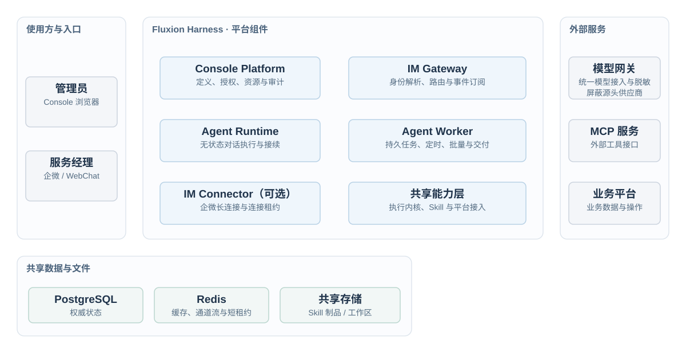

**图：系统组成与边界**

> 左侧是使用方与入口，中间是平台组件，右侧是外部服务，下方是共享数据与文件。Console 负责管理面；Gateway 负责请求接入；Connector 负责渠道长连接；Runtime 与 Worker 负责执行；共享能力层为执行面提供 Skill 与平台接入；模型网关是我们对接的外部模型供应入口，统一做脱敏与还原，并屏蔽源头模型供应商。

| 外部系统/依赖 | 依赖类型 | 交互内容 | 接口/协议 |
| ------------- | -------- | -------- | --------- |
| 企业微信 | IM 平台 | 用户消息、绑定、结果通知、附件 | WebSocket / 平台协议 |
| WebChat 浏览器 | 用户入口 | 登录、消息、事件流、历史 | HTTPS / SSE |
| 业务平台 | 外部业务系统 | 业务查询与操作 | 平台 HTTP 接口 |
| MCP 服务 | 外部工具服务 | 工具目录与工具调用 | MCP 协议 |
| 模型网关 | 模型供应服务 | 统一模型调用、脱敏与还原；屏蔽源头模型供应商 | 模型 HTTP 接口 |
| PostgreSQL | 数据库 | 控制面、运行态、任务态权威状态 | SQL |
| Redis | 缓存/消息 | 缓存、会话、通道流、去重、短租约 | Redis 协议 |
| 共享文件存储 | 文件存储 | Skill 制品、附件、结果、工作区 | 文件系统 / NFS |
| Nginx | 入口代理 | 页面、管理接口、聊天接口与事件流分流 | HTTPS / 反向代理 |
| 监控与日志 | 运维设施 | 指标、日志、链路与告警 | 运维接口 |

### 5.2 逻辑架构与模块划分

#### 5.2.1 逻辑视图

系统按用户入口、接入层、执行层、能力层和数据层组织；Console 作为管理面旁路，向接入层和执行层提供定义、授权和解析能力。

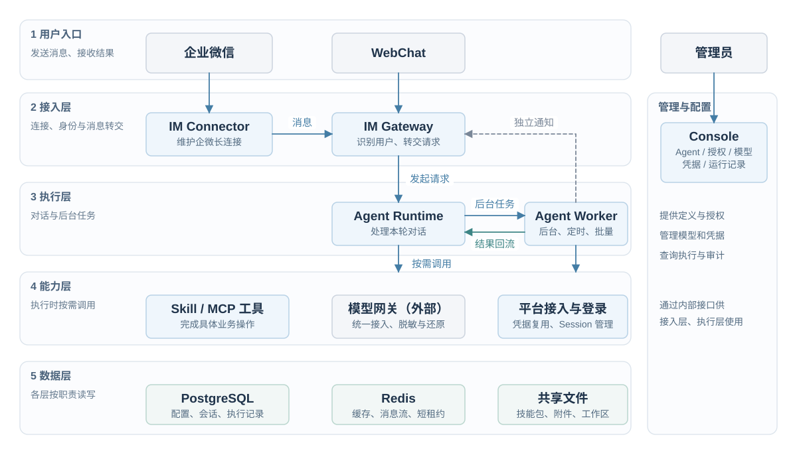

**图：逻辑分层**

> 先沿蓝色箭头看“入口 → 接入 → 执行”；需要后台处理时，从 Runtime 转给 Worker，结果沿绿色箭头回来。执行层按需调用下方能力，各层按职责访问数据。能力层的工具、平台接入和模型访问是内部能力，不是新增部署服务。

| 层次 | 主要组件 | 负责什么 |
| ---- | -------- | -------- |
| 用户入口 | 企业微信、WebChat | 发起请求、查看进度、接收结果 |
| 接入层 | Connector、IM Gateway | 维护渠道长连接、识别身份与权限、转交请求 |
| 执行层 | Agent Runtime、Agent Worker | Runtime 处理对话；Worker 处理后台、定时和批量任务 |
| 能力层 | Skill/MCP 工具、模型访问、平台接入与登录 | 为执行层提供业务工具、模型推理和受控的平台调用 |
| 数据层 | PostgreSQL、Redis、共享文件存储 | 保存权威状态、缓存和文件 |
| 管理配置 | Console Platform | 管理 Agent、用户授权、模型、凭据和审计 |

主要调用关系：

| 源 | 目标 | 关系 |
| -- | ---- | ---- |
| Connector | IM Gateway | 入站与出站事件经共享消息流传递 |
| IM Gateway | Agent Runtime | 提交 Run、订阅或重连持久事件流 |
| Agent Runtime | Agent Worker | 提交、取消异步任务 |
| Agent Worker | Agent Runtime | JOIN 结果回流；WebChat 后台结果写入会话收件箱 |
| Agent Worker | IM Gateway | 独立任务结果投递 |
| Gateway/Runtime/Worker | Console Platform | 解析定义、Bot、身份与授权 |
| Runtime/Worker | PostgreSQL、Redis、共享文件存储 | 状态、缓存与文件访问 |
| Runtime/Worker | 平台接入、模型池、外部模型网关 | 平台接入负责平台凭据与 Session；模型池负责成员与容量；外部模型网关负责脱敏、还原与供应商屏蔽 |

禁止的反向依赖：

- 执行面不反向依赖管理面的内部实现，跨面只走显式接口；
- 共享能力层不依赖任何部署单元；
- 接入面不承担 Agent 执行、Skill 执行和记忆写入；
- Worker 不复制第二套执行内核，Runtime 与 Worker 复用同一执行契约。

#### 5.2.2 模块功能说明

| 模块名 | 模块类型 | 功能说明 | 不负责 | 关联场景 | 详细设计文档 |
| ------ | -------- | -------- | ------ | -------- | ------------ |
| Console Platform | 管理服务 + Web 控制台 | Agent、Skill、MCP、模型池、用户与授权、项目平台与凭据、系统设置的定义、配置、发布与查询 | 不执行 Run、不调用模型、不持 IM 连接、不执行 Skill | SC-01、SC-02、SC-07、SC-08、SC-10 | 《03 Console Platform 详细设计》《14 用户范围与能力授权模型详细说明》《15 Console 字段词典与一致性规范》 |
| Agent Runtime | 无状态执行服务 | 受理 Run；领取执行；构建快照与上下文；调用模型、工具、Skill、MCP；持久化事件；SSE 订阅与续接 | 不执行后台 Task 的实际工作、不连 IM、不做管理面 CRUD、不保存本地权威状态 | SC-03、SC-04、SC-05、SC-06、SC-09、SC-10 | 《04 Agent Runtime 详细设计》《06 Skill SDK 与 Egress Boundary 详细设计》《08 关键流程、时序与状态机详细设计》 |
| Agent Worker | 无状态后台执行服务 | 领取 Task/Schedule；租约、心跳、重试、超时、取消；父子任务扇出与汇总；执行 Skill；结果回流与投递 | 不解析用户意图、不处理 IM 协议、不做管理面 CRUD、不复制第二套执行内核 | SC-05、SC-06、SC-07、SC-10 | 《10 Agent Worker 与异步任务详细设计》《08 关键流程、时序与状态机详细设计》 |
| IM Gateway | 无状态请求服务 | 消息接入、身份解析、授权校验、Agent 路由、命令处理、SSE 转换、投递入口；WebChat 与 IM 共用 | 不拼 Prompt、不执行 Skill、不保存记忆、不持渠道长连接、不持库 | SC-03、SC-04、SC-05、SC-09 | 《05 IM Gateway 详细设计》《07 跨模块接口与协议详细设计》 |
| IM Connector | 有状态运行时角色 | 维持渠道长连接；Bot 租约与接管；入站规范化、出站发送、附件收发 | 不做身份授权、不执行 Agent、不读写业务数据库、不提供公开业务入口 | SC-03、SC-04、SC-05 | 《05 IM Gateway 详细设计》《07 跨模块接口与协议详细设计》 |
| 共享能力层 | 共享库/能力包 | 执行内核（Agent Core：运行循环、上下文与工具调用）、工具/MCP/Skill 统一注册与执行规则、契约与公共支撑、消息内核、平台接入与 Session、制品访问 | 不是部署单元；不依赖任何应用模块；不共享 ORM、Repository 或业务服务 | 支撑全部场景 | 《06 Skill SDK 与 Egress Boundary 详细设计》《12 项目平台适配与 Session 详细设计》《07 跨模块接口与协议详细设计》 |
| 模型池 | 跨模块能力 | 管理逻辑模型、凭据、成员和额度组；执行面按冻结成员选择、预占容量、按用量结算；模型调用统一走外部模型网关 | 不是独立部署单元；不直接对外提供模型 API；不做跨型号替换；不直接对接源头模型供应商 | SC-04、SC-05、SC-06 | 《04 Agent Runtime 详细设计》《03 Console Platform 详细设计》 |

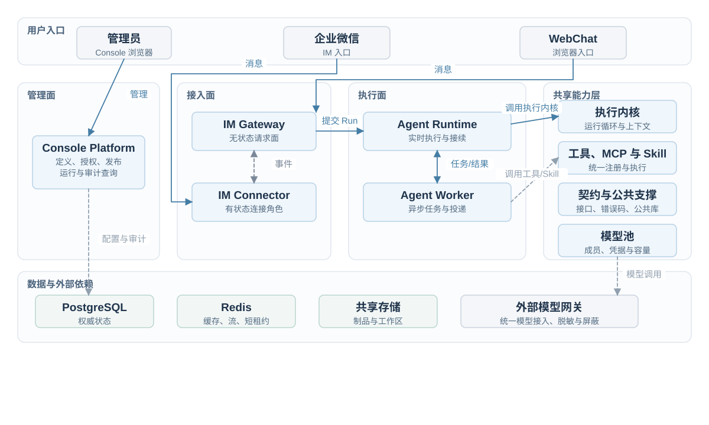

**图：模块依赖关系**

> 用户入口分管理与业务两类；管理面只提供定义、授权与查询；接入面把请求交给执行面；执行面复用共享能力层，模型请求经模型池调用外部模型网关；数据与外部依赖只作为被访问方。
>
> 共享能力层中的“执行内核”指 Agent Core 的运行循环、上下文与工具调用；“工具、MCP 与 Skill”指统一注册与执行规则；“契约与公共支撑”指跨模块接口、错误码和公共库。它们不是独立部署单元。

**依赖关系说明**

| 调用方 | 被调方 | 交互内容 |
| ------ | ------ | -------- |
| 管理员 | Console Platform | 配置 Agent、授权、模型与凭据，审批与导入 Skill |
| 企业微信 / WebChat | Connector / Gateway | 消息、事件流与回复 |
| Gateway | Runtime | 提交 Run、订阅或重连事件流 |
| Runtime ↔ Worker | 提交异步任务、回传任务结果 |
| Gateway / Runtime / Worker | Console Platform | 读取定义、Bot、身份与授权 |
| Runtime / Worker | 共享能力层 | 执行内核、工具/MCP/Skill、契约与公共支撑 |
| Runtime / Worker | PostgreSQL / Redis / 共享存储 | 权威状态、缓存与文件 |
| 模型池 | 外部模型网关 | 模型调用、脱敏与还原 |

**开发视图**：本总设不提供目录树、包图和编译依赖图。原因是设计文档是设计源头，工程目录与代码组织由研发规范维护，不作为架构契约；模块依赖关系图已经覆盖设计视角的依赖约束。

#### 5.2.3 模块职责与边界

模块的职责与不负责已经在上表列出，这里只补充跨模块边界原则和详细设计映射，避免重复描述：

- **管理面与执行面**：管理面只提供定义、授权、配置和查询；执行面通过显式接口读取，不反向依赖管理面的内部实现，执行状态也不写回管理面。
- **接入面与执行面**：接入面只做消息接入、身份解析、授权校验、路由和回复，不执行 Agent、Skill 或记忆写入；执行面不处理渠道协议。
- **执行面与连接面**：连接面有状态，执行面无状态；Bot 连接租约与 Run/Task 执行租约分开，互不替代。
- **执行面内部**：Runtime 与 Worker 复用同一执行契约和同一套工具、Skill、MCP 规则，不各写一套；Runtime 负责实时接续，Worker 负责持久任务。
- **共享能力层**：不是部署单元，不依赖任何部署单元；契约、执行内核、Skill SDK、平台接入、消息内核由执行面复用。
- **数据归属**：每个数据域只有一个责任方；跨数据域只读通过接口，不直接写别人的数据域。
- **模型调用**：模型池负责成员、凭据与容量；所有模型请求经外部模型网关做脱敏与还原；平台不直接对接源头模型供应商。

| 模块/能力 | 详细设计文档 |
| --------- | ------------ |
| Console Platform | 《03 Console Platform 详细设计》《15 Console 字段词典与一致性规范》《14 用户范围与能力授权模型详细说明》 |
| Agent Runtime | 《04 Agent Runtime 详细设计》《06 Skill SDK 与 Egress Boundary 详细设计》《08 关键流程、时序与状态机详细设计》 |
| Agent Worker | 《10 Agent Worker 与异步任务详细设计》《08 关键流程、时序与状态机详细设计》 |
| IM Gateway / Connector | 《05 IM Gateway 详细设计》《07 跨模块接口与协议详细设计》 |
| 共享能力层 | 《06 Skill SDK 与 Egress Boundary 详细设计》《12 项目平台适配与 Session 详细设计》《07 跨模块接口与协议详细设计》 |
| 数据与 DFX | 《02 核心领域与数据库详细设计》《09 DFX、安全、可靠性、测试与验收详细设计》 |

### 5.3 高层交互流程（子系统级）

本节按用户旅程组织，不按模块罗列。每个流程先给业务示例，再说明正常与异常；图后只补充图中未体现的约束，不重复图上的步骤。

#### 5.3.1 开通与绑定

##### 5.3.1.1 流程描述

- **对应需求/USE CASE：** SC-02、SC-03
- **示例场景：** 管理员在 Console 为服务经理生成绑定码 `7F3K9Q`（该服务经理负责客户 A），私下发给服务经理；服务经理在企业微信发送 `/bind 7F3K9Q`，完成绑定后即可对话。
- **正常场景描述：** 管理员在 Console 配好模型、Agent、用户授权、机器人账号和项目平台凭据后生成一次性绑定码；管理员私下把绑定码发给服务经理；服务经理在企业微信私聊发送绑定码；Connector 只做连接与规范化，Gateway 负责接入与回复，Console 校验一次性、有效期和租户后登记外部身份与入口授权。
- **异常场景描述：** 绑定码不存在、已使用、已撤销、已过期或租户不匹配时返回明确错误，不泄露外部身份是否存在；绑定失败不消费绑定码；外部身份已经属于其他平台用户时返回冲突，不覆盖已有映射。

##### 5.3.1.2 流程图与补充说明

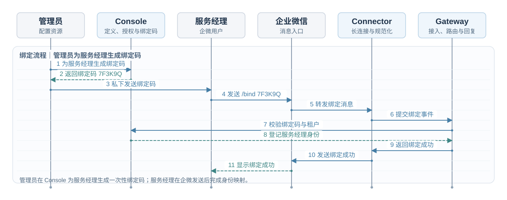

**图：开通与绑定**

> 管理员在 Console 为服务经理生成绑定码，并私下发给服务经理；服务经理在企微发送 `/bind` 后，Connector 只做连接与规范化，Gateway 负责接入和回复，Console 负责校验与登记。绑定流程不经过模型。

**补充说明**：

- 绑定码一次性、有有效期、只存哈希；绑定失败不泄露身份是否存在，也不消费绑定码。
- 绑定码由管理员线下发给服务经理，不通过 Agent 或模型转发。
- 外部身份已经属于其他平台用户时返回冲突，不覆盖已有映射。

#### 5.3.2 对话请求生命周期（企微 / WebChat）

##### 5.3.2.1 流程描述

- **对应需求/USE CASE：** SC-04、SC-09
- **示例场景：** 服务经理问“这条告警是什么意思”，这是一次纯模型对话；中途断网，重连后继续看到本轮解释；随后追问“80 端口呢”。
- **正常场景描述：** 用户从企业微信或 WebChat 发送消息；Gateway 校验身份与授权后提交 Run；Runtime 保存会话与快照、领取执行权，读取历史并调用外部模型网关；事件按序号持久化，Gateway 通过 SSE 或通道消息输出；断线后按最后确认序号重连；下一轮可以落到另一个 Runtime 实例。
- **异常场景描述：** 未绑定提示先绑定；无权限提示未授权；同一会话已有非终态 Run 时返回忙碌；实例故障由租约过期的回收机制接管；断流不等于取消，重连只回放持久事件。

##### 5.3.2.2 流程图与补充说明

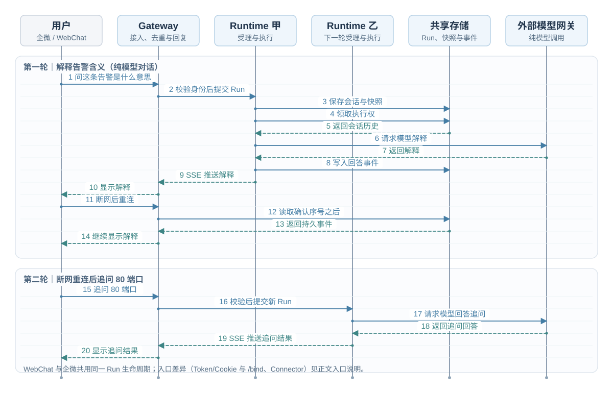

**图：对话请求生命周期**

> 第一轮是纯模型对话：用户问告警含义，Runtime 调用外部模型网关并输出解释，不调用 Skill、MCP 或工具。第二轮演示断网重连后的追问：重连只按序号回放持久事件，不重建 Run；下一轮可以由另一个实例执行。

**入口差异**

| 入口 | 认证/绑定 | 接入路径 | 流式与重连 | 停止 |
| ---- | --------- | -------- | ---------- | ---- |
| 企业微信 | `/bind <绑定码>` 绑定外部身份 | Connector → Gateway | 通道消息；按持久事件回放 | `/stop` |
| WebChat | 管理员签发 Token，用户换取 Chat Cookie | Gateway HTTP / SSE | SSE；按最后确认序号重连 | 页面停止按钮 |

**补充说明**：

- 本流程是纯模型对话，不调用 Skill、MCP 或内置工具；工具类请求见 5.3.3。
- Gateway 的身份与授权校验通过 Console 完成，图中合并为一步。
- WebChat 与企业微信只是两个入口，最终映射到同一平台用户，共用会话、记忆、任务和 Run 生命周期。
- 断流不等于取消；重连按持久序号回放；接收实例与执行实例可以不同。

#### 5.3.3 同步 Skill 执行

##### 5.3.3.1 流程描述

- **对应需求/USE CASE：** SC-04
- **示例场景：** 服务经理问“客户 A 昨天有哪些告警”；Agent 选择“告警查询”Skill，在沙箱执行并返回告警摘要。
- **正常场景描述：** Runtime 把 Agent 指令和本次生效的 Skill 目录交给外部模型网关选择；模型选择 Skill 后，Runtime 加载 Skill 正文与资源，在沙箱内执行；Skill 内部通过平台接入访问业务平台，工具结果持久化后再交给模型生成摘要，最后通过 Gateway 返回用户。
- **异常场景描述：** Skill 不在生效范围时拒绝执行；制品校验失败或不可用时明确失败；脚本超时、输出超限或沙箱不可用时按失败处理并保留审计；平台调用失败或模型网关脱敏/还原失败时显式失败，不把错误当成空结果。

##### 5.3.3.2 流程图与补充说明

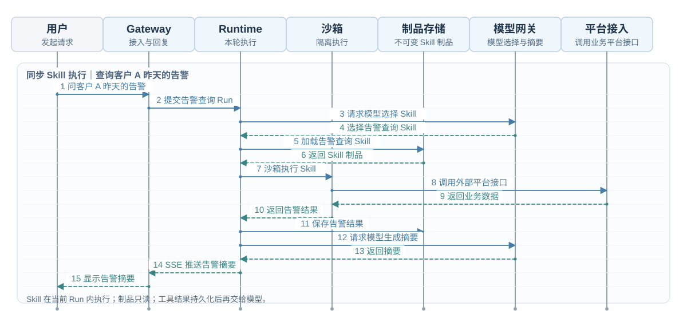

**图：同步 Skill 执行**

> 模型只负责选择 Skill；Runtime 负责加载制品、在沙箱执行、持久化结果和继续推理。沙箱内的 Skill 通过平台接入访问业务平台，模型请求经外部模型网关脱敏与还原。同步执行在当前 Run 内完成，不创建后台任务。

**补充说明**：

- 模型只选择 Skill，不决定同步或异步；执行方式由冻结的技能配置和平台规则决定。
- Skill 必须在本次生效范围；制品校验和一致才执行；MCP 与内置工具和 Skill 同属工具执行，不单独画用户旅程。
- 平台凭据与 Session 不进入 Skill 包或模型上下文；沙箱不可用、超时、输出超限或校验失败显式失败并审计。

#### 5.3.4 异步任务与结果回流

##### 5.3.4.1 流程描述

- **对应需求/USE CASE：** SC-05
- **示例场景：** 服务经理说“导出客户 A 近 30 天日报”；任务耗时较长，Runtime 提交异步任务。默认用 JOIN 把结果回流当前 Run；如果用户选择稍后通知，则用 DETACH 独立执行并推送。
- **正常场景描述：** Runtime 提交 Task；Worker 持久化受理并领取任务，执行日报 Skill 时先经平台接入调用业务平台获取业务数据，再经模型网关生成摘要；终态与结果在同一事务中保存；JOIN 模式把结果回传 Runtime，Runtime 续接原 Run 并继续输出；DETACH 模式独立完成，入口支持 PUSH 时投递结果。
- **异常场景描述：** 提交回执只表示受理，不代表业务成功；Worker 故障后由租约回收重试；重试耗尽或超过截止时间进入失败；重复结果按业务键幂等；DETACH 任务不受当前 Run 结束影响。

##### 5.3.4.2 流程图与补充说明

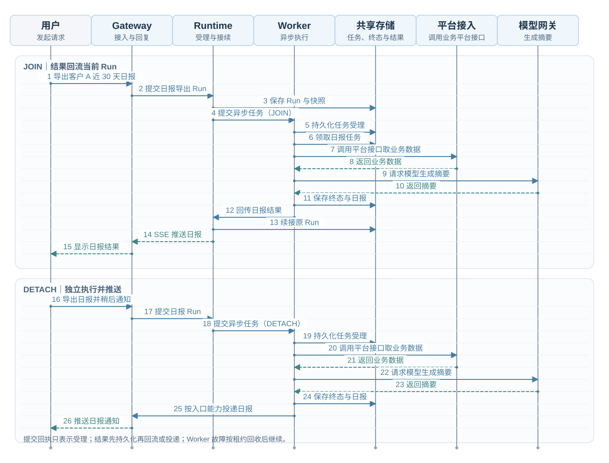

**图：异步任务与结果回流**

> 上半部分是 JOIN：Worker 先经平台接入取业务数据，再经模型网关生成摘要，然后把任务结果回传 Runtime，Runtime 续接原 Run 并返回用户。下半部分是 DETACH：Worker 独立完成，只有入口支持 PUSH 时才投递结果；WebChat 结果留在会话或任务中心。

**补充说明**：

- 第 12 步回传的是任务的结构化结果（摘要、状态、产物引用），不是裸 JSON；结果先持久化，再回流或投递。
- JOIN 是默认方式，结果回到当前 Run；DETACH 不续接原 Run，任务本身独立完成。
- 提交回执不等于业务成功；Worker 故障按租约回收；重试耗尽或超过截止时间才失败；结果重复按业务键幂等。

#### 5.3.5 定时与批量任务

##### 5.3.5.1 流程描述

- **对应需求/USE CASE：** SC-06、SC-07
- **示例场景：** 定时任务是“每天 9 点执行导出日报 Skill”；批量任务是“同时检查客户 A、B、C 的基线”。
- **正常场景描述：** Agent 创建定时计划；Worker 到点领取计划，重新校验授权并解析当前 Skill 版本，再创建任务；任务执行时先经平台接入取业务数据，再经模型网关生成摘要；完成后保存终态与结果；入口支持 PUSH 时自动投递，WebChat 结果留在会话。批量任务创建父子任务，子任务执行后汇总。
- **异常场景描述：** 计划过期、权限变化或配置不合法时不创建任务并记录原因；子任务按业务键幂等，回收后不重复扇出；子任务失败按聚合策略处理；用户连接断开不影响已受理计划。

##### 5.3.5.2 流程图与补充说明

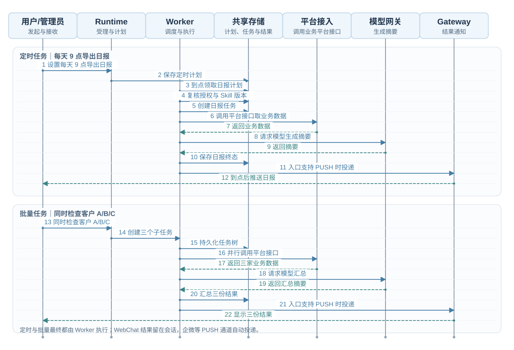

**图：定时与批量任务**

> 上半部分是定时：每天 9 点领取计划，先复核授权和当前 Skill 版本，再创建任务；执行时经平台接入取业务数据、经模型网关生成摘要；完成后只有入口支持 PUSH 才投递。下半部分是批量：同时检查客户 A、B、C，创建三个子任务，执行后汇总。

**补充说明**：

- 计划本身不永久冻结版本；触发时重新校验并解析当前 Skill 版本。
- 结果投递不是独立用户旅程，只在入口支持 PUSH（如企微）时发生；WebChat 结果留在会话。
- 批量按业务键幂等，回收后不重复扇出；用户连接断开不影响已受理计划。

#### 5.3.6 取消当前请求与恢复

##### 5.3.6.1 流程描述

- **对应需求/USE CASE：** SC-04、SC-05
- **示例场景：** 服务经理让 Agent 分析客户 A 的告警，运行中在 WebChat 点击停止（或在企业微信发送 `/stop`）；随后补充“只看最近 7 天”，恢复执行。
- **正常场景描述：** 用户停止当前 Run；Gateway 转发给 Runtime；Runtime 记录取消意图，取消未受理的异步提交和未结束的等待，返回已取消；用户补充有效输入后重新排队，Runtime 取得执行权并按原快照继续。
- **异常场景描述：** 已提交的外部动作能否撤回取决于外部系统；晚到结果只保留审计，不重启已结束的 Run；取消与终态并发时按幂等规则处理；定时任务的取消属于任务中心操作，不在本流程。

##### 5.3.6.2 流程图与补充说明

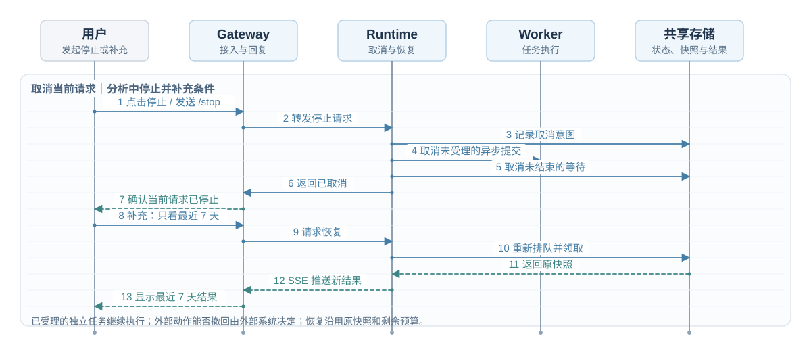

**图：取消当前请求与恢复**

> 这是 Run 级取消：入口可以是 WebChat 停止按钮或企业微信 `/stop`。取消先记录意图，再传播到未受理提交和未结束等待；用户补充输入后恢复，沿用原快照和剩余预算。它不是取消定时任务。

**补充说明**：

- 已受理的独立任务继续执行；外部动作能否撤回由外部系统决定。
- 晚到结果只保留审计，不重启已结束的 Run；取消是幂等的。
- 恢复沿用原快照、剩余预算和截止时间；等待用户输入与等待工具结果的触发方式不同。

#### 5.3.7 Skill 导入与自建

##### 5.3.7.1 流程描述

- **对应需求/USE CASE：** SC-08
- **示例场景：** 服务经理在 Console 写“检查 80 端口”Skill 草稿，沙箱测试后上传；管理员在 Console 审批通过。管理员也可以直接在 Console 导入 Skill，默认生效。
- **正常场景描述：** 服务经理写草稿、沙箱测试、上传后进入待审批；管理员在 Console 审批，通过后更新当前版本；管理员直接导入时，Console 校验并发布，默认生效，不再进入审批；后续 Run/Task 加载新版本，旧执行继续使用旧快照。
- **异常场景描述：** 校验失败返回具体原因；制品不可变，同版本不能覆盖；有活跃绑定时删除被拒绝；服务经理自建 Skill 未审批不生效；管理员直接导入默认生效。

##### 5.3.7.2 流程图与补充说明

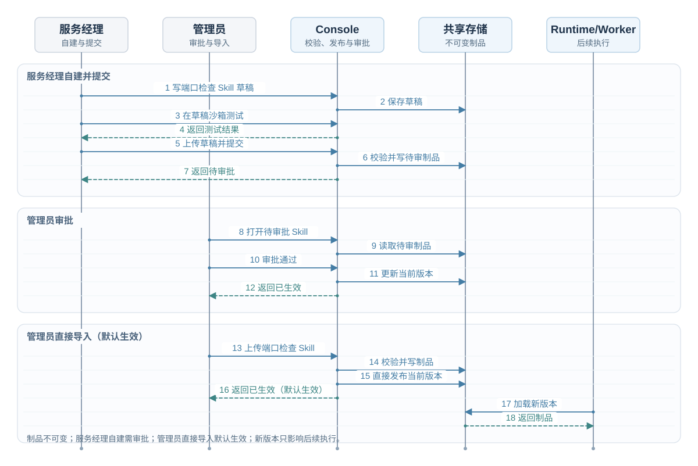

**图：Skill 导入与自建**

> 图分三个子流程：服务经理自建并提交、管理员审批、管理员直接导入。审批人就是管理员，不是独立节点；管理员直接导入默认生效。制品不可变，新版本只影响后续执行。

**补充说明**：

- 服务经理与管理员都是 Console 用户，不存在单独的“审批人”角色。
- 管理员直接导入默认生效，不再审批；服务经理自建必须经过管理员审批。
- 制品不可变；同版本不能覆盖；有活跃绑定时删除被拒绝；新版本只影响后续执行。

对象级状态机（Run、Task、Schedule、Delivery、制品审核、经验）属于模块详细设计，见《08 关键流程、时序与状态机详细设计》，本总设不展开。

### 5.4 数据域与接口概览

本节只说明三件事：数据由谁负责、哪一份是权威、模块之间用什么类别的接口交互。字段、表结构、接口参数和错误码见《02 核心领域与数据库详细设计》和《07 跨模块接口与协议详细设计》，不在总设重复。

**数据域与权威性**

| 数据域 | 保存什么 | 权威存储 | 责任方（写入） | 使用方（读取） | 一致性/生命周期 |
| ------ | -------- | -------- | -------------- | -------------- | --------------- |
| 控制面数据域 | Agent、Skill、MCP、模型池、用户与授权、项目平台与凭据、系统设置 | PostgreSQL | Console Platform | Console、Gateway、Runtime、Worker | 权威；管理操作提交后生效，版本可追溯 |
| 运行态数据域 | 会话、Run、快照、事件、用户记忆、执行审计 | PostgreSQL | Agent Runtime | Runtime、Gateway（按接口）、Console（按接口） | 权威；不可变事件只追加，快照按 Run 冻结 |
| 任务态数据域 | 定时计划、任务、租约、投递与任务事件 | PostgreSQL | Agent Worker | Worker、Runtime（按接口）、Gateway（按接口） | 权威；终态与投递记录同事务保存 |
| 制品数据域 | Skill 包、附件、结果文件 | 共享文件存储 | Console、Runtime、Worker | Console、Gateway、Runtime、Worker、Connector | 权威；写入后不可变，按校验和校验 |
| 工作区数据域 | 草稿、脚本执行工作区、输出 | 共享文件存储 | Console、Runtime、Worker | Console、Runtime、Worker | 权威；按租户、用户、Agent 隔离，有配额和清理策略 |
| 缓存与会话 | 授权缓存、去重、通道流、短租约、平台 Session | Redis | 各运行角色 | 各运行角色 | 非权威；可重建、可重放、可过期 |
| 本地缓存 | Skill 解压缓存、进程内缓冲 | 运行实例本地 | 各运行实例 | 本实例 | 可丢弃；下一次按需重建 |

数据归属原则：

- 每个数据域只有一个责任方；其他模块只读或通过显式接口请求，不直接写别人的数据域。
- 控制面不写运行态和任务态；运行态和任务态也不反向修改控制面定义。
- Redis 只做缓存、流和短租约，丢失后业务事实仍可从权威存储恢复。
- 制品不可变；工作区按租户、用户、Agent 分层，避免跨用户访问。

**接口概览**

| 接口类别 | 交互内容 | 调用方向 | 协议/契约 | 说明 |
| -------- | -------- | -------- | --------- | ---- |
| 用户入口 | 消息、事件流、历史 | 用户 → Gateway | HTTPS、WebSocket、SSE | 企业微信与 WebChat 共用接入面 |
| 渠道事件 | 入站与出站消息 | Connector ↔ Gateway | 共享消息流 | Connector 只做渠道适配与收发 |
| 实时执行 | Run 创建、事件订阅、取消、恢复 | Gateway → Runtime | 内部 HTTP、SSE | Run 事实由 Runtime 持久化 |
| 异步执行 | 任务提交、取消、结果回流 | Runtime ↔ Worker | 内部 HTTP、持久事件 | 提交、执行、回流分离 |
| 结果投递 | 独立结果通知 | Worker → Gateway | 受信内部接口 | 投递可重试、可去重 |
| 管理解析 | 定义、Bot、身份、授权 | Gateway/Runtime/Worker → Console | 受信内部接口 | 执行面只读控制面 |
| 数据访问 | 权威状态、缓存、文件 | 执行面 → PostgreSQL/Redis/共享存储 | SQL、Redis 协议、文件系统 | 按数据域责任方访问 |
| 外部能力 | 业务平台、MCP、模型 | 执行面 → 平台接入/模型池 → 外部模型网关 | 平台与模型协议 | 凭据在接入层；模型由外部网关脱敏与屏蔽源头供应商 |

### 5.5 部署与运行环境

#### 5.5.1 物理部署架构

默认部署四个业务单元：Console Platform、Agent Runtime、Agent Worker、IM Gateway；启用企业微信时增加 IM Connector。Nginx 作为浏览器入口，将管理、认证、聊天和事件订阅请求分流到 Console 或 Gateway。Runtime、Worker、Connector 和数据库不直接对用户暴露。

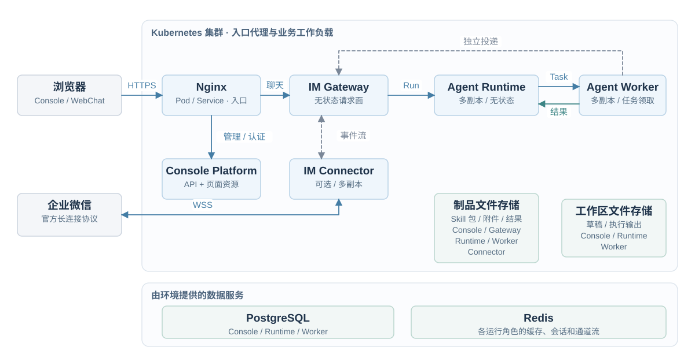

**图：部署拓扑**

> Nginx 与业务工作负载都在 Kubernetes 集群内；浏览器经 Nginx 进入，企业微信通过 WSS 直连 Connector。Runtime 与 Worker 多副本、无状态；Console 单 Pod；Connector 可选并按 Bot 租约分片。PostgreSQL、Redis 和两类共享文件存储由环境提供；数据库由运维脚本提前部署和升级，不作为集群工作负载。两类文件存储不是镜像仓库。

| 部署单元 | 作用 | 副本方向 | 关键说明 |
| -------- | ---- | -------- | -------- |
| Console Platform | 管理面 API 与页面资源 | 1 | 管理面，不跟随普通用户流量 |
| Agent Runtime | 实时执行面 | 多副本 | 按 Run 并发与资源使用扩展 |
| Agent Worker | 异步执行面 | 多副本 | 按任务队列深度与资源使用扩展 |
| IM Gateway | 无状态请求面 | 多副本 | 按消息吞吐与事件连接扩展 |
| IM Connector | 有状态连接角色 | 多副本 | 按 Bot 租约分片，不提供公开业务入口 |
| Nginx | 浏览器入口代理 | 多副本 | 页面、管理接口、聊天接口与事件流分流；企业微信不经过 Nginx |

| 外部资源 | 作用 | 访问方 |
| -------- | ---- | ------ |
| PostgreSQL | 控制面、运行态、任务态权威状态 | Console、Runtime、Worker |
| Redis | 缓存、会话、通道流、去重、短租约 | Console、Gateway、Runtime、Worker、Connector |
| 制品文件存储 | Skill 包、附件、结果文件；共享 RWX 文件存储，不是镜像仓库 | Console、Gateway、Runtime、Worker、Connector |
| 工作区文件存储 | 草稿、脚本执行工作区、输出；共享 RWX 文件存储 | Console、Runtime、Worker |

两类文件存储都是共享 RWX 文件存储（PVC），用于 Skill 制品、附件、结果、草稿和执行输出，不是容器镜像仓库；容器镜像由部署流水线单独构建。

#### 5.5.2 网络拓扑与容量规划

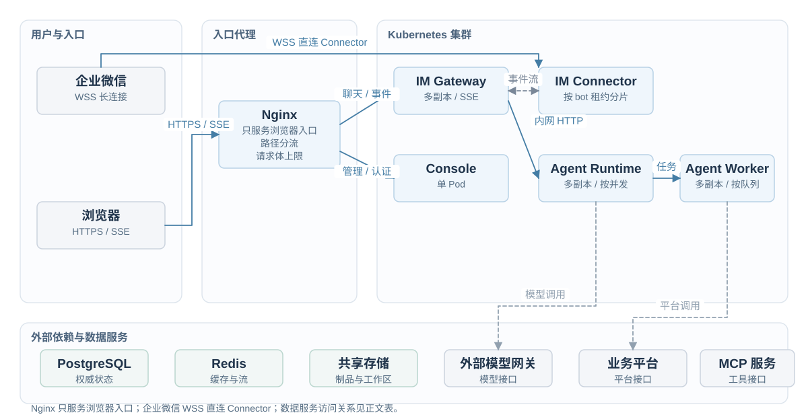

**图：网络拓扑与容量规划**

> 浏览器经 Nginx 进入，按路径把管理、认证、聊天和事件流分流到 Console 或 Gateway；企业微信通过 WSS 直连 Connector，不经过 Nginx。集群内 Runtime 与 Worker 横向扩展；数据库、缓存、模型、业务平台和 MCP 是外部依赖。容量规划同时受副本数、连接预算、模型额度和共享存储吞吐约束。

| 网络区域/节点 | 带宽/连接 | 容量指标 | 说明 |
| ------------- | --------- | -------- | ---- |
| 浏览器 → Nginx | HTTPS / SSE | 并发用户与事件连接 | 浏览器入口统一收敛 |
| 企业微信 → Connector | WSS | Bot 长连接数 | 直连长连接，不经过 Nginx |
| Nginx → Gateway | 内网 HTTP | 聊天请求与 SSE 连接 | 长连接需要连接预算 |
| Nginx → Console | 内网 HTTP | 管理面请求 | 管理面流量独立 |
| Gateway → Runtime | 内网 HTTP / SSE | 活跃 Run 与事件订阅 | 每个活跃 Run 占连接 |
| Runtime ↔ Worker | 内网 HTTP / 持久事件 | 任务提交与结果回流 | 不依赖调用方常驻 |
| 执行面 → 外部平台/模型 | 外部 HTTPS | 平台与模型额度 | 受外部容量约束 |
| 执行面 → PostgreSQL | SQL 连接 | 连接池与事务并发 | 按最大副本数核算 |
| 执行面 → Redis | Redis 连接 | 缓存、流与租约 | 支持单机与集群模式 |
| 执行面 → 共享存储 | 文件 IO | 吞吐、容量、延迟 | 制品、附件与工作区 |

容量目标：

| 项目 | 目标 |
| ---- | ---- |
| 用户规模 | 1000 用户 × 8 轮/600s，每人 1 个活跃 Run |
| 受理时延 | P95 ≤ 500ms，P99 ≤ 1500ms |
| 首帧时延 | P95 ≤ 1200ms |
| Runtime 副本 | 基线 8，按容量档位与资源使用扩展 |
| Worker 副本 | 基线 4，按任务队列深度与资源使用扩展 |
| Gateway 副本 | 基线 2，按消息吞吐与事件连接扩展 |
| Connector 副本 | 基线 2，按 Bot 租约分片扩展 |
| Console 副本 | 1，当前不承诺管理面高可用 |

容量结论以真实环境验收为准；总设只固定容量口径和扩展方向，不把规划值写成已验证结果。

### 5.6 质量属性设计

#### 5.6.1 性能设计

| 性能目标 | 设计方案 | 验证方法 |
| -------- | -------- | -------- |
| 请求受理稳定 | 请求先持久化，执行由空闲实例领取；受理与执行解耦 | 受理时延分位统计、并发压测 |
| 对话并发可扩展 | Runtime 无状态，增加副本即增加执行位 | 多副本压测与容量档位验收 |
| 后台吞吐可扩展 | Worker 从持久队列领取，按队列深度扩展 | 任务队列与吞吐压测 |
| 首帧可接受 | 事件按序号持久化并流式输出；不等待整轮完成 | 首帧时延统计 |
| 模型与平台等待不阻塞其他请求 | 异步执行与等待状态释放执行位；外部调用有超时与重试 | 故障注入与等待场景测试 |

#### 5.6.2 可靠性设计

| 可靠性目标 | 设计方案 | 验证方法 |
| ---------- | -------- | -------- |
| 实例故障不丢会话 | 权威状态在共享存储；实例只持租约期临时状态 | 实例终止与重连测试 |
| 长任务可恢复 | Worker 租约、心跳、回收、重试、截止时间 | 故障注入与回收测试 |
| 结果不丢 | 终态与待投递结果同事务保存；投递可重试可去重 | 投递故障与重放测试 |
| 缓存故障不丢事实 | Redis 只做缓存、流与短租约；事实在数据库和共享存储 | Redis 中断测试 |
| 外部依赖失败可控 | 超时、重试、退避、失败可见；不无限等待 | 平台与模型故障注入 |
| 连接可接管 | Connector 使用 Bot 租约与代次；旧连接不能覆盖新连接 | 连接接管测试 |

关键故障场景：

| 故障 | 预期行为 |
| ---- | -------- |
| Runtime 实例故障 | 执行租约过期后由回收机制接管；已持久化的等待可由其他实例接续；历史不丢 |
| Worker 实例故障 | 租约过期后其他 Worker 重新领取；投递按业务键去重 |
| PostgreSQL 不可用 | 失败关闭，不把状态写到本地；告警并等待恢复 |
| Redis 不可用 | 缓存缺失或去重降级；业务事实不丢 |
| 共享存储不可用 | 已缓存 Skill 可继续；未缓存 Skill 明确失败 |
| 模型限流或不可用 | 按截止时间与重试策略处理；不无限等待 |
| Connector 故障 | 租约过期后由其他 Connector 接管 |

#### 5.6.3 安全性设计

| 安全目标 | 设计方案 | 验证方法 |
| -------- | -------- | -------- |
| 用户身份可信 | 企业微信绑定与 WebChat 独立认证面；会话与凭据分离 | 认证与越权测试 |
| 授权前置 | 用户到 Agent、Agent 到 Skill/MCP、资源到用户范围三层校验；未授权能力不进入目录和工具集 | 授权矩阵与越权测试 |
| 租户隔离 | 业务数据、授权、制品与工作区按租户隔离；跨租户请求拒绝 | 跨租户测试 |
| 凭据不泄露 | 凭据只存在 Owner 数据域、临时内存和外部请求材料；不进入快照、事件、日志、模型上下文和 Skill 包 | 密钥扫描与日志审计 |
| 模型数据脱敏 | 所有模型请求经外部模型网关做占位符替换，响应在网关还原；模型网关不记录明文；平台不直接对接源头模型供应商 | 脱敏/还原测试、日志与审计检查 |
| 脚本不可信 | Skill 制品只读；脚本在沙箱执行；环境变量、网络与输出有界 | 沙箱逃逸与资源限制测试 |
| 平台调用受控 | Skill 只声明平台；凭据、Session 和请求准备由平台接入层负责 | 凭据隔离与重放测试 |
| 操作可审计 | 管理操作、工具调用、平台调用、投递和关键状态变化记录审计 | 审计完整性检查 |

模型脱敏是安全设计的固定部分：所有模型请求必须经外部模型网关，请求中的敏感数据替换为占位符，响应在网关还原；平台不直接对接源头模型供应商；模型网关不记录明文；脱敏或还原失败时拒绝发送并审计。

#### 5.6.4 可维护性设计

| 维护场景 | 支持措施 | 说明 |
| -------- | -------- | ---- |
| 模块定位 | 总设定义模块边界，详细设计按模块拆分 | 设计文档之间显式引用 |
| 配置治理 | 区分环境设置、平台设置和实现常量；配置有生效边界 | 配置盘点单独维护 |
| 数据库升级 | 发布前由运维脚本执行数据库升级；先升级再滚动服务 | 迁移与回滚有操作手册 |
| 故障定位 | Run、Task、Delivery、工具和平台调用都有持久记录 | 按请求与任务维度串联 |
| 环境隔离 | 开发、测试、验收、生产使用独立数据库、缓存与存储 | 不共用生产数据 |
| 版本追溯 | Skill 制品、Agent、模型和执行策略按快照冻结 | 能查清一次执行用了什么版本 |

#### 5.6.5 可观测性设计

| 调试场景 | 提供手段 | 接口/命令说明 |
| -------- | -------- | ------------- |
| 服务存活与就绪 | 健康探针与就绪探针 | 依赖缺失时就绪失败 |
| 请求执行过程 | Run 事件、工具事件、模型用量、审计 | 按请求序号查看 |
| 后台任务过程 | 任务事件、租约、重试、投递记录 | 按任务查看 |
| 外部调用 | 平台调用、模型调用、错误码与时延 | 不记录凭据与敏感正文 |
| 容量观察 | 副本数、队列深度、活跃执行、连接数、存储使用 | 指标与告警 |
| 安全审计 | 管理操作、授权变化、凭据使用、投递结果 | 审计查询与导出 |

#### 5.6.6 可扩展性设计

| 扩展场景 | 扩展设计方案 | 扩展方式说明 |
| -------- | ------------ | ------------ |
| 新增 IM 通道 | 实现通道适配器，接入统一消息与事件面 | 不改执行核心 |
| 新增业务平台 | 实现平台适配器，声明配置与凭据结构 | 复用平台接入与 Session |
| 新增 Skill | 以不可变制品发布，按审批与授权生效 | 不改 Runtime/Worker |
| 新增 MCP 服务 | 在控制面登记目录，执行面按快照使用 | 不改执行核心 |
| 新增模型能力 | 在模型池登记模型成员与凭据 | 通过外部模型网关接入，不改执行核心 |
| 增加执行副本 | 直接增加 Runtime/Worker 副本 | 不需要重新分配用户或 Bot |

#### 5.6.7 可测试性设计

| 测试类型 | 提供的测试支持 | 接口/工具说明 |
| -------- | -------------- | ------------- |
| 功能测试 | 模块接口、状态机和关键流程可独立测试 | 按场景编号组织 |
| 集成测试 | 模块间通过显式接口交互，可用真实依赖或受控替身 | 验收环境隔离 |
| 契约测试 | 模块间契约统一，消费者与提供者共同校验 | 防止跨模块漂移 |
| 端到端测试 | 从入口到执行、投递的完整旅程 | 真实构建产物与真实服务 |
| 压力测试 | 无状态执行面可水平扩展，支持多副本施压 | 容量档位与 SLO 统计 |
| 故障测试 | 实例、缓存、存储、模型和平台故障可注入 | 验证恢复与降级 |

---

## 6 风险与未决问题

### 6.1 风险清单

| 风险点 | 风险等级 | 风险预研结果/风险规避措施 | 责任人 | 计划解决日期 |
| ------ | -------- | ------------------------- | ------ | ------------ |
| 1000 用户 × 8 轮容量目标需要在目标拓扑与真实外部依赖下验证 | 高 | 容量档位、连接预算和 SLO 分开评估；规划值不能当作已验证结果 | 待填写 | 待填写 |
| 模型额度与供应商限流影响首帧和完成率 | 高 | 模型池容量预占、交互优先、排队与明确拒绝；按供应商分别观察 | 待填写 | 待填写 |
| 企业微信单机器人外部容量上限 | 中 | 连接侧按 Bot 租约分片；容量规划时单独核算外部平台限制 | 待填写 | 待填写 |
| 共享存储吞吐与可用性影响 Skill 加载和附件 | 中 | 本地缓存、校验和、失败可见；容量按制品与附件峰值核算 | 待填写 | 待填写 |
| Console 单 Pod，管理面不承诺高可用 | 中 | 明确管理面可用性边界；执行面不依赖 Console 常驻可用 | 待填写 | 待填写 |
| 多租户部署的运营与隔离复杂度 | 中 | 单租户部署用默认租户；多租户按入口与数据隔离设计，跨租户请求拒绝 | 待填写 | 待填写 |
| 旧项目迁移与兼容风险 | 中 | 保留已验证的业务旅程、绑定方式与 Skill 组织方式；迁移前做数据与流程核对 | 待填写 | 待填写 |
| 外部副作用无法撤回 | 中 | 取消只保证平台内停止；外部动作能否撤回由外部系统决定；审计保留晚到结果 | 待填写 | 待填写 |

### 6.2 尚未解决的问题

| 序号 | 问题描述 | 影响范围 | 计划解决方案 | 责任人 | 计划解决时间 |
| ---- | -------- | -------- | ------------ | ------ | ------------ |
| 1 | 产品型号、代号与正式版本号待确认 | 文档头、发布 | 由产品与版本经理确认 | 待填写 | 待填写 |
| 2 | 正式需求文档名称与版本待确认 | 需求追溯 | 以当前需求基线替换占位 | 待填写 | 待填写 |
| 4 | 多租户运营模式与部署边界 | 部署、隔离 | 按租户拆部署单元或统一入口，需结合运营要求确定 | 待填写 | 待填写 |
| 5 | Console 是否需要管理面高可用 | 部署、可靠性 | 结合管理面 SLA 评估 | 待填写 | 待填写 |
| 6 | 1000 用户 × 8 轮的全量容量验收环境 | 性能、发布 | 在目标环境执行并记录 | 待填写 | 待填写 |

---

## 附录 A 图目录

| 图名 | 所在章节 | 文件 | 读图重点 |
| ---- | -------- | ---- | -------- |
| 系统组成与边界 | 5.1 | 01-总体设计图/系统组成与边界.svg | 使用方、平台组件、外部模型网关与共享数据 |
| 逻辑分层 | 5.2.1 | 01-总体设计图/逻辑分层.svg | 入口、接入、执行、能力、数据与管理面 |
| 模块依赖关系 | 5.2.2 | 01-总体设计图/模块依赖关系.svg | 逻辑模块、共享能力与依赖方向 |
| 部署拓扑 | 5.5.1 | 01-总体设计图/部署拓扑.svg | 工作负载、入口、数据服务与存储 |
| 网络拓扑与容量规划 | 5.5.2 | 01-总体设计图/网络拓扑与容量规划.svg | 入口链路、集群内调用与外部依赖 |
| 开通与绑定 | 5.3.1 | 01-总体设计图/开通与绑定.svg | 绑定码、身份映射与回复 |
| 对话请求生命周期 | 5.3.2 | 01-总体设计图/对话请求生命周期.svg | 纯模型对话、入口差异、断线重连 |
| 同步 Skill 执行 | 5.3.3 | 01-总体设计图/同步Skill执行.svg | 模型网关、平台接入、沙箱执行与回填 |
| 异步任务与结果回流 | 5.3.4 | 01-总体设计图/异步任务与结果回流.svg | JOIN、DETACH、平台接入/模型网关、结果回流 |
| 定时与批量任务 | 5.3.5 | 01-总体设计图/定时与批量任务.svg | 计划触发、平台接入/模型网关、结果投递 |
| 取消当前请求与恢复 | 5.3.6 | 01-总体设计图/取消当前请求与恢复.svg | Run 级取消、等待恢复与快照沿用 |
| Skill 导入与自建 | 5.3.7 | 01-总体设计图/Skill导入与自建.svg | 自建提交、管理员审批、管理员直接导入 |

---

*文档结束*
