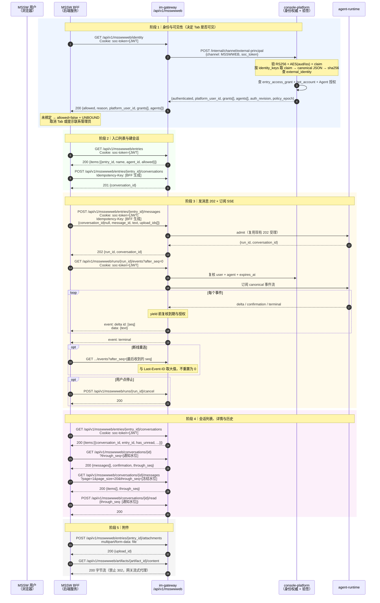

# MSSW 外部 IM 通道接入

上游 MSSW 平台新增智能客服能力，通过 BFF 调用本系统。本目录只保留**协议事实**与**BFF 对接视角**的参考，需求基线、设计与任务以 `.code-flow/tasks/2026-11-13/mssw-external-im-channel/` 为准。

## 一分钟了解

新增 `MSSWWEB` 通道，BFF 是**后端服务**，带 JWT 直接转发请求过来。**验签在 Console**（网关不持因子、不持库），验签后按平台配置的 `identity_keys` 解析身份，映射到我方平台用户，再复用现有会话能力。`MSSWWEB` 通道名对应 `platform_key=mssw`。会话在 **Web 面（`WEBCHAT`/`MSSWWEB`）按 user+Agent 跨入口共享，企微不进入 Web 列表**。

**通用化边界**：这是「JWT 类外部平台」的通用方案。新增同类平台只加平台配置与入口，不复制 handler；参数化改造与接入旅程见 `.code-flow/.../mssw-external-im-channel.backend.design.md` §3.1.3。若将来接非 JWT 平台（OAuth2、mTLS），身份模型与会话层可复用，认证适配层需另写。

**通道命名规范（接入新平台必读）**：平台配置里的 `channel` 必须形如 `^[A-Za-z0-9]+web$`（以 `web` 结尾、其余为字母数字，如 `MSSWWEB`、`MSSPWEB`）。它决定路由前缀 `/api/v1/<channel 小写>`，反代用一条正则覆盖所有外部平台前缀；不遵守会让前端通道选不通或请求 404，且无明确报错。**环境标识（UAT/PRD）放 `display_name`，不要放进 `channel`**（`MSSPWEBUAT` 这类命名不合法）。

## 文档地图

| 文档 | 内容 |
|---|---|
| [01-jwt-spec.md](./01-jwt-spec.md) | **协议事实权威**：JWT 结构、AES 细节、claim 清单、真实 token 实测报告 |

需求 / 设计 / 决策 / 旅程 / 接口映射等，见 `.code-flow/tasks/2026-11-13/mssw-external-im-channel/`（`mssw-external-im-channel.prd.md`、`.backend.design.md`、`.frontend.design.md`、`.decisions.md`、`.scenarios.md`）。

---

## BFF 视角：一次完整对话的调用链

所有请求由 BFF 服务端携带 `soc-token` Cookie 发出（非浏览器跨站，Cookie 可正常送达）。**BFF 需在转发前自行校验 token 有效性**——我方只做签名与 claim 校验，不判吊销（吊销状态在 MSSW 侧，我方无数据源）。

### 图上几个 BFF 必须知道的点

**身份只有一条路**：所有请求都是 `Cookie: soc-token=<JWT>`。网关把 token 原样交给 Console，由 Console 验签并解析身份。BFF 不需要传任何身份参数，也**不需要** `X-Chat-Context` 之类的自定义头。

**`entry_id` 从 `/entries` 拿**：入口授权是用户级的（一个用户可能被授权多个入口），所以 `/identity` 和 `/entries` 返回的是**授权列表**，不是一个固定值。发消息、建会话、传附件的路径段用列表里的 `entry_id`。

**身份字段由平台配置决定**：MSSW 的 `identity_keys` 是 `["expert_id", "tenant_id"]`（`expert_id` 即 JWT 的 `_id`）。取出来按 key 排序后算 `sha256`，命中 `external_identity` 才算已绑定。**管理员绑定时填的 JSON key 集合必须与 `identity_keys` 完全一致**。

**幂等靠 `Idempotency-Key`**：BFF 重试时原样回传同一个 key，保证不重复执行/不建第二个会话。`conversation_id` 由我方生成，BFF 存下来复用即可，**不需要维护映射表**。

**两套序号不要混**：

| 面 | 入参 | 出参 |
|---|---|---|
| 事件流（SSE） | `after_seq`（query）+ `Last-Event-ID`（header），**取大值** | 帧 `id: <seq>` |
| 历史分页 | `page` + `page_size` + `through_seq` | `items[]` + `through_seq` |
| 会话已读 | `{through_seq}`（**通知水位**） | — |

消息序号与通知序号是**两套不同的序列**，只作为同一次详情视图的配对水位使用，**不能互相比较**。

**`CURSOR_EXPIRED` 是正常情况**：用户关页面一整天再回来，游标过期是预期行为，BFF 应当作"重新拉历史"的信号，不要弹错误框。

**错误码**：

| 码 | HTTP | 场景 |
|---|---|---|
| `EXTERNAL_ASSERTION_INVALID` | 401 | 缺失/签名错/格式错/`aud`/`iss`/身份 key 缺失 |
| `EXTERNAL_ASSERTION_EXPIRED` | 401 | 超出最大会话年龄 |
| `EXTERNAL_ASSERTION_UNBOUND` | 403 | 工号未绑定到我方用户 |
| `EXTERNAL_ASSERTION_UNAVAILABLE` | 503 | Secret 未配置/损坏（不影响其它通道） |
| `CURSOR_EXPIRED` | 409 | 事件流游标超出保留窗口 |

---

## 已实测确认的事实

2026-11-13 用 MSSW 开发环境真实 token 验证通过（详见 [01](./01-jwt-spec.md) §5）：

| 项 | 结论 |
|---|---|
| 算法 | RS256，**必须加白名单**（签发方自己没做） |
| `exp` | **恒为 -1，服务端不校验**，无过期语义；新方案另加最大会话年龄兜底 |
| `aud`/`iss` | AES-256-ECB 密文；**加密期望值比对**；`iss` 是**单元素数组** |
| AES key 派生 | **`salt` 右侧补 `\x00` 到 32 字节**（`salt` 长度须 ≤32），PKCS#7 补位 |
| 身份字段 | `_id`（专家 ID，24 位 ObjectId）+ `tenant_id`；`job_number` 是工号，明文 |
| 加密字段 | 仅 `email`/`email_login`/`phone_login`，不填不落库 |
| 公钥 | PKCS#1（`BEGIN RSA PUBLIC KEY`），PyJWT 可直接加载 |
| token 位置 | Cookie `soc-token`，是**唯一凭据** |

实测解出 `job_number=14806`、`_id=6a4ca2554a2a45d4b1ad5996`，`alg=none` 攻击被拒。

> **注意**：`easm-exposure-service-mssw` 的 `py_jwt_cipher.py` 是 **CBC 模式、key 由三段拼接**，与 MSSW token 的 ECB 无关，不要照抄。
