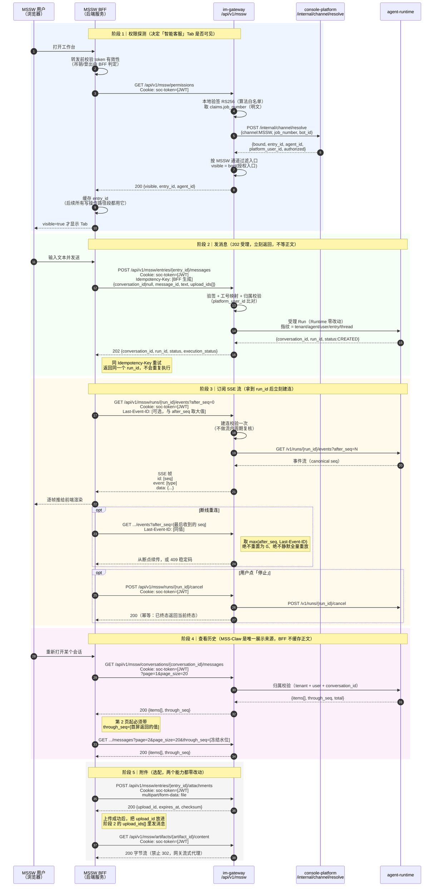

# MSSW 智能客服通道接入

上游 MSSW 平台新增智能客服能力，通过 BFF 调用本系统。本目录是需求梳理与规格分析的归档。**尚未进入 `cf-task:prd` 正式流程。**

## 一分钟了解

**要做什么**：在 `im-gateway` 加一个 MSSW 通道。BFF 是**后端服务**，带 JWT 直接转发请求过来，我们验签 → 用工号匹配本地用户 → 复用现有会话能力。

**关键认知**：这不是从零建一套聊天服务，而是**给现有 WebChat 能力换一个身份入口**。BFF **直接适配我方现有接口**，我们不需要实现它那套 `/internal/agent-provider/v1/*` URL。8 个能力里 **3 个零改动**（取消、附件下载、历史分页）、**3 个只加同构路由**（发消息、建会话、传附件）、**1 个换 Guard**（SSE）、**1 个新增但判定复用**（权限）。真正全新的只有 **JWT 验签器**。

## 文档地图

| 文档 | 什么时候看 |
|---|---|
| [01-jwt-spec.md](./01-jwt-spec.md) | JWT 规格 + 实测验证（结构、AES 细节、密钥配置、真实 token 验签报告） |
| [02-requirements.md](./02-requirements.md) | **主干文档**：需求定位、已定边界、R1-R8 分解、约束与风险 |
| [03-open-questions.md](./03-open-questions.md) | 决策记录与历史问题（当前全部闭合） |
| [04-user-journeys.md](./04-user-journeys.md) | 要理解端到端流程；附录 A 会话归属、附录 B 游标 |
| [05-interface-mapping.md](./05-interface-mapping.md) | 要实现接口时查逐条对照与请求/响应契约 |

---

## BFF 视角：一次完整对话的调用链

下面是 BFF 从"判断有没有权限"到"拿到流式回复"的完整时序。**所有请求都由 BFF 服务端携带 `soc-token` Cookie 发出**（非浏览器跨站，Cookie 可正常送达）；BFF 需在**转发前自行校验 token 有效性**——网关不做这件事（见 `02` §3.3.1）。

### 图上几个 BFF 必须知道的点

**身份只有一条路**：所有请求都是 `Cookie: soc-token=<JWT>`。网关本地 RS256 验签，取 `job_number`（明文），再经 Console `resolve` 换成 `platform_user_id` + `entry_id` + 授权集合。BFF 不需要传任何身份参数。

**`entry_id` 只在一个地方拿到**：`GET /api/v1/mssw/permissions` 的响应。它是 `bot_account.id`，单入口下**永远同一个值**（详见 `05` §4.1.1）。后续发消息、建会话、传附件的路径段都用它。

**幂等靠 `Idempotency-Key`，不靠 `conversation_id`**：BFF 重试时原样回传同一个 key，网关保证不重复执行/不建第二个会话。`conversation_id` 由我方生成并返回，BFF 存下来用即可，**不需要维护映射**。

**两套游标不要混**：

| 面 | 入参 | 出参 |
|---|---|---|
| 事件流（SSE） | `after_seq`（query）+ `Last-Event-ID`（header），**取大值** | 帧 `id: <seq>` |
| 历史分页 | `page` + `page_size` + `through_seq` | `items[]` + `through_seq` |

两者**是同一个 canonical seq 空间**（`through_seq` 与 `after_seq` 可直接续接），但**调用方式不同**：SSE 用 seq，分页用 `page`+冻结水位。

**`CURSOR_EXPIRED` 是正常情况**：用户关页面一整天再回来，游标过期是预期行为，BFF 应当作"重新拉历史"的信号，不要弹错误框（见 `04` 附录 B.6）。

**验签失败一律 401**，fail-closed 不降级；`MSSW_JWT_INVALID` / `MSSW_USER_NOT_MAPPED` / `MSSW_CHANNEL_FORBIDDEN` / `MSSW_CHANNEL_NOT_CONFIGURED` 是四个稳定错误码（`03` D3）。

---

## 已实测确认的事实

2026-11-13 用 MSSW 开发环境真实 token 验证通过（详见 [01](./01-jwt-spec.md) §5）：

| 项 | 结论 |
|---|---|
| **身份字段** | **`job_number`**（5-7 位工号），全局唯一 |
| `_id` | 专家 ID（24 位 ObjectId），**不作映射键** |
| 算法 | RS256，**必须加白名单**（签发方自己没做） |
| `exp` | **恒为 -1，服务端不校验**，无过期语义 |
| `aud`/`iss` | AES-256-ECB 密文；校验时加密期望值比对，**无需解密** |
| 加密字段 | 仅 `email`/`email_login`/`phone_login`，`job_number` 是明文 |
| 公钥 | PKCS#1（`BEGIN RSA PUBLIC KEY`），PyJWT 可直接加载 |
| token 位置 | Cookie `soc-token` |

实测解出 `job_number=14806`，`alg=none` 攻击被拒。

## 工作量的真实分布

| 类别 | 内容 |
|---|---|
| **全新** | JWT 验签器（中）、`MsswPrincipalDep`（小）、MSSW Guard（小）、通道适配器（小） |
| **直接复用** | 取消 100%、附件下载 100%、历史分页 95%（`page`+`through_seq` 直接透传，仅换身份依赖与路由前缀） |
| **只加同构路由** | 发消息 100%、新建会话 100%、上传附件 100%（路径形状同 WebChat，service 层一行不改） |
| **新增路由、判定复用** | 权限查询 90%（`/permissions` 返回布尔 + `entry_id`，谓词复用 `list_entries`） |
| **换 Guard** | SSE 事件流 90% |
| **不用改** | Runtime 全部接口、Console resolve、现有 WEBCHAT/WECOM |

**但"service 层一行不改"只对上述三个同构路由成立**——`WEBCHAT_CHANNEL` 有 **6 处写死必须参数化**：

| # | 位置 | 不改的后果 |
|---|---|---|
| ① | `list_entries`（`webchat_service.py:214`） | MSSW 入口被过滤，`/permissions` 恒 false |
| ② | `resolve_authorized_entry`（`:489`） | MSSW 入口一律 404 |
| ③ | `submit_message` 的 `InboundEvent(channel=...)`（`:237`） | 事件标错通道 |
| ④ | 同方法 `adapter=WEBCHAT_CHANNEL_IDENTITY`（`:257`） | 受理走 WebChat 适配器身份 |
| ⑤ | `create_conversation` 的 `ChannelContext(type=...)`（`:286`） | 会话记成 WebChat |
| **⑥** | **`_run_request`（`webchat_core.py:69`）** | **消息真正写进 Runtime 的通道**；`submit_message` 只构造 `InboundEvent` 交给 `admit_sync`，组装 `RunRequest.channel` 在 `_run_request`。**漏改 ⑥，③④ 无效** |

> **①→② 有顺序依赖**：① 产出的入口快照是 ② 的输入，只改 ② 仍会 404，**必须一起改**。
>
> 完整清单与论证见 `02` §3.6、`05` §4.2。

## 必须记住的五条约束

1. **不改动其它通道**——独立适配器 + 独立路由前缀 + 独立身份依赖（`MsswPrincipalDep` 与 `ChatIdentityDep` 并列）
2. **游标只透传不改写**，`after_seq`/`Last-Event-ID` 取大值，不得重置为 0
3. **归属校验不能只凭 `run_id`**——Runtime 的 `_load_run_in` 不带 user_id，必须调用方补
4. **SSE 不做流内复核**——`exp` 无意义，`ChatStreamGuard` 不能沿用
5. **验签留在网关、token 有效性由 BFF 判**——我方只验签 + 映射；是否吊销/有效由 BFF 转发前判定（上游只有 BFF）

## 当前状态

**可以立即动工（全部 R1-R8），无阻塞项。**

已定案的决策（只差写进代码）：

| 决策 | 结论 |
|---|---|
| D1 依赖 | 只加 `PyJWT` 一个（`cryptography` 已在依赖树中） |
| D3 错误码 | 四个稳定码，见下文 |
| D5 用户映射 | 建用户时 `user_code` 填工号，另建 `channel_identity` |
| Q5 密钥 | 固定不轮换，按静态单密钥配置读取 |
| Q18 选配未开 | 404 `MSSW_CHANNEL_NOT_CONFIGURED` |
| Q19 建会话幂等 | 以我方 `Idempotency-Key` 为准，BFF 不传 `conversation_id` |
| Q20 历史分页 | 直接复用我方 `page`+`page_size`+`through_seq`，不做游标转换 |

**唯一还缺的外部输入**：M5 生产环境 `issue`/`audience`/`salt`/公钥——需求方明确"后续会给"。**只阻塞生产联调**，开发环境值已实测确定。

已搁置：Q11 `exp` 真实机制、Q12 token 吊销（需求方"先不关心"）。

完整清单见 [03](./03-open-questions.md)。

## 结构化风险

| 风险 | 后果 |
|---|---|
| `run_id` 单独可达 | 越权漏洞（Runtime 不校验 user_id，必须调用方补） |
| **历史 token 重放** | `exp` 无意义、吊销不可见。**责任前移给 BFF**（转发前校验 token 有效性，上游只有 BFF）；`entry_id` 不透明挡住了"凭空新建"，但读/操作已有会话靠 ID 不公开（归属校验按 `platform_user_id`，挡不住同工号重放）。见 `02` §3.3.1 |
| `CURSOR_RUN_MISMATCH` 无人抛 | Runtime 零命中，需网关自行判定 |
| `CURSOR_EXPIRED` 补全未实现 | 现有只抛错不补全 |

## 关键源码位置

| 位置 | 用途 |
|---|---|
| `apps/im-gateway/.../api/webchat.py` | 16 个现成接口的全部原型 |
| `apps/im-gateway/.../application/webchat_service.py:224-271` | **202 受理语义**（`messages` 直接复用） |
| `apps/im-gateway/.../api/webchat.py:208-219` | `_resume_cursor` 取大值逻辑 |
| `apps/im-gateway/.../channels/webchat.py` | 新通道的参照模板 |
| `apps/im-gateway/.../channels/registry.py` | 通道装配入口 |
| `apps/im-gateway/.../api/deps.py:109-147` | CHAT 身份依赖（MSSW 需并列新增） |
| `apps/im-gateway/.../application/chat_principal.py:184-207` | CHAT StreamGuard（**不可复用**） |
| `apps/im-gateway/.../application/inbound.py:836-849` | 外部用户 → Console resolve 的写法 |
| `apps/console-platform/backend/.../application/channel_service.py:81-129` | 工号映射与授权判定 |
| `apps/console-platform/backend/.../infrastructure/models/channel.py:57-90` | `ChannelIdentity` 表 |
| `apps/agent-runtime/.../application/webchat_history.py:340-349` | 会话归属校验 |
| `apps/agent-runtime/.../application/event_tail_hub.py:659-675` | 游标 AHEAD/EXPIRED 判定 |
| `packages/contracts/.../webchat_events.py:190-206` | `validate_run_cursor`（含 RUN_MISMATCH） |
| `packages/contracts/.../enums.py:7` | 通道标识声明处 |
