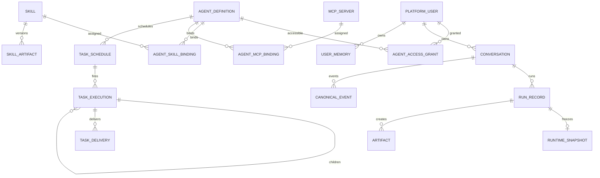

# 核心领域与数据库详细设计

> 本文是跨模块的数据域基线，描述数据归属、核心对象、关系、状态与不变量。字段级结构以迁移和实现为准，不在本文逐表复制。

## 1. 设计原则

- PostgreSQL 是权威事实源；Redis 只做缓存、流、去重与短租约。
- 只使用 `control`、`runtime`、`task` 三个逻辑 schema 作为产品数据域。
- 业务表统一带 `tenant_id`、`is_deleted`、`create_time`、`update_time`；查询必须带租户与软删谓词。
- 跨 schema 只做逻辑 UUID 引用，不建物理外键；允许只读聚合，但必须复刻对方的租户、软删与归属谓词。
- Secret/凭据明文只存 Owner 表；不进入 Snapshot、CanonicalEvent、Prompt、日志与普通业务表。
- 不可变事实只追加：CanonicalEvent、TaskEvent、审计、历史版本。
- Artifact 与 Workspace 文件在共享文件存储，DB 只保存相对 `storage_key` 与元数据。

---

## 2. Schema 与数据域

| Schema | Owner | 主要内容 | 写入方 |
| ------ | ----- | -------- | ------ |
| `control` | Console Platform | 用户/认证、Agent、模型、Skill、MCP、授权、Bot、项目平台与凭据、配置审计、平台设置 | Console |
| `runtime` | Agent Runtime | 会话、Run、Snapshot、事件、记忆、学习/经验、产物、中断、工具/模型/平台审计、容量与准入 | Runtime；Worker 仅通过共享端口写审计/产物 |
| `task` | Agent Worker | Task、Schedule、Fire、租约、检查点、人工交互、投递、工作区、任务事件 | Worker |

### 2.1 控制面数据域

| 数据组 | 核心对象 | 说明 |
| ------ | -------- | ---- |
| 用户与认证 | 平台用户、Console 账号/会话、CHAT Token/会话、认证缓存同步状态 | 管理面登录与独立 CHAT 认证面 |
| Agent 与模型 | Agent 定义、模型定义、模型凭据、额度组、模型部署 | Agent 冻结模型 revision；模型池按成员/额度管理 |
| Skill | Skill、不可变制品、草稿、Agent 绑定、指定用户授权、导入幂等 | 制品不可变；版本只前进；删除为软删 |
| MCP | MCP Server、Agent 绑定、指定用户授权、工具目录 | 目录 revision/hash 随快照冻结 |
| 授权 | AgentAccessGrant、SkillUserGrant、McpUserGrant | 三层关系：用户→Agent、Agent→资源、资源→用户范围 |
| 入口 | BotAccount、ChannelIdentity、BindCode、入站审计 | `bot_id` 全局唯一；身份映射按租户 |
| 项目平台 | ProjectPlatform、用户/共享凭据、产物投递审计 | 凭据明文存 Owner 表；Adapter 元数据来自代码 |
| 配置与设置 | 配置审计、审计导出任务、平台设置、设置幂等 | 平台设置 append-only；配置变更审计 |
| 学习/经验 | 控制面只读投影/治理入口 | 权威运行数据在 `runtime` |

### 2.2 运行时数据域

| 数据组 | 核心对象 | 说明 |
| ------ | -------- | ---- |
| 会话 | Conversation、ChannelConversation、ChannelUpload、通道通知/通知流、消息投递/尝试 | 会话归属入口；历史与通知可重建/可重放 |
| Run | RunRecord、RuntimeSnapshot、CanonicalEvent、RunInterrupt、RunSubmission | Run 状态、owner/epoch/lease、冻结快照、不可变事件 |
| 产物 | Artifact、附件引用 | 不可变；DB 只存相对 key/元数据 |
| 记忆 | UserMemory、MemoryScope、MemoryConflictCandidate、UserMemoryHistory、MemoryCommandReceipt、MemoryConsolidationJob | Runtime 唯一写入；稳定 key；历史 append-only |
| 学习/经验 | EvalCase/Report、LearningFamilyControl、LearningJob、FamilyRunStat | 经验候选/试用/启用/退役 |
| 执行审计 | 工具调用审计、平台调用审计/接口汇总/审计缺口、模型调用审计 | 只追加；脱敏；按保留策略 |
| 容量/准入 | ModelCapacity、RunAdmissionPolicy、ToolOperation、ToolResultInbox | 容量预占、受理阈值投影、异步操作与收件 |

### 2.3 任务数据域

| 数据组 | 核心对象 | 说明 |
| ------ | -------- | ---- |
| 计划 | TaskSchedule、ScheduleRevision、ScheduleDraft、ScheduleFire | 计划不永久冻结版本；触发时重解析 |
| 任务 | TaskExecution、Checkpoint、HumanInteraction、TaskSubmission | 状态、租约、attempt、deadline、父子关系 |
| 投递 | DeliveryRoute、TaskDelivery、TaskDeliveryAttempt、MessageOutbox | 终态与投递意图同事务；投递可重试 |
| 工作区 | Workspace、WorkspaceLease | 按 tenant/user/agent；配额、TTL、执行租约 |
| 事件 | TaskEvent | 状态/步骤/错误事实，只追加 |

---

## 3. 核心领域关系

关系说明：

1. **控制面定义与授权**：用户 → Agent、Agent → Skill/MCP、资源 → 用户范围三层表达；`ALL` 只放宽用户范围，不绕过 Agent 绑定。
2. **入口与身份**：BotAccount 决定 `bot_id → agent_id`；ChannelIdentity 决定外部身份 → 平台用户；两者都不绑定 Runtime/Worker Pod。
3. **运行态事实**：Conversation → RunRecord → Snapshot/Event/Artifact；Snapshot 冻结版本，不记录 Pod。
4. **任务态事实**：Schedule 表达何时触发，TaskExecution 表达一次实际执行；父子任务表达批量；Delivery 表达结果去哪。
5. **无状态约束**：ER 中刻意不存在 Runtime/Worker Pod 与 Agent/Bot 的绑定关系；执行者只用 `lease_owner`/epoch 临时表达。

---

## 4. 关键对象与不变量

### 4.1 控制面

- **Agent**：逻辑定义；`revision` 用于乐观并发；Run 使用冻结 revision，后续更新不影响已创建 Run。
- **Skill**：`current_artifact_id` 只是新执行默认版本；旧 Run/Task 继续引用旧制品。
- **Skill Artifact**：不可变；同 `skill_id + version` 不可覆盖；checksum 校验；删除为软删。
- **MCP**：`enabled` 是管理员是否允许使用；`connection_status` 是连接/发现结果；工具目录有 revision/hash。
- **授权**：AgentAccessGrant 是用户进入 Agent 的第一层；Skill/MCP 指定用户授权是资源级，不是三元关系。
- **Bot/身份**：`bot_id` 跨租户全局唯一；绑定码只存哈希、一次性、有有效期。
- **ProjectPlatform/凭据**：凭据明文存 Owner 表；Session 不落业务表；Adapter key/version 参与审计与 Session key。
- **平台设置**：append-only 版本行；当前版本 = 最大 revision；回滚也是插入新版本。

### 4.2 运行态

- **Run**：状态 `CREATED/RUNNING/WAITING_TOOL/WAITING_INPUT/COMPLETED/FAILED/CANCELLED`；同一会话最多一个非终态 Run。
- **Snapshot**：字段白名单；Secret/API Key/MCP 凭据不进入；`content_hash` 可复现。
- **CanonicalEvent**：只追加；按 `seq` 排序；ContextBuilder 只构造请求副本，不改事实。
- **Memory**：Runtime 唯一写入；稳定 `(tenant,user,key)`；确认/冲突/历史/提炼 job 均有持久事实；读取有界。
- **Artifact**：不可变；大工具结果/附件/产物外置；DB 只存元数据与相对 key。
- **RunInterrupt**：等待用户输入/工具结果；恢复使用原快照与剩余预算。
- **容量/准入**：受理阈值按 Console 设置单调投影；容量预占不超发。

### 4.3 任务态

- **Task**：状态 `QUEUED/RUNNING/WAITING_EXTERNAL/WAITING_HUMAN/COMPLETED/FAILED/CANCELLED`；进入等待释放租约。
- **Schedule**：状态 `ACTIVE/PAUSED/NEEDS_ATTENTION/ENDED/CANCELLED`；结束原因单独记录；错过触发 SKIP。
- **父子任务**：`(parent_id, item_key)` 唯一；回收后不重复扇出；BATCH Parent 才 fan-in。
- **投递**：终态与投递意图同事务；`PENDING/SENT/FAILED/NONE`；只有明确送达确认才算 SENT。
- **Workspace**：按 tenant/user/agent 隔离；配额/TTL/清理；沙箱只挂当前子目录。

---

## 5. 状态枚举

| 对象 | 状态 |
| ---- | ---- |
| Run | CREATED、RUNNING、WAITING_TOOL、WAITING_INPUT、COMPLETED、FAILED、CANCELLED |
| Task | QUEUED、RUNNING、WAITING_EXTERNAL、WAITING_HUMAN、COMPLETED、FAILED、CANCELLED |
| Schedule | ACTIVE、PAUSED、NEEDS_ATTENTION、ENDED、CANCELLED |
| Delivery | PENDING、SENT、FAILED、NONE |
| Skill 审核 | PENDING、APPROVED、REJECTED、SUPERSEDED |
| 经验 | PROPOSED、TRIAL、ACTIVE、RETIRED |
| Skill 执行方式 | SYNC、ASYNC；AUTO 仅为历史枚举，不作为当前执行策略 |
| 用户范围 | ALL、SELECTED |

状态转移细节见《08 关键流程时序与状态机》。

---

## 6. Artifact、Workspace 与 Redis 边界

### 6.1 Artifact

- 共享 RWX 文件存储；DB 只保存相对 `storage_key`、checksum、media_type、size、owner。
- 写入不可变：目标不存在才发布；同 key 二次写入失败；读方看不到半截内容。
- Runtime/Worker 使用本地 emptyDir 缓存 Skill；校验 checksum 后原子切换。
- 清理按保留期与引用；文件与行一起处理；先查引用再删。

### 6.2 Workspace

- 按 `tenant/user/agent` 分层；`data/` 跨执行持久，`outputs/{execution_id}/` 每次独立。
- 沙箱只挂当前 user/Agent 子目录；不挂共享存储根。
- 配额、文件数、TTL、清理状态可观测；超配额显式拒绝。

### 6.3 Redis

Redis 只存非权威数据：

- 授权/设置缓存；
- 会话/平台 Session；
- 入站/出站通道流、通知；
- 去重占位、短租约、取消提示；
- 流式/回复上下文。

Redis 丢失：缓存重建、Session 重新认证、去重降级 at-least-once；业务事实不丢。

---

## 7. 迁移与索引原则

- Alembic 单链；升级只前进，回滚靠新迁移或发布回滚，不删历史。
- 新列先可空/带默认，回填后再收紧；大表索引并发创建。
- 迁移先于服务滚动；迁移失败阻断发布。
- 索引覆盖租户过滤与高频状态查询；软删唯一用 partial unique；活跃/运行中用 partial index。
- 跨 schema 查询不建物理 FK；归属校验用 tenant + 软删 + 归属列。

---

## 8. 追溯

| 数据域 | 相关模块/文档 |
| ------ | ------------- |
| 控制面 | Console Platform、授权模型、平台设置、Skill/MCP/模型 |
| 运行态 | Agent Runtime、执行内核、记忆/经验、审计 |
| 任务态 | Agent Worker、调度、投递、工作区 |
| 文件 | Artifact Store、Workspace、保留/清理 |
| 缓存 | Redis 边界、Session、通道流、租约 |

---

*文档结束*
