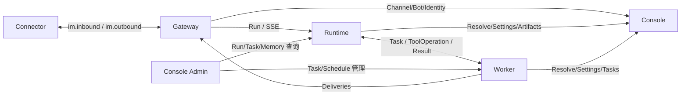

# 跨模块接口与协议详细设计

> 本文是跨模块接口的基线：只写协议约定、调用方向、关键接口与事件类别，不复制每个接口的完整字段。字段级契约以 DTO、错误码和接口测试为准。

## 1. 统一约定

### 1.1 传输与格式

| 项目 | 约定 |
| ---- | ---- |
| JSON | `application/json; charset=utf-8` |
| SSE | `text/event-stream`；心跳为注释帧 |
| 时间 | RFC3339，带 offset；业务裁决用 PG 服务端时间 |
| ID | UUID 字符串；外部平台原值保持字符串 |
| 分页 | `page/page_size`；`items/page/page_size/total` |
| 内部端点 | `/internal/*`，不对公网 Ingress 暴露 |
| 服务间追踪 | 透传 `traceparent`，并带 `X-Request-Id`/`X-Trace-Id` |

### 1.2 统一响应封套

```json
{
  "code": "0",
  "msg": "ok",
  "data": {},
  "trace_id": "...",
  "request_id": "...",
  "timestamp": "2026-11-22T12:00:00+00:00"
}
```

- `code="0"` 表示成功；失败使用稳定错误码字符串。
- `msg` 由消息目录按 locale 渲染；内部错误不直接作为最终用户文案。
- 分页数据放在 `data.items/page/page_size/total`。

### 1.3 Header 与身份

| Header | 使用范围 | 说明 |
| ------ | -------- | ---- |
| `X-Internal-Service` | `/internal/*` | 服务身份令牌；缺失/错误一律拒绝 |
| `X-Actor-User-Id` | 需要用户归属的内部端点 | 可信调用方显式传递；请求体不是信任来源 |
| `X-Tenant-Id` | 内部端点/公开登录 | 用户态路由只从登录账号取租户；内部端点由服务身份 + 显式租户 |
| `X-Request-Id` / `X-Trace-Id` | 全部 | 请求关联；缺失时生成 |
| `traceparent` | 全部 | W3C trace 上下文 |
| `X-CSRF-Token` | Console/CHAT Cookie 写操作 | 双提交 Cookie/Header 比对 |
| `Idempotency-Key` | 创建/绑定/投递等 | 指纹含 endpoint/tenant/身份；不含可重渲染正文 |

**约束**：

- 用户态租户不得取自可伪造的 `X-Tenant-Id`；内部端点必须服务身份门控。
- 内部端点不信任请求体里的 tenant/actor/owner；按可信头与资源归属复核。
- 渠道名、入口 ID 必须显式传递，不用字符串形状推断 UUID。

### 1.4 错误语义

- 错误码稳定；同一失败在不同入口保持同一码或明确映射。
- 未授权/跨租户/软删资源不泄露存在性。
- 可重试错误带 `retryable` 语义；不可重试错误不无限重试。
- 工具结果、任务终态、投递状态各有独立错误分类，不把“已受理”当“已完成”。

---

## 2. 调用方向总览



| 方向 | 协议 | 说明 |
| ---- | ---- | ---- |
| Connector ↔ Gateway | Redis Stream + HTTP | 入站/出站事件；Connector 不直接调 Runtime |
| Gateway → Runtime | HTTP + SSE | 提交 Run、取消、恢复、事件订阅 |
| Runtime ↔ Worker | HTTP + 持久发件/收件 | 提交 Task、取消、结果回流、工具操作 |
| Worker → Gateway | Internal HTTP | 独立结果投递 |
| Gateway/Connector → Console | Internal HTTP | Bot、身份、绑定、授权、Skill 目录 |
| Runtime/Worker → Console | Internal HTTP | 定义解析、平台接入、平台设置、产物 |
| Console → Runtime/Worker | Internal/Admin HTTP | 运行/任务/记忆查询与治理 |

---

## 3. Gateway → Runtime

### 3.1 Run 创建

`POST /v1/runs`：创建并流式执行一次 Run。

约束：

- 调用方只传 `agent_id`、`platform_user_id`、会话/入口上下文与消息；不得传 Pod。
- 同一 conversation 同时最多一个非终态 Run。
- 存在 `WAITING_INPUT` Run 时，本请求作为 resume 输入；存在 `CREATED/RUNNING` 时返回 `RUN_BUSY`。
- `channel.entry_id`（入口账号 UUID）决定会话归属；`bot_id` 只用于连接、租约与出站路由。
- 响应为 SSE；首事件给 `run_id/conversation_id/resumed`。

### 3.2 恢复、取消、新建会话、查询

| 接口 | 用途 | 关键语义 |
| ---- | ---- | -------- |
| `POST /v1/runs/{run_id}/resume` | 显式恢复 | 用户一致；幂等；只在 `WAITING_INPUT` 且未超 deadline |
| `POST /v1/runs/{run_id}/cancel` | Run 取消 | 幂等；终态返回当前终态；执行中为协作取消 |
| `POST /v1/runs/cancel-active` | 按入口/会话取消活跃 Run | 必须带来源；不按“用户+Agent 最新 Run”猜 |
| `POST /v1/conversations` | `/new` 新建会话 | 入口 UUID 随会话冻结；外线线程由 Runtime 派生 |
| `GET /v1/runs/{run_id}` | 诊断/详情 | 返回状态与 Snapshot 摘要引用，不含 Secret |

### 3.3 SSE 公开事件

公开事件类型：

| 事件 | 说明 |
| ---- | ---- |
| `message.delta` | 增量正文 |
| `message.snapshot` | 非增量正文/最终片段 |
| `run.stage` | 阶段/进度 |
| `run.terminal` | 正常终态 |
| `run.error` | 失败终态 |
| `artifact.created` | 产物/附件事实 |
| `confirmation.required` | 用户确认/补充输入 |
| `schedule.draft.ready` | 计划草稿待确认 |

约束：

- 事件按 `seq` 排序；断线按最后确认 seq 回放，不重建 Run。
- 内部/未知事件默认不公开；公开词表是白名单。
- 终态缺失但流断开：明确提示，不伪造完成。
- 附件/产物只给引用与摘要，不暴露存储路径。

---

## 4. Runtime ↔ Worker

### 4.1 任务与计划

| 接口 | 方向 | 用途 |
| ---- | ---- | ---- |
| `POST /internal/tasks` | Runtime → Worker | 提交 Task（含冻结快照、投递意图） |
| `POST /internal/schedules` | Runtime/Gateway → Worker | 创建/更新/暂停/恢复计划 |
| 任务/计划查询与取消 | 双向/管理 | 只按可信租户与归属复核 |
| `POST /internal/tool-operations*` | Worker → Runtime | Task-owned 异步操作提交/结果/取消 |

约束：

- 提交回执只表示受理；业务结果由 Task 终态表达。
- 任务/计划请求必须带服务身份与租户；请求体不是信任来源。
- Task-owned 操作归属按 `task_execution` 复核；`X-Actor-User-Id` 不符 403。

### 4.2 结果回流

| 通道 | 说明 |
| ---- | ---- |
| 结果发件/收件箱 | Worker 终态与结果同事务写发件；Runtime 持久化收件后接续 |
| 接续触发 | 持久结果触发原 Run；不依赖调用方常驻 |
| 幂等 | 按业务键/operation/结果事实去重；重复读取返回同一事实 |

---

## 5. Worker → Gateway 投递

`POST /internal/deliveries`：独立结果投递入口。

要求：

- `X-Internal-Service` 服务身份；`tenant_id` 必须等于本网关部署租户。
- 产物形态必须带 `artifact_id`，由 Gateway 经 Runtime `/internal/artifacts/{id}` 在本租户解析；调用方 `storage_key` 只比对，不直接读共享存储。
- 去重按 `delivery_key`；占位有主，释放/升级/续租是比较值再动作。
- 只有明确 `data.delivered=true` 才算送达；可重试失败回 `PENDING`。
- 投递业务策略（PUSH 默认、附件分组、文案）归核心功能 23；本接口只约定协议。

---

## 6. Gateway / Connector → Console

| 接口 | 调用方 | 用途 |
| ---- | ------ | ---- |
| `GET /internal/channel/bots` | Connector | Bot 快照；只取本角色接管的通道 |
| `POST /internal/channel/resolve` | Gateway | 外部身份、Bot、授权解析 |
| `POST /internal/channel/bind` | Gateway | 绑定码消费与身份登记 |
| `GET /internal/channel/skills` | Gateway | 当前用户/Agent 的 Effective Skill 目录 |
| 平台设置/入口授权 | Gateway/Connector | 按服务身份读取租户设置 |

约束：

- Bot secret 只流向 Connector，不进入 Gateway。
- 绑定码一次性、只存哈希；失败不泄露身份存在性。
- 入口身份显式传递 `entry_id`，不用 `bot_id` 猜 UUID。

---

## 7. Runtime / Worker → Console

| 接口 | 调用方 | 用途 |
| ---- | ------ | ---- |
| `POST /internal/runtime/resolve-definition` | Runtime/Worker | Agent、模型、Skill、MCP、授权解析 |
| 平台接入解析 | Runtime/Worker | ProjectPlatform、Adapter、凭据策略 |
| `GET /internal/platform-adapters/{key}` | Runtime/Worker | Adapter Metadata/Schema |
| `/internal/v1/platform-settings` | 全运行角色 | 平台设置快照 |
| `/internal/artifacts/{id}` | Gateway/Worker | 产物归属与元信息解析 |
| 模型/容量材料 | Runtime/Worker | 受理阈值、模型容量投影 |

约束：

- Resolve 只返回当前 actor+agent 的 Effective Skill/MCP；未授权资源名称/Schema 不返回。
- 解析结果带 revision/hash；Run/Task 快照冻结。
- 产物解析单点归 Runtime；调用方不直接读共享存储。

---

## 8. Console 管理接口

### 8.1 Overview

`GET /api/v1/overview?days=` 返回概览快照，按登录账号的 `tenant_id` 过滤。

| 字段 | 说明 |
| ---- | ---- |
| `resources` | Agent/Skill/MCP/模型等资源摘要 |
| `activity` | 期间运行/任务活动 |
| `attention` | 当前待处理项 |
| `agent_ranking` | Agent 使用排行 |
| `token_coverage` | 模型 Token 覆盖率 |
| `days` | 统计期间（今日/近 7 天/近 30 天） |


公共 Console API（`/api/v1`）按资源分组：

| 资源组 | 代表接口 | 认证 |
| ------ | -------- | ---- |
| Auth / CHAT Auth | `/auth/*`、`/webchat/auth/*` | 公开/会话 |
| Agent / Skill / MCP / Model | 定义、导入、绑定、测试、启停 | 已认证 + CSRF |
| User / Account / Credential / Quota | 用户、角色、凭据、额度 | ADMIN |
| ProjectPlatform / Adapter / External | 平台、适配器、外部入口 | 已认证/ADMIN |
| Task / Schedule / Run | 任务、计划、Run 查询与有限治理 | 已认证 |
| Audit / Overview | 审计、概览、导出 | 已认证/ADMIN |
| Learning / PlatformSettings | 经验、平台设置 | ADMIN |

管理侧内部接口：

- Runtime：Run/Memory 查询、受保护记忆命令、链路导出；
- Worker：Task/Schedule 查询与治理；
- 只读聚合必须带租户、软删与归属谓词。

---

## 9. 分页、幂等与版本

### 9.1 分页

- 请求 `page/page_size`；`page_size` 有上限。
- 响应 `items/page/page_size/total`；`list` 与 `count` 共用条件。
- 区间时间含结束日整天；时区按请求/租户口径明确。

### 9.2 幂等

- 幂等键：`Idempotency-Key`、`message_id`、`delivery_key`、`schedule:{id}:{fire_time}`、`parent:{parent_id}:{item_key}`。
- 指纹含 endpoint/tenant/身份/关键业务键；不含会随 locale 重渲染的正文。
- 同 key 异指纹返回 `IDEMPOTENCY_MISMATCH`；并发用共享幂等表/锁串行化。

### 9.3 版本与兼容

- 对外 API 以 `/api/v1` 为稳定面；破坏性变更走新版本/新字段。
- 内部契约变更必须同时升级调用方与提供方；不保留双读/双写过渡。
- Skill/Task 快照带 schema 版本；旧快照不能参与新执行。
- 时间、错误码、事件词表是契约；变更需同步测试与消息目录。

---

## 10. 追溯

| 协议域 | 相关模块/文档 |
| ------ | ------------- |
| Run/SSE | Agent Runtime、Gateway、核心功能 22 |
| Task/Schedule/ToolOperation | Agent Worker、核心功能 22 |
| 投递 | Worker、Gateway、核心功能 23 |
| 通道/入口 | Gateway/Connector、核心功能 22 |
| 定义解析/授权 | Console、Agent Runtime/Worker、授权模型 |
| 平台接入/产物 | 平台接入与 Session、Artifact Store |

---

*文档结束*
