# 关键流程、时序与状态机详细设计

> 本文是跨模块流程与状态机基线。图中模块名是逻辑角色，不代表代码目录；字段级契约见《07 跨模块接口与协议》。

## 1. `/bind` 首次绑定

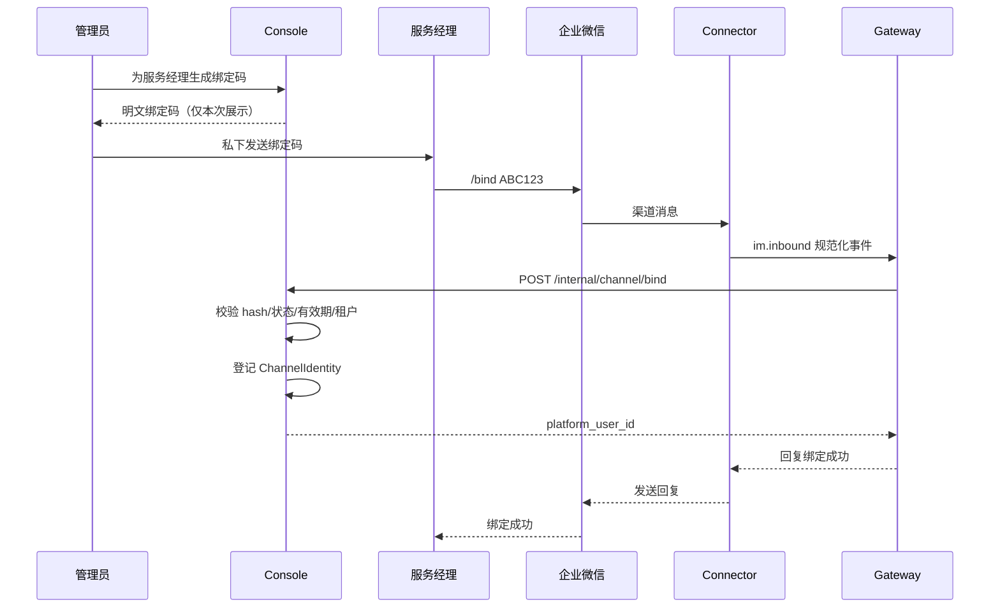

规则：

- `/bind` 只建立外部身份 → 平台用户；不绑定 Agent、不创建 AgentAccessGrant。
- `bot_id → agent_id` 由 BotAccount 决定；不绑定 Runtime/Worker Pod。
- 绑定码一次性、只存哈希；失败不泄露身份存在性。

---

## 2. 普通对话与 Run 生命周期

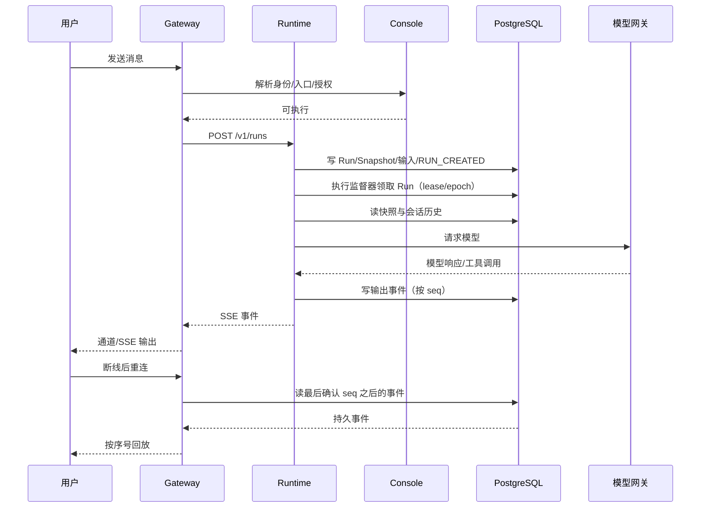

规则：

- 请求受理与执行领取分离；接收实例不一定是执行实例。
- 同一会话最多一个非终态 Run；`WAITING_INPUT` 的新消息按 resume 处理。
- 断流不取消；SSE 只订阅持久事件。
- 快照冻结 Agent/模型/Skill/MCP/预算；下一轮可换实例。

---

## 3. Effective Capability 解析

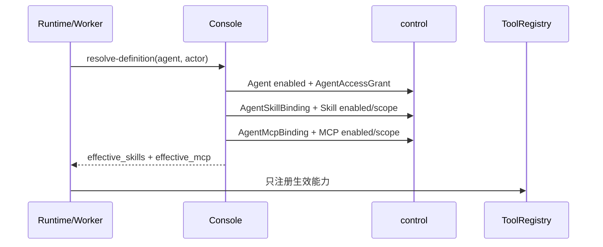

规则：

- 未授权 Skill/MCP 不进入目录、ToolRegistry、Prompt。
- `ALL` 只放宽用户范围，不绕过 Agent 绑定；`SELECTED` 需资源级 Grant。
- 未授权资源不返回名称/描述/Schema，错误信息不泄露存在性。
- 解析结果带 revision/hash；Run/Task 快照冻结。

---

## 4. 同步 Skill 执行

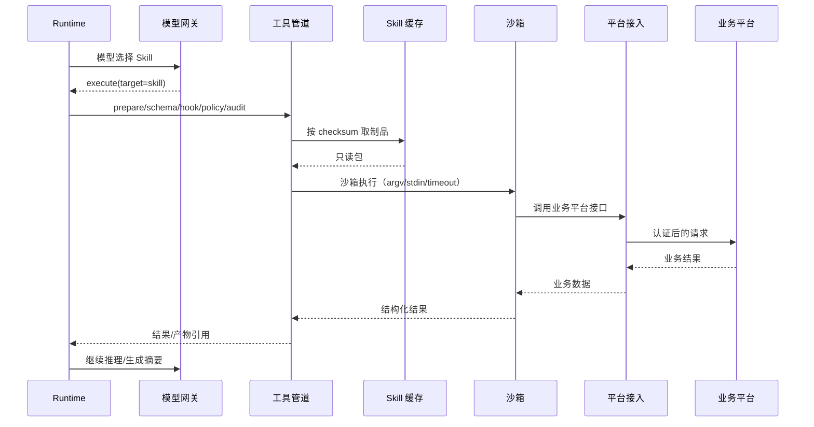

规则：

- 模型只选择 Skill/工具，不决定同步/异步。
- 执行方式来自冻结 `execution_mode`：SYNC 在当前 Run，ASYNC 提交 Worker。
- 工具结果统一 prepare/授权/审计；大结果外置为产物。
- Skill 不接触明文凭据；平台调用经宿主端口。

---

## 5. MCP Tool 调用

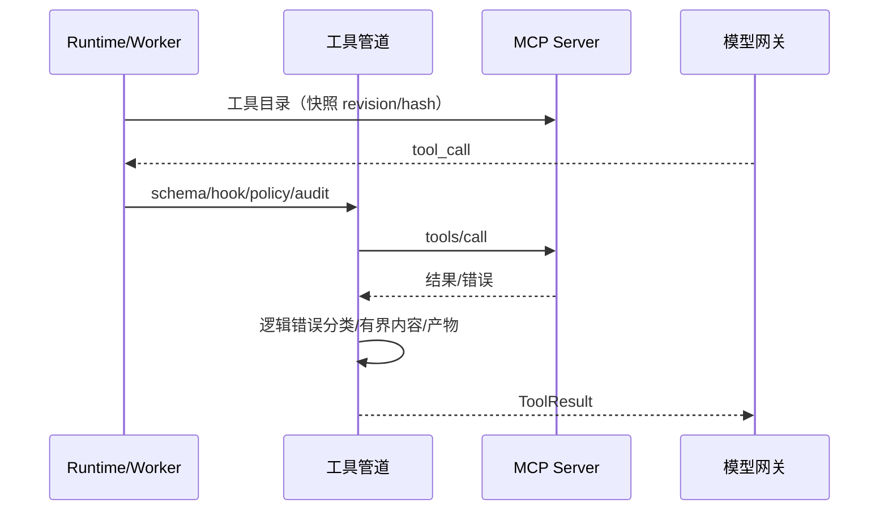

规则：

- MCP 工具与内置工具、Skill 进入同一工具管道。
- HTTP 200 不代表成功；`isError`/RPC/ID 错配按逻辑失败。
- 图片/嵌入资源不得静默丢；内容/响应有界。
- Runtime/Worker 复用同一 MCP 契约与审计，不各写一套。

---

## 6. 澄清、确认与记忆确认

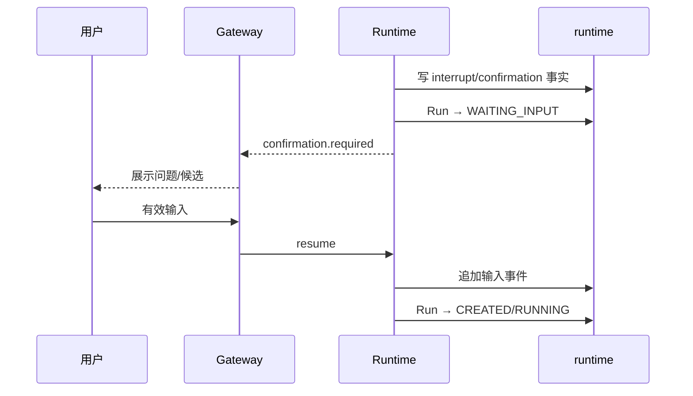

规则：

- 等待用户输入释放执行租约；恢复沿用原快照/剩余预算/截止时间。
- 记忆确认只接受完整确认/拒绝；无效输入保留等待。
- 合法但失效的提议按 STALE 处理并追加事实，不改写原工具回执。
- 确认事件完整投递到当前 ReplySession；重放读 canonical 事件。

---

## 7. 取消与恢复

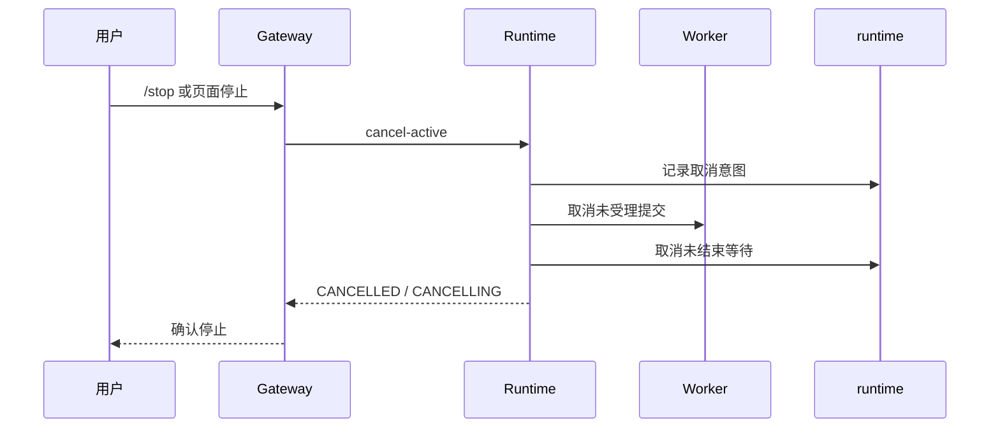

规则：

- `CREATED`/`WAITING_*` 无执行者，直接 CAS 为 CANCELLED。
- `RUNNING` 写 `cancel_requested` + 提示，执行者协作停止后写终态。
- 已受理的 DETACH Task 继续执行；外部动作能否撤回由外部系统决定。
- 恢复使用原快照、剩余预算、绝对 deadline；不重启已终态 Run。

---

## 8. Skill 用户范围与放开

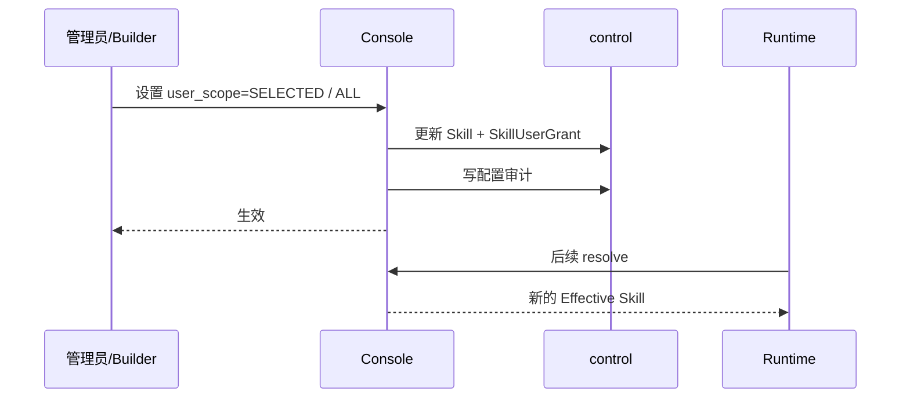

规则：

- 范围变更只影响后续新 Run/Task；已开始执行继续用原快照。
- `ALL` 不是全平台公开，仍需 AgentAccessGrant + AgentSkillBinding。
- 不建设 `User × Agent × Skill` 三元授权编辑器。

---

## 9. Agent / Skill 更新与 Snapshot

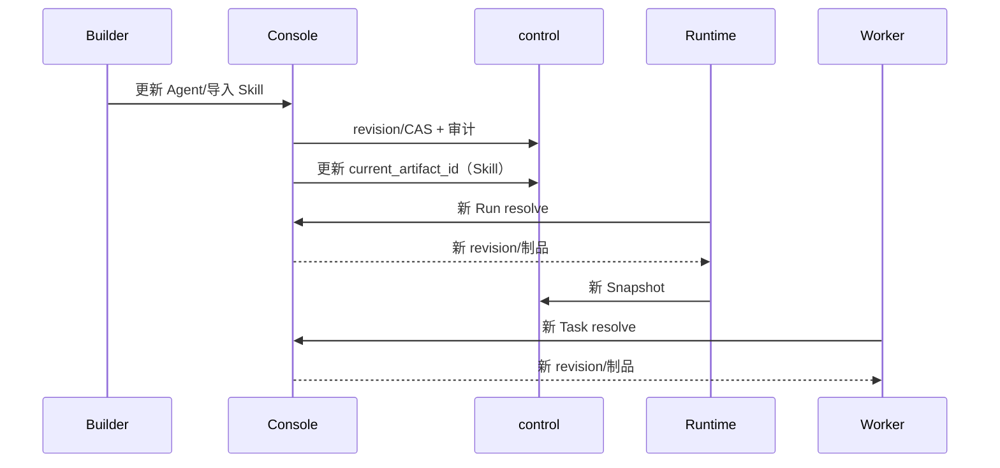

规则：

- Agent/Model 更新带 `expected_revision`；冲突返回 409。
- Skill 制品不可变；新版本只影响后续执行。
- 已运行 Run/Task 继续使用原 Snapshot；不因配置变更中途换版本。

---

## 10. 用户记忆生命周期

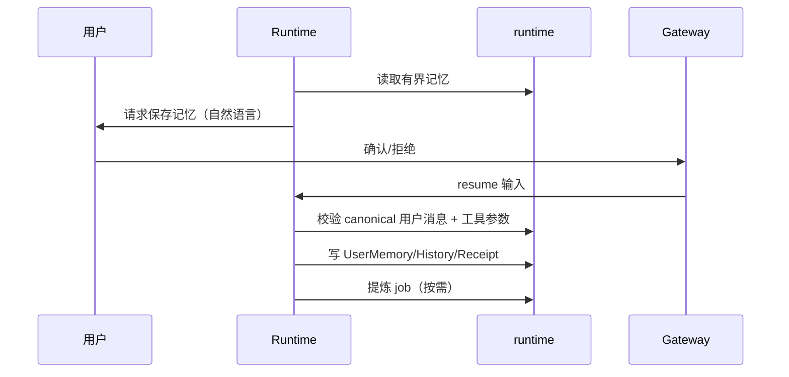

规则：

- Runtime 是 Memory 唯一写入方；Console 只读/治理。
- 自然语言保存必须用户确认；Gateway 不解析 value。
- 稳定 key `(tenant,user,key)`；软删不重置 key。
- 记忆读取有界；会话/记忆跨入口共享。

---

## 11. Run 状态机

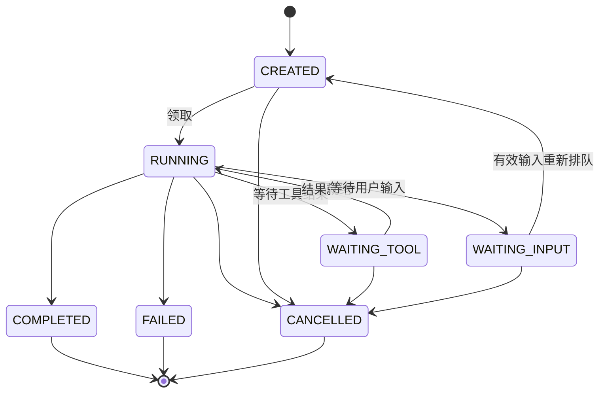

规则：终态不可逆；同一会话最多一个非终态 Run；等待释放执行租约。

---

## 12. Connector / Bot 连接状态

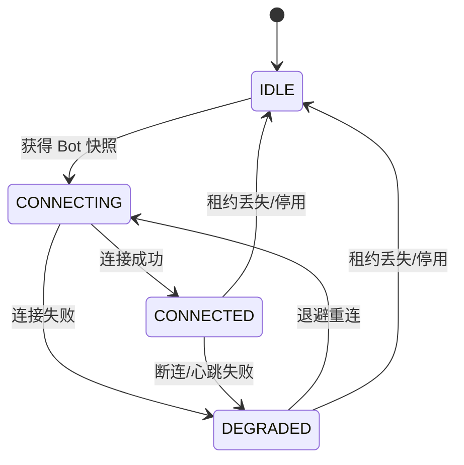

规则：

- 同一 Bot 同一时刻只有一个 Connector owner；租约/fencing 防旧 owner 覆盖。
- Bot 快照整批发布；不完整读取丢弃，保留最近完整快照。
- Gateway 不持连接；Connector 不调 Runtime、不读写业务库。

---

## 13. 平台接入与 Session

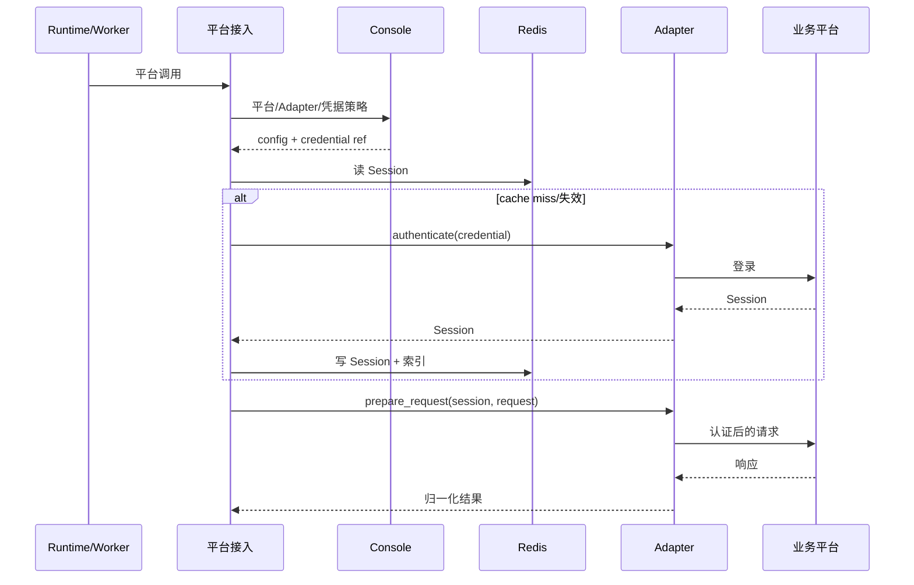

规则：

- Session 是可重建缓存，不是业务权威。
- 凭据版本变化 → 新 Session key，不复用旧 Session。
- 并发冷启动单飞；认证过期最多受控 re-auth 一次。
- 凭据不进入 Skill/Snapshot/Prompt/日志。

---

## 14. 模型调用与 Recovery

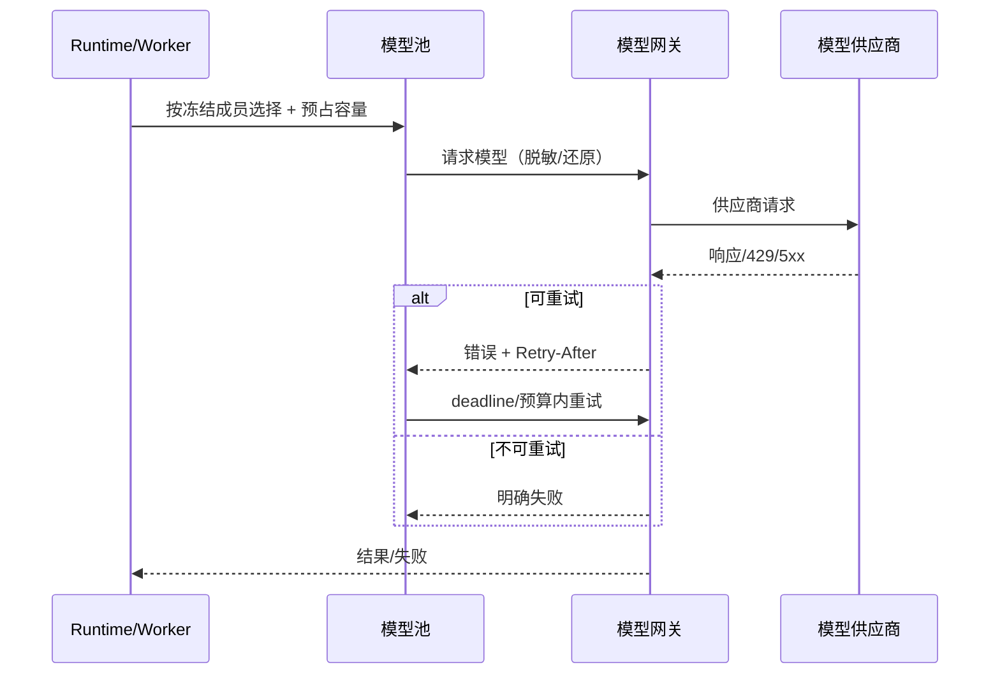

规则：

- 交互优先于后台；不超发、不跨型号替换。
- 模型请求经外部模型网关；平台不直接对接源头供应商。
- deadline/retry budget/cancel 优先；不无限等待。
- 失败收尾确定性渲染，不新增模型调用。

---

## 15. 异步任务

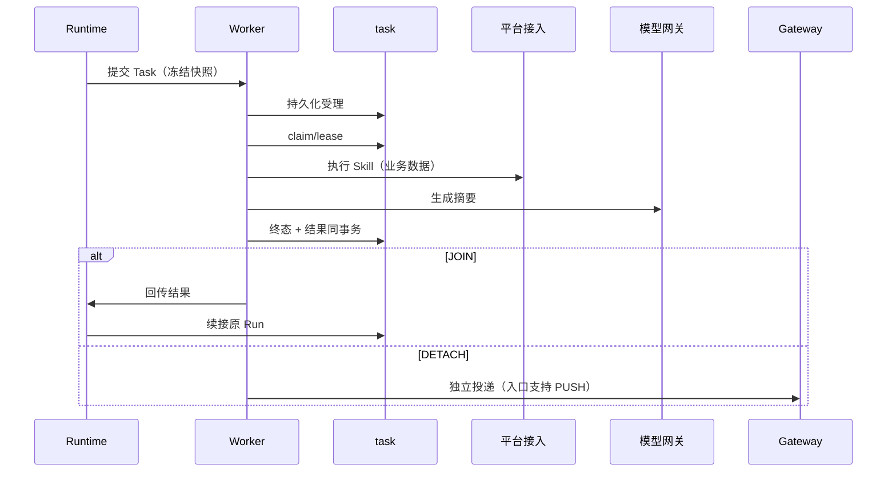

规则：

- 提交回执只表示受理；结果先持久化再回流/投递。
- 等待释放租约；崩溃 reclaim；重试预算/deadline。
- DETACH 不受当前 Run 结束影响；WebChat 结果留在会话。

---

## 16. 定时任务创建与触发

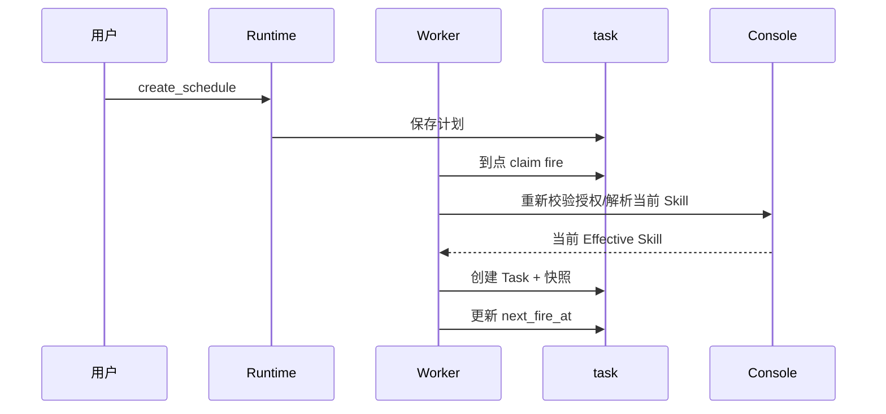

规则：

- 计划不永久冻结版本；触发时重解析当前版本与授权。
- 同一 `schedule_id + fire_time` 只生成一次 Task。
- 错过触发按 SKIP 记录，不补发；连续临时准入失败升级 NEEDS_ATTENTION。
- 计划变更只影响未来触发。

---

## 17. 批量 Fan-out / Fan-in

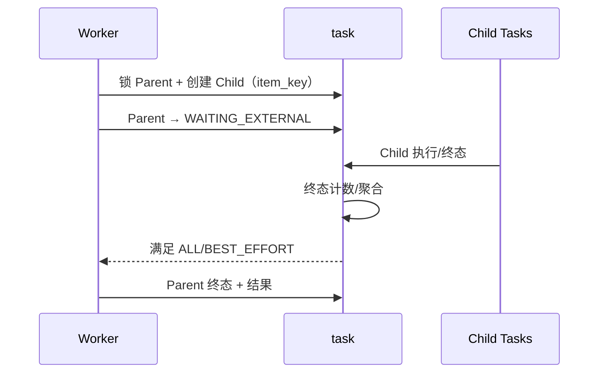

规则：

- `(parent_id, item_key)` 唯一；回收后不重复扇出。
- Parent 等待释放租约；Child 终态触发原子 fan-in。
- 只对 BATCH 父任务生效；Agentic ASYNC Skill 子 Task 不参与。
- 并发受计划/系统/平台限额共同约束。

---

## 18. Worker Lease / Crash Recovery

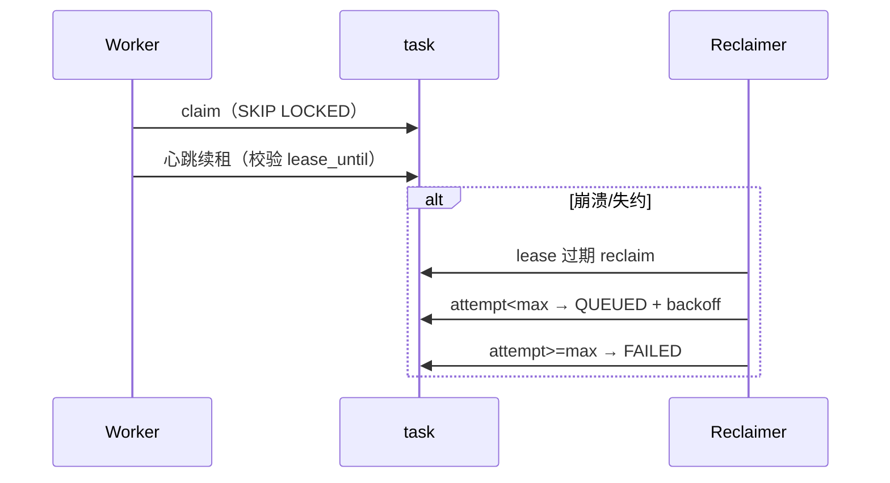

规则：

- claim 排除已取消、未到 not_before、已过 deadline。
- 续租必须当前租约仍有效；失约执行者停止本地执行。
- 回收消耗重试预算；不无限重启。
- 等待状态释放租约，不参与 reclaim。

---

## 19. Task 状态机

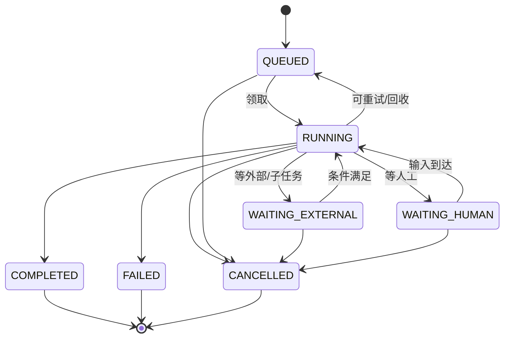

规则：终态不可逆；取消在非终态统一落意图；等待释放租约。

---

## 20. Schedule 状态机

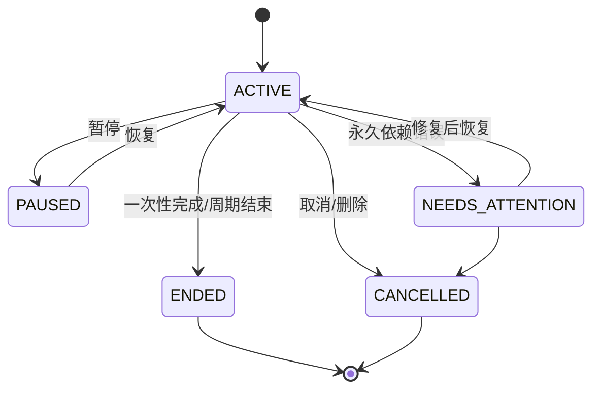

规则：结束原因单独记录；`ENDED` 不等于业务成功；错过触发 SKIP。

---

## 21. Delivery 状态机

```mermaid
stateDiagram-v2
    [*] --> PENDING: 需要投递
    [*] --> NONE: 无需投递
    PENDING --> SENT: 明确 delivered=true
    PENDING --> PENDING: 可重试失败
    PENDING --> FAILED: 不可重试/次数耗尽
    SENT --> [*]
    FAILED --> [*]
    NONE --> [*]
```

规则：

- 终态与待投递意图同事务；先落库再发送。
- 只有 `delivered=true` 才算 SENT；可重试失败回 PENDING。
- 按 `delivery_key` 去重；正文重渲染不影响身份。
- WebChat 结果留在会话；PUSH 入口才自动投递。

---

## 22. 多入口路由

```mermaid
flowchart LR
    WX["企业微信"] --> CN["Connector"] --> GW["Gateway"]
    WB["WebChat"] --> GW
    EX["外部 JWT 平台"] --> GW
    GW -->|"entry_id + channel"| RT["Runtime"]
    RT -->|"Run/事件"| GW
```

规则：

- 入口身份显式传递 `entry_id`（入口账号 UUID）；`bot_id` 只用于连接/出站路由。
- WebChat 与企微是同一批用户的不同入口，最终映射到同一平台用户。
- 通道名参数化；不得用字面量 `WECOM`/`WEBCHAT` 决定 Run 落库或投递路径。
- 新增入口只注册 `ChatSurface` 与适配器，不复制会话/Run 逻辑。

---

*文档结束*
