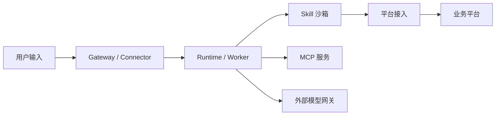
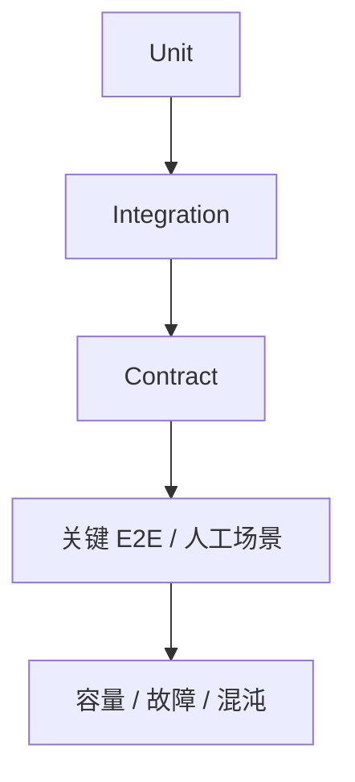

# DFX、安全、可靠性与测试详细设计

> 本文是跨模块的 DFX 基线：安全边界、可靠性承诺、可观测性、性能目标、测试分层与发布门禁。具体测试实现以 `tests/` 和 Spec verifier 为准。

## 1. 安全前提与安全模型

### 1.1 部署前提

- 平台部署在企业内网；Runtime、Worker、PostgreSQL、Redis、共享文件存储不直接暴露给普通用户。
- 普通用户入口：企业微信、WebChat、外部 JWT 平台；Console 仅管理员/Builder 内网访问。
- 管理面与 CHAT 认证面分离；内部 API 只接受服务身份。
- Skill 脚本、用户自建 Skill、MCP 返回、LLM 输出均按不可信处理。

### 1.2 信任边界



| 边界 | 信任假设 |
| ---- | -------- |
| 用户输入 | 不可信；需认证、授权、去重、长度/附件门控 |
| WebChat / 外部 JWT | 独立认证面；Token/Cookie/断言按固定链校验 |
| Console 登录 | 账号 + RBAC；租户来自账号，不取请求头 |
| 内部 API | 服务身份 + 显式租户；请求体不是信任来源 |
| Skill 脚本 | 不可信；只读制品、独立工作区、沙箱、资源有界 |
| MCP 返回 | 不可信；schema/内容/错误分类统一 |
| LLM 输出 | 不可信；工具调用需 schema/Hook/授权；模型网关脱敏 |
| 业务平台 | 外部依赖；凭据/Session 由平台接入管理 |

---

## 2. 威胁与控制

| 风险 | 控制 |
| ---- | ---- |
| 未绑定/伪造身份 | `/bind`、ChannelIdentity、WebChat CHAT、外部 JWT 验签 |
| 已认证但无 Agent 权限 | AgentAccessGrant + 三层授权 |
| 跨租户读写 | 租户来自账号；内部服务身份 + 租户；所有查询带 tenant |
| 未授权 Skill/MCP 被模型看到 | Resolve 先过滤；目录/ToolRegistry/Prompt 不出现 |
| 用户自建 Skill 恶意代码 | 沙箱、只读制品、独立工作区、环境白名单、资源/输出上限 |
| Skill 获取明文凭据 | 不在 SkillContext/包/日志/Context；平台接入代调用 |
| MCP 绕开审计 | 统一工具管道与 MCP 审计 |
| 模型数据泄露 | 外部模型网关脱敏/还原；平台不直接对接源头供应商 |
| 大结果拖垮上下文 | 产物外置 + preview/reference + 输出上限 |
| 配置升级影响运行中执行 | Run/Task 快照冻结 |
| Worker/Runtime 崩溃丢任务 | PG 队列 + lease/reclaim + 幂等 |
| 定时任务重复触发 | schedule_id + fire_time 幂等 |
| 批量压垮平台 | Parent/Child + 并发上限 + 平台限额 |
| 结果未送达 | 终态与投递意图同事务；PENDING 重试；delivered=true |
| 凭据/敏感日志 | 结构化脱敏；Authorization/Cookie/Token/Key/DSN 掩码 |

---

## 3. Secret、凭据与脱敏

允许出现明文的位置：

```text
各 Owner 表明文列
Runtime/Worker/平台接入的临时内存
外部请求的认证 Header/Cookie/签名材料
模型网关的脱敏/还原边界
```

禁止出现：

```text
RuntimeSnapshot
CanonicalEvent
ToolCallAudit / 平台调用审计
Console 默认 API 响应
Skill package / SKILL.md / scripts
LLM Prompt / 模型请求明文
普通日志
```

规则：

- Console 默认只回“已配置”；用户凭据按需回显需 ADMIN + `Cache-Control: no-store` + 审计。
- 模型请求经外部模型网关做占位符替换与响应还原；平台不直接对接源头供应商。
- 日志/审计至少识别 `Authorization`、`Cookie`、`Set-Cookie`、`api_key`、`access_token`、`secret`、`password`、私钥、DSN。
- 脱敏失败或模型网关不可用时拒绝发送，不降级为明文。

---

## 4. 可靠性目标与故障场景

### 4.1 承诺

- Runtime/Worker Pod 变化不丢会话、记忆、任务与结果。
- 不依赖 sticky session；同一会话可被任意实例执行/接续。
- 断流不取消；SSE 按持久 seq 回放。
- Worker 崩溃后 lease 过期可被其他 Worker reclaim。
- Redis 丢失不丢业务事实；Session 可重新认证。
- 结果先持久化，再回流或投递。
- 定时触发不依赖 Runtime 常驻；同一 fire 只生成一次 Task。
- Connector 故障可由其他实例接管 Bot 连接。

### 4.2 故障场景

| 故障 | 预期行为 |
| ---- | -------- |
| Runtime 实例崩溃 | 执行租约过期回收；Run 终态 `FAILED(RUN_ABANDONED)`；已持久化等待可由其他实例接续 |
| Worker 实例崩溃 | lease 过期 reclaim；消耗重试预算；终态或重新排队 |
| Worker deadline 超时 | 非终态 CAS 为 `FAILED(TASK_DEADLINE_EXCEEDED)`；按投递意图处理 |
| Scheduler 多副本 | 同一 `(schedule_id, fire_time)` 只触发一次 |
| 错过触发 | SKIP + 审计/指标，不补发 |
| 永久依赖错误 | Schedule → NEEDS_ATTENTION；修复后可恢复 |
| Gateway 暂时不可用 | 结果已持久化；Delivery PENDING 重试 |
| Console 暂时不可用 | 新 Resolve 失败；不读取本地旧配置当权威 |
| Redis 不可用 | 缓存/去重降级；通道流/租约明确失败；业务事实不丢 |
| PG 不可用 | fail closed，不本地落状态；就绪探针失败 |
| 共享存储不可用 | 已缓存 Skill 可继续；新制品/附件明确失败 |
| 模型网关 429/5xx | deadline + 预算内重试；不无限等待 |
| 平台认证过期 | 受控 re-auth 一次；失败明确 |
| Connector 故障 | Bot 租约过期，另一 Connector 接管；旧 owner 被 fencing 拒绝 |
| 投递失败 | PENDING 重试；不可重试/耗尽 → FAILED；不伪造送达 |

---

## 5. 可观测性

### 5.1 Trace 关联

```text
trace_id / request_id
tenant_id / platform_user_id / agent_id
conversation_id / run_id / snapshot_id
task_id / schedule_id / operation_id
tool_call_id / artifact_id
```

### 5.2 指标与日志

| 域 | 观察点 |
| ---- | ------ |
| Console | 请求错误率/P95、Resolve、Skill 导入、绑定、平台设置 |
| Runtime | 活跃 Run、等待、领取失败、租约回收、模型/工具延迟、首帧 |
| Worker | 队列深度、最老任务、claim/retry/reclaim、调度 fire、投递状态 |
| Gateway | 入站/出站、去重、SSE 断连、投递 facade |
| Connector | 连接数、租约接管、快照 revision、附件批次 |
| 模型/平台 | 模型网关延迟/错误/脱敏失败、平台调用错误/Session 命中 |
| 审计 | 管理变更、工具、模型、平台、投递、导出 |

规则：

- 指标 label 不含租户 UUID、用户 ID、消息体、路径等敏感/高基数维度；路由取模板。
- 日志结构化；trace/request ID 全链路透传；敏感字段掩码。
- 健康：`/healthz` 存活；`/readyz` 依赖缺失 503。

---

## 6. 性能与容量目标

| 目标 | 方向 |
| ---- | ---- |
| 用户规模 | 1000 用户 × 8 轮/600s，每人 1 个活跃 Run（容量 profile） |
| 受理 | P95 ≤ 500ms、P99 ≤ 1500ms |
| 首帧 | P95 ≤ 1200ms |
| 扩展 | Runtime/Worker 无状态横扩；Gateway 多副本；Connector 按 Bot 租约分片 |
| 数据 | PG 连接预算按最大副本核算；Redis/共享存储按峰值吞吐核算 |
| 隔离 | 管理面单 Pod，不承诺 HA；执行面故障不阻塞管理面 |

数值是目标/验收基线，不等于已验证容量；以容量 profile 与 staging 验收为准。

---

## 7. 测试分层



### 7.1 Unit

- 授权/可见性、Snapshot hash、Tool prepare/policy、Context 预算/压缩；
- Skill package/frontmatter/checksum、沙箱路径与资源上限；
- 平台 Adapter/Session/单飞、凭据版本；
- Schedule next_fire/misfire、Task claim/lease/fan-in；
- 投递去重/状态、SSE 事件投影、深链契约。

### 7.2 授权与租户

- ALL 未绑定 Agent 不可用；ALL 无 AgentAccessGrant 不可用；
- SELECTED 缺资源 Grant 不进目录；用户有 Grant 但无 AgentAccessGrant 仍拒绝；
- 撤销 Grant 后新 Run 不可见，已有 Snapshot 不变；
- 跨租户头/请求体伪造不生效；内部端点缺服务身份拒绝；
- 未授权 Skill/MCP 名称/Schema 不泄露。

### 7.3 Integration

- Console + PG + 制品/工作区；
- Runtime + PG + 事件 + 模型网关 fake；
- Runtime/Worker + 统一执行契约 + 沙箱；
- Worker + PG 队列 + 调度 + 投递；
- Gateway + Runtime SSE + Console 解析；
- Connector + Redis 流 + Bot 快照 + 接管；
- 平台接入 + Adapter + Session + 业务平台 fake。

### 7.4 Contract

- 响应封套/错误码/分页/幂等；
- `resolve-definition`、平台接入、平台设置、产物解析；
- SSE 公开事件白名单；
- ChannelEnvelope / InboundEvent / OutboundCommand；
- Task/Schedule/Delivery/ToolOperation 契约；
- Skill package/frontmatter/JSON 入口；
- Spec Compliance Matrix。

### 7.5 E2E 与人工

- E2E 只覆盖关键用户旅程；UI 布局/文案用 component，DTO/错误码用 contract，鉴权/事务/模块边界用 integration。
- 浏览器场景按 `scenarios.md` 在真实构建产物、真实浏览器、真实服务上人工执行并记录；`make acceptance-e2e` 仅按需复跑，不进 CI。
- 全量 pytest/acceptance/component 由 CI/归档后独立执行；浏览器 E2E 人工执行。

---

## 8. 专项测试

### 8.1 无状态与横向扩展

```text
Turn 1 → Runtime A
删除 Runtime A
Turn 2 → Runtime B
从 PG/共享存储重建上下文
```

断言：不依赖 Pod 本地目录/sticky；事件顺序完整；Artifact cache miss 可重拉；Run 租约可回收。

### 8.2 Snapshot 确定性

```text
Run R1: agent rev10 + skill v1
更新 agent rev11 + skill v2
R1 resume → 仍 rev10 + v1
R2 start → rev11 + v2
```

### 8.3 执行契约

- 工具成功/失败形状：JSON 数组/标量、`isError`、RPC 错配、显式 retryable；
- prepared 调用持久化与恢复：提交后收口前崩溃、operation/子 Task/无 checkpoint/未知结果；
- ContextPlan 受保护前缀、预算、摘要覆盖水位；
- Worker/Runtime 工具能力 parity；
- MCP 逻辑审计/重放/有界内容。

### 8.4 平台接入与 Session

- Adapter 未注册/配置非法；凭据缺失/轮换；
- Session miss/hit/过期/re-auth；多 Pod 冷启动单飞；
- 认证失败不无限重试；平台错误映射；
- 脱敏/日志/审计无明文。

### 8.5 投递与调度

- 终态与投递意图同事务；`delivered=true` 才 SENT；
- 可重试失败回 PENDING；去重/占位有主；
- 同一 fire 只触发一次；misfire SKIP；NEEDS_ATTENTION 恢复；
- 父子任务幂等/fan-in；超 deadline 不执行。

---

## 9. Architecture Gate

CI/评审至少检查：

1. 共享包不得依赖任何应用模块；Runtime/Worker 不得反向依赖 Console 实现。
2. Gateway 不持库（不 import SQLAlchemy）；渠道 SDK 只在 Connector 适配器表面。
3. Connector 不调 Runtime、不读写业务数据库；Gateway 不持长连接。
4. Worker 不复制第二套 Agent/Skill/MCP；Runtime/Worker 复用执行契约。
5. Skill 包不得依赖应用模块；Skill 访问平台只经宿主端口。
6. Snapshot 不含 Secret/API Key/MCP 凭据。
7. Artifact 不可变 + checksum；不在共享目录直接执行 Python。
8. Redis 不作权威源；Task/Schedule/Run 状态在 PG。
9. 执行方式由冻结配置决定，不由 LLM 自由布尔值决定。
10. 未授权 Skill/MCP 在 PromptBuilder/ToolRegistry 之前过滤。
11. 投递只有明确送达确认才算 SENT；产物按 `artifact_id` 归属解析。
12. 模型请求经外部模型网关；平台不直接对接源头供应商。
13. 平台 Adapter 代码不得从 DB/Console 动态上传。
14. 用户范围只使用 `ALL/SELECTED`；不恢复 PUBLIC/PRIVATE；不建三元授权表。
15. 不新增 Pod/Agent/Bot 持久绑定；执行者只用 lease/epoch。

---

## 10. 发布门禁

发布前至少：

- SCA/镜像扫描/Secret 扫描；
- 数据库迁移 dry-run，先升级再滚动；
- 全量 pytest / acceptance / component（CI）；
- 关键浏览器场景按 `scenarios.md` 人工执行并记录；
- 容量 profile 与准入 SLO；
- 无状态切换、Run 租约回收、Worker 租约回收；
- Snapshot 确定性；
- 执行契约/MCP/上下文专项；
- 平台接入 Session/单飞/凭据轮换；
- 模型网关脱敏/重试；
- Connector 接管/快照完整性；
- 投递重试/去重/送达判定；
- 调度重复触发/misfire/NEEDS_ATTENTION；
- 日志脱敏与审计完整性。

---

## 11. 追溯

| DFX 域 | 相关模块/文档 |
| ------ | ------------- |
| 安全/租户 | 认证、授权模型、Secret、平台接入 |
| 可靠性 | Runtime、Worker、Connector、投递 |
| 可观测性 | 日志/trace/指标/审计 |
| 测试 | 测试分层、Spec verifier、scenarios |
| 容量 | 部署拓扑、容量 profile、HPA |

---

*文档结束*
