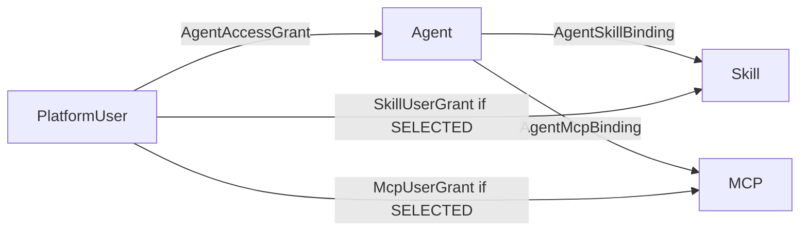

# 用户范围与能力授权模型

> 本文是跨模块授权基线：租户、Console RBAC、终端用户能力授权、入口身份、任务/产物/凭据/记忆归属。授权判定以服务端事实为准，请求头/请求体不是信任来源。

## 1. 授权主体与边界

| 主体 | 认证方式 | 授权范围 |
| ---- | -------- | -------- |
| 管理员（Admin） | Console 登录 | 用户、授权、凭据、平台配置、模型凭据、系统设置、经验治理 |
| Builder | Console 登录 | Agent、Skill、MCP、模型、项目平台配置与发布；审计只读 |
| 终端用户 | 企业微信 `/bind`、WebChat CHAT、外部 JWT 入口 | 已授权 Agent 及其生效 Skill/MCP、会话、记忆、任务、产物 |
| Runtime/Worker | 服务身份 + 显式租户 | 读取定义/授权/设置；执行 Run/Task |
| Gateway/Connector | 服务身份 + 显式租户 | 解析入口/身份/授权；投递 facade |

**总原则**：

- 租户是主体属性，不是请求属性；用户态租户只从登录账号取，内部端点用服务身份 + 显式租户。
- 授权判定在服务端；客户端自报 tenant/user/agent/owner 不构成授权。
- 未授权资源不泄露存在性：名称、描述、Schema、数量都不返回。

---

## 2. Console RBAC

| 能力 | Admin | Builder |
| ---- | ----- | ------- |
| 用户/账号/角色/授权 | ✅ | ❌ |
| 凭据/共享凭据/模型凭据 | ✅ | ❌ |
| 平台设置/经验治理 | ✅ | ❌ |
| Agent/Skill/MCP/模型/项目平台配置 | ✅ | ✅ |
| 审计查询 | ✅ | ✅（只读） |
| 运行/任务查询 | ✅ | ✅ |

- Console 无自助注册；只有上述两类角色。
- 用户/凭据/设置/经验等破坏性或敏感端点仅 ADMIN；前端隐藏 + 后端 403 双兜底。
- Console 登录与 CHAT 认证面完全分离；Cookie/CSRF 名不同，跨面不能互相授权。

---

## 3. 终端用户三层能力授权



三层回答三个问题：

1. **User → Agent**：这个用户能不能使用这个 Agent？
2. **Agent → Skill/MCP**：这个 Agent 理论上具备哪些能力？
3. **User → Skill/MCP**：资源为 `SELECTED` 时，能力对哪些 Agent 授权用户开放？

### 3.1 生效公式

Skill：

```text
AgentAccessGrant(user, agent).is_deleted = false
AND Agent.enabled = true
AND AgentSkillBinding(agent, skill).is_deleted = false
AND Skill.enabled = true
AND Skill.is_deleted = false
AND (
    Skill.user_scope = ALL
    OR SkillUserGrant(skill, user).is_deleted = false
)
```

MCP 同理，使用 `AgentMcpBinding`、`McpUserGrant`、`MCP.enabled`。

### 3.2 ALL / SELECTED

- `ALL` = 该 Agent 的**全部授权用户**，不是全平台公开。
- `ALL` 仍要求 AgentAccessGrant + AgentSkillBinding/AgentMcpBinding。
- `SELECTED` 是**资源级**授权，不是 `(user, agent, resource)` 三元关系。
- 新导入 Skill / 新注册 MCP 默认 `SELECTED`，验证后再放开。
- 不建 `User × Agent × Skill/MCP` 授权表/页面。

### 3.3 生效时机

| 操作 | 新 Run/Task | 已开始 Run/Task |
| ---- | ----------- | --------------- |
| AgentAccessGrant 增删 | 立即生效 | Snapshot 不变 |
| AgentSkillBinding/AgentMcpBinding 改 | 立即生效 | Snapshot 不变 |
| user_scope 改 | 立即生效 | Snapshot 不变 |
| SkillUserGrant/McpUserGrant 改 | 立即生效 | Snapshot 不变 |

绑定即生效；解除 = 软删；用户授权不设到期时间，撤销 = 软删。

---

## 4. 入口身份与外部断言

### 4.1 企业微信绑定

- `/bind` 只建立外部身份 → 平台用户；不绑定 Agent、不创建 AgentAccessGrant。
- 绑定码一次性、只存哈希、有有效期；失败不泄露身份存在性。
- `bot_id → agent_id` 由 BotAccount 决定；`bot_id` 不绑定 Runtime/Worker Pod。

### 4.2 外部 JWT 平台

- 按固定五步链校验：验签（算法白名单）→ 加密因子校验 aud/iss → claim 策略（最大会话年龄，兜底 exp）→ 身份字段提取/identity_hash → 按 `(tenant, platform_key, identity_hash)` 查外部身份与入口授权。
- `external_identity` 回答“外部标识对应哪个平台用户”；`entry_access_grant` 回答“该身份能在哪个入口下使用”。
- 任一步失败 fail-closed；不按字符串形状推断入口/租户。

### 4.3 WebChat CHAT

- 独立 CHAT Token/Cookie/CSRF；只认 CHAT 凭据，不与管理会话互通。
- 交换只提交用户 Token，无 tenant/user 参数；服务按摘要定位 Token 行并导出 tenant/user。
- 会话期限取交换时刻 + TTL 与来源 Token 到期的最小值；时间用 PG 服务端 now；普通请求不滑动续期。
- 错误码固定（`CHAT_TOKEN_INVALID/REVOKED/EXPIRED`、`CHAT_SESSION_REVOKED/EXPIRED`）；设置源损坏 503。

### 4.4 入口授权

- 入口身份显式传递 `entry_id`（入口账号 UUID）；`bot_id` 只用于连接/出站路由。
- 入口停用 → 对应 entry_access_grant 不再放行；已存在会话按可见性谓词处理。
- 入口归属与会话/通知/终态必须一致：`run.channel_json.entry_id`、`conversation.channel_account_id`、`channel_notification.entry_id`。

---

## 5. 资源级归属

| 资源 | 归属/授权 |
| ---- | --------- |
| 会话 / Run / 事件 / 记忆 | tenant + platform_user；用户只能读自己的会话/记忆 |
| Task / Schedule | tenant + 执行用户 + Agent；任务中心只展示授权 Agent 范围 |
| Artifact / 附件 | 按执行 owner（Run/Task/用户/Agent）核属；投递按 `artifact_id` 解析 |
| 模型 | Agent 冻结模型 revision；模型凭据/额度仅 ADMIN 管理 |
| 项目平台凭据 | 用户凭据仅本人可用；共享凭据按 credential_mode；仅 ADMIN 管理 |
| 平台设置 | 租户级；仅 ADMIN 读写/回滚 |
| 审计 | 租户级只读；导出仅 ADMIN |

规则：

- 跨租户/越权/软删资源统一不暴露存在性；需要区分时用 403/404 固定语义。
- 内部投递/产物解析必须服务身份 + 租户 + 归属复核；请求体 tenant/owner 不是信任来源。
- 任务产物/结果按 owner 校验；未授权、软删或内部留档不得暴露。

---

## 6. 过滤时机

```text
入口消息
 -> 平台用户
 -> AgentAccessGrant
 -> Agent 定义
 -> Agent Skill/MCP 绑定
 -> 资源 user_scope / Grant
 -> Effective Skill/MCP
 -> Snapshot
 -> PromptBuilder / SkillCatalog / ToolRegistry
 -> 模型
```

未授权资源：

- 不进入 Skill Catalog、MCP ToolRegistry、Prompt；
- `/skills`、任务中心、审计等接口不返回；
- 不泄露名称、描述、Tool Schema、数量。

---

## 7. 不建设的能力

- MCP Tool 级用户白名单；Tool 继承 MCP Server 的 `user_scope`。
- `User × Agent × Skill/MCP` 三元授权表/页面。
- 恢复 `PUBLIC/PRIVATE` 作为用户可见性语义。
- 用请求头 `X-Tenant-Id` 决定用户态租户。
- 在线编辑/动态上传 Adapter 或授权策略脚本。

---

## 8. 测试与机检

| 场景 | 断言 |
| ---- | ---- |
| ALL 未绑定 Agent | 不可用 |
| ALL 无 AgentAccessGrant | 不可用 |
| SELECTED 缺资源 Grant | 不进 Catalog/ToolRegistry |
| 有资源 Grant 但无 AgentAccessGrant | 拒绝 |
| Agent 未绑定资源 | 拒绝 |
| 跨租户头/请求体伪造 | 不生效 |
| 内部端点缺服务身份 | 拒绝 |
| 撤销 Grant | 新 Run 不可见，已有 Snapshot 不变 |
| 未授权资源 | 名称/Schema/数量不泄露 |
| CHAT/Console 会话混用 | 不互相授权 |

机检参考：`harness-auth`、`harness-im`、`harness-data` 的 verifier；Console 侧覆盖伪造头、Builder 越权、ADMIN 专属端点；Gateway 侧覆盖身份/入口解析与不泄露。

---

*文档结束*
