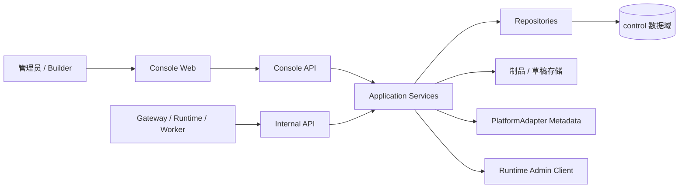

# Console Platform 模块详细设计

> 本模块是管理面/控制面，不执行 Agent、Skill、MCP 或模型调用。运行时执行、通道连接、任务调度和结果投递分别归 Runtime、Worker、Gateway、Connector 与核心功能模块。

## 1. 文档控制

### 1.1 责任人

| 角色 | 姓名 | 职责范围 |
| ---- | ---- | -------- |
| 模块负责人 |  | 管理面边界、字段口径、授权模型 |
| 开发负责人 |  | 后端 API、前端页面与内部接口 |
| 测试负责人 |  | 管理面契约、权限与字段一致性 |
| 架构负责人 |  | 控制面/执行面边界审核 |

### 1.2 修订历史

| 版本 | 日期 | 作者 | 变更描述 |
| ---- | ---- | ---- | -------- |
| v1.0 | 2026-09-02 |  | 初版详细设计 |
| v1.1 | 2026-11-22 |  | 按模块基线模板刷新：管理面边界、页面清单、内部接口、设置与经验管理、部署与追溯 |

---

## 2. 模块概述与边界

### 2.1 模块定位

| 项目 | 内容 |
| ---- | ---- |
| 模块名称 | Console Platform |
| 模块类型 | framework（基础模块/框架层） |
| 所属层 | 管理面（控制面） |
| 所属部署单元 | console-platform |
| 一句话定位 | 管理 Agent、Skill、MCP、模型、用户授权、项目平台、系统设置与审计查询的管理面 |
| 主要使用方 | 管理员、Builder、Gateway/Runtime/Worker 的内部解析调用 |
| 详细设计 | 本文、《15 Console 字段词典》《14 授权模型》《07 跨模块接口与协议》 |

Console 只管理“定义、配置、授权、发布与查询”，不承担任何实时执行。

### 2.2 角色与使用场景

| 角色 | 使用方式 | 关注点 |
| ---- | -------- | ------ |
| 管理员 | Console 浏览器 | 用户、授权、凭据、平台配置、系统设置、模型凭据、经验管理 |
| Builder | Console 浏览器 | Agent、Skill、MCP、模型、项目平台、授权范围内的配置 |
| Gateway / Runtime / Worker | 受信内部接口 | 读取 Agent 定义、Bot、身份、授权、平台设置、Skill 草稿等 |

关键场景：SC-01 建 Agent、SC-02 开通用户并授权、SC-07 批量任务查询、SC-08 Skill 导入与审批、SC-10 失败排障。运行、任务、投递的实际执行不在本模块。

### 2.3 能力清单

| 编号 | 能力 | 说明 |
| ---- | ---- | ---- |
| CAP-01 | 管理面页面 | 概览、Agent、Skill、MCP、模型、用户、项目平台、后台任务、定时任务、运行审计、经验管理、系统设置 |
| CAP-02 | Agent 管理 | 基本信息、模型选择、Skill/MCP 绑定、用户授权、IM 接入、修订版本 |
| CAP-03 | Skill 管理 | 导入、校验、不可变制品、版本、用户范围、删除与审批状态查询 |
| CAP-04 | MCP 管理 | 目录、连接配置、认证配置、工具目录刷新、启停与绑定 |
| CAP-05 | 模型管理 | 模型定义、凭据、额度组、批量测试；不提供平台默认模型回退 |
| CAP-06 | 用户与授权 | 账号、角色、AgentAccessGrant、Skill/MCP 指定用户授权 |
| CAP-07 | 项目平台 | ProjectPlatform、PlatformAdapter Metadata、凭据引用、调用测试 |
| CAP-08 | 任务与定时查询 | 后台任务/定时任务的管理视图、取消、暂停/恢复、历史触发查询 |
| CAP-09 | 审计与概览 | 运行审计查询、单次执行链路导出、概览指标与关联深链 |
| CAP-10 | 经验管理 | 经验候选、启用/退役、重新提炼的管理视图（ADMIN） |
| CAP-11 | 系统设置 | 平台级业务默认值与版本历史、回滚（ADMIN、append-only） |
| CAP-12 | 内部解析接口 | Agent 定义解析、Bot/身份/绑定、平台设置、Skill 草稿、产物解析 |
| CAP-13 | 制品与草稿 | Skill 制品发布、用户 Skill 草稿、工作区访问、产物取件 |

### 2.4 范围与非范围

| 类别 | 内容 |
| ---- | ---- |
| 范围 | 管理面定义、配置、授权、发布、查询；控制面数据与审计；内部解析接口 |
| 非范围 | Agent reasoning、Prompt 拼装、Skill/MCP 执行、模型调用、SSE 输出、渠道长连接、任务领取/重试/投递 |
| 前置假设 | PostgreSQL、Redis、共享文件存储由环境提供；Runtime/Worker/Gateway/Connector 通过受信内部接口读取控制面 |
| 有意妥协 | 当前 Console 单 Pod，不承诺管理面高可用；管理面故障不阻塞已受理的 Run/Task |

### 2.5 约束与依赖

| 类型 | 内容 | 影响 |
| ---- | ---- | ---- |
| 依赖数据 | PostgreSQL `control` 数据域；共享文件存储的制品/工作区 | 控制面权威数据 |
| 依赖内部模块 | Runtime（Agent 定义解析、产物解析）、Worker（任务/定时查询投影）、Gateway（Bot/身份/绑定） | 只读或受信内部调用 |
| 依赖外部 | 模型网关（模型测试/凭据不直接对接源头供应商）、业务平台（调用测试） | 外部失败不改变控制面状态 |
| 安全约束 | 租户来自登录账号；内部路由使用服务身份 + 显式租户；凭据不回显明文 | 见 3.4/3.5 |
| 数据约束 | 平台设置 append-only；制品不可变；审计只追加 | 见 3.3 |

---

## 3. 技术设计

### 3.1 关键决策

| 决策点 | 选择 | 被否决项 | 理由 | 可逆性 |
| ------ | ---- | -------- | ---- | ------ |
| 控制面与执行面分离 | Console 只管理定义与查询 | 在 Console 内执行 Agent/Skill | 避免管理面成为执行瓶颈和故障源 | 难回退 |
| 租户来源 | 已认证路由取登录账号的租户；内部路由取服务身份 + 租户头 | 客户端 `X-Tenant-Id` 直接决定用户态租户 | 防止伪造头跨租户 | 难回退 |
| Agent/Model 更新 | `expected_revision` 乐观并发 + 审计 | 无版本覆盖写 | 配置变更可追溯、可冲突检测 | 易 |
| Skill 制品 | 不可变、校验和、版本指针 | 覆盖同版本文件 | 执行可复现、旧 Run 不受影响 | 难回退 |
| 平台设置 | append-only 版本行 + 回滚插入新版本 | 原行更新 | 历史可追溯、回滚也是事实 | 易 |
| 凭据 | Owner 表明文列；Console 默认不回显；用户详情按需回显需 ADMIN + no-store | 统一外部密钥服务 | 当前安全模型与代码一致 | 难回退 |
| 任务/定时查询 | Console 只读聚合投影 | Console 直接调度/执行任务 | 执行归 Worker | 难回退 |
| 产物解析 | 投递场景按 `artifact_id` 问 Runtime `/internal/artifacts/{id}` | Console 直接读共享存储 | 归属与租户校验单点 | 易 |

### 3.2 架构设计

Console 分为前端管理面、公共 Console API、受信 Internal API、应用服务、基础设施适配五部分。前端只调用 Console API；Runtime/Worker/Gateway 只调用 Internal API；两者不共享 ORM 或 Application Service。

| 组件 | 职责 | 不负责 |
| ---- | ---- | ------ |
| Console Web | 页面、列表、表单、深链、错误展示 | 业务规则判定、直接访问数据库 |
| Console API | 认证、CSRF、参数校验、响应封套、分页 | 跨请求编排、执行任务 |
| Internal API | 服务身份校验、定义/Bot/身份/设置/草稿/产物解析 | 公开暴露、用户会话认证 |
| Application Services | 管理面业务编排、授权判定、版本与审计 | Agent reasoning、Skill/模型执行 |
| Repositories | `control` 数据域读写、跨域只读投影 | 写其他 Owner 数据域 |
| 制品/草稿存储 | Skill 制品、草稿、工作区文件 | 直接执行 Skill、记录权威状态 |

**分层约束**：路由只做协议适配与依赖注入；业务编排在 application；数据访问在 infrastructure；`domain` 保持纯领域。不存在按前端页面拆分的后端模块子包。

### 3.3 数据设计

Console 拥有 `control` 数据域，并只读访问 `runtime`/`task` 做管理查询投影。

| 数据对象 | 归属 | 说明 | 生命周期 |
| -------- | ---- | ---- | -------- |
| 账号、会话、角色 | control | Console 登录、RBAC、CHAT 独立认证面 | 账号软删；会话可撤销/过期 |
| Agent 定义 | control | 指令、模型、修订、启用状态 | 软删；revision 递增 |
| Skill / 制品 / 草稿 | control + 共享文件 | 制品不可变；草稿在 workspaces | 制品保留；软删；有活跃绑定禁止删除 |
| MCP Server / 工具目录 | control | 连接配置、认证配置、catalog revision/hash | 软删；工具目录可刷新 |
| 模型定义/凭据/额度组 | control | 模型成员、凭据、额度 | 软删；凭据只回配置状态 |
| 用户授权 | control | AgentAccessGrant、Skill/MCP 指定用户 | 撤销 = 软删 |
| 项目平台/凭据 | control | ProjectPlatform、User/SharedCredentialRef | 软删；凭据轮换写新值 |
| Bot / 身份 / 绑定码 | control | 入口账号、外部身份、一次性绑定码 | 绑定码消费/过期；身份软删 |
| 审计 | control | 配置/操作审计、批量导出 | 只追加；按保留策略清理 |
| 平台设置 | control | append-only 版本行 | 永不软删；回滚插入新版本 |
| 经验管理 | control/runtime 投影 | 候选、试用、启用、退役 | 由 Runtime 写入；Console 查询/治理 |

约束：

- Agent/Model 更新使用 `expected_revision`；冲突返回 `REVISION_CONFLICT`。
- Skill 制品发布在文件写入成功后写 DB 元数据；文件写入失败清理或留孤儿扫描，不把文件复制放进 DB 事务。
- 平台设置按 `(tenant_id, revision)` 唯一，当前版本取最大 revision；回滚插入新版本并写审计。
- 跨域只读查询必须带租户与软删谓词；归属列为空时按“不可操作”渲染，不补默认值。

### 3.4 接口设计

**公共 Console API**（`/api/v1`）：

| 接口组 | 用途 | 认证 |
| ------ | ---- | ---- |
| `/auth/*`、`/webchat/auth/*` | 管理登录、CHAT 独立认证 | 公开/会话 |
| `/agents`、`/skills`、`/mcp-servers`、`/models` | 定义、绑定、导入、测试 | 已认证 + CSRF |
| `/users`、`/accounts`、`/credentials`、`/model-credentials`、`/model-quota-groups` | 用户、角色、凭据、额度 | ADMIN |
| `/project-platforms`、`/platform-adapters`、`/external-platforms` | 项目平台、适配器元数据、外部入口 | 已认证/ADMIN |
| `/tasks`、`/schedules`、`/runs` | 任务/定时/Run 管理查询与有限操作 | 已认证 |
| `/audits`、`/overview` | 审计、概览指标 | 已认证 |
| `/learning` | 经验管理 | ADMIN |
| `/platform-settings` | 平台设置读写/历史/回滚 | ADMIN |
| `/artifacts/{id}/content` | 产物取件 | 会话或签名令牌 |

**Internal API**：

| 接口组 | 调用方 | 用途 |
| ------ | ------ | ---- |
| `/internal/runtime/*` | Runtime/Worker | Agent 定义解析、授权材料、模型/容量材料 |
| `/internal/channel/*` | Gateway/Connector | Bot 快照、身份解析、绑定、入口校验 |
| `/internal/v1/platform-settings` | Runtime/Worker/Gateway/Connector | 平台设置快照 |
| `/internal/skills/drafts/*` | Runtime | Skill 草稿测试与回读 |
| `/internal/artifacts/{id}` | Gateway/Worker | 产物归属与元信息解析；不直接读共享存储 |

**统一约定**：

- 响应封套 `{code,msg,data,trace_id,request_id,timestamp}`；分页 `page/page_size`；时间为 RFC3339。
- `Idempotency-Key` 用于账号创建、绑定、批处理等；指纹含 endpoint/tenant/关键身份，不把可重渲染正文算进指纹。
- 内部路由要求 `X-Internal-Service` 服务身份；租户只从可信头/服务上下文取。
- 用户态路由的租户只从登录账号取；CSRF 对所有 Cookie 会话写操作生效。
- 产物投递按 `artifact_id` 解析，调用方 `storage_key` 只比对不读取。

### 3.5 质量实现

#### 安全与租户

| 目标 | 设计 |
| ---- | ---- |
| RBAC | Admin 全量；Builder 限 Agent/Skill/MCP/Model/项目平台；用户/凭据/平台设置/经验仅 Admin |
| 租户隔离 | 用户态取登录账号租户；内部路由服务身份 + 显式租户；每条查询带 `tenant_id` |
| 凭据 | 默认只回“已配置”；用户详情按需回显需 ADMIN + `Cache-Control: no-store`，审计/日志不含明文 |
| CSRF/会话 | 管理 Cookie 独立；CHAT 使用独立 Cookie/CSRF；内部路由不走用户会话 |
| 产物 | 取件按会话或签名令牌；投递归属由 Runtime 解析；签名令牌不泄露存储路径 |
| 审计 | 配置变更、授权变更、凭据使用、导出、设置回滚写审计 |

#### 性能与容量

| 目标 | 设计 |
| ---- | ---- |
| 列表可用 | 分页；`list/count` 共用条件；跨域聚合一次批量查询，不 N+1 |
| 概览 | 单接口 `days` 驱动；手动刷新；失败保留旧快照，不显示上一期间数据 |
| 单 Pod | 管理面 QPS 与普通用户流量分离；不承诺 HA |

#### 可靠性

| 场景 | 设计 |
| ---- | ---- |
| 配置更新冲突 | `expected_revision` / CAS；冲突返回 409，不覆盖 |
| 文件写失败 | DB 事务后置；文件失败清理或孤儿扫描；不产生半制品 |
| 内部接口失败 | 调用方按明确错误处理；不伪造默认定义/授权 |
| 数据查询失败 | 读取失败降级为“不可知/不可操作”，不回落默认值 |
| 发布升级 | 数据库脚本先于服务滚动；迁移失败阻断发布 |

#### 可观测性与可测试性

| 场景 | 手段 |
| ---- | ---- |
| 请求排障 | trace_id、结构化日志、审计记录、错误封套 |
| 管理面健康 | `/healthz` 存活、`/readyz` 就绪（DB/文件依赖） |
| 契约测试 | 字段词典、深链键对、错误码、内部接口契约 |
| 权限测试 | 伪造租户头、跨租户读取、Builder 越权、ADMIN 专属端点 |
| 制品测试 | 不可变写、校验和、失败清理、孤儿扫描 |

---

## 4. 部署与运维

| 项目 | 内容 |
| ---- | ---- |
| 部署单元 | console-platform，1 Pod（当前不承诺 HA） |
| 入口 | Nginx 浏览器入口，转发管理/认证/页面资源；企业微信不经过 Nginx |
| 挂载 | 制品文件存储 RW、工作区文件存储 RW |
| 依赖 | PostgreSQL、Redis（缓存/会话）、共享文件存储 |
| 发布 | 运维脚本先执行数据库升级，再滚动服务；迁移失败阻断发布 |
| 监控 | 请求错误率、P95、内部接口失败、审计写入、就绪状态 |

不交付数据库/Redis/NFS 服务本身；数据库与文件存储由环境提供。

---

## 5. 风险与依赖

| 风险/依赖 | 类型 | 描述 | 影响 | 应对 |
| --------- | ---- | ---- | ---- | ---- |
| Console 单 Pod | 可用性 | 管理面故障时不能配置/查询 | 不影响已受理 Run/Task | 明确边界；后续评估 HA |
| 控制面与执行面耦合 | 架构 | 内部接口失败会影响解析 | Run/Task 无法获得定义 | 显式失败、重试、健康探针 |
| 跨域只读投影 | 数据 | 读 runtime/task 需复刻可见性谓词 | 越权/误展示 | 统一 tenant/软删/归属谓词；读不到按不可知 |
| 凭据回显 | 安全 | 用户详情按需回显 | 泄露风险 | ADMIN + no-store + 审计；默认不回显 |
| 文件存储不可用 | 依赖 | Skill 导入/草稿失败 | 不能发布新 Skill | 明确 `SKILL_ARTIFACT_UNAVAILABLE`；已缓存制品可继续 |
| 平台设置回滚 | 数据 | 回滚也是新版本 | 误配置需审计 | append-only + 审计 + 乐观并发 |

---

## 6. 追溯矩阵

| 总设模块 | 能力/接口 | Spec/Rule | 场景 | 说明 |
| -------- | --------- | --------- | ---- | ---- |
| Console Platform | 管理面 CRUD、内部解析 | `harness-api`、`harness-auth`、`harness-rel`、`harness-secret` | SC-01/02/07/08/10 | 控制面基线 |
| Agent、授权与 Skill | Agent/Skill/授权 | `harness-auth`、`harness-skill`、`harness-snapshot` | SC-01/02/08 | 核心功能文档 20 |
| MCP 与模型能力 | MCP/模型/额度 | `harness-mcp`、`harness-model` | SC-01/04 | 核心功能文档 21 |
| 对话、Run、任务与调度 | 任务/定时/Run 查询 | `harness-api`、`harness-data` | SC-04/05/06 | 核心功能文档 22 |
| 结果与附件投递 | 产物取件/投递查询 | `harness-skill`、`harness-im` | SC-05/06 | 核心功能文档 23 |
| 记忆、经验、审计与可观测 | 经验/审计/概览 | `harness-memory`、`harness-log` | SC-10 | 核心功能文档 24 |

---

## 附录：术语表

| 术语 | 定义 |
| ---- | ---- |
| Console | 本模块的管理面 Web + API |
| Internal API | 仅服务身份可达的受信接口 |
| CAP | 本模块能力编号 |
| RBAC | 基于角色的访问控制 |
| append-only | 只追加、不更新/删除历史行 |

---

*文档结束*
