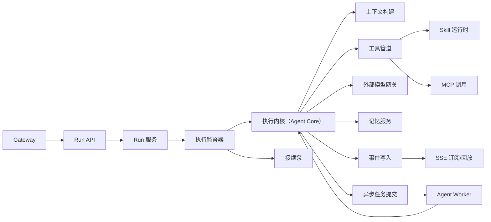

# Agent Runtime 模块详细设计

> 本模块是实时执行面，负责一次 Run 的受理、执行、接续与事件输出。后台任务的实际执行归 Agent Worker；通道长连接归 Connector；结果投递策略归核心功能“结果与附件投递”。

## 1. 文档控制

### 1.1 责任人

| 角色 | 姓名 | 职责范围 |
| ---- | ---- | -------- |
| 模块负责人 |  | Run 生命周期、执行契约与快照边界 |
| 开发负责人 |  | 执行内核、上下文、工具与事件链路 |
| 测试负责人 |  | 状态机、租约、恢复与流式验证 |
| 架构负责人 |  | Runtime/Worker/模型网关边界审核 |

### 1.2 修订历史

| 版本 | 日期 | 作者 | 变更描述 |
| ---- | ---- | ---- | -------- |
| v1.0 | 2026-08-01 |  | 初版详细设计 |
| v1.1 | 2026-11-22 |  | 按模块基线模板刷新：执行领取/接续、共享执行契约、模型网关、上下文与工具边界 |

---

## 2. 模块概述与边界

### 2.1 模块定位

| 项目 | 内容 |
| ---- | ---- |
| 模块名称 | Agent Runtime |
| 模块类型 | framework（基础模块/框架层） |
| 所属层 | 实时执行面 |
| 所属部署单元 | agent-runtime |
| 一句话定位 | 无状态执行一次 Run：快照、上下文、工具/Skill/MCP、模型调用、事件与接续 |
| 主要使用方 | Gateway、Console（内部解析）、Worker（结果回流）；最终用户不直连 |
| 详细设计 | 本文、《06 执行内核与 Skill 运行时》《08 关键流程时序与状态机》 |

### 2.2 角色与使用场景

| 角色 | 使用方式 | 关注点 |
| ---- | -------- | ------ |
| 用户 | 经 Gateway 发消息/看事件 | 结果、进度、断线重连、停止 |
| Gateway | 提交 Run、订阅事件、转发停止 | 请求只负责接入，执行归 Runtime |
| Console | 提供定义、授权、模型/平台材料 | 只读控制面，不参与执行 |
| Worker | 接收异步任务、回传结果 | JOIN 回流当前 Run |
| 模型网关 / 平台接入 | Runtime 调用外部能力 | 模型调用、平台凭据与 Session |

关键场景：SC-03 对话、SC-04 同步 Skill、SC-05 异步任务、SC-06 定时任务、SC-09 WebChat、SC-10 排障。

### 2.3 能力清单

| 编号 | 能力 | 说明 |
| ---- | ---- | ---- |
| CAP-01 | Run 受理与领取 | 持久化 Run、快照、输入；由空闲执行实例从 PG 领取 |
| CAP-02 | 快照冻结 | 冻结 Agent、模型、Skill、MCP、Prompt 模板版本与预算 |
| CAP-03 | 上下文构建 | 从不可变事件重建历史，注入记忆，按预算裁剪/压缩 |
| CAP-04 | 工具执行 | 内置工具、Skill、MCP 统一 prepare/schema/hook/policy/audit |
| CAP-05 | Skill 执行 | 渐进式披露、制品缓存、沙箱执行、结果外置 |
| CAP-06 | MCP 调用 | 工具目录、认证、审计与错误分类统一 |
| CAP-07 | 模型调用 | 经外部模型网关；模型池成员、容量预占、重试与 deadline |
| CAP-08 | 事件与流式 | 不可变事件持久化；SSE 订阅、回放与断线重连 |
| CAP-09 | 取消与接续 | 取消意图、等待工具/用户、续接原 Run |
| CAP-10 | 异步任务提交 | 冻结 Skill 配置，提交 Worker；JOIN 结果回流 |
| CAP-11 | 附件与产物 | 入站附件落库、工具结果外置、产物引用 |
| CAP-12 | 审计 | 工具、模型、平台调用与执行审计 |

### 2.4 范围与非范围

| 类别 | 内容 |
| ---- | ---- |
| 范围 | Run 生命周期、快照、上下文、工具/Skill/MCP、模型调用、事件流、取消/接续、异步提交 |
| 非范围 | 后台 Task 的实际执行、定时触发、渠道长连接、Console CRUD、结果投递策略、管理面查询 |
| 前置假设 | PostgreSQL/Redis/共享文件存储可用；Console 可解析定义；模型网关与业务平台可达 |
| 有意妥协 | Run 断流不取消；执行者故障由租约回收接管；摘要失败作废摘要层并由 micro/snip/trim 兜底，coverage 不推进 |

### 2.5 约束与依赖

| 类型 | 内容 | 影响 |
| ---- | ---- | ---- |
| 依赖基础模块 | PostgreSQL/Redis/制品与工作区、执行内核、平台接入、模型池/模型网关 | 执行所需状态与能力 |
| 依赖控制面 | Console Internal API：Agent 定义、授权、模型/平台材料 | 解析失败即受理/执行失败 |
| 依赖 Worker | 异步 Task、结果回流 | JOIN 需要持久结果触发接续 |
| 安全约束 | 租户/用户/Agent/Skill/MCP 授权前置；凭据不进入上下文 | 未授权能力不可见、不可执行 |
| 一致性约束 | 事件只追加；快照冻结；执行者/代次/租约校验 | 旧执行者不能覆盖新执行者 |

---

## 3. 技术设计

### 3.1 关键决策

| 决策点 | 选择 | 被否决项 | 理由 | 可逆性 |
| ------ | ---- | -------- | ---- | ------ |
| 执行生命周期 | PG 持久队列 + 租约/代次领取 | HTTP 请求内同步跑完整 Run | 断流不取消、可横扩、故障可接管 | 难回退 |
| 执行状态 | 不可变事件 + 快照 | Pod 本地会话状态 | 任意实例可重建，跨 Pod 一致 | 难回退 |
| 执行方式 | 冻结 Skill `execution_mode` + 工具管道 | 模型自由决定同步/异步、独立执行路由 | 避免模型主观判断；Shared Worker 契约 | 难回退 |
| 上下文 | 受保护前缀 + 可裁剪对话区 + 分层压缩 | 直接裁整条历史 | 保护系统提示/记忆/摘要，压缩可降级 | 易 |
| 工具并发 | 显式声明 `SERIAL`/`PARALLEL_READ` | 按 READ 自动并行 | 对端提示不是授权依据 | 易 |
| 模型调用 | 外部模型网关 + 模型池容量预占 | Runtime 直连源头供应商 | 统一脱敏/还原与容量 | 难回退 |
| 记忆 | Runtime 唯一写入，按租户/用户隔离 | Pod 本地记忆 | 跨 Pod 一致、可审计 | 难回退 |
| 失败收尾 | 确定性失败即停，最多一次模型整理 | 无限重试 | 失败环节重试不会变成功 | 易 |

### 3.2 架构设计

| 组件 | 职责 | 不负责 |
| ---- | ---- | ------ |
| Run API | 受理、事件订阅、取消、恢复入口 | 执行、后台任务实际执行 |
| Run 服务 | 事务内落 Run/快照/输入/事件；状态映射 | 长时间执行 |
| 执行监督器 | 从 PG 领取 Run、占用槽位、心跳/租约、故障回收 | 业务推理、Console CRUD |
| 执行内核 | 模型/工具循环、上下文、Hook/Policy、失败收尾 | 渠道协议、管理面 |
| 工具管道 | 参数/schema/Hook/授权/审计/并发策略 | 具体业务脚本实现 |
| 接续泵 | 等待工具/用户后的续接领取 | 重建 Run、重放已完成工具 |
| 事件写入 | 不可变事件、序号、SSE 源 | 业务判断 |
| 异步提交 | 冻结 Skill 配置、提交 Worker、记录操作 | Worker 执行与投递 |

**关键约束**：

- Run 创建事务只落持久事实；执行由监督器领取，接收实例不一定是执行实例。
- 心跳、事件、终态写入校验 owner/epoch/lease；旧执行者不能覆盖新执行者。
- 断流不等于取消；SSE 按最后确认序号回放。
- 工具准备调用、授权结论、结果事实必须持久化；恢复按事实续接，不按 assistant 原始参数重放。
- Runtime/Worker 复用同一执行契约；Worker 不复制第二套工具/MCP/Skill 实现。

### 3.3 数据设计

| 数据对象 | 归属 | 说明 | 生命周期 |
| -------- | ---- | ---- | -------- |
| Conversation | runtime | 会话与入口归属 | 软删；历史保留 |
| RunRecord | runtime | 状态、owner/epoch/lease、deadline、trace | 终态不恢复；故障回收 |
| RuntimeSnapshot | runtime | Agent/模型/Skill/MCP/策略/模板版本/hash | 按 Run 冻结 |
| CanonicalEvent | runtime | 用户/助手/工具/状态事实，按 seq 追加 | 只追加；按保留策略 |
| RunInterrupt / 接续点 | runtime | 等待用户/工具、恢复游标 | 随 Run 终态结束 |
| ToolOperation / 收件箱 | runtime | 异步操作身份、结果收件与恢复 | 终态保留审计 |
| UserMemory | runtime | 记忆权威记录 | 写入/确认/退役；按租户用户 |
| 执行/工具/模型/平台审计 | runtime | 审计事实 | 只追加；按保留策略 |
| Artifact / 附件引用 | runtime + 共享文件 | 大结果、附件、产物 | 不可变；按保留清理 |
| 配置/设置快照引用 | 控制面 | 只读引用，不复制权威定义 | 按 Run 冻结 |

**状态与不变量**：

- Run：CREATED → RUNNING → WAITING_TOOL / WAITING_INPUT → RUNNING → COMPLETED/FAILED/CANCELLED。
- 同一会话同一时间最多一个非终态 Run。
- 终态写入不可逆；取消/失败/完成不重复写。
- 快照字段白名单构建；Secret/API Key/MCP 凭据不进入快照。

### 3.4 接口设计

| 接口/主题 | 类型 | 调用方向 | 用途 |
| --------- | ---- | -------- | ---- |
| `POST /v1/runs` | HTTP | Gateway → Runtime | 创建 Run、返回事件流 |
| `/v1/runs/{id}`、`/cancel-active`、`/resume` | HTTP | Gateway → Runtime | 查询、取消、恢复 |
| SSE 事件流 | SSE | Runtime → Gateway | 持久事件按 seq 输出/回放 |
| `/internal/artifacts/{id}` | Internal HTTP | Gateway/Worker → Runtime | 产物归属与元信息解析 |
| `/internal/tool-operations/*` | Internal HTTP | Worker → Runtime | Task-owned 异步操作提交/结果/取消 |
| Console 解析接口 | Internal HTTP | Runtime/Worker → Console | Agent 定义、授权、模型/平台材料 |
| Worker 任务接口 | Internal HTTP | Runtime → Worker | 提交异步 Task、取消 |
| 外部模型网关 | HTTP | Runtime → 外部 | 模型选择、脱敏/还原、摘要 |
| 平台接入 | 内部能力 → 外部平台 | Runtime/Worker | 凭据、Session、业务调用 |

**错误与失败语义**：

- 未授权/禁用/跨租户：不返回资源存在性；Run 不创建或明确失败。
- 模型/平台失败：确定性失败第一次即停；可重试失败按阈值与 deadline。
- 工具失败：抛异常与返回 `{"error":...}` 同等对待；确定性失败进入收尾。
- 接续结果未知：按 operation/checkpoint/结果事务边界恢复，不重复副作用。

### 3.5 质量实现

#### 性能与容量

| 目标 | 设计 |
| ---- | ---- |
| 受理与执行解耦 | 创建事务只落库；执行槽位领取；等待释放槽位 |
| 横扩 | 无状态；增加副本增加执行位；执行并发由容量设置 |
| 流式 | 事件按 seq 持久化并增量输出；不等待整轮完成 |
| 大结果 | 外置为产物，上下文只放 preview/reference |
| 压缩 | 受保护前缀不动；当前回合只做 micro（不 snip/trim）；摘要失败逐层降级并记指标 |

#### 可靠性

| 场景 | 设计 |
| ---- | ---- |
| 实例故障 | 租约过期回收；等待中的 Run 由结果触发接续 |
| 断流 | 不取消；按最后确认 seq 回放 |
| Worker 故障 | 任务租约回收；结果幂等回流 |
| 模型限流/不可用 | deadline + retry budget + Retry-After；不无限等待 |
| 压缩/外置失败 | 摘要作废后由 micro/snip/trim 兜底；外置失败保留内联结果；记日志与指标，不静默 |

#### 安全与租户

| 目标 | 设计 |
| ---- | ---- |
| 授权前置 | 未授权 Skill/MCP 不进入目录、ToolRegistry 或上下文 |
| 租户隔离 | 所有读写带 tenant；跨租户拒绝 |
| 凭据 | 不进入快照/事件/Prompt/日志；模型网关统一脱敏 |
| 沙箱 | Skill 脚本只读制品、独立工作区、资源有界 |
| 审计 | 工具/模型/平台/执行事实可追溯 |

#### 可观测性与测试

| 场景 | 手段 |
| ---- | ---- |
| Run 排障 | Run/Task 事件、工具/模型/平台审计、trace |
| 容量 | 活跃 Run、队列、槽位、模型等待、错误率/延迟 |
| 契约测试 | Run 状态机、事件契约、快照 hash、工具结果形状 |
| 恢复测试 | 崩溃点/operation/无 checkpoint/未知结果四类窗口 |
| 并发测试 | 工具并行 planner、单会话 Run 互斥、租约抢占 |

---

## 4. 部署与运维

| 项目 | 内容 |
| ---- | ---- |
| 部署单元 | agent-runtime，多副本、无状态 |
| 挂载 | 制品文件存储 RW、工作区文件存储 RW、Skill 本地缓存 emptyDir |
| 依赖 | PostgreSQL、Redis、Console、Worker、外部模型网关/业务平台 |
| 发布 | 先数据库升级再滚动；实例排空时停止领取并有界完成在飞 Run |
| 监控 | 活跃/等待 Run、领取失败、租约回收、模型/工具延迟、SSE 断连 |

不直接对用户暴露；不保存用户专属本地目录；不绑定 Agent/User/Task。

---

## 5. 风险与依赖

| 风险/依赖 | 类型 | 描述 | 影响 | 应对 |
| --------- | ---- | ---- | ---- | ---- |
| Console 解析失败 | 依赖 | 定义/授权不可用 | Run 无法执行 | 明确失败；不伪造默认定义 |
| Worker 结果延迟 | 依赖 | JOIN 等待 | Run 暂停但不丢 | 持久结果触发接续；deadline |
| 模型网关不可用 | 依赖 | 模型调用失败 | 首帧/完成受影响 | 重试/降级到明确失败；不跨型号替换 |
| 共享存储不可用 | 依赖 | 制品/附件读取失败 | Skill/附件不可用 | 已缓存 Skill 可继续；明确错误 |
| 上下文压缩失败 | 内部 | token 预算压力 | 可能超出预算 | 摘要作废 + micro/snip/trim 兜底 + 指标；不静默 |
| 执行契约漂移 | 架构 | Runtime/Worker 各写一套 | 行为分叉 | 共享契约/端口；契约测试 |

---

## 6. 追溯矩阵

| 总设模块 | 能力/接口 | Spec/Rule | 场景 | 说明 |
| -------- | --------- | --------- | ---- | ---- |
| Agent Runtime | Run 受理/执行/事件 | `harness-arch`、`harness-api`、`harness-snapshot` | SC-03/04/05/09 | 实时执行面基线 |
| Agent、授权与 Skill | Skill 执行/授权 | `harness-skill`、`harness-auth` | SC-04/08 | 核心功能文档 20 |
| MCP 与模型能力 | MCP/模型调用 | `harness-mcp`、`harness-model` | SC-04/05 | 核心功能文档 21 |
| 对话、Run、任务与调度 | Run 生命周期/接续 | `harness-api`、`harness-time` | SC-04/05/06 | 核心功能文档 22 |
| 记忆、经验、审计与可观测 | 记忆/审计 | `harness-memory`、`harness-log` | SC-10 | 核心功能文档 24 |

---

## 附录：术语表

| 术语 | 定义 |
| ---- | ---- |
| Run | 一次用户请求的实时执行记录 |
| Snapshot | Run 开始时冻结的版本与策略 |
| Canonical Event | 不可变会话事实 |
| Owner/Epoch/Lease | 执行者、执行代次与租约 |
| JOIN | 异步任务结果回流当前 Run |
| 接续 | 等待后由持久事实重新领取并继续原 Run |

---

*文档结束*
