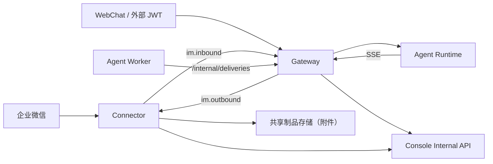

# IM Gateway / Connector 模块详细设计

> 本模块包含两个运行时角色：**Gateway（无状态 Web 请求面）** 与 **Connector（有状态渠道连接角色）**。两者同属一个逻辑部署单元，不是两个业务微服务。本模块只做接入、身份解析、路由、事件转换与通道收发，不做 Agent reasoning、Skill 执行或投递策略。

## 1. 文档控制

### 1.1 责任人

| 角色 | 姓名 | 职责范围 |
| ---- | ---- | -------- |
| 模块负责人 |  | 接入面边界、通道 SPI、WebChat/外部入口 |
| 开发负责人 |  | Gateway、Connector、通道适配器 |
| 测试负责人 |  | 入口、身份、去重、流式、连接接管 |
| 架构负责人 |  | 连接面/执行面/交付边界审核 |

### 1.2 修订历史

| 版本 | 日期 | 作者 | 变更描述 |
| ---- | ---- | ---- | -------- |
| v1.0 | 2026-08-01 |  | 初版详细设计 |
| v1.1 | 2026-11-22 |  | 按模块基线模板刷新：Gateway/Connector 拆分、ChatSurface、Redis 流、投递 facade |

---

## 2. 模块概述与边界

### 2.1 模块定位

| 项目 | 内容 |
| ---- | ---- |
| 模块名称 | IM Gateway / Connector |
| 模块类型 | framework（基础模块/框架层） |
| 所属层 | 接入面 |
| 所属部署单元 | im-gateway（含可选 Connector 角色） |
| 一句话定位 | Gateway 把各入口消息规范化为 Run 请求并把事件转成通道输出；Connector 持有渠道长连接、Bot 租约与收发 |
| 主要使用方 | 企业微信、WebChat、外部 JWT 平台、Runtime、Worker、Console |
| 详细设计 | 本文、《07 跨模块接口与协议》《08 关键流程时序与状态机》 |

### 2.2 角色与使用场景

| 角色 | 使用方式 | 关注点 |
| ---- | -------- | ------ |
| 服务经理 | 企业微信 / WebChat / 外部平台 | 发消息、收结果、停止、看历史 |
| Gateway | 无状态 HTTP/SSE 请求面 | 入口认证、身份解析、路由、事件转换、投递 facade |
| Connector | 有状态渠道连接角色 | 长连接、Bot 租约、收发、附件、接管 |
| Runtime | 接收 Run、输出事件 | 不感知渠道协议 |
| Worker | 独立结果投递 | 只调用 Gateway facade |
| Console | Bot/身份/绑定/授权解析 | 控制面 |

关键场景：SC-03 绑定、SC-04 对话、SC-05 异步结果、SC-09 WebChat、SC-10 排障。

### 2.3 能力清单

| 编号 | 能力 | 说明 |
| ---- | ---- | ---- |
| CAP-01 | 入口接入 | 企业微信、WebChat、外部 JWT 平台统一接入 |
| CAP-02 | 身份与路由 | 外部身份 → 平台用户；bot_id → Agent；授权校验 |
| CAP-03 | 命令 | `/bind`、`/skills`、`/new`、`/stop`、记忆命令分类 |
| CAP-04 | 入站去重 | 按 message_id 占位/终值；受理后才落终值 |
| CAP-05 | 渠道长连接 | Connector 持有 SDK 长连接、Bot 租约与接管 |
| CAP-06 | 事件流 | SSE 订阅、按 seq 回放、通道消息转换 |
| CAP-07 | 出站发送 | Connector 按通道路由发送；Gateway 提供 facade |
| CAP-08 | 附件 | 入站附件批次聚合、出站附件/媒体发送 |
| CAP-09 | 投递 facade | `/internal/deliveries` 接收 Worker 独立投递，去重后转通道 |
| CAP-10 | 通道扩展 | ChannelRegistry + 适配器 SPI；核心域零渠道专有字样 |

### 2.4 范围与非范围

| 类别 | 内容 |
| ---- | ---- |
| 范围 | 入口认证、身份解析、Agent 路由、命令、去重、SSE/通道转换、连接租约、收发、投递 facade |
| 非范围 | Agent reasoning、Prompt、Skill/MCP/模型调用、记忆写入、任务调度、投递业务策略（核心功能 23） |
| 前置假设 | Console Internal API 可用；Redis 可用；Runtime SSE 可用；Connector 可选 |
| 有意妥协 | Gateway 不持库；Connector 不持业务库；Redis 不可用时去重/租约降级但不阻断已受理请求 |

### 2.5 约束与依赖

| 类型 | 内容 | 影响 |
| ---- | ---- | ---- |
| 依赖 Console | Bot 快照、身份解析、绑定、入口授权、Skill 目录 | 控制面不可用时 fail closed 或使用最近完整快照 |
| 依赖 Runtime | 提交 Run、取消、事件流、产物解析 | 执行归 Runtime |
| 依赖 Redis | 去重、Bot 租约、通道流、回复上下文、短期提示 | 非权威；丢失可重建/降级 |
| 依赖共享存储 | 入站附件、出站附件字节 | 不执行 Skill |
| 架构约束 | 渠道 SDK 只在 Connector 的适配器表面；Gateway 不持库；核心域渠道中立 | 见 3.1/3.5 |

---

## 3. 技术设计

### 3.1 关键决策

| 决策点 | 选择 | 被否决项 | 理由 | 可逆性 |
| ------ | ---- | -------- | ---- | ------ |
| 接入面拆分 | Gateway 无状态 + Connector 有状态连接角色 | 单一 Gateway 同时持连接与执行 | 连接故障与执行故障分离 | 难回退 |
| 渠道 SDK | 只在 Connector 适配器表面 | Gateway 内接 SDK | Gateway 可无状态横扩 | 难回退 |
| 通道间通信 | Redis Stream `im.inbound` / `im.outbound` | Gateway 直接调 Connector | 解耦、可重放、可多 Connector | 易 |
| 身份解析 | Gateway 调 Console Internal API | Gateway 持业务库 | 控制面单点、无库 | 难回退 |
| 入口抽象 | `ChatSurface(channel, auth_kind, entry_resolver)` | 每个平台复制 router | 通道名参数化、复用同一会话面 | 易 |
| 去重 | Redis 占位 + 受理后终值 | 先落终值再去重 | 受理前失败可重投 | 易 |
| Bot 连接 | 租约 + fencing，同一 Bot 单 owner | 多 Connector 同时连接 | 避免重复消费 | 难回退 |
| 投递 | Gateway 只做 facade；投递策略归核心 23 | 把 PUSH 默认策略写进 Gateway | 通道机制与业务策略分离 | 易 |

### 3.2 架构设计

| 组件 | 职责 | 不负责 |
| ---- | ---- | ------ |
| Gateway | HTTP/SSE、身份解析、路由、命令、SSE→通道事件、投递 facade | 长连接、渠道 SDK、业务库、Agent 执行 |
| Connector | 渠道长连接、Bot 租约、入站规范化、出站发送、附件 | 身份授权、Agent 执行、业务库、公开业务入口 |
| ChannelRegistry | 适配器注册与查找 | 业务逻辑 |
| ChatSurface | 入口认证方式与入口解析 | 复制 Run/历史逻辑 |
| Redis Stream | 入站/出站事件、批次、去重、租约、回复上下文 | 权威业务事实 |

**关键约束**：

- Gateway 不 import SQLAlchemy，不持库；Connector 不读写业务数据库。
- Connector 只发送 `im.inbound`/`im.outbound`，不直接调 Runtime。
- 渠道 SDK 只允许出现在 Connector 的适配器表面；核心域零渠道专有字样。
- 同一 Bot 同一时刻只有一个 Connector owner；旧 owner 不能覆盖新 owner。
- Gateway 多副本无 sticky；会话/Run 历史在 Runtime。

### 3.3 数据设计

本模块不拥有业务数据库；只使用 Redis 与共享制品存储。

| 数据对象 | 存储 | 说明 | 生命周期 |
| -------- | ---- | ---- | -------- |
| Bot 快照 | Redis/内存 | Console `/internal/channel/bots` 拉取；按渠道过滤 | 固定节拍刷新；保留最近完整快照 |
| 入站事件 | Redis Stream `im.inbound` | Connector 规范化事件；Gateway 消费 | 可重放；有界 |
| 出站命令 | Redis Stream `im.outbound` | Gateway 投递命令；Connector 消费 | 可重放；有界 |
| 入站批次 | Redis | 同 route 的文字+媒体聚合、在途成员 | 窗口有界；失败整批丢弃 |
| 去重占位 | Redis | message_id 占位/终值；带 owner token | TTL；受理后终值 |
| Bot 租约 | Redis | 连接所有权、续租、fencing | TTL；接管 |
| 回复上下文 | Redis | ReplySession、最后确认 seq、流式状态 | 会话期；可重建 |
| 入站/出站附件 | 共享制品存储 | 已解密字节 + 元信息 | 按保留策略 |

**不变量**：

- Bot 快照整批发布；不完整读取丢弃并保留旧快照。
- 入站去重只有“已受理”才落终值；受理前依赖故障释放占位。
- 出站占位有主，释放/升级/续租都是比较值再动作。
- Gateway 不保存 `agent_id → Pod` 或 `bot_id → Pod`。

### 3.4 接口设计

| 接口/主题 | 类型 | 调用方向 | 用途 |
| --------- | ---- | -------- | ---- |
| 企业微信 | WSS/平台协议 | 企业微信 ↔ Connector | 消息、事件、附件、回执 |
| WebChat / 外部 JWT | HTTP/SSE | 用户 → Gateway | 消息、事件、历史、停止 |
| Chat 认证 | HTTP | WebChat → Console/Gateway | Token 换 Chat 会话、Cookie/CSRF |
| Run API | Internal HTTP/SSE | Gateway → Runtime | 提交、取消、恢复、事件流 |
| Console 解析 | Internal HTTP | Gateway/Connector → Console | Bot、身份、绑定、授权、Skill 目录 |
| 入站/出站事件 | Redis Stream | Connector ↔ Gateway | 规范化消息与发送命令 |
| 独立投递 | Internal HTTP | Worker → Gateway | `/internal/deliveries`；服务身份 + 租户 + 产物归属 |
| 附件 | 共享存储/内部 HTTP | Connector/Gateway → 存储/Runtime | 入站落盘、出站引用、产物解析 |

**错误与映射**：

- `IDENTITY_NOT_BOUND` → 提示绑定；`AGENT_ACCESS_DENIED`/`AGENT_DISABLED` → 明确无权限/不可用；
- `RUN_BUSY` → 当前会话已有任务执行中；
- `NO_ACTIVE_RUN` / `CANCEL_REQUESTED` → 停止语义；
- 不暴露内部堆栈、URL、凭据。

### 3.5 质量实现

#### 连接与一致性

| 场景 | 设计 |
| ---- | ---- |
| Connector 故障 | Bot 租约过期，另一个 Connector 接管；旧 owner 结果被 fencing 拒绝 |
| 快照不完整 | 整批丢弃，保留最近完整快照；拉取失败保留旧快照 |
| 入站重复 | message_id 占位；受理后终值；重复直接忽略/确认 |
| 出站重复 | delivery_key 去重；占位有主；成功键存首次结果 |
| Redis 不可用 | 去重降级 at-least-once；租约/流不可用则明确失败，不伪造已连接 |

#### 流式与附件

| 场景 | 设计 |
| ---- | ---- |
| SSE 断流 | 按最后确认 seq 重连；不重建 Run；终态缺失给明确提示 |
| 通道流式 | 按 SDK 最小发送间隔节流；终态 finalize |
| 入站附件 | 同 route 文字+媒体聚合；成员全部成功才发布一个 InboundEvent |
| 出站附件 | 按通道能力发送；大结果只给摘要/引用，不直接暴露内部路径 |

#### 安全与租户

| 目标 | 设计 |
| ---- | ---- |
| 入口认证 | WebChat CHAT 独立 Cookie/CSRF；外部 JWT 验签/身份提取；企微绑定 |
| 租户 | Gateway 按单租户部署；投递 tenant 必须等于部署租户 |
| 渠道凭据 | 只进 Connector 适配器；不进 Gateway、日志、模型上下文 |
| 内部投递 | `X-Internal-Service` + 租户绑定 + 产物按 `artifact_id` 解析 |
| 审计 | 绑定、入站、出站、投递、接管可追溯 |

#### 可观测性与测试

| 场景 | 手段 |
| ---- | ---- |
| 连接健康 | `wecom_ws_connected`、租约 owner/接管、快照 revision |
| 消息链路 | 入站/去重/路由/SSE/出站分段指标与 trace |
| 投递 | PENDING/SENT/FAILED、尝试次数、去重命中 |
| 测试 | 渠道中立扫描、Gateway 无 SQL、Connector SDK 边界、去重/租约/接管、SSE 回放 |

---

## 4. 部署与运维

| 项目 | 内容 |
| ---- | ---- |
| 部署单元 | Gateway 2 Pod（无状态）；Connector 可选 2 Pod（有状态角色，按 Bot 租约分片） |
| 入口 | Gateway 经 Nginx；企业微信 WSS 直连 Connector |
| 挂载 | Gateway 制品文件存储 RW；Connector 制品文件存储 RW；不挂工作区 |
| 依赖 | Redis、Console、Runtime、共享文件存储 |
| 发布 | Gateway 可滚动；Connector 缩容先释放/转移 Bot 租约，避免连接抖动 |
| 监控 | 连接数、租约接管、入站/出站延迟、去重命中、投递状态 |

Connector 不提供公开业务入口；Gateway/Connector 都不直接暴露数据库。

---

## 5. 风险与依赖

| 风险/依赖 | 类型 | 描述 | 影响 | 应对 |
| --------- | ---- | ---- | ---- | ---- |
| Console 不可用 | 依赖 | Bot/身份/授权解析失败 | 新消息无法路由 | 最近完整快照；fail closed |
| Redis 不可用 | 依赖 | 去重/流/租约不可用 | 重复或无法接管 | 去重降级；连接明确失败 |
| 渠道限流/断连 | 外部 | 企微连接抖动 | 收发延迟 | SDK 重连、租约接管、退避 |
| 重复投递 | 一致性 | 至少一次 | 用户重复收到 | delivery_key 去重；占位有主 |
| 渠道专有泄漏 | 架构 | 渠道字样进入核心域 | 难扩展 | 架构机检 + 适配器边界 |
| 附件批次不完整 | 数据 | 媒体下载失败 | 部分消息 | 整批失败，不发布部分结果 |

---

## 6. 追溯矩阵

| 总设模块 | 能力/接口 | Spec/Rule | 场景 | 说明 |
| -------- | --------- | --------- | ---- | ---- |
| IM Gateway / Connector | 接入、身份、路由、流式 | `harness-im`、`harness-arch`、`harness-auth` | SC-03/04/09 | 接入面基线 |
| 对话、Run、任务与调度 | 对话入口 | `harness-im`、`harness-api` | SC-04/09 | 核心功能文档 22 |
| 结果与附件投递 | 投递 facade/通道发送 | `harness-im` | SC-05/06 | 核心功能文档 23 |
| 记忆、经验、审计与可观测 | 入口审计 | `harness-log` | SC-10 | 核心功能文档 24 |

---

## 附录：术语表

| 术语 | 定义 |
| ---- | ---- |
| Gateway | 无状态 Web/SSE 接入面 |
| Connector | 有状态渠道连接角色 |
| ChatSurface | 入口认证方式与入口解析抽象 |
| InboundEvent | Connector 规范化后的入站事件 |
| Bot 租约 | 同一 Bot 连接所有权的短期租约 |
| ReplySession | 一轮回复的通道上下文 |

---

*文档结束*
