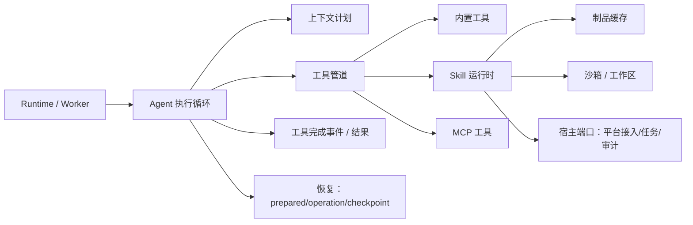

# 执行内核与 Skill 运行时模块详细设计

> 本模块是 Runtime 与 Worker 共用的执行内核与 Skill 运行时，不是部署单元。它统一工具身份、调用与结果、恢复与上下文边界，并提供 Skill 包加载、制品缓存、沙箱执行与结果收口。平台接入、模型网关、任务调度分别归 12、21、10。

## 1. 文档控制

### 1.1 责任人

| 角色 | 姓名 | 职责范围 |
| ---- | ---- | -------- |
| 模块负责人 |  | 执行契约、工具管道、Skill 包规范 |
| 开发负责人 |  | 执行内核、Skill 运行时、沙箱 |
| 测试负责人 |  | 工具结果、恢复、沙箱、制品缓存 |
| 架构负责人 |  | Runtime/Worker 共享边界审核 |

### 1.2 修订历史

| 版本 | 日期 | 作者 | 变更描述 |
| ---- | ---- | ---- | -------- |
| v1.0 | 2026-08-01 |  | 初版 Skill SDK 设计 |
| v1.1 | 2026-11-22 |  | 按模块基线模板刷新：执行契约、统一 execute、沙箱、制品与恢复边界 |

---

## 2. 模块概述与边界

### 2.1 模块定位

| 项目 | 内容 |
| ---- | ---- |
| 模块名称 | 执行内核与 Skill 运行时 |
| 模块类型 | framework（基础模块/框架层） |
| 所属层 | 执行内核/共享能力 |
| 所属部署单元 | 无（Runtime/Worker 共享库） |
| 一句话定位 | 为 Runtime/Worker 提供统一的 Agent 执行循环、工具管道、Skill 包加载与沙箱执行 |
| 主要使用方 | Agent Runtime、Agent Worker |
| 详细设计 | 本文、《04 Agent Runtime》《10 Agent Worker》《05 Skill 相关协议》 |

### 2.2 角色与使用场景

| 角色 | 使用方式 | 关注点 |
| ---- | -------- | ------ |
| Runtime | 实时 Run 的工具/Skill/MCP 执行 | 可恢复、可审计、结果可回放 |
| Worker | 后台 Task 的 Skill 执行 | 同一执行契约、沙箱、制品缓存 |
| Skill 作者 | 编写 SKILL.md、脚本、资源 | 最小包规范、渐进式披露、真实失败反馈 |
| 测试/运维 | 沙箱、缓存、工具审计 | 资源有界、失败可见 |

关键场景：SC-04 同步 Skill、SC-05 异步任务、SC-07 批量任务、SC-08 用户自建 Skill、SC-10 排障。

### 2.3 能力清单

| 编号 | 能力 | 说明 |
| ---- | ---- | ---- |
| CAP-01 | Agent 执行循环 | 模型/工具循环、失败收尾、恢复入口 |
| CAP-02 | 上下文计划 | 用户输入、消息来源、活跃 Skill、受保护前缀与预算 |
| CAP-03 | 工具管道 | 定义、prepare、schema、Hook、Policy、审计、并发 |
| CAP-04 | 统一执行入口 | `execute(target=skill/draft/workspace)`；别名保留但不新增隐藏入口 |
| CAP-05 | Skill 包 | SKILL.md、可选 JSON 入口、脚本/资源/测试 |
| CAP-06 | 渐进式披露 | 目录 → load_skill → 资源/脚本按需读取 |
| CAP-07 | 制品缓存 | 不可变制品、checksum、NFS→本地 emptyDir |
| CAP-08 | 沙箱执行 | 只读包、独立工作区、环境隔离、资源/输出有界 |
| CAP-09 | 结果契约 | 结构化结果、失败/可重试、产物引用、工具完成事件 |
| CAP-10 | 恢复契约 | prepared 调用、operation、checkpoint、结果收件 |
| CAP-11 | 工具来源 | 内置工具、Skill、MCP 进入同一 ToolRegistry |
| CAP-12 | 平台接入端口 | Skill 经宿主端口调用业务平台，不直接持有凭据 |

### 2.4 范围与非范围

| 类别 | 内容 |
| ---- | ---- |
| 范围 | 执行循环、上下文计划、工具管道、Skill 包与运行时、沙箱、制品缓存、工具结果/恢复契约 |
| 非范围 | 部署单元、渠道协议、任务调度/租约、模型池容量、Console 管理、平台 Adapter 实现 |
| 前置假设 | 制品/工作区共享存储可用；沙箱能力可用；调用方提供宿主端口 |
| 有意妥协 | 进程级隔离而非独立沙箱服务；缓存丢失可重建；沙箱不可用时 fail closed |

### 2.5 约束与依赖

| 类型 | 内容 | 影响 |
| ---- | ---- | ---- |
| 依赖存储 | 制品文件存储、工作区文件存储、本地 emptyDir | 加载 Skill、执行脚本、保存输出 |
| 依赖宿主 | Runtime/Worker 提供工具上下文、平台接入、模型网关、任务端口 | 内核不直接依赖 app |
| 依赖契约 | Tool/Result/Recovery/Context 契约 | Runtime/Worker 行为一致 |
| 安全约束 | Skill 不可信；只读包、独立工作区、环境白名单、输出上限 | 不影响宿主与其他用户 |
| 依赖方向 | 执行内核不依赖 Runtime/Worker app | 共享库可独立测试 |

---

## 3. 技术设计

### 3.1 关键决策

| 决策点 | 选择 | 被否决项 | 理由 | 可逆性 |
| ------ | ---- | -------- | ---- | ------ |
| 执行契约 | Tool/Result/Recovery/Context 四类共享契约 | Runtime/Worker 各写一套 | 避免同类缺陷在两个宿主复发 | 难回退 |
| 工具入口 | 唯一 `execute(target=...)` | 每个 Skill 一个隐藏 Tool、模型自由选择异步 | 统一准备/授权/审计；执行方式由冻结配置决定 | 难回退 |
| 执行方式 | 冻结 `execution_mode`：SYNC/ASYNC | 模型自由决定同步/异步 | SCHEDULED 一律 Worker；执行方式由冻结配置决定 | 易 |
| Skill 包 | SKILL.md + 可选 JSON 入口 | 复杂 `skill.yaml` 双事实源 | 减少平台与作者重复维护 | 易 |
| 制品 | 不可变 + checksum + 缓存 | 覆盖同版本文件 | 可复现、可回退 | 难回退 |
| 沙箱 | 进程级只读沙箱 | 直接执行共享目录 | 脚本不可信 | 难回退 |
| 工具结果 | 结构化结果 + 产物引用 + 完成事件 | 字符串成败推断、只存进程内 typed | 恢复与跨宿主一致 | 难回退 |
| 恢复 | prepared 调用 + operation/checkpoint/收件箱 | 按 assistant 原始参数重放 | 避免重复副作用 | 难回退 |

### 3.2 架构设计

| 组件 | 职责 | 不负责 |
| ---- | ---- | ------ |
| Agent 执行循环 | 模型/工具循环、失败状态、收尾 | 部署、渠道、任务调度 |
| 上下文计划 | 来源化输入、活跃 Skill、受保护前缀、预算 | 直接查库/拼业务规则 |
| 工具管道 | 定义、prepare、schema、Hook、Policy、审计、并发 | 业务实现 |
| Skill 运行时 | 包校验、缓存、沙箱、脚本执行、结果收口 | 平台 Adapter、模型选择 |
| 制品缓存 | 不可变制品、checksum、NFS→本地 | 直接改制品 |
| 宿主端口 | 平台接入、任务、审计、模型 | 持有宿主 app 依赖 |

**关键约束**：

- Runtime 与 Worker 使用同一执行循环、工具管道和结果语义；不复制第二套 MCP/Skill。
- 模型只选择 Skill/工具，不决定执行方式；`SYNC/ASYNC` 来自冻结快照。
- 工具调用外部执行前落库 prepared 事实；恢复以 prepared 为准。
- 工具结果持久化为版本化完成事件；进程内 typed 结果与落库字符串必须同形。
- 上下文有受保护前缀（系统提示、记忆、摘要）；压缩只作用于其后的对话区。
- Skill 执行不直接持有凭据；平台调用经宿主端口。

### 3.3 数据设计

| 数据对象 | 归属 | 说明 | 生命周期 |
| -------- | ---- | ---- | -------- |
| Skill Package | 制品存储 | SKILL.md、scripts、references、assets、tests | 不可变；按版本 |
| Skill Artifact | 制品存储 + 控制面元数据 | checksum、storage_key、execution_mode | 不可变 |
| 本地 Skill Cache | emptyDir | checksum 目录、只读执行副本 | 可丢弃 |
| Workspace | 工作区存储 | 当前 user/Agent 的 data/outputs | 配额/TTL |
| Tool Definition | 执行内核 | 名称、schema、effect、concurrency、retry_safety | 按 Run/Task 冻结 |
| Prepared Call | runtime/task | 归一化参数、Hook/授权后调用、幂等身份 | 恢复事实 |
| Tool Event / Result | runtime/task | 开始/完成/失败、产物角色、follow-ups | 只追加 |
| Operation / Checkpoint | runtime/task | 异步操作、接续点、结果收件 | 终态保留 |

**不变量**：

- 同一 `storage_key` 不可覆盖；缓存校验 checksum 后原子切换。
- 沙箱只挂载当前 user/Agent 的工作区；不挂共享存储根。
- 工具结果成功/失败只有一种判定；不得按 JSON 形状推断成败。
- 恢复不得重复执行已确定的副作用；未知结果按 operation/checkpoint 处理。

### 3.4 接口设计

| 接口/契约 | 类型 | 调用方向 | 用途 |
| --------- | ---- | -------- | ---- |
| ToolDefinition / Handler | 函数/库契约 | 执行内核 → 工具实现 | 名称、schema、effect、concurrency、retry_safety |
| `execute(target=skill/draft/workspace)` | 工具契约 | 模型 → 执行内核 | 统一执行入口 |
| Skill Package 契约 | 文件/库契约 | 导入器/运行时 | SKILL.md、可选 JSON 入口、路径与大小 |
| 沙箱执行契约 | 进程契约 | Skill 运行时 → 沙箱 | argv、stdin、env、cwd、timeout、输出上限 |
| 结果契约 | 类型化契约 | 工具 → 执行内核 → 事件 | 成功/失败/可重试/产物/follow-ups |
| 宿主端口 | 协议 | 执行内核 → Runtime/Worker | 平台接入、模型、任务、审计、产物 |
| 制品解析 | 接口 | 执行内核 → 制品存储 | resolve、exists、不可变写 |

**错误语义**：

- 工具抛异常与返回 `{"error":...}` 同等对待；确定性失败第一次即停。
- 平台/环境失败第一次即停；模型可纠正失败按阈值重试。
- 沙箱不可用、超时、输出超限、路径非法、checksum 不一致：显式失败并审计。
- 失败收尾最多一次模型调用；空产出用失败码/平台原文兜底。

### 3.5 质量实现

#### 隔离与资源

| 目标 | 设计 |
| ---- | ---- |
| 脚本不可信 | 只读制品、独立工作区、环境白名单、最小权限 |
| 资源有界 | 单次超时、输出上限、进程组回收、并发上限 |
| 路径安全 | 拒绝绝对路径、`..`、符号链接逃逸；resolve 落在根内 |
| 缓存安全 | checksum 校验；同 checksum 单飞；原子切换 |
| 失败可见 | 沙箱/超时/输出/校验失败显式错误与审计 |

#### 结果与恢复

| 场景 | 设计 |
| ---- | ---- |
| 工具结果形状 | 结构化 typed → 持久化版本化事件 → 恢复同形 |
| 崩溃恢复 | prepared 调用/operation/checkpoint/收件箱；不按原始参数重放 |
| 上下文恢复 | ContextPlan 覆盖水位；连续摘要合并；pinned 回载 |
| 工具完成 | 版本化 result + 产物角色 + follow-ups；进程内/落库一致 |
| MCP | 统一错误分类/审计/有界内容；不静默丢图片/资源 |

#### 可观测性与测试

| 场景 | 手段 |
| ---- | ---- |
| 工具链路 | 工具名、调用 ID、耗时、结果状态、产物、审计 |
| Skill 执行 | 缓存命中、checksum、沙箱退出码、超时、输出大小 |
| 合同测试 | 工具身份/结果/恢复/上下文四类契约；Runtime/Worker parity |
| 沙箱测试 | 逃逸、路径、符号链接、资源/输出上限、取消 |
| 回归 | 长上下文、工具失败、MCP 形状、恢复窗口 |

---

## 4. 部署与运维

| 项目 | 内容 |
| ---- | ---- |
| 部署单元 | 无；作为共享库随 Runtime/Worker 镜像发布 |
| 挂载 | Runtime/Worker 挂载制品文件存储、工作区文件存储；Skill 本地缓存 emptyDir |
| 依赖 | 制品/工作区存储、沙箱能力、宿主端口 |
| 发布 | 随 Runtime/Worker 滚动；执行契约变更需两宿主同时升级 |
| 监控 | 缓存命中、沙箱失败、工具失败分类、恢复次数、压缩降级 |

---

## 5. 风险与依赖

| 风险/依赖 | 类型 | 描述 | 影响 | 应对 |
| --------- | ---- | ---- | ---- | ---- |
| 执行契约漂移 | 架构 | Runtime/Worker 各写一套 | 行为分叉 | 共享契约/端口、parity 测试 |
| 沙箱不可用 | 安全 | 无法隔离执行 | Skill 不能运行 | fail closed，明确错误 |
| 制品缓存损坏 | 数据 | checksum 不一致 | 执行错误 | 校验失败拒绝；重新拉取 |
| 大输出 | 资源 | 上下文/磁盘压力 | 任务失败 | 外置产物、preview、上限 |
| 恢复重复副作用 | 一致性 | prepared/operation 缺失 | 重复外部调用 | prepared 落库、幂等键、恢复状态机 |
| 平台凭据 | 安全 | 脚本直接持凭据 | 泄露 | 宿主端口；Skill 不接触明文 |

---

## 6. 追溯矩阵

| 总设模块 | 能力/接口 | Spec/Rule | 场景 | 说明 |
| -------- | --------- | --------- | ---- | ---- |
| 执行内核与 Skill 运行时 | 工具/Skill/沙箱/结果 | `harness-skill`、`harness-arch`、`harness-mcp` | SC-04/05/08 | 共享执行基线 |
| Agent 授权与 Skill | Skill 生命周期/执行 | `harness-skill` | SC-04/08 | 核心功能文档 20 |
| MCP 与模型能力 | MCP 工具/模型调用 | `harness-mcp`、`harness-model` | SC-04/05 | 核心功能文档 21 |
| 对话、Run、任务与调度 | 工具循环/恢复 | `harness-api`、`harness-snapshot` | SC-04/05 | 核心功能文档 22 |

---

## 附录：术语表

| 术语 | 定义 |
| ---- | ---- |
| Agent Core | 执行循环、上下文计划与工具管道 |
| Skill Artifact | 不可变 Skill 制品 |
| Prepared Call | 归一化、Hook/授权后的调用事实 |
| Tool Event | 工具开始/完成/失败的事实 |
| 宿主端口 | Runtime/Worker 提供给执行内核的能力接口 |

---

*文档结束*
