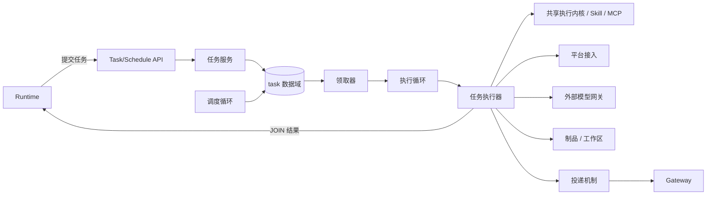

# Agent Worker 与异步任务模块详细设计

> 本模块是异步执行面，负责持久任务、定时计划、租约、重试、超时、取消、父子任务与投递机制。业务交付策略（结果/附件、PUSH 默认）归核心功能“结果与附件投递”；Worker 只提供可靠执行与投递状态机制。

## 1. 文档控制

### 1.1 责任人

| 角色 | 姓名 | 职责范围 |
| ---- | ---- | -------- |
| 模块负责人 |  | 任务生命周期、调度与租约 |
| 开发负责人 |  | 执行器、调度器、投递机制 |
| 测试负责人 |  | 崩溃恢复、重试、批量、投递一致性 |
| 架构负责人 |  | Runtime/Worker/交付边界审核 |

### 1.2 修订历史

| 版本 | 日期 | 作者 | 变更描述 |
| ---- | ---- | ---- | -------- |
| v1.0 | 2026-08-01 |  | 初版详细设计 |
| v1.1 | 2026-11-22 |  | 按模块基线模板刷新：等待细分、定时状态、投递边界、共享执行契约 |

---

## 2. 模块概述与边界

### 2.1 模块定位

| 项目 | 内容 |
| ---- | ---- |
| 模块名称 | Agent Worker 与异步任务 |
| 模块类型 | framework（基础模块/框架层） |
| 所属层 | 异步执行面 |
| 所属部署单元 | agent-worker |
| 一句话定位 | 从持久队列领取 Task/Schedule，可靠执行并沉淀终态、事件与投递意图 |
| 主要使用方 | Runtime（提交/取消任务）、Gateway（任务查询/投递入口）、Console（管理查询） |
| 详细设计 | 本文、《08 关键流程时序与状态机》《06 执行内核与 Skill 运行时》 |

### 2.2 角色与使用场景

| 角色 | 使用方式 | 关注点 |
| ---- | -------- | ------ |
| 用户 | 经 Agent 提交长任务/定时/批量，查询进度和结果 | 任务能完成、可取消、结果可送达 |
| Runtime | 提交 Task/Schedule、取消、接收 JOIN 结果 | 只负责受理与接续 |
| Gateway | 查询任务、接收独立投递 | 投递入口与去重 |
| Console | 任务/定时管理视图 | 只读投影与有限操作 |

关键场景：SC-05 异步长任务、SC-06 定时任务、SC-07 批量处理、SC-10 失败排障。

### 2.3 能力清单

| 编号 | 能力 | 说明 |
| ---- | ---- | ---- |
| CAP-01 | 任务创建与查询 | Runtime 提交 Task，Gateway/Console 查询 |
| CAP-02 | 持久队列 | PostgreSQL 为权威队列；claim/lease/heartbeat |
| CAP-03 | 任务状态机 | QUEUED/RUNNING/WAITING_EXTERNAL/WAITING_HUMAN/终态 |
| CAP-04 | 重试与退避 | 按错误语义、attempt、deadline 决定 |
| CAP-05 | 取消 | 非终态统一落取消意图；执行中协作停止 |
| CAP-06 | 定时计划 | 计划、revision、fire、misfire、NEEDS_ATTENTION |
| CAP-07 | 父子批量 | Parent/Child 幂等扇出与原子扇入 |
| CAP-08 | 外部异步等待 | 外部任务 create/poll，等待释放租约 |
| CAP-09 | Skill 执行 | 复用共享执行内核、制品缓存、沙箱、平台接入、模型网关 |
| CAP-10 | 结果回流 | JOIN 结果经发件/收件箱回传 Runtime |
| CAP-11 | 投递机制 | 终态与投递意图同事务；PENDING/SENT/FAILED/NONE |
| CAP-12 | 任务事件与审计 | task_event、投递尝试、任务审计 |

### 2.4 范围与非范围

| 类别 | 内容 |
| ---- | ---- |
| 范围 | Task/Schedule 领取、执行、等待、重试、取消、父子任务、终端结果与投递机制 |
| 非范围 | 用户意图理解、IM 协议、Console CRUD、结果投递业务策略（核心功能 23）、Run 实时事件流 |
| 前置假设 | PostgreSQL 可用；Runtime 提交冻结快照；共享文件存储可读；平台接入/模型网关可达 |
| 有意妥协 | 至少一次执行 + 幂等；外部副作用不可撤回；等待状态释放租约 |

### 2.5 约束与依赖

| 类型 | 内容 | 影响 |
| ---- | ---- | ---- |
| 依赖基础模块 | PostgreSQL、制品/工作区、执行内核、平台接入、模型网关 | 任务持久化与执行能力 |
| 依赖 Runtime | Task 提交、取消、结果回流 | JOIN 任务与 Run 接续 |
| 依赖 Gateway | 独立结果投递入口 | 投递通道 |
| 一致性约束 | 终态与投递意图同事务；claim/lease/epoch；结果按业务键幂等 | 不丢结果、不重复副作用 |
| 安全约束 | 任务按租户/用户/Agent 归属；Worker 不做身份授权决策 | 授权来自提交快照与前置校验 |

---

## 3. 技术设计

### 3.1 关键决策

| 决策点 | 选择 | 被否决项 | 理由 | 可逆性 |
| ------ | ---- | -------- | ---- | ------ |
| 任务队列 | PostgreSQL 持久队列 | Redis/内存队列作为权威 | 事务、租约、恢复、审计 | 难回退 |
| 执行者归属 | lease_owner + lease_until + epoch | Pod 名称/固定绑定 | 可回收、可横扩 | 难回退 |
| 等待语义 | WAITING_EXTERNAL / WAITING_HUMAN | 单一 WAITING | 取消与续接规则不同 | 易 |
| 定时版本 | Schedule 不永久冻结版本；触发时重解析 | 计划永久绑定旧版本 | 新版本作用于后续触发 | 易 |
| 批量 | Parent/Child + item_key 幂等 | 任意 DAG/工作流引擎 | 当前批量足够、可恢复 | 易 |
| 投递 | 终态 + 投递意图同事务；Worker 提供机制 | 先发消息后落库 | 不丢结果、可重试 | 难回退 |
| 执行内核 | 与 Runtime 共享同一契约/工具/Skill/MCP | Worker 自建第二套 | 避免行为分叉 | 难回退 |
| 失败收尾 | 确定性失败即停，可重试按预算 | 无限重试 | 失败环节重试不会变成功 | 易 |

### 3.2 架构设计

| 组件 | 职责 | 不负责 |
| ---- | ---- | ------ |
| Task/Schedule API | 提交、查询、取消、暂停/恢复 | 执行业务、IM 协议 |
| 任务服务 | 任务/计划事务、状态映射、事件 | 长时间执行 |
| 调度循环 | 到期计划 claim、fire、next_fire_at | 执行 Skill |
| 领取器 | 持久队列 claim、排除已取消/过期 | 业务规则 |
| 执行循环 | 心跳、deadline、取消检查、执行调度 | 重新理解用户意图 |
| 任务执行器 | Skill、外部等待、批量、结果收口 | 复制 Runtime 执行链路 |
| 投递机制 | 投递意图、状态、重试/去重 | 决定“推什么/给谁”（核心功能 23） |

**关键约束**：

- 领取必须同时满足 `status` 可执行、`not_before <= now()`、`deadline_at > now()`、未取消。
- 心跳续租必须校验当前租约仍有效；失约执行者只能停手。
- 进入 WAITING_* 释放 lease，不参与 reclaim。
- 终态、task_event、结果发件/投递意图在同一事务；外部发送在事务外。
- Worker 与 Runtime 使用同一执行契约；不复制工具/MCP/Skill 逻辑。

### 3.3 数据设计

| 数据对象 | 归属 | 说明 | 生命周期 |
| -------- | ---- | ---- | -------- |
| TaskExecution | task | 状态、owner/lease、attempt、deadline、快照引用 | 终态保留；软删 |
| TaskEvent | task | 状态/步骤/错误事实 | 只追加 |
| TaskSchedule / Revision / Fire | task | 计划、版本、触发记录 | 计划软删；触发保留 |
| TaskScheduleDraft | task | 待确认的计划草稿 | 确认/清理 |
| TaskDelivery / Attempt | task | 投递意图、状态、尝试与回执 | 终态保留；审计 |
| TaskSubmission / Outbox | task | 提交受理、结果发件 | 幂等保留 |
| Workspace / Lease | task | 用户/Agent 工作区元数据与执行租约 | 配额/TTL |
| HumanInteraction | task | 等待人工处理的交互 | 终态/超时 |
| Execution Snapshot | task | 冻结的 Agent/模型/Skill/MCP/预算 | 按 Task 冻结 |

**状态与不变量**：

- Task：QUEUED → RUNNING → WAITING_EXTERNAL/WAITING_HUMAN → RUNNING → COMPLETED/FAILED/CANCELLED。
- Schedule：ACTIVE ↔ PAUSED；可进入 NEEDS_ATTENTION；终态为 ENDED/CANCELLED，结束原因单独记录。
- Parent 只对 BATCH 生效；Agentic 异步 Skill 子 Task 不参与 BATCH fan-in。
- 同一父任务 `(parent_id, item_key)` 唯一；回收后不重复扇出。
- 终态不可逆；取消/失败/完成只写一次。
- 错过触发按 SKIP 记录 fire 并累加指标，不补发；连续临时准入失败升级 NEEDS_ATTENTION。

### 3.4 接口设计

| 接口/主题 | 类型 | 调用方向 | 用途 |
| --------- | ---- | -------- | ---- |
| `/internal/tasks` | Internal HTTP | Runtime → Worker | 提交、取消、查询任务 |
| `/internal/schedules` | Internal HTTP | Runtime/Gateway → Worker | 创建/暂停/恢复/查询计划 |
| 任务/计划查询 | Internal/Console API | Gateway/Console → Worker/投影 | 管理视图与任务中心 |
| `/internal/deliveries` | Internal HTTP | Worker → Gateway | 独立结果投递 |
| 结果发件/收件箱 | 持久事件 | Worker ↔ Runtime | JOIN 结果回流 |
| 任务操作结果 | Internal HTTP | Worker → Runtime | Task-owned 异步操作结果 |
| 平台接入 / 模型网关 | HTTP | Worker → 外部 | Skill 内部业务调用与模型摘要 |

**错误与失败语义**：

- 提交回执只表示受理；业务结果由终态表达。
- 可重试失败保留队列；不可重试/预算耗尽/超 deadline 进入终态。
- 外部 create 前生成幂等键，成功后持久化外部任务 ID；恢复后继续 poll，不重复 create。
- 投递只有 `delivered=true` 才算送达；可重试失败回 PENDING。

### 3.5 质量实现

#### 可靠性

| 场景 | 设计 |
| ---- | ---- |
| Worker 崩溃 | lease 过期 reclaim；按 attempt/退避；终态 CAS |
| Parent 崩溃 | 已有 Child 继续；回收后只等待/扇入，不重复扇出 |
| 外部等待 | WAITING_EXTERNAL + not_before 轮询；释放租约 |
| 取消竞争 | 单语句落取消意图；claim/reclaim 排除已取消 |
| 投递失败 | PENDING 重试；FAILED 终态；delivery_key 去重 |
| Redis 不可用 | 持久队列可继续；提示/取消 hint 降级 |

#### 性能与容量

| 目标 | 设计 |
| ---- | ---- |
| 吞吐 | 多副本 claim；`SKIP LOCKED`；批量领取有界 |
| 长任务 | 释放租约等待；不占 Worker 线程 |
| 批量 | Child 并发受计划/系统/平台限制 |
| 调度 | 单轮批量处理，避免排队误判 misfire |

#### 安全与审计

| 目标 | 设计 |
| ---- | ---- |
| 租户隔离 | 任务/计划/投递按 tenant；跨租户不扫描 |
| 授权 | 提交快照 + 触发时重校验；撤销影响后续 |
| 凭据 | 平台接入管理；不进任务事件/日志 |
| 审计 | 终态、取消、重试、投递、调度跳过可追溯 |

#### 可观测性与测试

| 场景 | 手段 |
| ---- | ---- |
| 队列健康 | 深度、最老任务年龄、claim 失败、租约回收 |
| 调度健康 | fire 成功/跳过/失败、NEEDS_ATTENTION 数 |
| 投递健康 | PENDING 数、尝试次数、FAILED、送达率 |
| 测试 | 崩溃点/重试/取消/父子/投递幂等/调度 misfire |

---

## 4. 部署与运维

| 项目 | 内容 |
| ---- | ---- |
| 部署单元 | agent-worker，多副本、无状态 |
| 挂载 | 制品文件存储 RW、工作区文件存储 RW、Skill 本地缓存 emptyDir |
| 依赖 | PostgreSQL、Redis（提示/缓存）、Runtime、Gateway、平台接入、模型网关 |
| 发布 | 先数据库升级再滚动；缩容前停止领取并有界排空 |
| 监控 | 队列深度、最老任务、租约回收、调度 fire、投递状态 |

不直接对用户暴露；不绑定 Agent/User/Task；不保存本地权威状态。

---

## 5. 风险与依赖

| 风险/依赖 | 类型 | 描述 | 影响 | 应对 |
| --------- | ---- | ---- | ---- | ---- |
| 外部副作用不可撤回 | 业务 | 外部已创建任务无法回滚 | 取消只保证平台内停止 | 审计保留；不伪造回滚 |
| 重复执行 | 一致性 | at-least-once | 外部副作用重复 | 幂等键/结果去重/业务键 |
| 调度误判 | 时间 | 排队导致 misfire | 漏触发 | 单轮批量、宽限、跳过审计 |
| 投递拥塞 | 依赖 | Gateway/通道不可用 | 结果延迟 | 持久 PENDING、退避、跨租户公平 |
| 执行契约漂移 | 架构 | Runtime/Worker 各写一套 | 行为分叉 | 共享契约/端口、契约测试 |
| 容量 | 性能 | 队列积压 | 完成时间变长 | HPA 按队列、排空策略 |

---

## 6. 追溯矩阵

| 总设模块 | 能力/接口 | Spec/Rule | 场景 | 说明 |
| -------- | --------- | --------- | ---- | ---- |
| Agent Worker | 任务队列/租约/重试 | `harness-arch`、`harness-api`、`harness-data` | SC-05/06/07 | 异步执行面基线 |
| 对话、Run、任务与调度 | Task/Schedule/批量 | `harness-api`、`harness-time` | SC-05/06/07 | 核心功能文档 22 |
| 结果与附件投递 | 投递机制/状态 | `harness-im`、`harness-skill` | SC-05/06 | 核心功能文档 23 |
| 记忆、经验、审计与可观测 | 任务审计/指标 | `harness-log` | SC-10 | 核心功能文档 24 |

---

## 附录：术语表

| 术语 | 定义 |
| ---- | ---- |
| Task | 一次持久化后台执行 |
| Schedule | 定时计划定义 |
| Fire | 一次计划触发记录 |
| Lease | 执行者租约 |
| JOIN | 结果回流当前 Run |
| DETACH | 独立执行并投递 |
| Misfire | 错过触发窗口 |

---

*文档结束*
