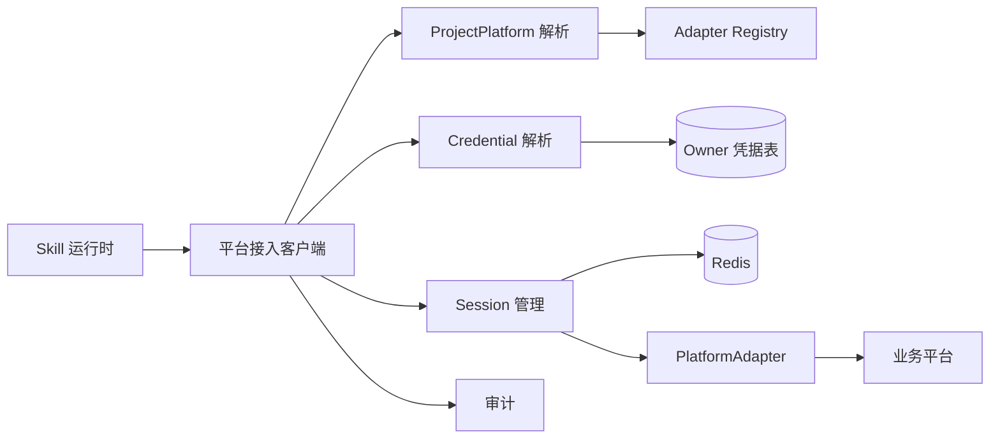

# 平台接入与 Session 模块详细设计

> 本模块是 Runtime/Worker 共用的平台接入能力，不是部署单元。它负责 ProjectPlatform 解析、PlatformAdapter 选择、凭据解析、Session 缓存与请求准备；不承载 Skill 业务逻辑，也不直接对接模型供应商。

## 1. 文档控制

### 1.1 责任人

| 角色 | 姓名 | 职责范围 |
| ---- | ---- | -------- |
| 模块负责人 |  | 平台接入抽象、凭据与 Session 边界 |
| 开发负责人 |  | Adapter、CredentialResolver、SessionManager |
| 测试负责人 |  | 认证、Session 失效、并发冷启动、脱敏 |
| 架构负责人 |  | 平台接入/执行内核边界审核 |

### 1.2 修订历史

| 版本 | 日期 | 作者 | 变更描述 |
| ---- | ---- | ---- | -------- |
| v1.0 | 2026-08-01 |  | 初版项目平台适配设计 |
| v1.1 | 2026-11-22 |  | 按模块基线模板刷新：平台接入层、凭据主键、Session 缓存与单飞 |

---

## 2. 模块概述与边界

### 2.1 模块定位

| 项目 | 内容 |
| ---- | ---- |
| 模块名称 | 平台接入与 Session |
| 模块类型 | framework（基础模块/框架层） |
| 所属层 | 共享能力/平台接入 |
| 所属部署单元 | 无（随 Runtime/Worker/Console 共享库发布） |
| 一句话定位 | 把“业务平台怎么认证、怎么准备请求、怎么复用 Session”收口为可复用能力 |
| 主要使用方 | Skill 运行时、Runtime、Worker、Console Metadata |
| 详细设计 | 本文、《07 跨模块接口与协议》《14 授权模型》 |

### 2.2 角色与使用场景

| 角色 | 使用方式 | 关注点 |
| ---- | -------- | ------ |
| Skill 作者 | 只声明使用哪个平台 | 不接触账号、密码、Cookie、签名 |
| Runtime/Worker | 执行 Skill 时调用平台接入 | 无状态、Session 可重建、失败可控 |
| 管理员 | Console 配置 ProjectPlatform/凭据 | Adapter 元数据驱动表单，凭据不回显 |
| 业务平台 | 接收认证后的请求 | 平台协议差异由 Adapter 吸收 |

关键场景：SC-04 同步 Skill、SC-05 异步任务、SC-07 批量任务、SC-10 平台调用排障。

### 2.3 能力清单

| 编号 | 能力 | 说明 |
| ---- | ---- | ---- |
| CAP-01 | ProjectPlatform 解析 | 平台实例配置、Adapter key、凭据策略 |
| CAP-02 | Adapter Registry | key/version 查找、Metadata 与 Schema |
| CAP-03 | Credential 解析 | 用户/共享凭据、credential_mode、版本/指纹 |
| CAP-04 | Session 缓存 | Redis 可重建缓存、TTL、失效与索引 |
| CAP-05 | 请求准备 | Cookie/Token、CSRF、签名、Header 注入 |
| CAP-06 | 受控重新认证 | 认证过期最多一次 re-auth |
| CAP-07 | 并发单飞 | 多 Pod 冷启动只受控登录一次 |
| CAP-08 | Schema 驱动 Console | platform_config_schema / credential_schema |
| CAP-09 | 审计与脱敏 | 平台调用、认证、失败与凭据使用审计 |
| CAP-10 | 错误归一 | 平台错误映射为统一错误码/retryable |

### 2.4 范围与非范围

| 类别 | 内容 |
| ---- | ---- |
| 范围 | 平台配置解析、Adapter 选择、凭据解析、Session 缓存、请求认证、错误映射 |
| 非范围 | Skill 业务逻辑、Agent reasoning、Console 在线编写 Adapter、模型供应商接入、结果投递 |
| 前置假设 | ProjectPlatform/凭据由控制面维护；Redis 可用；业务平台可达 |
| 有意妥协 | Redis 丢失触发重新认证；V1 每平台最多一套共享凭据；不做账号池/主备切换 |

### 2.5 约束与依赖

| 类型 | 内容 | 影响 |
| ---- | ---- | ---- |
| 依赖控制面 | ProjectPlatform、Adapter Metadata、用户/共享凭据 | 配置与凭据权威 |
| 依赖 Redis | Session 缓存、单飞锁、失效索引 | 非权威；丢失可重建 |
| 依赖宿主 | Runtime/Worker 提供调用上下文与审计端口 | 不直接依赖 app |
| 安全约束 | 凭据明文只存 Owner 表；不进入 Skill、Snapshot、Prompt、日志、审计 | 见 3.5 |
| 架构约束 | Adapter 代码评审后随应用发布；不允许运行时下载代码 | 供应链安全 |

---

## 3. 技术设计

### 3.1 关键决策

| 决策点 | 选择 | 被否决项 | 理由 | 可逆性 |
| ------ | ---- | -------- | ---- | ------ |
| 平台认证抽象 | ProjectPlatform + PlatformAdapter + Credential + Session | 统一 Bearer/API Key 枚举 | 平台协议差异大 | 难回退 |
| 凭据存储 | Owner 表明文列，主键引用 | 外部密钥服务引用 | 与当前安全模型和备份一致 | 难回退 |
| Session | Redis 可重建缓存 | Pod 本地 Session | 任意 Pod 可复用、可重建 | 难回退 |
| 凭据选择 | credential_mode: USER_ONLY/SHARED_ONLY/USER_THEN_SHARED/NONE | 每平台手写策略 | 统一表达“凭据从哪来” | 易 |
| 请求认证 | Adapter `prepare_request` | SessionManager 直接拼 Header | 支持每请求签名/CSRF | 难回退 |
| 并发冷启动 | 分布式单飞 + double-check | 每 Pod 各自登录 | 避免账号被打爆 | 易 |
| Adapter 管理 | 代码注册、版本化、Metadata 驱动 Console | 运行时下载 Python/在线编辑 | 供应链与可审计 | 难回退 |

### 3.2 架构设计

| 组件 | 职责 | 不负责 |
| ---- | ---- | ------ |
| 平台接入客户端 | 一次调用的编排：解析平台/凭据/Session/请求 | 业务语义、模型调用 |
| ProjectPlatform 解析 | 平台实例、Adapter key、凭据策略 | Adapter 实现 |
| Adapter Registry | key/version 查找、Schema/Metadata | 运行时加载代码 |
| Credential 解析 | 用户/共享凭据、版本/指纹 | 明文展示 |
| Session 管理 | 缓存、TTL、失效、单飞 | 业务权威状态 |
| PlatformAdapter | 认证、校验、请求准备 | Console ORM、Agent 执行 |

**关键约束**：

- Adapter 不读 Console ORM，不直接持有 Skill/业务数据。
- Session 缓存只放短期认证材料；长期凭据只在解析时短暂使用。
- 凭据版本变化 → Session key 变化，自然不复用旧 Session。
- Adapter key/version 变化 → 旧 Session 失效、凭据标记需重配。
- 平台调用审计记录平台、Adapter、结果、耗时；不记录明文。

### 3.3 数据设计

| 数据对象 | 归属 | 说明 | 生命周期 |
| -------- | ---- | ---- | -------- |
| ProjectPlatform | control | 平台实例、resolver_type/config、adapter_key/config、credential_mode | 软删；配置审计 |
| 用户凭据 | control | 用户 + 平台 + credential_json 明文 | 轮换/软删；版本变化 |
| 共享凭据 | control | 平台级 0..1 套 | 轮换/软删 |
| Adapter Metadata | 代码 | key/name/version/session_mode/schemas | 随发布 |
| Session | Redis | session_id/cookie/token/csrf/adapter_state/expires_at | TTL；可重建 |
| Session 索引 | Redis | 按 tenant/platform 的 key 集合 | 失效时删除 |
| 平台调用审计 | runtime/control 审计 | 平台、Adapter、结果、耗时、脱敏信息 | 只追加 |

**不变量**：

- 凭据明文只在 Owner 表、临时内存和请求材料中出现。
- Session 不保存 raw password/AK/SK；需要再次认证时重新解析凭据。
- Session key 含 tenant/platform/actor/credential_version/adapter_key/adapter_version。
- 失效删除用索引集合，禁止通配符扫描。

### 3.4 接口设计

| 接口/契约 | 类型 | 调用方向 | 用途 |
| --------- | ---- | -------- | ---- |
| 平台解析 | Console Internal API | Runtime/Worker → Console | ProjectPlatform、Adapter、凭据策略 |
| PlatformAdapter | 库契约 | 平台接入 → Adapter 实现 | authenticate/validate/prepare_request |
| Adapter Registry | 库契约 | 平台接入 → 注册表 | key/version 查找 |
| Credential 解析 | 库契约 + DB | 平台接入 → 凭据表 | 用户/共享凭据 + 版本 |
| Session 管理 | 库契约 + Redis | 平台接入 → Redis | get/set/expire/单飞 |
| 业务平台请求 | HTTP/平台协议 | Adapter → 业务平台 | 认证后的业务调用 |
| 审计 | 宿主端口 | 平台接入 → 审计 | 平台调用/认证事实 |

**错误语义**：

- `PLATFORM_ADAPTER_NOT_FOUND` / `PLATFORM_CONFIG_INVALID`：配置失败，不重试。
- `CREDENTIAL_MISSING` / `CREDENTIAL_INVALID`：提示配置/更新凭据。
- `SESSION_AUTH_FAILED` / `SESSION_VALIDATE_FAILED`：Session 失效，受控 re-auth 一次。
- `PLATFORM_AUTH_EXPIRED`：明确过期，重新认证；账号锁定/密码错误不快速重试。
- `PLATFORM_REQUEST_FAILED`：按 Adapter 的 `retryable` 与调用方预算处理。

### 3.5 质量实现

#### 安全与租户

| 目标 | 设计 |
| ---- | ---- |
| 凭据隔离 | 明文只在 Owner 表/临时内存/请求材料；不进 Skill、快照、Prompt、日志、审计 |
| 租户隔离 | 平台/凭据/Session 均按 tenant；跨租户拒绝 |
| 脱敏 | Authorization/Cookie/Token/Key 日志与审计脱敏 |
| Adapter 供应链 | 代码评审、版本化、随应用发布；禁止运行时下载 |
| 最小暴露 | Console 默认只回“已配置”；按需回显需 ADMIN + no-store |

#### 可靠性

| 场景 | 设计 |
| ---- | ---- |
| Redis 丢失 | Session cache miss，重新认证；不丢业务事实 |
| 并发冷启动 | 单飞 + double check，只允许受控登录 |
| 凭据轮换 | credential_version 变化，新 key，不复用旧 Session |
| Adapter 变更 | 旧 Session 失效、凭据标记需重配 |
| 平台认证过期 | 最多一次 re-auth；失败明确返回 |

#### 性能与可观测

| 场景 | 手段 |
| ---- | ---- |
| Session 复用 | 跨 Pod 共享 Redis；减少登录 |
| 调用排障 | 平台、Adapter、结果、耗时、重试次数、脱敏错误 |
| 容量 | 登录频率、Session 命中率、单飞等待、平台错误率 |
| 测试 | Adapter schema/认证/签名、Session 命中/失效、并发单飞、脱敏 |

---

## 4. 部署与运维

| 项目 | 内容 |
| ---- | ---- |
| 部署单元 | 无；作为共享库随 Runtime/Worker/Console 镜像发布 |
| 依赖 | Redis（Session/单飞）、控制面凭据/平台配置、业务平台 |
| 配置 | Adapter key/version、Session TTL、单飞锁时长由实现配置 |
| 发布 | Adapter/契约变更随应用滚动；旧 Session 失效 |
| 监控 | 登录成功率、Session 命中、单飞等待、平台错误、凭据失效 |

---

## 5. 风险与依赖

| 风险/依赖 | 类型 | 描述 | 影响 | 应对 |
| --------- | ---- | ---- | ---- | ---- |
| 平台协议变化 | 外部 | 登录/签名/字段变化 | 调用失败 | Adapter 版本化；错误归一 |
| Session 缓存击穿 | 性能 | 大量 Pod 同时冷启动 | 平台账号压力 | 单飞 + double check |
| 凭据轮换 | 安全 | 旧 Session 残留 | 认证失败 | credential_version 进 key |
| Adapter 供应链 | 安全 | 运行时加载代码 | 不可审计 | 代码评审 + 随应用发布 |
| 明文凭据 | 安全 | 日志/上下文泄露 | 合规风险 | 严格脱敏 + 不进入快照/Prompt |
| Redis 不可用 | 依赖 | 无法缓存 Session | 频繁登录/失败 | 受控重认证/明确失败 |

---

## 6. 追溯矩阵

| 总设模块 | 能力/接口 | Spec/Rule | 场景 | 说明 |
| -------- | --------- | --------- | ---- | ---- |
| 平台接入与 Session | Adapter/Session/凭据 | `harness-project-platform`、`harness-secret`、`harness-arch` | SC-04/05/07 | 平台接入基线 |
| MCP 与模型能力 | 平台业务调用 | `harness-project-platform` | SC-04/05 | 核心功能文档 21 |
| 结果与附件投递 | 平台发送能力 | `harness-im` | SC-05/06 | 核心功能文档 23 |

---

## 附录：术语表

| 术语 | 定义 |
| ---- | ---- |
| ProjectPlatform | 平台实例配置 |
| PlatformAdapter | 平台认证/Session/请求准备的代码实现 |
| Credential | 用户或共享凭据，明文存 Owner 表 |
| Session | 由凭据派生、可失效重建的缓存 |
| Credential Version | 凭据内容变化后的版本/指纹 |
| SingleFlight | 多调用方共享一次认证 |

---

*文档结束*
