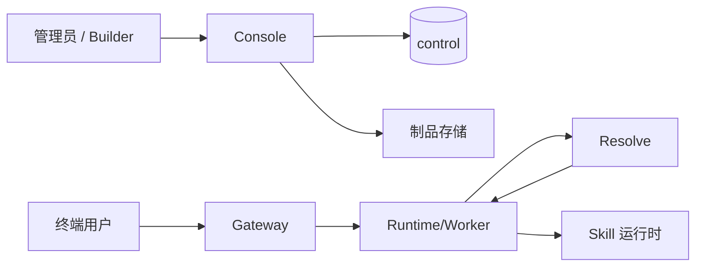

# Agent、授权与 Skill 核心功能详细设计

> 本模块是业务能力文档：描述 Agent 定义、能力授权与 Skill 全生命周期的业务规则和跨模块协作。管理面实现见 03，执行见 04/06/10，授权基础设施见 14。

## 1. 文档控制

### 1.1 责任人

| 角色 | 姓名 | 职责范围 |
| ---- | ---- | -------- |
| 产品/业务负责人 |  | Agent、Skill 业务规则与验收 |
| 架构负责人 |  | 能力边界与授权模型 |
| 开发负责人 |  | Console/Runtime/Worker 落地 |
| 测试负责人 |  | 授权、版本、审批与回归 |

### 1.2 修订历史

| 版本 | 日期 | 作者 | 变更描述 |
| ---- | ---- | ---- | -------- |
| v1.0 | 2026-11-22 |  | 首版核心功能基线：Agent、授权、Skill 生命周期 |

---

## 2. 模块概述与边界

### 2.1 模块定位

| 项目 | 内容 |
| ---- | ---- |
| 模块名称 | Agent、授权与 Skill |
| 模块类型 | business（核心功能/业务层） |
| 所属层 | 业务能力 |
| 所属部署单元 | 无（跨 Console/Runtime/Worker） |
| 一句话定位 | 定义“谁可以用哪个 Agent、该 Agent 有哪些能力、Skill 如何发布和生效” |
| 主要使用方 | 管理员、Builder、终端用户、Runtime/Worker |
| 依赖基础模块 | Console、Agent Runtime、Agent Worker、执行内核与 Skill 运行时、授权数据 |

### 2.2 角色与使用场景

| 角色 | 使用方式 | 关注点 |
| ---- | -------- | ------ |
| 管理员 | Console | 用户/授权、Skill 审批、管理员直接导入 |
| Builder | Console | 建 Agent、绑定 Skill/MCP、发布 Skill |
| 服务经理 | 企业微信/WebChat | 使用已授权 Agent 的能力 |
| Runtime/Worker | 内部解析 | 只看到 Effective 能力与冻结版本 |

关键场景：SC-01 建 Agent、SC-02 开通授权、SC-08 用户自建 Skill。

### 2.3 能力清单与业务规则

| 编号 | 能力 | 业务规则 |
| ---- | ---- | -------- |
| CAP-01 | Agent 定义 | 指令、模型、启用、revision；Run 冻结 revision |
| CAP-02 | Agent 能力绑定 | AgentSkillBinding / AgentMcpBinding；绑定即生效，解绑软删 |
| CAP-03 | 用户授权 | AgentAccessGrant；用户进入 Agent 的第一层 |
| CAP-04 | Skill 导入 | 校验包、Secret 扫描、checksum、不可变制品 |
| CAP-05 | Skill 版本 | 同版本不可覆盖；新版本只影响后续执行 |
| CAP-06 | Skill 用户范围 | ALL/SELECTED；默认 SELECTED；资源级 Grant |
| CAP-07 | Skill 审批 | 用户自建 Skill 需管理员审批；管理员直接导入默认生效 |
| CAP-08 | Skill 草稿 | 沙箱测试、上传、待审批；草稿与正式数据分离 |
| CAP-09 | Skill 删除 | 软删；有活跃绑定返回 `SKILL_IN_USE` |
| CAP-10 | Effective 能力 | Resolve 先过滤；未授权不进目录/ToolRegistry/Prompt |
| CAP-11 | 版本一致性 | 已运行 Run/Task 继续用原 Snapshot |
| CAP-12 | 审计 | Agent/Skill/绑定/授权/审批/导入可追溯 |

### 2.4 范围与非范围

| 类别 | 内容 |
| ---- | ---- |
| 范围 | Agent 定义与绑定、用户授权、Skill 导入/审批/版本/范围/删除、Effective 能力解析 |
| 非范围 | Skill 沙箱实现（06）、Console 页面实现（03）、执行调度（04/10）、模型池（21） |
| 前置假设 | Console 可用；制品/工作区存储可用；Skill 运行时可执行 |
| 有意妥协 | 用户自建 Skill 需审批；管理员直接导入默认生效；不建三元授权 |

### 2.5 约束与依赖

| 类型 | 内容 | 影响 |
| ---- | ---- | ---- |
| 依赖基础模块 | Console、Runtime、Worker、执行内核、制品存储 | 定义/执行/发布 |
| 依赖授权 | AgentAccessGrant + Skill/MCP Grant | Effective 能力 |
| 依赖版本 | Agent/Model revision、Skill Artifact checksum | 快照一致性 |
| 安全约束 | Skill 不可信；凭据不进包/Prompt；未授权不泄露 | 见 06/09/14 |

---

## 3. 技术设计

### 3.1 关键决策

| 决策点 | 选择 | 被否决项 | 理由 | 可逆性 |
| ------ | ---- | -------- | ---- | ------ |
| Agent 与实例 | 逻辑 Agent 与执行实例解耦 | Agent 绑定 Pod | 可横扩、无状态 | 难回退 |
| 版本 | Agent/Model revision + Skill 不可变制品 | 覆盖同版本 | 执行可复现 | 难回退 |
| 授权 | 三层：用户→Agent、Agent→资源、资源→用户范围 | 三元授权表 | 表达清晰、可维护 | 易 |
| 默认范围 | 新 Skill/MCP 默认 SELECTED | 默认 ALL | 避免未验证能力全开放 | 易 |
| 审批 | 用户自建 Skill 需审批；管理员直接导入默认生效 | 所有导入都审批 | 管理员信任级别不同 | 易 |
| 删除 | 软删 + 活跃绑定检查 | 物理删 | 可追溯、保护执行 | 易 |
| 执行方式 | Skill 冻结 SYNC/ASYNC | 模型自由决定 | 稳定可测 | 易 |
| Effective 过滤 | Resolve 阶段过滤 | 执行阶段再 403 | 不泄露能力、不浪费上下文 | 难回退 |

### 3.2 架构与流程



**Agent 创建/更新**：

1. Builder 建 Agent，选择模型、写系统 Prompt；
2. 绑定 Skill/MCP；
3. 管理员授 AgentAccessGrant；
4. 更新写 revision/审计；Run 冻结 revision。

**Skill 导入/发布**：

1. 管理员上传或服务经理提交草稿；
2. 校验包/路径/frontmatter/Secret/checksum；
3. 写不可变制品；
4. 用户 Skill 进入审批；管理员审批或直接导入；
5. 更新当前版本；后续执行使用新版本。

**Effective 解析**：

```text
User → AgentAccessGrant
Agent → Binding
Resource → user_scope/Grant
→ Effective Skill/MCP
→ Snapshot → Prompt/ToolRegistry
```

### 3.3 数据对象

| 对象 | 归属 | 说明 |
| ---- | ---- | ---- |
| AgentDefinition | control | 指令、模型、revision、enabled |
| AgentAccessGrant | control | 用户 → Agent |
| AgentSkillBinding / AgentMcpBinding | control | Agent → 资源 |
| Skill / SkillArtifact | control + 制品存储 | 元数据 + 不可变制品 |
| SkillDraft | control + 工作区 | 用户自建草稿/测试 |
| SkillUserGrant | control | SELECTED 用户 |
| Skill 审核状态 | control | PENDING/APPROVED/REJECTED/SUPERSEDED |
| 导入幂等 | control | 幂等键/指纹 |
| 配置审计 | control | 变更/审批/授权 |

### 3.4 接口与契约

| 接口 | 方向 | 用途 |
| ---- | ---- | ---- |
| Console Agent/Skill API | Console UI → Console | 定义、绑定、导入、审批、删除 |
| `resolve-definition` | Runtime/Worker → Console | Effective Agent/Skill/MCP + revision/hash |
| 产物解析 | Gateway/Worker → Runtime | 制品归属/元信息 |
| 草稿接口 | Runtime → Console | 用户自建 Skill 草稿测试/上传 |

**错误语义**：

- `AGENT_NOT_FOUND`/`AGENT_DISABLED`/`AGENT_ACCESS_DENIED`；
- `SKILL_IN_USE`、`SKILL_PACKAGE_INVALID`、`SKILL_VERSION_EXISTS`；
- 未授权资源不泄露存在性；导入失败返回具体原因。

### 3.5 质量实现

| 目标 | 设计 |
| ---- | ---- |
| 版本一致 | 不可变制品 + revision + Snapshot |
| 授权正确 | 三层公式；Resolve 前置过滤 |
| 发布安全 | 包校验、Secret 扫描、审批、审计 |
| 删除安全 | 软删；活跃绑定禁止 |
| 可测试 | 授权矩阵、版本/审批/导入/删除、快照不变 |
| 可观测 | 导入/审批/绑定/授权/resolve 审计与指标 |

---

## 4. 部署与运维

本能力无独立部署单元，落在 Console/Runtime/Worker：

- Console：定义/审批/导入/授权；
- Runtime/Worker：Resolve/执行；
- 制品/工作区：不可变制品与草稿。

发布顺序：数据库升级 → Console → Runtime/Worker；不保留双写/双读。

---

## 5. 风险与依赖

| 风险/依赖 | 类型 | 描述 | 影响 | 应对 |
| --------- | ---- | ---- | ---- | ---- |
| Skill 供应链 | 安全 | 用户自建/第三方包 | 恶意代码 | 沙箱/审批/Secret 扫描 |
| 版本漂移 | 一致性 | 执行中升级 | 结果不可复现 | Snapshot 冻结 |
| 授权扩散 | 业务 | ALL/绑定误用 | 越权 | 默认 SELECTED；Resolve 过滤 |
| 审批绕过 | 业务 | 管理员直接导入 | 未审代码生效 | 管理员信任边界 + 审计 |
| 制品损坏 | 数据 | checksum 不一致 | 执行失败 | 校验/拒绝/重拉 |

---

## 6. 追溯矩阵

| 总设模块 | 能力 | Spec/Rule | 场景 | 说明 |
| -------- | ---- | --------- | ---- | ---- |
| Agent、授权与 Skill | Agent/Skill/授权 | `harness-auth`、`harness-skill`、`harness-snapshot` | SC-01/02/08 | 本文件 |
| Console Platform | 管理面 | `harness-api`、`harness-ui` | SC-01/02/08 | 03/15 |
| Agent Runtime/Worker | 执行 | `harness-arch`、`harness-skill` | SC-04/05 | 04/06/10 |
| 平台接入 | Skill 平台调用 | `harness-project-platform` | SC-04 | 12 |

---

## 附录：术语表

| 术语 | 定义 |
| ---- | ---- |
| AgentDefinition | 逻辑 Agent 定义 |
| Effective Capability | 用户+Agent 下实际可见/可执行的能力 |
| Skill Artifact | 不可变 Skill 制品 |
| SkillDraft | 用户自建 Skill 草稿 |
| 审批 | 用户自建 Skill 的管理员审核 |

---

*文档结束*
