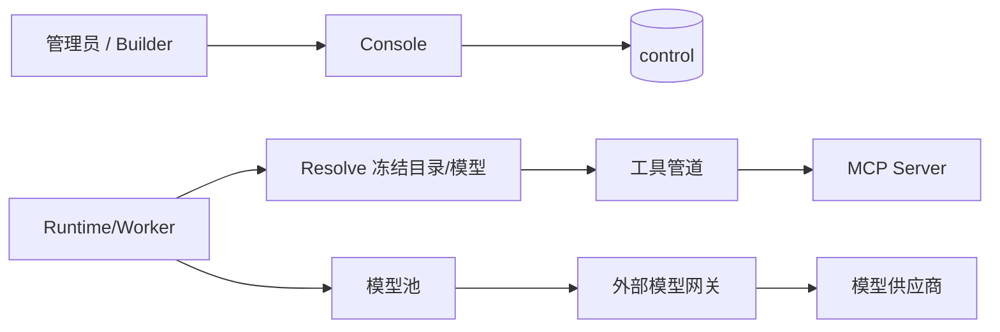

# MCP 与模型能力核心功能详细设计

> 本模块是业务能力文档：描述 MCP 目录/绑定/调用的业务规则，以及模型池、模型选择、容量与额度策略。MCP 传输与工具管道见 06，模型网关是外部模型供应入口；平台不直接对接源头模型供应商。

## 1. 文档控制

### 1.1 责任人

| 角色 | 姓名 | 职责范围 |
| ---- | ---- | -------- |
| 产品/业务负责人 |  | MCP 与模型能力规则、验收 |
| 架构负责人 |  | MCP/模型网关/容量边界 |
| 开发负责人 |  | Console/Runtime/Worker 落地 |
| 测试负责人 |  | 工具目录、错误、容量与额度 |

### 1.2 修订历史

| 版本 | 日期 | 作者 | 变更描述 |
| ---- | ---- | ---- | -------- |
| v1.0 | 2026-11-22 |  | 首版核心功能基线：MCP 目录/调用、模型池与模型网关 |

---

## 2. 模块概述与边界

### 2.1 模块定位

| 项目 | 内容 |
| ---- | ---- |
| 模块名称 | MCP 与模型能力 |
| 模块类型 | business（核心功能/业务层） |
| 所属层 | 业务能力 |
| 所属部署单元 | 无（跨 Console/Runtime/Worker） |
| 一句话定位 | 管理 MCP 工具能力与模型资源，并决定一次执行可用哪些 SDK/工具与模型 |
| 主要使用方 | 管理员、Builder、Skill 作者、Runtime/Worker |
| 依赖基础模块 | Console、Runtime/Worker、执行内核、平台接入、模型池/外部模型网关 |

### 2.2 角色与使用场景

| 角色 | 使用方式 | 关注点 |
| ---- | -------- | ------ |
| 管理员 | Console | MCP 注册/认证/启停、模型凭据/额度 |
| Builder | Console/Agent 详情 | MCP 绑定、模型选择、工具目录刷新 |
| Skill 作者 | SKILL.md/脚本 | 通过宿主端口调用 MCP/模型能力 |
| Runtime/Worker | 执行 | 只使用冻结的 MCP 目录与模型成员 |

关键场景：SC-01 建 Agent、SC-04 同步 Skill、SC-05 异步任务、SC-10 排障。

### 2.3 能力清单与业务规则

| 编号 | 能力 | 业务规则 |
| ---- | ---- | -------- |
| CAP-01 | MCP 注册 | 名称/标识/连接配置/认证配置；启用与连接状态分离 |
| CAP-02 | 工具目录 | 显式 discover；catalog revision/hash；Run/Task 冻结 |
| CAP-03 | MCP 绑定 | AgentMcpBinding；绑定即生效，解绑软删 |
| CAP-04 | 用户范围 | ALL/SELECTED；默认 SELECTED；MCP Server 粒度 |
| CAP-05 | MCP 认证 | 无认证/Bearer/自定义头；密钥只回 configured |
| CAP-06 | 工具调用 | 统一工具管道；错误分类/审计/有界内容 |
| CAP-07 | 模型定义 | 标识/模型 ID/Base URL/协议；Agent 显式选择 |
| CAP-08 | 模型凭据 | 仅 ADMIN 管理；不回显明文 |
| CAP-09 | 额度组 | 成员/额度/结算；不超发 |
| CAP-10 | 模型选择 | 按冻结成员/权重；交互优先；不跨型号替换 |
| CAP-11 | 模型调用 | 经外部模型网关；脱敏/还原；deadline/重试 |
| CAP-12 | 测试与审计 | 批量测试、用量/失败/审计 |

### 2.4 范围与非范围

| 类别 | 内容 |
| ---- | ---- |
| 范围 | MCP 注册/目录/绑定/范围/认证/调用；模型定义/凭据/额度/选择/调用 |
| 非范围 | MCP 传输实现（06）、模型网关实现（外部）、Agent 指令/授权（20）、投递（23） |
| 前置假设 | Console 可配置；Runtime/Worker 可访问 MCP/模型网关；平台接入可用 |
| 有意妥协 | MCP 仅 Streamable HTTP；不做 Tool 级用户授权；模型不设默认回退 |

### 2.5 约束与依赖

| 类型 | 内容 | 影响 |
| ---- | ---- | ---- |
| 依赖控制面 | MCP/模型/凭据/额度定义 | 配置权威 |
| 依赖执行内核 | 工具管道/MCP 适配/模型调用 | 执行一致性 |
| 依赖外部 | MCP Server、外部模型网关 | 可用性与容量 |
| 安全约束 | MCP 结果/模型输出不可信；凭据/明文不进上下文 | 见 09/14 |

---

## 3. 技术设计

### 3.1 关键决策

| 决策点 | 选择 | 被否决项 | 理由 | 可逆性 |
| ------ | ---- | -------- | ---- | ------ |
| MCP 认证 | 无认证/Bearer/自定义头 | 每个平台硬编码 | 覆盖常见协议 | 易 |
| MCP 工具目录 | 显式 discover + revision/hash | Run 内 tools/list | 快照稳定、可审计 | 难回退 |
| MCP 用户范围 | Server 级 ALL/SELECTED | Tool 级白名单 | 语义简单、避免组合爆炸 | 易 |
| 模型资源 | 模型池 + 成员/额度 | 每用户独占配置 | 共享、可配额 | 难回退 |
| 模型选择 | 冻结成员/权重 + 预占容量 | 运行时自由换模型 | 不超发、不跨型号替换 | 难回退 |
| 模型调用 | 外部模型网关 | Runtime 直连供应商 | 统一脱敏/还原/屏蔽 | 难回退 |
| 默认模型 | 无 | 平台默认回退 | Agent 显式选择、避免隐式漂移 | 易 |

### 3.2 架构与流程

**MCP 流程**：

1. 管理员注册/启用 MCP，配置认证；
2. Builder 绑定 Agent，设置用户范围；
3. 显式 discover 工具目录，得到 revision/hash；
4. Run/Task 冻结目录；
5. 模型调用工具 → 工具管道 prepare/schema/hook/policy/audit → MCP `tools/call`；
6. 结果按逻辑错误分类，大内容外置，图片/资源不静默丢。

**模型流程**：

1. 管理员维护模型定义/凭据/额度组；
2. Agent 显式选择模型，Run 冻结 revision/成员/权重；
3. 模型池选择成员并预占容量；
4. 请求经外部模型网关脱敏/还原 → 供应商；
5. 按用量结算；失败按 deadline/预算重试。

### 3.3 数据对象

| 对象 | 归属 | 说明 |
| ---- | ---- | ---- |
| McpServer | control | 连接/认证/catalog revision/hash |
| AgentMcpBinding | control | Agent → MCP |
| McpUserGrant | control | SELECTED 用户 |
| ModelDefinition | control | key/model_id/protocol/Base URL/params |
| ModelCredential | control | 模型凭据，仅 ADMIN |
| ModelQuotaGroup / ModelDeployment | control | 额度组/成员 |
| MCP 调用审计 | runtime | 逻辑结果/错误/耗时 |
| 模型调用审计/容量 | runtime | 用量、失败、容量预占 |

### 3.4 接口与契约

| 接口 | 方向 | 用途 |
| ---- | ---- | ---- |
| Console MCP/Model API | UI → Console | 注册、绑定、目录、测试、凭据/额度 |
| `resolve-definition` | Runtime/Worker → Console | MCP 目录/模型 revision |
| MCP `tools/list`/`tools/call` | Runtime/Worker → MCP | 目录刷新/调用 |
| 模型池/模型网关 | Runtime/Worker → 外部 | 选择/预占/脱敏/调用/结算 |

**错误语义**：

- MCP 配置/认证/连接/调用失败分类；HTTP 200 + `isError` 算逻辑失败；
- 模型容量不足：排队或明确拒绝，不超发、不跨型号替换；
- 凭据缺失/无效：明确提示；不快速重试账号锁定类错误。

### 3.5 质量实现

| 目标 | 设计 |
| ---- | ---- |
| 目录稳定 | discover + revision/hash + 快照冻结 |
| 调用安全 | 统一工具管道；结果不可信；有界内容 |
| 容量 | 预占/结算；交互优先；不超发 |
| 凭据 | 仅 ADMIN；不回显；不进入上下文/日志 |
| 可测试 | 目录变化、错误形状、容量不足、脱敏、重试 |
| 可观测 | MCP 调用/模型调用/用量/失败/容量指标与审计 |

---

## 4. 部署与运维

无独立部署单元：

- Console：MCP/模型配置与凭据/额度；
- Runtime/Worker：工具管道/模型调用；
- 模型网关为外部依赖；MCP 为外部服务。

发布：配置变更影响后续 Run/Task；已运行使用冻结快照。

---

## 5. 风险与依赖

| 风险/依赖 | 类型 | 描述 | 影响 | 应对 |
| --------- | ---- | ---- | ---- | ---- |
| MCP 协议/服务变化 | 外部 | 工具 schema/错误变化 | 调用失败 | 目录 revision/错误分类 |
| 模型额度/限流 | 外部 | 供应商限流 | 首帧/完成 | 预占/队列/明确拒绝 |
| 模型跨型号替换 | 业务 | 隐式换模型 | 结果不一致 | 禁止 |
| 凭据泄露 | 安全 | 模型/MCP 凭据 | 合规 | ADMIN/不回显/脱敏 |
| 工具级授权扩散 | 业务 | Tool 白名单 | 组合爆炸 | Server 级范围 |

---

## 6. 追溯矩阵

| 总设模块 | 能力 | Spec/Rule | 场景 | 说明 |
| -------- | ---- | --------- | ---- | ---- |
| MCP 与模型能力 | MCP/模型 | `harness-mcp`、`harness-model`、`harness-secret` | SC-01/04/05 | 本文件 |
| 执行内核 | 工具管道 | `harness-mcp`、`harness-arch` | SC-04/05 | 06 |
| Agent Runtime/Worker | 执行 | `harness-api`、`harness-snapshot` | SC-04/05 | 04/10 |
| 平台接入 | 模型网关外部 | `harness-project-platform` | SC-04/05 | 12/外部 |

---

## 附录：术语表

| 术语 | 定义 |
| ---- | ---- |
| MCP Server | 外部工具服务 |
| Tool Catalog | MCP 工具目录，带 revision/hash |
| 模型池 | 模型成员/凭据/额度 |
| 模型网关 | 外部模型供应入口 |
| 容量预占 | 调用前预留额度 |

---

*文档结束*
