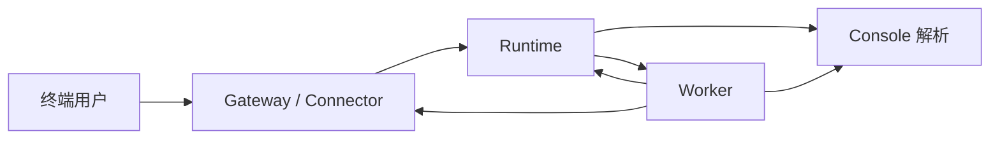

# 对话、Run、任务与调度核心功能详细设计

> 本模块是业务能力文档：描述对话入口、会话/Run 生命周期、异步/定时/批量任务与任务中心可见性。执行机制见 04/10，投递策略见 23。

## 1. 文档控制

### 1.1 责任人

| 角色 | 姓名 | 职责范围 |
| ---- | ---- | -------- |
| 产品/业务负责人 |  | 对话、任务、调度业务规则 |
| 架构负责人 |  | 会话/Run/Task 状态与边界 |
| 开发负责人 |  | Gateway/Runtime/Worker 落地 |
| 测试负责人 |  | 状态机、并发、恢复与调度 |

### 1.2 修订历史

| 版本 | 日期 | 作者 | 变更描述 |
| ---- | ---- | ---- | -------- |
| v1.0 | 2026-11-22 |  | 首版核心功能基线：对话/Run/任务/调度 |

---

## 2. 模块概述与边界

### 2.1 模块定位

| 项目 | 内容 |
| ---- | ---- |
| 模块名称 | 对话、Run、任务与调度 |
| 模块类型 | business（核心功能/业务层） |
| 所属层 | 业务能力 |
| 所属部署单元 | 无（跨 Gateway/Runtime/Worker） |
| 一句话定位 | 把用户消息变成一次 Run，把长任务变成可恢复的 Task，把定时/批量变成可靠触发 |
| 主要使用方 | 终端用户、Gateway、Runtime、Worker、Console |
| 依赖基础模块 | Gateway/Connector、Runtime、Worker、执行内核、平台接入、模型网关 |

### 2.2 角色与使用场景

| 角色 | 使用方式 | 关注点 |
| ---- | -------- | ------ |
| 服务经理 | 企微/WebChat | 发消息、看进度、停止、看历史、收结果 |
| Gateway | 入口 | 身份/授权/路由/SSE |
| Runtime | 实时执行 | 快照/接续/取消 |
| Worker | 后台执行 | Task/Schedule/批量 |
| Console | 管理查询 | 任务/定时可见性 |

关键场景：SC-04 同步任务、SC-05 异步长任务、SC-06 定时任务、SC-07 批量、SC-09 WebChat。

### 2.3 能力清单与业务规则

| 编号 | 能力 | 业务规则 |
| ---- | ---- | -------- |
| CAP-01 | 对话入口 | 企微、WebChat、外部 JWT 共用会话/Run 面；入口身份显式 `entry_id` |
| CAP-02 | 会话 | 同一会话最多一个非终态 Run；`/new` 新建会话；历史按会话读 |
| CAP-03 | Run 受理 | 先持久化 Run/快照/输入，再由空闲实例领取 |
| CAP-04 | 流式与重连 | SSE 按 seq；断流不取消；重连回放 |
| CAP-05 | 等待与恢复 | WAITING_INPUT/WAITING_TOOL；恢复原快照/预算/deadline |
| CAP-06 | 取消 | Run 级取消；终态幂等；执行中协作停止 |
| CAP-07 | 异步任务 | JOIN 默认；DETACH 独立；提交回执不等于成功 |
| CAP-08 | 定时计划 | 创建/暂停/恢复/删除；触发时重校验授权/解析当前 Skill |
| CAP-09 | 批量 | Parent/Child；item_key 幂等；fan-in 聚合 |
| CAP-10 | 任务中心 | 按 tenant/用户/授权 Agent 可见；实例/定义互链 |
| CAP-11 | 投递路由 | 结果去哪由入口与投递策略决定；WebChat 留会话，PUSH 入口投递 |
| CAP-12 | 时间与截止 | 计划时区/下次触发；Task deadline；PG 服务端时间裁决 |

### 2.4 范围与非范围

| 类别 | 内容 |
| ---- | ---- |
| 范围 | 对话入口、会话/Run 生命周期、流式/重连、取消/恢复、Task/Schedule/批量、任务中心 |
| 非范围 | 具体执行/沙箱（04/06/10）、通道连接（05）、投递策略实现（23）、Console 页面实现（03/15） |
| 前置假设 | Runtime/Worker 可用；Console 可解析；入口身份可解析 |
| 有意妥协 | 同一会话单活跃 Run；断流不取消；外部副作用不可撤回 |

### 2.5 约束与依赖

| 类型 | 内容 | 影响 |
| ---- | ---- | ---- |
| 依赖基础模块 | Gateway/Connector、Runtime、Worker、执行内核 | 入口/执行/调度 |
| 依赖授权 | AgentAccessGrant、资源范围 | 谁能建 Run/Task |
| 依赖时间 | 租户时区、PG 时间、deadline | 调度/截止 |
| 一致性 | 单活跃 Run、Task/Schedule 幂等、终态不可逆 | 见 07/08/10 |

---

## 3. 技术设计

### 3.1 关键决策

| 决策点 | 选择 | 被否决项 | 理由 | 可逆性 |
| ------ | ---- | -------- | ---- | ------ |
| 会话并发 | 同一会话最多一个非终态 Run | 多 Run 并行 | 避免上下文/交付竞争 | 难回退 |
| 执行领取 | 持久队列 + lease/epoch | HTTP 内跑完 | 断流不取消、可恢复 | 难回退 |
| 流式 | 持久事件 + SSE seq | 仅内存流 | 重连可回放 | 难回退 |
| 异步 | JOIN 默认，DETACH 可选 | 一律后台/一律同步 | 按业务选择交付方式 | 易 |
| 定时 | 触发时重解析版本/授权 | 计划永久冻结版本 | 新版本作用于后续触发 | 易 |
| 批量 | Parent/Child + item_key | 任意 DAG | 当前规模足够 | 易 |
| 投递 | 入口能力决定 PUSH/留会话 | 全部主动推送 | 避免 WebChat 重复/噪音 | 易 |

### 3.2 架构与流程

**对话/Run**：

1. 入口消息 → 身份/授权 → Run 请求；
2. Runtime 持久化 Run/快照/输入；
3. 执行监督器领取，调用模型/工具；
4. 事件持久化，Gateway 输出/回放；
5. 等待/取消/恢复按状态机。

**Task/Schedule**：

1. Skill 冻结为 ASYNC → Runtime 提交 Task；
2. Worker 领取/执行/等待/重试/终态；
3. JOIN 回传 Runtime 续接；DETACH 独立完成；
4. Schedule 到点 claim fire，重校验授权/当前 Skill，创建 Task；
5. 批量 Parent/Child，fan-in 聚合。

### 3.3 数据对象

| 对象 | 归属 | 说明 |
| ---- | ---- | ---- |
| Conversation | runtime | 会话/入口归属 |
| RunRecord / Snapshot / Event / Interrupt | runtime | Run 生命周期/事实 |
| TaskExecution / TaskEvent | task | 后台执行/状态 |
| TaskSchedule / Revision / Fire | task | 计划/触发记录 |
| TaskDelivery / Route | task | 投递意图（策略见 23） |
| 任务中心投影 | Console/Gateway | 只读聚合，按租户/用户/Agent |

### 3.4 接口与契约

| 接口 | 方向 | 用途 |
| ---- | ---- | ---- |
| Run API / SSE | Gateway → Runtime | 创建/恢复/取消/查询/事件 |
| Task/Schedule API | Runtime/Gateway → Worker | 提交/取消/查询/治理 |
| 任务中心查询 | Gateway/Console → 投影 | 列表/详情/历史 |
| 投递 | Worker → Gateway | 独立结果投递（23） |

**错误语义**：

- `RUN_BUSY`：同会话已有非终态 Run；
- `NO_ACTIVE_RUN` / `CANCELLING` / `CANCELLED`：取消语义；
- 任务提交回执不等于成功；Task 终态才是结果；
- 计划/任务越权/跨租户不泄露。

### 3.5 质量实现

| 目标 | 设计 |
| ---- | ---- |
| 不丢会话 | 事件/快照外置；重连回放 |
| 不丢任务 | PG 队列/lease/reclaim；deadline |
| 不重复触发 | schedule_id+fire_time 幂等；item_key |
| 权限 | 入口/任务中心按租户/用户/Agent |
| 时间 | 租户时区、PG 时间、DST/misfire |
| 可测试 | 单活跃 Run、取消/恢复、JOIN/DETACH、调度/批量 |

---

## 4. 部署与运维

无独立部署单元：

- Gateway/Connector：入口与 SSE；
- Runtime：Run 执行/接续；
- Worker：Task/Schedule/批量；
- Console：任务中心投影。

发布：先数据库升级再滚动；缩容前停止领取并有界排空。

---

## 5. 风险与依赖

| 风险/依赖 | 类型 | 描述 | 影响 | 应对 |
| --------- | ---- | ---- | ---- | ---- |
| 会话并发 | 业务 | 多 Run 竞争 | 上下文/交付错乱 | 单活跃 Run |
| 外部副作用 | 业务 | 取消不可撤回 | 重复/残留 | 审计/不伪造回滚 |
| 调度误判 | 时间 | 排队/misfire/DST | 漏触发/重复 | 单轮批量/宽限/SKIP |
| 任务积压 | 性能 | 队列深度 | 完成延迟 | HPA/并发配置 |
| 入口差异 | 业务 | WebChat/企微能力不同 | 投递/流式 | 入口能力表 + 策略 |

---

## 6. 追溯矩阵

| 总设模块 | 能力 | Spec/Rule | 场景 | 说明 |
| -------- | ---- | --------- | ---- | ---- |
| 对话、Run、任务与调度 | 对话/Run/Task/Schedule | `harness-api`、`harness-time`、`harness-snapshot` | SC-04/05/06/07/09 | 本文件 |
| Agent Runtime | Run 执行 | `harness-arch` | SC-04/05 | 04 |
| Agent Worker | Task/Schedule | `harness-worker` | SC-05/06/07 | 10 |
| 结果与附件投递 | 结果去向 | `harness-im` | SC-05/06 | 23 |

---

## 附录：术语表

| 术语 | 定义 |
| ---- | ---- |
| Conversation | 会话容器 |
| Run | 一次用户请求的实时执行 |
| JOIN / DETACH | 异步结果回流 / 独立执行 |
| Schedule | 定时计划定义 |
| Fire | 一次计划触发 |
| 任务中心 | 按权限展示 Task/Schedule 的查询面 |

---

*文档结束*
