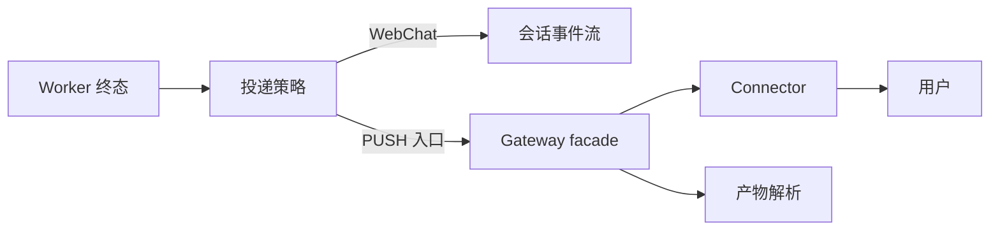

# 结果与附件投递核心功能详细设计

> 本模块是业务能力文档：决定任务结果“投什么、投给谁、什么时候投、怎么算送达”。通道发送机制见 05，任务/投递状态机见 10/08，文本与附件产物见 06/23 相关契约。

## 1. 文档控制

### 1.1 责任人

| 角色 | 姓名 | 职责范围 |
| ---- | ---- | -------- |
| 产品/业务负责人 |  | 结果交付策略与用户语义 |
| 架构负责人 |  | Worker/Gateway/Connector 边界 |
| 开发负责人 |  | 投递策略、去重、附件、状态 |
| 测试负责人 |  | 送达判定、重试、附件与幂等 |

### 1.2 修订历史

| 版本 | 日期 | 作者 | 变更描述 |
| ---- | ---- | ---- | -------- |
| v1.0 | 2026-11-22 |  | 首版核心功能基线：结果与附件统一投递 |

---

## 2. 模块概述与边界

### 2.1 模块定位

| 项目 | 内容 |
| ---- | ---- |
| 模块名称 | 结果与附件投递 |
| 模块类型 | business（核心功能/业务层） |
| 所属层 | 业务能力 |
| 所属部署单元 | 无（策略跨 Worker/Gateway/Connector） |
| 一句话定位 | 把任务终态结果与产出附件，按入口能力和用户语义可靠送达 |
| 主要使用方 | 终端用户、Worker、Gateway、Connector |
| 依赖基础模块 | Worker（投递机制）、Gateway（facade）、Connector（通道发送）、制品存储 |

### 2.2 角色与使用场景

| 角色 | 使用方式 | 关注点 |
| ---- | -------- | ------ |
| 服务经理 | 企微/WebChat | 收到最终结果/附件，不重复、不丢 |
| Worker | 终态后发起投递 | 投什么、给谁、状态 |
| Gateway | 投递 facade | 身份/租户/去重/产物解析 |
| Connector | 通道发送 | 通道能力/媒体发送 |

关键场景：SC-05 异步长任务、SC-06 定时任务、SC-10 投递排障。

### 2.3 能力清单与业务规则

| 编号 | 能力 | 业务规则 |
| ---- | ---- | -------- |
| CAP-01 | 交付判定 | 任务终态后按入口能力与投递策略决定是否投递 |
| CAP-02 | PUSH 默认 | 企微等支持 PUSH 的 IM 默认主动推送 |
| CAP-03 | WebChat 留会话 | WebChat 结果留在会话事件流，不额外 PUSH |
| CAP-04 | JOIN/DETACH | JOIN 回流当前 Run；DETACH 独立投递 |
| CAP-05 | 结果统一 | 正文 + 附件/产物引用统一交付，不丢附件 |
| CAP-06 | 附件能力 | 按通道能力发送；不暴露内部存储路径 |
| CAP-07 | 去重 | `delivery_key`；占位有主；重放回放首次结果 |
| CAP-08 | 送达判定 | 只有明确 `delivered=true` 才算 SENT |
| CAP-09 | 重试 | 可重试失败回 PENDING；不可重试/耗尽 FAILED |
| CAP-10 | 审计 | 投递意图、尝试、结果、失败原因可追溯 |

### 2.4 范围与非范围

| 类别 | 内容 |
| ---- | ---- |
| 范围 | 交付判定、PUSH 默认、JOIN/DETACH、结果+附件、去重、送达、重试、审计 |
| 非范围 | 通道连接/发送实现（05）、任务执行（10）、附件生成（06）、Console 页面（03） |
| 前置假设 | Worker 已有终态与结果；Gateway/Connector 可达；产物可解析 |
| 有意妥协 | 至少一次投递 + 去重；外部通道不保证幂等；附件大小受通道/系统限制 |

### 2.5 约束与依赖

| 类型 | 内容 | 影响 |
| ---- | ---- | ---- |
| 依赖 Worker | 终态与投递意图同事务 | 不丢结果 |
| 依赖 Gateway | `/internal/deliveries` 服务身份/租户/产物解析 | 投递准入 |
| 依赖 Connector | 通道发送/媒体上传 | 最终送达 |
| 依赖制品 | 附件/产物字节与元信息 | 附件可读 |
| 一致性 | delivery_key 去重、delivered=true | 不重复/不伪成功 |

---

## 3. 技术设计

### 3.1 关键决策

| 决策点 | 选择 | 被否决项 | 理由 | 可逆性 |
| ------ | ---- | -------- | ---- | ------ |
| 投递策略位置 | 核心功能 23 | 写进 Worker/Gateway | 业务策略与通道机制分离 | 易 |
| 投递时机 | 终态与意图同事务，事务外发送 | 先发后落库 | 不丢结果 | 难回退 |
| PUSH 默认 | 入口支持 PUSH 则默认推送 | 所有入口统一推送 | WebChat 会话已可见，避免重复 | 易 |
| 结果形态 | 正文 + 附件/产物引用 | 只发文本 | 附件是交付的一部分 | 难回退 |
| 去重 | delivery_key + 占位有主 | 只靠内存/无去重 | 重试不重复 | 难回退 |
| 送达 | 明确 `delivered=true` | HTTP 2xx 即成功 | 通道可能异步回执 | 难回退 |
| 失败 | 可重试回 PENDING；不可重试 FAILED | 一律 FAILED | 区分退避与终态 | 易 |

### 3.2 架构与流程

**DETACH/定时任务**：

1. Worker 终态与投递意图同事务；
2. 投递策略判断入口能力；
3. WebChat：结果留在会话事件流；
4. PUSH 入口：Gateway 校验服务身份/租户/产物，Connector 发送；
5. 送达确认回写；失败按 PENDING/FAILED 处理。

**JOIN**：

- 结果回流 Runtime，由原 Run 继续输出；不额外走独立投递；
- 若同时需要独立通知，按 DETACH 策略处理，避免重复。

### 3.3 数据对象

| 对象 | 归属 | 说明 |
| ---- | ---- | ---- |
| DeliveryRoute | task | 投递目标/入口/会话 |
| TaskDelivery | task | delivery_key、状态、尝试、回执 |
| TaskDeliveryAttempt | task | 每次尝试/错误/耗时 |
| MessageDelivery / Attempt | runtime | 会话消息/通知投递 |
| Artifact/AttachmentRef | runtime + 制品 | 结果附件/产物引用 |
| 投递审计 | task/runtime | 意图、尝试、送达/失败 |

### 3.4 接口与契约

| 接口 | 方向 | 用途 |
| ---- | ---- | ---- |
| `/internal/deliveries` | Worker → Gateway | 独立结果投递 |
| 产物解析 | Gateway → Runtime | `artifact_id` 归属/元信息 |
| 通道发送 | Gateway/Connector → 通道 | 文本/媒体 |
| 会话通知 | Worker/Runtime → WebChat | 会话事件流/通知 |

**错误语义**：

- 可重试（网络/5xx/限流/未确认）→ PENDING；
- 不可重试（4xx/路由缺失/产物不存在/权限拒绝）→ FAILED；
- 同 key 异指纹 → `IDEMPOTENCY_MISMATCH`；
- 没有 `delivered=true` 不得标记 SENT。

### 3.5 质量实现

| 目标 | 设计 |
| ---- | ---- |
| 不丢 | 终态/意图同事务；PENDING 持久化 |
| 不重复 | delivery_key；占位有主；重放首次结果 |
| 附件完整 | 结果与附件一起判定；失败不部分成功 |
| 权限 | 服务身份 + 租户 + 产物归属 |
| 可观测 | PENDING/SENT/FAILED、尝试、失败原因、送达率 |
| 可测试 | 送达/未确认/重试/耗尽/重复/附件/跨租户 |

---

## 4. 部署与运维

无独立部署单元：

- Worker：投递策略/状态；
- Gateway：facade/去重/产物解析；
- Connector：通道发送；
- 制品存储：附件/产物。

发布：投递策略变更随 Worker/Gateway/Connector 滚动；已 PENDING 记录继续按新策略处理。

---

## 5. 风险与依赖

| 风险/依赖 | 类型 | 描述 | 影响 | 应对 |
| --------- | ---- | ---- | ---- | ---- |
| 通道不幂等 | 外部 | 重试可能重复 | 用户重复收到 | delivery_key + 通道去重 |
| 附件过大/不支持 | 通道 | 媒体发送失败 | 交付不完整 | 能力表 + 降级摘要/引用 |
| 回执缺失 | 外部 | 无法确认送达 | 状态不确定 | 有界重试 + FAILED |
| 跨租户 | 安全 | 错投 | 数据泄露 | 服务身份 + 租户 + 产物归属 |
| 投递策略分散 | 架构 | 各服务各自判断 | 行为不一致 | 核心 23 单点策略 |

---

## 6. 追溯矩阵

| 总设模块 | 能力 | Spec/Rule | 场景 | 说明 |
| -------- | ---- | --------- | ---- | ---- |
| 结果与附件投递 | 投递策略/附件/送达 | `harness-im`、`harness-skill` | SC-05/06 | 本文件 |
| Agent Worker | 投递机制/状态 | `harness-worker` | SC-05/06 | 10 |
| IM Gateway / Connector | 通道发送 | `harness-im` | SC-05/06 | 05 |
| 制品 | 附件/产物 | `harness-skill`、`harness-data` | SC-05 | 06/02 |

---

## 附录：术语表

| 术语 | 定义 |
| ---- | ---- |
| PUSH 入口 | 支持主动推送的 IM 通道（如企微） |
| delivery_key | 投递幂等键 |
| 送达确认 | 通道明确返回 delivered=true |
| DETACH | 独立执行并投递 |
| PENDING/SENT/FAILED/NONE | 投递状态 |

---

*文档结束*
