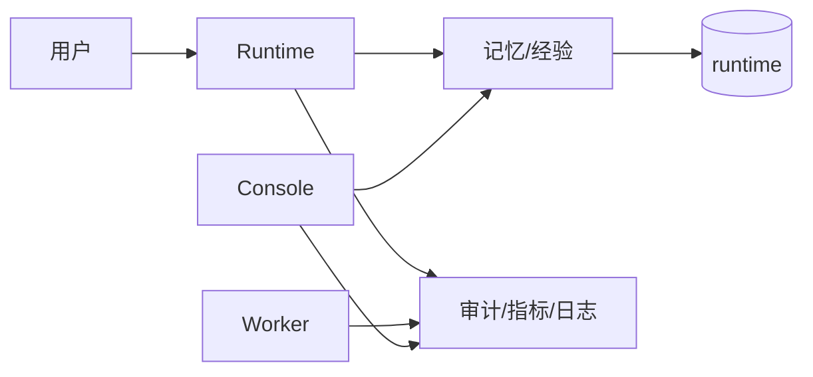

# 记忆、经验、审计与可观测核心功能详细设计

> 本模块是业务能力文档：描述用户记忆的写入/确认/检索，经验候选/试用/启用/退役，以及审计与可观测的业务口径。基础设施实现见 02/04/09/10。

## 1. 文档控制

### 1.1 责任人

| 角色 | 姓名 | 职责范围 |
| ---- | ---- | -------- |
| 产品/业务负责人 |  | 记忆、经验、审计业务规则 |
| 架构负责人 |  | Runtime/Console/Worker 边界 |
| 开发负责人 |  | 记忆/学习/审计链路 |
| 测试负责人 |  | 确认、检索、经验状态、审计完整性 |

### 1.2 修订历史

| 版本 | 日期 | 作者 | 变更描述 |
| ---- | ---- | ---- | -------- |
| v1.0 | 2026-11-22 |  | 首版核心功能基线：记忆、经验、审计与可观测 |

---

## 2. 模块概述与边界

### 2.1 模块定位

| 项目 | 内容 |
| ---- | ---- |
| 模块名称 | 记忆、经验、审计与可观测 |
| 模块类型 | business（核心功能/业务层） |
| 所属层 | 业务能力 |
| 所属部署单元 | 无（Runtime 为主，Console/Worker 参与） |
| 一句话定位 | 让 Agent 跨会话记住用户、把成功经验沉淀为可复用能力，并让执行事实可追溯 |
| 主要使用方 | 终端用户、Runtime、Worker、Console、Admin |
| 依赖基础模块 | Runtime、Worker、Console、数据层、日志/审计/指标 |

### 2.2 角色与使用场景

| 角色 | 使用方式 | 关注点 |
| ---- | -------- | ------ |
| 服务经理 | 企微/WebChat/用户详情 | 记住什么、可查看/确认/删除 |
| Runtime | 执行 | 记忆注入、确认、提炼 |
| Worker | 后台执行 | 任务侧记忆/审计事实 |
| Admin | Console | 经验治理、审计查询/导出 |

关键场景：SC-04/05 执行、SC-10 排障、用户记忆确认、经验启用/退役。

### 2.3 能力清单与业务规则

| 编号 | 能力 | 业务规则 |
| ---- | ---- | -------- |
| CAP-01 | 记忆写入 | Runtime 唯一 writer；显式 `remember(key,value,category)` 与推断记忆 |
| CAP-02 | 用户确认 | 自然语言保存记忆必须用户确认；Gateway 不解析 value |
| CAP-03 | 记忆检索 | 有界；按租户/用户；不跨用户 |
| CAP-04 | 记忆展示 | 用户详情展示来源/状态/版本/有效期；可查看/确认/删除 |
| CAP-05 | 记忆合并 | scope/摘要/冲突候选/历史；连续摘要/退役/配额淘汰有事实 |
| CAP-06 | 经验候选 | 从执行中提炼候选；回放/评分/报告 |
| CAP-07 | 经验状态 | PROPOSED/TRIAL/ACTIVE/RETIRED；只有 ACTIVE 参与后续 |
| CAP-08 | 经验治理 | 启用/退役/重新提炼/任务族控制 |
| CAP-09 | 审计 | 管理变更、工具、模型、平台、投递、导出可追溯 |
| CAP-10 | 可观测 | 日志/指标/trace/审计查询；脱敏 |
| CAP-11 | 保留与清理 | 审计/事件/记忆历史按保留策略；不物理删权威事实 |
| CAP-12 | 权限 | 用户只读自己的记忆/审计范围；Admin 可治理/导出 |

### 2.4 范围与非范围

| 类别 | 内容 |
| ---- | ---- |
| 范围 | 记忆写入/确认/检索/展示/合并、经验候选/状态/治理、审计查询/导出、可观测口径 |
| 非范围 | 存储/索引实现（02）、执行循环（04/06）、Console 页面（03/15）、DFX 全量（09） |
| 前置假设 | PostgreSQL 可用；Runtime 可写记忆；审计端口可用 |
| 有意妥协 | 记忆有界；经验需治理；审计按保留策略，不做无限归档 |

### 2.5 约束与依赖

| 类型 | 内容 | 影响 |
| ---- | ---- | ---- |
| 依赖 Runtime | 记忆/经验写入、注入 | 唯一 writer |
| 依赖 Console | 查询/治理/审计页面 | 用户/Admin 可见 |
| 依赖 Worker | 任务侧记忆/审计 | 后台一致性 |
| 安全约束 | 租户/用户隔离；内容不泄露；审计脱敏 | 见 09/14 |

---

## 3. 技术设计

### 3.1 关键决策

| 决策点 | 选择 | 被否决项 | 理由 | 可逆性 |
| ------ | ---- | -------- | ---- | ------ |
| 记忆 writer | Runtime 唯一写入 | 各服务各自写 | 一致性/审计 | 难回退 |
| 保存方式 | 显式工具 + 推断；自然语言需确认 | 静默自动保存全部 | 用户可控/隐私 | 易 |
| 检索 | 有界、按租户/用户 | 全量注入 | 上下文预算/隐私 | 易 |
| 经验 | 候选→试用→启用→退役 + 治理 | 自动全量启用 | 质量可控 | 易 |
| 审计 | 只追加、脱敏、按保留 | 可改写/无限保留 | 可信/成本 | 难回退 |

### 3.2 架构与流程

**记忆写入**：

1. Runtime 读取有界记忆；
2. 显式工具或推断产生候选；
3. 自然语言保存 → 用户确认；
4. 校验 canonical 用户消息/工具参数；
5. 写 UserMemory/History/Receipt；按需提炼。

**经验**：

1. 执行事实/回放/评分 → 候选；
2. 候选/试用/启用/退役；
3. 只有 ACTIVE 进入后续上下文；
4. 治理动作写审计。

**审计**：

1. 管理/工具/模型/平台/投递事实写审计；
2. Console 查询/导出；
3. 脱敏、租户/权限、保留策略。

### 3.3 数据对象

| 对象 | 归属 | 说明 |
| ---- | ---- | ---- |
| UserMemory / Scope / History | runtime | 权威记忆、版本、历史 |
| MemoryConflictCandidate / CommandReceipt / ConsolidationJob | runtime | 冲突、命令回执、提炼 |
| Learning Family/Job/Eval/Report | runtime | 经验/评估 |
| Tool/Model/平台/投递审计 | runtime/control | 只追加事实 |
| 审计导出任务 | control | Admin 导出 |

### 3.4 接口与契约

| 接口 | 方向 | 用途 |
| ---- | ---- | ---- |
| 记忆工具/命令 | 模型/用户 → Runtime | remember/确认/删除/检索 |
| Console 用户记忆 API | Console → Runtime/DB | 列表/详情/版本/删除 |
| 经验 API | Console → Runtime | 候选/状态/治理/回放 |
| 审计 API | Console → 投影 | 查询/详情/导出 |

**错误语义**：

- 确认不完整/无效：保留等待，不消费提议；
- 失效提议：STALE，追加事实，不改原回执；
- 跨租户/越权：不泄露存在性；
- 导出仅 ADMIN；失败明确。

### 3.5 质量实现

| 目标 | 设计 |
| ---- | ---- |
| 隐私 | 租户/用户隔离；最小化；可查看/删除 |
| 一致性 | Runtime 唯一 writer；稳定 key；版本历史 |
| 质量 | 经验需治理；只有 ACTIVE 生效 |
| 审计可信 | 只追加、脱敏、权限、保留 |
| 可测试 | 确认/失效/冲突/配额/提炼/经验状态/审计 |

---

## 4. 部署与运维

无独立部署单元：

- Runtime：记忆/经验/审计写入；
- Worker：任务侧事实；
- Console：查询/治理/导出；
- 数据层：runtime/control 审计与记忆。

发布：记忆/经验 schema 变更需迁移；审计保留策略由运维配置。

---

## 5. 风险与依赖

| 风险/依赖 | 类型 | 描述 | 影响 | 应对 |
| --------- | ---- | ---- | ---- | ---- |
| 记忆污染 | 业务 | 推断错误/过期 | 影响后续 | 确认/状态/有效期/删除 |
| 隐私 | 安全 | 跨用户/入口泄露 | 合规 | 租户/用户隔离；最小化 |
| 经验误启用 | 业务 | 低质量经验 | 结果偏差 | 候选/试用/治理 |
| 审计缺口 | 合规 | 写失败/脱敏不完整 | 不可追溯 | 只追加/重试/指标/脱敏 |
| 保留成本 | 运维 | 事件/审计增长 | 存储压力 | 保留策略/清理 |

---

## 6. 追溯矩阵

| 总设模块 | 能力 | Spec/Rule | 场景 | 说明 |
| -------- | ---- | --------- | ---- | ---- |
| 记忆、经验、审计与可观测 | 记忆/经验/审计 | `harness-memory`、`harness-log`、`harness-data` | SC-04/05/10 | 本文件 |
| Agent Runtime | 记忆/经验写入 | `harness-memory`、`harness-arch` | SC-04/05 | 04/06 |
| Console | 查询/治理 | `harness-ui`、`harness-auth` | SC-10 | 03/15 |
| DFX | 脱敏/保留/可观测 | `harness-log`、`harness-test` | SC-10 | 09 |

---

## 附录：术语表

| 术语 | 定义 |
| ---- | ---- |
| 记忆 | 跨会话的用户事实/偏好 |
| 经验 | 从执行中提炼的可复用方法 |
| 候选/试用/启用/退役 | 经验生命周期 |
| 审计 | 只追加的执行/管理事实 |
| 可观测 | 日志/指标/trace/审计的统称 |

---

*文档结束*
